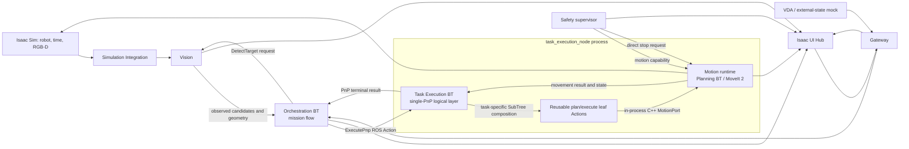

# SF-Twin ARM Cell

[한국어](README.md) | [English](README.en.md)

A simulator-backed ROS 2 workcell for developing and evaluating a Doosan M0609 robot with a Robotiq 2F-85 gripper. The project brings perception, motion planning, task orchestration, software safety supervision, material handoff, and an operator UI together around shared ROS interfaces.

The current official release is v0.3.4. It improves Vision/PICK candidate selection, PLACE recovery, per-run diagnostic records, local D455 assets, and runtime logging. This is an engineering and simulation project, not a validated production or safety-rated robot cell.

## Project Overview

The ARM Cell uses Isaac Sim as its simulated robot and sensor environment and ROS 2 as the integration and runtime layer. MoveIt plans and executes robot motion. Vision reports observed candidates and geometry, Orchestration manages mission flow, Task Execution runs one PnP task, Motion plans and executes individual movements, Safety controls software motion capability, and Gateway owns material-transfer readiness.

The current profile includes a simulated material-delivery path and an Isaac Sim UI Hub for operator observation and requests. External AMR/VDA, PLC, and safety-hardware state are represented by a mock adapter. The project does not implement AMR navigation or safety-rated E-stop/STO hardware.

## Demo Video

[Watch the demo on YouTube](https://youtu.be/6eOcrNFdf2g)

## Key Features

- Shared Doosan M0609 and Robotiq 2F-85 robot description for ROS planning and Isaac Sim construction.
- ROS integration for canonical joint state, simulation time, TF, and RGB-D camera input.
- MoveIt 2 robot planning with explicitly scoped planning-scene profiles.
- A Vision/Task Execution/Motion boundary where Vision reports candidate geometry, Task Execution decides candidate order, and Motion builds request-specific planning occupancy excluding the selected candidate.
- Depth-map-based, Geometry-first Vision for factory RawPart work: the separately implemented `cuboid_top_face` algorithm specializes in cuboid workpieces and uses observed orthogonal L-shaped top edges and profile dimensions to evaluate and reconstruct shape and pose hypotheses from complete or partial observations. It also provides detector profiles and source-frame diagnostics.
- PICK, PLACE, GO_HOME, and recovery motion tasks behind backend-neutral ROS interfaces.
- Reusable Behavior Tree task actions plus PICK candidate ordering and occupancy-exclusion heuristics.
- Software Safety supervision with fail-closed startup, motion capability, and a direct stop path to Motion.
- Acquisition-linked diagnostic snapshots and evidence records, simulated material handoff, and an Isaac Sim UI Hub.

## System Architecture

The runtime keeps perception, mission decisions, robot execution, and motion permission in separate ROS components. Isaac Sim supplies simulated time, robot state, and camera data; the integration layer adapts those inputs to the shared ROS contracts and provides simulator-specific gripper behavior.



Task Execution BT and Motion leaf Actions are the logical execution layers for one PnP task, not separate ROS nodes or processes. The current `task_execution_node` executable composes the PnP Action server and Motion runtime in one process. Orchestration connects to Task Execution through a ROS Action; Task Execution calls Motion through an in-process C++ `MotionPort`.

| Component | Responsibility and interaction |
|---|---|
| **Vision** | Acquires fresh RGB-D observations on `DetectTarget` requests, applies the selected detector profile, and returns a target observation with source-frame diagnostics. It does not grant motion permission. |
| **Orchestration** | Admits and tracks mission work, requests Vision observations, and submits a single PnP task. It owns mission-level retry and authorized recovery coordination. |
| **Task Execution** | Owns one PnP task's candidate order/transitions, PICK/PLACE phases, gripper and holding handling, internal recovery, and PnP result. It is a BT responsibility layer, not a separate process. |
| **Motion** | Searches poses, IK, and paths within the selected candidate and uses MoveIt 2 to plan and execute individual movement requests. It owns per-request planning occupancy, excluding the selected candidate, and movement results; it consumes Safety's motion capability. |
| **Safety** | Evaluates required input freshness and operational conditions, publishes the sole software motion capability, and sends stop requests directly to Motion. It does not replace safety-rated hardware. |
| **Gateway** | Connects operator supply requests to the external-state mock and publishes `MATERIAL_READY` only after the simulated handoff completes. Orchestration admits the mission. |
| **UI Hub** | Runs as an Isaac Sim/Kit extension. It presents camera and component state and sends requests to their owning components; it does not author canonical runtime state. |

### Architecture evolution in v0.3.0

Behavior Tree mission flow and MoveIt planning were already present in v0.2.0. The v0.3.0 change is not the first introduction of BTs; it extracts PnP task execution from Motion and makes the responsibility layers explicit.

- **Mission and task separation:** The new `arm_cell_task_execution` layer owns one PnP task's sequence and internal recovery, while Orchestration retains mission quantity, retry, and higher-level recovery. Orchestration submits the task through a ROS Action; Task Execution and the Motion runtime are composed in one process. This lets mission policy and PICK/PLACE strategy evolve independently.
- **Reusable movement Actions:** PICK/PLACE SubTrees compose common planning/execution leaf Actions, while Motion's internal Planning BT searches poses, IK, and paths and retries within the selected candidate. Task Execution owns ordering and transitions between candidates. This structure supports composing or changing task strategies without changing each leaf operation; it does not claim measured performance gains.
- **Vision and Motion responsibilities:** Vision returns observed geometry and eligible candidates; Task Execution sets candidate order and transitions. Motion evaluates movement feasibility for the candidate it receives and builds request-specific planning occupancy that excludes that selected candidate. A detection result alone does not establish grasp feasibility or grant motion permission.
- **Recovery, results, and Safety ownership:** Orchestration coordinates mission-level retries and Safety-authorized recovery; Task Execution owns candidate transitions, task-internal recovery, and the PnP Action terminal result. Motion owns selected-candidate planning retries plus individual movement execution, cancellation, terminal results, and stop evidence, while Safety independently decides motion permission and direct stop requests.
- **Simulator boundary:** v0.3.0 retains the existing boundary that keeps simulator-specific state and gripper realization behind shared ROS contracts. This supports replaceable implementations as a design direction; the Public implementation remains Isaac Sim focused and does not validate physical-robot adapters or operation.

For the detailed contracts, see [component architecture](docs/design/architecture/components.md), [Task Execution CDS](docs/design/components/task-execution/cds.md), [Motion Execution FDS](docs/design/components/motion/fds-motion-execution.md), the [Orchestration–Task Execution ICD](docs/design/interfaces/icd-orchestration-task-execution.md), and the [Vision/Motion occupancy story](docs/record/engineering-story/vision-to-motion-occupancy-ownership.md).

## Design Records and Sim-to-Real Direction

The [Engineering Stories](docs/record/engineering-story/) and [architecture/algorithm decision records](docs/record/) cover geometry-first Vision, Vision/Motion occupancy ownership, reusable Motion BT actions, Orchestration and Safety recovery, and the Sim-to-Real boundary. These historical records do not replace current contracts or establish physical-robot support or performance superiority.

## Technology Stack

- **ROS 2 Humble** — component communication, shared messages/actions/services, and workspace build.
- **Isaac Sim 5.1** — simulated M0609/2F-85 cell, robot state, simulation time, and RGB-D source.
- **MoveIt 2** — robot kinematics, planning-scene integration, motion planning, and execution.
- **C++ / `rclcpp`** — ROS runtime components, including Vision, Motion, Orchestration, Safety, and Integration.
- **Python** — Isaac Sim scene/runtime entrypoints, validation tooling, and the UI Hub extension.
- **Xacro, TF2, OpenCV, and OMPL** — robot description, transforms, image processing, and planning support.

## Getting Started

Clone the public repository:

```bash
git clone https://github.com/dev-kibeom/sftwin-arm-cell.git
cd sftwin-arm-cell
```

## Run ARM Cell

Both run methods require ROS 2 Humble and Isaac Sim 5.1 on a Linux host. Start the Isaac Sim cell from the repository root; the script builds the scene and starts the Timeline and UI Hub.

```bash
source /opt/ros/humble/setup.bash
./infra/isaac_sim/scripts/isaac_arm_cell.sh
```

Before starting Isaac, the launcher invokes Bringup’s public export CLI to produce runtime JSON. Isaac reads that data without importing Bringup Python code. Restart the launcher after changing material or policy settings to refresh the export. See [configuration export and Script Editor startup](#configuration-export-and-script-editor-startup) for Script Editor and validation exports.

### Configuration export and Script Editor startup

The default launcher exports the selected operational profile to `.run_records/runtime_configuration.json` before starting Isaac. Set `ARM_CELL_PROFILE` to select another input profile, or `ARM_CELL_RUNTIME_CONFIG` to select another output file.

For direct Script Editor startup, first export from a terminal with the built ROS workspace overlay sourced:

```bash
ros2 run arm_cell_bringup export_runtime_configuration \
  --profile ros2_ws/src/bringup/config/operational_profile.yaml \
  --output .run_records/runtime_configuration.json
```

Set `SFTWIN_PROJECT_ROOT` to the absolute repository path in the Isaac process. To read another export, set `ARM_CELL_RUNTIME_CONFIG` to its absolute path. Re-export and reload the Isaac configuration after changing settings. An explicit ROS `profile:=` argument only affects that ROS invocation.

Export the validation PnP profile separately:

```bash
ros2 run arm_cell_bringup export_runtime_configuration \
  --profile ros2_ws/src/bringup/config/pnp_validation_profile.yaml \
  --output .run_records/pnp_runtime_configuration.json
```

Validation entrypoints read this file by default. Set `SFTWIN_PNP_PROFILE` to the absolute path of another exported file to override it. Relative configuration paths resolve against their declaring file; `package://` resolves against the ROS package, and `project://` against the project root.


If Isaac Sim is not installed at `$HOME/isaac_sim`, set its location:

```bash
source /opt/ros/humble/setup.bash
ISAAC_SIM_ROOT=/path/to/isaac_sim ./infra/isaac_sim/scripts/isaac_arm_cell.sh
```

### Method 1: Build and run ROS 2 on the host

For a first run, use Docker Compose below. For local development, install ROS 2 Humble, colcon, and `nlohmann-json3-dev`, and initialize rosdep. Run the following from the repository root in a fresh terminal to build the same TRAC-IK revision as the Dockerfile.

```bash
bash ros2_ws/build-local.bash
source ros2_ws/install/setup.bash
ros2 pkg prefix trac_ik_kinematics_plugin
ros2 launch arm_cell_bringup arm_cell.launch.py
```

Press `Ctrl+C` to stop the ROS bringup.

### Method 2: Run with Docker Compose

Docker Compose v2 is required. No separate host ROS workspace build is needed; run from the repository root:

```bash
export ARM_CELL_UID="$(id -u)" ARM_CELL_GID="$(id -g)"
docker compose up --build
```

Compose writes records with the host Isaac user’s UID/GID (defaults: `1000:1000`).
If earlier runs left records owned by another user, stop Isaac and Compose before
repairing ownership once. This preserves existing records:

Run this from the repository root. For custom paths, set `record_dir` to `root` from `config/run_records.yaml` and `waypoint_dir` to the parent directory of the file configured in Motion’s `config/place_waypoint.yaml`. Relative paths are resolved from the repository root. Ownership changes recursively, so use only directories dedicated to records or waypoint storage.

```bash
record_dir=".run_records"
waypoint_dir=".motion_data"

for dir in "$record_dir" "$waypoint_dir"; do
  if [ -d "$dir" ]; then
    sudo chown -R -- "$(id -u):$(id -g)" "$dir"
  fi
done
```

Compose builds the ROS workspace image and starts `arm_cell_bringup` with the Python 3.10 sidecars. It uses Linux host networking, `ROS_DOMAIN_ID=0`, `RMW_IMPLEMENTATION=rmw_fastrtps_cpp`, and Fast DDS UDPv4 transport by default. Keep the ROS domain and RMW settings consistent between Isaac Sim and the container. Follow logs with `docker compose logs -f arm-cell`; stop with `Ctrl+C` in the Compose terminal or run `docker compose down`.

## Documentation

- [v0.3.4 release notes](docs/releases/v0.3.4.en.md) / [한국어](docs/releases/v0.3.4.ko.md) · [Previous release: v0.3.3](docs/releases/v0.3.3.en.md)

- [ARM Cell demo definition](docs/product/definition.md)
- [Final live acceptance contract](docs/product/acceptance.md)
- [System architecture](docs/design/architecture/) and [ARM Cell component designs](docs/design/components/)
- [ROS and simulator interface contracts](docs/design/interfaces/)
- [Algorithm procedures](docs/design/algorithms/)
- [Architecture Decision Records (ADRs)](docs/record/architecture-decision/)
- [Engineering Stories](docs/record/engineering-story/)
- [Technical records](docs/record/)
- [Acceptance reports](docs/reports/acceptance/)

## Current Status & Limitations

See the [v0.3.4 release notes](docs/releases/v0.3.4.en.md) for changes, upgrade instructions, and verification scope. This release documentation update checks source sanity and documentation links. The full ROS test suite and live Isaac Mission acceptance were not rerun.

## License & Third-Party Attribution

Project-owned code is available under the [MIT License](LICENSE). Robot models and other third-party assets retain their upstream terms. See [Third-Party Notices](THIRD_PARTY_NOTICES.md) and the retained upstream license/provenance files before redistributing those materials.
