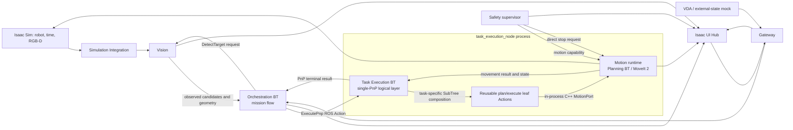

# SF-Twin ARM Cell

[한국어](README.md) | [English](README.en.md)

A simulator-backed ROS 2 workcell for developing and evaluating a Doosan M0609 robot with a Robotiq 2F-85 gripper. The project brings perception, motion planning, task orchestration, software safety supervision, material handoff, and an operator UI together around shared ROS interfaces.

The current official release is v0.3.4. It improves Vision/PICK candidate selection, PLACE recovery, per-run diagnostic records, local D455 assets, and runtime logging. This is an engineering and simulation project, not a validated production or safety-rated robot cell.

## Project Overview

The ARM Cell uses Isaac Sim as its simulated robot and sensor environment and ROS 2 as the integration and runtime layer. MoveIt plans and executes robot motion. Vision reports observed candidates and geometry, Orchestration manages mission flow, Task Execution runs one PnP task, Motion plans and executes individual movements, Safety controls software motion capability, and Gateway owns material-transfer readiness.

The current profile includes a simulated material-delivery path and an Isaac Sim UI Hub for operator observation and requests. External AMR/VDA, PLC, and safety-hardware state are represented by a mock adapter. The project does not implement AMR navigation or safety-rated E-stop/STO hardware.

## Demo Video

[Watch the demo on YouTube](https://youtu.be/6eOcrNFdf2g)

## Key Features

- Shared Doosan M0609 and Robotiq 2F-85 robot description for ROS planning and Isaac Sim construction.
- ROS integration for canonical joint state, simulation time, TF, and RGB-D camera input.
- MoveIt 2 robot planning with explicitly scoped planning-scene profiles.
- A Vision/Task Execution/Motion boundary where Vision reports candidate geometry, Task Execution decides candidate order, and Motion builds request-specific planning occupancy excluding the selected candidate.
- Depth-map-based, Geometry-first Vision for factory TestCube work: the separately implemented `cuboid_top_face` algorithm specializes in cuboid workpieces and uses observed orthogonal L-shaped top edges and profile dimensions to evaluate and reconstruct shape and pose hypotheses from complete or partial observations. It also provides detector profiles and source-frame diagnostics.
- PICK, PLACE, GO_HOME, and recovery motion tasks behind backend-neutral ROS interfaces.
- Reusable Behavior Tree task actions plus PICK candidate ordering and occupancy-exclusion heuristics.
- Software Safety supervision with fail-closed startup, motion capability, and a direct stop path to Motion.
- Acquisition-linked diagnostic snapshots and evidence records, simulated material handoff, and an Isaac Sim UI Hub.

## System Architecture

The runtime keeps perception, mission decisions, robot execution, and motion permission in separate ROS components. Isaac Sim supplies simulated time, robot state, and camera data; the integration layer adapts those inputs to the shared ROS contracts and provides simulator-specific gripper behavior.



Task Execution BT and Motion leaf Actions are the logical execution layers for one PnP task, not separate ROS nodes or processes. The current `task_execution_node` executable composes the PnP Action server and Motion runtime in one process. Orchestration connects to Task Execution through a ROS Action; Task Execution calls Motion through an in-process C++ `MotionPort`.

| Component | Responsibility and interaction |
|---|---|
| **Vision** | Acquires fresh RGB-D observations on `DetectTarget` requests, applies the selected detector profile, and returns a target observation with source-frame diagnostics. It does not grant motion permission. |
| **Orchestration** | Admits and tracks mission work, requests Vision observations, and submits a single PnP task. It owns mission-level retry and authorized recovery coordination. |
| **Task Execution** | Owns one PnP task's candidate order/transitions, PICK/PLACE phases, gripper and holding handling, internal recovery, and PnP result. It is a BT responsibility layer, not a separate process. |
| **Motion** | Searches poses, IK, and paths within the selected candidate and uses MoveIt 2 to plan and execute individual movement requests. It owns per-request planning occupancy, excluding the selected candidate, and movement results; it consumes Safety's motion capability. |
| **Safety** | Evaluates required input freshness and operational conditions, publishes the sole software motion capability, and sends stop requests directly to Motion. It does not replace safety-rated hardware. |
| **Gateway** | Connects operator supply requests to the external-state mock and publishes `MATERIAL_READY` only after the simulated handoff completes. Orchestration admits the mission. |
| **UI Hub** | Runs as an Isaac Sim/Kit extension. It presents camera and component state and sends requests to their owning components; it does not author canonical runtime state. |

### Architecture evolution in v0.3.0

Behavior Tree mission flow and MoveIt planning were already present in v0.2.0. The v0.3.0 change is not the first introduction of BTs; it extracts PnP task execution from Motion and makes the responsibility layers explicit.

- **Mission and task separation:** The new `arm_cell_task_execution` layer owns one PnP task's sequence and internal recovery, while Orchestration retains mission quantity, retry, and higher-level recovery. Orchestration submits the task through a ROS Action; Task Execution and the Motion runtime are composed in one process. This lets mission policy and PICK/PLACE strategy evolve independently.
- **Reusable movement Actions:** PICK/PLACE SubTrees compose common planning/execution leaf Actions, while Motion's internal Planning BT searches poses, IK, and paths and retries within the selected candidate. Task Execution owns ordering and transitions between candidates. This structure supports composing or changing task strategies without changing each leaf operation; it does not claim measured performance gains.
- **Vision and Motion responsibilities:** Vision returns observed geometry and eligible candidates; Task Execution sets candidate order and transitions. Motion evaluates movement feasibility for the candidate it receives and builds request-specific planning occupancy that excludes that selected candidate. A detection result alone does not establish grasp feasibility or grant motion permission.
- **Recovery, results, and Safety ownership:** Orchestration coordinates mission-level retries and Safety-authorized recovery; Task Execution owns candidate transitions, task-internal recovery, and the PnP Action terminal result. Motion owns selected-candidate planning retries plus individual movement execution, cancellation, terminal results, and stop evidence, while Safety independently decides motion permission and direct stop requests.
- **Simulator boundary:** v0.3.0 retains the existing boundary that keeps simulator-specific state and gripper realization behind shared ROS contracts. This supports replaceable implementations as a design direction; the Public implementation remains Isaac Sim focused and does not validate physical-robot adapters or operation.

For the detailed contracts, see [component architecture](docs/design/architecture/components.md), [Task Execution CDS](docs/design/components/task-execution/cds.md), [Motion Execution FDS](docs/design/components/motion/fds-motion-execution.md), the [Orchestration–Task Execution ICD](docs/design/interfaces/icd-orchestration-task-execution.md), and the [Vision/Motion occupancy story](docs/record/engineering-story/vision-to-motion-occupancy-ownership.md).

## Design Records and Sim-to-Real Direction

The [Engineering Stories](docs/record/engineering-story/) and [architecture/algorithm decision records](docs/record/) cover geometry-first Vision, Vision/Motion occupancy ownership, reusable Motion BT actions, Orchestration and Safety recovery, and the Sim-to-Real boundary. These historical records do not replace current contracts or establish physical-robot support or performance superiority.

## Technology Stack

- **ROS 2 Humble** — component communication, shared messages/actions/services, and workspace build.
- **Isaac Sim 5.1** — simulated M0609/2F-85 cell, robot state, simulation time, and RGB-D source.
- **MoveIt 2** — robot kinematics, planning-scene integration, motion planning, and execution.
- **C++ / `rclcpp`** — ROS runtime components, including Vision, Motion, Orchestration, Safety, and Integration.
- **Python** — Isaac Sim scene/runtime entrypoints, validation tooling, and the UI Hub extension.
- **Xacro, TF2, OpenCV, and OMPL** — robot description, transforms, image processing, and planning support.

## Prerequisites

- Linux host; the commands below target Ubuntu 22.04
- ROS 2 Humble, Isaac Sim 5.1, and a GPU/driver suitable for Isaac Sim
- GUI launcher: Python 3.10 or later and an X11 or XWayland display
- Host build: colcon, initialized rosdep, and `nlohmann-json3-dev`
- Docker option: Docker Compose v2

```bash
git clone https://github.com/dev-kibeom/sftwin-arm-cell.git
cd sftwin-arm-cell
```

Run commands from the repository root unless noted otherwise.

## Run ARM Cell

Choose one path. The GUI launcher uses a ROS workspace built on the host.
To run ROS in Docker, use [manual startup](#manual-startup-host-or-docker).
Do not start the same cell through both the GUI and manual commands.

### GUI Launcher

**1. Build the ROS workspace** in a fresh terminal.

```bash
bash ros2_ws/build-local.bash
```

A successful build creates `ros2_ws/install/setup.bash`.

**2. Install launcher dependencies.** Python dependencies are PySide6, PyYAML,
and xacro. Use the same Python environment for installation and startup.

```bash
sudo apt-get install python3-pip libegl1 libxcb-cursor0 xterm
```

A virtual environment is optional; choose its location yourself. If using one,
activate it before installing Python dependencies. For example:

```bash
sudo apt-get install python3-venv
python3 -m venv .venv
source .venv/bin/activate
```

```bash
python3 -m pip install -r infra/launcher/requirements.txt
```

Use the same requirements command when updating an existing installation.

**3. Start the launcher.**

```bash
python3 launcher.py
```

The default Isaac Sim installation is `~/isaac_sim`. Override the location or
ROS domain when starting the GUI if needed:

```bash
ISAAC_SIM_ROOT=/path/to/isaac_sim ROS_DOMAIN_ID=0 python3 launcher.py
```

**4. Start the cell.** Button labels currently appear in Korean.

1. Select Robot, Tool, Cell, and Backend. The supported combination is M0609 +
   Robotiq 2F-85 + the `isaac_m0609` Cell.
2. Click `Isaac 시작` (Start Isaac). Wait for the scene, Timeline, and After Playing initialization.
3. Click `ROS 2 시작` (Start ROS 2). For detailed logs, select `ROS 2 디버그 모드` before starting.
4. Check the camera/Vision views in Isaac Sim's UI Hub and errors in both run terminals.
   The launcher reports process execution; this does not establish system readiness or PnP success.

Isaac and ROS each open an `xterm` window for output and errors. Use `모두 종료`
(Stop all) or close the launcher to stop. `Ctrl+C` or closing either run terminal
also initiates shutdown. Allow shutdown to finish.

### Manual Startup: Host or Docker

**1. Prepare the ROS environment.** For host execution, build first. Docker does
not require a host workspace build.

```bash
bash ros2_ws/build-local.bash
```

**2. Start Isaac Sim in the first terminal.**

```bash
source /opt/ros/humble/setup.bash
./infra/isaac_sim/scripts/isaac_arm_cell.sh
```

For a different installation, prefix the script with `ISAAC_SIM_ROOT=/path/to/isaac_sim`.
Wait for scene, Timeline, and After Playing initialization before continuing.

**3. Start ROS in a second terminal.** Choose one of the following.

Host:

```bash
source /opt/ros/humble/setup.bash
source ros2_ws/install/setup.bash
ros2 launch arm_cell_bringup arm_cell.launch.py log_level:=info
```

Docker:

```bash
export ARM_CELL_UID="$(id -u)" ARM_CELL_GID="$(id -g)"
docker compose up --build
```

Isaac and ROS must use matching `ROS_DOMAIN_ID` and RMW settings. Compose defaults
to `ROS_DOMAIN_ID=0` and `RMW_IMPLEMENTATION=rmw_fastrtps_cpp`.
Use `docker compose logs -f arm-cell` to follow Docker logs.

Stop ROS with `Ctrl+C` in its terminal. For Docker, use `Ctrl+C` in the Compose
terminal or `docker compose down`. Close Isaac after ROS has stopped.

## Basic Use

The **UI Hub** inside Isaac Sim provides camera/Vision views and operator controls.
The separate launcher manages process startup and shutdown.

- In `External Handoff Trigger`, select `Material type` and `Quantity`, then use
  `Random Drop` to publish a supply stimulus. After supply completes, Safety and readiness conditions
  govern task admission. Successful publication does not establish supply or task success.
- Inspect camera images and Vision Snapshots. Use ROS terminal output and diagnostic
  records for system state and task errors. The Hub does not provide an aggregate state dashboard.
- Use the standard Isaac Timeline Pause to pause, and Play to resume the same experiment.
- For a new experiment, the simplest path is Stop all in the launcher, then start again.
  To keep Isaac running, stop ROS → Timeline Stop → `1_before_play.py` → Play →
  `2_after_play.py` → start fresh ROS. Stop resets simulation state; it does not replace
  Safety Reset or a physical emergency stop.

See [UI Hub behavior](docs/design/components/ui-hub/fds.md) and
[simulation sessions](docs/design/components/simulation/fds-sim-session.md) for details.

## Configuration and Logs

- The GUI applies the selected configuration to both Isaac and ROS. Stop and restart after changing configuration files.
- Manual startup examples use the default operational profile. The Isaac startup script
  exports its configuration to `.run_records/runtime_configuration.json` by default.
- Material definitions are in `ros2_ws/src/bringup/config/materials/`. The UI Hub uses the catalog loaded at startup.
- Diagnostic records default to `.run_records/`. Launcher terminal output disappears when the terminal closes.
- For host ROS, use `log_level:=debug` for detailed logs. Default `info` disables optional
  diagnostic collection; `debug` enables all ROS diagnostic collection. Select records with
  `diagnostics:=none`, `all`, or a comma-separated subset of `motion,vision,safety,orchestration`.

For Docker, select logs and diagnostics with environment variables at startup.
Stop the existing run before changing settings:

```bash
ARM_CELL_LOG_LEVEL=debug docker compose up --build
ARM_CELL_LOG_LEVEL=info ARM_CELL_DIAGNOSTICS=vision,motion docker compose up --build
```

See [component architecture](docs/design/architecture/components.md) for configuration
responsibilities and [Observability Records ICD](docs/design/interfaces/icd-observability-records.md)
for record interpretation.

## Troubleshooting

| Symptom | Check |
|---|---|
| Python module missing in launcher | Install requirements with the same Python used to launch. Activate your virtual environment if applicable. |
| Missing `ros2_ws/install/setup.bash` | Complete the host build. The GUI does not use the workspace built inside a Docker image. |
| Isaac executable not found | Set `ISAAC_SIM_ROOT` to the directory containing `isaac-sim.sh`. |
| Run terminal does not open | Check `xterm` installation and an X11/XWayland display. |
| ROS startup blocked or already running | Stop the previous GUI, CLI, or Docker run. Processes from another checkout are not cleaned up automatically. |
| Images or robot state do not update | Check Timeline Play, completed After Playing initialization, and matching ROS domain/RMW settings. |
| Code changes do not take effect | Rebuild and source the overlay on the host; replace Docker with `docker compose up --build`. Reload the Isaac runtime or restart for Isaac Python changes. |
| Docker cannot write records | Stop Isaac and Compose, then check `.run_records/` and `.motion_data/` ownership and `ARM_CELL_UID`/`ARM_CELL_GID`. |

## Documentation

- [v0.3.4 release notes](docs/releases/v0.3.4.en.md) / [한국어](docs/releases/v0.3.4.ko.md): changes, upgrades, and verification scope
- [Project definition](docs/product/definition.md) and [live acceptance contract](docs/product/acceptance.md)
- [System architecture](docs/design/architecture/), [component designs](docs/design/components/), and [interfaces](docs/design/interfaces/)
- [Algorithm designs](docs/design/algorithms/)
- [Design decisions and Engineering Stories](docs/record/)
- [Acceptance reports](docs/reports/acceptance/)

## License and Third-Party Assets

Project-owned code uses the [MIT License](LICENSE). Robot models and third-party
assets retain their upstream terms. Check [Third-Party Notices](THIRD_PARTY_NOTICES.md)
and retained licenses and source information before redistribution.

### RB5-850E Robot selection

The default remains the user-verified M0609 + Robotiq 2F-85 + `isaac_m0609` Cell.
The launcher also registers RB5-850E with the same Tool and Cell, explicitly marked
**live validation pending**. See the [RB5 preparation and user validation guide](infra/isaac_sim/RB5_850.md).
Model/profile, static USD and MoveIt checks do not certify live joint control, HOME,
attachment, PICK/PLACE, PnP or recovery. Those live checks are performed by the user.
