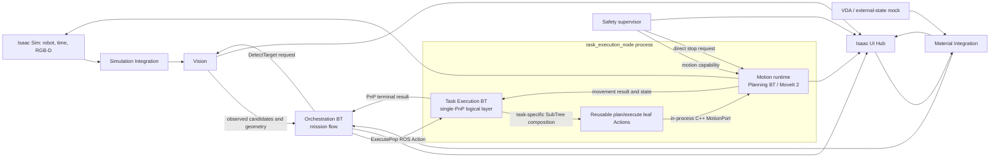

# SF-Twin ARM Cell

[한국어](README.md) | [English](README.en.md)

A simulator-backed ROS 2 workcell for developing and evaluating a Doosan M0609 robot with a Robotiq 2F-85 gripper. The project brings perception, motion planning, task orchestration, software safety supervision, material handoff, and an operator UI together around shared ROS interfaces.

The current official release is v0.3.0. It makes the boundaries between mission flow, one pick-and-place task, and individual robot movements more explicit. It is an engineering and simulation project; it is not a validated production or safety-rated robot cell.

## Project Overview

The ARM Cell uses Isaac Sim as its simulated robot and sensor environment and ROS 2 as the integration and runtime layer. MoveIt plans and executes robot motion. Vision reports observed candidates and geometry, Orchestration manages mission flow, Task Execution runs one PnP task, Motion plans and executes individual movements, Safety controls software motion capability, and Integration owns material-transfer readiness.

The current profile includes a simulated material-delivery path and an Isaac Sim UI Hub for operator observation and requests. External AMR/VDA, PLC, and safety-hardware state are represented by a mock adapter. The project does not implement AMR navigation or safety-rated E-stop/STO hardware.

## Demo Video

[Watch the demo on YouTube](https://youtu.be/6eOcrNFdf2g)

## Key Features

- Shared Doosan M0609 and Robotiq 2F-85 robot description for ROS planning and Isaac Sim construction.
- ROS integration for canonical joint state, simulation time, TF, and RGB-D camera input.
- MoveIt 2 robot planning with explicitly scoped planning-scene profiles.
- A Vision/Task Execution/Motion boundary where Vision reports candidate geometry, Task Execution decides candidate order, and Motion builds request-specific planning occupancy excluding the selected candidate.
- Depth-map-based, Geometry-first Vision for factory RawPart work: the separately implemented `cuboid_top_face` algorithm specializes in cuboid workpieces and uses observed orthogonal L-shaped top edges and profile dimensions to evaluate and reconstruct shape and pose hypotheses from complete or partial observations. It also provides detector profiles and source-frame diagnostics.
- PICK, PLACE, GO_HOME, and recovery motion tasks behind backend-neutral ROS interfaces.
- Reusable Behavior Tree task actions plus PICK candidate ordering and occupancy-exclusion heuristics.
- Software Safety supervision with fail-closed startup, motion capability, and a direct stop path to Motion.
- Acquisition-linked diagnostic snapshots and evidence records, simulated material handoff, and an Isaac Sim UI Hub.

## System Architecture

The runtime keeps perception, mission decisions, robot execution, and motion permission in separate ROS components. Isaac Sim supplies simulated time, robot state, and camera data; the integration layer adapts those inputs to the shared ROS contracts and provides simulator-specific gripper behavior.



Task Execution BT and Motion leaf Actions are the logical execution layers for one PnP task, not separate ROS nodes or processes. The current `task_execution_node` executable composes the PnP Action server and Motion runtime in one process. Orchestration connects to Task Execution through a ROS Action; Task Execution calls Motion through an in-process C++ `MotionPort`.

| Component | Responsibility and interaction |
|---|---|
| **Vision** | Acquires fresh RGB-D observations on `DetectTarget` requests, applies the selected detector profile, and returns a target observation with source-frame diagnostics. It does not grant motion permission. |
| **Orchestration** | Admits and tracks mission work, requests Vision observations, and submits a single PnP task. It owns mission-level retry and authorized recovery coordination. |
| **Task Execution** | Owns one PnP task's candidate order/transitions, PICK/PLACE phases, gripper and holding handling, internal recovery, and PnP result. It is a BT responsibility layer, not a separate process. |
| **Motion** | Searches poses, IK, and paths within the selected candidate and uses MoveIt 2 to plan and execute individual movement requests. It owns per-request planning occupancy, excluding the selected candidate, and movement results; it consumes Safety's motion capability. |
| **Safety** | Evaluates required input freshness and operational conditions, publishes the sole software motion capability, and sends stop requests directly to Motion. It does not replace safety-rated hardware. |
| **Material Integration** | Connects operator supply requests to the external-state mock and publishes `MATERIAL_READY` only after the simulated handoff completes. Orchestration, not Integration, admits the mission. |
| **UI Hub** | Runs as an Isaac Sim/Kit extension. It presents camera and component state and sends requests to their owning components; it does not author canonical runtime state. |

### Architecture evolution in v0.3.0

Behavior Tree mission flow and MoveIt planning were already present in v0.2.0. The v0.3.0 change is not the first introduction of BTs; it extracts PnP task execution from Motion and makes the responsibility layers explicit.

- **Mission and task separation:** The new `arm_cell_task_execution` layer owns one PnP task's sequence and internal recovery, while Orchestration retains mission quantity, retry, and higher-level recovery. Orchestration submits the task through a ROS Action; Task Execution and the Motion runtime are composed in one process. This lets mission policy and PICK/PLACE strategy evolve independently.
- **Reusable movement Actions:** PICK/PLACE SubTrees compose common planning/execution leaf Actions, while Motion's internal Planning BT searches poses, IK, and paths and retries within the selected candidate. Task Execution owns ordering and transitions between candidates. This structure supports composing or changing task strategies without changing each leaf operation; it does not claim measured performance gains.
- **Vision and Motion responsibilities:** Vision returns observed geometry and eligible candidates; Task Execution sets candidate order and transitions. Motion evaluates movement feasibility for the candidate it receives and builds request-specific planning occupancy that excludes that selected candidate. A detection result alone does not establish grasp feasibility or grant motion permission.
- **Recovery, results, and Safety ownership:** Orchestration coordinates mission-level retries and Safety-authorized recovery; Task Execution owns candidate transitions, task-internal recovery, and the PnP Action terminal result. Motion owns selected-candidate planning retries plus individual movement execution, cancellation, terminal results, and stop evidence, while Safety independently decides motion permission and direct stop requests.
- **Simulator boundary:** v0.3.0 retains the existing boundary that keeps simulator-specific state and gripper realization behind shared ROS contracts. This supports replaceable implementations as a design direction; the Public implementation remains Isaac Sim focused and does not validate physical-robot adapters or operation.

For the detailed contracts, see [component architecture](docs/design/arm-cell/architecture/components.md), [Task Execution CDS](docs/design/arm-cell/components/task-execution/cds.md), [Motion Execution FDS](docs/design/arm-cell/components/motion/fds-motion-execution.md), the [Orchestration–Task Execution ICD](docs/design/arm-cell/interfaces/icd-orchestration-task-execution.md), and the [Vision/Motion occupancy story](docs/record/arm-cell/engineering-story/vision-to-motion-occupancy-ownership.md).

## Design Records and Sim-to-Real Direction

The [Engineering Stories](docs/record/arm-cell/engineering-story/) and [architecture/algorithm decision records](docs/record/arm-cell/) cover geometry-first Vision, Vision/Motion occupancy ownership, reusable Motion BT actions, Orchestration and Safety recovery, and the Sim-to-Real boundary. These historical records do not replace current contracts or establish physical-robot support or performance superiority.

## Technology Stack

- **ROS 2 Humble** — component communication, shared messages/actions/services, and workspace build.
- **Isaac Sim 5.1** — simulated M0609/2F-85 cell, robot state, simulation time, and RGB-D source.
- **MoveIt 2** — robot kinematics, planning-scene integration, motion planning, and execution.
- **C++ / `rclcpp`** — ROS runtime components, including Vision, Motion, Orchestration, Safety, and Integration.
- **Python** — Isaac Sim scene/runtime entrypoints, validation tooling, and the UI Hub extension.
- **Xacro, TF2, OpenCV, and OMPL** — robot description, transforms, image processing, and planning support.

## Getting Started

Clone the public repository:

```bash
git clone https://github.com/dev-kibeom/sftwin-arm-cell.git
cd sftwin-arm-cell
```

### Build the ROS workspace on a Humble host

With ROS 2 Humble and the package dependencies installed, build the supported workspace subset:

```bash
source /opt/ros/humble/setup.bash
cd ros2_ws
colcon build --packages-up-to arm_cell_bringup --cmake-args -DBUILD_TESTING=ON
source install/setup.bash
```

### Build with Docker

The root Dockerfile builds the same ROS subset in a Humble container. It verifies image construction and compilation; it does not provide Isaac Sim or run ROS nodes.

Run the following from the repository root:

```bash
docker build --progress=plain -t sftwin-arm-cell:humble .
```

See the [Docker build guide](docs/guides/docker-humble-build.md) for prerequisites and build output details.

### Run with Isaac Sim

Live operation requires ROS 2 Humble and Isaac Sim 5.1 on the host. The ROS build alone does not start the simulator or establish a live runtime. Follow the [ARM Cell Isaac Sim guide](docs/guides/arm-cell-isaac-sim.md) for prerequisites, the supported launch profiles, and the Isaac Script Editor entrypoints (`1_before_play.py` → Play → `2_after_play.py`).

## Documentation

- [v0.3.0 release notes](docs/releases/v0.3.0.en.md) / [한국어](docs/releases/v0.3.0.ko.md)

- [ARM Cell demo definition](docs/product/arm-cell/definition.md)
- [Final live acceptance contract](docs/product/arm-cell/acceptance.md)
- [System architecture](docs/design/arm-cell/architecture/) and [ARM Cell component designs](docs/design/arm-cell/components/)
- [ROS and simulator interface contracts](docs/design/arm-cell/interfaces/)
- [Algorithm procedures](docs/design/arm-cell/algorithms/)
- [Architecture Decision Records (ADRs)](docs/record/arm-cell/architecture-decision/)
- [Engineering Stories](docs/record/arm-cell/engineering-story/)
- [Technical records](docs/record/arm-cell/)
- [Acceptance reports](docs/reports/acceptance/)
- [Operator guides](docs/guides/)

## Current Status & Limitations

The public source contains the Vision, Motion, Orchestration, Safety, Material Integration, VDA mock, and UI Hub implementations described above. Their presence in source does not mean the complete final demonstration has passed live acceptance.

- **Build and Docker runtime plugin:** The v0.3.0 Docker image build succeeded and compiled the 12-package `arm_cell_bringup` build closure. PR #12 installed TRAC-IK 2.0.1 in `/opt/trac_ik` and verified MoveIt pluginlib loading, ARM Cell IK plugin initialization, and `solve_type=Distance`. The probe does not calculate an IK solution for a target pose, and it does not validate the full Motion Launch or Isaac Sim PnP. Earlier Public PR #2 and v0.2.0 export build results are separate historical baselines. The full-checkout ROS test failures remain as recorded in the release notes; successful compilation and plugin initialization do not resolve them.
- **Planning evidence:** Historical Milestone 1A robot-only planning and Milestone 1B bounded static-scene acceptance are documented in the [acceptance reports](docs/reports/acceptance/). The reports preserve their evidence limits: exact historical commit/tag identifiers are unavailable, and Milestone 1B does not establish general reachability or full-cell collision coverage.
- **Live runtime:** The v0.3.0 Docker verification did not include the full Motion Launch, target-pose IK solution, Isaac Sim connection or live run, or PnP. Separate historical Private live reports record robot-only planning and a limited static-scene check, but they do not establish full mission acceptance and have limited baseline-revision traceability. Use the Isaac guide for the supported profile in a configured environment.
- **RGB-D known issue:** Vision can intermittently fail to acquire a usable RGB-D pair before detector processing starts. Distinct depth-reception gaps and missing synchronization callbacks are recorded; a common cause and resolution remain unconfirmed. See the [open acquisition issue record](docs/record/arm-cell/engineering-story/vision-rgbd-intermittent-acquisition-failure.md).
- **E-Stop recovery evidence:** A separate Private-environment clean live record from 2026-10-30 shows reset, SafetyRecovery, and GO_HOME succeeding, after which the Mission resumed PnP. A later approach ended with `BACKEND_UNAVAILABLE`, so the complete Mission did not succeed. This is separate from the Public Docker verification, supports only that execution condition, and does not establish a general success rate.
- **Simulation and safety boundary:** The VDA/external-state adapter is a mock subset; it is not full VDA 5050 or AMR navigation. Software Safety is not safety-rated E-stop/STO hardware and is not a substitute for it. Isaac Sim is the supported development environment; physical robot operation is not validated here.

## License & Third-Party Attribution

Project-owned code is available under the [MIT License](LICENSE). Robot models and other third-party assets retain their upstream terms. See [Third-Party Notices](THIRD_PARTY_NOTICES.md) and the retained upstream license/provenance files before redistributing those materials.
