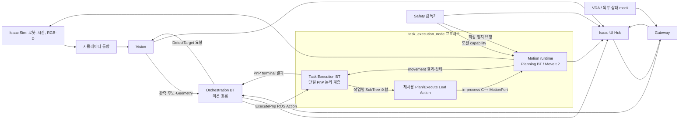

# SF-Twin ARM Cell

[한국어](README.md) | [English](README.en.md)

Doosan M0609 로봇과 Robotiq 2F-85 그리퍼를 대상으로 하는 시뮬레이터 기반 ROS 2 로봇 셀 프로젝트입니다. 비전, 모션 계획, 작업 오케스트레이션, 소프트웨어 안전 감독, 자재 인계, 운영자 UI를 공통 ROS 인터페이스로 연결합니다.

현재 공식 배포 버전은 v1.0.0입니다. Robot·Tool·Cell 구성, GUI 런처, RB5-850E와 Vision/PnP 개선을 포함하는 엔지니어링·시뮬레이션 릴리즈입니다. 생산용 셀이나 안전 등급을 인증받은 시스템은 아닙니다.

## 프로젝트 개요

Isaac Sim은 로봇과 센서가 동작하는 시뮬레이션 환경을 제공하고 ROS 2는 컴포넌트 통신과 런타임 통합을 담당합니다. MoveIt 2가 로봇 모션을 계획하고 실행합니다. Vision은 관측 후보와 Geometry를 제공하고, Orchestration은 미션 흐름을 관리하며, Task Execution은 단일 PnP 작업을 수행합니다. Motion은 개별 움직임을 계획·실행하고, Safety는 소프트웨어 모션 권한을 판단하며, Gateway는 자재 인계 완료와 준비 상태를 관리합니다.

현재 프로파일에는 시뮬레이션 자재 공급 경로와 Isaac Sim UI Hub가 포함되어 있습니다. 외부 AMR/VDA, PLC, 안전 하드웨어 상태는 mock 어댑터로 표현합니다. AMR 내비게이션과 안전 등급 E-stop/STO 하드웨어는 구현하지 않습니다.

## 시연 영상

[YouTube에서 시연 영상 보기](https://youtu.be/6eOcrNFdf2g)

## 주요 기능

- ROS 계획 및 Isaac Sim 셀 구성에 함께 사용하는 Doosan M0609·Robotiq 2F-85 로봇 설명 모델
- canonical joint state, 시뮬레이션 시간, TF, RGB-D 카메라 입력을 연결하는 ROS 통합
- MoveIt 2 기반 로봇 계획과 제한 범위를 명시한 planning scene 프로파일
- Vision은 관측 Geometry와 후보를 제공하고 Task Execution은 후보 순서를 정하며 Motion은 선택 후보를 제외한 요청별 planning occupancy를 구성하는 책임 분리
- 깊이맵 기반 Geometry-first Vision: 공장 TestCube 작업의 직육면체 형상에 특화해 별도 구현한 `cuboid_top_face` 알고리즘으로, 관측된 직교 L자 상판 윤곽과 프로파일 치수를 사용해 완전·부분 관측의 형상·자세 가설을 평가·복원합니다. Detector profile과 source-frame 진단 정보도 제공합니다.
- backend-neutral ROS 인터페이스를 통한 PICK, PLACE, GO_HOME 및 복구 모션 작업
- 재사용 가능한 Behavior Tree Action 기반 작업 실행, PICK 후보 순서 및 Occupancy 제외 휴리스틱
- fail-closed 시작, 모션 capability, Motion에 직접 전달하는 정지 요청을 지원하는 소프트웨어 Safety 감독
- Acquisition Snapshot과 컴포넌트별 진단 기록을 연결하는 관측·증거 흐름 및 Isaac Sim UI Hub

## 시스템 아키텍처

런타임은 인지, 미션 의사결정, 단일 작업 실행, 개별 움직임, 모션 허가를 분리합니다. Isaac Sim은 시뮬레이션 시간, 로봇 상태, 카메라 데이터를 제공합니다. Integration 계층은 이를 공통 ROS 계약에 맞게 연결하고 simulator 전용 그리퍼 동작을 처리합니다.



다이어그램의 Task Execution BT와 Motion Leaf Action은 단일 PnP의 논리적 실행 계층이며 별도 ROS 노드나 프로세스가 아닙니다. 현재 `task_execution_node` 실행 파일이 PnP Action server와 Motion runtime을 한 프로세스에 조립합니다. Orchestration과의 경계는 ROS Action이고, Task Execution에서 Motion으로 가는 움직임 요청은 in-process C++ `MotionPort`를 사용합니다.

| 컴포넌트 | 책임과 상호작용 |
|---|---|
| **Vision** | `DetectTarget` 요청이 오면 최신 RGB-D 관측을 획득하고, 선택한 detector profile로 타깃을 찾아 source-frame 진단 정보와 함께 반환합니다. 모션 허가를 내리지는 않습니다. |
| **Orchestration** | 자재 준비와 Safety 조건을 확인해 미션을 시작하고, Vision 관측과 단일 PnP 요청을 조정합니다. 미션 진행·상위 재시도 및 허가된 복구를 소유합니다. |
| **Task Execution** | 단일 PnP의 후보 순서·전환, PICK/PLACE 단계, 그리퍼·Holding 처리, 작업 내부 복구와 PnP 결과를 소유합니다. BT 논리 계층이며 별도 프로세스가 아닙니다. |
| **Motion** | 선택된 후보 안에서 Pose/IK/경로 탐색과 movement 실행 가능성을 평가하고 MoveIt 2로 계획·실행합니다. 선택 후보를 제외한 요청별 Planning Occupancy와 개별 movement 결과를 소유하며 Safety capability를 준수합니다. |
| **Safety** | 필수 입력의 최신성과 운영 조건을 평가해 소프트웨어 모션 capability를 단독으로 발행하고 Motion에 직접 정지 요청을 보냅니다. 안전 등급 하드웨어를 대체하지 않습니다. |
| **Gateway** | 운영자 자재 공급 요청을 외부 상태 mock에 전달하고 시뮬레이션 인계가 완료된 뒤에만 `MATERIAL_READY`를 발행합니다. 미션 시작 여부는 Orchestration이 결정합니다. |
| **UI Hub** | Isaac Sim/Kit 확장으로 동작합니다. 카메라와 컴포넌트 상태를 보여 주고 소유 컴포넌트에 요청을 보냅니다. canonical 런타임 상태를 직접 변경하지 않습니다. |

### v0.3.0 아키텍처 발전

v0.2.0에도 Behavior Tree 기반 미션 흐름과 MoveIt 계획은 있었습니다. v0.3.0의 변화는 BT를 처음 도입한 것이 아니라 PnP 작업 실행 책임을 Motion에서 분리해 계층 경계를 명확히 한 것입니다.

- **미션과 단일 작업의 분리:** 새 `arm_cell_task_execution` 실행 계층이 단일 PnP의 순서와 내부 복구를 소유하고, Orchestration은 미션 수량·재시도·상위 복구를 유지합니다. 구현상 Orchestration은 ROS Action으로 작업을 제출하고, Task Execution과 Motion runtime은 한 프로세스에서 조립됩니다. 미션 정책과 PICK/PLACE 전략을 서로 독립적으로 바꿀 수 있는 구조입니다.
- **재사용 가능한 움직임 Action:** PICK·PLACE SubTree는 공통 계획·실행 Leaf Action을 조합하고, Motion 내부 Planning BT는 선택된 후보 안에서 Pose/IK/경로 탐색과 해당 탐색 범위의 재시도를 수행합니다. Task Execution은 후보 간 순서와 전환을 소유합니다. 작업 순서를 바꾸거나 실행 전략을 조합하기 쉬워지지만, 정량적인 성능 향상을 의미하지는 않습니다.
- **Vision과 Motion의 책임 정리:** Vision은 관측 Geometry와 적격 후보를 반환하고, Task Execution은 후보 순서와 전환을 결정합니다. Motion은 전달된 후보의 움직임 실행 가능성을 평가하고 요청별 Planning Occupancy를 구성해 선택 후보를 제외합니다. 검출 결과가 곧 파지 가능성이나 이동 허가를 뜻하지 않습니다.
- **복구·결과·Safety 소유권:** Orchestration은 미션 수준 재시도와 Safety 승인 복구를 조정하고, Task Execution은 작업 내부 복구·후보 전환·PnP Action terminal 결과를 소유합니다. Motion은 선택 후보의 계획 탐색 재시도와 개별 movement 실행·취소·terminal 및 정지 근거를 소유하고, Safety는 독립적으로 모션 권한과 직접 정지를 결정합니다.
- **시뮬레이터 경계:** v0.3.0은 공통 ROS 계약 뒤에 simulator별 상태·그리퍼 realization을 두는 기존 경계를 유지합니다. 이는 구현 교체를 고려한 설계 방향이며, Public 구현은 Isaac Sim 중심이고 실물 로봇 어댑터나 운전을 검증하지 않았습니다.

세부 계약은 [구성요소 아키텍처](docs/design/architecture/components.md), [Task Execution CDS](docs/design/components/task-execution/cds.md), [Motion Execution FDS](docs/design/components/motion/fds-motion-execution.md), [Orchestration–Task Execution ICD](docs/design/interfaces/icd-orchestration-task-execution.md)와 [Vision–Motion Occupancy 기록](docs/record/engineering-story/vision-to-motion-occupancy-ownership.md)을 참고하세요.

### 설계 의도

- **상태 소유권:** 각 컴포넌트는 자기 도메인의 상태와 결정을 소유합니다. 예를 들어 Gateway는 인계 완료와 `MATERIAL_READY`를 발행하고, Orchestration은 이를 받아 미션 시작을 판단합니다. Safety는 모션 capability와 정지 판단을 소유하며, UI Hub는 이를 표시하고 요청만 전달합니다.
- **인터페이스 분리:** 컴포넌트 간 데이터와 동작은 공통 ROS 메시지·서비스·액션 계약으로 교환합니다. Motion은 backend-neutral 그리퍼 경계를 사용하고, simulator 세부사항이 미션 의미를 정의하지 않도록 합니다. 계약 문서는 인터페이스 문서에서 확인할 수 있습니다.
- **시뮬레이터 의존성 격리:** Isaac에서 얻은 상태와 그리퍼 동작은 Integration/backend 경계에서 ROS 계약으로 변환합니다. 이를 통해 상위 컴포넌트의 역할을 시뮬레이터 내부 표현과 구분합니다. 이 구조는 하드웨어 어댑터가 이미 제공되거나 실물 운전이 검증됐다는 뜻은 아닙니다.

### 대표 시나리오

운영자가 UI Hub에서 자재 공급을 요청하면 외부 상태 mock이 도착·도킹·하역을 시각화합니다. 하역과 인계가 완료된 뒤 Gateway가 `MATERIAL_READY`를 발행하고, Orchestration은 Safety 허가와 현재 준비 상태를 확인해 미션을 시작합니다. Orchestration은 Vision 관측과 Recipe를 바탕으로 단일 PnP Action을 제출합니다. Task Execution은 PICK·Holding 확인·PLACE·release 확인을 진행하고, 각 움직임은 Motion에 위임합니다. Motion은 결과와 상태를 Task Execution에 돌려주며 Task Execution은 PnP 결과를 Orchestration에 반환합니다. Safety는 전체 과정에서 독립적으로 모션 capability와 정지 경로를 유지합니다.

이 흐름은 현재 공개 구현의 역할과 연결을 요약합니다. 전체 시나리오가 실시간 Isaac Sim 환경에서 최종 acceptance를 통과했다는 의미는 아닙니다.

## 설계 기록과 Sim-to-Real 방향

Geometry-first Vision, Vision/Motion Occupancy 소유권, 재사용 Motion BT, Orchestration·Safety Recovery 및 Sim-to-Real 경계를 다룬 [Engineering Story](docs/record/engineering-story/)와 [아키텍처·알고리즘 결정 기록](docs/record/)을 제공합니다. 이 기록은 현재 계약을 대체하지 않으며 실물 로봇 지원이나 성능 우위를 입증하지 않습니다.

## 기술 스택

- **ROS 2 Humble** — 컴포넌트 통신, 공통 메시지·액션·서비스, workspace 빌드
- **Isaac Sim 5.1** — M0609/2F-85 시뮬레이션 셀, 로봇 상태, 시뮬레이션 시간, RGB-D 입력
- **MoveIt 2** — 로봇 기구학, planning scene 연동, 모션 계획과 실행
- **C++ / `rclcpp`** — Vision, Motion, Orchestration, Safety, Gateway 등 ROS 런타임 컴포넌트
- **Python** — Isaac Sim 장면·런타임 entrypoint, 검증 도구, UI Hub 확장
- **Xacro, TF2, OpenCV, OMPL** — 로봇 설명, 좌표 변환, 영상 처리, 모션 계획 지원

## 준비 사항

- Linux 호스트: 아래 명령은 Ubuntu 22.04 기준입니다.
- ROS 2 Humble과 Isaac Sim 5.1 및 Isaac Sim을 실행할 수 있는 GPU·드라이버
- GUI 런처: Python 3.10 이상, X11 또는 XWayland 디스플레이
- 호스트 빌드: colcon, 초기화된 rosdep, `nlohmann-json3-dev`
- Docker 실행을 선택하는 경우: Docker Compose v2

```bash
git clone https://github.com/dev-kibeom/sftwin-arm-cell.git
cd sftwin-arm-cell
```

아래 명령은 별도 안내가 없으면 저장소 루트에서 실행합니다.

## ARM Cell 실행 방법

다음 중 한 경로를 선택합니다. GUI 런처는 호스트에 빌드한 ROS workspace를 사용합니다.
Docker로 ROS를 실행하려면 [수동 실행](#수동-실행-호스트-또는-docker)을 사용합니다.
GUI와 수동 실행으로 같은 셀을 동시에 시작하지 마세요.

### GUI 런처로 실행

**1. ROS workspace를 빌드합니다.** 새 터미널에서 실행합니다.

```bash
bash ros2_ws/build-local.bash
```

빌드가 완료되면 `ros2_ws/install/setup.bash`가 생성됩니다.

**2. 런처 의존성을 설치합니다.** Python 의존성은 PySide6, PyYAML, xacro입니다.
설치와 실행에는 같은 Python 환경을 사용합니다.

```bash
sudo apt-get install python3-pip libegl1 libxcb-cursor0 xterm
```

가상환경 사용 여부와 위치는 사용자가 선택합니다. 사용할 경우 Python 의존성을
설치하기 전에 활성화합니다. 다음은 저장소 안의 `.venv`를 사용하는 예시입니다.

```bash
sudo apt-get install python3-venv
python3 -m venv .venv
source .venv/bin/activate
```

```bash
python3 -m pip install -r infra/launcher/requirements.txt
```

기존 설치를 갱신할 때도 같은 requirements 명령을 사용합니다.

**3. 런처를 실행합니다.**

```bash
python3 launcher.py
```

Isaac Sim 설치 위치는 기본 `~/isaac_sim`입니다. 다른 위치나 ROS domain을 사용한다면
실행 시 지정합니다.

```bash
ISAAC_SIM_ROOT=/path/to/isaac_sim ROS_DOMAIN_ID=0 python3 launcher.py
```

**4. 셀을 시작합니다.**

1. Robot·Tool·Cell·Backend를 선택합니다. 기본 조합은 기존 M0609 + Robotiq 2F-85 +
   `isaac_pnp_cnc` Cell입니다. RB5-850E + 동일 Tool/Cell도 선택할 수 있으며 **라이브 검증 전**으로
   표시됩니다. [RB5 준비·자동 검사·사용자 라이브 절차](infra/isaac_sim/RB5_850.md)를 먼저 확인하세요.
2. `Isaac 시작`을 누릅니다. 씬이 로드되고 Timeline과 After Playing 초기화가 끝날 때까지 기다립니다.
3. `ROS 2 시작`을 누릅니다. 상세 로그가 필요하면 시작 전에 `ROS 2 디버그 모드`를 선택합니다.
4. Isaac Sim UI Hub의 카메라·Vision 화면과 두 실행 터미널의 오류를 확인합니다.
   런처의 실행 표시는 프로세스가 실행 중이라는 뜻입니다. 시스템 준비나 PnP 성공을 보장하지 않습니다.

Isaac과 ROS마다 별도 `xterm` 창이 열립니다. 출력과 오류는 해당 터미널에서 확인합니다.
종료는 런처의 `모두 종료` 또는 창 닫기를 사용합니다. 실행 터미널의 `Ctrl+C`나 창 닫기도
종료로 처리됩니다. 종료 처리가 끝날 때까지 기다려 주세요.

### 수동 실행: 호스트 또는 Docker

**1. ROS 실행 환경을 준비합니다.** 호스트를 사용한다면 먼저 빌드합니다.
Docker를 사용한다면 호스트 workspace 빌드는 필요하지 않습니다.

```bash
bash ros2_ws/build-local.bash
```

**2. 첫 번째 터미널에서 Isaac Sim을 시작합니다.**

```bash
source /opt/ros/humble/setup.bash
./infra/isaac_sim/scripts/isaac_arm_cell.sh
```

설치 경로가 다르면 스크립트 앞에 `ISAAC_SIM_ROOT=/path/to/isaac_sim`을 지정합니다.
씬·Timeline·After Playing 초기화가 완료된 뒤 다음 단계로 진행합니다.

**3. 두 번째 터미널에서 ROS를 시작합니다.** 아래 둘 중 하나를 선택합니다.

호스트 실행:

```bash
source /opt/ros/humble/setup.bash
source ros2_ws/install/setup.bash
ros2 launch arm_cell_bringup arm_cell.launch.py log_level:=info
```

Docker 실행:

```bash
export ARM_CELL_UID="$(id -u)" ARM_CELL_GID="$(id -g)"
docker compose up --build
```

Isaac과 ROS는 같은 `ROS_DOMAIN_ID`와 RMW 설정을 사용해야 합니다. Compose 기본값은
`ROS_DOMAIN_ID=0`, `RMW_IMPLEMENTATION=rmw_fastrtps_cpp`입니다.
Docker 로그는 `docker compose logs -f arm-cell`로 확인합니다.

종료할 때는 ROS 터미널에서 `Ctrl+C`를 누릅니다. Docker는 Compose 터미널의 `Ctrl+C`
또는 `docker compose down`으로 종료합니다. ROS 종료 후 Isaac을 닫습니다.

## 기본 사용

Isaac Sim의 **UI Hub**는 카메라·Vision 결과와 운영자 조작을 제공합니다.
런처는 프로세스 시작·종료용이며, UI Hub는 시뮬레이터 안에서 사용합니다.

- `External Handoff Trigger`에서 `Material type`과 `Quantity`를 선택하고
  `Random Drop`으로 공급 자극을 발행합니다.
  공급 완료 후 Safety·준비 조건에 따라 작업이 시작됩니다. 버튼의 발행 성공은 공급이나 작업 성공을 뜻하지 않습니다.
- 카메라 영상과 Vision Snapshot에서 관측 결과를 확인합니다. 전체 시스템 상태와 작업 오류는
  ROS 터미널 및 진단 기록에서 확인합니다. UI Hub는 종합 상태 대시보드를 제공하지 않습니다.
- 잠시 멈출 때는 Isaac 표준 Timeline의 Pause를 사용합니다. Play로 같은 실험을 재개합니다.
- 새 실험은 가장 간단하게 런처의 `모두 종료` 후 다시 시작합니다. 같은 Isaac 프로세스를 유지하려면
  ROS 종료 → Timeline Stop → `1_before_play.py` → Play → `2_after_play.py` → 새 ROS 시작 순서를 따릅니다.
  Stop은 시뮬레이션 상태 초기화이며 Safety Reset이나 실장비 비상정지를 대신하지 않습니다.

자세한 조작과 세션 동작은 [UI Hub 안내](docs/design/components/ui-hub/fds.md)와
[시뮬레이션 세션](docs/design/components/simulation/fds-sim-session.md)을 참고하세요.

## 설정과 로그

- GUI는 선택한 설정을 Isaac과 ROS에 함께 적용합니다. 설정 파일을 수정했다면 실행을 종료하고 다시 시작합니다.
- 수동 실행 예시는 기본 운영 프로파일을 사용합니다. Isaac 시작 스크립트가 생성하는
  설정 파일의 기본 경로는 `.run_records/runtime_configuration.json`입니다.
- 자재 정의는 `ros2_ws/src/bringup/config/materials/`에 있습니다. UI Hub 목록은 실행 시 읽은 설정을 사용합니다.
- 진단 기록은 기본 `.run_records/` 아래에 저장됩니다. 런처 터미널 출력은 창이 닫히면 사라집니다.
- 호스트 ROS 상세 로그는 `log_level:=debug`로 켭니다. 기본 `info`는 선택적 진단 수집을 끄고,
  `debug`는 모든 ROS 진단 수집을 켭니다. `diagnostics:=none`, `all`, 또는
  `motion,vision,safety,orchestration` 중 쉼표 구분 목록으로 수집 범위를 선택합니다.

Docker에서는 시작할 때 환경변수로 로그와 진단을 선택합니다. 변경하려면 기존 실행을 종료하고 다시 시작합니다.

```bash
ARM_CELL_LOG_LEVEL=debug docker compose up --build
ARM_CELL_LOG_LEVEL=info ARM_CELL_DIAGNOSTICS=vision,motion docker compose up --build
```

설정 구조·컴포넌트 책임은 [구성요소 아키텍처](docs/design/architecture/components.md),
기록 해석은 [Observability Records ICD](docs/design/interfaces/icd-observability-records.md)를 참고하세요.

## 문제 해결

| 증상 | 확인할 사항 |
|---|---|
| 런처에서 Python 모듈을 찾지 못함 | 런처 실행에 쓰는 Python으로 requirements를 설치했는지 확인합니다. 가상환경을 사용한다면 활성화합니다. |
| `ros2_ws/install/setup.bash`가 없음 | 호스트 빌드를 완료합니다. GUI 런처는 Docker 이미지의 빌드 결과를 사용하지 않습니다. |
| Isaac 실행 파일을 찾지 못함 | `ISAAC_SIM_ROOT`가 `isaac-sim.sh`를 포함한 디렉터리인지 확인합니다. |
| 실행 터미널이 열리지 않음 | `xterm` 설치와 X11/XWayland 디스플레이를 확인합니다. |
| ROS 시작이 차단되거나 이미 실행 중이라고 표시됨 | 기존 런처·CLI·Docker 실행을 먼저 종료합니다. 다른 checkout의 프로세스는 자동 정리하지 않습니다. |
| 영상이나 로봇 상태가 갱신되지 않음 | Timeline이 Play 상태인지, After Playing 초기화가 완료됐는지, Isaac과 ROS의 domain·RMW 설정이 같은지 확인합니다. |
| 코드 수정이 실행에 반영되지 않음 | 호스트는 재빌드 후 overlay를 다시 source하고, Docker는 `docker compose up --build`로 교체합니다. Isaac Python 변경은 runtime 재로드 또는 재시작이 필요합니다. |
| Docker 기록 저장 권한 오류 | Isaac과 Compose를 종료하고 `.run_records/`, `.motion_data/`의 소유자와 `ARM_CELL_UID`·`ARM_CELL_GID`를 확인합니다. |

## 문서 탐색

- [v1.0.0 릴리즈 노트](docs/releases/v1.0.0.ko.md) / [English](docs/releases/v1.0.0.en.md): 변경·업그레이드·검증 범위
- [프로젝트 정의](docs/product/definition.md), [라이브 인수 계약](docs/product/acceptance.md)
- [시스템 아키텍처](docs/design/architecture/), [컴포넌트 설계](docs/design/components/), [인터페이스](docs/design/interfaces/)
- [알고리즘 설계](docs/design/algorithms/)
- [설계 결정과 Engineering Stories](docs/record/)
- [Acceptance 보고서](docs/reports/acceptance/)

## 라이선스 및 제3자 저작물

프로젝트 자체 코드는 [MIT License](LICENSE)를 따릅니다. 로봇 모델과 제3자 에셋에는
각각의 upstream 조건이 적용됩니다. 재배포 전 [Third-Party Notices](THIRD_PARTY_NOTICES.md)와
함께 배포된 라이선스 및 출처 정보를 확인하세요.

### Plugin과 Stage 명명

Robot Plugin은 모델과 Robot 고유 관절·HOME·Drive 설정, Tool Plugin은 말단 장치의 구동·Capture,
Cell Plugin은 작업 환경·Camera·Material Supply·장치 배치를 소유합니다.
Model Assembly는 Robot·Tool의 물리적 결합과 모델 내부 Binding을 정의합니다.
현재 공통 Cell은 `PnP_CNC`이며 `config/cells/isaac_pnp_cnc.yaml`과
`infra/isaac_sim/scripts/pnp_cnc_cell/`에서 선택합니다. 공통 실행은 `isaac_runtime/`을 사용합니다.
환경 원본은 `config/pnp_cnc_static_environment.json`입니다.

두 Robot 모두 `/World/SF_Twin_Cell/ARM` 아래 선택한 Assembly를 로드합니다.
Stage의 `ARM`은 독립 고정형 로봇팔의 설치 역할이며 모델명은 `robot_id`·`model_id`로 구분합니다.
설치 경로는 Cell의 `isaac.robot_prim_path`에서만 설정하고 Graph·Tool·Capture는 같은 Robot Binding을 소비합니다.
기존 URDF/SRDF·USD·Mesh와 모델별 HOME·Drive 설정은 유지합니다.
이 변경 코드의 라이브 PnP·Stop/Reset·E-Stop 회귀는 사용자가 별도로 확인해야 합니다.

Tool의 Logical/Physics 구동 및 Fixed Attach/Physical Grasp 선택·한계·라이브 검증 항목은 [Tool Runtime 안내](infra/isaac_sim/TOOL_RUNTIME.md)를 참조한다.
