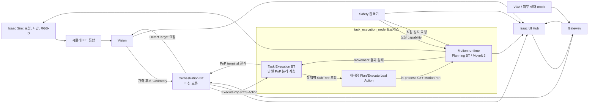

# SF-Twin ARM Cell

[한국어](README.md) | [English](README.en.md)

Doosan M0609 로봇과 Robotiq 2F-85 그리퍼를 대상으로 하는 시뮬레이터 기반 ROS 2 로봇 셀 프로젝트입니다. 비전, 모션 계획, 작업 오케스트레이션, 소프트웨어 안전 감독, 자재 인계, 운영자 UI를 공통 ROS 인터페이스로 연결합니다.

현재 공식 배포 버전은 v0.3.2입니다. v0.3.2는 잔여 ROS 패키지를 제거하고 Motion 설정, 공통 로봇 자산과 소스 폴더 구조를 정리했습니다. 엔지니어링 및 시뮬레이션 프로젝트이며, 생산용 셀이나 안전 등급을 인증받은 시스템은 아닙니다.

## 프로젝트 개요

Isaac Sim은 로봇과 센서가 동작하는 시뮬레이션 환경을 제공하고 ROS 2는 컴포넌트 통신과 런타임 통합을 담당합니다. MoveIt 2가 로봇 모션을 계획하고 실행합니다. Vision은 관측 후보와 Geometry를 제공하고, Orchestration은 미션 흐름을 관리하며, Task Execution은 단일 PnP 작업을 수행합니다. Motion은 개별 움직임을 계획·실행하고, Safety는 소프트웨어 모션 권한을 판단하며, Gateway는 자재 인계 완료와 준비 상태를 관리합니다.

현재 프로파일에는 시뮬레이션 자재 공급 경로와 Isaac Sim UI Hub가 포함되어 있습니다. 외부 AMR/VDA, PLC, 안전 하드웨어 상태는 mock 어댑터로 표현합니다. AMR 내비게이션과 안전 등급 E-stop/STO 하드웨어는 구현하지 않습니다.

## 시연 영상

[YouTube에서 시연 영상 보기](https://youtu.be/6eOcrNFdf2g)

## 주요 기능

- ROS 계획 및 Isaac Sim 셀 구성에 함께 사용하는 Doosan M0609·Robotiq 2F-85 로봇 설명 모델
- canonical joint state, 시뮬레이션 시간, TF, RGB-D 카메라 입력을 연결하는 ROS 통합
- MoveIt 2 기반 로봇 계획과 제한 범위를 명시한 planning scene 프로파일
- Vision은 관측 Geometry와 후보를 제공하고 Task Execution은 후보 순서를 정하며 Motion은 선택 후보를 제외한 요청별 planning occupancy를 구성하는 책임 분리
- 깊이맵 기반 Geometry-first Vision: 공장 RawPart 작업의 직육면체 형상에 특화해 별도 구현한 `cuboid_top_face` 알고리즘으로, 관측된 직교 L자 상판 윤곽과 프로파일 치수를 사용해 완전·부분 관측의 형상·자세 가설을 평가·복원합니다. Detector profile과 source-frame 진단 정보도 제공합니다.
- backend-neutral ROS 인터페이스를 통한 PICK, PLACE, GO_HOME 및 복구 모션 작업
- 재사용 가능한 Behavior Tree Action 기반 작업 실행, PICK 후보 순서 및 Occupancy 제외 휴리스틱
- fail-closed 시작, 모션 capability, Motion에 직접 전달하는 정지 요청을 지원하는 소프트웨어 Safety 감독
- Acquisition Snapshot과 컴포넌트별 진단 기록을 연결하는 관측·증거 흐름 및 Isaac Sim UI Hub

## 시스템 아키텍처

런타임은 인지, 미션 의사결정, 단일 작업 실행, 개별 움직임, 모션 허가를 분리합니다. Isaac Sim은 시뮬레이션 시간, 로봇 상태, 카메라 데이터를 제공합니다. Integration 계층은 이를 공통 ROS 계약에 맞게 연결하고 simulator 전용 그리퍼 동작을 처리합니다.



다이어그램의 Task Execution BT와 Motion Leaf Action은 단일 PnP의 논리적 실행 계층이며 별도 ROS 노드나 프로세스가 아닙니다. 현재 `task_execution_node` 실행 파일이 PnP Action server와 Motion runtime을 한 프로세스에 조립합니다. Orchestration과의 경계는 ROS Action이고, Task Execution에서 Motion으로 가는 움직임 요청은 in-process C++ `MotionPort`를 사용합니다.

| 컴포넌트 | 책임과 상호작용 |
|---|---|
| **Vision** | `DetectTarget` 요청이 오면 최신 RGB-D 관측을 획득하고, 선택한 detector profile로 타깃을 찾아 source-frame 진단 정보와 함께 반환합니다. 모션 허가를 내리지는 않습니다. |
| **Orchestration** | 자재 준비와 Safety 조건을 확인해 미션을 시작하고, Vision 관측과 단일 PnP 요청을 조정합니다. 미션 진행·상위 재시도 및 허가된 복구를 소유합니다. |
| **Task Execution** | 단일 PnP의 후보 순서·전환, PICK/PLACE 단계, 그리퍼·Holding 처리, 작업 내부 복구와 PnP 결과를 소유합니다. BT 논리 계층이며 별도 프로세스가 아닙니다. |
| **Motion** | 선택된 후보 안에서 Pose/IK/경로 탐색과 movement 실행 가능성을 평가하고 MoveIt 2로 계획·실행합니다. 선택 후보를 제외한 요청별 Planning Occupancy와 개별 movement 결과를 소유하며 Safety capability를 준수합니다. |
| **Safety** | 필수 입력의 최신성과 운영 조건을 평가해 소프트웨어 모션 capability를 단독으로 발행하고 Motion에 직접 정지 요청을 보냅니다. 안전 등급 하드웨어를 대체하지 않습니다. |
| **Gateway** | 운영자 자재 공급 요청을 외부 상태 mock에 전달하고 시뮬레이션 인계가 완료된 뒤에만 `MATERIAL_READY`를 발행합니다. 미션 시작 여부는 Orchestration이 결정합니다. |
| **UI Hub** | Isaac Sim/Kit 확장으로 동작합니다. 카메라와 컴포넌트 상태를 보여 주고 소유 컴포넌트에 요청을 보냅니다. canonical 런타임 상태를 직접 변경하지 않습니다. |

### v0.3.0 아키텍처 발전

v0.2.0에도 Behavior Tree 기반 미션 흐름과 MoveIt 계획은 있었습니다. v0.3.0의 변화는 BT를 처음 도입한 것이 아니라 PnP 작업 실행 책임을 Motion에서 분리해 계층 경계를 명확히 한 것입니다.

- **미션과 단일 작업의 분리:** 새 `arm_cell_task_execution` 실행 계층이 단일 PnP의 순서와 내부 복구를 소유하고, Orchestration은 미션 수량·재시도·상위 복구를 유지합니다. 구현상 Orchestration은 ROS Action으로 작업을 제출하고, Task Execution과 Motion runtime은 한 프로세스에서 조립됩니다. 미션 정책과 PICK/PLACE 전략을 서로 독립적으로 바꿀 수 있는 구조입니다.
- **재사용 가능한 움직임 Action:** PICK·PLACE SubTree는 공통 계획·실행 Leaf Action을 조합하고, Motion 내부 Planning BT는 선택된 후보 안에서 Pose/IK/경로 탐색과 해당 탐색 범위의 재시도를 수행합니다. Task Execution은 후보 간 순서와 전환을 소유합니다. 작업 순서를 바꾸거나 실행 전략을 조합하기 쉬워지지만, 정량적인 성능 향상을 의미하지는 않습니다.
- **Vision과 Motion의 책임 정리:** Vision은 관측 Geometry와 적격 후보를 반환하고, Task Execution은 후보 순서와 전환을 결정합니다. Motion은 전달된 후보의 움직임 실행 가능성을 평가하고 요청별 Planning Occupancy를 구성해 선택 후보를 제외합니다. 검출 결과가 곧 파지 가능성이나 이동 허가를 뜻하지 않습니다.
- **복구·결과·Safety 소유권:** Orchestration은 미션 수준 재시도와 Safety 승인 복구를 조정하고, Task Execution은 작업 내부 복구·후보 전환·PnP Action terminal 결과를 소유합니다. Motion은 선택 후보의 계획 탐색 재시도와 개별 movement 실행·취소·terminal 및 정지 근거를 소유하고, Safety는 독립적으로 모션 권한과 직접 정지를 결정합니다.
- **시뮬레이터 경계:** v0.3.0은 공통 ROS 계약 뒤에 simulator별 상태·그리퍼 realization을 두는 기존 경계를 유지합니다. 이는 구현 교체를 고려한 설계 방향이며, Public 구현은 Isaac Sim 중심이고 실물 로봇 어댑터나 운전을 검증하지 않았습니다.

세부 계약은 [구성요소 아키텍처](docs/design/architecture/components.md), [Task Execution CDS](docs/design/components/task-execution/cds.md), [Motion Execution FDS](docs/design/components/motion/fds-motion-execution.md), [Orchestration–Task Execution ICD](docs/design/interfaces/icd-orchestration-task-execution.md)와 [Vision–Motion Occupancy 기록](docs/record/engineering-story/vision-to-motion-occupancy-ownership.md)을 참고하세요.

### 설계 의도

- **상태 소유권:** 각 컴포넌트는 자기 도메인의 상태와 결정을 소유합니다. 예를 들어 Gateway는 인계 완료와 `MATERIAL_READY`를 발행하고, Orchestration은 이를 받아 미션 시작을 판단합니다. Safety는 모션 capability와 정지 판단을 소유하며, UI Hub는 이를 표시하고 요청만 전달합니다.
- **인터페이스 분리:** 컴포넌트 간 데이터와 동작은 공통 ROS 메시지·서비스·액션 계약으로 교환합니다. Motion은 backend-neutral 그리퍼 경계를 사용하고, simulator 세부사항이 미션 의미를 정의하지 않도록 합니다. 계약 문서는 인터페이스 문서에서 확인할 수 있습니다.
- **시뮬레이터 의존성 격리:** Isaac에서 얻은 상태와 그리퍼 동작은 Integration/backend 경계에서 ROS 계약으로 변환합니다. 이를 통해 상위 컴포넌트의 역할을 시뮬레이터 내부 표현과 구분합니다. 이 구조는 하드웨어 어댑터가 이미 제공되거나 실물 운전이 검증됐다는 뜻은 아닙니다.

### 대표 시나리오

운영자가 UI Hub에서 자재 공급을 요청하면 외부 상태 mock이 도착·도킹·하역을 시각화합니다. 하역과 인계가 완료된 뒤 Gateway가 `MATERIAL_READY`를 발행하고, Orchestration은 Safety 허가와 현재 준비 상태를 확인해 미션을 시작합니다. Orchestration은 Vision 관측과 Recipe를 바탕으로 단일 PnP Action을 제출합니다. Task Execution은 PICK·Holding 확인·PLACE·release 확인을 진행하고, 각 움직임은 Motion에 위임합니다. Motion은 결과와 상태를 Task Execution에 돌려주며 Task Execution은 PnP 결과를 Orchestration에 반환합니다. Safety는 전체 과정에서 독립적으로 모션 capability와 정지 경로를 유지합니다.

이 흐름은 현재 공개 구현의 역할과 연결을 요약합니다. 전체 시나리오가 실시간 Isaac Sim 환경에서 최종 acceptance를 통과했다는 의미는 아닙니다.

## 설계 기록과 Sim-to-Real 방향

Geometry-first Vision, Vision/Motion Occupancy 소유권, 재사용 Motion BT, Orchestration·Safety Recovery 및 Sim-to-Real 경계를 다룬 [Engineering Story](docs/record/engineering-story/)와 [아키텍처·알고리즘 결정 기록](docs/record/)을 제공합니다. 이 기록은 현재 계약을 대체하지 않으며 실물 로봇 지원이나 성능 우위를 입증하지 않습니다.

## 기술 스택

- **ROS 2 Humble** — 컴포넌트 통신, 공통 메시지·액션·서비스, workspace 빌드
- **Isaac Sim 5.1** — M0609/2F-85 시뮬레이션 셀, 로봇 상태, 시뮬레이션 시간, RGB-D 입력
- **MoveIt 2** — 로봇 기구학, planning scene 연동, 모션 계획과 실행
- **C++ / `rclcpp`** — Vision, Motion, Orchestration, Safety, Gateway 등 ROS 런타임 컴포넌트
- **Python** — Isaac Sim 장면·런타임 entrypoint, 검증 도구, UI Hub 확장
- **Xacro, TF2, OpenCV, OMPL** — 로봇 설명, 좌표 변환, 영상 처리, 모션 계획 지원

## 시작하기

공개 저장소를 clone합니다.

```bash
git clone https://github.com/dev-kibeom/sftwin-arm-cell.git
cd sftwin-arm-cell
```

## ARM Cell 실행 방법

두 방법 모두 Linux 호스트에 ROS 2 Humble과 Isaac Sim 5.1이 설치돼 있어야 합니다. Isaac Sim을 저장소 루트에서 시작합니다. 스크립트가 씬을 구성하고 Timeline과 UI Hub를 시작합니다.

```bash
source /opt/ros/humble/setup.bash
./infra/isaac_sim/scripts/isaac_arm_cell.sh
```

Isaac Sim 설치 위치가 `$HOME/isaac_sim`과 다르면 `ISAAC_SIM_ROOT`를 지정합니다.

```bash
source /opt/ros/humble/setup.bash
ISAAC_SIM_ROOT=/path/to/isaac_sim ./infra/isaac_sim/scripts/isaac_arm_cell.sh
```

### 방법 1: 호스트에서 ROS 2 빌드 및 실행

ROS 2 Humble과 workspace 의존성이 설치된 다른 터미널에서 저장소 루트 기준으로 빌드한 뒤 overlay를 source합니다.

```bash
source /opt/ros/humble/setup.bash
cd ros2_ws
colcon build --packages-up-to arm_cell_bringup --cmake-args -DBUILD_TESTING=ON
source install/setup.bash
```

`info`는 기본 운영 로그 모드이고 선택적 구조화 진단 수집은 끕니다. 호스트에서 실행하려면 다음 명령을 사용합니다.

```bash
ros2 launch arm_cell_bringup arm_cell.launch.py log_level:=info
```

```bash
ros2 launch arm_cell_bringup arm_cell.launch.py log_level:=debug
```

`debug`는 ROS 노드의 상세 로그를 활성화하고 더 많은 로그와 진단 기록을 생성합니다. `diagnostics`를 생략하면 `debug`는 `motion`, `vision`, `safety`, `orchestration` 수집을 모두 켭니다. 로그 상세도와 구조화된 진단 수집은 별도 설정입니다. 예를 들어 진단 기록 없이 debug 로그만 보려면 `log_level:=debug diagnostics:=none`을 지정합니다. 반대로 info 로그에서 필요한 기록만 고를 수 있습니다.

```bash
ros2 launch arm_cell_bringup arm_cell.launch.py log_level:=info diagnostics:=vision,motion
```

`diagnostics`는 `none`, `all`, 또는 `motion,vision,safety,orchestration`의 쉼표 구분 목록을 받습니다. 이 설정은 ROS bringup에 적용되며 Isaac Sim UI 프로세스의 진단 설정과는 별도입니다.

ROS bringup을 종료하려면 `Ctrl+C`를 누릅니다.

파지 목표·attach 코드처럼 C++ Motion과 Isaac Python 사이의 메시지를 함께 변경한 경우,
실행 중인 bringup을 종료한 뒤 위 빌드와 overlay source를 다시 수행하고 bringup을 재시작합니다.
Isaac에서도 현재 체크아웃의 `2_after_play.py`를 다시 실행해 그리퍼 runtime을 교체합니다.
`/tmp`의 검증용 빌드는 이 `ros2_ws/install`이나 실행 중인 프로세스를 갱신하지 않습니다.

현재 파지 reference 메시지는 보정된 TCP 목표 `position`과 비전에서 계산한 자재 중심
`object_position`을 함께 전달합니다. `capture_object_association_missing`이면 이전 Motion
실행 파일이 보내는 메시지인지 확인합니다. `capture_object_association_runtime_unavailable`이면
Isaac 그리퍼 runtime이 현재 Python 모듈로 다시 로드되었는지 확인합니다.

### 방법 2: Docker Compose로 실행

호스트에 Docker Compose v2가 필요합니다. 별도의 호스트 ROS workspace 빌드 없이 저장소 루트에서 실행합니다.

```bash
docker compose up --build
```

C++ 소스 변경 후에는 기존 Compose 실행을 종료하고 `docker compose up --build`로
이미지를 다시 빌드해 컨테이너를 교체합니다. 저장소 bind mount는 `/arm_cell`의 Python
소스를 갱신하지만, 실행 파일은 이미지의 `/workspace/ros2_ws/install`에서 로드하므로
Python 파일만 갱신해서는 Motion 메시지 변경이 반영되지 않습니다.

Compose가 ROS workspace를 이미지로 빌드하고 `arm_cell_bringup`과 Python 3.10 sidecar를 시작합니다. Linux host networking, 기본 `ROS_DOMAIN_ID=0`, `RMW_IMPLEMENTATION=rmw_fastrtps_cpp`, Fast DDS UDPv4 transport를 사용합니다. Isaac Sim과 컨테이너의 ROS domain 및 RMW 설정을 일치시킵니다. 기본 모드는 `info`이며, Docker에서는 시작할 때 환경변수로 모드를 선택합니다.

```bash
ARM_CELL_LOG_LEVEL=info docker compose up --build
```

```bash
ARM_CELL_LOG_LEVEL=debug docker compose up --build
```

`ARM_CELL_DIAGNOSTICS`를 생략하면 `info`는 선택적 진단 수집을 끄고 `debug`는 모든 ROS 진단 수집을 켭니다. 일부 기록만 수집하려면 함께 지정합니다.

```bash
ARM_CELL_LOG_LEVEL=info ARM_CELL_DIAGNOSTICS=vision,motion docker compose up --build
```

```bash
ARM_CELL_LOG_LEVEL=debug ARM_CELL_DIAGNOSTICS=none docker compose up --build
```

`ARM_CELL_DIAGNOSTICS`는 `none`, `all`, 또는 `motion,vision,safety,orchestration`의 쉼표 구분 목록을 받습니다. 실행 중인 컨테이너의 모드를 바꾸려면 기존 Compose 실행을 내린 뒤 원하는 환경변수로 다시 시작합니다. 로그는 `docker compose logs -f arm-cell`로 확인하고, 종료할 때는 Compose 터미널에서 `Ctrl+C`를 누르거나 `docker compose down`을 실행합니다.

## 문서 탐색

- [v0.3.2 릴리즈 노트](docs/releases/v0.3.2.ko.md) / [English](docs/releases/v0.3.2.en.md) · [이전 버전 v0.3.1](docs/releases/v0.3.1.ko.md)

- [ARM Cell 데모 정의](docs/product/definition.md)
- [최종 라이브 인수 계약](docs/product/acceptance.md)
- [시스템 아키텍처](docs/design/architecture/), [ARM Cell 컴포넌트 설계](docs/design/components/)
- [ROS 및 simulator 인터페이스 계약](docs/design/interfaces/)
- [알고리즘 설계](docs/design/algorithms/)
- [아키텍처 결정 기록(ADR)](docs/record/architecture-decision/)
- [Engineering Stories](docs/record/engineering-story/)
- [기술 기록](docs/record/)
- [Acceptance 보고서](docs/reports/acceptance/)

## 구현 상태 및 한계

호스트 ROS 2 실행과 Docker Compose 실행이 정상 동작하고, Docker 환경에서 Isaac Sim의 RGB-D 토픽이 ROS에 전달되는 것을 확인했습니다. 전체 Mission acceptance나 실물 로봇 운전까지 검증됐다는 뜻은 아닙니다. 자산·소스 구조 정리 후 live test 통과를 확인했습니다. 전체 테스트 모음에는 알려진 실패가 남아 있습니다. 세부 개선과 검증 범위는 [v0.3.2 릴리즈 노트](docs/releases/v0.3.2.ko.md)를 참고하세요.

## 라이선스 및 제3자 저작물

프로젝트 자체 코드는 [MIT License](LICENSE)를 따릅니다. 로봇 모델과 제3자 에셋에는 각각의 upstream 조건이 적용됩니다. 재배포 전 [Third-Party Notices](THIRD_PARTY_NOTICES.md)와 함께 배포된 upstream 라이선스 및 출처 정보를 확인하세요.
