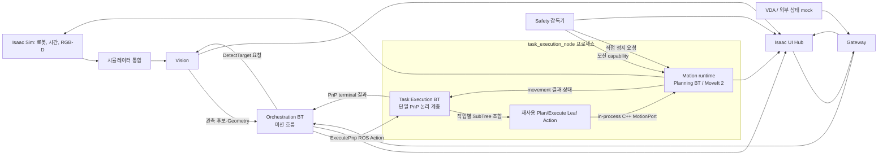

# SF-Twin ARM Cell

[한국어](README.md) | [English](README.en.md)

Doosan M0609 로봇과 Robotiq 2F-85 그리퍼를 대상으로 하는 시뮬레이터 기반 ROS 2 로봇 셀 프로젝트입니다. 비전, 모션 계획, 작업 오케스트레이션, 소프트웨어 안전 감독, 자재 인계, 운영자 UI를 공통 ROS 인터페이스로 연결합니다.

현재 공식 배포 버전은 v0.3.4입니다. v0.3.4는 Vision/PICK 후보 선택과 PLACE 복구, 실행별 진단 기록, 로컬 D455 자산과 런타임 로그를 개선했습니다. 엔지니어링 및 시뮬레이션 프로젝트이며, 생산용 셀이나 안전 등급을 인증받은 시스템은 아닙니다.

## 프로젝트 개요

Isaac Sim은 로봇과 센서가 동작하는 시뮬레이션 환경을 제공하고 ROS 2는 컴포넌트 통신과 런타임 통합을 담당합니다. MoveIt 2가 로봇 모션을 계획하고 실행합니다. Vision은 관측 후보와 Geometry를 제공하고, Orchestration은 미션 흐름을 관리하며, Task Execution은 단일 PnP 작업을 수행합니다. Motion은 개별 움직임을 계획·실행하고, Safety는 소프트웨어 모션 권한을 판단하며, Gateway는 자재 인계 완료와 준비 상태를 관리합니다.

현재 프로파일에는 시뮬레이션 자재 공급 경로와 Isaac Sim UI Hub가 포함되어 있습니다. 외부 AMR/VDA, PLC, 안전 하드웨어 상태는 mock 어댑터로 표현합니다. AMR 내비게이션과 안전 등급 E-stop/STO 하드웨어는 구현하지 않습니다.

## 시연 영상

[YouTube에서 시연 영상 보기](https://youtu.be/6eOcrNFdf2g)

## 주요 기능

- ROS 계획 및 Isaac Sim 셀 구성에 함께 사용하는 Doosan M0609·Robotiq 2F-85 로봇 설명 모델
- canonical joint state, 시뮬레이션 시간, TF, RGB-D 카메라 입력을 연결하는 ROS 통합
- MoveIt 2 기반 로봇 계획과 제한 범위를 명시한 planning scene 프로파일
- Vision은 관측 Geometry와 후보를 제공하고 Task Execution은 후보 순서를 정하며 Motion은 선택 후보를 제외한 요청별 planning occupancy를 구성하는 책임 분리
- 깊이맵 기반 Geometry-first Vision: 공장 TestCube 작업의 직육면체 형상에 특화해 별도 구현한 `cuboid_top_face` 알고리즘으로, 관측된 직교 L자 상판 윤곽과 프로파일 치수를 사용해 완전·부분 관측의 형상·자세 가설을 평가·복원합니다. Detector profile과 source-frame 진단 정보도 제공합니다.
- backend-neutral ROS 인터페이스를 통한 PICK, PLACE, GO_HOME 및 복구 모션 작업
- 재사용 가능한 Behavior Tree Action 기반 작업 실행, PICK 후보 순서 및 Occupancy 제외 휴리스틱
- fail-closed 시작, 모션 capability, Motion에 직접 전달하는 정지 요청을 지원하는 소프트웨어 Safety 감독
- Acquisition Snapshot과 컴포넌트별 진단 기록을 연결하는 관측·증거 흐름 및 Isaac Sim UI Hub

## 시스템 아키텍처

런타임은 인지, 미션 의사결정, 단일 작업 실행, 개별 움직임, 모션 허가를 분리합니다. Isaac Sim은 시뮬레이션 시간, 로봇 상태, 카메라 데이터를 제공합니다. Integration 계층은 이를 공통 ROS 계약에 맞게 연결하고 simulator 전용 그리퍼 동작을 처리합니다.



다이어그램의 Task Execution BT와 Motion Leaf Action은 단일 PnP의 논리적 실행 계층이며 별도 ROS 노드나 프로세스가 아닙니다. 현재 `task_execution_node` 실행 파일이 PnP Action server와 Motion runtime을 한 프로세스에 조립합니다. Orchestration과의 경계는 ROS Action이고, Task Execution에서 Motion으로 가는 움직임 요청은 in-process C++ `MotionPort`를 사용합니다.

| 컴포넌트 | 책임과 상호작용 |
|---|---|
| **Vision** | `DetectTarget` 요청이 오면 최신 RGB-D 관측을 획득하고, 선택한 detector profile로 타깃을 찾아 source-frame 진단 정보와 함께 반환합니다. 모션 허가를 내리지는 않습니다. |
| **Orchestration** | 자재 준비와 Safety 조건을 확인해 미션을 시작하고, Vision 관측과 단일 PnP 요청을 조정합니다. 미션 진행·상위 재시도 및 허가된 복구를 소유합니다. |
| **Task Execution** | 단일 PnP의 후보 순서·전환, PICK/PLACE 단계, 그리퍼·Holding 처리, 작업 내부 복구와 PnP 결과를 소유합니다. BT 논리 계층이며 별도 프로세스가 아닙니다. |
| **Motion** | 선택된 후보 안에서 Pose/IK/경로 탐색과 movement 실행 가능성을 평가하고 MoveIt 2로 계획·실행합니다. 선택 후보를 제외한 요청별 Planning Occupancy와 개별 movement 결과를 소유하며 Safety capability를 준수합니다. |
| **Safety** | 필수 입력의 최신성과 운영 조건을 평가해 소프트웨어 모션 capability를 단독으로 발행하고 Motion에 직접 정지 요청을 보냅니다. 안전 등급 하드웨어를 대체하지 않습니다. |
| **Gateway** | 운영자 자재 공급 요청을 외부 상태 mock에 전달하고 시뮬레이션 인계가 완료된 뒤에만 `MATERIAL_READY`를 발행합니다. 미션 시작 여부는 Orchestration이 결정합니다. |
| **UI Hub** | Isaac Sim/Kit 확장으로 동작합니다. 카메라와 컴포넌트 상태를 보여 주고 소유 컴포넌트에 요청을 보냅니다. canonical 런타임 상태를 직접 변경하지 않습니다. |

### v0.3.0 아키텍처 발전

v0.2.0에도 Behavior Tree 기반 미션 흐름과 MoveIt 계획은 있었습니다. v0.3.0의 변화는 BT를 처음 도입한 것이 아니라 PnP 작업 실행 책임을 Motion에서 분리해 계층 경계를 명확히 한 것입니다.

- **미션과 단일 작업의 분리:** 새 `arm_cell_task_execution` 실행 계층이 단일 PnP의 순서와 내부 복구를 소유하고, Orchestration은 미션 수량·재시도·상위 복구를 유지합니다. 구현상 Orchestration은 ROS Action으로 작업을 제출하고, Task Execution과 Motion runtime은 한 프로세스에서 조립됩니다. 미션 정책과 PICK/PLACE 전략을 서로 독립적으로 바꿀 수 있는 구조입니다.
- **재사용 가능한 움직임 Action:** PICK·PLACE SubTree는 공통 계획·실행 Leaf Action을 조합하고, Motion 내부 Planning BT는 선택된 후보 안에서 Pose/IK/경로 탐색과 해당 탐색 범위의 재시도를 수행합니다. Task Execution은 후보 간 순서와 전환을 소유합니다. 작업 순서를 바꾸거나 실행 전략을 조합하기 쉬워지지만, 정량적인 성능 향상을 의미하지는 않습니다.
- **Vision과 Motion의 책임 정리:** Vision은 관측 Geometry와 적격 후보를 반환하고, Task Execution은 후보 순서와 전환을 결정합니다. Motion은 전달된 후보의 움직임 실행 가능성을 평가하고 요청별 Planning Occupancy를 구성해 선택 후보를 제외합니다. 검출 결과가 곧 파지 가능성이나 이동 허가를 뜻하지 않습니다.
- **복구·결과·Safety 소유권:** Orchestration은 미션 수준 재시도와 Safety 승인 복구를 조정하고, Task Execution은 작업 내부 복구·후보 전환·PnP Action terminal 결과를 소유합니다. Motion은 선택 후보의 계획 탐색 재시도와 개별 movement 실행·취소·terminal 및 정지 근거를 소유하고, Safety는 독립적으로 모션 권한과 직접 정지를 결정합니다.
- **시뮬레이터 경계:** v0.3.0은 공통 ROS 계약 뒤에 simulator별 상태·그리퍼 realization을 두는 기존 경계를 유지합니다. 이는 구현 교체를 고려한 설계 방향이며, Public 구현은 Isaac Sim 중심이고 실물 로봇 어댑터나 운전을 검증하지 않았습니다.

세부 계약은 [구성요소 아키텍처](docs/design/architecture/components.md), [Task Execution CDS](docs/design/components/task-execution/cds.md), [Motion Execution FDS](docs/design/components/motion/fds-motion-execution.md), [Orchestration–Task Execution ICD](docs/design/interfaces/icd-orchestration-task-execution.md)와 [Vision–Motion Occupancy 기록](docs/record/engineering-story/vision-to-motion-occupancy-ownership.md)을 참고하세요.

### 설계 의도

- **상태 소유권:** 각 컴포넌트는 자기 도메인의 상태와 결정을 소유합니다. 예를 들어 Gateway는 인계 완료와 `MATERIAL_READY`를 발행하고, Orchestration은 이를 받아 미션 시작을 판단합니다. Safety는 모션 capability와 정지 판단을 소유하며, UI Hub는 이를 표시하고 요청만 전달합니다.
- **인터페이스 분리:** 컴포넌트 간 데이터와 동작은 공통 ROS 메시지·서비스·액션 계약으로 교환합니다. Motion은 backend-neutral 그리퍼 경계를 사용하고, simulator 세부사항이 미션 의미를 정의하지 않도록 합니다. 계약 문서는 인터페이스 문서에서 확인할 수 있습니다.
- **시뮬레이터 의존성 격리:** Isaac에서 얻은 상태와 그리퍼 동작은 Integration/backend 경계에서 ROS 계약으로 변환합니다. 이를 통해 상위 컴포넌트의 역할을 시뮬레이터 내부 표현과 구분합니다. 이 구조는 하드웨어 어댑터가 이미 제공되거나 실물 운전이 검증됐다는 뜻은 아닙니다.

### 대표 시나리오

운영자가 UI Hub에서 자재 공급을 요청하면 외부 상태 mock이 도착·도킹·하역을 시각화합니다. 하역과 인계가 완료된 뒤 Gateway가 `MATERIAL_READY`를 발행하고, Orchestration은 Safety 허가와 현재 준비 상태를 확인해 미션을 시작합니다. Orchestration은 Vision 관측과 Recipe를 바탕으로 단일 PnP Action을 제출합니다. Task Execution은 PICK·Holding 확인·PLACE·release 확인을 진행하고, 각 움직임은 Motion에 위임합니다. Motion은 결과와 상태를 Task Execution에 돌려주며 Task Execution은 PnP 결과를 Orchestration에 반환합니다. Safety는 전체 과정에서 독립적으로 모션 capability와 정지 경로를 유지합니다.

이 흐름은 현재 공개 구현의 역할과 연결을 요약합니다. 전체 시나리오가 실시간 Isaac Sim 환경에서 최종 acceptance를 통과했다는 의미는 아닙니다.

## 설계 기록과 Sim-to-Real 방향

Geometry-first Vision, Vision/Motion Occupancy 소유권, 재사용 Motion BT, Orchestration·Safety Recovery 및 Sim-to-Real 경계를 다룬 [Engineering Story](docs/record/engineering-story/)와 [아키텍처·알고리즘 결정 기록](docs/record/)을 제공합니다. 이 기록은 현재 계약을 대체하지 않으며 실물 로봇 지원이나 성능 우위를 입증하지 않습니다.

## 기술 스택

- **ROS 2 Humble** — 컴포넌트 통신, 공통 메시지·액션·서비스, workspace 빌드
- **Isaac Sim 5.1** — M0609/2F-85 시뮬레이션 셀, 로봇 상태, 시뮬레이션 시간, RGB-D 입력
- **MoveIt 2** — 로봇 기구학, planning scene 연동, 모션 계획과 실행
- **C++ / `rclcpp`** — Vision, Motion, Orchestration, Safety, Gateway 등 ROS 런타임 컴포넌트
- **Python** — Isaac Sim 장면·런타임 entrypoint, 검증 도구, UI Hub 확장
- **Xacro, TF2, OpenCV, OMPL** — 로봇 설명, 좌표 변환, 영상 처리, 모션 계획 지원

## 시작하기

공개 저장소를 clone합니다.

```bash
git clone https://github.com/dev-kibeom/sftwin-arm-cell.git
cd sftwin-arm-cell
```

## ARM Cell 실행 방법

두 방법 모두 Linux 호스트에 ROS 2 Humble과 Isaac Sim 5.1이 설치돼 있어야 합니다. Isaac Sim을 저장소 루트에서 시작합니다. 스크립트가 씬을 구성하고 Timeline과 UI Hub를 시작합니다.

```bash
source /opt/ros/humble/setup.bash
./infra/isaac_sim/scripts/isaac_arm_cell.sh
```

Launcher는 시작 전에 Bringup의 공개 export CLI로 runtime JSON을 생성합니다. Isaac은 이 파일만 읽으며 Bringup Python 코드를 import하지 않습니다. 자재·정책 설정을 변경하면 launcher를 다시 실행해 export를 갱신합니다. Script Editor 및 검증용 설정 export는 [설정 export와 Script Editor 실행](#설정-export와-script-editor-실행)을 참조하세요.

Isaac Sim 설치 위치가 `$HOME/isaac_sim`과 다르면 `ISAAC_SIM_ROOT`를 지정합니다.

```bash
source /opt/ros/humble/setup.bash
ISAAC_SIM_ROOT=/path/to/isaac_sim ./infra/isaac_sim/scripts/isaac_arm_cell.sh
```

### PySide6 ARM Cell Launcher (호스트)

ROS 시작 스크립트는 같은 checkout에서 실행한 이전 `ros2 launch arm_cell_bringup
arm_cell.launch.py`와 자식 프로세스를 확인하고 SIGINT → SIGTERM → SIGKILL 순서로
종료한 뒤 새 bringup을 시작합니다. PID 시작 시각과 pidfd로 종료 대상을 확인합니다.
다른 checkout이나 부모가 사라진 노드는 자동 종료하지 않고 PID를 표시하며 시작을
차단합니다. 새 시작 경로의 잠금을 보유한 bringup은 먼저 기존 launcher에서 종료해야
합니다. 이 검사는 Isaac Timeline을 초기화하지 않으므로 Stop → Before Playing →
Play → After Playing → 새 ROS bringup 순서는 계속 지켜야 합니다.


Robot·Tool·Cell·Backend 선택과 호스트 프로세스 시작·종료를 GUI에서 관리합니다.
ROS 2 Humble과 Isaac Sim 5.1을 설치하고, 아래 [호스트 빌드 절차](#방법-1-호스트에서-ros-2-빌드-및-실행)로
`ros2_ws/install/setup.bash`를 먼저 준비합니다. 저장소 루트에서 Python 3.10 이상으로 설치합니다.
Ubuntu 22.04 X11 기준 예시입니다.

```bash
sudo apt-get install python3-pip libegl1 libxcb-cursor0 xterm
python3 -m pip install -r infra/launcher/requirements.txt
python3 launcher.py
```

Python 의존성은 PySide6, PyYAML, xacro이며 버전 범위는
`infra/launcher/requirements.txt`에서 관리합니다. 설치와 실행에는 같은 Python 환경을
사용합니다. 가상환경 사용 여부와 위치는 사용자가 선택합니다. 예를 들어 저장소 루트에
가상환경을 만들려면 위 Python 명령을 실행하기 전에 다음을 수행합니다.

```bash
sudo apt-get install python3-venv
python3 -m venv .venv
source .venv/bin/activate
```

기존 설치도 위 requirements 설치 명령을 다시 실행해 의존성 제한을 적용합니다.
PySide6 6.12.0은 Python 3.10/3.11에서 GUI 갱신 중 비정상 종료를 일으키는
[참조 수 결함](https://qt-project.atlassian.net/browse/PYSIDE-3486) 때문에 제외합니다.

Isaac 설치 경로가 기본값 `~/isaac_sim`과 다르면 실행 전에 `ISAAC_SIM_ROOT`를 지정합니다.
필요한 `ROS_DOMAIN_ID`도 GUI 시작 시 환경변수로 지정합니다.

```bash
ISAAC_SIM_ROOT=/path/to/isaac_sim ROS_DOMAIN_ID=0 \
  python3 launcher.py
```

1. Robot·Tool·Cell·Backend를 선택합니다. 첫 버전은 M0609 + Robotiq 2F85 + 기존
   `isaac_m0609` Cell만 지원합니다. 기존 YAML에서 목록을 읽고, production 배포 Profile에
   등록되지 않았거나 실제 Isaac 지원 범위 밖인 조합은 실행을 차단합니다.
2. `Isaac 시작`을 누르고 기존 씬·Timeline·After Playing 초기화가 끝났는지 확인합니다.
3. 필요하면 `ROS 2 디버그 모드`를 선택하고 `ROS 2 시작`을 누릅니다. 기본값은 `info`,
   디버그 모드는 기존 Bringup의 `log_level:=debug`입니다. 별도 diagnostics override 없이
   기존 debug 기본 진단 선택을 따릅니다. 실행 중 모드 변경은 종료 후 재시작으로 적용합니다.
   GUI의 실행 표시는 프로세스 상태이며 시스템 readiness나
   PnP 성공을 뜻하지 않습니다. 기존 Endpoint·Fresh Readiness 확인 절차를 따릅니다.
4. `모두 종료` 또는 창 닫기로 실행한 프로세스를 정리합니다. SIGINT 후 15초 동안
   기다리고, 필요하면 SIGTERM 후 5초를 더 기다린 뒤 SIGKILL로 정리합니다.

Bringup의 기존 조립·검증·export로 `runtime_configuration.json`을 OS 임시 디렉터리에
한 번 생성합니다. Isaac과 ROS는 **동일한 파일**을 읽으며 재export하지 않습니다.
관련 프로세스 그룹이 모두 종료될 때까지 Snapshot을 유지하고, 정상 종료·실행 실패·
창 닫기 시 임시 디렉터리와 함께 삭제합니다. 원본 Profile은 변경하지 않습니다.

Isaac과 ROS 2 실행마다 별도 `xterm` 창이 열리고 stdout/stderr는 해당 창에 표시됩니다.
GUI에는 설정·실행 상태·오류만 표시하며 출력 영역이나 별도 영구 로그를 만들지 않습니다.
각 터미널의 `Ctrl+C` 또는 창 닫기도 실행 종료로 처리하며, 나머지 환경을 정리합니다.
정상 종료 중에는 runtime이 끝날 때까지 터미널을 유지한 뒤 닫습니다.
`.run_records`에는 GUI의 임시 설정이나 중복 로그를 저장하지 않습니다.
Isaac·ROS가 기존 정책으로 생산하는 진단·디버깅 기록, Kit 로그와 세션 관리는 그대로 유지합니다.
터미널 출력은 창이 닫히면 사라지므로 영속 진단은 기존 기록을 사용합니다.
터미널 시작에는 X11 또는 XWayland 디스플레이와 `xterm`이 필요합니다.
같은 사용자로 실행한 GUI 사이에는 중복 실행 잠금을 사용합니다. 외부 CLI·Docker로
별도 실행한 프로세스는 관리하지 않으므로 동시에 실행하지 않습니다.

목록과 조합 판정은 GUI 위젯에 고정하지 않습니다. 새 조합에는 실제 어댑터 지원과
production 배포 Profile이 필요하며, Isaac 지원을 확장할 때 Launcher의 지원 판정도
함께 갱신합니다. 기존 CLI 및 Docker 실행 방법은 아래 안내를 그대로 사용할 수 있습니다.
Isaac 없이 GUI 회귀 테스트를 실행하려면 같은 Python 환경에 `pytest`를 설치합니다.

```bash
python3 -m pip install pytest
QT_QPA_PLATFORM=offscreen python3 -m pytest -q infra/launcher/tests
```

### 설정 export와 Script Editor 실행

기본 CLI 스크립트 `isaac_arm_cell.sh`는 선택한 운영 프로파일을 `.run_records/runtime_configuration.json`으로 export한 뒤 Isaac을 시작합니다. `ARM_CELL_PROFILE`로 입력 프로파일을, `ARM_CELL_RUNTIME_CONFIG`로 출력 파일을 선택할 수 있습니다.

Scene 선택 진입점은 `infra/isaac_sim/scripts/scene_entrypoint.py`입니다. Cell Profile의 `isaac.scene_builder`는 scripts 루트 기준의 `모듈:함수`를 지정하며, 기본값은 `m0609_cell.scene_builder.composition:run_scene_build`입니다. 이 선택과 Builder import에는 M0609 디렉터리를 Python 검색 경로에 넣을 필요가 없습니다. Builder는 전달된 Runtime Configuration의 Assembly와 Cell 배치·Geometry를 소비합니다.

Cell Profile의 `camera`는 논리 Prim, D455 Mount Prim과 기존 Geometry 기준 설치 Offset, Frame·Topic·해상도·센서 설정 및 TF Snapshot 경로를 소유합니다. Calibration 참조는 같은 Cell의 기존 `calibration_file`을 재사용합니다. Bringup은 원본 조립 때 Calibration의 Frame·CameraInfo Topic·해상도 정합성을 확인하고 Vision Topic을 같은 Camera 선택에서 구성합니다. Isaac Scene·Graph·Camera Snapshot은 export된 값을 소비합니다. 운영 ROS Camera Launch는 `runtime_profile`로 전달된 운영 Profile 또는 Runtime JSON을 우선하며, 단독 실행은 `ARM_CELL_RUNTIME_CONFIG`가 없을 때 기존 `profile`/`snapshot` 인자를 지원합니다. 운영 Camera Snapshot 생성도 Cell의 `camera.snapshot` 경로를 사용합니다. Camera 설치를 바꾸면 해당 Stage에서 Snapshot을 다시 생성하고 Calibration을 맞춰야 합니다.

Cell의 `material_supply`는 기존 Supply Profile, Delivery Root와 기존 Geometry의 공급 지지면을 선택합니다. Bringup은 Supply Profile 내용을 Runtime Configuration에 포함하고 Vision·Supply가 공유하는 지지면 치수도 같은 Geometry에서 유도합니다. 공급 위치는 지지면 중심과 두께에서 유도하며 자재 종류·수량·랜덤 낙하·공급 완료 계산은 기존 설정과 알고리즘을 유지합니다. Adapter·Capture Registry·Demonstration·Pose 기록이 같은 Delivery Root를 소비하고 Sidecar·UI Hub·ROS Gateway 프로토콜은 유지합니다.

공통 Startup은 scripts 루트의 `1_before_play.py` → Timeline Play → GUI/headless `2_after_play*.py`를 실행합니다. `isaac_runtime/runtime_workflow.py`가 기존 역할 순서를 소유하며, Script Editor의 기존 `m0609_cell/0_pre_build.py`, `1_before_play.py`, `2_after_play*.py`도 얇은 호환 진입점으로 유지합니다. 임시 Script Editor 복사본은 `SFTWIN_PROJECT_ROOT`로 공통 scripts 루트를 찾습니다.

| 단계 | 실행 및 책임 |
|---|---|
| Pre Build (명시 실행) | 선택 Assembly의 Xacro → URDF → USD·Provenance 생성·검증. Startup/Before Play는 Build를 암묵적으로 실행하지 않음 |
| Before Play | Runtime JSON 한 번 로드 → 선택 Scene Builder → Robot HOME·Drive → Cell 공급 Adapter·Timeline 연결 → Camera Snapshot → ROS Graph |
| Play | 기존 Timeline callback이 Live Test Session 생성 |
| After Play | 같은 설정 Snapshot으로 선택 Tool 초기화 → GUI일 때 UI Hub 활성화 |
| Pause/Resume | 기존 Session·Tool·공급 상태 유지 |
| Stop/Reset | Tool·Attachment Reset → 진단 Writer 종료 → HOME 복원 (Drive 재배율 없음) → 생성 자재 삭제 → Live Test Session 종료. 기존 Physics STOPPED 검증 정리는 멱등 경로를 유지 |
| 재생·재실행·종료 | Stop 후 Play는 새 Live Test Session 생성. After Play 재실행은 기존 Tool Session·Subscription 교체. Before Play 재실행·종료는 Tool → 진단 Session → 공급 Subscription·Sidecar 정리 |

선택 호출은 기존 `모듈:함수` 형식을 재사용합니다. Cell의 `isaac.scene_builder`, `material_supply_factory`, `camera_snapshot`, `action_graph_builder`는 Cell 구현을, Tool의 `runtime.isaac_bootstrap`은 Physics 준비 후 Tool 초기화를 선택합니다. Robot Binding·HOME·Drive는 Robot과 Assembly·Cell 배치 데이터를 함께 소비합니다. 공통 Runtime은 Plugin ID나 Prim 경로로 분기하지 않습니다. M0609 Scene·공급 장치와 Robotiq Capture/Actuator 구현은 기존 디렉터리에 남으며, 선택된 구현 내부의 기존 sibling import 경로는 아직 유지합니다. Launcher 지원 조합과 사용자 실행 명령은 바뀌지 않습니다. 다른 조합의 Runtime 지원은 선언하지 않습니다.

M0609 실제 Lifecycle smoke는 export와 필요한 Pre Build 후 Isaac Python으로 실행할 수 있습니다. `--pre-build`는 선택 Assembly 산출물을 먼저 재생성합니다. 공급 Sidecar까지 확인하려면 해당 checkout의 ROS overlay가 필요합니다.

```bash
~/isaac_sim/python.sh infra/isaac_sim/scripts/m0609_cell/tests/acceptance/runtime_lifecycle_smoke.py --pre-build
```

이 검사는 headless Startup·관절 이동·Robotiq 실측 OPEN/CLOSE·Camera Prim·공급 Adapter·시연 자재 생성/삭제·Pause/Resume·HOME/Drive Reset·Session/Physics Subscription 교체를 확인합니다. ROS 공급 완료와 전체 PnP 라이브 검증은 별도입니다.


Script Editor로 직접 시작할 때는 ROS workspace를 빌드하고 overlay를 source한 터미널에서 먼저 export합니다.

```bash
ros2 run arm_cell_bringup export_runtime_configuration \
  --profile ros2_ws/src/bringup/config/operational_profile.yaml \
  --output .run_records/runtime_configuration.json
```

Isaac 프로세스에 `SFTWIN_PROJECT_ROOT`를 저장소 절대 경로로 설정합니다. 기본 파일 이외의 export를 읽으려면 `ARM_CELL_RUNTIME_CONFIG`에 해당 파일의 절대 경로를 설정합니다. 설정을 바꾸면 다시 export하고 Isaac 구성을 다시 로드합니다. ROS의 명시적 `profile:=` 인자는 해당 ROS 실행에만 적용됩니다.

검증용 PnP는 별도 프로파일을 export합니다.

```bash
ros2 run arm_cell_bringup export_runtime_configuration \
  --profile ros2_ws/src/bringup/config/pnp_validation_profile.yaml \
  --output .run_records/pnp_runtime_configuration.json
```

검증 entrypoint는 이 파일을 기본으로 읽으며, `SFTWIN_PNP_PROFILE`에 다른 export 파일의 절대 경로를 지정할 수 있습니다. 상대 설정 경로는 선언 파일 기준, `package://`는 해당 ROS 패키지 기준, `project://`는 프로젝트 기준으로 해석합니다.

배포 YAML의 `profiles.robot`, `profiles.tool`, `profiles.cell`에서 조합할 설정 파일을 선택합니다. 기본 선택은 각각 `motion/config/robots/m0609.yaml`, `motion/config/tools/robotiq_2f85.yaml`, `bringup/config/cells/isaac_m0609.yaml`입니다. 결합 URDF/SRDF 자산은 `model_configuration`에서 별도로 선택하며 기본 M0609+2F85 모델은 그대로 사용합니다. Motion 실행 정책은 `components.motion`, IK·Planning 파일 선택은 `motion_configuration`에서 지정합니다. 가져올 Motion 입력 묶음은 `motion_profile_sections`, capture 출력 이름은 `capture_section`에 명시합니다. 검증 Profile은 Tool의 `validation_motion`을 선택하고 생산 Cell 경로 제약·손가락 탐색 치수를 제외하며, `validation.planning_scene_profiles`에서 접촉·Scene 입력 Owner를 선택합니다. HOME·관절 자세는 Robot, 그리퍼 치수·축 관례는 Tool, 작업 위치·Calibration 참조는 Cell에서 수정하고 다시 export합니다. 여러 소유자에 같은 파라미터를 정의하면 조립을 거부합니다. MoveIt 단독 실행은 `robot_profile:=<Robot YAML>`과 `model_configuration:=<결합 모델 YAML>`을 지원하며 생략 시 기존 기본 조합을 사용합니다. 설정 책임과 실행 책임의 구분은 [Components Architecture](docs/design/architecture/components.md)를 따릅니다.

Plugin 전환 기반 설정은 기존 owner 아래에 포함됩니다. Robot의 `joint_policy`는 동치각 허용·PLACE IK Seed 관절, Assembly의 `model_id`·`planning_group`·`isaac`는 모델 식별·그룹·모델 내부 Articulation Binding, Tool의 `contact_links.payload_touch_links`는 실제 도구 접촉 Link, Cell의 `contact_objects.pick_retract`·`isaac.robot_prim_path`는 설비 접촉 대상·Stage 배치를 나타냅니다. 기존 HOME·관절 목록·Limits·Tool validation 접촉 Link·Cell 작업 위치는 그대로 재사용합니다. 이 메타데이터는 runtime JSON으로 전달됩니다. Isaac Model Builder는 선택된 Assembly의 Xacro와 Mesh 경로를 사용하며, `isaac.urdf`가 있으면 기존 Isaac용 Xacro Wrapper를 사용합니다. `isaac.revolute_joints`는 Import 후 Revolute Joint와 PhysX Mimic 부재를 확인할 모델 내부 Joint Binding입니다. 생성 URDF는 `infra/isaac_sim/assets/urdf/generated/<model_id>.urdf`, USD와 Provenance는 `infra/isaac_sim/assets/usd/<model_id>_generated.*`에 기록됩니다. 생성물은 원본 Assembly 설정이 아니며 기존 Provenance 검증을 거쳐 재사용합니다. M0609의 기존 파일명·Wrapper·Import 옵션은 유지합니다. Tool의 `runtime`은 Capability·Isaac 구현·폭 한계·구동 시간·지원 형상을, `grasp_pose_collision_links`는 TCP Pose 충돌 검사 링크를 제공합니다. Isaac Tool 실행은 선택된 Profile과 Assembly Binding을 소비합니다. Scene 배치는 기존 M0609 조합을 사용합니다. Launcher의 지원 조합과 실행 경로도 그대로입니다.

원본 Profile 조립·export는 기존 Xacro 확장기를 사용해 URDF/SRDF와 선택 설정을 대조합니다. ROS 환경에는 기존 `xacro` 의존성을 사용하고, 독립 Launcher 환경에는 `infra/launcher/requirements.txt`로 설치합니다. export된 JSON을 읽는 소비자는 추가 모델 검사나 Xacro import를 수행하지 않습니다. Isaac Articulation 경로의 형식은 조립 시 검사하지만 실제 USD Prim 존재와 Play 이후 바인딩은 라이브 검증 대상입니다.

자재는 `bringup/config/materials/*.yaml`에서 관리합니다. `TestCube`(70×70×80 mm), 알루미늄 빌릿(60×40×30 mm), 철강 블랭크(70×50×40 mm), 알루미늄 판재(80×60×20 mm)를 제공합니다. UI Hub의 Material type 목록은 export에 포함된 자재에서 생성되며, Random Drop 한 요청은 선택한 한 종류만 공급합니다. 새 cuboid는 자재 정의와 미션을 추가하고 runtime 설정을 다시 export하면 목록에 반영됩니다.

판재의 일반 파지는 60 mm 방향으로 제한합니다. 80 mm 방향을 명시적으로 시험하거나 pick offset을 조정할 때는 별도의 검증 export를 사용합니다.

```bash
ros2 run arm_cell_bringup export_runtime_configuration \
  --profile ros2_ws/src/bringup/config/pnp_validation_profile.yaml \
  --material AL_PLATE_080_060_020 --grasp-width-mm 80 \
  --output .run_records/pnp_runtime_configuration.json
ros2 launch arm_cell_bringup arm_cell_pnp_validation.launch.py \
  profile:="$(pwd)/.run_records/pnp_runtime_configuration.json"
```

`--pick-offset-z-m`은 자재 중심 기준 Z offset의 시험값입니다. 이 옵션은 원본 YAML을 변경하지 않습니다. Isaac에는 같은 export를 `SFTWIN_PNP_PROFILE`로 지정합니다. 신규 자재 offset은 기존 2.5 mm 상판 접촉 깊이에 기반한 초깃값이며 `pending_live_validation`으로 표시합니다. 실제 파지 결과를 확인한 뒤 자재 정의에 보정값과 근거를 반영해야 합니다.

Isaac에서 검증 fixture를 생성한 뒤 출력된 등록 manifest로 `ros2 run arm_cell_bringup validate_material_grasp --profile <export.json> --manifest <manifest.json> --result <result.json>`을 실행하면 Fixed Vision과 기존 Task Execution API로 한 번의 PnP를 수행하고 결과를 기록합니다. 원본 자재 YAML은 자동 변경하지 않습니다.


### 방법 1: 호스트에서 ROS 2 빌드 및 실행

첫 실행에는 아래 Docker Compose 방법을 권장합니다. 로컬 개발 시 ROS 2 Humble, colcon, 초기화된 rosdep, `nlohmann-json3-dev`를 준비합니다. 새 터미널에서 저장소 루트 기준으로 아래 명령을 실행하면 Dockerfile과 동일한 TRAC-IK 리비전을 로컬에 빌드합니다.

```bash
bash ros2_ws/build-local.bash
source ros2_ws/install/setup.bash
ros2 pkg prefix trac_ik_kinematics_plugin
```

`info`는 기본 운영 로그 모드이고 선택적 구조화 진단 수집은 끕니다. 호스트에서 실행하려면 다음 명령을 사용합니다.

```bash
ros2 launch arm_cell_bringup arm_cell.launch.py log_level:=info
```

```bash
ros2 launch arm_cell_bringup arm_cell.launch.py log_level:=debug
```

`debug`는 ROS 노드의 상세 로그를 활성화하고 더 많은 로그와 진단 기록을 생성합니다. `diagnostics`를 생략하면 `debug`는 `motion`, `vision`, `safety`, `orchestration` 수집을 모두 켭니다. 로그 상세도와 구조화된 진단 수집은 별도 설정입니다. 예를 들어 진단 기록 없이 debug 로그만 보려면 `log_level:=debug diagnostics:=none`을 지정합니다. 반대로 info 로그에서 필요한 기록만 고를 수 있습니다.

```bash
ros2 launch arm_cell_bringup arm_cell.launch.py log_level:=info diagnostics:=vision,motion
```

`diagnostics`는 `none`, `all`, 또는 `motion,vision,safety,orchestration`의 쉼표 구분 목록을 받습니다. 이 설정은 ROS bringup에 적용되며 Isaac Sim UI 프로세스의 진단 설정과는 별도입니다.

ROS bringup을 종료하려면 `Ctrl+C`를 누릅니다.

파지 목표·attach 코드처럼 C++ Motion과 Isaac Python 사이의 메시지를 함께 변경한 경우,
실행 중인 bringup을 종료한 뒤 위 빌드와 overlay source를 다시 수행하고 bringup을 재시작합니다.
Isaac에서도 현재 체크아웃의 `2_after_play.py`를 다시 실행해 그리퍼 runtime을 교체합니다.
`/tmp`의 검증용 빌드는 이 `ros2_ws/install`이나 실행 중인 프로세스를 갱신하지 않습니다.

현재 파지 reference 메시지는 보정된 TCP 목표 `position`과 비전에서 계산한 자재 중심
`object_position`을 함께 전달합니다. `capture_object_association_missing`이면 이전 Motion
실행 파일이 보내는 메시지인지 확인합니다. `capture_object_association_runtime_unavailable`이면
Isaac 그리퍼 runtime이 현재 Python 모듈로 다시 로드되었는지 확인합니다.

### 방법 2: Docker Compose로 실행

호스트에 Docker Compose v2가 필요합니다. 별도의 호스트 ROS workspace 빌드 없이 저장소 루트에서 실행합니다.

```bash
export ARM_CELL_UID="$(id -u)" ARM_CELL_GID="$(id -g)"
docker compose up --build
```

Compose는 호스트 Isaac 사용자와 같은 UID/GID로 기록합니다(기본값 `1000:1000`).
기존 기록 폴더가 다른 사용자 소유라면 Isaac과 Compose를 종료한 후 한 번만 복구합니다.
아래 명령은 기존 기록을 삭제하지 않고 소유자만 변경합니다.

저장소 루트에서 실행합니다. 경로를 바꿨다면 `record_dir`에는 `config/run_records.yaml`의 `root`를, `waypoint_dir`에는 Motion의 `config/place_waypoint.yaml`에 지정한 파일의 상위 디렉터리를 넣으세요. 상대 경로는 저장소 루트 기준입니다. 재귀적으로 소유권이 바뀌므로 기록과 waypoint 저장 전용 디렉터리만 지정하세요.

```bash
record_dir=".run_records"
waypoint_dir=".motion_data"

for dir in "$record_dir" "$waypoint_dir"; do
  if [ -d "$dir" ]; then
    sudo chown -R -- "$(id -u):$(id -g)" "$dir"
  fi
done
```

C++ 소스 변경 후에는 기존 Compose 실행을 종료하고 `docker compose up --build`로
이미지를 다시 빌드해 컨테이너를 교체합니다. 저장소 bind mount는 `/arm_cell`의 Python
소스를 갱신하지만, 실행 파일은 이미지의 `/workspace/ros2_ws/install`에서 로드하므로
Python 파일만 갱신해서는 Motion 메시지 변경이 반영되지 않습니다.

Compose가 ROS workspace를 이미지로 빌드하고 `arm_cell_bringup`과 Python 3.10 sidecar를 시작합니다. Linux host networking, 기본 `ROS_DOMAIN_ID=0`, `RMW_IMPLEMENTATION=rmw_fastrtps_cpp`, Fast DDS UDPv4 transport를 사용합니다. Isaac Sim과 컨테이너의 ROS domain 및 RMW 설정을 일치시킵니다. 기본 모드는 `info`이며, Docker에서는 시작할 때 환경변수로 모드를 선택합니다.

```bash
ARM_CELL_LOG_LEVEL=info docker compose up --build
```

```bash
ARM_CELL_LOG_LEVEL=debug docker compose up --build
```

`ARM_CELL_DIAGNOSTICS`를 생략하면 `info`는 선택적 진단 수집을 끄고 `debug`는 모든 ROS 진단 수집을 켭니다. 일부 기록만 수집하려면 함께 지정합니다.

```bash
ARM_CELL_LOG_LEVEL=info ARM_CELL_DIAGNOSTICS=vision,motion docker compose up --build
```

```bash
ARM_CELL_LOG_LEVEL=debug ARM_CELL_DIAGNOSTICS=none docker compose up --build
```

`ARM_CELL_DIAGNOSTICS`는 `none`, `all`, 또는 `motion,vision,safety,orchestration`의 쉼표 구분 목록을 받습니다. 실행 중인 컨테이너의 모드를 바꾸려면 기존 Compose 실행을 내린 뒤 원하는 환경변수로 다시 시작합니다. 로그는 `docker compose logs -f arm-cell`로 확인하고, 종료할 때는 Compose 터미널에서 `Ctrl+C`를 누르거나 `docker compose down`을 실행합니다.

## 문서 탐색

- [v0.3.4 릴리즈 노트](docs/releases/v0.3.4.ko.md) / [English](docs/releases/v0.3.4.en.md) · [이전 버전 v0.3.3](docs/releases/v0.3.3.ko.md)

- [ARM Cell 데모 정의](docs/product/definition.md)
- [최종 라이브 인수 계약](docs/product/acceptance.md)
- [시스템 아키텍처](docs/design/architecture/), [ARM Cell 컴포넌트 설계](docs/design/components/)
- [ROS 및 simulator 인터페이스 계약](docs/design/interfaces/)
- [알고리즘 설계](docs/design/algorithms/)
- [아키텍처 결정 기록(ADR)](docs/record/architecture-decision/)
- [Engineering Stories](docs/record/engineering-story/)
- [기술 기록](docs/record/)
- [Acceptance 보고서](docs/reports/acceptance/)

## 구현 상태 및 한계

v0.3.4의 주요 변경과 업그레이드 안내, 검증 범위는 [릴리즈 노트](docs/releases/v0.3.4.ko.md)를 참고하세요. 이번 버전 문서 갱신에서는 소스 검사와 문서 링크를 확인했습니다. 전체 ROS 테스트 모음과 라이브 Isaac Mission acceptance는 다시 실행하지 않았습니다.

## 라이선스 및 제3자 저작물

프로젝트 자체 코드는 [MIT License](LICENSE)를 따릅니다. 로봇 모델과 제3자 에셋에는 각각의 upstream 조건이 적용됩니다. 재배포 전 [Third-Party Notices](THIRD_PARTY_NOTICES.md)와 함께 배포된 upstream 라이선스 및 출처 정보를 확인하세요.
