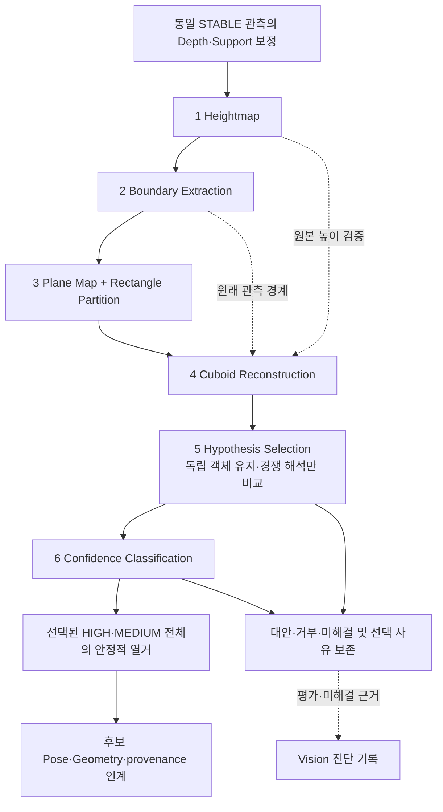

# RawPart 직교 외곽선 기반 직육면체 복원 알고리즘

- **Owner:** ARM Cell Vision — 관측 형상 해석, 후보 열거
- **범위:** Heightmap의 경계 보존, Plane Map과 사각형 분할, 수평 RawPart 직육면체 가설 복원·선택·신뢰도 분류.
- **비책임:** 기울어진 자재의 완전한 3D 자세 복원, 파지 가능성·작업 우선순위 및 Motion 경로 판단

**실험 자료:** Cuboid Notebook, 실라이브 세션 L자 신뢰도·경사 복원 PoC, 과거 구현 감사·검증 자료. PoC는 비규범 비교 자료이며 현재 계약은 이 문서가 소유한다.

**관련 계약:** [Vision CDS](../components/vision/cds.md), [Motion CDS](../components/motion/cds.md), [Vision–Orchestration ICD](../interfaces/icd-vision-orchestration.md), [Orchestration–Motion ICD](../interfaces/icd-orchestration-motion.md). 각 문서는 책임·전달 형식·실행 권한을 소유하며 이 문서는 기하 계산 절차만 정의한다.

## 목적과 적용 범위

보정된 Heightmap에서 **경계 → 평면 → 객체 가설** 순서로 해석을 구체화한다. 연결 영역의 수평성이나 완전한 외곽선 폐합을 경계 추출의 선행조건으로 삼지 않는다. Contour·Line·직각 Anchor·L/U자 복원은 재사용하되 Plane Map의 평면 영역을 물리 객체로 확정하지 않는다. Rectangle Partition은 Recipe와 독립적인 기하 해석이며, 관측된 모든 객체를 완전 분할해야 개별 후보를 인정하는 방식은 사용하지 않는다.

[RawPart FDS](../components/vision/fds-rawpart-depth-perception.md)는 후보 적격성의 외부 동작과 Strategy별 필수 출력을, ICD는 목록 인계와 실행 경계를 소유한다. 이 알고리즘은 검증된 기하 후보 집합과 파지 우선순위 의미가 없는 안정적 열거 순서를 소유한다. Motion은 단일 PICK Action 내부의 후보 우선순위·탐색·전환을 소유한다.

후보 생성 뒤 실제 관측 면적, Profile 치수, 경계 지지, 수평 높이 일관성 및 주변 관측값을 가설 평가 근거로 사용한다. 면적 관측률이나 ROI 전체 포함을 모든 후보에 적용하는 공통 Gate로 두지 않는다. 실패·불확실 후보는 무관한 후보를 탈락시키지 않는다. 동일 객체의 L자·대칭 방향·사실상 같은 Footprint와 Pose 가설은 정규화해 하나의 후보로 취급한다. 중복 proposal 수는 모호성이나 등급 저하 근거가 아니다. 정규화 후에도 관측으로 구별할 수 없는 실질적으로 다른 형상·자세 해석이 남을 때만 모호하게 분류한다.

선택 대상 체적은 다른 점유 근거와 구별한다. 같은 관측의 나머지 점유·미확인 형상은 후보별 Collision Primitive 집합으로 전달한다. 미관측 영역을 FREE로 표현하지 않는다. Vision은 Grasp 접근성이나 파지 편의에 따른 우선순위를 계산하지 않고, Motion은 로봇 모델의 실행 가능성과 우선순위를, Orchestration은 미션 진행·Retry를 소유한다.

작업 영역에는 서로 접촉·적층된 수평 상판 또는 기울어진 상판의 RawPart가 존재할 수 있다. 치수·관측 증거·수평 상판 조건을 만족한 후보만 PICK 대상으로 승격한다. 기울어진 RawPart는 PICK에서 제외하고 해당 관측·미해결 근거는 진단에 보존한다. 관측 평면의 법선·기울기는 보존하지만 이를 기울어진 객체의 완전한 6D Pose·물리적 면 정체성으로 해석하지 않는다. 노이즈, 누락 Depth, 부분 관측은 가능하며 Raster/Depth 오차를 별개의 장애물로 단정하지 않는다. 연결된 표면의 합집합이 반드시 하나의 객체는 아니다.

## 입력 형상과 가설

Vision Profile은 양의 유한 치수 `(a,b,c)`를 가진 Material 정의를 참조한다. 치수 허용오차·관측 불확실성은 Vision Profile이 소유하고, 공통 처리에서 보정된 지지 기하를 제공한다. 특정 배포의 고정 치수를 가정하지 않고 다음 세 상판/자체 두께 가설을 평가한다.

| 수평 상판 | 객체 자체의 수직 두께 |
|---|---|
| `a × b` | `c` |
| `a × c` | `b` |
| `b × c` | `a` |

중복 치수와 정사각 대칭으로 동등해지는 가설은 병합한다. 지지면 위 상판 높이와 객체 자체 두께는 다른 개념이며, 적층 자재의 자체 두께에 상판 높이를 대입해서는 안 된다. 관측으로 구분할 수 없는 면 가설이 서로 다른 Pose·두께·측면 형상을 뜻하면 미해결로 둔다. 후보에는 회전된 직사각 Footprint, 상판 높이, Yaw, 면/두께 가설, 관측 지지 근거가 포함된다. 후보 ID는 한 관측에서만 고유하며 지속적 물리 객체 ID가 아니다.

## 알고리즘 판단 흐름

후보가 없다고 자재 부재를 확정하지 않는다. 모든 산출물은 동일 `acquisition_id`, 원본 Depth·셀 ID, 호환 RGB Header(있는 경우), Tray 좌표계와 적용 Profile에 연결한다. 원본 관측은 불변이며 관측·추론·미관측을 구별한다. 실패 시 선행 근거를 남기고 후속 미계산은 `not_computed`와 원인을 보존한다. UNKNOWN을 0 또는 FREE로 취급하지 않는다.

### 핵심 수학 관계

- Support 보정 후 유효 셀의 Tray 기준 높이를 `h(x,y)`로 둔다. 8방향 인접 셀의 `|h(p)-h(q)| ≤ height_tolerance_m`는 국소 연결 단서일 뿐 평면 동일성·수평성·객체 동일성을 보장하지 않는다. 절대 높이를 양자화하거나 Recipe 치수 합으로 영역을 만들지 않는다.
- 관측 셀 `(x_i,y_i,h_i)`의 최소제곱 평면 `h_i ≈ αx_i + βy_i + γ`에 대해 위쪽 단위 법선은 `n=(-α,-β,1)/sqrt(α²+β²+1)`, 기울기는 `atan(sqrt(α²+β²))`, 기울기의 단위는 radian이며 높이 잔차는 `sqrt(Σ(h_i-αx_i-βy_i-γ)²/N)`다. 위치·높이 기준점은 관측 셀 중심과 그 지점의 적합 높이이며 모두 Tray frame/metre 기준이다. 잔차와 실제 높이 분포를 함께 보존한다.
- 수평 상판 평가에는 실제 관측 높이의 95–5 백분위 범위와 적합 평면의 **실제 셀 위치**에서 예측한 높이 최댓값–최솟값을 모두 사용한다. 두 범위 모두 기존 `top_surface_geometry_tolerance_m` 이하여야 한다. 기울기와 Bounding 대각선의 곱으로 대체하지 않는다. 이 조건은 개별 상판의 PICK 적격성 평가이며 경계 추출 Gate가 아니다.
- Anchor `q`와 내부 단위 직교 방향 `u,v`, Recipe 변 `l,w`의 중심은 `q + (lu + wv)/2`, 반대 대각 꼭짓점은 `q + lu + wv`다. 상판 높이는 귀속된 실제 수평 관측에서, 자체 두께는 Recipe 면 가설에서 얻는다.

## 단계별 알고리즘 계약

### 1단계 — Heightmap

**입력:** 최종 STABLE Depth, 호환 CameraInfo, 보정된 Support/Tray 기하, Workspace와 기존 Sensor/Profile 허용오차.

**출력:** Tray 정렬 Height Grid, 유효/무효·미관측 Mask, 원본 Pixel/셀 대응, ROI·이미지 경계 및 Support 보정 근거.

기존 Depth 역투영·Support Plane 보정과 Grid 집계 원칙을 유지한다. 관측되지 않은 셀을 임의 높이로 채우거나 연결 영역 중앙값으로 원본을 평탄화하지 않는다. 원본 Heightmap을 경계 추출 이후에도 보존하고, 후속 평면·가설의 근거를 원본 높이와 재대조할 수 있어야 한다.

### 2단계 — Boundary Extraction

**입력:** Heightmap의 실제 유효 셀·미관측 Mask와 경계 정보.

**출력:** 관측 영역 외곽·높이 불연속 경계, 열린/닫힌 Contour, 적합 Line Segment·끝점·지지 샘플·지지율·잔차, 직각 교점 및 오목/볼록점과 출처 ID.

Heightmap에서 직접 경계를 추출하고 기존 Contour·Line 적합 기법을 재사용한다. 관측 외곽선 점에서 선분을 적합하며 모서리 주변을 선 적합에서 제외하고 관측 호를 투영해 끝점을 추정한다. 높이 단차·미관측 경계·ROI 절단을 구별한다. 열린 Contour도 유효 선분·직각을 보존한다. 선 적합에 부적합한 근거와 사유도 남기며 연결 영역 전체가 `mixed_or_inclined`라는 이유로 Contour 이전에 버리지 않는다. Recipe 치수·객체 수·Confidence를 결정하거나 숨겨진 Edge를 관측 사실로 추가하지 않는다.

### 3단계 — Plane Map + Rectangle Partition

**입력:** 원본 Heightmap과 Boundary Extraction의 관측 경계·직선·모서리.

**출력:** 아래의 평면·경계·분할 관계. Plane Map은 객체 목록이 아니며 개별 RawPart ID·최종 Pose·파지 적격성을 확정하지 않는다.

| Plane Map 항목 | 의미와 후속 전달 근거 |
|---|---|
| 평면 ID·관측 영역 | 실제 셀 집합·Mask와 원본 Heightmap 참조; 연결된 영역 내부도 여러 평면 또는 미해결 영역으로 표현 |
| 위치·높이·법선·기울기·잔차 | 위 수식의 관측 평면 속성, 지지 셀 수·실제 높이 분포·적합 가능 여부; 기울어진 객체의 자세 확정 아님 |
| 관측 경계·선분·모서리 | 원본 Contour·Line·오목/볼록점 ID 및 해당 평면의 실제 지지 구간 |
| 인접 관계 | 공유/접촉 경계, 높이 차이와 연속성·단차·가림 근거; 미확인은 미확인으로 유지 |
| 추론·보완 경계 | 연장한 원래 선분 ID, 방향·간격·교점·평면 일관성 근거와 미관측 구간; 관측 경계와 별도 표기 |
| 사각형 영역·대안 분할 | 부모 평면/영역, 네 모서리·변, 관측/추론 구간, 대안 그룹과 사용한 근거 ID; 원래 경계를 덮어쓰지 않음 |

**평면 구성:** 연결성은 탐색 범위만 제공한다. 단차 경계를 넘어서 평면을 합치지 않으며 실제 셀의 평면 적합 잔차와 공간적 높이 추세를 기존 Profile 기하 허용오차로 평가한다. 연결 영역에서 단일 평면이 맞지 않으면 국소적으로 일관된 셀과 선·높이 경계에 따라 평면을 나눈다. 수평과 경사가 이어져도 각각의 관측을 보존한다. 3개 미만이거나 비공선 지지가 없어 평면을 적합할 수 없으면 미해결 영역으로 남기되 경계·선분을 잃지 않는다. `mixed_or_inclined`는 영역 전체 삭제나 개별 경사 확정 근거가 아니다. 수평·경사·미해결 관계를 보존하며 원본을 평탄화하지 않는다.

**Rectangle Partition:** 동일 평면의 연결 외곽선에서도 네 직각에 대응하는 기하 구조, 대변의 평행성, 변의 연결 및 관측 셀의 평면 일관성이 지지하는 사각형 영역을 구성한다. 각 모서리는 실제 직각 또는 관측 선분의 정합된 연장 교점에 근거해야 한다. 오목점은 내부 분할선의 단서, 볼록점은 직각 모서리·영역의 단서다. 오목점 하나만으로 분할을 강제하지 않는다. 짧게 끊긴 선분은 기존 Line/Grid 허용오차에서 방향·연장선·교점 및 인접 평면 관계가 일치할 때만 보완한다. 생성한 분할선은 실제 Seam이 보이지 않았다면 항상 추론이다. 관측 직선 방향의 직교 쌍과 그 교점에서 사각형을 열거하고, 오목점에서 같은 방향의 내부 분할선을 제안한다. 네 모서리·대변 관계가 성립하고 해당 영역의 실제 셀이 동일 평면에 부합하는 해석만 유지한다. 동일 셀을 중복 소유하는 서로 다른 사각형 해석은 하나의 확정 분할로 합치지 않고 대안으로 연결한다. 관측 셀을 모두 덮는 완전 타일링이나 자재 치수에 맞춘 분할선을 탐색하지 않는다.

관측된 구조로 분할이 명확하면 사각형 영역을 구성한다. 여러 분할이 가능하면 상호 배타적인 대안 그룹을 유지하고, 넓은 미관측 구간을 넘어 L/U자를 억지로 닫거나 공간을 사각형으로 채우지 않는다. 분할이 불충분해도 원래 열린 경계와 평면을 4단계에 전달한다. **Recipe 치수는 이 단계에서 사용하지 않는다.** 사각형 영역은 후속 복원의 기하 제안이지 자재 하나의 확정이 아니다. 분할 결과와 원래 관측 경계·대안이 모두 후속에서 재평가 가능해야 한다.

### 4단계 — Cuboid Reconstruction

**입력:** 원본 Heightmap, 원래 관측 Boundary, Plane Map·대안 분할과 Material `(a,b,c)`의 면/두께 조합.

**출력:** Anchor·대각 꼭짓점·Footprint·중심·Yaw·상판 높이·자체 두께 가설, 관측/추론 경계, 근거별 적합도·직접 모순, 정규화 대표 및 대안 관계.

관측 볼록 직각의 두 선분 교점을 Anchor로 삼아 내부 직교 방향과 Recipe 변 배정을 적용한다. 기존 대각 꼭짓점 기반 형상 생성과 L/U자 복원을 유지한다. Plane Map이 보완한 모서리는 원래 관측 직선의 교점으로 지지될 때만 복원 근거가 되며, 임의 잔여 공간이나 추론 경계만으로 새 객체 Anchor를 만들지 않는다. 오목점은 분할·배치 검증 단서이며 독립 객체 생성 Anchor가 아니다. 기울어진 평면은 가림·접촉·적층의 관측 근거로 사용하고 수평 상판 PICK 후보로 승격하지 않는다.

#### 완전한 ㅁ자 외곽선

같은 개별 사각형 영역으로 귀속 가능한 **실제 닫힌 관측 외곽선** 내부를 `O`, Recipe와 Anchor로 만든 사각형을 `R`로 두고 Tray XY 면적의 `IoU(O,R)=|O∩R|/|O∪R|`를 계산한다. 원래 복합 Contour 전체를 개별 객체의 `O`로 삼지 않는다. 추론 분할선이나 미관측 경계로만 닫힌 영역은 완전 관측 IoU 경로가 아니다.

IoU는 적합도 비교 근거이며 `IoU=1`을 요구하지 않는다. 기존 Grid 셀 반대각 길이와 Line 적합 위치 허용오차 중 큰 값을 `ε`(metre)로 사용한다. 그 폭 내 관측 경계 Band `Bε(∂O)`에 대칭차 `O△R`가 들어가는 작은 형상 오차는 직접 모순으로 거부하지 않는다. Band 밖 불일치는 실제 높이·귀속 경계와 함께 평가하고, 다른 객체 경계나 누락 Depth를 해당 객체의 반증으로 임의 귀속하지 않는다. 별도의 공통 IoU 하한 Gate는 추가하지 않는다. 관측 면적·직선 지지와 일관적인 가설 사이에서는 더 높은 IoU를 우선한다. IoU가 높아도 형상·두께 모호성이나 실제 가림은 사라지지 않는다.

#### L/U자 등 부분 외곽선

관측 직각 Anchor, 실제 관측 변과 높이, Recipe 치수로 복원한다. 세 번째·네 번째 변은 같은 객체로 귀속될 때 평행성·간격·방향·높이의 추가 제약으로 사용하며 L자로 이미 충분한 가설에 추가 변을 필수로 요구하지 않는다. 짧은 관측 변은 부분 복원을 허용한다. 긴 변은 접촉 객체의 연속 경계일 수 있으므로 변 전체를 단일 자재에 강제하지 않는다. 연결된 추가 평행 변으로 확인된 횡방향 간격은 Recipe 변과 정합해야 한다.

부분 관측에는 완전 사각형 IoU를 적용하지 않는다. 실제 관측 변에 대한 거리 잔차·지지 길이·높이 일관성 및 Recipe 정합으로 평가하고, 보이지 않는 변은 추론으로 남긴다. Plane Map의 대안 분할을 다시 대조할 수 있으며 잘못된 분할 하나 때문에 원래 지지된 L/U자 후보를 없애지 않는다. 관측 샘플 ID는 한 번만 집계하며 추론 경계·그 경계로 채운 면적을 관측 지지나 IoU에 더하지 않는다.

실제 Tray 직접 지지가 확인되면 `관측 상판 높이 - Tray 지지 높이`를 Recipe 자체 두께와 대조한다. 직접 지지 미확인은 감점·거부 사유가 아니며 숨겨진 지지 구조를 만들지 않는다. Recipe 체적의 Tray 관통, 귀속된 실제 경계·높이와의 직접 모순은 거부 근거다. 동일 Footprint·Pose·상판·면/두께의 L자·대칭 표현은 정규화하고 원래 가설 ID를 연결한다. 서로 다른 자체 두께는 같은 가설로 합치지 않는다.

### 5단계 — Hypothesis Selection

**입력:** 정규화 가설, 직접 모순과 적합도, 공유 관측·분할 대안 관계, 평면 높이·두께·점유 관계.

**출력:** 독립적으로 확정된 객체와 경쟁 해석의 가설별 `SELECTED`·`ALTERNATIVE`·`UNRESOLVED`·`REJECTED`, 경쟁 관계·대표 관계·선택/보류/거부 이유. 이 상태는 Confidence와 별개이며 Motion 실행 우선순위가 아니다.

이 단계는 전체 객체 배치를 최적화하지 않는다. Plane Map의 구분된 영역과 원본 관측 경계로 복원한 객체를 먼저 개별 평가하고, 실제로 남은 경쟁 해석만 비교한다. ㅁ자는 관측 외곽선·Recipe IoU, ㄷ자·L자는 기존 Anchor·관측 변·높이·Recipe 복원 근거를 사용한다. 외곽선 형태와 관계없이 개별 형상·자세·자체 두께가 충분히 확정되고 다른 관측과 물리적으로 모순되지 않으면 SELECTED로 유지한다. 다른 영역에 가설이 있다는 이유만으로 경쟁 대상으로 만들지 않으며 인접 객체·정상 적층 객체가 양립하면 모두 유지한다. 단, 동일 관측을 설명하는 실질적으로 다른 대안이 남으면 독립 확정으로 취급하지 않는다.

| 관계·조건 | 처리 원칙 |
|---|---|
| 동일 객체의 동등 표현 | 정규화 대표 하나로 평가; proposal 수는 득점·모호성 아님 |
| 독립적으로 확정 가능한 객체 | 관측 경계·평면·Recipe 근거와 물리적 양립성을 확인해 유지; 같은 Contour나 평면에 속해도 서로 다른 객체일 수 있음 |
| 동일 관측의 상호 배타 대안 | L/U자의 서로 다른 면·두께·자세, 연결 외곽선의 대안 사각형 분할, 동일 관측 근거를 상호 배타적으로 설명하는 복원 해석만 아래 기준으로 비교 |
| 실제 3D 체적이 양립 불가능한 가설 | 해당 경쟁 해석의 관측 적합도와 점유 관계를 비교; 단순 XY 겹침이나 다른 가설의 존재만으로 양쪽을 REJECTED로 만들지 않음 |
| 직접 모순 | 관측된 기하·높이·Tray/고정 구조와 모순되는 개별 가설만 REJECTED; 다른 가설과의 경쟁 자체는 직접 관측 모순이 아님 |
| 해석을 구별할 근거 부족 | 해당 경쟁 해석은 UNRESOLVED로 보존하고 독립적으로 확정된 다른 객체는 유지 |

수평 Cuboid의 상판 `z_top`, 자체 두께 `t`에 대해 체적은 `R × [z_top-t,z_top]`다. XY 내부가 겹쳐도 수직 내부 구간이 분리되거나 층의 경계만 접촉하면 양립 가능하다. 기존 Grid/Geometry 허용오차를 넘는 3D 내부 관통은 양립 불가다. 직접 지지·상부 가림은 실제 높이와 공간 관계로 확인한다. 미해결 작업 공간을 설명하기 위해 별도 미식별 객체나 숨겨진 RawPart를 추가하지 않는다. 기존 Tray·고정 구조와 실제 관측된 복수 RawPart 관계는 유지한다.

**경쟁 해석의 비교 기준:** 같은 미해결 관측을 설명하는 대안에 한해서 다음 기존 관측 적합도를 순서대로 비교한다. 전체 장면의 관측량을 합산해 객체 조합을 최적화하지 않는다. 각 셀·선분은 원본 ID로 중복 제거하며 추론 경계·복원된 미관측 면적은 실제 관측 근거로 가산하지 않는다. 가설의 Footprint 안에서 실제 높이가 예측 상판과 기존 높이 허용오차 안에 있는 셀만 상판 지지로 센다.

1. 실제 유효 관측 셀을 더 많이 일관되게 설명하는 해석.
2. 설명된 셀 수가 같으면 실제 관측 경계의 지지 길이가 더 큰 해석.
3. 관측량이 같으면 평면 높이 잔차, 실제 간격을 측정한 Recipe 변의 잔차 순으로 더 작은 해석. 각 잔차는 해당 기존 Profile 허용오차로 나누고 사용한 독립 관측의 평균으로 비교하며 둘을 임의 가중합하지 않는다. 짧게 보인 부분 변은 길이 하한일 뿐 Recipe 전체 변과의 차이를 잔차로 부과하지 않는다.
4. 동일한 완전 관측 사각형을 설명하는 대안은 IoU가 더 큰 해석. 부분 관측에는 완전 사각형 IoU를 대입하지 않는다.
5. 위 근거가 동률이면 관측된 하부 평면과 후보 바닥의 일치를 비교한다. 원본 상판 관측 셀을 기존 Line/Raster 불확실성 Band만큼 확장한 영역 중 후보 Footprint 외곽의 같은 Band 안에 있는 유효한 낮은 셀만 사용한다. 확장 Mask는 검색 범위일 뿐 지지 소속의 근거가 아니다. 원본 Boundary에서 실제 관측된 후보의 대향 외곽 변 한 쌍에 접하는 단일 연결 하부 관측 영역이 있을 때만 그 영역의 평균 높이를 사용한다. 원본 관측 선분에 대응하지 않는 추론 변이나 미관측 경계는 근거로 쓰지 않는다. 유효한 낮은 셀의 연결은 기존 8방향 인접·Height Tolerance를 사용하고, 각 영역의 전체 높이 범위도 같은 Height Tolerance 안이어야 한다. 분리된 영역을 평균으로 합치지 않으며, 한쪽 이웃 상판·대향 변 근거 부족·복수 유효 영역에서는 지지 높이를 미확정으로 둔다. 전체 지역 하부 높이 범위가 Support Contact Tolerance를 넘는 혼합 관측도 미확정으로 유지한다. 두 대안의 하부 관측 높이가 같은 Height Tolerance 안이고, 한쪽 바닥만 Support Contact Tolerance 안에서 일치하면 그 해석을 우선한다. 바닥 불일치만으로 독립 후보를 거부하지 않는다. 하부 미관측·복수 높이·서로 다른 지지 근거에는 이 비교를 적용하지 않는다. Tray 높이를 강제하거나 미관측 하부 객체를 추가하지 않으며, 지역 지지 일치는 직접 접촉의 보증이 아니다. 후보별 일치/불일치는 기존 지지 근거 진단에 보존한다.

셀 수 비교에서 차이가 나는 셀 모두가 관측 경계의 위 `ε` Band에 있으면 동률로 취급한다. 경계 지지 길이는 같은 원본 선분별로 비교하고 끝점 각각의 `ε` 이동으로 설명되는 차이는 동률이다. 높이·치수 잔차 차이가 해당 기존 허용오차 이내이면 동률이며, IoU 차이가 해당 경계 Band 내 대칭차로만 발생해도 동률이다. 실제 3D 점유·적층 관계에 부합하는 해석 중 우열이 명확하면 더 적합한 해석을 SELECTED, 미선택 대안을 ALTERNATIVE로 남긴다. 관측으로 구별할 수 없는 실질적 형상·두께·자세 차이는 UNRESOLVED로 보존하며 ID나 생성 순서로 확정하지 않는다. 경쟁 해석의 미해결 결과를 독립 객체로 전파하지 않는다.

**계산 상한과 종료:** 가설별 Seed 배치 생성, 호환 가설의 순차 추가, 여러 객체 배치 조합 생성·최적화를 요구하지 않는다. 필요한 경쟁 해석의 비교가 끝나면 종료한다. 후보 생성·분할·선택은 기존 관측별 **20,000회 평가·64 MiB Mask 및 Acquisition Deadline**을 계산 자원 상한으로 공유한다. 이는 소진해야 하는 목표량이나 배치 조합 생성 의무가 아니다. 상한에 도달하면 미평가 경쟁 해석과 원인을 남기고 유일성을 주장하지 않는다. 미처리 평면·경계는 미해결 관측으로 보존하며 계산하지 않은 객체를 만들지 않는다. 독립적으로 확정된 다른 객체는 유지하고 전체 장면의 완전 분할을 종료 조건으로 요구하지 않는다.

### 6단계 — Confidence Classification 및 열거

**입력:** 선택 상태와 경쟁 근거, 실제 관측 상판·경계·높이·가림, Recipe 복원 근거.

**출력:** 객체 해석의 HIGH/MEDIUM/LOW 또는 미평가와 근거, 선택 상태와 분리된 진단 기록, SELECTED이면서 적격한 HIGH·MEDIUM 전체 목록.

| Confidence | 판정 의미 |
|---|---|
| HIGH | 충분한 실제 수평 상판 전체·외곽선 관측으로 개별 형상·Pose·면/두께가 확정됨; 기존 허용오차의 국소 노이즈·Hole과 확정된 접촉 객체는 허용 |
| MEDIUM | 부분 관측을 직각 Anchor·변·높이·Recipe로 신뢰성 있게 복원하여 개별 형상·Pose·자체 두께가 확정됨 |
| LOW | 관측 부족으로 개별 형상·Pose·자체 두께를 신뢰성 있게 확정할 수 없음 |

`REJECTED`는 Confidence 등급이 아니라 명백한 관측·기하 모순의 판정 상태다. ALTERNATIVE라는 이유만으로 LOW를 부여하지 않는다. 대안도 자체 관측 근거를 평가할 수 있으면 같은 Confidence 기준을 적용하고 평가할 수 없으면 미평가와 원인을 기록한다. UNRESOLVED 영역의 개별 객체를 확정할 수 없는 관측 부족은 LOW 근거지만 단순 순위 열세는 LOW 근거가 아니다. IoU 또는 선택 순위만으로 HIGH가 되지 않는다.

실제 상판 일부가 ROI/Grid 밖이라면 유일 복원돼도 MEDIUM이며 경계 접촉 자체로는 강등하지 않는다. 상부 가림 자체는 LOW 또는 후보 제외 사유가 아니다. 확정된 부분 복원은 MEDIUM으로 반환한다. XY 중첩·지지 관계 미확인만으로 가림을 확정하지 않는다. 모든 픽셀 유효성이나 새 면적률 Gate를 추가하지 않는다. 분할되지 않은 Contour에서도 독립적으로 확정된 수평 객체는 반환 가능하다.

반환은 SELECTED인 HIGH·MEDIUM 전체를 단일 목록으로 안정되게 열거한다. 후보 ID는 Acquisition-local하게 고유하고 목록 순서는 파지 우선순위가 아니다. ALTERNATIVE·UNRESOLVED·REJECTED와 LOW는 진단 전용으로 남기며 일반 PICK 목록에 넣지 않는다. 내부의 경쟁 해석 선택은 Motion의 자재 실행 순서·Grasp Pose 선택과 다르다. Finger Clearance·IK·접근성·경로 계획을 Vision Gate로 추가하지 않으며 Action Payload에 Confidence나 Ranking Score를 추가하지 않는다. Result 의미는 RawPart FDS·ICD를 따른다.

### 교란용 미확정 영역 산출

기존 Heightmap·Plane Map·Contour를 재사용하여 일반 PICK 후보와 독립된 교란 근거를 산출한다. 동일 높이의 복합 연결 외곽선에서 개별 배치·형상을 확정할 수 없는 관측 영역은 기존 `OTHER_UNRESOLVED` 범주로 표현한다. 후보는 실제 관측된 미해결 영역 셀에서 중심과 높이를 계산하며 객체별 임의 Pose·가상 분할선·외삽 영역을 만들지 않는다. HIGH/MEDIUM PICK 후보로 인계된 관측 체적은 중복 교란 대상으로 만들지 않는다. 실제 관측 근거가 없는 영역은 교란 후보가 아니다.

| 관측 조건 | 산출 유형 | 계산 근거 |
|---|---|---|
| 공간 높이 변화로 `inclined_surface`가 긍정 판정됨 | `INCLINED_SURFACE` | 유효 관측 영역의 중심·Tray 기준 높이; 공유 계산 규칙은 Vision–Orchestration ICD 참조 |
| 그 밖의 높이 미확정 패치 | `ELEVATED_UNRESOLVED` | 유효 패치의 중심·Tray 기준 높이; 공유 계산 규칙은 Vision–Orchestration ICD 참조 |
| 나머지 미확정 외곽선·영역 | `OTHER_UNRESOLVED` | 유효 관측 영역의 중심·Tray 기준 높이; 공유 계산 규칙은 Vision–Orchestration ICD 참조 |

미확정 영역 구성 단계는 공유 ICD의 중심 계산 규칙에 쓸 관측 셀 집합을 만든다. 영역 사이를 합칠 때 같은 관측 영역 근거의 중복 가설만 병합하며, 서로 다른 높이·부분 관측 영역은 XY 중첩만으로 병합하지 않는다. 그 외의 기울기 판정·면적 하한 없음·후보 누락 조건은 유지한다. 공유 필드와 중심 의미는 [Vision–Orchestration ICD](../interfaces/icd-vision-orchestration.md)가 소유한다. 로봇 측 후보 우선순위·접촉점은 Motion 책임이다.

## 후보 산출물 경계

이 Algorithm은 관측 해석에서 반환할 Candidate Pose·Geometry·Confidence와 진단 근거를 확정한다. Planning Occupancy는 산출하지 않는다. 반환 목록과 미선택·미해결 근거의 경계는 [Vision–Orchestration ICD](../interfaces/icd-vision-orchestration.md)를 따른다.

## 계산 근거와 진단 기록

6개 단계는 동일 Acquisition·원본 관측에 연결된 불변 진단 근거를 만든다. 상태·단위·실제 ID·측정값·입출력 수·상위 근거와 판정 이유를 보존한다. 기존 `diagnostic_record_json`을 사용하며 별도 Snapshot 설계나 저장 체계를 만들지 않는다. 실패 단계도 이전 근거를 보존하고 미계산 원인을 남긴다. Snapshot은 보존 근거를 읽으며 새 검출·적합·분할·선택을 수행하지 않는다. Planning Occupancy는 이 단계들의 산출물이 아니다.

| 단계 | 주요 기록 근거 |
|---|---|
| Heightmap | 원본 높이·유효/미관측 셀·Support 보정·Source |
| Boundary Extraction | Contour·Line·단차·직각·오목/볼록점·원본 지지 ID |
| Plane Map + Rectangle Partition | 평면 속성·잔차·관측 영역·인접 관계·관측/추론 경계·대안 분할과 근거 |
| Cuboid Reconstruction | Anchor·Recipe 면/두께·전체/관측 Footprint·IoU 적용 여부와 값·직접 모순·정규화 대표 |
| Hypothesis Selection | 관측 공유·대안/독립 객체·경쟁 관계·대안 비교 근거·선택 상태·대안 ID·선택/보류/거부 이유·예산 소진 |
| Confidence Classification | HIGH/MEDIUM/LOW 또는 미평가·실제 가림/관측 부족 근거·선택 상태와 별개인 Confidence·최종 반환 집합과 열거 순서 |

관측 경계는 실선, 평면 분할·Recipe 복원의 추론/보완 경계는 점선으로 구분할 수 있도록 provenance를 남긴다. 관측 부족에 의한 LOW와 미선택 대안은 서로 다른 기록 축으로 식별한다. 단계별 그림·색상·Manifest·Unavailable 표현은 [Diagnostic Snapshot FDS](../components/vision/fds-diagnostic-snapshot.md)와 ICD가 소유한다. 원본 Heightmap은 진단과 후속 원본 대조용으로 유지한다. 저장되지 않은 근거를 렌더러가 복원하지 않는다.

## 수평 상판 판정과 물리적 구분

- **기울어진 상판은 PICK 대상이 아니다.** 동일한 연결 관측 상판 셀에서 허용오차를 초과하는 연속적·일관된 높이 변화가 있을 때만 `inclined_surface`로 거부한다. 센서·Profile 허용오차 안의 작은 변동은 수평으로 유지한다.
- 불연속 단차, Depth 적층, 가림 경계, 이웃 객체를 하나의 경사로 간주하지 않는다. 연결 영역과 후보 가설을 독립 평가한다. 관측이 경사·노이즈·단차·누락을 구별하지 못하면 근거 부족/모호성으로 분류하고 경사 또는 수평을 억지로 단정하지 않는다.
- `inclined_surface`는 수평 후보가 아님을 뜻하며 관측 평면 법선·기울기를 물리 객체의 완전한 6D Pose·면 정체성으로 보고하는 근거가 아니다. 하나의 경사 영역을 분류해도 독립 수평 후보는 유지한다.
- 동일 높이의 고체 직육면체는 상호 관통하지 않고 XY 내부가 겹칠 수 없지만 변·모서리 접촉은 가능하며 같은 높이의 연결 Footprint가 하나의 관측 영역으로 보일 수 있다.
- 서로 다른 높이의 상판은 XY 투영에서 겹칠 수 있다. Depth는 보이는 상판을 보여줄 뿐 모든 하부 형상을 알려주지 않는다.
- 노출된 수평 상판만으로 들어 올릴 수 있다고 증명되지는 않는다. 상부 가림 자체는 LOW 또는 후보 제외 사유가 아니며, 파지·접근 가능성은 Vision이 판정하지 않는다.
- 동일 Depth 외곽선에 서로 다른 물리 배치가 대응할 수 있다. 관측과 알려진 치수로 우선 해석을 비교하되 동률인 Face·Pose를 임의로 확정하지 않는다.
- 심한 가림, 비직육면체, 임의 로봇 접근·후퇴 가능성은 이 절차 범위 밖이다.

## Verification Requirements

| ID | 계산·판단 규칙 | 검증 가능한 기대 결과·금지 결과 |
|---|---|---|
| `VR-VIS-CUBOID-01` | 공통 L자 후보 생성 | 완전 상판과 부분 상판을 같은 후보 생성 규칙으로 평가하며 일반 후보 부재를 fallback 선행조건으로 사용하지 않는다. |
| `VR-VIS-CUBOID-02` | 연결 외곽선의 객체 분리 | 하나의 Contour/평면에서 지지된 복수 L자 가설을 평가할 수 있고 Contour 하나를 RawPart 하나로 단정하지 않는다. |
| `VR-VIS-CUBOID-03` | 가설 정규화와 형상 모호성 | 동일 객체의 L자·대칭·동등 Footprint/Pose는 하나로 정규화한다. 중복 proposal 수만으로 등급을 낮추지 않으며 실질적으로 다른 미해결 형상·자세만 ambiguity로 남긴다. |
| `VR-VIS-CUBOID-04` | ROI 및 이미지 경계 | ROI/Grid 접촉 자체는 거부·감점 근거가 아니다. 실제 상판 일부가 미관측이면 유일 복원 후보도 MEDIUM이며, 완전 관측 상판의 경계 접촉은 HIGH를 허용한다. |
| `VR-VIS-CUBOID-05` | 상부 가림·confidence | 상부 가림은 관측 높이와 3D 공간 관계로 판정하며 XY 중첩만으로 확정하지 않는다. HIGH는 실제 상판 전체 관측과 형상·자세 확정을 요구한다. 그 밖의 부분 관측에서 개별 형상·자세가 확정되면 MEDIUM이다. 상부 가림 자체로 LOW로 낮추거나 SELECTED 후보를 제외하지 않는다. 상부 관측 근거는 Vision 진단에 보존한다. |
| `VR-VIS-CUBOID-06` | 단일 목록의 후보 전체 반환 | 모든 가설을 내부 분류하고 선택된 HIGH·MEDIUM 전체를 단일 목록으로 반환하며 LOW·미선택 대안·REJECTED는 일반 PICK 목록에 포함하지 않는다. 경쟁 해석 선택을 Motion 작업 우선순위로 사용하지 않는다. |
| `VR-VIS-CUBOID-07` | 전체·관측 Footprint 및 반환 Geometry | Recipe 기반 전체 Footprint와 관측 영역을 구별하고 ROI/Grid 경계에서 복원 Geometry를 축소하지 않는다. 반환하는 HIGH/MEDIUM Candidate Geometry는 동일 Acquisition의 최종 Depth 관측과 일치하며 동일 객체의 중복 L자 가설을 서로 다른 반환 Candidate로 내보내지 않는다. |
| `VR-VIS-CUBOID-08` | 등급 후보 부재와 valid absence 구분 | HIGH·MEDIUM 목록이 비었을 때 낮은 등급을 반환 후보로 승격하지 않는다. 유효한 최종 관측에서 미해결 Geometry가 남으면 기존 `GEOMETRY_ERROR`와 근거 있는 교란 후보 계약을 적용하고, 일시적 Observation Evidence 부족은 `TEMPORARY_INVALID_TARGET`로 구분한다. 전체 유효 관측으로 부재가 확정될 때만 `OBJECT_NOT_FOUND`를 사용한다. |
| `VR-VIS-CUBOID-09` | 경계 선행·원본 보존 | 연결된 경사면과 수평면의 입력에서 두 영역의 실제 외곽·단차·열린 선분이 Plane Map과 복원까지 남고 `mixed_or_inclined` 전체 삭제가 없어야 한다. 미관측 셀을 높이로 채우지 않는다. |
| `VR-VIS-CUBOID-10` | 평면·사각형 분할 | 맞닿은 사각 표면에 네 직각·평면 일관성이 있으면 Recipe 없이 분할한다. 오목점만 있는 반례는 강제 분할하지 않고, 복수 해석은 대안 및 원래 경계를 보존한다. 끊긴 선 보완과 L/U자 미폐합을 구분한다. |
| `VR-VIS-CUBOID-11` | 관측·추론과 IoU | 정상 개별 사각형은 계속 검출된다. 작은 경계 오차의 닫힌 ㅁ자는 불확실성 Band 안 대칭차로 전부 거부되지 않고 IoU로 대안을 비교한다. 추론 경계·채운 면적을 관측으로 중복 계산하지 않으며 부분 L/U자에는 완전 IoU를 적용하지 않는다. |
| `VR-VIS-CUBOID-12` | 독립 객체 보존·경쟁 해석 비교 | ㅁ자·ㄷ자·L자 복원의 개별 형상·자세가 확정되고 물리적으로 양립하면 인접·적층 객체를 모두 유지한다. 동일 관측의 면/두께/자세·사각형 분할 대안이나 실제 3D 관통이 남을 때만 비교한다. 우열이 명확하면 더 지지되는 해석을 선택하고 구별 불가하면 UNRESOLVED로 보존한다. XY 중첩·다른 가설의 존재만으로 양쪽을 거부하거나 미해결 경쟁 때문에 독립 후보를 폐기하지 않는다. 미관측 물체를 추가하지 않는다. |
| `VR-VIS-CUBOID-13` | 선택·Confidence 독립 | 가림 자체는 LOW·진단 전용 사유가 아니고 미선택 대안은 ALTERNATIVE와 사유를 보존한다. 순위 열세만으로 LOW, 높은 IoU만으로 HIGH가 되지 않는다. 직접 모순만 REJECTED이며 선택된 HIGH/MEDIUM 전체만 기존 응답에 반환한다. |
| `VR-VIS-CUBOID-14` | 계산 상한·종료 | 경쟁 해석 비교는 20,000회 평가·64 MiB Mask·Acquisition Deadline을 상한으로 지키며 이를 목표량으로 소진하지 않는다. Seed·호환 가설 추가·객체 배치 조합 탐색을 요구하지 않는다. 상한 내 미평가 경쟁 해석은 확정하지 않고 독립 확정 객체는 유지한다. |

## 비책임

임의 경사 물체의 완전한 3D 자세 복원, 범용 Instance Segmentation, 숨겨진 상판 완성, Clearance 점수 인계, 객체 지속 추적, Vision 측 IK, TARGET 충돌 체적 생성, MoveIt 런타임 통합, 미션 Retry 변경을 수행하지 않는다. 후보 목록은 관측 하나에 한정되고 Motion이 하나의 Action에서 우선순위·경로·실행 가능성을 판단하며 Orchestration이 외부 Retry를 소유한다.
