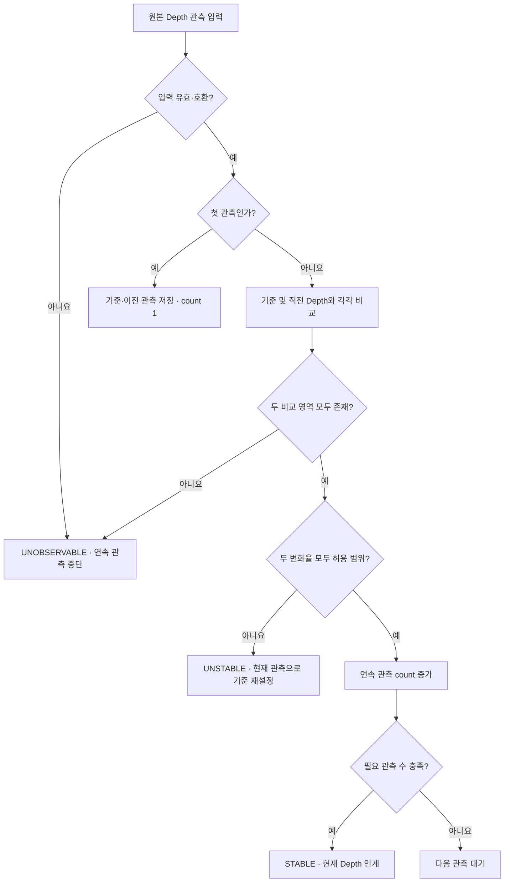

# Depth Scene Stability Algorithm

- **Algorithm ID:** `depth-scene-stability`

- **범위:** DetectTarget 요청별 원본 Camera Depth 관측의 안정화 판단
- **Owner:** ARM Cell Material Detection
- **상위 계약:** [Vision CDS](../components/vision/cds.md), [DetectTarget FDS](../components/vision/fds-detect-target.md), [Frame Ingress FDS](../components/vision/fds-frame-ingress.md), [RawPart FDS](../components/vision/fds-rawpart-depth-perception.md)

## 목적

고정 카메라의 원본 Depth Grid를 이용하여 연속 5회 관측에서 자재의 가시적 움직임이 멈췄는지 판단한다. 자재 분할·적격성·후보 우선순위를 계산하거나 Detector 형상·Occupancy 계약을 변경하지 않는다. RGB 값, Tray 형상, Calibration 변환, 시뮬레이터 상태는 비교 입력이 아니다.

## 입력 및 유효성

입력은 Source Stamp, 수신 시각, Frame 및 Acquisition 식별자가 연결된 필터링 전 Depth Frame(m 단위)이다. `32FC1`은 m, `16UC1`과 `mono16`은 mm에서 m로 변환한 값으로 해석한다. 양의 유한 Pixel만 유효하며 0·NaN·무한대는 미관측이다. 비교 Frame·해상도·Pixel 좌표가 같아야 한다. 기존 CameraInfo/Calibration 호환성, Source Stamp, Freshness, Watermark 및 단일 Acquisition Deadline 계약은 유지한다. RGB Pairing은 안정화 수락 조건이 아니다.

이 판단에는 필터링·Rectification·투영·Resampling·ROI Crop·Heightmap·Foreground Mask 등 이미지 변환을 적용하지 않는다. STABLE 판정을 만든 **바로 그 Depth 관측**을 선택된 Detector에 한 번 인계하며 원본 관측 식별자를 유지한다.

## 알고리즘 흐름



## 핵심 계산식

각 비교 대상 `D_t`, `D_j`에 대해 동일 화소에서 유한하고 양수인 Depth만 비교한다.

```text
C(t,j) = {p | D_t(p) > 0, D_j(p) > 0, 두 값 모두 유한}
delta(t,j,p) = |D_t(p) - D_j(p)|
r(t,j) = |{p in C(t,j) | delta(t,j,p) > epsilon_d}| / |C(t,j)|
stable(t) = (r(t,reference) <= epsilon_r)
         AND (r(t,previous) <= epsilon_r)
```

`epsilon_d`는 `depth_difference_tolerance_m`, `epsilon_r`는 `changed_pixel_ratio_tolerance`다. 두 비교의 분모는 서로 독립적이며, 어느 하나라도 비교 가능 화소 수가 0이면 안정 판정은 성립하지 않는다. 실제 설정값의 소유권은 운영 Profile에 있다.

## 관측 간 비교

두 Depth Frame에서 모두 양의 유한값인 Pixel만 비교한다. Pixel별 절대차(m)를 계산하고 그 값이 `depth_difference_tolerance_m`보다 **엄격히 클 때만** 변화 Pixel로 센다:

```text
difference_m = abs(current_depth_m - earlier_depth_m)
changed = difference_m > depth_difference_tolerance_m
changed_pixel_ratio = changed_pixels / comparable_pixels
```

현재 Depth를 안정 기준 Reference 및 바로 이전 Depth와 각각 독립적으로 비교한다. 두 비율은 각 비교의 유효 Pixel 수를 분모로 사용하며 비교 영역을 교집합이나 합집합으로 합치지 않는다. 어느 하나라도 비교 가능한 Pixel이 없으면 UNOBSERVABLE이며 연속 관측을 중단한다. 미관측 Pixel로 안정성을 추론하지 않는다. Pixel 최소 개수·Coverage 비율·Tray 가시성·지역 Gate는 추가하지 않는다. 비교별 Pixel 수와 비교 영역 밖의 현재 유효 Depth 수를 기록해 제한된 증거를 드러낸다.

두 변화율이 **각각** `changed_pixel_ratio_tolerance` 이하일 때에만 현재 관측이 안정적이다. 하나라도 초과하면 UNSTABLE로 판정하고 현재 Depth를 새로운 기준·직전 관측으로 정하며 Count를 1로 재설정한다.

## 연속 관측 판정

- 첫 유효 Depth를 기준·이전 관측으로 저장하고 Count=1, 상태=UNOBSERVABLE로 대기한다.
- 두 변화율이 모두 허용 범위면 Count를 증가시킨다.
- 허용 범위 초과는 UNSTABLE이며 현재 Depth로 기준과 이전 관측을 갱신하고 Count=1로 재시작한다.
- 입력 무효·비호환, 유효 Depth Pixel 부재, 비교 불가능 시 UNOBSERVABLE이며 연속 관측을 중단한다.
- 유효 관측 5회 연속 조건이 충족되면 STABLE이다. 판정에 사용한 현재 Depth를 해당 Acquisition의 Detector에 한 번 인계한다.
- 요청 시작·취소·Terminal 정리·관측 무효화 때마다 요청별 상태를 초기화한다. 기존 단일 Acquisition Deadline을 공유한다.

## 운영 파라미터

| 파라미터 | 기본값 | 의미·선정 근거 |
|---|---:|---|
| `diagnostics.depth_scene_stability.depth_difference_tolerance_m` | `0.003` m | Pixel별 Depth 절대차 Deadband. 과거 Cuboid 높이 허용오차에서 유래한 3mm 기준을 계승하며 실측 Camera Noise 값은 아니다. |
| `diagnostics.depth_scene_stability.changed_pixel_ratio_tolerance` | `0.01` | 비교별 최대 변화 Pixel 비율. 기존 20×20 단일 Pixel Fixture는 0.25%, 이동한 3×3 Fixture는 최소 4.5%를 보여 1% 기준을 뒷받침하나 실제 카메라 실측치는 아니다. |
| `scene_stability.stable_observation_count` | `5` | 연속 유효 관측 필요 횟수. |

두 허용오차는 독립적으로 설정할 수 있다. 과거 Heightmap 전용 `mask_change_tolerance`, `height_change_tolerance`, `height_deadband_m`은 Scene Stability에 사용하지 않는다. 다른 Detector·Calibration의 동명 설정은 해당 Owner에 남는다.

## Snapshot 및 진단 근거

기본 Acquisition Diagnostic Record에는 최신 상태·원인·Count·유효/미관측 Pixel 수·실제 허용오차를 기록한다. 상세 캡처 활성 시 최근 최대 5회 관측 각각의 Source/수신·경과 시각, 기준/직전 비교 Pixel 수, 변화 Pixel 수·비율, 유효/미관측 수, 적용 허용오차, 증거 한계, 판정 상태·이유·Reset 이유를 Snapshot Metadata 및 Diagnostic Record에 남긴다. 각 비교의 절대차 Histogram도 기록한다.

Histogram Bin은 m 단위로 다음 구간을 사용한다:
`[0,0.0005)`, `[0.0005,0.001)`, `[0.001,0.002)`, `[0.002,0.003)`,
`[0.003,0.005)`, `[0.005,0.01)`, `[0.01,0.02)`, `[0.02,0.05)`,
`[0.05,0.1)`, `[0.1,0.2)`, `[0.2,0.5)`, `[0.5,1)`, `[1,2)`, `[2,5)`,
`[5,10)` and `[10,inf)`. 기존 Snapshot Worker는 기준·이전 관측 Histogram을 같은 Acquisition 디렉터리의 `scene_stability_panorama.png`에 렌더링한다. 상세 캡처 비활성 시 Histogram 계산·출력을 생략하고 전체 Depth Frame 또는 Frame별 이미지를 추가 저장하지 않는다.

일반 로그는 의미 있는 상태 변화와 원인만 보고한다. Frame별 측정값·Count·Histogram은 기존 Snapshot과 Diagnostic Record에 보존한다.
