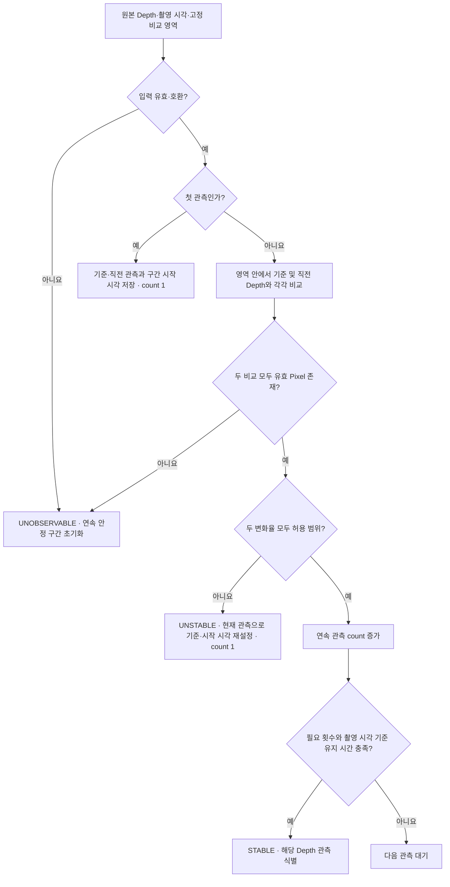

# Depth Scene Stability Algorithm

- **Algorithm ID:** `depth-scene-stability`
- **범위:** DetectTarget 요청별 원본 Camera Depth 관측의 안정화 판단
- **Owner:** ARM Cell Material Detection
- **실현 대상 계약:** [DetectTarget FDS](../components/vision/fds-detect-target.md), [Frame Ingress FDS](../components/vision/fds-frame-ingress.md)

## 목적과 경계

보정된 트레이 작업 영역에서 원본 Depth의 변화율·연속 관측 횟수·촬영 시각 기준
안정 유지 시간을 계산한다. 자재 분할·후보 적격성·유효 부재·파지 가능성은 판단하지
않는다. STABLE 결과의 Detector 인계와 요청 Deadline은 DetectTarget FDS가 소유한다.

## 입력과 비교 영역

| 입력 | 계산에 사용하는 의미 |
|---|---|
| 원본 Depth·Source Stamp | 필터링 전 Depth와 안정 구간의 촬영 시각 |
| CameraInfo·선택 Calibration·설정 트레이 작업 영역 | 지지 평면 Tray Z=0의 작업 영역을 영상에 투영하여 고정 비교 영역 P를 정의 |
| Frame·Acquisition·수신 시각 | 입력 호환성·Freshness·Watermark는 Frame Ingress FDS를 따름 |
| 운영 Profile | Depth 차이 허용오차, 변화 Pixel 비율 허용오차, 필요 관측 횟수와 최소 안정 유지 시간 |

비교 영역 P는 현재 측정된 자재 Depth와 독립적이다. 영역 밖 Pixel은 변화율의
분자·분모에 포함하지 않는다. Calibration과 Tray Geometry는 영역을 정하는 데만
사용하며, 실제 비교값은 원본 Camera Depth다. RGB 값·Detector Heightmap·후보 출력·
시뮬레이터 상태는 비교값이 아니다. 비교를 위해 Depth를 Filter·Rectification·
Resampling하거나 Heightmap으로 변환하지 않는다.

`32FC1`은 m, `16UC1`과 `mono16`은 mm에서 m로 변환해 해석한다. 양의 유한 Pixel만
유효하며 0·NaN·무한대는 미관측이다. 비교 Frame·해상도·Pixel 좌표가 같아야 한다.
호환 CameraInfo/Calibration과 유효 Source Stamp·Freshness는 기존 입력 계약을
따른다. RGB Pairing은 안정화 수락 조건이 아니다.

## 알고리즘 흐름



## 핵심 계산과 판단 규칙

현재 관측 `D_t`와 비교 관측 `D_j`(기준 또는 직전)에 대해 다음을 계산한다.

```text
C(t,j) = {p in P | D_t(p) > 0, D_j(p) > 0, 두 값 모두 유한}
delta(t,j,p) = |D_t(p) - D_j(p)|
r(t,j) = |{p in C(t,j) | delta(t,j,p) > epsilon_d}| / |C(t,j)|
stable_observation(t) = (r(t,reference) <= epsilon_r)
                    AND (r(t,previous) <= epsilon_r)
STABLE(t) = stable_observation(t)
         AND (count >= required_count)
         AND (source_stamp(t) - stable_start_stamp >= minimum_stable_duration)
```

| 변수·판단 | 의미·경계 |
|---|---|
| P | 보정된 지지 평면에서 투영한 고정 트레이 작업 영역 |
| `epsilon_d` | `depth_difference_tolerance_m`; 절대차가 엄격히 큰 Pixel만 변화로 계산 |
| `epsilon_r` | `changed_pixel_ratio_tolerance`; 두 변화율이 각각 허용치 이하여야 함 |
| `C(t,reference)`, `C(t,previous)` | 각 비교의 독립적인 유효 Pixel 집합; 분모를 교집합·합집합으로 합치지 않음 |
| 비교 가능 Pixel 부재 | 어느 한 비교라도 비어 있으면 UNOBSERVABLE; 미관측으로 안정성 추론 금지 |
| `count`, `required_count` | 연속 유효 관측 수와 `scene_stability.stable_observation_count` |
| `stable_start_stamp` | 현재 연속 안정 구간을 시작한 Depth 촬영 시각 |
| `minimum_stable_duration` | `scene_stability.minimum_stable_duration_s`; Source Stamp 차이로 계산하고 wall/steady 경과시간으로 대체하지 않음 |

고정 비교 영역은 Pixel 선택 범위다. Pixel 최소 개수·Coverage 비율·Tray 가시성
조건을 추가 Detector 진입 Gate로 만들지 않는다. 유효 부재에 필요한 Coverage는
Detector의 별도 계약이다. 관측 횟수와 유지 시간은 운영 Profile에서 선택하며
설계에서 기본값을 중복 소유하지 않는다.

## 연속 관측과 종료

| 관측·이벤트 | 결과·상태 갱신 |
|---|---|
| 첫 유효 Depth | 기준·직전 관측과 구간 시작 시각을 저장하고 Count=1, UNOBSERVABLE로 대기 |
| 두 변화율 허용 범위 | Count 증가; 필요 횟수와 최소 유지 시간을 모두 충족하면 STABLE |
| 변화율 초과 | UNSTABLE; 현재 관측을 기준·직전으로 삼고 Count=1 및 시작 시각 재설정 |
| 무효·비호환 입력, 유효/비교 가능 Pixel 부재 | UNOBSERVABLE; 연속 안정 구간 초기화 |
| 요청 시작·취소·Terminal 정리·관측 무효화 | 요청별 상태 초기화 |

요청의 단일 steady monotonic Deadline은 전체 Acquisition을 제한한다. 실제 시간이
흘렀다는 이유만으로 안정 유지 시간을 충족하지 않는다. STABLE을 만든 정확한 Depth
관측의 식별자를 보존하며 Detector를 위한 추가 관측이나 RGB Pairing을 요구하지 않는다.

## Snapshot 및 진단 근거

기본 Acquisition Diagnostic Record에는 최신 상태·원인·Count·유효/미관측 Pixel 수·실제 허용오차를 기록한다. 상세 캡처 활성 시 최근 최대 5회 관측 각각의 Source/수신·경과 시각, 기준/직전 비교 Pixel 수, 변화 Pixel 수·비율, 유효/미관측 수, 적용 허용오차, 증거 한계, 판정 상태·이유·Reset 이유를 Snapshot Metadata 및 Diagnostic Record에 남긴다. 각 비교의 절대차 Histogram도 기록한다.

Histogram Bin은 m 단위로 다음 구간을 사용한다:
`[0,0.0005)`, `[0.0005,0.001)`, `[0.001,0.002)`, `[0.002,0.003)`,
`[0.003,0.005)`, `[0.005,0.01)`, `[0.01,0.02)`, `[0.02,0.05)`,
`[0.05,0.1)`, `[0.1,0.2)`, `[0.2,0.5)`, `[0.5,1)`, `[1,2)`, `[2,5)`,
`[5,10)` and `[10,inf)`. 기존 Snapshot Worker는 기준·이전 관측 Histogram을 같은 Acquisition 디렉터리의 `scene_stability_panorama.png`에 렌더링한다. 상세 캡처 비활성 시 Histogram 계산·출력을 생략하고 전체 Depth Frame 또는 Frame별 이미지를 추가 저장하지 않는다.

일반 로그는 의미 있는 상태 변화와 원인만 보고한다. Frame별 측정값·Count·Histogram은 기존 Snapshot과 Diagnostic Record에 보존한다.
