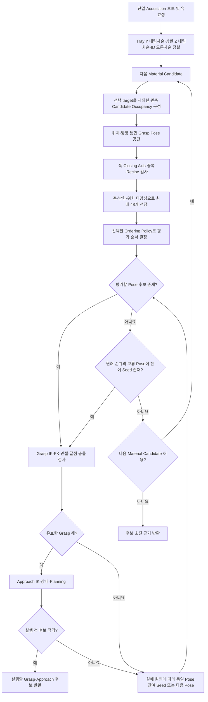

# ARM Cell PICK 후보 우선순위·운동학 탐색 Algorithm

- **Algorithm ID:** `motion-pick-candidate-search`
- **Owner:** Task Execution (Material Candidate 순서·전환), Motion (Grasp Pose 생성·운동학 실현 가능성)
- **실현 대상 계약:** [Task Execution PnP FDS](../components/task-execution/fds-pnp-execution.md), [Motion Execution FDS](../components/motion/fds-motion-execution.md), [Task Execution CDS](../components/task-execution/cds.md), [Task Execution–Motion ICD](../interfaces/icd-task-execution-motion.md)

## 목적과 경계

한 Acquisition의 Material Candidate를 결정적인 우선순위로 방문하고, 후보별 Recipe·관측 evidence가 허용하는 Grasp Pose와 Approach의 운동학적 실현 가능성을 평가하는 절차다. Task Execution은 후보 순위와 다음 후보로의 전환을 결정하고 Motion은 선택된 후보의 pose 생성과 IK·관절·충돌·경로 평가를 수행한다. Vision 열거 순서는 파지 우선순위가 아니다. 산출물은 실행할 후보 또는 탐색 소진 근거이며, PICK 공정·Terminal PnP 결과와 개별 movement 실행 결과는 각각 Task Execution 및 Motion의 정식 FDS가 소유한다.

## 입력과 산출물

| 구분 | 계산에 사용하는 정보 | 결과 |
|---|---|---|
| 입력 | 한 Acquisition의 전체 Material Candidate ID·`base_link` 상판 Pose·Orientation Symmetry·Rectangle Geometry·자체 두께와 현재 선택된 Candidate ID | 검증 가능한 후보 순위와 선택 target의 관측 Occupancy |
| 입력 | Object Pose, Recipe의 접촉면·Closing Axis·폭 범위·Object-to-TCP 관계·Approach 거리, Motion 운영 Profile | TCP 위치·방향 후보 영역 및 탐색 예산 |
| 입력 (Motion) | 최신 측정 관절, Robot/Gripper 모델, Planning Scene, IK/FK·Planner 결과 | 선택된 자재의 후보별 운동학 실현 가능성 평가 근거 |
| 산출 | 결정적으로 정렬된 Material Candidate, Grasp Pose Candidate 및 평가·소진 근거 | FDS의 Action 실행 또는 최종 분류에 전달 |

## 알고리즘 흐름



Motion은 선택된 후보에 대한 계산상 Planning 근거를 반환한다. 계산 실패를 다음 Material Candidate로 전환할지는 Task Execution이 기존 eligibility와 Action-local budget에 따라 결정한다. Grasp 삽입 시작 이후 실제 실행 실패, Scene·Backend·Safety·Gripper/Holding 실패 또는 불확실 결과는 후보 전환을 허가하지 않는다. 최종 Cartesian Descent 실행은 Task Execution이 순서를 정하고 Motion이 계획·실행한다.

## 핵심 계산과 판단

### Geometry·후보·탐색 용어

- **Observation Pose**는 Vision이 관측한 자재 기준점의 위치·방향이다. Motion은 이를 `T_base_observation`으로 표현하고 `T_observation_object`를 합성해 **Object Pose** `T_base_object`를 얻는다. 다시 `T_object_grasp_tcp`를 합성한 `T_base_grasp_tcp_ref = T_base_object · T_object_grasp_tcp`가 최초 기준 자세인 **Reference Grasp TCP Pose**다. Recipe의 객체 기준점과 grasp TCP 기준점은 서로 다른 Geometry 기준이다.
- **Face Pair**는 직육면체의 대향면 쌍이고, **Closing Axis**는 jaw가 닫히는 TCP +X와 정렬되는 객체 축이다. Closing Axis는 면 선택 의미이며 Orientation 그 자체가 아니다.
- **Orientation Sample**은 특정 Closing Axis를 보존하며 생성된 TCP 방향이다. 축별 유효 생성 순번은 다른 Closing Axis의 방향들과 통합된 Orientation 후보 식별 순번과 구분한다. 이 순번은 생성 식별자이지 품질 순위가 아니다.
- **Position Offset Sample**은 Reference Grasp TCP Pose 위치에 객체 좌표계로 더하는 이동량이다. 자세 방향과 결합되어 실제 6D **Grasp Pose Candidate**를 이룬다.
- **Candidate Selection**은 기하학적으로 적격한 후보 중 정해진 상한과 기존 다양성 배분에 따라 유한 집합을 고른다. **Candidate Ordering**은 선정된 후보를 기존 평가 우선순위로 배열한다. 그 뒤 **Pose/Seed Search**가 후보별 IK·FK·Collision·Approach Planning을 수행한다.
- 운영 설정의 책임은 다음처럼 구분한다.

  | 책임 | 설정이 정하는 내용 |
  |---|---|
  | Geometry | Observation → Object → Reference Grasp TCP 변환과 TCP 축 정의 |
  | Sampling | Closing Axis별 회전 샘플 수, 면 접선 Position Offset 해상도·상대 범위, 허용 최대 Withdrawal Tilt와 음의 상판 법선 Offset |
  | Selection | 전체 Grasp Pose Candidate 상한과 기존 후보 다양성 배분 |
  | Ordering | 선정된 동일 후보 집합의 평가 순서. 시작 시 `pick_grasp_pose_order_policy`로 선택하며 기본값은 `distance_then_tilt` |

  Orientation/Position 샘플링 설정은 평가 선호 정책을 정하지 않는다. Ordering은 후보 선정 이후의 독립 책임이며 어떤 후보를 선정하거나 제거하지 않는다.

### Material Candidate 순서

1. `target_pose`는 이미 `base_link`로 전달되는 관측 상판 Pose이므로 Y 좌표를 기준으로 내림차순 정렬한다. 설치 좌표계/TF에서 Tray +Y는 로봇 쪽을 향하므로 Y가 큰 후보부터 Tray 안쪽(로봇 쪽)에서 바깥쪽으로 평가한다. 3차원 거리, 객체 하단, 자체 두께 또는 상판 법선 투영은 순위에 사용하지 않는다.
2. Y가 같으면 관측 상판 높이 `target_pose.position.z`가 높은 후보를 먼저 평가한다. 객체 두께나 눕힌 면은 별도로 보정하지 않으며 적층 구분이나 높이 동등 그룹을 만들지 않는다.
3. Y와 Z가 모두 같으면 `candidate_id` 오름차순으로 결정한다. 비교는 exact coordinate 값에 적용하며 Vision 열거 순서에 의존하지 않는다.

가중 점수나 Vision 후보 순위로 대체하지 않는다. 이는 도메인 우선순위이지 Reachability·성공 보증이나 별도 Gate가 아니다. `top_height_tolerance_m`는 Vision의 관측 높이 비교 메타데이터이며 PICK 우선순위에는 사용하지 않는다. 후보 목록의 비어 있지 않은 단일 Acquisition ID와 중복 없는 비어 있지 않은 Candidate ID는 FDS/ICD의 입력 일관성 조건이다. 후보별 Pose·Geometry 검증에 실패한 항목은 기록·건너뛰되, 목록 전체의 ID 무결성 실패는 FDS가 분류한다. 후순위 후보를 미리 계획하거나 순위를 재계산하지 않는다.

### 객체 상대 TCP 후보 위치

허용된 Rectangle 대향면의 Closing Axis를 객체 축 `e_i`로 두고 다른 두 직교 축을 `e_j,e_k`, 그 측정 길이를 `L_j,L_k`, Object Frame 공칭 TCP Translation을 `q_0`로 둔다.

```text
q = q_0 + u e_j + v e_k
|q_j| < L_j/2
|q_k| < L_k/2
```

Closing Axis 방향 좌표는 보정된 공칭값으로 유지하며 위 부등식은 후보 생성의 영역 제한이지 Finger Pad의 실제 접촉 성공 판정이 아니다. Recipe가 허용하는 면의 **공칭 중앙 후보**는 추가 Offset 범위와 무관하게 생성하며, 다른 Pose와 동일한 기하학적 적격성을 적용하고 후보 상한 안에서 보존한다. 실제 Close/Capture·fresh `HELD`가 파지 성공을 결정하며 Capture Volume은 별도 Backend 검사다.

관측 상판 Normal의 음의 방향 추가 Offset은 `q_0` 기준 Motion Profile의 `pick_max_downward_position_offset_m`를 넘지 않는다. Normal은 Object `+Z`를 Planning Frame으로 변환한 것이다. 이 한계는 음의 Normal Offset에만 적용하며 공칭·상판 평행·양의 Normal Offset의 원래 적격성은 제한하지 않는다. 물체 회전과 관계없이 동일한 Object Frame 규칙을 적용한다.

### TCP 방향과 Approach

파지 가능한 대향면 쌍은 기존 직육면체의 X/Y/Z축과 Recipe 허용 폭·실제 Gripper 최대 폭 85mm로 결정한다. TCP +X Closing Axis와 선택한 객체 축 사이에는 양방향 부호를 동등하게 취급하는 1° 이내 정렬 오차를 허용한다. 이는 FK/IK의 작은 방향 오차를 허용하는 범위이며 임의의 비스듬한 접촉을 허용하지 않는다. 후보 생성과 실제 FK 접촉 검증에 같은 기준을 적용한다. 유효한 위치에 이 Closing Axis와 예상 접촉 폭에 맞는 방향을 결합한다. Closing Axis 주위 회전과 삽입축을 탐색하며 고정된 소수 Quaternion으로 제한하지 않는다. 객체 Orientation 대칭 분류와 Top Plane의 두 Jaw Axis·폭 선택은 별개의 판단이다. Finger Pad 최소 면적, Edge Erosion, 추가 Tool Sweep·면별 충돌 Gate는 도입하지 않는다.

TCP 삽입축 `insertion_axis_tcp`가 주어질 때 Planning Frame에서

```text
a = R_base_tcp · normalize(insertion_axis_tcp)
w = -a
angle(w, n_support) <= configured_max_tilt
p_A = p_G - d_A a,    R_A = R_G
p_R = p_G - d_R a,    R_R = R_G
```

`a`는 Grasp 삽입 방향, `w`는 후퇴 방향, `n_support`는 동일 Frame의 Support Normal, `d_A`는 Recipe Approach 거리, `d_R`은 Motion이 소유한 Retract 거리다. Tilt는 객체 상판 외향 법선과 TCP 후퇴 방향 사이의 각도이며 공칭 위치를 포함한 모든 Pose의 유효 탐색 범위에 적용한다. 운영 기본값 90°는 수직 위쪽 0°부터 정확한 수평 90°까지 허용하며 아래쪽 후퇴를 새로 허용하지 않는다. 지원하는 수평 Tray 도메인에서 상판 외향 법선은 지면 수직 위쪽이다. 이 범위는 파지 자세 탐색 범위이며 추가 충돌 검사나 승인 Gate가 아니다.

### 탐색 순서 및 유효성

모든 후보는 객체 상대 TCP 위치·Orientation·Closing Axis·Contact 근거를 가진 동일한 Grasp Pose다. 위치와 방향은 처음부터 결합된 6D 후보 공간이며, 후보 생성 방식에 따른 실행 분기를 두지 않는다. Closing Axis 주위의 기존 방향 샘플마다 공칭 위치와 해당 면의 두 접선 Offset·대각 Offset을 결합한다. 기존 방향 축당 8개, 위치 축당 3개 해상도, 범위, 음의 상판 Normal 제한과 좌표 변환을 유지한다. 같은 TCP 위치·방향은 Quaternion 부호와 무관하게 중복 제거한다. 기하학적 적격성은 Recipe·Closing Axis 정렬·대향면·폭·Contact·위치 영역·운영 최대 Tilt로 판단하며, IK 도달 가능성과 구별한다. 최대 허용 Tilt는 Sampling 적격성 한계이고 Ordering의 낮은 Tilt 선호와 별개다.

#### 후보 선정

IK 이전의 저비용 기하학적 계산으로 최대 48개의 평가 대상을 결정한다. 각 적격 Closing Axis의 공칭 위치·방향을 보존하고, 축 사이에 차례를 배분하면서 각 축의 서로 다른 방향을 넓게 확보한다. 각 방향의 공칭 위치도 같은 공간의 한 점으로 보존한다. 남은 자리는 축·방향별로 한 번씩 돌아가며 Offset을 배분한다. 방향별 Offset 방문 시작점을 순환시켜 작은 반경이나 한 접선·부호에 전체 배분이 집중되지 않고 기존 바깥 반경·양쪽 접선·대각 위치에도 기회를 준다. 한 방향의 Offset을 먼저 소진하지 않는다.

배분은 입력에 대해 결정적이고 가중 점수나 새로운 거리·각도 거부 조건을 사용하지 않는다. 유한 샘플 공간에서 필요한 조합을 순차 열거하며, 전체 위치·방향 Cartesian Product를 메모리에 만들거나 모든 후보에 IK를 수행하지 않는다. 적격성 검사·중복 제거 후 자리가 남으면 다음 조합을 방문하고, 상한 도달 또는 유한 공간 소진으로 선정을 끝낸다. 후보 상한은 연속 영역 전체의 포함이나 실행 가능성을 보장하지 않는다.

#### 선정된 후보의 평가 순서

Candidate Selection이 최대 48개까지 적격 후보 집합을 확정한 뒤, Candidate Ordering은 그 같은 집합에 정렬 기준만 적용한다. 두 정책 모두 객체 좌표계에서 공칭 TCP 위치 `q_0`와 후보 위치 `q`의 거리 `d = ||q - q_0||` 오름차순을 최우선으로 한다. Closing Axis 방향의 공칭 Translation은 유지되므로 추가 Offset의 Euclidean norm과 같다. 수치적으로 같은 샘플 거리는 부동소수점 계산 잡음만 동률로 취급한다.

`pick_grasp_pose_order_policy`는 Motion 시작 시 적용되는 운영 설정이며 허용 값은 다음과 같다.

| 정책 | 거리 동률의 순서 |
|---|---|
| `distance_then_tilt` (기본값) | Withdrawal Tilt 오름차순 → 동일 방향 반복 분산 → Closing Axis별 Orientation Sample 순번 → 안정적인 생성 순서 |
| `distance_then_diversity` | 기존 정책: 동일 거리에서 Orientation 반복 분산 → Closing Axis별 Orientation Sample 순번 → Withdrawal Tilt 오름차순 → 안정적인 생성 순서 |

Withdrawal Tilt는 TCP 후퇴 방향과 객체 상판 외향 법선 사이의 각도다. 0°는 수직 위쪽, 45°는 기울어진 후퇴, 90°는 수평 후퇴다. 운영 최대 Tilt 기본값 90°는 바뀌지 않는다. `distance_then_tilt`의 낮은 Tilt 선호는 추가 적격성 Gate가 아니며 이미 선정된 높은 Tilt와 수평 후보를 제거하지 않는다. 수직 자세의 IK·Collision·Approach Planning 실패 뒤에는 기존 Pose·Seed 탐색에 따라 기울어진 자세와 수평 자세도 평가한다.

다양성 배분은 후보 **선정**의 책임이고 Ordering은 확정된 집합의 평가 순서만 정한다. 낮은 Tilt 선호는 새 점수나 거부 조건이 아니며 선정된 먼 Pose도 앞선 후보 실패 뒤 평가될 수 있다.

Pose·Seed 탐색 진행 책임은 이미 선정·정렬된 Pose를 순차 방문하며 기하학을 다시 계산하지 않는다. IK·FK·관절 범위·Collision·Approach IK·Global Planning 검증은 기존 실행 메커니즘이 소유한다.

#### 실패 원인별 Pose·Seed 탐색

Pose 다양성은 TCP 위치·방향을 바꾸고 Seed 다양성은 같은 TCP Pose의 다른 관절 해에 기회를 준다. 탐색은 Pose별 사용·잔여 Seed, 즉시 재시도, 보류와 재방문, 소진·선택·중단을 이 Algorithm의 규칙에 따라 수행한다. Motion은 Solver와 검증에서 확인한 실패 근거를 사용하며 진단 문구로 전환을 결정하지 않는다.

| 실제 평가 근거 | 다음 탐색 대상 |
|---|---|
| Grasp IK `NO_IK_SOLUTION` | 다음 Pose의 측정 Seed를 우선하고 현재 Pose의 남은 Seed를 보류 |
| Grasp 해의 실제 충돌 | 같은 Pose의 남은 다양화 Seed를 즉시 시도 |
| 유효 Grasp 이후 Approach IK 실패 | 같은 Pose의 남은 다양화 Seed를 즉시 시도 |
| 기하학적 Contact 불일치 | 현재 Pose를 종료하고 다음 Pose; 다른 위치·방향은 배제하지 않음 |
| Global Planning 실패 | 기존대로 현재 Pose를 종료하고 다음 Pose |
| 기타 Grasp IK 실패·Joint Limit·FK·Approach 상태 검증 실패 | 원인을 구별해 보존하며 기존의 같은 Pose 잔여 Seed 재시도 유지; `NO_SOLUTION`이나 실제 충돌로 추정하지 않음 |
| 실행 가능한 Approach 계획 | 즉시 선택하고 탐색 종료 |
| Backend·Scene 오류 또는 Safety·Cancel 중단 | 기존 오류·중단 처리; 후보 재시도 없음 |

1차 탐색은 확정된 Pose 우선순위를 그대로 따른다. 각 Pose의 첫 시도는 현재 측정 관절 Seed다. 즉시 재시도 대상이면 그 Pose의 두 번째 Seed를 사용하고 완료·소진한다. `NO_SOLUTION`은 해당 Seed에서 해를 얻지 못했다는 뜻이며 Pose 전체의 불가능성 증명이 아니다.

1차에서 실행 가능한 계획을 찾지 못하면 보류 Pose만 원래 우선순위대로 재방문한다. 사용하지 않은 다양화 Seed만 시도하고 같은 Pose·Seed 기회를 반복하지 않는다. 두 Seed를 사용했거나 Contact·Planning 정책으로 종료한 Pose는 재방문하지 않는다. 두 번째 시도는 동일한 IK·FK·Contact·Collision·Approach·Planning 검증을 모두 거친다. 이 과정은 동일 PICK 탐색의 연속이며 새 Action이나 Acquisition이 아니다. Pose당 최대 2회이며 PICK Action 공통 탐색 예산 100초와 Material Candidate별 탐색 예산 기본 15초를 함께 적용한다. Pose·Seed 보류 및 재방문은 해당 Material Candidate 예산을 초기화하지 않는다. 다음 Material Candidate로 전환할 때 후보별 예산만 초기화하고 Action 공통 예산은 유지한다. 실제 IK·Planning 호출 한도는 설정된 호출 한도와 두 잔여 예산 중 가장 짧은 값으로 제한한다. 시간 검사는 호출 경계에서 협력적으로 수행하며 Solver를 강제로 중단하지 않는다. 예산 소진은 보류 후보가 남아 있어도 탐색을 종료하며 정상 후보 소진과 구별한다.

두 번째 Seed는 기존 Randomized Seed와 충돌 관절 중심 다양화를 사용한다. 실제 접촉이 확인되고 같은 Pose의 직전 실패에 관련된 충돌 관절만 힌트로 사용할 수 있다. Approach IK 실패처럼 접촉 근거가 없거나 출처·관련성이 불명확하면 일반 Randomized Seed를 사용한다. 이전 Pose·실행 구간의 충돌을 현재 실패의 근거로 사용하지 않는다. 힌트는 거부 조건이 아니며 Seed 분포와 Solver 자체는 바꾸지 않는다.

선택한 Pose는 Full-pose IK(선택된 Solver·Seed 경로), 반환 Joint Limit·FK·연속성·최종 Grasp 상태 충돌 검사 후 Approach IK·끝점 검증·Global Planning으로 평가한다. FK로 확보한 유효 Orientation은 Position-only IK를 선행하지 않아도 허용된다. Position-only IK는 Seed 생성 수단일 뿐 성공 또는 적격성의 전제가 아니다. Approach 계획 성공은 최종 Grasp 삽입 경로의 통과를 보장하지 않는다.

하나의 Material Candidate 안에서는 Approach Planning을 통과하는 첫 적격 Grasp Pose를 선택하며 이후 Pose를 선계획하지 않는다. 실패 근거는 정확한 Goal·Solver·Seed·Timeout·Scene·Start·Planner 조건에 종속된다. 동일 조건 실패가 다음 후보의 무효성을 **논리적으로 증명할 때만** 재사용하고, 유사 Pose나 이전 후보의 실패로 독립 후보를 제거하지 않는다. 접촉 근거의 Seed 힌트 사용은 위의 동일 Pose·직전 시도 관련성 범위를 지키며 출처를 기록한다.

운영 Profile의 최대 후보 48개와 기존 Seed·Planner 호출·시간 한도를 유지한다. TRAC-IK Distance, Grasp/Approach IK 호출당 각각 1초, Pose당 현재 관절 Seed → 다양화 Seed 최대 2회, Grasp 해의 Approach Seed 재사용, 위 탐색 예산과 실패별 전환, RRTConnect 및 첫 실행 가능 Approach 계획 채택을 유지한다. 후보별 한도는 객체별 독립 적용하지만 Action 공통 시간 예산은 후보 전환으로 초기화하지 않는다. 소진이 연속 영역 전체의 불가능성 증명은 아니다.

### Target별 관측 Occupancy 구성

Vision-derived PICK의 현재 `candidate_id`를 선택 target으로 사용한다. 같은 Acquisition의 후보 목록에서 그 ID와 일치하는 단일 후보를 제외하고 나머지 유효 HIGH/MEDIUM 후보마다 하나의 BOX 관측 점유를 만든다. 각 BOX는 해당 후보의 `target_pose`가 나타내는 상판 중심·방향, `rectangle_long_side_m`, `rectangle_short_side_m`, `estimated_height_m`에서 정의한다. 상판 Pose의 방향 회전행렬을 (R), 자체 두께를 (h), 상판 중심 위치를 (p_{top})이라 할 때 BOX 중심은 (p_{top}-R[0,0,h/2]^T), 변 길이는 `[rectangle_long_side_m, rectangle_short_side_m, h]`다. 이는 FDS에 정의된 상판 Reference→Object 중심 변환을 Occupancy Geometry에도 동일하게 적용한다. 다른 후보의 Pose·Geometry·Header/Stamp를 재검출하거나 수정하지 않는다. 같은 XY의 독립 후보도 ID가 다르면 포함한다.

LOW·미선택 대안·UNRESOLVED 영역은 일반 `material_candidates`에 없으므로 Occupancy로 승격하지 않는다. 미해결 공간은 이 점유맵에서 제외되며 자유 공간으로 주장하지 않는다. Motion은 `UNKNOWN_OCCUPANCY`를 생성하지 않고, 계산된 Empty map은 반환된 다른 Candidate가 없다는 뜻으로만 기록한다. 고정 Planning Scene·Robot Self Collision·Attachment 검사는 별도 유지한다.

구성한 점유맵은 해당 target attempt의 Pose·IK Seed 평가에 동일하게 사용하며 다른 Candidate attempt와 공유하지 않는다. Planning 적용, attempt별 map 재사용 및 Snapshot 수명은 [Motion Execution FDS](../components/motion/fds-motion-execution.md)가 소유한다.

Grasp 해의 끝점 검증은 Motion FDS의 Occupancy 전략을 적용하고 PICK 접근 경로 계획에서는 현재 target의 관측 Occupancy가 포함된 요청 범위 Scene을 사용하며, PICK 삽입·후퇴 및 PLACE에서는 제외한다. 고정 설비·Tray·Robot Self Collision·Attached Object 검사는 유지한다.

### Finger Clearance 계산

`FINGER_CLEARANCE`는 기존 Grasp Contact의 Closing Axis와 예상 폭을 재사용한다.
객체 중심 `o`, 선택된 객체 축을 TCP +X와 같은 부호로 정렬한 Planning Frame 단위벡터 `n`, 후보 TCP 위치 `p`,
Contact Width `w`에 대해 접촉 중심은 다음과 같다.

```text
c = p - n dot(n, p-o)
c_minus = c - (w/2)n
c_plus  = c + (w/2)n
```

즉 TCP의 접선 위치는 유지하고 법선 좌표만 기존 대향면에 정렬한다. 새로운 접촉면 추정이나
URDF 크기 추론을 하지 않는다. 각 손가락의 로컬 X는 해당 면의 외향 법선, Z는 기존 삽입 방향의
면 접선 성분을 정규화한 축, Y는 Z×X다. TCP 삽입축 모드에서는 후보 TCP로 삽입축을 회전하고,
Planning Frame 수직 모드에서는 기존 하향 삽입 방향을 사용한다. 축이 평행하여 접선 삽입 방향을
구성할 수 없거나 Contact Geometry가 없으면 계산 불가를 기존 Backend 오류로 전달한다.

각 접촉 중심 원점에서 보호 체적은 다음 외측 반캡슐 단면의 유한 압출이다.

```text
x >= 0
x² + max(|y| - span/2, 0)² <= radius²
-depth <= z <= 0
```

깊이는 최종 접촉 위치에서 진입 쪽으로 확장하며 전체 Approach 경로 Sweep이 아니다.
손가락 번호 0/1은 각각 TCP -X/+X 쪽이며 객체 축의 부호가 뒤집혀도 유지한다.
양쪽 체적은 독립적이며 하나라도 Non-target Occupancy의 내부와 교차하면 거부한다.
회전된 Occupancy BOX의 실제 Pose·치수를 사용한다. 직육면체를 외측 반공간과 삽입 깊이 구간으로
자른 뒤 그 볼록체의 XY 투영과 단면 중심 선분 사이 최소거리를 반경과 비교한다.
양의 체적 교차만 거부하여 외측 평면·깊이 끝면·원형 끝단의 단순 경계 접촉은 허용한다.
수치 기하 오차 허용은 1e-10 m이며 운영 여유가 아니다. 추가 Margin이나 이중 Gate는 없다.
Convex Mesh도 실제 형상과 보호 체적의 내부 교차를 검사하며 외접 BOX로 대체하지 않는다. 동일하게 양의 체적 교차만 거부하고 단순 경계 접촉은 허용한다.

운영 Profile의 `finger_clearance_radius_m=0.010`, `finger_contact_span_m=0.020`,
`finger_clearance_depth_m=0.025`는 모두 m 단위의 유한 양수 `(0, 1]`이며 최초 시연용 근사다.
시작 시 유효성을 검사하며 실제 그리퍼의 확정 치수를 뜻하지 않는다.
`NONE`·`FULL_COLLISION`의 판단은 이 치수나 Contact Geometry에 의존하지 않는다.

## 예외·불확실성·종료

| 계산 조건 | 알고리즘 결과 | 외부 처리 Owner |
|---|---|---|
| Material Candidate input invalid/priority group exhausted | 입력 근거·결정적 순서 또는 후보 소진 | Task Execution FDS의 candidate·PnP Result 계약 |
| Grasp Pose·IK·Approach 실현 불가 | 선택된 자재의 단계별 계산 근거 | Motion FDS가 계산 결과 반환; Task Execution이 기존 규칙으로 다음 자재 여부 결정 |
| 삽입 시작·실행·Backend·Scene·Safety·Gripper/Holding 불확실 | 추가 Material Candidate 전환 없음 | Task Execution FDS의 lifecycle과 Motion FDS의 movement failure 경계 |

## 검증 요구사항

| ID | 계산·판단 규칙 | 검증 가능한 기대 결과·금지 결과 |
|---|---|---|
| `VR-ALGO-PICK-01` | Material Candidate 순서 | Tray 방향 base_link Y 내림차순, 동률에서 관측 상판 Z 내림차순, 다시 동률이면 Candidate ID 오름차순으로 정렬한다. 두께나 면 방향을 보정하지 않으며 Vision 열거 순서는 결과를 바꾸지 않는다. |
| `VR-ALGO-PICK-02` | 통합 후보의 기하학적 적격성 | Recipe·Contact·Gripper 폭, Closing Axis 정렬, 객체 좌표 변환, Tilt 90° 경계와 음의 Normal Offset 제한을 유지하고 동등 TCP Pose를 중복 제거한다. 추가 Reachability·접촉면적·Edge·Sweep Gate를 도입하지 않는다. |
| `VR-ALGO-PICK-03` | 결정적 다양성 선정 | 최대 48개 안에서 적격 축의 공칭 위치·방향을 보존하고 서로 다른 방향과 내부·외부 반경·접선 Offset에 기회를 배분한다. 특정 방향의 Offset 또는 공칭 위치만으로 후보를 독점하지 않는다. 동일 입력은 같은 집합을 만들고 전체 조합 IK나 무제한 조합 물질화를 하지 않는다. |
| `VR-ALGO-PICK-04` | 평가 순서·실행 연계 | 같은 선정 집합에서 `distance_then_diversity`는 거리→방향 반복 분산→축별 방향 샘플→Tilt 순서를 유지하고, 기본 `distance_then_tilt`는 거리→Tilt→방향 반복 분산→축별 방향 샘플 순서를 적용한다. 두 정책은 선정 후보 집합을 바꾸지 않으며 수평 90° 후보를 유지한다. 선정된 먼 Pose는 앞선 실패 이후 평가 가능하며 기존 Seed·예산·Safety·Backend·Planning 검증과 첫 실행 가능 계획 선택을 보존한다. 다른 Pose의 실패를 정확히 동일한 계산 조건 없이 재사용해 제외하지 않는다. |
| `VR-ALGO-PICK-05` | 실패별 Seed·Pose 우선순위 | Grasp `NO_IK_SOLUTION`이면 후속 Pose 첫 Seed가 보류 Seed보다 먼저다. 실제 Grasp 충돌과 Approach IK 실패는 같은 Pose 두 번째 Seed가 먼저다. Contact 불일치와 Global Planning 실패는 다음 Pose로 전환하고 남은 Seed를 재방문하지 않는다. 기타 검증 실패·실제 Solver 오류와 Backend 오류를 혼동하지 않는다. |
| `VR-ALGO-PICK-06` | 보류 재방문·한도·종료 | 1차 실패 후 보류 Pose를 원래 순위대로 남은 Seed만 방문한다. 동일 Pose·Seed를 중복 시도하지 않고 두 Seed 사용 Pose는 제외한다. 같은 입력·평가 결과는 같은 방문 순서다. 두 순회는 PICK Action 공통 100초와 동일 Material Candidate의 기본 15초 예산을 초기화 없이 공유하고 예산·중단·Backend 오류 또는 첫 실행 가능 계획에서 남은 후보와 무관하게 종료한다. |
| `VR-ALGO-PICK-07` | 실패 근거와 실행 경계 | Transport의 실제 Solver 오류·Grasp 검증·Contact·충돌·Approach IK·상태 검증·Global Planning 단계에서 탐색 분류를 전달한다. 같은 Pose 직전 충돌만 관절 다양화 힌트로 사용하고 근거가 없으면 일반 Randomized Seed다. 다른 Pose의 실패·같은 관절 해로 독립 Pose를 배제하지 않으며 IK·Planning·외부 Result 계약을 보존한다. |
| `VR-ALGO-PICK-08` | Target별 Occupancy 구성 및 재사용 | 동일 Acquisition 후보 집합과 선택 ID에서 선택 후보만 제외하고 다른 유효 반환 후보의 BOX Occupancy를 구성한다. LOW·미해결 영역 또는 UNKNOWN Occupancy를 맵에 만들지 않고 Empty map을 미해결 공간이 비었다는 근거로 해석하지 않는다. 한 target attempt의 모든 Pose·Seed에는 같은 맵을 사용하고 다음 Candidate attempt에는 맵을 승계하지 않는다. Planning map과 Snapshot의 일치는 `VR-MOT-EXEC-09`에서 검증한다. |


## 참조

- [Task Execution PnP FDS](../components/task-execution/fds-pnp-execution.md)
- [Motion Execution FDS](../components/motion/fds-motion-execution.md)
- [Task Execution–Motion ICD](../interfaces/icd-task-execution-motion.md)
