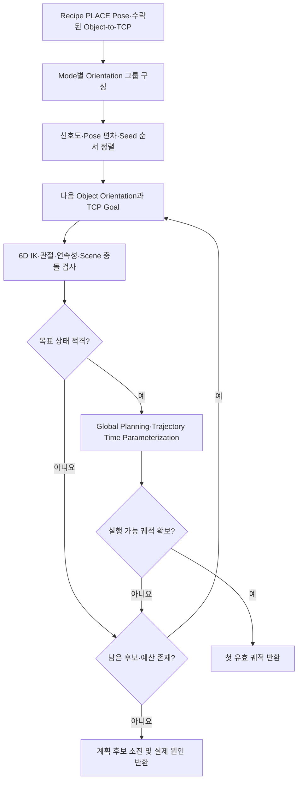

# Motion PLACE 자세 후보 탐색 Algorithm

- **Algorithm ID:** `motion-place-pose-search`
- **Owner:** ARM Cell Motion
- **실현 대상 계약:** [Motion Execution FDS](../components/motion/fds-motion-execution.md), [Task Execution–Motion ICD](../interfaces/icd-task-execution-motion.md)

## 목적과 경계

Recipe의 PLACE Object Pose와 허용 Orientation Mode에 맞는 유한·결정적 자세 후보를 생성하고, 수락된 Object-to-TCP 관계를 적용해 IK·상태·경로 계획의 우선순위를 평가한다. **자세 후보 생성·비교·첫 실행 가능 궤적 선택**만 소유한다. PLACE pose 후보 생성·비교는 Motion이 소유한다. Task Execution은 PLACE 공정 순서, OPEN·Holding/release 의미, Retreat 요청 및 HOME 경유지 복구의 수명주기·허가를 소유한다. Motion은 요청받은 Approach/Final/Retreat movement의 계획·실행과 Trajectory 실행 완료 및 정확도 진단을 소유한다.

## 입력과 산출물

| 구분 | 계산 정보 | 용도 |
|---|---|---|
| 입력 | Recipe PLACE Object Pose·`fixed`/`bounded`/`free`, 자세·위치 허용오차, 선택적 선호 TCP Orientation | 허용 자세 집합과 순서 |
| 입력 | PICK에서 수락된 Object-to-TCP 관계, 최신 관절·부착 Geometry·Planning Scene, IK/FK·Planner | TCP 목표와 실행 가능성 |
| 입력 | Motion Profile의 후보·Seed·Planning 시간 예산 | 유계 탐색 |
| 출력 | 결정적 PLACE 자세 후보, 검증된 첫 궤적 또는 후보 소진 근거 | FDS의 실행·결과 판단에 제공 |

## 알고리즘 흐름

경유지 복구는 Task Execution이 소유하는 별도의 실행·수명주기 절차이므로 이 알고리즘에서 HOME 이동을 자동 수행하지 않는다. 복구 후 Task Execution이 새 측정 상태에서 정상 PLACE movement를 요청하면 Motion은 같은 자세 후보 계산 규칙을 적용한다.

## 핵심 계산과 판단

| Orientation Mode | 후보 집합·우선순위 |
|---|---|
| `fixed` | Recipe의 고정 공칭 Orientation을 실현하는 후보 |
| `bounded` | 공칭 Orientation 우선 그룹과 허용 범위 내 Position Fallback 그룹을 유지 |
| `free` | 공칭 Orientation 및 Object 축 기준 고정 90도 회전을 포함해 측면 방향도 탐색하는 유한·결정적 대표 집합 |

각 허용 Object Orientation에 **이미 수락된 Object-to-TCP Transform**을 합성하여 목표 TCP Pose를 생성한다. 선택적 선호 TCP Orientation은 `fixed`와 `bounded`에서만 사용하고 `free`에서는 스키마 호환 `orientation_tolerance_rad`을 무시한다. 선호도로 Process 허용오차·Collision·IK 제약을 완화할 수 없다.

각 그룹 안의 비교 순서는 해당되는 경우 **Tool Orientation 선호 → Pose 편차 → IK Seed 순서**다. 6D IK, 관절 범위·연속성, Planning Scene 끝점 충돌, Global Planning, Trajectory Time Parameterization 순으로 평가한다. 처음 유효한 궤적이 나오면 즉시 선택하고 후속 후보의 IK를 미리 계산하거나 성공한 경로 사이의 시간·Joint Delta를 비교해 다시 고르지 않는다. IK 이후 Joint Delta는 진단값이지 Recipe 우선순위가 아니다.

Recipe 위치·Orientation 허용오차 및 `fixed`/`bounded`/`free`의 의미는 기존 Owner를 따른다. 후보별·전체 탐색 횟수·계획 시간은 Motion 운영 Profile에서 가져오며 소진한 예산을 새 후보마다 임의로 초기화하지 않는다. 실행한 TCP 목표의 최종 측정 정확도는 FDS에서 진단하되 그 초과만으로 OPEN 또는 RELEASED를 차단하지 않는다.

## 예외·불확실성·종료

| 조건 | 계산상 결과 | 외부 동작 |
|---|---|---|
| IK·Joint Limit·끝점 충돌 부적격 | 다음 허용 후보·Seed | FDS의 최종 실패 분류 유지 |
| Global Planning·시간 매개변수화 부적격 | 제한된 탐색에서 다음 후보 또는 소진 | 실제 Backend 오류와 후보 소진 구별 |
| 후보·예산 소진 | 마지막 단계와 이유 전달 | FDS가 경유지 복구 **진입 여부** 판단 |
| 유효 궤적 선택 | 첫 궤적과 선택 TCP 목표 반환 | FDS가 실행·Gripper·Holding 진행 |

## 검증 요구사항

- **기존 `VR-MOT-TASK-10`의 계산 검증:** Recipe의 `FIXED`/`BOUNDED`/`FREE` 제약, `BOUNDED`의 공칭 우선·Position Fallback 그룹과 그룹 내 Tool Orientation 선호도 → Pose 편차 → IK Seed 순서를 유지한다. IK·관절·Planning Scene 유효성·Global Planning·Trajectory Time Parameterization을 순서대로 평가하고, 처음 실행 가능한 궤적에서 중단해 후속 IK/Planning을 호출하지 않는다. IK Joint Delta는 진단에만 사용하고 순위를 변경하지 않는다. Primary/Fallback의 실제 Recipe Pose Candidate × IK Seed 평가 수는 FDS가 소유한 후보·시간 예산 안에서 계산한다.
- **기존 `VR-MOT-TASK-11`:** 원래 Recipe 목표·수락된 Object-to-TCP를 보존한다. 해당 movement의 물리 실행은 Motion FDS가 소유한다.
- **PnP recovery:** HOME 경유와 Recovery 진입은 Task Execution FDS가 소유하며 이 알고리즘은 복구 승인이나 PLACE 공정 재진입을 정의하지 않는다.

## 참조

- [Motion Execution FDS](../components/motion/fds-motion-execution.md)
- [Task Execution–Motion ICD](../interfaces/icd-task-execution-motion.md)
