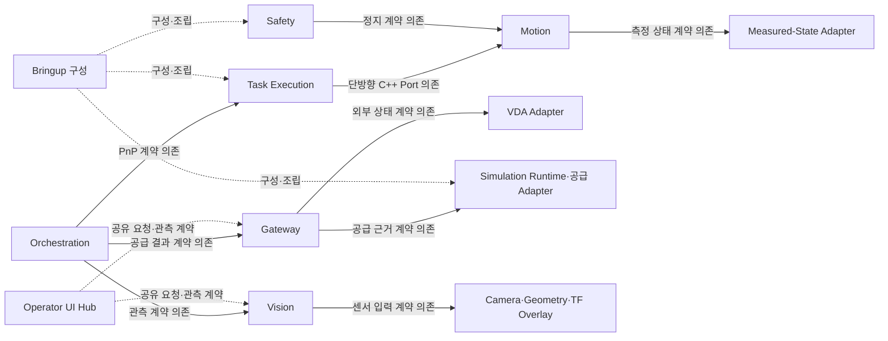
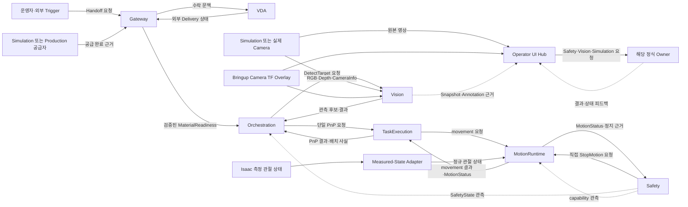

# ARM Cell 구성요소 아키텍처

- **설계 범위:** ARM Cell의 자재 공급 인계부터 Vision 관측, PnP 작업 실행 및 로봇 Motion까지의 논리 컴포넌트
- **Owner:** ARM Cell Architecture

## 1. 목적과 아키텍처 경계

ARM Cell은 외부 자재 공급 사실을 검증된 작업 문맥으로 인계하고, 관측된 자재를 단위 작업으로 처리해 로봇에 개별 움직임을 요청한다. 이 아키텍처는 해당 책임의 컴포넌트 간 소유권과 의존 경계를 정의한다. 각 컴포넌트의 내부 정적 구성과 책임 수행·판단 흐름은 해당 CDS 및 기능 설계가 소유한다.

- **포함 범위:** Orchestration, Task Execution, Motion, Vision, Safety, Gateway, VDA Adapter, Operator UI Hub, Simulation Runtime 및 관련 Adapter
- **외부 경계:** 운영자·외부 Trigger, 실제 PLC·AMR·로봇·Safety Hardware, Isaac Sim, 설정과 정규 Robot Model
- **주요 제약:** 물리적 Safety 권한은 Hardware에 남고 Safety의 소프트웨어 감독 권한은 단일 소유한다. 시뮬레이션과 실제 장비는 정규 공유 계약에서 분리 가능한 실현이다.

## 2. 컴포넌트 구성과 책임

| 컴포넌트 | 핵심 책임 | 분리·응집 근거 | 비책임 경계 |
|---|---|---|---|
| Orchestration | Delivery·Cycle 수락, 작업 준비 판정, Vision 및 단일 PnP 작업 요청, Mission 진행·수량 회계·상위 결과와 재시도, 허가된 상위 복구 조정 | Mission 정책과 자재 회계는 PnP 내부 후보 실행 및 개별 움직임과 다른 변경 이유를 갖는다. | 후보 순위·PnP 내부 상태·Gripper 판단, Motion 계획, Safety 원인·심각도·권한 |
| Task Execution | 수락된 단일 PnP의 PICK/PLACE 수행, 후보 탐색, Gripper 사용, Holding 및 자재 처리 disposition, 작업 내부 복구와 PnP 결과 확정 | 단일 자재 작업의 공정 정책과 Mission lifecycle 및 개별 Motion을 분리한다. | Mission 수량·상위 재시도, Vision Acquisition, IK·충돌·Trajectory, Safety 권한 |
| Motion | 개별 movement의 target 실현, IK·계획·Planning Scene·충돌 검증, trajectory 실행·완료/실패 관측, 로봇 Backend 및 Motion 상태 소유 | 운동학·로봇 상태·실행 의미는 PnP 공정과 독립적으로 변경된다. | 후보 순위·PnP 결과·자재 수량·Mission 진행·Safety 판단 |
| Vision | Camera 관측과 Calibration 근거를 받아 요청별 Material Detection, 후보 적격성·점유 근거 및 진단 결과 제공 | 센서 관측과 모션 가능성 판단은 서로 다른 입력·변경 이유를 갖는다. | Camera/TF 발행, Mission 승인, 후보 실행 순위·파지 가능성, Motion 권한 |
| Safety | Safety 입력 평가, capability·permitted envelope·정지 원인/강도 및 latch·Reset·Recovery 적격성의 단일 소프트웨어 권한, Motion 직접 정지 요청 | Safety 판단은 Mission·Motion 정책에서 격리되어 독립된 안전 권한을 유지한다. | 물리 E-Stop/STO, Motion 경로 생성, 업무 준비·Mission 분류 |
| Gateway | 외부 Handoff Trigger와 공급 완료 근거 검증·상관, 검증된 MaterialReadiness 제공 | IT–OT 사실 경계는 생산·시뮬레이션 공급 실행 및 Mission Admission과 다른 변경 이유를 갖는다. | 공급 할당, VDA 프로토콜·AMR 명령, 자재 인지·Mission 승인 |
| VDA Adapter | 현재 Mock Subset에서 AMR·PackML·Safety-HW 상태 및 승인된 Fault 자극을 제공하고 Gateway가 수락한 Handoff 문맥을 표현 | 외부 시스템 상태를 실제 설비 및 Mission/Safety 판단에서 교체 가능하게 격리한다. | 실제 AMR/PLC 제어·안전 인증, Raw Trigger 검증, 공급 완료·Readiness, Safety 판단 |
| Operator UI Hub | 운영 입력 요청 발행, 각 정식 Owner 결과와 영상·진단의 읽기 전용 표현 | 사용자 상호작용·표시는 운영 정책과 결과 Authority에서 분리된다. | Handoff·Mission·Safety·Vision·Motion 결과 승인, 자동 Retry |
| Simulation Runtime·공급 Adapter | Isaac Session·환경 실현 및 시뮬레이션 자재 공급 실행·공급 완료 근거 제공 | Simulation 실현은 생산 장비와 교체 가능한 외부 실행 경계다. | Gateway 검증, Mission Admission, 정규 Safety·Motion 결과의 authority |
| Measured-State Adapter | Simulator articulation의 측정 상태를 정규 독립 관절 상태로 투영하고 원본 값·시각의 의미를 보존 | 시뮬레이터 표현을 로봇 상태 소비자로부터 격리한다. | 관절 명령·Mission·Safety·Robot Model 발행 권한 |
| Camera·Geometry 및 TF Overlay | Simulation Camera source/geometry를 정규 논리 센서에 연결하고 Bringup이 Camera TF Overlay를 단일 발행 | Simulation 기하·센서 실현과 Vision의 인지, UI의 표시를 서로 독립시킨다. | Vision 검출·입력 보정, 운영자 표시 판단, 공유 RGB-D 계약 재정의 |
| Bringup 구성 | 컴포넌트와 선택된 Runtime·Adapter를 조립해 ARM Cell 실행 경계를 구성 | 조립 책임은 정책·동작 책임을 소유하지 않는다. | 각 Owner의 상태·결과·판단 및 내부 lifecycle |

## 3. 컴포넌트 관계와 의존 방향

### 정적 설계 의존

아래 실선은 컴포넌트가 제공받는 계약에 대한 설계 의존을, 점선은 구현 의존을 단정하지 않는 조립·공유 계약 관계를 나타낸다. ICD·Port의 개별 참조 관계는 해당 CDS·ICD가 소유한다. 런타임 요청·결과 방향은 다음 그림에서 별도로 표현한다.

Task Execution → Motion은 단방향 C++ MotionPort 의존이며 그 경계에 ROS endpoint를 추가하지 않는다. Motion은 Task Execution을 참조하지 않는다. Task Execution의 PnP endpoint와 Motion runtime composition 및 공유 instance 불변조건은 [Task Execution CDS](../components/task-execution/cds.md)와 [Task Execution–Motion ICD](../interfaces/icd-task-execution-motion.md)가 정의한다. Safety의 직접 정지 요청과 각 소비자의 읽기 전용 상태 구독은 런타임 상호작용이지 상호 구현 의존이 아니다. Gateway·VDA, Camera·Vision, Simulation Adapter·Robot State 경계는 각 ICD가 정의한 공유 계약으로 연결된다. Bringup은 조립 책임만 가지며 아래 런타임 흐름을 소유하지 않는다.

### BT 계층과 재시도 경계

Orchestration BT는 Mission lifecycle·재진입·Safety Recovery를, Task Execution BT는 Material Candidate 전환·PICK/PLACE 공정 및 작업 내부 Recovery를 소유한다. Motion 내부 Planning BT는 선택된 Material Candidate의 Grasp Pose·IK Seed 탐색과 검증·계획 순서 및 그 범위의 재시도를 소유한다. 각 계층은 하위 결과를 기존 계약으로 소비하며 다른 계층의 결과 분류나 Recovery를 재구현하지 않는다. Motion BT는 내부 구현이며 새 ROS node·package·Action server가 아니다. Task Execution은 MotionPort만 사용한다.

### 런타임 요청·결과 및 관측 흐름

화살표는 요청·결과 또는 관측 데이터의 런타임 방향이며, 실행 순서·내부 처리 단계·구현 package 의존을 선언하지 않는다. 화살표가 양방향인 경계는 요청과 결과를 각 방향으로 분리해 표시했다.

## 4. 책임 및 Authority 경계

2절의 컴포넌트별 단일 책임을 반복하지 않고, 여러 컴포넌트의 관측·요청·결과가 서로 다른 의미를 갖는 경계만 명시한다.

| 경계 | 최종 Authority 구분 | 혼동해서는 안 되는 의미 |
|---|---|---|
| 공급 완료와 Mission 승인 | Gateway는 Trigger 및 공급 근거를 검증해 MaterialReadiness를 확정하고, Orchestration은 Mission 수락·진행을 결정 | 공급 완료는 물체 가시성·파지 가능성·Mission 승인이 아님 |
| 인지 후보와 작업·움직임 | Vision은 적격 Material Candidate를 열거하고, Task Execution은 실행 우선순위·전환 및 PnP 결과를 확정하며, Motion은 선택된 후보의 Grasp Pose·계획·개별 movement를 담당 | Vision의 열거 순서는 Task Execution의 실행 우선순위가 아니며 Motion의 파지 가능성이나 Safety 허가를 보장하지 않음 |
| 작업 완료와 Mission 수량 | Task Execution이 단일 PnP의 배치 사실과 terminal 결과를 확정하고, Orchestration이 그 결과로 Mission 진행·수량을 반영 | MotionStatus나 Gripper 단일 관측을 Orchestration이 재판정해 PnP 결과를 덮어쓰지 않음 |
| Safety 정지 명령과 실제 정지 | Safety는 정지 권한·원인·severity를 소유하고 Motion은 정지 집행 및 실제 정지 근거를 보고 | Stop 요청 수락과 물리적 정지 완료는 동일하지 않음. Hardwired E-Stop/STO 권한도 소프트웨어와 별개임 |
| 외부 Mock·센서 관측과 정식 판단 | VDA·Simulation·Camera·State Adapter는 각 외부 사실과 정규 관측을 제공하며 Gateway·Vision·Motion·Safety 등 각 Owner가 정식 의미를 판단 | Mock 결과, UI 표시 및 원본 센서값만으로 업무·인지·Safety 결과가 확정되지 않음 |

세부 상태·단계·실패·복구 및 공유 필드 의미는 해당 CDS·FDS·ICD를 따른다. 이 문서는 새로운 Gate·상태·Retry·Timeout을 정의하지 않는다.
