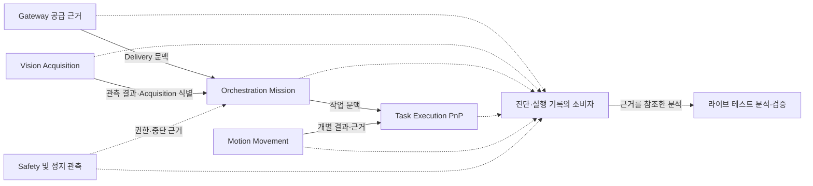

# ARM Cell 횡단 관심사 아키텍처

- **문서 유형:** HLD Architecture — Cross-cutting
- **설계 범위:** ARM Cell 컴포넌트 경계를 넘는 실행 식별, 결과 의미 보존, 관측·진단 연결
- **Owner:** ARM Cell Architecture

## 1. 목적과 횡단 관심사

ARM Cell에서는 외부 공급 사실, Mission, Vision Acquisition, 단일 PnP 및 개별 Movement가 서로 다른 책임에서 발생한다. **운영 중 문제가 발생한 위치와 원래 판단의 의미를 연결해 이해할 수 있는 구조**는 여러 컴포넌트를 가로지르므로 독립된 아키텍처 관점으로 설명한다.

이 문서는 **실행 문맥의 인과관계 연결**, **결과·실패 의미의 경계 간 보존**, **운영 관측과 구조화된 진단 근거의 역할 분리**만 다룬다. 모든 횡단 정책을 이곳에 모으지 않는다. 환경의 공간적 불변식은 [Simulation Environment Semantics](../components/simulation-environment-semantics.md), 실제 실행 협력은 [Runtime Architecture](runtime.md), 개별 컴포넌트 판단 및 결과는 각각의 FDS/ICD가 소유한다.

## 2. 횡단 책임 및 경계

컴포넌트별 정식 판단·결과 Owner는 [Components Architecture](components.md)가 소유한다. 아래는 해당 결과를 서로 연결해 해석할 때 보존할 인과관계이며 Owner를 새로 배정하지 않는다.

| 횡단 관심사 | 생산·확정 역할 | 소비·연결 역할 | 보존할 구분 |
|---|---|---|---|
| 공급·Mission 문맥 | Gateway의 수락 사실, Orchestration의 Mission 문맥 | 후속 Vision·Task Execution 및 진단 소비자 | 공급 완료와 Mission 수락은 서로 다른 사실 |
| 인지·단일 작업의 인과관계 | Vision Acquisition, Task Execution PnP 결과 | Orchestration 및 작업 진단 소비자 | 후보 목록·선택된 작업·PnP terminal 결과를 구분 |
| 개별 Movement와 상위 PnP | Motion의 Movement 결과, Task Execution의 PnP 결과 | Task Execution·Orchestration 및 진단 소비자 | 실제 운동 결과가 상위 공정·Mission 결과를 대신하지 않음 |
| Safety·중단·복구 근거 | Safety의 권한·원인 판단, Motion의 실제 정지 관측 | Orchestration·운영자·진단 소비자 | 정지 요청·정지 완료·Mission 중단·복구 허가는 독립된 의미 |
| 운영 관측과 상세 분석 | 각 정식 Owner의 결과 및 진단 생산 | UI Hub·운영 Log·Live Test Analysis | 표시·진단·검증 결론은 정식 실행 결과를 재판정하지 않음 |

새로운 중앙 진단 판단자나 모든 컴포넌트가 공통 식별자를 생성하는 단일 Owner를 도입하지 않는다. 기존 인터페이스·실행 상태·진단 기록의 정식 식별자가 연결의 근거다.

## 3. 공통 메커니즘과 정보 흐름

다음 도식의 화살표는 **진단적 인과관계를 이해하는 방향**이다. 새로운 전송 Topic, 기록 수집 서비스나 데이터 저장 경로를 요구하지 않으며 실제 처리 순서를 정의하지 않는다.

운영 UI와 Log는 현재 결과나 의미 있는 이벤트를 관측하며, 구조화된 진단 기록은 상세 원인·측정·연결 근거를 제공한다. 특정 분석 또는 검증 보고서는 **그 증거의 유효성·충분성을 새로 판정**할 수 있으나, 실행 당시의 원래 결과를 수정하지 않는다. 증거의 평가 범위는 Verification Policy가 소유한다.

## 4. 식별·상관관계와 오류 의미 보존

| 연결 경계 | 유지할 인과·결과 의미 | 잘못된 해석 |
|---|---|---|
| Delivery → Mission/Cycle | 공급 요청·완료와 이를 소비한 Mission 관계 | Delivery가 곧 유효 Target이나 Mission 성공이라는 해석 |
| Mission → Vision Acquisition | 어떤 작업 문맥에서 어떤 관측을 요청했는지 | 과거 Acquisition을 새 요청의 확정 결과로 간주 |
| Acquisition → PnP | 인지된 후보와 실행을 위임한 단일 작업의 관계 | 후보 순위나 적격성이 Motion 실행 가능성을 보장한다는 해석 |
| PnP → Movement | 개별 움직임의 결과와 이를 소비한 작업의 관계 | Movement 성공을 자재 처리 완료로 치환 |
| Safety → Stop/Recovery → Mission | Safety 판단, 정지 집행 근거, 상위 중단·복구 결과의 관계 | 취소 요청을 실제 정지 완료 또는 복구 허가로 간주 |

기술적 ID의 정확한 필드·생성 시점·전파·보존 정책은 해당 ICD/FDS와 기존 기록 계약을 따른다. 여기서 새 상관관계 스키마·공통 필수 ID·전역 에러 코드 집합을 정의하지 않는다.

오류는 원래 확정한 경계의 원인 정보를 진단에서 식별할 수 있어야 한다. 상위 결과로의 의미 있는 정제는 해당 Owner가 수행하며, 오류를 그대로 전달하는 것은 허용되며, 의미 있는 도메인·애플리케이션 맥락이 추가될 때에만 상위 Owner가 오류를 정제한다. 원래 의미를 묵시적으로 바꾸어서는 안 된다. 이는 Errors Policy의 경계 원칙을 따른다.

## 5. 운영 관측·진단·장애 분석 구조

| 분석 질문 | 관측해야 할 경계 | 근거 형태와 해석의 한계 |
|---|---|---|
| 어떤 공급으로 시작한 작업인가? | 공급 수락과 Mission 문맥 | 실행·진단 기록의 연관 근거; 공급이 곧 작업 성공은 아님 |
| 왜 새 Target이 나오지 않았는가? | Vision Acquisition 결과와 그 입력 | Vision의 정식 결과와 관측·거부 진단; UI 영상만으로 성공을 재판정하지 않음 |
| PnP가 어느 단계에서 종료됐는가? | Task Execution 결과와 Motion 개별 결과 | PnP terminal 사실과 연계된 Movement 근거를 구분 |
| 정지가 실제로 집행되었는가? | Safety 권한 및 Motion 실제 정지 관측 | Stop 요청 성공과 실제 정지 증거를 별도로 확인 |
| 이번 실험 근거로 무엇을 주장할 수 있는가? | 세션 기준선·환경·인과관계·결과 | 관련 증거의 적용 가능성과 충분성은 검증 Owner가 판정 |

사람이 읽는 운영 Log는 의미 있는 사건·결과 중심으로 유지하고, 상세 식별자·측정값·원인 추적은 적합한 구조화 기록에 둔다. 기록 분류와 과거 기준 구현·생산자/소비자 감사는 [Observability Record Inventory](../components/observability-record-inventory.md)를 참고한다. 실제 현행 기록의 의미·생성·소비 계약은 각 FDS/ICD가 소유하고, Log 표현은 Logging Policy가 소유한다. 디렉터리·파일명·JSONL 필드·샘플링·보존 기간은 이 HLD의 새 규칙이 아니다.

## 6. 횡단 구조적 불변조건

- **결과의 Authority는 관측 경로와 무관하다.** UI·로그·보고서·Mock·Simulator는 원래 Owner의 결과를 대체하지 않는다.
- **연결 가능한 근거와 새로운 실행 권한은 다르다.** 실행 ID나 기록의 인과관계를 찾을 수 있다는 사실은 Retry·Recovery·Mission 승인 조건이 아니다.
- **실패 경계의 의미를 보존한다.** 원래 실패 원인과 상위 결과의 구분이 추적 가능해야 하며 하위 오류·Safety 근거를 상위 계층이 임의로 재판정하지 않는다.
- **실행 진단과 검증 결론은 구분한다.** 진단 기록이 남았다는 이유만으로 해당 제품 시나리오가 PASS하거나 현재 기준선에서 재사용 가능한 증거가 되지는 않는다.

이 구조적 불변조건은 새로운 Runtime Gate, 로그 생성 의무, 자동화 검증 요건 또는 통합 인수 조건을 추가하지 않는다.
