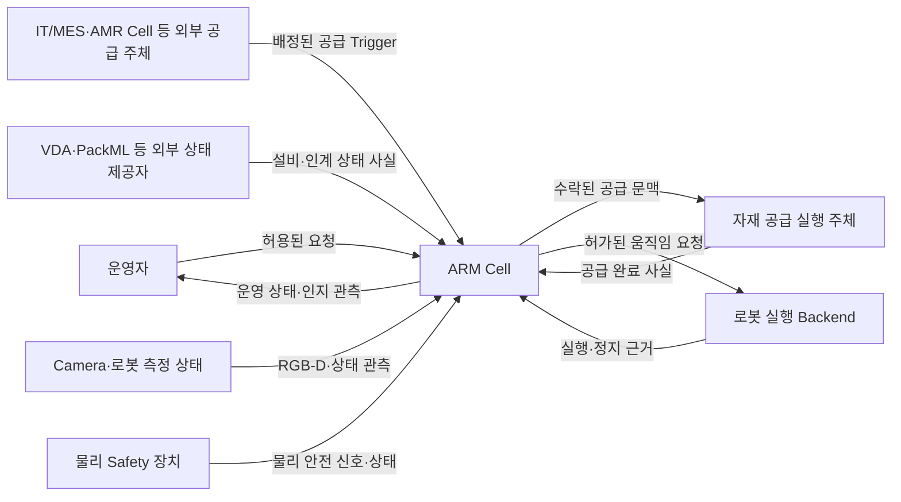

# ARM Cell 시스템 개요 아키텍처

- **문서 유형:** HLD Architecture — System Overview
- **설계 범위:** ARM Cell 시스템의 외부 경계, 주요 아키텍처 영역, 시스템 수준 구조 전략
- **Owner:** ARM Cell Architecture

## 1. 목적과 시스템 범위

ARM Cell의 제품 목표는 [Product Definition](../../product/definition.md)이 소유한다. 이 System Overview는 실제 로봇 셀 적용을 지향하는 **Sim-to-Real 목표를 지원하는 구조적 선택**을 설명한다. 핵심 판단·실행 계약은 실행 환경에 종속시키지 않고 센서·로봇 Backend·공급 Adapter의 환경별 실현을 분리한다. 현실의 물리·센서·기구 특성은 가능한 범위에서 시뮬레이션으로 모사하고, 남는 차이는 실제 환경·장비의 Calibration 및 검증 대상에 둔다. 보정 절차·값과 현장 적합성 판단은 해당 하위 설계·설정·검증 Owner가 소유한다.

현재 인수 범위와 데모 완료 의미는 [Product Definition](../../product/definition.md) 및 [Acceptance](../../product/acceptance.md)가 소유한다.

이 HLD는 컴포넌트 내부가 아닌 **시스템의 구조적 경계**를 설명한다. 포함 범위는 외부 자재 인계, 인지, Mission 조정, PnP·Motion 실행, 소프트웨어 Safety 감독, 운영자 관측과 선택된 실행 환경의 조립이다. 외부 배송 할당·AMR 주행·현장 장비 내부 제어, 물리적 E-Stop/STO와 안전 등급 인증은 이 시스템이 소유하지 않는다.

## 2. 시스템 컨텍스트

아래 화살표는 외부 시스템과 ARM Cell의 **사실·요청·관측·제어 경계**를 나타내며 내부 컴포넌트 의존 또는 작업 실행 순서를 뜻하지 않는다.

현재 데모에서 외부 상태와 자재 공급 주체의 일부는 VDA Mock·Isaac Simulation Adapter로 구현되며, Camera·로봇 Backend도 시뮬레이터로 실현된다. **Mock과 Simulator 결과는 해당 관측의 출처이지 Mission·Vision·Safety의 정식 판단 자체가 아니다.** 실제 장비로 교체해도 책임 경계가 바뀌지 않도록 공유 계약을 분리한다.

## 3. 주요 아키텍처 영역

논리 컴포넌트의 정확한 소유권·의존 구조는 [Components Architecture](components.md)가 정의한다. 여기서는 외부 시스템에서 보이는 역할에 따라 영역만 구분한다.

| 영역 | 시스템 수준 역할 | 다른 영역과의 경계 |
|---|---|---|
| 외부 사실 인계 | 공급 Trigger·상태·공급 완료 근거를 신뢰 가능한 작업 문맥으로 연결 | 외부 공급 사실과 Mission 수락을 구분 |
| 업무 실행 조정 | 공급량·Mission 진행을 관리하고 단일 PnP 작업을 위임 | 단일 PnP 결과를 사용하되 내부 실행을 재판정하지 않음 |
| 인지 및 로봇 작업 | 생산 센서 관측으로 자재 후보를 제공하고 개별 작업·움직임을 수행 | 인지 적격성, PnP 결과, 개별 Movement 성공의 Owner를 분리 |
| Safety 감독 | 소프트웨어의 동작 허가·제약·정지와 복구 가능 범위를 감독 | 업무 진행보다 우선하되 물리 Hardware 안전 권한을 대체하지 않음 |
| 운영자 관측·요청 | 정식 결과를 표시하고 허용된 요청을 전달 | UI가 공급·인지·Mission·Safety 결과의 Owner가 되지 않음 |
| 실행 환경·조립 | Simulator 또는 실제 장비의 관측·구동 경계를 연결하고 실행 구성을 조립 | Adapter와 Bringup이 업무·Safety 결정을 소유하지 않음 |

## 4. 핵심 설계 전략 및 제약

| 전략·제약 | 선택 근거 | 시스템 구조에 주는 의미 |
|---|---|---|
| 외부 사실과 Mission 판단 분리 | 공급 완료가 대상 검출이나 작업 가능성을 보장하지 않음 | 외부 사실 검증, 인지, Mission 수락을 별도 책임으로 유지 |
| Mission·PnP·Movement 계층 분리 | 공급량 회계, 단일 공정 결과, 운동학 실행은 서로 다른 변경 이유를 가짐 | 상위 조정자는 하위 소유 결과를 소비하며 재판정하지 않음 |
| Safety 독립 감독 | 정상 업무 경로에 종속된 안전 판단을 피해야 함 | Safety는 정지·허가 권한을 독립적으로 행사하고 Motion이 집행 근거를 제공 |
| Sim-to-Real 지향과 실현 분리 | 시뮬레이션은 최종 제품이 아니라 실제 로봇 셀 적용 전 검증 환경 | 핵심 업무·인지·작업·안전 감독 의미는 공통 계약에 두고 환경별 센서·Backend·Adapter 실현을 교체 가능하게 유지 |
| 현실 차이의 모사와 Calibration 경계 | 물리·센서·기구 편차를 시뮬레이터에서 완전히 제거할 수 없음 | 모사 가능한 특성은 시뮬레이션에 반영하고 잔여 환경·장비별 편차는 실제 Calibration·검증 대상에 둔다. 구체 보정 값·절차는 소유 설계와 운영 설정이 정의 |
| 관측과 정식 결과의 분리 | 영상·Mock 상태·UI 발행 성공이 실제 성과를 증명하지 않음 | 정식 결과 Owner가 판단을 확정하고 다른 영역은 이를 관찰·전달 |

## 5. 시스템 수준 구조적 불변조건

- **외부 공급 인계와 Mission Admission은 별개다.** 자재 생성 또는 공급 완료만으로 검출·파지 가능성·작업 성공을 선언할 수 없다. 공급 의미는 [Material Handoff FDS](../components/gateway/fds-material-handoff.md), 업무 진행은 [Mission Cycle FDS](../components/orchestration/fds-mission-cycle.md)가 정제한다.
- **인지·단일 PnP·개별 Movement의 판단 소유권은 분리된다.** 각 결과를 상위 계층이 임의로 대체하지 않는다. 정적 책임은 [Components Architecture](components.md), 동적 실행은 해당 FDS/ICD가 정제한다.
- **Safety 감독은 업무 조정과 독립적이다.** 실제 Hardware 안전 기능은 별도 권한이며, Safety의 직접 정지 경로는 Mission 요청의 정상 흐름에 종속되지 않는다. 상세는 [Safety Supervision FDS](../components/safety/fds-supervision.md)를 따른다.
- **환경별 실현은 정식 의미의 은닉된 Owner가 아니다.** Simulator Ground Truth, UI 표시, Adapter 상태가 생산 Vision 검출이나 업무·안전 판단을 대체하지 않는다. 공유 환경 의미는 [Simulation Environment Semantics](../components/simulation-environment-semantics.md)가 소유한다.

이 불변조건은 새로운 Gate·Timeout·Retry·상태 또는 Acceptance 조건을 추가하지 않는다. 대표 시나리오의 컴포넌트 간 시간적 협력은 별도 Runtime HLD 관점에서, 횡단 진단·상관관계는 Cross-cutting HLD 관점에서 설명한다.
