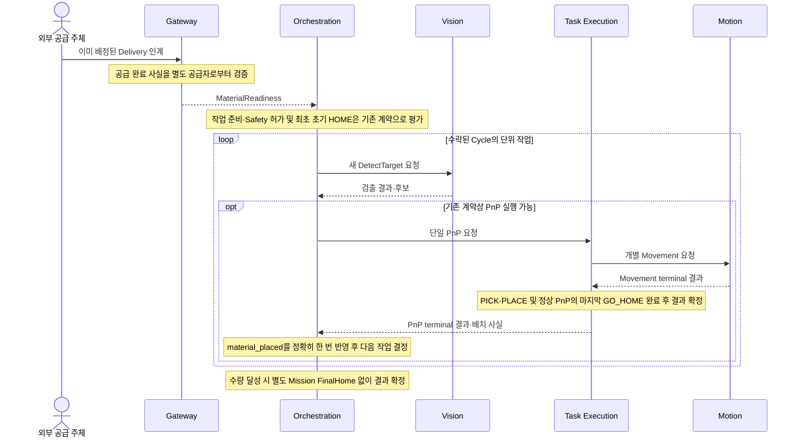
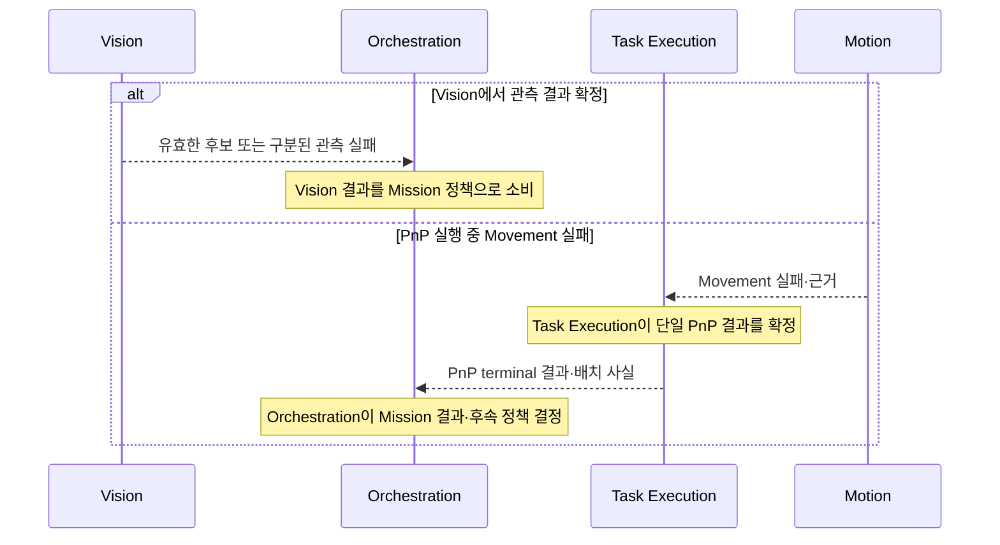
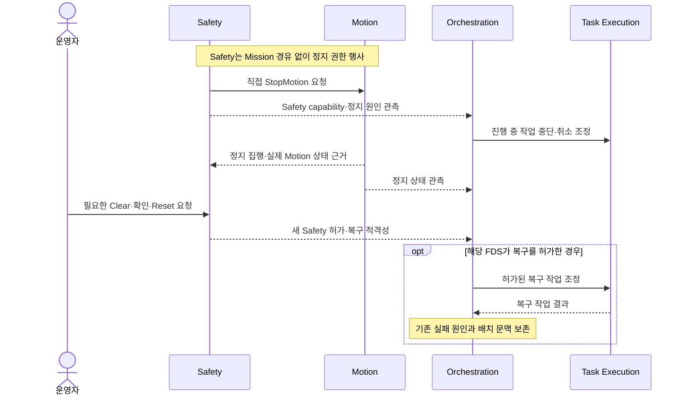

# ARM Cell 런타임 아키텍처

- **문서 유형:** HLD Architecture — Runtime
- **설계 범위:** ARM Cell의 대표 Mission 실행 협력, 결과 전달 및 Safety 선점 경계
- **Owner:** ARM Cell Architecture

## 1. 목적과 대표 실행 시나리오

이 문서는 [ARM Cell Product Definition](../../../product/arm-cell/definition.md)과 그 대표 Use Case의 실현을 위한 **컴포넌트 간 시간적 협력**을 설명한다. 컴포넌트 자체의 책임·정적 의존은 [Components Architecture](components.md)가, 실제 작업 단계와 상태 전이·재시도·복구 적격성은 해당 FDS/ICD가 소유한다. Sequence Diagram은 계약 간 연결을 이해하기 위한 축약된 View로서 별도의 실행 명령이나 Gate를 추가하지 않는다.

| 대표 시나리오 | 시작 경계 | 종료 경계 | 아키텍처 관점 |
|---|---|---|---|
| 자재 인계와 배치 처리 | 외부 Delivery 및 공급 완료 사실 | 확정된 Mission 결과 | 외부 공급, 인지, PnP와 수량 회계의 협력 |
| 실행 결과와 실패 전달 | 컴포넌트가 결과를 확정 | 해당 상위 Owner가 결과를 소비 | 실패 원인과 책임 경계 보존 |
| Safety 선점·통제 복구 | Safety가 정상 Motion 권한을 철회 | 중단·허가된 복구 또는 종료 | 직접 정지와 Mission 중단의 독립성 |

## 2. 참여 역할과 결과 소유

| 참여 역할 | 런타임 협력 | 확정하는 결과 |
|---|---|---|
| Gateway·외부 공급 주체 | 배정된 인계 요청과 공급 완료 사실을 연결 | 검증된 MaterialReadiness (Gateway) |
| Orchestration | Mission 준비·수량 및 Vision/Task Execution 요청을 조정 | Mission/Cycle 진행·최종 결과 및 회계 |
| Vision | 실제 센서 관측으로 적격 후보를 제공 | Acquisition의 검출 결과 |
| Task Execution | 단일 PnP를 수행하며 Motion에 개별 Movement를 위임 | PnP terminal 결과 및 배치 사실 |
| Motion | 개별 Movement 실행과 실제 관측 결과 제공 | Movement 결과·정지 관측 |
| Safety | Motion 허가와 정지 권한을 독립적으로 행사 | Safety capability·정지 및 복구 적격성 |
| Operator UI·환경 Adapter | 운영 요청·관측 및 환경별 사실 제공 | 다른 Owner의 정식 결과를 대신 확정하지 않음 |

## 3. 대표 Runtime View

### 3.1 정상 자재 인계와 배치 처리

다음 그림은 **각 결과가 어느 계층에서 확정되는지**를 보여준다. 후보 선택과 내부 Movement 및 Mission Retry·Recovery HOME의 상세 수행은 [Mission Cycle FDS](../components/orchestration/fds-mission-cycle.md) 및 [Task Execution 설계](../components/task-execution/cds.md)를 따른다.

Gateway의 Readiness는 Vision 적격성이나 Mission 수락을 뜻하지 않는다. Task Execution의 PnP 결과는 Motion의 단일 Movement 결과와 구분되고, Orchestration은 Task Execution이 확정한 배치 사실을 사용한다. 정상 PnP는 마지막 GO_HOME까지 완료한 뒤 terminal 결과를 반환하며, Orchestration은 별도 FinalHome을 중복 요청하지 않는다. 초기·Retry·Recovery HOME 및 상세 재관측은 FDS Owner가 소유한다.

### 3.2 실패 결과의 전달

이 분기는 실패 처리 알고리즘을 선택하지 않는다. 하위 결과의 원인과 결과 Owner는 보존되며 상위 계층은 자신의 책임 범위에서만 다음 동작과 최종 결과를 확정한다. 구체 실패 분류·복구 예산·후보 전환은 [Mission Cycle FDS](../components/orchestration/fds-mission-cycle.md), Task Execution FDS 및 Motion FDS/ICD가 정의한다.

### 3.3 Safety 선점과 복구 협력

이 그림은 직접 정지 경로와 업무 취소 경로가 **별개**라는 관계를 보여준다. StopMotion 요청 수락만으로 정지가 완료된 것은 아니며, 운영자 조치·정지 확인·Holding 판정·실제 복구 순서는 [Controlled Recovery FDS](../components/orchestration/fds-controlled-recovery.md) 및 [Safety Stop and Recovery FDS](../components/safety/fds-stop-recovery.md)에 따른다. 위 화살표는 엄격한 전체 발생 순서나 자동 복구 허가를 뜻하지 않는다.

## 4. 시스템 경계의 결과·실패 전파

결과의 **정식 Owner 자체**는 [Components Architecture](components.md)가 정의한다. 여기서는 각 결과가 상위 실행 협력에 전달되는 위치와 소비되는 의미만 다룬다.

| 결과 경계 | 정식 결과 Owner | 다음 소비자 | 보존할 의미 |
|---|---|---|---|
| 공급 완료 → Readiness | 공급자는 실행 사실, Gateway는 검증된 Readiness | Orchestration | 공급 사실과 Mission Admission은 다름 |
| 센서 관측 → 검출 결과 | Vision | Orchestration | 유효한 후보·관측 실패·물체 부재를 혼동하지 않음 |
| Movement → PnP 결과 | Motion은 개별 Movement, Task Execution은 단일 PnP | Task Execution → Orchestration | Movement 성공은 곧 PnP 완료가 아니며 배치 사실은 독립적인 결과 |
| PnP 결과 → Mission 결과 | Orchestration | 상위 요청자·관측자 | PnP terminal 결과와 처리 수량·Mission terminal 결과를 구분 |
| Safety 정지 → 업무 중단 | Safety는 정지 권한, Motion은 집행 근거 | Orchestration·Task Execution | 정지 요청·실제 정지·Mission 취소는 서로 다른 사실 |

## 5. 실행 구조적 불변조건

- 정상 Mission 진행은 **Vision의 독립 관측 결과**와 **Task Execution의 단일 PnP 결과**를 소비한다. Orchestration은 하위 Movement나 Holding의 상세 결과를 이용해 PnP terminal 결과를 재판정하지 않는다.
- Task Execution과 Motion의 실행 협력은 [Components Architecture](components.md)의 단방향 Port 경계를 유지한다. 이 View는 새로운 ROS 경계나 Backend 공유 구조를 요구하지 않는다.
- Safety의 직접 Motion 정지는 Orchestration의 취소·중단 처리에 종속되지 않는다. 실제 정지 관측·복구 허가·작업 재개는 서로 다른 책임의 결과다.
- 실패 결과를 전달할 때 원래 실패 근거와 확정 Owner를 유지한다. 구체 오류 코드·우선순위·Retry·회복 절차와 Verification Requirement는 해당 FDS/ICD에서만 정한다.

## 참조

- [Components Architecture](components.md) — 논리 역할과 정적 책임
- [Mission Cycle FDS](../components/orchestration/fds-mission-cycle.md) — Mission 수량·작업·실패·반복 의미
- [Controlled Recovery FDS](../components/orchestration/fds-controlled-recovery.md) — Safety 선점 후 업무 중단·복구 조정
- [Safety Supervision FDS](../components/safety/fds-supervision.md) — 독립 Safety 판단과 직접 정지
