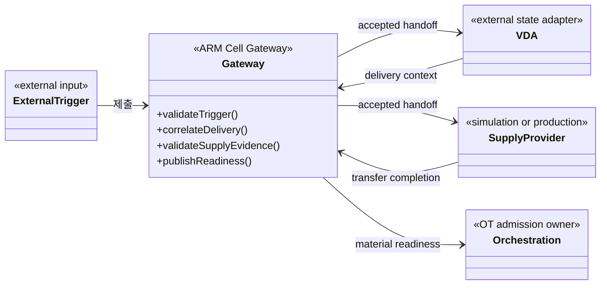
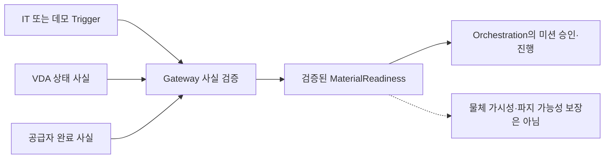

# [SF-Twin] ARM Cell Gateway 컴포넌트 설계 (CDS)

- **범위:** ARM Cell / IT–OT Gateway
- **Owner:** ARM Cell Gateway
- **기능 설계:** [Material Handoff FDS](fds-material-handoff.md)
- **공유 계약:** [External Handoff Trigger ICD](../../interfaces/icd-external-handoff-trigger.md), [Material Readiness ICD](../../interfaces/icd-integration-orchestration-material.md)

## 1. 목적과 책임

Gateway는 외부에서 배정한 자재 공급 사실이 ARM Cell OT 영역으로 들어오는 **IT–OT 계약 경계**를 소유한다. 현재 구현된 기능은 Material Handoff다. Gateway는 외부 Trigger와 공급자 결과를 검증하고 Delivery ID로 상관관계를 확인한 후, 검증된 공급 사실을 기존 `MaterialReadiness`로 제공한다.

Gateway는 모든 ROS 통신의 필수 중계기가 아니다. Gateway가 소유한 기능에서 IT–OT 계약을 통과하는 사실만 Gateway를 거친다. Simulation과 Production은 **동일한 Gateway 검증 책임**을 사용하고, 공급 완료 사실을 생성하는 Provider만 환경에 따라 교체한다.

## 2. 정적 구성과 의존 관계

위 요소는 **설계 역할**이며 실제 클래스 또는 실행 메서드의 추가를 강제하지 않는다. 공급자의 세부 실행·VDA 상태·미션 승인까지 Gateway 내부 책임으로 합치지 않는다.

| 구분 | Gateway 책임 | 다른 Owner 및 경계 |
|---|---|---|
| 외부 입력 | `/external/handoff_trigger` 유효성·Freshness·Delivery ID·중복·설정된 Material Type·양수 Quantity 확인 | Delivery 배정 및 Trigger ID 생성은 외부 공급자 또는 데모 UI Hub |
| 수락 결과 | 수락·거부 상태와 실제 거부 원인 보고, 수락 Trigger를 `/integration/accepted_handoff`로 인계 | Trigger·Receipt의 필드 의미는 External Handoff ICD |
| 공급 근거 | Delivery ID별 VDA 문맥 및 `/material_supply/transfer_completion` 검증 | AMR/PackML/상태 사실은 VDA, 자재 공급 실행과 완료 판정 알고리즘은 Provider |
| OT 전달 | 적격한 완료 근거에 대해 `/integration/material_readiness` 제공 | 데이터·전송·중복 의미는 Material Readiness ICD, Mission Admission은 Orchestration |
| 환경 | Simulation/Production 공통 검증 기준 적용 | Isaac Material Supply는 RawPart 생성·Physics Drop·완료 보고, Production 공급자는 실제 장비 기준으로 완료 보고 |

## 3. Authority와 비책임

Gateway는 MES/WMS의 작업 배정·예약, AMR 명령 및 VDA 프로토콜, Mission 수락·진행·Recovery, Motion/Vision/Safety 판단을 소유하지 않는다. Camera/TF·Simulation Clock·ROS-to-Isaac 상태 변환·Scene 생성·Gripper 시뮬레이션·검증 Fixture·Bringup 구성도 소유하지 않는다.

| 별도 Owner | 정식 설계 |
|---|---|
| VDA 프로토콜·Mock 상태 | [VDA CDS](../vda/cds.md) |
| Isaac 환경·물리 자재 생성·Session | [Simulation CDS](../simulation/cds-sim-adapter.md), [Environment Semantics](../simulation-environment-semantics.md) |
| Operator Camera/Overlay | [Camera Overlay CDS](../simulation/cds-camera-overlay.md) |
| 검증 Fixture | [Deterministic PnP Fixture FDS](../simulation/fds-deterministic-pnp-fixture.md) |
| 수량 누적·Mission Admission/Recovery | [Orchestration CDS](../orchestration/cds.md), [Mission Cycle FDS](../orchestration/fds-mission-cycle.md) |

`MaterialReadiness`는 **검증된 공급 완료 사실**이며 물체의 현 시점 가시성·파지 가능성 또는 Mission Admission 승인을 주장하지 않는다.

## 4. 기능·확장 경계

Gateway가 Trigger를 수락하고, 별도 Provider/VDA의 완료 근거를 관측한 다음 Ready/Failure를 확정하는 시간적 상호작용은 [Material Handoff FDS](fds-material-handoff.md)가 소유한다. 필드·상태의 공유 의미는 두 ICD가 소유한다.

향후 IT 시스템 연동은 구체적으로 승인된 요구사항이 있을 때 외부 계약 Adapter를 추가할 수 있다. 기존 OT Authority를 보존해야 하며 이 CDS는 아직 구현되지 않은 MES/WMS Workflow나 가상의 Interface를 정의하지 않는다.

## 5. Verification Requirements

### VR-GW-01 — IT–OT 사실 검증
유효하고 신선하며 중복되지 않은 외부 Trigger와 Delivery에 상관된 유효한 VDA 문맥·공급자의 성공적 공급 완료 근거만 긍정적 MaterialReadiness를 만들 수 있다.

### VR-GW-02 — 공급자 독립성
Simulation과 Production 공급자는 동일한 Gateway 입력 및 MaterialReadiness 계약을 사용한다. 환경별 공급 실행과 완료 판정 알고리즘은 Gateway 밖에 있다.

### VR-GW-03 — OT Authority 보존
Gateway는 AMR/VDA 프로토콜, Mission Admission·Progress·Recovery, Motion·Vision·Safety, Scene 생성 또는 Bringup 책임을 소유해서는 안 된다.
