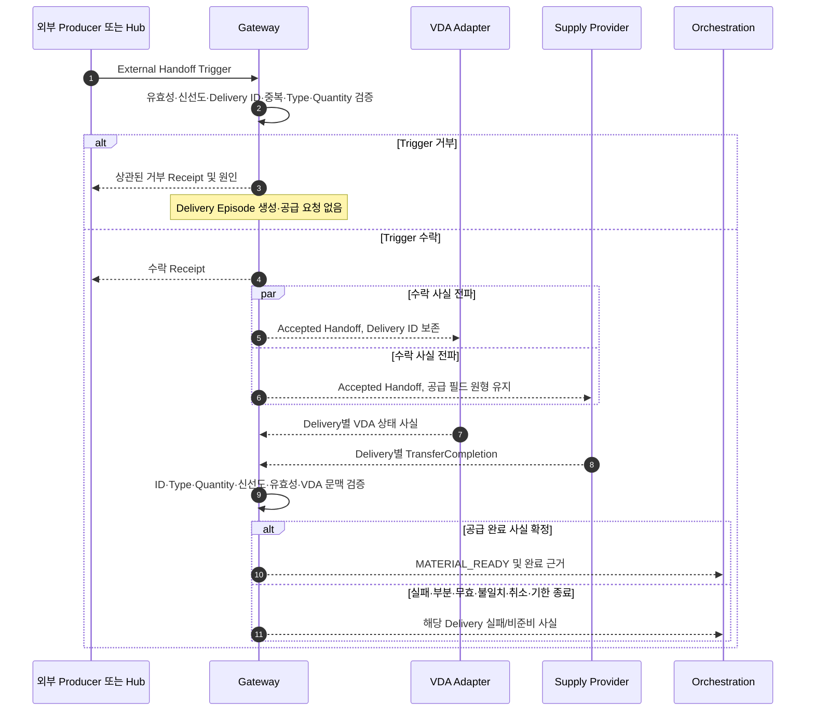
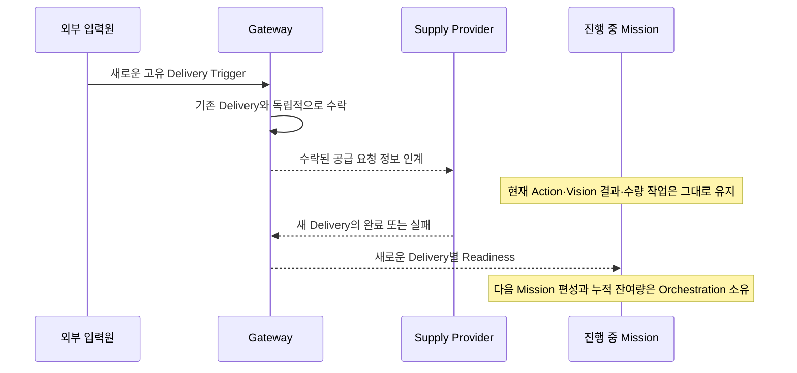

# [SF-Twin] ARM Cell Gateway Material Handoff 기능 설계 (FDS)

- **범위:** ARM Cell Gateway / 외부 인계 Trigger 수락·공급 완료 근거 검증·Readiness 제공
- **Owner:** ARM Cell Gateway
- **정적 책임:** [Gateway CDS](cds.md)
- **공유 계약:** [External Handoff Trigger ICD](../../interfaces/icd-external-handoff-trigger.md), [Material Readiness ICD](../../interfaces/icd-integration-orchestration-material.md)

## 1. 목적과 기능 경계

Gateway는 외부에서 **이미 배정된** 자재 Delivery를 수락하고, 별도 VDA 및 Supply Provider가 제공한 사실을 Delivery ID로 검증한 뒤, 공급 완료가 확정된 Delivery에 한해 `MATERIAL_READY`를 발행한다. Gateway는 Delivery를 요청·배정·재공급하지 않고 물체의 가시성·파지 가능성이나 Mission Admission을 판정하지 않는다. Simulation UI Hub는 Production 외부 공급자와 동일한 Trigger 인터페이스를 사용하는 데모 입력원이다.

**시작:** 새 `/external/handoff_trigger` 수신. **종료:** Trigger 거부 또는 수락된 Delivery에 대한 공급 완료·실패·취소의 최종 사실 처리. 수락된 Delivery는 다른 Delivery/미션의 완료를 기다리는 Queue 명령이 아니라 독립적으로 추적되는 사실이다.

## 2. 참여자·Owner 및 공유 계약

| 참여자 | 이 시나리오에서의 역할 | 동작·의미 Owner |
|---|---|---|
| 외부 공급자/데모 UI Hub | Delivery ID·양수 Quantity·설정된 Material Type·선택 Seed를 포함한 Trigger 발행 | Trigger 형식·식별/수락 의미: [External Handoff ICD](../../interfaces/icd-external-handoff-trigger.md) |
| Gateway | 원본 Trigger의 유일한 수락 Owner; 수락 전 검증, 수락 통보, Delivery별 VDA·Provider 근거 검증, Readiness 발행 | 이 FDS |
| VDA Mock | **Gateway가 수락한** Trigger만 소비해 `ARRIVED → DOCKED → UNLOADED → DEPARTED` 사실 보고 | [VDA Material Delivery FDS](../vda/fds-material-delivery.md) |
| Simulation Material Supply | 수락 Delivery별 RawPart 생성·Random Initial Pose·Physics Drop 실행 및 완료 사실 보고 | [Simulation Environment Semantics](../simulation-environment-semantics.md), 공급 Provider 구현 |
| Production Supply Provider | 해당 장비가 정의한 물리적 완료 조건으로 공급 사실 보고 | 외부 Provider |
| Orchestration | Ready Delivery와 잔여 수량을 소비해 Safety·Mission 조건에 따라 순차 실행 | [Mission Cycle FDS](../orchestration/fds-mission-cycle.md), [ExecuteCycle ICD](../../interfaces/icd-orchestration-execute-cycle.md) |
| Safety·Vision·Motion | Safety Permission, 실제 관측, 경로 및 PICK/PLACE 결과 판정 | 각 컴포넌트 설계 |

Gateway는 양 환경에서 동일한 Trigger·TransferCompletion·Readiness 계약과 검증 규칙을 사용한다. Provider의 **공급 완료 계산 방식**과 Isaac Scene/Prim은 Gateway의 입력 계약이 아니다. `RawPart`는 현재 지원되는 Material Profile이며 Material Definition이 물리 형상·공칭 치수의 Owner다. Vision Profile은 이를 참조해 검출을 설정하고 Recipe는 검출 및 Grasp/PLACE 정책을 소유한다.

## 3. 기능 시퀀스

이 시퀀스는 **Gateway의 사실 판정과 통보 시점**을 정의한다. VDA의 내부 이동 연출, Isaac의 Spawn/Physics Drop, Orchestration의 다음 Mission 실행은 각 Owner가 정의한다. Readiness와 Trigger Receipt의 상태·필드 및 전송/지연 해석은 위 ICD가 소유하며, 이 FDS는 중복 스키마를 정의하지 않는다.

## 4. Trigger 수락·공급 검증

| 단계 | 조건과 처리 | 금지되는 해석 |
|---|---|---|
| Trigger 수락 | 신선하고 유효한 중복 없는 양수 Delivery ID, 설정된 Material Type, Quantity > 0만 수락. 수락/거부 Receipt를 원인과 동일 ID로 보고 | Gateway가 ID를 발급하거나 Delivery를 배정했다고 주장 금지 |
| 수락 사실 인계 | 수락된 모든 공급 필드를 변경 없이 `/integration/accepted_handoff`에 발행 | VDA·Supply Provider가 원본 Trigger를 독립적으로 수락하지 않음 |
| VDA 문맥 | 동일 Delivery의 유효한 VDA 상태만 검증 근거로 소비 | `UNLOADED`·`DEPARTED`만으로 공급 완료 확정 금지 |
| Provider 완료 | `/material_supply/transfer_completion`에서 요청 ID·Type·Quantity와 완료 당시 Freshness·Validity·성공 및 `supplied_quantity` 확인 | Timer·UI 상태·정적 RawPart·일치하지 않는 근거로 Ready 발행 금지 |
| 긍정적 완료 | 요청 수량 전체를 공급한 유효한 Provider 성공 사실과 적용 가능한 VDA 문맥이 모두 확인될 때 **Delivery별 한 번** `MATERIAL_READY` | 긍정적 Readiness를 Vision 가시성·PICK 성공·Mission 승인으로 해석 금지 |
| 부정적 완료 | 실패·부분 공급·부재·무효·중복·불일치·확인 시점 Stale·Delivery Deadline 종료·Stop 취소를 구분해 보고하고 Ready 금지 | 자동 재공급·Trigger 재소비·이전 완료 사실 덮어쓰기 금지 |

Trigger 수락은 일회성이며 이후 실패하더라도 같은 Trigger를 재생하거나 재소비하지 않는다. 완료 사실을 **확인한 시점**에 Freshness를 검증한다. 이미 확정·전달한 긍정적 완료는 나중에 ROS 전송이 지연됐다는 이유로 다시 만료시키지 않는다. 각각의 Delivery ID는 다른 Delivery나 이미 진행 중인 Mission과 독립적으로 추적한다.

## 5. 신규 공급·시뮬레이션 종료와 동시성

신규 Trigger는 기존 공급·Vision·PnP 도중에도 수락할 수 있으며 Gateway는 이를 근거로 현재 ExecuteCycle·Motion Goal·이미 인계한 PICK Pose를 취소·교체하지 않는다. Simulation에서는 Material Supply Adapter가 기존 Scene 자재를 보존하고 신규 Delivery의 **요청 Quantity만 추가**하여 무작위 초기 자세·중력 낙하를 실행한다. Seed는 동일 Scene/Profile/Adapter 버전의 샘플 초기 자세 재현성을 위한 것으로, Grasp 성공·Marker Clearance·충돌 회피에 유리하게 자세를 고르거나 재배치하지 않는다. 공급 성공은 요청 객체 생성과 설정된 Action 수행 완료를 뜻하며 Settling·가시성·PICK 가능성·PnP 성공을 보증하지 않는다.

Isaac Timeline Stop은 Simulation Owner의 Reset 경계다. 해당 Adapter는 미완료 Spawn을 취소하고 Simulation의 Gripper Attach 관계를 정리하고 Isaac 소유 생성 자재를 제거한 다음 Delivery별 취소 완료 사실을 보고한다. Gateway는 미완료 공급/관측의 종료 사실을 처리하고 해당 활성 슬롯을 해제한다. **이미 확정된 Ready Event나 과거 성공 PLACE 기록을 수정하지 않는다.** 다음 실험은 수동으로 새 ROS Bringup을 시작하고 Process-local Accounting을 비운다. 이 흐름은 실제 Production 장비의 정지·해제 명령이 아니다.

## 6. 결과·실패 경계와 타 기능 연동

| Gateway가 확정하는 것 | 다른 Owner가 확정하는 것 |
|---|---|
| 원본 Trigger의 수락/거부와 실제 이유 | Hub는 단지 Trigger 발행 사실을 표시 |
| Delivery ID별 공급 완료 근거 검증 및 Ready/Failure | 공급자는 환경별 실제 공급 완료 사실을 판정 |
| 부분·실패·취소·Stale·Mismatch를 긍정적 Ready로 승격하지 않음 | VDA는 운송 상태만 보고하고 Ready를 발행하지 않음 |
| 별도 Delivery의 사실 상관관계와 활성 처리 종료 | Orchestration이 누적 미처리 수량·Mission Admission·Safety 조건·Retry·복구를 판단 |

Ready Delivery의 수량 소비·직렬 ExecuteCycle 승인·PLACE 처리 회계는 [Mission Cycle FDS](../orchestration/fds-mission-cycle.md)가 소유한다. Gateway는 이 사실을 독립적으로 재판정하지 않는다. 목표 수량 이전의 유효한 `OBJECT_NOT_FOUND`는 정상 완료가 아닌 `MISSION_EXIT_QUANTITY_SHORTFALL`(Soft Error)이며, 이는 **Gateway 또는 Safety의 새 상태가 아닌 Orchestration 결과**다. 기존 마지막 `GO_HOME`, Safety 우선순위, Vision 실패 분류, 한정된 Mission Retry 규칙도 Orchestration·Motion·Vision Owner를 따른다. 추가 Retry가 발생해도 Delivery Trigger를 재발행하거나 Supply를 다시 수행하지 않는다.

Gateway는 Isaac Prim 좌표·Identity·생성 객체 목록을 읽거나 Vision에 넘기지 않는다. Vision은 RGB-D·선택 Calibration 파일·Tray Geometry에서 실제 관측을 판단하며, Support Fiducial은 명시적 설치 보정에만 필요하다. Snapshot/관측·Collision 판단·Safety 중단은 각각 기존 Owner의 계약에 따른다.

## 7. Verification Requirements

### VR-GW-MAT-01 — Provider 완료 근거를 요구하는 Readiness
긍정적 `MATERIAL_READY`는 **확정 시점에** 신선하고 유효하며 요청 Delivery와 상관된 공급자 완료 사실, 요청 Quantity 전체의 공급과 적절한 VDA 문맥을 요구한다. Timer·VDA·UI·정적 자재만으로 충분하지 않다. 이미 발행된 완료 사실은 전송 지연으로 만료되지 않는다.

### VR-GW-MAT-02 — 공급 실패의 Readiness 차단
실패·부분·무효·Stale·불일치 Provider 완료는 관측 가능한 실패로 남아야 하며 긍정적 Readiness 또는 Batch Admission을 만들지 않는다.

### VR-GW-MAT-03 — Quantity 및 Safety Admission
`MATERIAL_READY`는 Delivery ID·Material Type·목표 Quantity·완료 근거를 포함한다. Orchestration만 Workflow 조건과 현재 Safety Permission 아래 Delivery를 한 번 소비하고 Batch Admission을 판정한다. Gateway·Supply Provider·Hub는 승인하거나 Safety를 우회할 수 없다.

### VR-GW-MAT-04 — Trigger Authority와 Identity
Gateway만 원본 Trigger를 수락하고 승인된 필드를 인계한다. VDA 및 Material Supply는 이를 독립 수락할 수 없다. Identity·Material Profile·Quantity는 Readiness·Admission까지 상관관계를 유지한다.

### VR-GW-MAT-05 — 공급 근거의 소유권
Supply Provider는 환경별 완료 알고리즘과 사실 보고를 소유하고 Gateway는 검증과 Readiness를 소유한다. Isaac Prim의 좌표·Identity·객체 생성 목록은 Vision 입력이 아니다.

### VR-GW-MAT-06 — Stop 취소 및 Delivery 해제
진행 중인 Simulation Delivery 상태에서 Isaac Timeline Stop이 발생하면 Material Supply Adapter는 대기 Spawn 취소·Isaac 소유 Attach Reset·생성 자재 제거·상관된 Terminal Cancellation 발행을 수행해야 한다. Gateway는 계약에 맞게 Delivery Terminal Outcome을 발행하고 활성 점유를 해제해야 한다. 다음 실험의 신규 Bringup Accounting은 비어 있으며 과거 Ready·성공 PLACE 기록을 다시 쓰지 않는다. **Simulation에만 해당**하며 실장비 명령이 아니다. Oracle은 Delivery별 TransferCompletion, Gateway Terminal Receipt/Readiness와 후속 고유 Trigger 수락이다. Simulation Reset 실행 상세는 해당 Owner를 따른다.

### VR-GW-MAT-07 — 기존 자재를 보존하는 추가 공급
새 고유 Delivery 수락 시 Simulation Adapter는 기존 자재를 보존하고 신규 Quantity만 정확히 추가해야 한다. 신규 Delivery는 활성 Mission·기존 Material을 취소·삭제하지 않으며 전체 Scene Material Cleanup은 Isaac Timeline Stop만 소유한다. Oracle은 구·신 Delivery ID, 각 Delivery의 생성/Action 결과와 Stop 이전 보존 Scene Material이다. 공급 수행·보존 책임은 Simulation Owner가 소유한다.

## 8. 계약과 구현 경계

인터페이스 필드·상태의 단일 공유 의미는 [External Handoff Trigger ICD](../../interfaces/icd-external-handoff-trigger.md)와 [Material Readiness ICD](../../interfaces/icd-integration-orchestration-material.md)에 있으며, Quantity별 Mission 결과는 [Mission Cycle FDS](../orchestration/fds-mission-cycle.md)에 있다. Gateway ROS 검증, Isaac Supply Adapter, 구성된 자재 생성/물리 동작은 기존 구현을 보존한다. Production Provider의 바인딩, 형상·좌표·물리·임계값은 환경에 따라 설정되며 PnP 성공을 위해 무작위 자세를 임의로 보정하지 않는다. 과거 Timer 기반 Ready나 정적 RawPart 확인은 이 계약을 충족하지 않는다.

## 9. 참조
- [Gateway CDS](cds.md)
- [External Handoff Trigger ICD](../../interfaces/icd-external-handoff-trigger.md)
- [Material Readiness ICD](../../interfaces/icd-integration-orchestration-material.md)
- [ExecuteCycle ICD](../../interfaces/icd-orchestration-execute-cycle.md)
- [VDA Material Delivery FDS](../vda/fds-material-delivery.md)
- [RawPart Vision FDS](../vision/fds-rawpart-depth-perception.md)
- [Simulation Environment Semantics](../simulation-environment-semantics.md)
- [Simulation UI Hub FDS](../ui-hub/fds.md)
- [Mission Cycle FDS](../orchestration/fds-mission-cycle.md)
