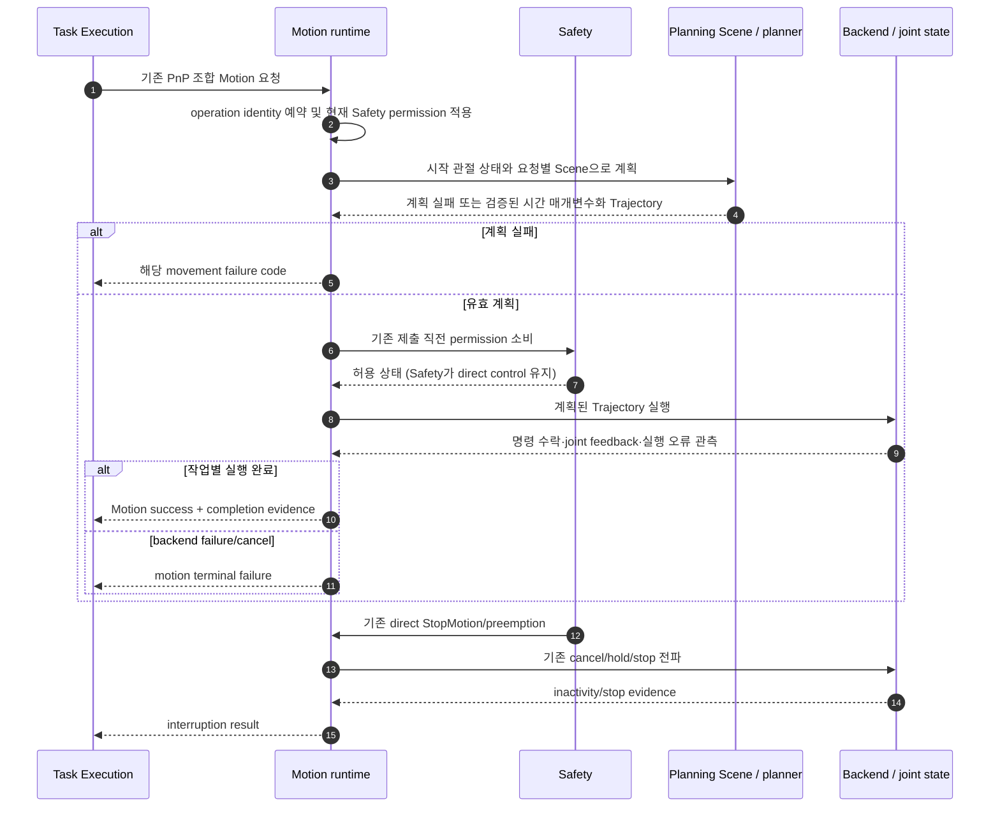
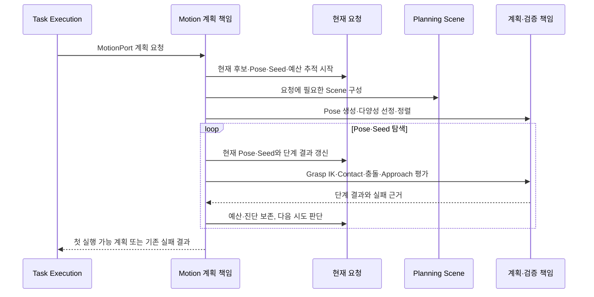

# [SF-Twin] ARM Cell Motion 단일 움직임 계획·실행

- **Function ID:** `ARM-MOTION-EXECUTION`
- **Owner:** `ARM Cell Motion`

## 목적과 동작 범위

MotionPort에 전달된 단일 motion command를 Planning Scene·현재 측정 Robot State에
기초해 계획·실행하고 해당 움직임의 완료/실패를 반환한다.

- **시작 경계:** Task Execution이 C++ MotionPort operation을 호출하거나 기존 explicit operator motion contract가 요청을 수락한 시점.
- **종료 경계:** 계획 실패, motion terminal failure, 작업별 실행 완료, Cancel 또는 Safety preemption의 결과가 확정된 시점.
- **비책임:** PICK/PLACE 공정 순서·candidate retry·Gripper choreography·material disposition·Mission retry.

## 참여 책임과 계약

| 참여 책임 | 동적 역할 | 정식 Owner |
|---|---|---|
| Task Execution | 단일 motion intent/constraint 제출, operation 결과 소비 | Task Execution FDS, Task Execution–Motion ICD |
| Motion runtime | reservation, precondition·Safety permission 확인, 실행 lifecycle | Motion CDS |
| Planning Scene / MoveIt | IK·충돌·경로 계획·trajectory validation | Motion CDS 및 기존 Planning ICD |
| Backend / joint observer | trajectory 제출, 측정 state와 종료 관측 | Motion Backend ICD |
| Safety | permission·stop cause/mode·direct stop | Safety FDS 및 Safety–Motion ICD |

## 핵심 시나리오

현재 PnP는 `planAndExecuteMotion()` 조합 API를 계속 사용한다. 계획과 실행은 MotionPort의
독립 재사용 기능이며, 조합 API는 같은 작업 예약 안에서 두 기능을 이어 쓴다. 후속 BT Leaf는
같은 operation identity로 계획 결과를 보관하고 실행을 요청할 수 있다.

계획 성공은 실행 성공을 뜻하지 않는다. PICK/PLACE Trajectory 완료는 아래 실행 계약을,
GO_HOME과 Stop은 기존 독립 계약을 따른다. Canonical measured state, collision scene integrity,
Backend 오류 및 Safety 권한은 유지한다. Motion은 현재 operation의 terminal result를 반환하고
Task Execution이 다음 공정 단계를 결정한다.

현재 operation에서 실제 Trajectory 실행이 시작되지 않은 IK·경로 Planning 실패는 Motion이
해당 operation의 예약과 active 상태를 먼저 정리한 뒤 실패 결과를 반환해야 한다(SHALL).
이미 완료된 이전 Trajectory의 `backend_inactivity_confirmed=false`만으로 실패 operation을
활성 상태로 유지하거나 Backend 비활성 대기를 수행해서는 안 된다(SHALL NOT). 이때 MotionStatus는
관측된 `execution_active`와 `backend_inactivity_confirmed` 값을 보존하면서 operation 실행 상태를
`IDLE`, `has_active_execution=false`로 보고할 수 있어야 한다(SHALL). 현재 Backend trajectory가
실제로 실행 중이거나 Cancel/Safety stop이 미확정이면 기존 예약·정지 계약을 유지하고, 후속 Goal을
거부해야 한다(SHALL).

### Task Execution 전략과 단일 movement 경계

Task Execution의 `PLANNED`·`WAYPOINT` 선택과 작업별 동적 sequence는 Task Execution FDS가 소유한다.
Motion은 두 전략이 제출한 개별 movement를 기존 operation reservation, movement 완료, Backend
오류 및 Cancel/Safety lifecycle 계약에 따라 처리한다. 전략별 PLACE 목표와 Object Disposition은
Task Execution FDS가 소유하며 Motion 결과는 개별 movement에 한정된다. PLACE `WAYPOINT`에서는
PICK별 Grasp Relation에 따라 사전 계산 경로나 최종 TCP 목표를 다시 정하지 않고 고정 HOME→PLACE
Trajectory를 실행한다. 전략별 target 표현이나 경로 실현 방법은 이 FDS에서 추가 API·segment 또는
planner 선택으로 고정하지 않는다.

PLACE `WAYPOINT`의 HOME→PLACE 접근은 Backend가 기존 Planning 기능으로 사전에 계산·검증한
Trajectory를 Motion이 실행한다. 결과는 적용된 운영 profile, HOME 상태 및 고정 PLACE 목표에
대응해야 하며, 실행 시 매 사이클 OMPL Global Planning을 반복하지 않는다. 사전 계산 결과가 없거나
대응 조건이 맞지 않으면 기존 Motion movement 실패로 반환하며 임의 관절 이동이나 다른 실행 전략으로
전환하지 않는다. Motion은 PLACE `WAYPOINT` 전략이 활성화된 경우에만 저장된 Trajectory를 읽어야 하며,
다른 전략에서는 해당 파일을 읽어서는 안 된다. 실행·완료·Cancel·Safety는 기존 Motion Trajectory
lifecycle 계약을 그대로 따른다.

분리된 계획 기능은 실행 명령 없이 Trajectory와 계획 시작·종료 상태를 반환한다. 다음 구간을
앞서 계획하는 경우 앞 계획의 종료 상태를 시작 상태로 전달한다. 실행 기능은 계획을 만든 순서로
Trajectory를 제출하고, 앞 구간이 해당 작업의 실행 완료 계약을 충족한 뒤 다음 구간을 실행한다.
PnP 조합 API도 같은 계획·실행 기능을 한 예약 아래 사용한다.

Motion은 PICK 계획·탐색에서 Material Candidate별 탐색 deadline을 적용하되 PICK Action 공통 deadline을 초과하지 않는다. 기본 후보별 예산은 15초(`pick_candidate_search_budget_s`), 공통 예산은 100초이며 세부 호출 한도·예산 적용 규칙은 [PICK Candidate Algorithm](../../algorithms/motion-pick-candidate-search.md)을 따른다. 시간 검사는 호출 경계에서 협력적으로 수행하며 독립적인 강제 Solver 중단 Watchdog은 제공하지 않는다.

## Planning 탐색과 요청 수명

각 단계의 실패는 원인과 함께 반환되며 후속 평가는 건너뛴다. 같은 Pose의 Seed 재시도, 후속 Pose, 보류 재방문 및 종료는 [PICK Algorithm](../../algorithms/motion-pick-candidate-search.md)의 기존 규칙을 따른다. Safety·Cancel·Backend 오류는 해당 기존 중단·결과 계약을 따른다.

한 planning 요청은 현재 Candidate·Pose·Seed, 단계별 근거, Action 공통 deadline과 후보별 잔여 예산을 탐색 동안 보존한다. 재시도는 해당 시도 결과만 갱신한다. 요청이 취소·선점·종료된 뒤 도착한 계산 결과는 새 요청에 반영하지 않는다.

각 Planning·충돌 검증은 아래 구간 정책을 적용한다. 후보 또는 요청 사이에 점유 설정이 이어지지 않으며 고정 환경·Robot Self Collision·Attachment 검사는 유지한다.

### 검증 목적별 Scene 적용

Vision-derived PICK의 Candidate Geometry 입력은 [Task Execution–Motion ICD](../../interfaces/icd-task-execution-motion.md), target별 map 구성은 [PICK Algorithm](../../algorithms/motion-pick-candidate-search.md)을 따른다. Motion은 해당 map을 아래 구간 정책에 따라 Planning에 사용한다. 이 사용은 공유 Planning Scene을 변경하지 않으며 관련 요청이 끝나면 종료된다. 계획 시작에는 canonical 최신 측정 관절 상태를 사용한다. Scene 또는 요청별 planning 입력을 구성할 수 없는 경우 기존 Backend 오류로 반환하며 Candidate 전환 사유로 취급하지 않는다.

| PICK 구간·검사 | Motion 생성 `OBSERVED_OCCUPANCY`; `UNKNOWN_OCCUPANCY` 미생성·미적용 | 고정 Scene 및 로봇 |
|---|---|---|
| Grasp IK/FK 목표 상태 유효성 | `grasp_occupancy_mode`로 선택 | 검사 유지 |
| Approach IK/FK 목표 상태 유효성 | 충돌 판단에서 제외 | 검사 유지 |
| Approach Global Planning 및 전체 경로 검증 | 충돌 검사 유지 | 검사 유지 |
| Cartesian Descent·Grasp 검증 및 실행 사전검사 | 충돌 판단에서 제외 | 검사 유지 |
| Grasp 이후 Lift·Retract 경로 검증 및 실행 사전검사 | 충돌 판단에서 제외 | 검사 유지 |
| PLACE | PICK에서 사용한 임시 Occupancy는 적용하지 않음 | 검사 유지 |

각 Vision-derived Candidate attempt는 target별 planning map을 사용하고 같은 map을 보여주는 Occupancy Snapshot 하나를 기본적으로 생성·저장한다. 이 생성은 `diagnostics.capture_enabled`, `log_level` 및 상세 진단 선택 여부와 독립적이다. Snapshot은 candidate ID와 `vision_acquisition_id`로 해당 시도와 연결한다. 그 attempt의 Pose·Seed 탐색은 같은 map과 Snapshot을 공유하며 Candidate 전환 때 새 map과 Snapshot을 사용한다. Snapshot PNG는 공통 `snapshots/` 저장 영역에, 선택적 Planning Diagnostic JSON은 `diagnostic_records/` 영역에 둔다. 활성화된 Diagnostic Record에서 해당 Snapshot을 참조할 수 있어야 한다. 상세 Planning Diagnostic JSON과 Trace는 기존 Capture 정책을 따른다. Snapshot 생성·저장 실패는 planning 또는 실행 결과를 바꾸지 않는다.

### Grasp Occupancy 전략

Grasp endpoint에서는 먼저 Robot Self Collision, 정적 Tray·Fixture 및 기존 고정 객체 충돌을
검사한 뒤 운영 Profile의 `grasp_occupancy_mode`로 선택된 Occupancy 전략을 적용한다.

| Mode | Occupancy 판단 |
|---|---|
| `NONE` | Candidate Occupancy 검사 생략 |
| `FULL_COLLISION` (기본값) | Candidate Occupancy와 전체 로봇 상태 충돌 검사 |
| `FINGER_CLEARANCE` | 기존 Contact Geometry로 정의한 양쪽 접촉면 바깥 보호 체적과 Occupancy 실제 Geometry의 내부 교차 검사 |

Finger Clearance 계산은 [PICK Algorithm](../../algorithms/motion-pick-candidate-search.md)이
소유한다. 최종 Grasp 자세만 검사하며 Approach·Descent·Retreat 경로 정책은 바꾸지 않는다.
공통 충돌과 Occupancy 간섭은 기존 `GRASP_COLLISION`으로 분류하고 기존 Pose·Seed 전환을 유지한다.
보호 체적 간섭을 실제 Robot Link 접촉이나 충돌 관절 Seed 힌트로 해석하지 않는다.
검증 시 선택 Mode, 공통/Occupancy 결과, 보호 체적의 Frame·Pose·형상, 침범 Occupancy ID와
손가락, 최종 허용 여부 및 거부 이유를 기존 PICK 진단에 전달한다. 미실행 검사는 미실행으로
구별하며 진단을 위한 별도 상태·Gate를 만들지 않는다. MotionPort Result Code는 유지한다.

직접/non-Vision PICK의 기존 Occupancy 입력 의미는 [Orchestration–Motion ICD](../../interfaces/icd-orchestration-motion.md)를 따른다. Vision-derived map의 구성 의미는 [PICK Algorithm](../../algorithms/motion-pick-candidate-search.md)이 소유한다. 제외 구간에는 관측 Occupancy를 적용하지 않으며 고정 환경·Robot Self Collision·Attachment 및 기존 Tray 충돌 예외는 유지한다.

## PICK/PLACE Trajectory 실행 완료

이 계약은 PICK/PLACE의 모든 시간 지정 Trajectory 구간에 공통으로 적용한다. Approach,
삽입, Retract/Retreat 및 PICK/PLACE 권한으로 수행하는 복구 경유지 이동도 포함한다.
GO_HOME 목표 도달, Safety 승인 standalone RETRACT 및 다른 작업의 독립 완료 계약은 변경하지 않는다.

유효한 Trajectory 실행에서 다음 조건이 **모두 충족되는 것이 필요충분조건**이다.

1. 동일 operation에 속한 유효한 Trajectory가 실행 중이다.
2. 유효하고 역행하지 않는 Simulation Time에서 실행 시작 이후 경과시간이 계획의 최종
   `time_from_start` 이상이다. Wall Time이나 명령 제출 시각만으로 대체하지 않는다.
3. 해당 실행 방식의 계획된 명령 시퀀스가 정상 발행·수락됐고 최종 명령의 성공적인 수락이
   확인됐다. 중간 명령의 실패·미완료를 최종 명령 성공으로 덮어쓰지 않는다. 시간 샘플링 방식에서
   이는 계획을 따라 생성·발행하는 명령 시퀀스를 뜻하며 원본 waypoint 각각의 개별 발행을 뜻하지 않는다.
4. 결과 확정 시점까지 해당 실행을 무효화하는 Safety·Cancel·Stop/Halt, Transport·Backend 오류,
   Simulation Clock 정체·역행·무효 등의 기존 오류나 중단이 없다.

충족 즉시 Trajectory 수행 완료를 확정하고 명령 생산과 해당 실행의 감시를 종료한다.
최종 명령 수락은 Backend 계약이 제공하는 명령 전달 경계의 성공이며 실제 관절의 목표 위치 일치나
물리적 정지를 증명하지 않는다. 이 계약은 그러한 증명을 별도 성공 조건으로 요구하지 않는다.
단순 Trajectory 제출 성공 또는 계획 시간 경과 하나만으로 완료를 확정해서는 안 된다.

완료 판정에 연속 관절 변화량의 `settled`, 안정화 연속 샘플, 최종 Joint Target Accuracy,
Arrival/Accuracy, 잔여 속도·운동 확인 또는 독립적인 Next Command Readiness를 Gate로 두지 않는다.
최종 명령 이후 추가 물리적 안정화 대기, Settling Timeout, Readiness Timeout도 두지 않는다.
새 Joint State 수신·generation 증가나 inactivity 확인을 이 완료의 추가 승인 조건으로 사용하지 않는다.
필수 Transport·Backend 상태 오류의 검출은 유지하며 진단용 관측 결측과 구별한다.

**계획된 명령의 정상 수행 완료 자체가 다음 Motion Phase로 진행할 실행 경계다.** 다음 Planning은
기존대로 최신 측정 Joint State를 사용하고 계획상 최종 관절값으로 대체하지 않는다. 그 Planning의
상태 가용성·IK·Collision·Joint Limit·Path Validity 검증은 유지하되 이전 Trajectory 완료에서
중복 수행하지 않는다. 동일 identity의 연속 선계획은 기존 plan 소유권·순서를 유지하며,
선계획용 종료 상태를 실제 측정 상태로 간주하지 않는다.

### Watchdog 책임과 활성 범위

| 책임 | 활성 범위·오류 | 완료와의 관계 |
|---|---|---|
| Motion Progress | Trajectory 수행 중 측정 관절의 비정상 진행 정체 감시; 실제 정체의 기존 실패 분류 보존 | 최종 명령 수락과 계획 시간 경과로 완료가 확정되면 종료. 목표 주변 진동을 이유로 완료를 연장하거나 완료 뒤 진행 시각을 갱신하지 않음 |
| Trajectory Clock | 시간 지정 실행 중 Simulation Clock의 정지·무수신과 시간 진행 이상 감시; 역행·무효도 기존 Clock 검증 경계에서 오류 처리 | 계획 시간은 완료 조건의 시간 근거이며 Clock 감시는 성공 승인자가 아님. 오류·중단이 확정된 실행을 시간 경과로 성공 처리하지 않음 |

Watchdog Healthy는 완료의 추가 증거·승인 Gate가 아니다. 완료 이전에 확정된 실제 진행 정체나 Clock
오류는 실패로 보존한다. 최종 수락·시간 조건 충족 이후 물리적 움직임을 더 관찰해 완료를 승인하거나
새 정체 실패를 만들지 않는다. 완료와 Safety·Cancel의 경합은 기존 operation terminal arbitration과
[Task Execution–Motion ICD](../../interfaces/icd-task-execution-motion.md)를 따르며, 진행 중인 중단을
완료로 덮어쓰지 않는다. GO_HOME 및 Stop의 감시·종결은 각각의 독립 계약을 따른다.

### 작업별 독립 계약

Trajectory 완료는 개별 이동 결과이며 공정상 PICK/PLACE 성공이 아니다. Gripper `HELD/RELEASED`,
Isaac 객체 부착·분리, 단계별 실패 분류, Holding·반환·Recovery와 최종 PnP outcome은
[Task Execution PnP FDS](../task-execution/fds-pnp-execution.md) 및 Backend 계약을 유지한다.
GO_HOME의 목표 도달 판정과 Stop/Halt/Cancel·Safety preemption의 정지 확인은 별개다.
정상 Trajectory 완료를 Safety Stop 완료나 물리적 inactivity 근거로 승격하지 않는다.
정지 명령의 집행·완료 및 실제 정지 관측의 보장 범위는 [Stop and Recovery FDS](fds-stop-recovery.md)와
[Safety–Motion ICD](../../interfaces/icd-safety-motion.md)를 따른다.

### 정확도 및 실행 진단

PICK/PLACE 구간 완료 또는 중단 확정 시 기존 Motion Task Accuracy Record와 관련 실행 진단에서
계획된 목표, 마지막으로 관측한 측정값과 그 시각·유효성, 실행 결과·중단 원인을 보존한다.
Approach 및 최종 목표의 관절별 위치 오차와 최대 관절 위치 오차, 측정 Joint State의 FK와 계획 TCP
목표 사이의 위치·방향 오차를 유지한다. 실제 측정 관절 위치·속도, 연속 피드백 변화량 등 유용한
안정화 관측값, 계획 소요시간, 실제 최종 명령 발행 및 수락 시각도 기존 기록 안에서 구별한다.
발행 시도 시각을 성공 수락 시각으로 기록하거나 명령 속도를 측정 속도로 표시하지 않는다.

새 피드백이나 안정화 샘플을 기다리지 않고 가용한 관측을 사용한다. 미관측·결측·계산 불가·기록 실패는
그대로 표시하며 0 오차나 정확도 충족으로 대체하지 않는다. 정확도 계산·파일 기록은 best-effort이며
정상 완료를 차단하거나 확정된 결과를 바꾸지 않는다. 진단값은 완료 Gate로 재사용하지 않고 별도 파일·
기록 체계를 만들지 않는다. 공유 해석은 [Observability Records ICD](../../interfaces/icd-observability-records.md)를 따른다.

### 명명 및 설정 책임

실행 상태는 계획 시간 경과, 명령 시퀀스 완료, Trajectory 실행 완료와 중단을 구별한다.
최종 명령 수락만 나타내는 관측값에 전체 시퀀스 정상 완료라는 이름을 붙이지 않는다.
발행 횟수는 시도·성공 및 최종 명령 발행 횟수를 구별하고, 목표 오차·허용오차 내 여부는
정확도 진단으로 명명한다. 안정화 대기 상태·연속 샘플 카운터·전용 이전 관절값 및 완료 정책의
정확도 선택 분기는 PICK/PLACE 완료 경로에서 제거한다. 관절 변화량 진단은 측정 관측으로 유지할 수 있다.

불필요해진 안정화 임계값·연속 샘플 설정은 선언·전달·운영 및 검증 Profile에서 폐기하며
호환 Alias·Deprecated 필드·Fallback을 두지 않는다. GO_HOME 목표 도달, 실제 실행 중 진행 정체·Clock
감시 및 정확도 진단에 필요한 설정은 해당 책임 아래 유지한다. 동일 이름의 필드라도 GO_HOME이나 Stop의
독립 책임에 사용되면 안정화 Gate 제거만을 이유로 삭제하지 않는다. 설정은 이 완료 계약을 선택하거나
재정의하지 않는다.

## 결과 및 실패 경계

| 조건 | 감지 책임 | 결과 Owner | 전파 의미 |
|---|---|---|---|
| IK·collision·path 불가 | Motion planner | Motion | planning result; Task Execution이 현재 PnP policy에 소비 |
| 실행 시작 전 PICK 탐색 예산 소진 | Motion planner | Motion | 기존 `TASK_RESULT_GRASP_CANDIDATE_EXHAUSTED` 반환; 이후 후보 전환·복구는 Task Execution과 Mission 소유 |
| trajectory submit/execution 오류 | Backend/Motion | Motion | 실제 execution failure; PnP candidate transition으로 바꾸지 않음 |
| 작업별 실행 완료 | Motion execution observer | Motion | PICK/PLACE는 위 Trajectory 완료 계약; GO_HOME 등은 독립 계약. PnP 성공·물리 정지 자체가 아님 |
| Backend unavailable/invalid state/scene integrity | 해당 Motion dependency | Motion | existing backend/scene result; PnP level에서 source 보존 |
| Cancel | Task Execution request, Motion lifecycle | Motion | 같은 active motion operation을 중단하고 inactivity evidence 관찰 |
| Safety preemption | Safety direct control, Motion 실행 | Motion | existing safety result 및 stop state evidence |

Motion Result는 Gripper `HELD/RELEASED`나 PnP `PLACED`를 확정하지 않는다. MotionStatus는
현재 움직임·정지 관측이며 Task Execution action Result와 별개다.

## C++ operation lifecycle

1. 현재 Task Execution PnP는 하나의 motion target, constraint, 선택 후보의 Scene evidence 및 PnP identity를 `planAndExecuteMotion()`에 전달한다. 후속 BT Leaf는 같은 identity를 사용해 계획·실행 API를 조합할 수 있다.
2. Motion은 작업을 예약하고 현재 또는 지정 시작 관절 상태, 요청별 Planning Scene 및 기존 Safety permission을 사용해 계획한다.
3. 계획 기능은 실행 가능한 Trajectory와 시작·종료 상태를 반환하며 Backend 실행 명령을 내지 않는다. 계획 성공과 실행 성공은 별개다.
4. 실행 기능은 해당 작업의 계획 Trajectory를 재계획 없이 기존 Backend에 제출한다. 연속 계획은 앞선 계획이 해당 작업의 실행 완료 계약을 충족한 순서로 실행한다.
5. Motion은 작업별 실행 완료와 독립 Stop contract를 구별해 결과와 정지 evidence를 확정한다. 계획 묶음은 실행되거나 같은 identity의 Cancel/Safety가 처리될 때까지 소유권을 유지한다. Task Execution이 후속 PnP phase를 결정하며 MotionPort 호출은 Action server나 ROS endpoint를 만들지 않는다.

세부 후보·geometry 정책은 기존 [Motion PICK candidate algorithm](../../algorithms/motion-pick-candidate-search.md),
[Motion PLACE pose algorithm](../../algorithms/motion-place-pose-search.md) 및 관련 shared ICD가
각 의미 Owner다. 이 FDS는 알고리즘 순서를 복제하지 않는다.

## Verification Requirements

### VR-MOT-EXEC-09 — PICK Planning Scene 정책

동일 후보의 Grasp 끝점 충돌은 `GRASP_COLLISION` 근거로 분기하고 같은 Pose에 남은 Seed가 있으면 이를 우선해야 한다. Occupancy 구성은 [PICK Algorithm](../../algorithms/motion-pick-candidate-search.md), 구간별 사용은 이 절의 정책을 따라야 한다. Candidate attempt Snapshot은 동일 target의 실제 planning map 객체 집합을 표시해야 한다. Vision Acquisition과 연결된 Motion Occupancy Snapshot은 해당 Acquisition의 Vision Snapshot 및 Metadata와 같은 저장 디렉터리에 둔다. 요청별 점유·Scene 정책이 다른 요청에 남거나 종료 뒤 늦은 계산 결과가 새 요청에 반영되어서는 안 된다. 단계별 실패 원인과 누적 예산을 구분해야 한다.

### VR-MOT-EXEC-06 — PICK/PLACE Trajectory 완료와 Gate 배제

위 네 조건이 모두 충족되면 최종 관절 오차·작은 진동·잔여 속도·안정화 샘플 부족과 무관하게
Trajectory 완료를 반환해야 한다(SHALL). 시간 미경과, 명령 거부·중간 발행 실패·미완료,
Clock 정체·역행·무효, Backend 오류 또는 유효한 중단이 있으면 완료로 반환해서는 안 된다(SHALL NOT).
완료만을 위한 새 Joint State나 Watchdog Healthy·inactivity 승인을 기다려서는 안 된다(SHALL NOT).

### VR-MOT-EXEC-07 — 감시 종료와 독립 계약 보존

실제 수행 중 진행 정체와 Clock 오류는 기존 실패를 유지하고, 정상 완료 이후에는 해당 실행의
진행 감시·명령 생산이 종료돼야 한다(SHALL). GO_HOME 목표 도달, Safety/Cancel 정지 확인 및
Gripper·객체 부착/분리 조건은 이 완료로 대체돼서는 안 된다(SHALL NOT).

### VR-MOT-EXEC-08 — 정확도 진단의 비차단성

관절별·최대 관절 오차, TCP 위치·방향 오차, 측정 위치·속도·변화량과 시간·결과 근거를 기존 기록에
best-effort로 남겨야 한다(SHALL). 진단 불가·쓰기 실패나 큰 오차가 정상 완료를 차단하거나
성공·실패·정지 근거를 바꾸어서는 안 된다(SHALL NOT). 다음 Planning은 최신 측정 상태와 기존
계획 검증을 사용하고, 앞선 완료에서 이를 중복 Gate로 요구해서는 안 된다(SHALL NOT).

### VR-MOT-EXEC-02 — Planning과 execution 분리

유효 계획이 Backend trajectory 실행 성공으로 관측되지 않으면 Motion success로 확정되어서는 안 된다.

### VR-MOT-EXEC-03 — no PnP policy

Motion operation result, retry 또는 status가 Delivery quantity, candidate priority, Vision Acquisition, PICK/PLACE order 또는 material disposition을 결정하면 안 된다.

### VR-MOT-EXEC-04 — Safety/Cancel stop evidence

Cancel 및 Safety preemption은 기존 Backend stop 경계로 전달되고 실제 inactivity/stop 관측은 기존 Motion/Safety contract대로 보고되어야 한다.

### VR-MOT-EXEC-05 — Stored trajectory와 operation 소유권

`planMotion`은 실행 command 없이 Trajectory·start/end state를 반환해야 한다.
`executePlannedMotion`은 동일 plan ID와 operation identity에 속한 Trajectory를 재계획 없이
실행해야 한다. 여러 plan을 보유한 동안 다른 operation이 reservation을 선점해서는 안 되며,
연속 계획은 앞 계획의 end state를 다음 계획의 start state로 사용할 수 있어야 한다.

## 참조

- [Motion CDS](cds.md)
- [Task Execution–Motion ICD](../../interfaces/icd-task-execution-motion.md)
- [Motion Backend ICD](../../interfaces/icd-motion-backend.md)
- [Safety–Motion ICD](../../interfaces/icd-safety-motion.md)
- [Stop and Recovery FDS](fds-stop-recovery.md)
- [Task Execution PnP FDS](../task-execution/fds-pnp-execution.md)
