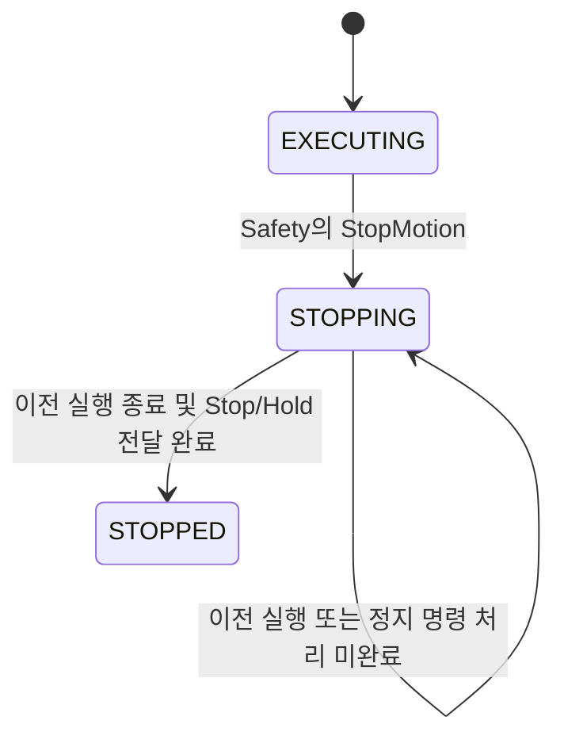
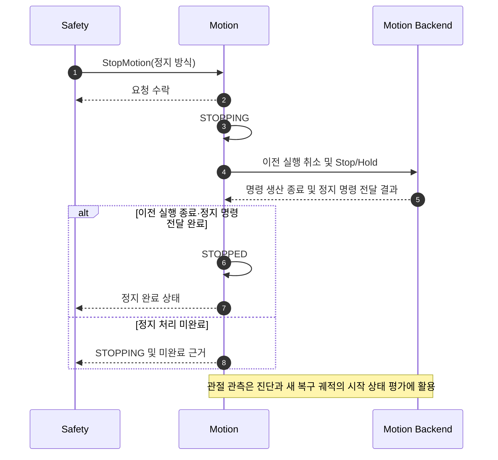

# [SF-Twin] ARM Cell Motion 정지 및 복구 동작

- **범위:** Safety 정지 / 선점 / 복구 진입
- **Owner:** ARM Cell Motion

Motion은 Safety가 지정한 정지 방식을 실행하고 정지 처리 결과를 보고한다. 정지 요청과 강도, 복구 권한은 Safety가 소유한다. Orchestration은 중단된 미션과 복구 이후의 작업 순서를 조정한다. 공유 상태와 명령의 상세 계약은 [Safety–Motion ICD](../../interfaces/icd-safety-motion.md)를 따른다.

## 1. 동작 권한

- `MOTION_NONE`: 궤적 실행 금지
- `MOTION_RECOVERY_ONLY`: 승인된 `RETRACT`만 허용
- `MOTION_NORMAL`: 정상 작업 허용

Motion은 작업 수락과 실제 궤적 실행 직전에 현재 Safety 권한을 확인한다.

## 2. 정지 완료와 상태 전이

`StopMotion`의 수락은 정지 요청이 접수됐다는 뜻이며 정지 완료가 아니다. Motion은 기존 Action과 궤적 명령 생산자를 종료하고, 이전 궤적 명령이 다시 발행될 수 없게 한 다음 Stop/Hold 명령 전달 결과를 확인한다. 이 처리가 완료됐을 때 소프트웨어 정지 완료를 확정한다.

관절 위치·속도가 완전히 안정될 때까지 기다리는 것은 정지 완료 조건이 아니다. 관성이나 미세한 움직임이 남아 있어도 기존 명령 실행이 종료됐다면 새로운 복구 요청을 평가할 수 있다. 그러나 새로운 복구 궤적의 실행 가능성은 최신 관절 상태·충돌 환경과 Safety 권한을 기준으로 별도로 판단하며, 이전 궤적을 재사용하지 않는다. 정지 처리 미완료는 새 작업의 허가 근거가 되지 않는다.

이 소프트웨어 정지 완료는 실제 하드웨어의 안전 등급 정지 확인을 대체하지 않는다. 실제 E-Stop/STO 보호와 재가동 조건은 별도 안전 계약을 따른다.

관절 진행 정체는 물리적 끼임의 확정 진단이 아니라 실행 실패다. 관련 작업 실패 의미는 [Task Execution PnP FDS](../task-execution/fds-pnp-execution.md)가 소유하며, 이후 정지나 복구가 성공해도 최초 작업의 실패 결과를 성공으로 바꾸지 않는다.

## 3. 정지 방식

- `STOP_MODE_CONTROLLED`: 승인된 감속 정지
- `STOP_MODE_IMMEDIATE`: 진행 중인 궤적 취소 및 현재 위치 유지
- `STOP_MODE_EMERGENCY`: 독립적인 E-Stop/STO와 연동하는 소프트웨어 정지·명령 차단

정지 강도는 Safety가 결정한다. Motion은 원인이나 심각도를 재해석하지 않는다. 정지 방식의 공유 의미는 [Safety–Motion ICD](../../interfaces/icd-safety-motion.md)를 따른다.

## 4. 정지 시퀀스

Safety에서 Motion으로 향하는 정지 요청이 기본 경로다. Orchestration의 취소는 미션 조정을 위한 보조 동작이며 정지 요청의 선행 조건이 아니다. 진행 중인 계획·실행 작업이 장시간 대기하더라도 Safety의 정지 요청 처리가 무기한 막혀서는 안 된다.

## 5. 그리퍼와 보유 자재

정지 이전의 그리퍼 명령이 통제 없이 계속 실행되어서는 안 된다. 정지 중인 자재의 보유 상태를 임의로 변경하거나 명령 성공만으로 `HELD`·`RELEASED`를 추정하지 않는다. 보유 자재의 수동 처리와 HOME 이후 미션 재개는 [Orchestration 복구 FDS](../orchestration/fds-controlled-recovery.md)를 따른다.

## 6. 검증 요구사항

### VR-MOT-STOP-01 — 정상 실행 권한
정상 궤적 실행은 현재 `MOTION_NORMAL` 권한을 요구한다.

### VR-MOT-STOP-02 — 제한 복구 권한
`RETRACT`는 Safety의 유효한 복구 권한을 요구한다.

### VR-MOT-STOP-03 — 요청 수락과 완료 구분
`StopMotion` 수락만으로 정지 완료를 확정해서는 안 된다.

### VR-MOT-STOP-04 — 정지 완료
이전 Action과 명령 생산자가 종료되어 더 이상 이전 궤적 명령을 발행할 수 없고 Stop/Hold 전달이 완료됐을 때에만 소프트웨어 정지 완료를 보고한다. 관절 안정 구간은 추가 완료 Gate가 아니다.

### VR-MOT-STOP-05 — 직접 정지
Orchestration의 취소 없이도 Safety의 직접 정지 요청이 동작해야 한다.

### VR-MOT-STOP-06 — 정지 경로의 진행 보장
정상 계획이나 실행이 오래 걸리거나 대기 중이더라도 정지 요청 처리가 그 작업의 종료까지 무기한 지연되지 않아야 한다. 특정 mutex·callback group·스레드 구조를 강제하지 않는다.

### VR-MOT-STOP-07 — 그리퍼 정지
진행 중인 그리퍼 동작은 적용되는 정지 정책에 따라 제한돼야 한다.
