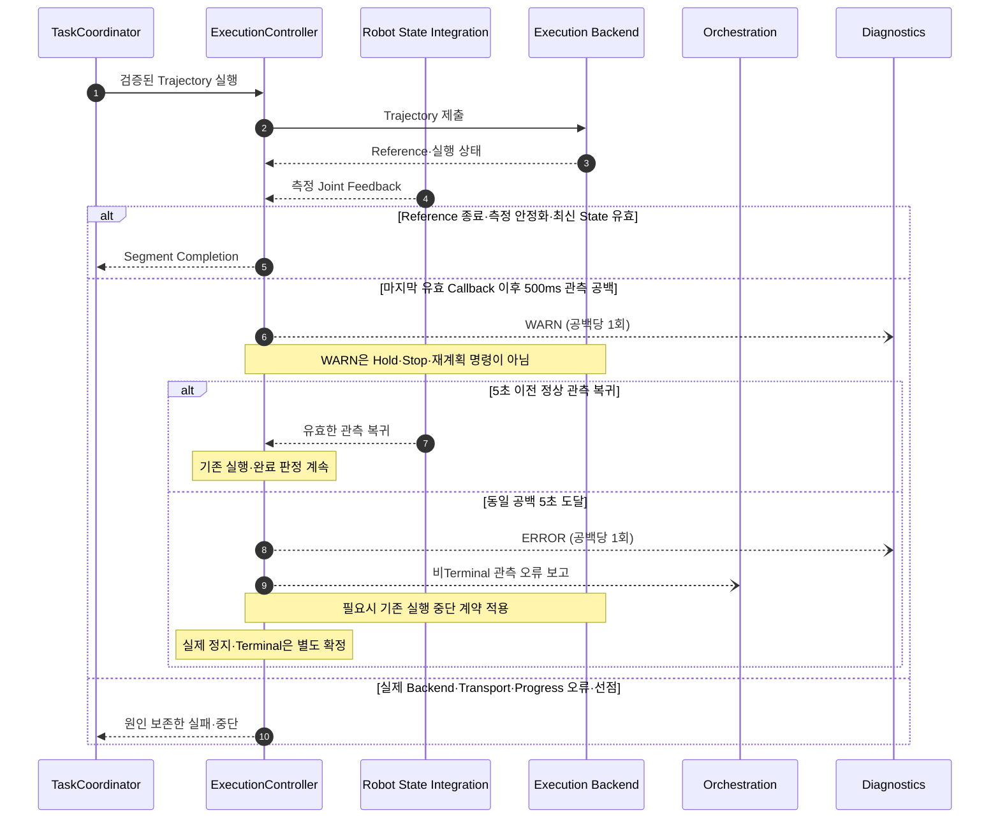
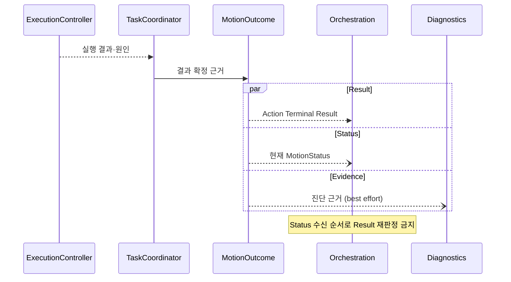
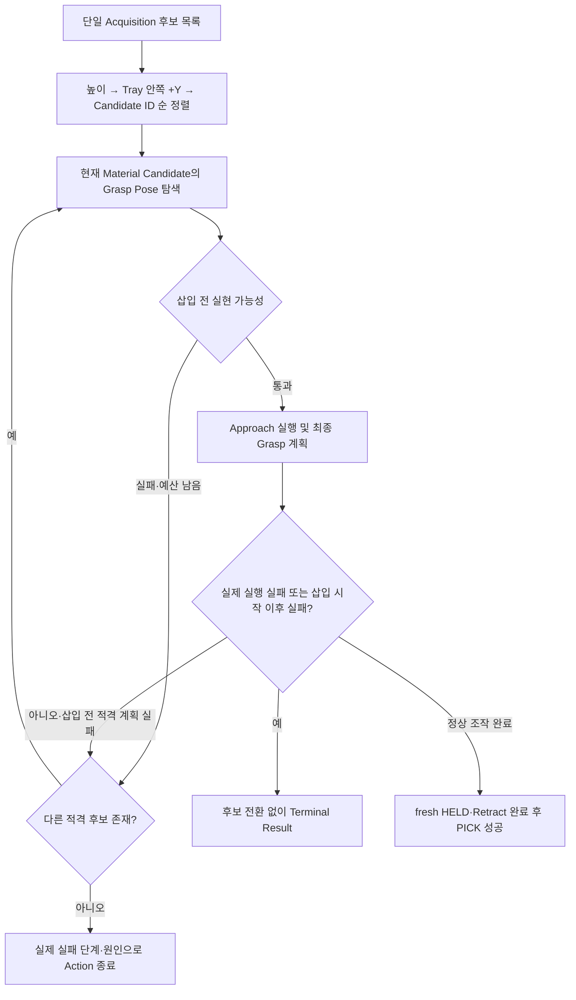

# [SF-Twin] ARM Cell 현행 통합 작업 실행 동작 — 이관 원본

- **범위:** 현행 `PICK / PLACE / GO_HOME / RETRACT` 통합 구현의 보존할 상세 동작
- **현행 구현 Owner:** `ARM Cell Motion`
- **목표 책임:** PnP 공정·후보 전환·Gripper·작업 복구는 `ARM Cell Task Execution`; IK·Planning·Trajectory·측정 완료는 `ARM Cell Motion`

> **비규범적인 기존 구현 대조 자료다.** 아래의 VR과 절차는 이전 통합 구현에서 관찰한 동작이며 현재 목표 계약이나 실행 계획이 아니다. 정식 요구사항은 Task Execution/Motion CDS·FDS·ICD의 Owner VR만 따른다. 아래의 Motion Action·클래스 소유 표기는 구현 관찰이며 목표 계약을 정의하지 않는다. 정식 설계는 [Task Execution PnP FDS](../task-execution/fds-pnp-execution.md), [Motion Execution FDS](fds-motion-execution.md), 각 CDS와 ICD가 소유한다. 상충 시 현재 Owner 문서가 적용되며 이 자료의 VR·절차를 현재 계약으로 인용해서는 안 된다.

> 아래 Scene 및 Grasp 끝점 Occupancy 설명도 기존 구현의 대조 정보다. 현재 Motion Planning BT와 Scene 적용 계약은 [Motion Execution FDS](fds-motion-execution.md)가 소유한다.

> 아래 안정화·연속 샘플·최신 상태를 결합한 완료 설명은 이전 구현의 대조 정보로만 남긴다.
> PICK/PLACE Trajectory의 현재 완료 의미와 Watchdog 활성 범위는
> [Motion Execution FDS](fds-motion-execution.md)의 **PICK/PLACE Trajectory 실행 완료**가 소유한다.
> 아래 설명을 새 안정화·정확도·Readiness Gate의 근거로 사용하지 않는다.

## 목적과 동작 범위

Motion은 수락된 `PICK`·`PLACE`·`GO_HOME`·`RETRACT` 작업을 계획·실행하고, 측정된 실행 결과와 실제 중단 원인에 따라 Action 결과를 확정한다. 아래 시나리오에서 공통 실행 완료와 후보 탐색을 먼저 소개한 뒤 작업별 적격성·실패·복구 경계를 정의한다.

| 핵심 판단 | 완료·진행에 필요한 근거 | 그것만으로는 인정하지 않는 것 |
|---|---|---|
| PICK/PLACE 구간 완료 | 마지막 궤적 기준점 발행 성공, 측정 관절 안정화·연속 샘플 충족, 유효한 최신 측정 관절 상태 | 기준점 발행만의 성공, 최종 오차 수치만의 판정 |
| 다음 구간 계획 | 완료 이후 최신 측정 관절 상태와 기존 IK·충돌·경로 유효성 검사 | 계획상 최종 관절값, 별도의 Arrival/Accuracy Gate |
| 후보 선택 | 해당 후보의 Grasp·Approach 실현 가능성 검증 | Vision 열거 순서, IK Seed만의 성공 |
| Action 결과 | 작업별 실제 실행·Holding·Safety·중단 원인 | 주기적 Phase 보고, 진단 기록의 성공 여부 |

## 실행 완료와 작업 후보의 핵심 의미

**Motion Execution Completion**은 요청된 궤적의 실행이 끝나고 로봇이 다음 동작을 시작할 준비가 되었는지 판단한다. PICK/PLACE의 Approach 및 최종 궤적 구간에서 완료하려면
마지막 궤적 기준점 발행이 성공해야 하고, 측정 관절 피드백이 궤적 종료 후 안정화 조건과 설정된 연속 샘플 수를 충족해야 하며, 다음 작업에 사용할 유효한 최신 측정 관절 상태가 존재해야 한다. 안정화 임계값과
샘플 수는 설정으로 소유한다. 기준점 발행만으로 물리적 완료를 인정하지 않는다. 마지막 관절 목표 오차가 `trajectory_goal_tolerance_rad`를 초과한 경우를 포함해 최종 목표 오차는 정확도 기록에
남기지만, 해당 PICK/PLACE 구간의 완료를 차단하지 않는다. 움직임 횟수, 특정 시점의 추가 움직임, 마지막 기준점 이후의 진행은 완료 조건이 아니다.

완료 판정의 범위는 궤적 기준점 실행 상태, 측정 관절의 안정화, 최신 측정 관절 상태의 가용성뿐이다. Transport는 명령 전달·통신 실패·피드백 전달 유효성, `TrajectoryWatchdog`는 시뮬레이션
Clock 진행 감시, `MotionProgressWatchdog`는 측정 관절의 진행 정체 감시를 책임진다. Safety는 실행 권한·위험 판단·직접 정지를, Action Lifecycle은 취소·선점·결과 전파를
책임진다. 완료 판정은 각 책임이 보고한 오류와 중단을 받아들이되 판단을 중복하지 않으며, 보고된 실행 오류나 중단을 Motion Action 성공으로 바꿔서는 안 된다. 중단 원인의 결과 전파 우선순위는 §6.1에
따른다. `MotionProgressWatchdog`는 비정상적인 진행 정체를 검출하며 정상 실행의 성공을 증명하는 조건이 아니다.

PICK/PLACE Approach와 최종 궤적이 끝나면 Motion은 관절별 최종 위치 오차, 최대 관절 위치 오차, TCP 위치·방향 오차를 기록한다. TCP 오차는 실제 측정 관절 상태에 FK를 적용한 결과를
계획된 최종 TCP 목표와 비교한다. 기존 Motion 작업 정확도 진단과 기록을 재사용하며 별도의 Recipe TCP Accuracy 기록은 생성하지 않는다. 명시된 도메인 계약이 없는 한 정확도 경고만으로 완료
결과를 무효화하지 않는다. 정확도 계산과 기록은 최선 노력(best-effort)으로 수행하며 정상 완료를 차단하지 않는다.

Approach나 이전 궤적의 완료 후 다음 Planning은 최신 측정 관절 상태에서 시작한다. 계획상 최종 관절값으로 측정값을 대체하지 않는다. 궤적 완료와 다음 Planning 사이에 별도의 Arrival·Accuracy·State
Validity Gate를 두지 않는다. 다음 Planning의 IK·충돌·관절 한계·경로 유효성 검사는 그대로 유지한다.

**Material Candidate**는 관측된 자재 객체 하나이고, **Grasp Pose Candidate**는 그 자재에 대한 TCP 자세·Closing Axis/예상 폭·파생 Approach 한 조합이다.
후보 평가는 적격성과 실현 가능성을 검사하고, 선택은 실행할 후보를 정하며, 후보 전환은 §1.1.1의 제한된 탐색 범위에서만 이루어진다. IK Seed와 Planning 요청은 후보 평가 안의 시도일 뿐 별도의
Material Candidate가 아니다.

Vision 기반 PICK은 동일 Acquisition에서 나온 전체 Material Candidate 목록을 받으며, Cuboid 검출에서는 이 목록이 Vision이 반환한 HIGH 후보 전체다. MEDIUM·LOW는 Action 입력에 포함되지 않는다. Direct PICK은 목록 없이 하나의 목표를 받아 동일한 파지·실행 계약을 적용한다. Occupancy가
누락됐다고 자유 공간이 증명되는 것은 아니다. 공유 필드의 유효성과 호환성은 [Orchestration–Motion ICD](../../interfaces/icd-orchestration-motion.md)에 정의된다.

**Approach**는 파지 전 자세까지의 이동이다. **Cartesian Descent**는 Grasp를 향한 TCP 직선 삽입이며, 기울거나 수평일 수 있으므로 World 수직 하강을 의미하지 않는다. **Grasp
Entry**는 최종 이동 구간이고 이후 논리적 Close와 새로운 Holding 확인을 수행한다. **Post-Grasp Lift**는 파지한 물체를 유지하며 후퇴하는 동작으로 별도의 Action 단계가 아니다.
§5의 **RETRACT**는 Safety가 승인하는 독립 복구 작업이며, 정상 PICK 후퇴는 해당 PICK Action의 일부다.

Gripper 관측은 서로 다른 세 사실로 해석한다. **Holding 상태**는 최신 유효 관측의 `HELD`, `RELEASED`, `UNKNOWN` 값이고, **관측 전달 상태**는 그 관측의 수신 또는 지연·Stale 여부이며, **작업 결과**는 Motion이 확인한 파지 성공·실패 또는 해제 결과다. Stale·미수신은 Holding 값이 아니다. Motion은 마지막 정상 관측의 값·시퀀스·시각을 보존하고, 관측이 오래됐다는 이유로 `HELD`/`RELEASED`를 `UNKNOWN`으로 덮어쓰지 않는다. 오래된 관측은 새 상태 전이의 증거로 사용하지 않는다. 필요한 새 관측이 지연되면 해당 Gripper 단계에서 기다리고, 복구 관측을 받으면 중단한 단계부터 계속한다. 이 대기는 별도 Timeout이나 Action 실패가 아니며 통신 지연만으로 CLOSE/OPEN을 재명령하거나 기존 PICK/PLACE를 포기하지 않는다. 지연 시작과 복구는 필요에 따라 각각 진단하고, 같은 지연의 반복 로그를 억제한다. 이 진단만으로 Action 결과를 바꾸지 않으며 Joint Feedback 공백의 500ms/5초 기준을 Gripper에 적용하지 않는다.

## 동적 시나리오와 책임

이 문서는 [Motion CDS](cds.md)의 설계 역할이 **언제 상호작용하고, 어떤 실패를 어떻게 전파하는지**를 기술한다. Sequence Diagram의 책임 간 상호작용, 선후관계, 상태 전이 및 결과·오류
전파는 구현이 준수해야 하는 설계 계약이다. 실제 클래스와 설계 역할이 일대일 대응할 필요는 없으며, 이 계약을 보존하는 추가 클래스·메서드·내부 호출·최적화는 허용한다. 설계 책임의 구현 위치와 실행 흐름은 추적
가능해야 한다. 상세 후보·충돌·Gripper·Scene 계약은 아래 §1–§6과 ICD가 소유하며, 시퀀스는 동일 규칙을 다시 정의하지 않는다.

| 참여 책임 | 상호작용 |
|---|---|
| Orchestration | Task 요청, 진행·오류 보고 및 최종 Action Result 소비 |
| TaskCoordinator / MotionOutcome | Admission·실행 조정, 원인 보존과 결과·상태 확정 |
| CandidateSelector / MotionPlanner | 후보 탐색 및 계획의 타당성·실패 |
| ExecutionController / Backend | 실제 실행과 측정 완료·관측 오류 |
| GripperPort | 논리 Open/Close 및 fresh HoldingObservation |

### PICK — 실행과 복구 결과

```mermaid
sequenceDiagram
    autonumber
    participant O as Orchestration
    participant T as TaskCoordinator
    participant C as CandidateSelector
    participant P as MotionPlanner
    participant E as ExecutionController
    participant G as GripperPort
    O->>T: ExecuteTask(PICK, Material Candidates)
    T->>T: Admission 및 Safety 허용
    T->>G: 초기 OPEN
    loop 새 Holding 관측 수신 전
        alt 관측 전달 지연·Stale
            G-->>T: 지연 (마지막 정상 관측 유지)
            Note over T,G: 현재 단계에서 대기; OPEN 반복·Terminal Result 없음
        else 새 관측 수신
            G-->>T: 새 Holding 상태, 대기 종료
        end
    end
    alt 새 RELEASED
        Note over T: PICK 후보 탐색 계속
    loop Action 공유 예산 내 적격 후보
        T->>C: 다음 후보
        C->>P: Grasp 상태·Approach 계획 검증
        alt 후보 적격 계획 실패
            P-->>C: 실패 단계·원인
        else 후보 계획 유효
            P-->>T: 선택 후보 및 Approach
            T->>E: Approach 실행
            alt 실제 실행 실패·선점
                E-->>T: 측정 상태·실행 원인
                T-->>O: 기존 Terminal Result (Approach 실행 실패는 후보 전환·작업 재진입 대상 아님)
            else Approach 측정 완료
                E-->>T: 유효한 최신 측정 상태
                T->>P: Grasp 경로 계획
                alt 삽입 전 적격 계획 실패
                    P-->>T: 계획 실패·근거
                    Note over T,C: 다음 후보는 최신 측정 상태에서 Approach 재계획
                else 삽입 경로 유효
                    P-->>T: 유효 경로
                    T->>E: Grasp 삽입 실행
                    alt 삽입 실행 실패·선점
                        E-->>T: 측정 상태·실행 원인
                        alt 복구 가능한 PICK 작업 실패
                            loop 새 Holding 관측 수신 전
                                alt 관측 전달 지연·Stale
                                    G-->>T: 지연, 복구 단계 유지
                                else 새 관측 수신
                                    G-->>T: 새 Holding 상태, 대기 종료
                                end
                            end
                            alt 최신 Holding HELD
                                T->>G: 현재 위치에서 기존 OPEN
                                loop 새 Holding 관측 수신 전
                                    alt 관측 전달 지연·Stale
                                        G-->>T: 지연, OPEN 반복 없음
                                    else 새 관측 수신
                                        G-->>T: 새 Holding 상태, 대기 종료
                                    end
                                end
                                alt 새 RELEASED
                                    T-->>O: 기존 PICK 실패 Result + object_disposition=RETURNED
                                else 새 UNKNOWN 또는 실제 OPEN/Backend 오류
                                    T-->>O: 새 UNKNOWN은 TASK_RESULT_GRASP_FAILURE, 오류는 원인별 Result; object_disposition=UNKNOWN
                                end
                            else 최신 Holding RELEASED
                                Note over T,G: OPEN 생략; 기존 RELEASED 증거 사용
                                T-->>O: 기존 PICK 실패 Result + object_disposition=RETURNED
                            else 최신 Holding UNKNOWN
                                T->>G: 현재 위치에서 기존 OPEN 1회
                                loop OPEN 후 새 Holding 관측 수신 전
                                    alt 관측 전달 지연·Stale
                                        G-->>T: 지연, OPEN 반복 없음
                                    else 새 관측 수신
                                        G-->>T: 새 Holding 상태, 대기 종료
                                    end
                                end
                                alt 새 RELEASED
                                    T-->>O: 기존 PICK 실패 Result + object_disposition=RETURNED
                                else 새 UNKNOWN 또는 실제 OPEN/Backend 오류
                                    T-->>O: 새 UNKNOWN은 TASK_RESULT_GRASP_FAILURE, 오류는 원인별 Result; object_disposition=UNKNOWN
                                end
                            end
                        else Safety·취소·시스템/Backend 오류
                            T-->>O: 기존 Terminal Result
                        end
                    else Grasp 측정 완료
                        E-->>T: 완료 근거
                        T->>G: CLOSE
                        loop 새 Holding 관측 수신 전
                            alt 관측 전달 지연·Stale
                                G-->>T: 지연 (마지막 정상 관측 유지)
                                Note over T,G: 같은 단계에서 대기; CLOSE 반복·Result 없음
                            else 새 관측 수신
                                G-->>T: 최신 Holding 상태, 대기 종료
                            end
                        end
                        alt 새 관측 HELD
                            T->>E: 검증된 삽입 역경로 Retract
                            E-->>T: 완료 또는 실패·측정 상태
                            alt 복구 가능한 PICK 후퇴 실패
                                loop 새 Holding 관측 수신 전
                                    alt 관측 전달 지연·Stale
                                        G-->>T: 지연, 복구 단계 유지
                                    else 새 관측 수신
                                        G-->>T: 새 Holding 상태, 대기 종료
                                    end
                                end
                                alt 최신 Holding HELD 또는 UNKNOWN
                                    T->>G: 현재 위치에서 기존 OPEN 1회
                                    loop OPEN 후 새 Holding 관측 수신 전
                                        alt 관측 전달 지연·Stale
                                            G-->>T: 지연, OPEN 반복 없음
                                        else 새 관측 수신
                                            G-->>T: 새 Holding 상태, 대기 종료
                                        end
                                    end
                                    alt 새 RELEASED
                                        T-->>O: 기존 PICK 실패 Result + object_disposition=RETURNED
                                    else 새 UNKNOWN 또는 OPEN/Backend 오류
                                        T-->>O: 기존 TASK_RESULT_GRASP_FAILURE 또는 원인별 Result + object_disposition=UNKNOWN
                                    end
                                else 최신 Holding RELEASED
                                    Note over T,G: OPEN 생략; 기존 RELEASED 관측 사용
                                    T-->>O: 기존 PICK 실패 Result + object_disposition=RETURNED
                                end
                            else 후퇴 성공
                                T-->>O: 기존 PICK 성공 Result + object_disposition=HELD
                            else Safety·취소·시스템/Backend 오류
                                T-->>O: 기존 Terminal Result
                            end
                        else 정상 통신에서 새 RELEASED
                            Note over T,G: 이미 RELEASED; 현재 위치 OPEN 생략
                            T-->>O: 기존 PICK 실패 Result + object_disposition=RETURNED
                        else 정상 통신에서 새 UNKNOWN 또는 실제 파지 실패
                            Note over T,G: 현재 위치 OPEN 복구 1회
                            T->>G: 현재 위치에서 기존 OPEN
                            loop OPEN 후 새 Holding 관측 수신 전
                                alt 관측 전달 지연·Stale
                                    G-->>T: 지연, OPEN 반복 없음
                                else 새 관측 수신
                                    G-->>T: 새 Holding 상태, 대기 종료
                                end
                            end
                            alt 새 RELEASED
                                T-->>O: 기존 PICK 실패 Result + object_disposition=RETURNED
                            else 새 UNKNOWN 또는 실제 OPEN/Backend 오류
                                T-->>O: 새 UNKNOWN은 TASK_RESULT_GRASP_FAILURE, 오류는 원인별 Result; object_disposition=UNKNOWN
                            end
                        end
                    end
                end
            end
        end
    end
    opt 적격 후보 모두 소진
            T-->>O: 기존 PICK 계획 실패 Result + object_disposition=UNCHANGED
    end
    else 정상 통신에서 새 UNKNOWN
        Note over T,G: 초기 OPEN은 이미 수행됨; 동일 목적의 OPEN을 반복하지 않음
        T-->>O: 기존 TASK_RESULT_GRASP_FAILURE + object_disposition=UNKNOWN
    end
```

후보 전환은 기존 계약에 따른 Grasp 삽입 전 적격 계획 실패에만 허용한다. 후보 전체의 IK·Planning 탐색 소진과 파지 확정 전 비조작 실패는 각각 기존 실패 Result와 `UNCHANGED`로 확정한다. Action-local Gripper 관측 대기와 파지·후퇴 복구 분기는 위 PICK Sequence가 정의하며, 별도 Tray 반환 자세나 PICK 후퇴 위치 경로를 추가하거나 실패 궤적을 재전송하지 않는다. Safety·명시적 Cancel 및 실제 Backend 오류는 기존 Terminal 계약을 따른다. 상위 재진입 정책은 [Mission Cycle FDS](../orchestration/fds-mission-cycle.md), 공유 결과 의미는 §6과 ICD가 소유한다.

### PLACE — 정상 실행·접근 실패 반환·삽입/후퇴 복구

```mermaid
sequenceDiagram
    autonumber
    participant O as Orchestration
    participant T as TaskCoordinator
    participant P as MotionPlanner
    participant E as ExecutionController
    participant G as GripperPort
    O->>T: ExecuteTask(PLACE, Recipe 목표와 제약)
    T->>P: 기존 PLACE 후보·IK·Global Planning
    P-->>T: 계획 성공 또는 후보·예산 실패 근거
    alt PLACE Approach 경로 계획 성공
        T->>E: 기존 Approach·Final Place 궤적 실행
        E-->>T: 측정 완료 또는 실제 실행 실패
        T->>G: 기존 논리 OPEN
        loop 새 Holding 관측 수신 전
            alt 관측 전달 지연·Stale
                G-->>T: 지연 (마지막 정상 관측 유지)
                Note over T,G: 같은 단계에서 대기; OPEN 반복·Terminal Result 없음
            else 새 관측 수신
                G-->>T: 새 Holding 상태, 대기 종료
            end
        end
        alt 새 RELEASED
            T->>T: World Object 상태 전이
            T->>E: 기존 Retreat 실행
            E-->>T: 측정 완료
            T-->>O: 기존 PLACE 성공 Result + object_disposition=PLACED
        else 정상 통신에서 새 UNKNOWN
            Note over T,G: 이미 OPEN 수행; OPEN 반복 없이 기존 TASK_RESULT_GRASP_FAILURE와 UNKNOWN
            T-->>O: TASK_RESULT_GRASP_FAILURE + object_disposition=UNKNOWN
        else 실제 OPEN/Backend 오류
            T-->>O: 원인별 기존 오류 Result + 미확정 object_disposition=UNKNOWN
        end
    else 모든 PLACE Approach 후보·Planning 요청 예산 소진 (순수 계획 실패)
        Note over T,E: PICK 후퇴 위치를 유지하며 HOME·경유지 이동 금지
        T->>G: 현재 위치에서 기존 논리 OPEN
        loop 새 Holding 관측 수신 전
            alt 관측 전달 지연·Stale
                G-->>T: 지연 (OPEN 반복 없음)
            else 새 관측 수신
                G-->>T: 새 Holding 상태, 대기 종료
            end
        end
        alt fresh RELEASED 확인
            T->>T: World Object 상태 전이
            Note over T: 기존 IK/Path Planning 실패 Result 보존
            T-->>O: 기존 PLACE Planning 실패 Result + object_disposition=RETURNED
        else 새 UNKNOWN
            T-->>O: 기존 TASK_RESULT_GRASP_FAILURE + object_disposition=UNKNOWN
        else 실제 OPEN/Backend 오류
            T-->>O: 원인별 기존 오류 Result + 미확정 object_disposition=UNKNOWN
        end
    else PLACE 삽입 복구 가능한 실패·자재 HELD
        loop 현재 상태 기준 유한한 대체 자세·경로 탐색
            T->>P: 최신 측정 상태에서 다른 유효 PLACE 자세·경로
            P-->>T: 새 경로 또는 구간 예산 소진
            opt 유효 경로 발견
                T->>E: 새로 계획한 삽입 실행
                E-->>T: 측정 완료 또는 실패·현재 상태
            end
        end
        Note over T,E: 삽입 탐색 소진 후 충돌 없는 고정 관절 경로를 사용
        T->>E: 기존 HOME 관절 자세로 이동
        E-->>T: 이동 완료
        T->>E: place_tray_return_joint_positions로 이동
        E-->>T: 이동 완료
        T->>G: 반환 자세에서 기존 논리 OPEN
        loop 새 Holding 관측 수신 전
            alt 관측 전달 지연·Stale
                G-->>T: 지연 (OPEN 반복 없음)
            else 새 관측 수신
                G-->>T: 새 Holding 상태, 대기 종료
            end
        end
        alt fresh RELEASED 확인
            T-->>O: 기존 PLACE 실패 Result + object_disposition=RETURNED
        else 새 UNKNOWN
            T-->>O: 기존 TASK_RESULT_GRASP_FAILURE + object_disposition=UNKNOWN
        else 실제 OPEN/Backend 오류
            T-->>O: 원인별 기존 오류 Result + 미확정 object_disposition=UNKNOWN
        end
    else PLACE 후퇴 복구 가능한 실패·자재 RELEASED
        loop 현재 상태 기준 유한한 대체 후퇴 경로 탐색
            T->>P: 최신 측정 상태에서 다른 유효 후퇴 경로
            P-->>T: 새 경로 또는 구간 예산 소진
            opt 유효 경로 발견
                T->>E: 새로 계획한 후퇴 실행
                E-->>T: 측정 완료 또는 실패·현재 상태
            end
        end
        T-->>O: 기존 PLACE 실패 Result + object_disposition=PLACED
    else Planning 중 시스템·Scene·Safety·취소 오류
        T-->>O: 기존 원인별 Terminal Result
    end
```

Motion은 기존 유한 Recipe 후보·IK·Planning 예산을 한 번의 PLACE Approach 탐색에
적용한다. 모든 적격 후보와 요청 예산이 소진된 순수 계획 실패는 기존
`TASK_RESULT_IK_UNREACHABLE` 또는 `TASK_RESULT_PATH_OBSTRUCTED`로 확정하되,
그 전에 PICK 성공 후 완료된 후퇴 위치에서 기존 논리 OPEN과 fresh `RELEASED` 확인을
수행한다. 해당 위치는 현재 데모 전제상 Tray 내부이며, 이 반환 동작에 별도 배치
알고리즘·충돌 Gate·낙하 Gate를 추가하지 않는다. HOME이나 다른 경유지로 먼저 이동하지
않는다. `RELEASED`가 확인되지 않거나 취소·Safety 선점·시스템/Backend 오류가 발생하면
기존 해당 실패 Result를 적용한다.

PLACE Approach Planning 실패 Result는 실패 원인을 보존한 Terminal Action Result다. Motion은
PICK 후퇴 위치를 유지해 OPEN·fresh `RELEASED`를 완료한 뒤 기존 Planning 실패 Result를
반환한다. 삽입 실패에서는 Motion이 유한한 대체 계획을 소진한 뒤 고정 HOME 자세 → Tray
반환 자세 → OPEN·fresh `RELEASED` 순으로 수행하고 기존 PLACE 실패 Result를 반환한다.
이 HOME·Tray 이동은 Motion Action 내부 복구이며, Terminal Result 이후 별도 GO_HOME Action을
요청할지는 Orchestration 소유 정책이다. 후퇴 실패에서는 이미 `RELEASED`인 자재를 다시
반환하지 않으며 유한한 대체 후퇴 탐색을 마친 뒤 기존 실패 Result를 반환한다. 새 Action 종류나
Result Code는 만들지 않는다. Planning에 사용되는 설정은 §3.1에 명시한다.

### 공통 Execution Completion과 피드백 관측 공백



| 관측 사건 | 보고·영향 | 실행 결과와의 관계 |
|---|---|---|
| 마지막 유효 Joint Feedback Callback 후 500ms 공백 | WARN 1회 | 실행 정지·재계획·성공 판정 아님 |
| 같은 공백 5초 도달 | ERROR 1회 및 Orchestration 비Terminal 보고 | 자체로 Terminal Result 아님 |
| 유효 관측 복귀 | 기존 실행·완료 판단 계속 | 별도 Resume Gate 없음 |
| 실제 정체·Backend 오류·취소·선점 | 해당 계약으로 중단·Result 확정 | 관측 공백 보고와 구별 |

**도메인 시간 요구사항:** 실행 중 필수 Joint Feedback의 마지막 유효 **Callback 수신 시점**을 기준으로 관측 공백이 500ms에 도달하면 WARN, 같은 공백이 5초에 도달하면 ERROR
및 **Orchestration에 비Terminal 오류 보고**를 수행한다. 이미 보고한 같은 공백은 고주파 반복 기록하지 않는다. 관측 복귀 자체에는 별도 Resume·재계획 절차가 필요하지 않다. 관측 부재는
실제 움직임 정체나 물리 정지의 증거가 아니며 기존 측정 완료 조건을 우회하지 않는다. 5초 보고, 중단 요청, 정지 확인, Action Terminal Result는 별개의 사건이다. 미확정 실행의 소유권을 해제하거나
새 Goal을 허용하지 않는다. 비Terminal 보고는 [Orchestration–Motion ICD](../../interfaces/icd-orchestration-motion.md)의 `MotionObservationError`
논리 데이터 계약을 따르며, 기존 Action Feedback이나 MotionStatus의 진단 문자열을 오류 전달 프로토콜로 간주하지 않는다. 본 기준은 §1의 **500ms Action phase heartbeat**와
별도이다.

### 결과·MotionStatus·진단의 관계



Diagnostic 기록 실패는 Action 결과를 변경하지 않는다. Safety Stop·Completion 경합은 [Stop and Recovery FDS](fds-stop-recovery.md)의 단일 소유다.

### 오류 분류와 관측 근거

| 조건 | 전파·종료 | 관측해야 할 근거 |
|---|---|---|
| 적격 IK·Planning 실패 | 후보 전환 또는 Action 계획 실패 | 후보·단계·원인 |
| Scene 무결성·실제 실행 실패 | Terminal; 후보 전환 금지 | 적용 상태·Backend·측정 결과 |
| Joint Feedback 공백 | 500ms WARN, 5초 ERROR·비Terminal 보고 | 마지막 유효 관측·공백 경과·보고 |
| 유효 Feedback에서 진행 정체 | 별도 `JOINT_PROGRESS_STALLED` 결과 | 측정 진행·Watchdog 판정 |
| Holding 관측 전달 지연·Stale | 해당 Gripper 단계에서 대기; Action Result 변경 없음 | 마지막 정상 Holding 값·시퀀스·시각, 지연 시작·복구 진단 |
| 정상 통신에서 Holding `UNKNOWN` 또는 실제 파지 실패 | 이미 OPEN이면 반복하지 않음; 복구 후 새 RELEASED면 PICK 실패 + RETURNED, 미확정이면 Gripper 실패 + UNKNOWN | 실제 Holding·파지 실패·OPEN 횟수·복구 후 새 관측·Action Result |
| Safety 선점·명시적 Caller Cancel·실제 Gripper 명령 오류 | 각 정규 Safety/Cancel/Gripper 결과 | 실제 오류·선점·취소 근거 |

GO_HOME은 Home 목표 도달의 정확도 판정을 유지하며 그리퍼의 무관한 부작용을 만들지 않는다. RETRACT는 Safety Recovery 허용과 Holding·경로 유효성에 따라 실행한다.

---

## 1. 공통 실행 전제조건

궤적 실행 명령을 생성하기 전에 Motion은 다음 조건을 확인해야 한다.

1. 작업의 의미적 유효성을 검증한다.
2. Safety Capability를 집행한다.
3. 필수 목표·객체 정보를 검증한다.
4. 충돌을 고려한 필수 Planning 결과를 생성하고 검증한다.

이는 Motion이 책임지는 실행 전제조건이다. Orchestration은 논리적 작업 입력을 해석하고 Safety 허가를 읽지만, 목표 기하·충돌/경로·궤적 실현 가능성·실행 허가·물리적 Gripper 결과 검사를
중복하지 않는다. Motion은 Goal 수락 시 한 번 검증하며 궤적 제출 직전 Safety를 독립적으로 다시 확인하고, Planning과 실행에 Safety Envelope를 적용한다. 물리적 전제조건이 실패하면
해당 작업을 Motion 결과 및 실패 근거와 함께 거부하거나 종료한다. 실제 Safety 선점은 Safety Interlock이며 일반적인 재시도 가능 PICK 실패로 분류하지 않는다.

ROS Action Goal 수락은 요청의 접수이며 작업 성공이나 Safety 허가 확정이 아니다. Motion은 유효 Goal을 배타적으로 예약하고 궤적 제출 직전에 Safety Capability를 다시 확인한다.

| Goal 수락·실행 경계 | 정규 처리 |
|---|---|
| 실행 예약·제어 실행·정지 관측 대기·Backend 비활성 미확인 중 충돌 Goal | 기존 실행을 교체하거나 새 Backend 작업을 시작하지 않고 `TASK_RESULT_BUSY` 반환 |
| 잘못된 입력 | `TASK_RESULT_INVALID_GOAL` 반환 |
| Safety 권한 부족 | `TASK_RESULT_PERMISSION_DENIED` 반환 |
| Backend 사용 불가 | `TASK_RESULT_BACKEND_UNAVAILABLE` 반환 |
| Action Protocol 수준의 거부 | 도메인 `ExecuteTask.Result` 없음; BUSY로 추정 금지 |

프로토콜상 수락 가능한 충돌 Goal은 BUSY 결과 전달을 위해 수락할 수 있다. 위 실패는 기존 예약·실행을 변경하지 않는다. Motion은 Action 종료까지 예약 해제와 Backend 활동 상태 관측을 소유한다. Action Result와 MotionStatus는 어느 순서로든 도착할 수 있으며 과거 Status가 새 Goal의 수락 근거는 아니다. 수락된 Goal도 [Orchestration–Motion ICD](../../interfaces/icd-orchestration-motion.md)에 따라 실행 전 또는 실행 중 실패할 수 있다.

수락된 Goal의 전체 수명 동안 Motion은 작업 Phase가 바뀌는 즉시 보고하고 현재 관측 Phase를 500ms마다 반복한다. Action Goal UUID만 실행 식별자로 사용한다. 이 주기적 보고는 Action의
활성 관측일 뿐 물리적 움직임이나 Backend 건전성의 근거가 아니다. 최종 Result는 별도의 완료 확인과 Backend 비활성 확인을 따른다. MotionStatus는 상태와 정지 확인을 제공하는 인터페이스다.

Motion은 [Safety–Motion ICD](../../interfaces/icd-safety-motion.md)의 Safety 소유 허용 Motion Envelope를 사용한다. Planning과 실행의 속도·가속도는
이 한계를 따라야 하며 Motion은 원인·상태·심각도를 재해석하지 않는다. 실행 중 더 엄격한 Envelope가 적용되면 Backend가 안전하게 한계를 적용하고 활성 궤적의 준수 근거를 제공하는 경우에만 계속
실행할 수 있다. 그렇지 않으면 Safety가 권한에 따라 StopMotion을 시작하고 Motion은 정지를 수행하며 비활성을 확인한다. Motion이 정지 정책을 선택하지 않는다. 이후 작업은 현재 Envelope에서
새로 계획해야 한다. Envelope가 누락·무효·오래됨·권한 부족 상태이면 새로운 궤적을 시작하지 않는다.

필수 Safety 정보가 유효하고 정해진 신선도 범위에 있는 동안, Communication Health 지연·Timestamp·Freshness 경고만으로 허용 Envelope를 축소하거나 StopMotion을
발생시켜서는 안 된다. 단, Safety가 실제 게시한 유효한 제한은 승인된 원인과 무관하게 Motion이 그대로 적용한다.

PICK·PLACE Planning은 운영 Profile이 선택한 Planning Capability와 작업별 유한한 후보 수·IK Seed 수·Planning 요청 수·경과 시간 예산을 따른다. Vision 기반
PICK에서는 Grasp Pose 후보·IK Seed·Planning 요청의 개수 제한을 각 Material Candidate에 독립 적용하며 Action 전체의 경과 시간 예산은 후보 전환 시 초기화하지 않는다.
후보 하나가 자체 횟수 한도를 소진해도 다음 후보의 횟수 한도는 감소하지 않는다. 실제 값과 적용 수명은 Motion 운영 Profile이 소유하며 현재 기본값은 FDS의 고정 한도가 아닌 설정이다. 반복 Planning
요청은 후보와 측정된 시작·목표를 유지하며 목표를 교란하지 않는다. 검증된 Plan이 성공하면 해당 단계는 즉시 종료한다. 후보별·전체 경과 시간 예산에는 해당 범위의 모든 Planning 요청을 포함하며 다른 요청이나
후보 전환으로 초기화하지 않는다. 후보 횟수 예산이 남더라도 경과 시간 예산이 소진되면 탐색을 종료한다. 이러한 탐색 예산은 물리적 관절/Safety 한계, 궤적 완료 조건, Orchestration Retry 예산을
정의하지 않는다.

Trajectory Execution이 위 Execution Completion 계약에 따라 PICK/PLACE Approach 완료를 확인하면 Task Execution은 최신 측정 관절 상태를 시작점으로 최종
Grasp 또는 Place 구간을 계획한다. 별도의 Approach 도달·Feedback Freshness·Settling·State Validity Gate를 추가하지 않는다. 설정된 유한 예산 안에서 검증된 Cartesian
직선 경로를 먼저 요청한다. Cartesian 경로가 실패하면 정확히 같은 TCP 목표에 대해 Target IK와 충돌 유효성이 통과한 경우에 한해 제한된 Global Planning으로 대체할 수 있다. Global
Fallback은 Planning Scene, 부착 객체 충돌 형상, Recipe 목표 허용 오차, 궤적 검증 조건을 그대로 유지하며 Cartesian TCP Descent를 보장하지 않는다. Safety 선점·취소·Planning
Scene 유효성 서비스 실패·무효하거나 충돌하는 Goal에서는 Global Fallback 없이 Planning을 중단한다. 각 시도의 Occupancy 적용 범위는 §1.2가 정의하며 Global Fallback에서도
바뀌지 않는다.

PICK Grasp 삽입이 성공하면 정상 PICK Retract는 실제 실행된 Descent 궤적을 역순으로 재사용한다. 이 규칙은 Descent가 검증된 Cartesian 경로나 허용된 Global Fallback을
사용한 경우 모두 적용된다. Grasp 이후 측정 관절 상태에서 시작해 궤적 연속성, 부착 객체·고정 Scene 충돌, 허용된 Finger Tip–Tray 예외, 관절 한계, 궤적 유효성 및 현재 Safety를 실행
전에 검증한다. 새로운 자세나 경로를 탐색하지 않으며, 측정 시작점과 첫 역방향 Waypoint의 연결을 위해 별도의 목표 정확도 허용 오차를 추가하지 않는다. 기존 궤적 연속성과 실행 가능 상태 검사가 이를 판단한다.
검증에서 거부되면 기존 Path 실패를 Action의 실패·Recovery 경계로 반환한다. 독립 Recovery RETRACT는 별도 작업으로 유지한다.

### 1.1 PICK 후보 평가 단계

Motion은 하나의 수락된 PICK Action에서 정렬된 Material Candidate 목록을 탐색한다. 적격한 Grasp Pose Candidate마다 후보 기하·Recipe 적격성, Grasp IK, 반환된
해의 FK·관절 범위/연속성·Grasp 접촉 적격성·최종 Grasp 목표 상태의 충돌 유효성, Approach IK/검증 및 경로 Planning, Approach 실행, 최종 Grasp Cartesian Planning,
Grasp 삽입 실행, Gripper 확인 및 Retract의 단계를 판단·진단 근거에서 명확히 구분해야 한다.

IK 실패는 Approach 실패가 아니며, Approach Plan이 존재한다고 최종 Grasp 상태가 유효한 것은 아니다. 최종 작업 Result도 후보 평가 단계가 아니다. Grasp IK 해가 유효한 후 Approach
궤적 실행을 승인하기 전에 Motion은 적용되는 Planning Scene에서 최종 Grasp 목표 상태를 검증해야 한다. 최종 상태가 무효하거나 충돌하면 기본 제약에 따라 Approach 실행 전에 후보를 거부한다.
§1.2의 구간별 Vision Occupancy 검사는 고정 Scene이나 로봇 상태 유효성을 완화하지 않는다. 동일한 충돌 관절 상태까지 경로만 바꾸어도 유효한 상태가 되지 않는다. 동일 TCP 자세에 대해 다른
유효한 IK 분기는 상태 검증 대상이 될 수 있다.

Motion은 최종 Cartesian Grasp 경로 Planning을 Approach 완료 후까지 연기할 수 있으며, 이 경우 최신 측정 상태를 사용해야 한다. Approach 전에 수행한 최종 상태 검사는 최종
Descent 경로가 장애물 없이 통과 가능하다는 뜻이 아니다.

후보의 유사성만으로 실패 판정을 다른 후보에 전파해서는 안 된다. 재사용 가능한 근거가 변경된 후보 속성과 무관하게 실패 조건을 증명하는 경우에만 추가 평가를 생략할 수 있다. 예를 들어 동일 Scene의 동일한
검증 관절 상태에서 발생한 최종 상태 충돌이나, 측정 시작·목표·Scene·Planner 제약·경로가 모두 같은 Path 요청의 유효성 판정이다. IK 해 없음과 Timeout 근거는 정확한 Grasp 목표·Solver·Seed·적용
Timeout에 한정되며 인접 Pose의 도달 불가능을 증명하지 않는다. 실패한 Path 요청은 다른 Route나 변경된 시작 상태를 배제하지 않는다. 하나의 Pose에 대한 Seed 시도는 설정된 Seed 예산을
따른다. 이전 후보의 접촉 데이터는 Seed 다양화의 탐색 힌트로 사용할 수 있지만 다른 후보를 거부·분류하는 근거가 될 수 없다. 기록에는 힌트의 원본 후보와 이를 사용한 후보를 식별해야 한다.

후보 생성·평가의 계산 절차는 [Motion PICK Algorithm](../../algorithms/motion-pick-candidate-search.md)이 소유하며 생성된 Descent Pose를 포함한 Profile 계약을 유지해야 한다. IK·FK·충돌·Approach Planning·실행에 도달하지 못한 후보도 처리 결과와 사유를 기록해야
한다. 다음의 우선순위 및 기하 규칙은 Profile이 소유한 유한한 IK·Planning 한도 안에서 적용한다.

Motion은 계획된 우선순위에 따라 각 Material Candidate의 Grasp Pose Candidate와 Planning Attempt를 생성한다. 실행 전 실현 가능성 실패가 후보 전환을 허용하면 §1.1.1에
따라 다른 적격 Pose, 그다음 Material Candidate로 제한된 탐색을 진행할 수 있다. 실제 실패 단계와 사유를 보존해야 한다. `TASK_RESULT_GRASP_CANDIDATE_EXHAUSTED`,
`TASK_RESULT_IK_UNREACHABLE`, `TASK_RESULT_PATH_OBSTRUCTED`는 하나의 Action 내 최종 Result 분류이며 Orchestration의 후보 반복을 유발하지 않는다.
Grasp 삽입이 시작됐거나 결과·Holding 상태가 불확실하면 후보 전환을 허용하지 않는다. Planning Scene context·Backend·Safety·취소 실패는 각각 구분된 Terminal Result를 유지한다. 복구 가능한 파지·후퇴 실행 실패도 후보를 바꾸지 않으며, §2의 측정 상태 기반 PICK 복구를 완료한 뒤 기존 실패 Result를 반환한다. 최종 작업 결과는 최선 노력의 Planning 상세 기록과 독립적으로 보고한다. Approach는 재계획하며 이전 후보 Plan이나 오래된 시작 상태를 재사용하지 않는다. 이
내부 탐색은 하나의 Motion Action에 속하고 Orchestration Mission Retry 예산을 사용하지 않는다. 공개 Motion Result는 최종 Action을 분류하며 Planning 진단은
후보별 실패 분포·마지막 실패 단계와 원인을 보존한다. Approach 실제 실행 실패는 기존 Terminal 계약을 따른다. Grasp 삽입 또는 PICK 후퇴의 복구 가능한 실행 실패는 현재 측정 상태와 실제 Holding에 따라 PICK 후퇴·반환을 마친 뒤 기존 실패 Result를 반환한다. Approach를 성공적으로 마친 뒤의 Planning 실패는 최신 측정 상태에서 다음 후보로 진행할 수 있다.

`TASK_RESULT_BACKEND_ERROR`의 경우 기존 Motion Planning/Execution 기록은 최종 Result를 Motion Goal UUID, 작업 유형, TaskExecutor 실패 단계
및 이용 가능한 Backend/MoveIt 근거와 연결한다. 단계는 확인 가능한 범위에서 요청·Planning Scene·계획/실행·Gripper/Holding·Attach/Detach·Cleanup·Worker
Exception 맥락을 식별한다. Backend 결과 코드와 하위 원인은 기존 Planning/Execution 근거 및 Action 진단 상세에 남긴다. 확인할 수 없는 값은 실제 수집 한계와 함께 `UNAVAILABLE`로
기록한다. 진단 기록 실패가 Action Result를 변경하지 않는다.

PICK의 Occupancy가 계산됐으면(`has_non_target_occupancy=true`) Motion은 [Orchestration–Motion ICD](../../interfaces/icd-orchestration-motion.md)의
형상·기하·Frame·관측 Timestamp 규칙에 따라 전달 집합을 검증한다. Planning Scene Monitor에는 고정 환경과 현재 attached object 상태를 유지한다. PICK Approach Global Planning에는 해당 후보의 관측·UNKNOWN Primitive를 `MoveGroup` 요청의 `planning_scene_diff`에 추가해 실제 Planning Pipeline에 전달한다. PLACE와 Vision Occupancy를 제외하는 PICK endpoint·Cartesian 검사는 요청별 Diff에서 이전 `vision_candidate_occupancy_*`만 제외한다. 같은 Diff를 반영한 검증용 PlanningScene은 IK 결과와 Cartesian 경로 상태를 검사한다. 공유 Scene에는 Vision 임시 객체를 적용하거나 제거하지 않는다. Planning 시작 상태는 현재 MoveIt Robot State와 최신 측정 관절 상태를 사용하며, 과거 PlanningScene Snapshot의 Robot State를 재사용하지 않는다. Vision 기반 Occupancy는 PICK Approach 전체 경로에서만 후보별 충돌 고려에 사용한다. PICK이 성공하거나 실패·취소·Safety 선점되어도 요청별 Geometry는 공유 Scene에 남지 않으며 PLACE 계획·실행에 이전 PICK 후보 Occupancy를 사용하지 않는다. 고정 환경·Robot Self Collision·파지 자재 Attachment 및 Gripper 관리는 계속 유지한다. Scene snapshot 또는 요청 context 구성 실패는 해당 movement의 기존 Backend 오류로 전파하며 시스템 Shutdown이나 E-Stop을 발생시키지 않는다.

False/Empty Occupancy는 미계산 상태이며 [Orchestration–Motion ICD](../../interfaces/icd-orchestration-motion.md)의 Baseline/Direct
호환 정책을 따른다. 이용 가능한 고정 Scene에 대한 수락·충돌 검사를 유지하고 해당 Planning 요청에는 Vision Geometry를 추가하지 않으며, 주변에 객체가 없다고 확정하지 않는다. 이전 형식의 Vision 임시 ID가 공유 Scene에 있으면 현재 요청 Diff에서만 제외한다. False/Nonempty
또는 무효한 입력 Geometry는 검증 실패로 처리하고 Missing-Data 호환성으로 격하해서는 안 된다. Motion은 어떤 Vision Algorithm이 선택됐는지 알 필요 없이 증거 가용성과 Collision
Scope를 기록한다.

PICK과 PLACE는 운영 Profile에 독립적인 탐색 예산을 둔다. 후보·단계 한도는 효력이 있는 명시적 설정이며 Planning 진단에서 확인 가능해야 한다. 값을 바꾸어도 후보 소진이나 실행 실패의 의미는
변경되지 않는다. GO_HOME 및 다른 작업은 기존 Planning 동작을 유지한다.

### 1.1.1 Material Candidate 우선순위와 단일 Action 탐색

다음 그림은 **이미 정의된 후보 전환 경계**를 요약한다. 각각의 IK·Planning 시도와 실제 실행 조건은 §1.1 및 §2.3의 기존 계약을 따른다.



| 상황 | 같은 Action 내 다른 후보 탐색 | 보존해야 하는 근거 |
|---|---|---|
| 삽입 전 IK·최종 상태 유효성·Planning 실패 | 후보별 한도 및 Action 공통 시간 예산 안에서 가능 | 해당 후보·단계·실패 원인 |
| Approach 완료 후 최종 Grasp Planning 실패 | 최신 측정 관절 상태에서 가능 | 완료된 Approach와 새로운 Planning 시작 상태 |
| Grasp 삽입 또는 PICK 후퇴의 복구 가능한 실제 실행 실패, 또는 정상 통신에서 실제 Holding `UNKNOWN` | 후보 전환 불가; 지연 시 현재 단계에서 대기, 필요할 때 현재 위치 OPEN 1회; 새 RELEASED면 RETURNED, 미확정이면 UNKNOWN | 실패 구간·최신 측정 상태·실제 Holding·OPEN 횟수·복구 후 새 관측 |
| Backend/Transport·Planning Scene 무결성 실패 | 불가, 기존 Terminal | 실행·Scene 상태 및 실제 원인 |
| Safety 선점·명시적 취소·실제 Gripper 명령 실패 | 불가, 기존 Terminal/Controlled Recovery | 실제 원인 근거; Holding 관측 전달 지연은 포함하지 않음 |
| Grasp 삽입 이후 복구 불가 또는 상태 불확실 | 후보 전환 불가; 기존 Terminal | 삽입 여부·측정 상태·Holding 근거 |


Vision 기반 PICK Goal에는 하나의 Acquisition에서 적격 판정된 전체 Material Candidate 목록이 포함되며, Cuboid에서는 HIGH 후보 전체로 한정된다. Motion은 해당 PICK Action의 수명 동안 목록을 소유하고,
결정적인 우선순위를 계산한 다음 정밀한 Grasp/Approach 탐색을 수행하며, 삽입 전 실현 가능성과 실행 시퀀스를 처음 통과하는 후보를 실행한다. Vision 열거 순서는 관측 증거의 순서일 뿐 Grasp
우선순위를 결정해서는 안 된다.

Material Candidate의 높이·Tray 안쪽·ID 사전식 우선순위, 높이 동등성 판정, 후보별 결정적 탐색 순서의 **계산 규칙**은 [Motion PICK Algorithm](../../algorithms/motion-pick-candidate-search.md)이 소유한다. 이 FDS는 선택된 후보를 하나의 PICK Action에서 소비하고, 실패·실행·중단 근거에 따라 전환 또는 Terminal을 결정한다. 높이 우선은 선호일 뿐 도달 가능성·성공 보장이나 새 실행 Gate가 아니다.

비어 있지 않은 Acquisition 식별자와 중복 없는 비어 있지 않은 후보 ID는 목록 전체의 일관성 조건이다. Motion은 정렬 전에 소비하는 Pose·Geometry·Occupancy를 후보별로 검증한다.
무효 후보는 기록하고 평가 가능한 다른 후보가 있으면 건너뛴다. 유효 후보는 높이·안쪽 축·ID 순서를 따른다. 전체 목록의 Acquisition 불일치 또는 중복·빈 ID는 Action 입력 오류다. 건너뛴 후보는
진단 결과이지 Action의 실제 탐색 시도 목록에 들어가지 않는다. Motion은 Vision의 관측 적격성 판정을 반복하지 않는다.

Motion은 다음 우선순위 후보로 이동하기 전에 현재 후보의 정밀 탐색을 소진한다. 삽입 전 IK·Endpoint Validity·Planning 실패는 후보별 수·IK Seed·Planning 요청 한도와 Action
공통 시간 예산 안에서 다음 후보로 이어질 수 있다. Approach를 성공적으로 완료했지만 최종 Grasp Planning에 실패했다면 최신 측정 상태에서 계속 진행할 수 있다. 실제 궤적 실행 실패, Backend/Transport
오류, 미해결 Planning Scene 무결성, Safety 선점, 취소, Gripper/Holding 실패 또는 Grasp 삽입 시작 이후의 실패는 후보 전환 대상이 아니다. 삽입이 시작된 뒤 후보를 자동 전환하지 않으며, 복구 가능한 Grasp·Retract 실패와 실제 Holding `UNKNOWN`은 §2의 현재 위치 복구 및 기존 PICK 실패 Result를 따른다. 실제 Terminal Result와 상태 근거를 Orchestration에 반환해 기존 재진입 정책을 적용한다.

Planning Detail과 Summary는 Material Candidate별 Grasp Pose Candidate 평가와 Planning 단계를 구분한다. Acquisition ID·우선순위 후보 ID·Priority
Key·후보별 처리 결과·마지막 시도 후보·성공한 PICK 후보·삽입 시작 여부·최종 단계와 원인을 보존한다. 진단 기록은 최선 노력이며 Action Result를 변경하지 않는다. Terminal Result에서는
정밀 탐색을 시작한 후보의 이력과 Action 결과의 원인이 된 후보를 구분한다. 성공하면 PICK을 완료한 후보를, 실패하면 최종 실패 단계와 원인에 해당하는 후보를 식별한다. 탐색을 시작한 후보가 없으면 결과
후보도 없다. 최종 실패 단계와 삽입 상태는 결과 후보를 기준으로 하며 성공에는 실패 단계가 없다. 이로써 앞선 후보는 시도 이력으로 보존하되 최종 작업 대상으로 혼동하지 않는다.

Orchestration은 후보 목록을 변경 없이 전달하고 최종 Action Result를 소비한다. 후보 선택·재정렬·반복 또는 별도의 실현 가능성 평가 예산을 소유하지 않는다. Motion은 평가 전용 Action
Mode 없이 정밀 실현 가능성 탐색을 직접 수행한다.

### 1.2 PICK 구간별 충돌 정책

각 후보의 Planning·Endpoint 상태 검증·Cartesian 경로 검증·실행 사전검사에는 다음과 같은 요청 범위 정책을 동일하게 적용한다.

| PICK 구간·검사 | Vision `OBSERVED_OCCUPANCY` 및 `UNKNOWN_OCCUPANCY` | 고정 Scene 및 로봇 |
|---|---|---|
| Grasp IK/FK 목표 상태 유효성 | 충돌 판단에서 제외 | 검사 유지 |
| Approach IK/FK 목표 상태 유효성 | 충돌 판단에서 제외 | 검사 유지 |
| Approach Global Planning 및 전체 경로 검증 | 충돌 검사 유지 | 검사 유지 |
| Cartesian Descent·Grasp 검증 및 실행 사전검사 | 충돌 판단에서 제외 | 검사 유지 |
| Grasp 이후 Lift·Retract 경로 검증 및 실행 사전검사 | 충돌 판단에서 제외 | 검사 유지 |
| PLACE | PICK에서 사용한 Vision 임시 Occupancy는 적용하지 않음 | 검사 유지 |

이 정책은 해당 PICK 요청의 명시된 구간·검사에만 적용한다. 공유 Planning Scene 객체를 전역 삭제하거나 제약을 완화해서는 안 된다. 제외 구간에서는 Vision Occupancy 두 종류에 동일한
제외 규칙을 적용한다. UNKNOWN은 불확실한 증거이며 자유 공간으로 재해석하지 않는다. 고정 설비·Tray·Rail·Robot Self Collision·Attached Object·관절/궤적 한계·Grasp
Geometry·Safety·Gripper/Capture/Holding 성공 검사는 계속 적용한다. PLACE는 §3을 따른다.

Approach Global Planning은 Vision의 두 Occupancy 종류에 대해 전체 Route의 충돌을 검증한다. Vision Occupancy를 완화하는 별도의 Approach Planning Probe는
수행하지 않는다. Cartesian Global Fallback은 실패한 Cartesian 구간의 대체 Route이고 해당 구간의 충돌 정책을 따르며, Approach 실현 가능성을 검사하는 Probe가 아니다.

접촉이 발생했다는 사실만으로 Motion 실패가 아니다. Cartesian Descent와 Retract에서 명령된 관절 움직임이 정체되거나 요청된 동작이 완료 조건을 만족하지 못하면 기존 실행 실패 Result를 보존한다. 복구 가능한 PICK 파지·후퇴 작업 실패는 §2의 측정 상태 기반 후퇴·반환 경로를 시도한다. 실제 관절 Feedback, 궤적 진행/완료 및 Motion Action Feedback/Result를 사용한다. 관측된 실패 분류를 보존해야 하며 물리적 끼임이 근거로 확립되지 않은 상태에서 Jam이라고 표시해서는 안 된다. `MotionProgressWatchdog`는 측정 관절의 진행 정체를 검출하고 `TrajectoryWatchdog`는 시간 지정 궤적 실행 중 Simulation Clock 진행 중단을 검출한다. Cartesian과
Global 궤적은 공통 궤적 실행 감시를 사용한다. 어느 Watchdog도 물리적 접촉·끼임 원인을 증명하거나 측정된 실행 완료를 대체하지 않는다.

복구 가능한 PICK 작업 실패에서는 실패 궤적을 중단하고, 새 Holding 관측·OPEN 필요 여부·복구 Result를 위 PICK Sequence에 정의된 순서로 처리한다. 실제 OPEN/Backend 오류는 원인별 기존 Result와 확정하지 못한 자재 처리 결과를 보존한다. 실패 궤적은 재전송하지 않으며 실제 Safety·명시적 Cancel은 기존 계약을 따른다. Result 이후 Mission 분기는 [Mission Cycle FDS](../orchestration/fds-mission-cycle.md)가 소유한다.
접촉 힘·횟수 및 객체 이동량은 실행 Gate가 아니다.

MoveIt 충돌 검사에서 Vision Occupancy를 제외해도 PhysX 접촉이 비활성화되지는 않는다. Cartesian Descent·Grasp·Retract에서 인접 자재가 접촉하거나 조금 밀리거나 다시
자리 잡는 것은 의도된 PnP 상호작용이다. 접촉만으로 실패하지 않는다. 접촉 횟수·힘·자재 이동량만으로 실행을 차단하지 않는다. 시뮬레이션 및 Planning의 고정 Scene 충돌 검사는 계속 적용한다.

후보 Occupancy는 Action 범위의 Planning request에만 포함한다. 원본 Vision Payload, Acquisition 및 후보 연계는 불변이다. request별 Diff를 적용하는 Planning/검증 context는 해당 요청이 끝나면 폐기되므로 Scene Apply·Cleanup·Pending·Terminal Cleanup 상태를 만들지 않는다. Planning Scene snapshot 또는 request context 생성 실패는 후보 전환 대상이 아닌 Backend 오류다. 계산된 Empty는 계산되지 않은 False/Empty와 구분하며 False/Nonempty는 무효하다. 어느 경우도 자유 공간의 증거로 바꾸지 않는다. Motion의 ApplyPlanningScene 사용은 별도 Grasp Contact Policy처럼 기존 공유 Scene 설정 책임에만 유지하며 Vision Occupancy 등록에는 사용하지 않는다.

Material Candidate별 Pose·IK Seed·Planning 요청 한도, Action 공통 경과 시간 예산, 취소 응답성과 Safety 반응은 전체 후보 목록 탐색 동안 유지한다. 후보 전환은 해당
후보의 횟수 한도만 새로 부여할 뿐 Action 시간을 초기화·증식하지 않는다. 별도 평가 예산이나 후보 Retry 계층을 두지 않는다. 하나의 PICK 요청에서는 불변 Robot Model과 변하지 않은 고정 Scene을
재사용하고 불필요한 Scene 조회/교체를 피하며, 후보·로봇 상태·제약·Scene의 근거가 동일하고 유효할 때만 검증된 Grasp/Approach IK를 재사용한다. 후보 간 Plan이나 오래된 측정 상태를 재사용하지
않는다. 정상 PICK Retract만 예외적으로 동일 선택 후보의 실제 실행 Descent 궤적을 역순으로 재사용하며, 실행 전에 측정 시작점과 현재 충돌 Scene을 검사한다. 다른 경로를 추가하지 못하는 중복
Planning 요청·Retry를 피한다. 이는 구현 최적화 목표이며 측정 없이 성능 향상을 주장하지 않는다.

## 2. PICK

```text
Goal 수락
→ 객체 중심 기준 유효성 검사
→ Motion TCP/Tool 보정
→ 논리적 Open 및 새로운 RELEASED 확인
→ 후보 평가와 Approach
→ PICK/PLACE Execution Completion Gate
→ Grasp 삽입
→ 측정 기반 Grasp 완료
→ 논리적 Close
→ 새로운 Holding 관측: HELD
→ Retract
→ 측정 기반 Retract 완료
→ 성공
```

Action 최초 OPEN과 새 `RELEASED` 확인은 후보 탐색 전에 한 번 수행하고, Gripper·Holding이 바뀌지 않은 후보 전환에서는 확인된 근거를 재사용한다. 이 단계의 정상 통신 `UNKNOWN`·지연 처리는 PICK Sequence가 정의한다. Mission 재진입은 [Mission Cycle FDS](../orchestration/fds-mission-cycle.md)가 소유한다.

### 2.1 탐색 경계

Recipe는 PICK에서 허용되는 접촉면·Closing Axis, 접촉 폭 범위, Grasp 목표와 실행 허용 오차, Approach 방향과 거리를 정의한다. Vision은 RawPart Observation Pose·Rectangle Geometry 변 길이(실측 또는 L자 기반 복원 추정)·선택 객체 자체 두께(측정 또는 추정)를 기존 필드로 전달한다. `has_observed_rectangle`는 실측 provenance이며 추정 Side Length의 유효성 Flag가 아니다. Motion은 유효한 양수 Side Length와 `has_estimated_object_height`가 있는 두께를 Geometry 입력으로 소비하고 Object Pose와 공칭 Object-to-TCP 관계를 계산한다. Recipe가 허용하는 면 축을 갖는 중앙 위치 후보는
같은 Grasp 폭 규칙 아래 후보 순서에 남아야 한다. FK로 얻은 적격 Orientation은 먼저 Position-only IK를 수행하지 않아도 허용 영역에 속한다.

후보 생성·IK 내부 탐색 순서는 Motion PICK Algorithm을 따른다. Position-only IK는 Seed 제공 수단이지 선행조건이나 Grasp 유효성 검사가 아니다. Solver별 FK 직접 채택 또는 보정 경로가
작업 성공을 정의하지 않는다. 선택된 모든 해는 목표·관절·Planning Scene·Path 검사를 통과해야 한다.

### 2.2 객체 상대 후보 영역

공칭 Object-to-TCP 관계와 Recipe의 접촉면·Closing Axis·폭·Approach 제약에 따른 **객체 상대 위치·Orientation 후보 생성식**, 허용 영역 및 샘플 탐색 순서는 [Motion PICK Algorithm](../../algorithms/motion-pick-candidate-search.md)이 소유한다. 공칭 중앙 후보를 보존하고, Motion 운영 Profile의 후보 수·탐색 한도 안에서 평가한다. 이는 파지 성공 여부를 판정하는 물리적 Capture Gate가 아니다. FDS는 실제 선택 후보의 Approach·Grasp·Retract 실행과 결과 확정을 계속 소유한다.

### 2.3 후보 평가와 실행

Grasp Pose Candidate의 위치·방향 그룹, 중복 제거, Closing Axis·폭 선별, IK/FK·관절·목표 충돌·Approach 후보 평가의 **내부 계산·탐색 순서**는 [Motion PICK Algorithm](../../algorithms/motion-pick-candidate-search.md)을 따른다. Motion은 선택된 계획의 시작 상태·Planning Scene·기존 Constraint 유효성을 보장해야 하며, IK Seed만의 성공은 Grasp 적격성을 증명하지 않는다. Approach와 Grasp TCP의 방향 관계, TCP 삽입축을 따른 Cartesian Descent 및 최종 Retract의 실행·충돌 범위는 이 FDS와 §1.2의 계약을 유지한다. PICK Retract Planning과 Path State 검증에 한해 `gripper_robotiq_85_{left,right}_finger_tip_link` ↔ `amr_tray` 두 충돌 쌍만 예외적으로 허용할 수 있다. 이 예외는 요청 범위의 Cartesian 검증과 Global Fallback에 동일 적용하며 Approach·Grasp·다른 Robot Link·다른 환경 객체·다른 Motion 작업에는 적용하지 않는다. 나머지 Planning Scene 충돌·관절 범위·연속성 검사는 계속 차단 조건이다. Approach 후보 선택에 새로운 충돌 Gate나 완전한 Cartesian Insertion 사전검사를 추가하지 않는다.


각 Material Candidate에서 Motion은 Approach Planning 검사를 통과하는 첫 Grasp Pose Candidate를 선택하고 그 후보의 Approach 탐색을 끝낸다. Approach
또는 허용된 최종 Planning이 실패하면 §1.1.1의 전환 조건에 따라 새로 측정된 관절 상태에서 다른 Grasp Pose Candidate나 다음 Material Candidate를 시도할 수 있다. 실제
궤적 실행·Gripper 동작 실패, 취소 또는 Safety 중단은 후보 전환 없이 Action을 종료한다. 수락된 Object-to-TCP 관계는 이후 PLACE에 사용할 수 있도록 유지한다.

선택된 Approach와 Grasp TCP Orientation은 일치해야 한다. Trajectory Execution Completion은 최종 기준점 발행 성공·궤적 이후 측정 관절 안정화·유효한 최신 측정 관절의
가용성을 확인한다. Task Execution은 해당 측정 상태에서 선택된 TCP 삽입축을 따라 완전한 Cartesian Descent를 먼저 요청한다. 궤적 실행에 성공하면 선택 Grasp 목표·Recipe 정확도
허용 오차와 비교한 관절별 최종 위치 오차·최대 관절 위치 오차·측정 관절 FK 기반 TCP 위치/방향 오차를 Motion Task Accuracy 진단에 기록한다. Recipe 허용 오차 밖의 관절/TCP 정확도
결과는 진단일 뿐 Gripper Close를 차단하지 않는다. Cartesian Planning 실패 시 정확한 Target에 유효하고 충돌 없는 IK 상태가 확인된 경우에만 제한된 Global Fallback을
사용할 수 있다. 부분 Cartesian 경로 자체는 실행하지 않으며 선택된 Global 경로도 실행 가능 궤적 검증을 통과해야 한다. Planning/충돌 유효성과 Adapter의 Capture Volume·Ownership
검사는 계속 차단 조건이다.

Motion 진단이 활성화된 경우 PICK Cartesian 생성·검증 근거를 최종 Motion Planning Record에 포함한다. `cartesian_descent` 항목에는 Motion Goal UUID,
요청된 Grasp Pose, 실제 Path 시작점과 목표, Path Fraction, 생성 및 검증 Sample 수, Planning 시간, 최종 Motion Result Code를 남긴다. 검증이 실패 Sample을
반환하면 해당 Index, 확인 가능한 Pose·원인·Contact Body 쌍을 기록하며 수집하지 못한 근거는 추론하지 않고 사용 불가로 표시한다. Cartesian을 선택하면 `selected_strategy: CARTESIAN`과
`READY_FOR_EXECUTION`을 기록한다. Global Fallback을 선택해도 이 항목에는 Cartesian 실패를 남기고, 동일 Goal의 `final_segment_planning` 항목에는 최종
결과·요청별 Fallback 근거·`selected_strategy: GLOBAL_FALLBACK`을 기록한다.

정상 PICK Retract 진단은 실행된 Descent를 역순 재사용했는지와 실패 이유를 식별한다. 연속성 또는 충돌 검사에서 거부되더라도 새로 계획한 대체 경로를 허용하지 않는다.

Motion Profile의 후보 수·위치/방향 Sample 밀도·IK Seed 수와 Timeout·Planning 요청 및 시간 한도는 내부 탐색을 제한한다. Profile 튜닝은 실제 소요 시간과 Coverage
측정으로 평가한다. 이러한 탐색 한도는 물리적 Action 완료와 구분되며 Action 전체에 별도의 필수 실행 Deadline을 만들지 않는다. 설정된 탐색 한도가 소진되거나 평가된 모든 후보가 실패하면 단계·원인
근거와 함께 해당 Planning Result를 반환한다. 유한한 탐색이 연속 영역의 후보가 없음을 증명하지는 않는다. 내부 후보와 Seed 시도는 하나의 Motion Action에 속하고 Orchestration의
Target Episode Retry 예산을 사용하지 않는다. Terminal Motion Result만 Orchestration의 Retry 수락 판단에 전달된다.

PICK CLOSE 이후의 관측 대기·Holding별 분기·Action-local 복구는 PICK Sequence를 따른다. 새 `HELD` 관측과 Retract 완료로 PICK 성공을 확정하며, Retract 뒤 두 번째 `HELD` 승인은 요구하지 않는다. 이후 실제 Holding 변화는 진단에 반영하되, 확인 Gate로 성공을 소급 변경하지 않는다. Capture 측정 폭은 진단 근거로 보존하며 이를 별도 Recovery Gate로 사용하지 않는다. 새 `RELEASED`가 파지 전에 유지돼 자재를 조작하지 않은 경우는 `UNCHANGED`다.

선택적 Motion Planning Record와 불변 Pick Execution Record가 진단의 정식 소유자다. 관측 Pose, 객체 상대 위치·Orientation, 후보 평가 순위·공칭 TCP 거리·Tilt, 면·폭 선택, 후보 IK 및 Approach
Planning 결과, 선택된 Grasp/Approach Pose, 탐색 경과 시간과 종료 원인을 Goal/Acquisition ID와 제한된 구조화 기록으로 기술해야 한다. `cartesian_descent`와
`final_segment_planning`은 최종 경로와 Fallback 근거를 계속 기록한다. 충돌 접촉 근거는 관측된 Candidate·Seed·Stage·Cartesian Sample 출처를 유지한다. Seed
변화의 정렬에 활용할 수 있지만 상태나 Path Validity를 대체하지 않는다. 일반 로그는 후보별 출력이나 추가 실행 ID 없이 기존 Summary 수준을 유지한다. 진단 기록 실패는 Result를 바꾸지 않는다.

후보 생성·IK 평가 순서·탐색 튜닝은 Motion 내부 책임이다. 변경 시 접촉·경로 검증·Action Result 계약을 유지한다. 진단 비교로 Planning Coverage·경과 시간·기하 민감도·관측 `HELD`
결과를 평가할 수 있다. 이러한 측정은 작업 성공의 의미를 다시 정의하거나 라이브 수락 기준을 새로 만들지 않는다.

Motion이 직접 Attachment를 명령해서는 안 된다. 논리 Close 명령 결과만으로 Retract나 PICK 성공을 승인할 수 없다. 활성 Gripper Adapter가 Holding 확인 메커니즘을 소유하며
Isaac Adapter는 Capture 로컬 Snap Policy가 Attachment를 생성한 뒤에만 새 `HELD`를 확정할 수 있다. 오래됨·미수신·연결 지연은 관측 전달 상태로 남기고 마지막 정상 Holding 값을 보존한다. 정상 통신으로 수신된 모호함·실제 불일치·예기치 않은 Attachment 상태는 Holding `UNKNOWN`이며 §2의 현재 위치 OPEN 복구를 시작한다.

새 Holding 관측이 지연되면 Motion은 Retract나 실패 판정을 내리지 않고 해당 확인 단계에서 기다린다. 새 `HELD` 없이 Retract를 시작하지 않는다. 정상 통신으로 새 `UNKNOWN` 또는 실제 파지 실패가 확인되면 §2의 현재 위치 OPEN 복구를 수행한다. 실제 Gripper 명령 실패는 기존 오류 계약을 따르며, 관측 전달 지연을 명령 Timeout 또는 Grasp/Backend 실패로 변환하지 않는다.

Rectangle PICK에서는 Top Surface Observation Pose와 `estimated_object_height_m`(실측 또는 추정 Own Thickness)를 사용해 로컬 Z의 안쪽 방향으로 선택 객체 자체 두께의 절반만큼 이동하여
Object Pose를 구한다. 적층 높이를 두께 대신 사용해서는 안 되며 공칭 높이의 절반을 사용하지도 않는다. 제공된 실측 또는 Fallback 추정 Side Length와 Observation Pose Frame에서 두 Jaw Closing
Axis 후보를 생성한다. 후보별 예상 접촉 폭은 Closing Axis와 평행한 제공 길이다. 긴 변 평행 Axis는 긴 변 길이를, 짧은 변 평행 Axis는 짧은 변 길이를 사용하고 Axis 부호 반전은 폭에
영향을 주지 않는다. Recipe 접촉 폭 범위 또는 물리 Gripper 범위 밖의 후보는 Planning 전에 거부한다. 관측 길이는 Close 목표가 아니다. 남은 후보는 IK·충돌·Path Planning/Ranking을
공유하며 가능한 후보가 없으면 Gripper Close 없이 해당 Planning 실패를 반환한다. 선택된 후보의 Target Pose만 실행한다. 해당 예상 접촉 폭은 Capture/Attach 확인과 Retract까지
연계되며 기기별 Closing 동작은 Gripper Adapter가 소유한다. Recipe는 RawPart 고정 폭이 아니라 접촉 폭 정책 범위를 제공한다.

Symmetry Order 2는 측정 Rectangle 긴 축의 180도 동치류를, Order 4는 정사각형 변 축의 90도 동치류를 뜻한다. 이러한 분류는 Object Pose 동등 Orientation Sample에
적용한다. Order 2는 180도 동등 자세를, Order 4는 90도 단위 동등 자세를 허용한다. 두 Jaw Axis 선택은 Rectangle 변에서 파생한 별도의 후보 차원이다. 이 선택과 Pose 동등성을
결합해도 직사각형이 아닌 정사각형에만 Order 4를 적용하며, Symmetry Order가 Grasp 폭 후보 수와 같아지지 않는다. Order 1은 다른 Profile의 고유 Yaw를 유지한다. Order 0은
Vision Quaternion을 무시하고 명시적 Fallback이 있을 때만 사용한다. 정사각형과 직사각형 RawPart Top Face는 같은 Rectangle 후보 방식을 사용하며 Order 4가 항상 네 종류
폭이나 Grasp 선택을 뜻하지 않는다.

Production과 Validation에서 Isaac Release의 `RELEASED`는 Actuator 완료 상태와 측정 Opening Width 허용 오차로 확인된 OPEN 완료 및 Adapter 소유 Joint의
부재 확인이 모두 필요하다. 소유 Joint는 실제 적용된 OPEN/Release 요청에 대해서만 OPEN 완료 후 제거하고 부재를 검증한다. Joint Ownership을 읽을 수 없거나 무효하거나 제거에 실패하면
실제 상태가 미확정이므로 `UNKNOWN`을 유지한다. Release는 Capture Candidate 조회, Motion Capture Reference·Object Pose·접촉 관계·Finger Clearance·Capture 설정
유효성을 요구하지 않는다. Capture 설정 유효성은 CLOSE 수락에는 계속 필요하며 Lifecycle 또는 Attachment Cleanup 실패는 Adapter를 무효화한다. OPEN 진행 중에는 이전 Holding
관측의 값·시퀀스·시각을 보존하며 수신 지연을 새 Holding `UNKNOWN`으로 바꾸지 않는다. 물리적 상태가 확인되면 새 관측을 생성한다. 명령 수신만으로 OPEN 완료나 `RELEASED`가 확인되지 않는다. Motion은 새로운 `HELD`/`RELEASED`를
통해 PICK/PLACE 결과를 소유하며 Motion Capture Reference는 진단 연계 정보일 뿐 Snap Attach의 적격성 조건이 아니다.

Production과 Validation에서 Isaac Capture는 적용된 Gripper Close마다 Capture Transaction 하나를 활성화한다. Actuator가 `closing`을 보고하는 동안
Isaac Adapter는 등록된 유효 RawPart와 TCP 로컬 Capture Volume에 대해 Capture Policy를 반복 평가한다. 이때 Volume 치수·좌표계·후보 적격성·모호성 규칙을 유지한다.
아직 적격 후보가 없다는 것은 Terminal 실패가 아니므로 다음 Physics Tick에서 다시 평가할 수 있다. 유일한 Capture 적격 후보가 Grasp Qualification까지 통과하면 Isaac은
현재 Pre-physics Callback에서 CLOSE를 중단하고 Fixed Joint를 생성한 뒤 Ownership을 확인한다. 검증된 Ownership만 새로운 `HELD` 관측을 만든다. 정상 `holding`에
도달할 때까지 적격 후보가 없으면 Capture를 마지막으로 한 번 평가하고 Fail-closed 결과를 게시한다.

Grasp Qualification은 선택 자재의 Shape와 Gripper Model 지원 여부를 검사하며 PhysX Fingertip 접촉 관측이나 별도 Fingertip Gap 계산을 요구하지 않는다. 현재
지원 조합은 `box`와 Robotiq 2F-85다. Shape 또는 Gripper 정보가 누락·무효·미지원이면 명시적 원인과 함께 Attachment를 거부한다. Motion Capture Reference와 예상
폭은 진단 연계 정보일 뿐 Snap Attach의 적격성을 결정하지 않는다. 이 방식은 시뮬레이션 데모용 근사 Snap Attach이며 물리 접촉이나 안정적인 실제 파지를 증명하지 않으며 접촉 직전의 정밀 정지를
보장하지 않는다. CLOSE 완료 시 후보 부재·복수 후보·무효 Runtime 상태·기존 소유 Joint·미지원 Qualification·Joint 생성 또는 Ownership 실패는 Fail-closed로 처리하고
`UNKNOWN`/실패 동작을 수행한다. PLACE의 Detach·Open·새로운 `RELEASED` 계약은 유지된다. Grasp Pose 생성과 선택은 계속 Vision 및 Motion이 소유한다.

Motion은 Terminal PICK마다 `.local_artifacts/pick_execution_records/<goal_uuid>.json`에 불변 Pick Execution Record 하나를 저장하려고
시도해야 한다. 전달된 `vision_acquisition_id`로 Vision Detector Snapshot과 연계한다. Action 실행 식별자, 수신 관측과 Orientation Class, 실제 적용 Grasp
요구조건, 계산한 Object/Target/Approach/Retract Transform, 관측 가능한 IK·Planning 결과, 선택 해 또는 선택 실패, Motion Phase, 새로운 `HELD` 또는 그
부재, Retract 완료와 Terminal Result를 기록한다. Schema는 관측값과 이용 불가능한 값을 구분하고 Source Observation Stamp/Frame, `vision_acquisition_id`,
관련 Transform/Profile 식별자, Command/Result Timing, Artifact Schema Version을 포함해야 한다. Solver 내부 기록이나 후보 생성 표현 방식을 강제하지 않는다.
활성화된 PICK Motion Planning Record와 Progress Record에는 Motion Goal UUID와 전달된 `vision_acquisition_id`를 함께 넣어 후보·IK 근거를 Vision
Acquisition과 연결한다. 다른 작업 유형에는 해당 필드를 `null`로 기록한다. Isaac Adapter는 `GripperPort` 아래 별도 Capture Diagnostic Record를 추가하며,
측정 위치/방향/폭 오차·설정 한계·Capture Volume 결과·적격 객체 수·Attachment/HELD 전이를 Motion Goal UUID로 연계한다. Motion은 Backend 중립 Result만 기록하고
장면/Prim 상세는 Capture Record에 남긴다. Pick Execution Record가 존재할 때 `capture_diagnostic_record_relative_path`는 `.local_artifacts`
기준 상대 경로 `capture_diagnostic_records/<goal_uuid>.json`을 사용한다. 근거 기록은 Terminal 분류 후 최선 노력으로 수행하며 작업 결과를 지연하거나 변경하지 않는다.
Vision Detector Snapshot은 Vision 소유의 불변 산출물이며 Motion과 Hub가 수정하지 않는다. Hub는 Viewer 계약에 따라 읽기 전용 Snapshot을 표시한다.

Isaac 소유 Capture Diagnostic Record는 Event 중심이며 크기가 제한된다. Close 요청/완료, Capture Reference 식별자, 후보 수·Disposition, Capture
Volume 및 Grasp Qualification 판단, Attachment 생성/Ownership 결과, Holding 전이/원인을 보존한다. 확보된 경우 USD Stage와 PhysX 관측을 분리해 기록하고
Joint Authoring 및 이후 최초 Physics Step 근거, TCP/Object Pose, 예상 접촉 폭 및 실제 Opening Width를 남긴다. 관측되지 않은 값은 이용 불가로 유지하며 관측 자체를
Capture 승인 조건으로 만들지 않는다. 선택적 상세 수준은 `SFTWIN_DIAGNOSTICS`로 정한다. 기록 실패가 Attachment 동작·Holding·Motion Result를 바꾸지 않는다.

[ARM Cell Observability Records ICD](../../interfaces/icd-observability-records.md)는 본 작업에 대한 선택적 Observation → Decision → Outcome
수집과 Clock Time 근거를 정의한다. Motion은 후보·Watchdog·완료 판단에 실제로 사용한 값을 기록하며 진단이 정규 작업 결과를 바꾸지 않는다. Pick 및 Profile Artifact는 계속
Motion 소유다.

## 3. PLACE

PLACE의 후보 평가와 Release 조건은 별개의 단계다. 다음 표는 기존 계약의 판단 경계를 한눈에 비교한다.

| 판단 단계 | 선택·진행 조건 | 실패 시 처리 |
|---|---|---|
| Orientation 후보 구성 | Recipe의 `FIXED`·`BOUNDED`·`FREE` 제약 및 그룹별 순서 | 유한 Planning 예산 안에서 다음 적격 후보 평가 |
| Approach·최종 궤적 | IK·관절·Planning Scene·경로·측정 완료 | Approach Planning 실패 뒤 반환은 §3.1, 성공 경로의 Final Place는 기존 순서 |
| Placement 정확도 | 실행한 TCP 목표 대비 측정 FK 오차 기록 | 허용 오차 초과만으로 Release 차단 금지 |
| OPEN 및 Release 확인 | OPEN 후 필요한 최신 `RELEASED` | 관측 지연·Stale이면 같은 단계에서 대기; OPEN 재명령·실패 판정 없음 |
| Retreat·성공 | 새 `RELEASED` 이후 진행 | 실제 새 `UNKNOWN`·명령 실패는 기존 PLACE Recovery/Result 계약 적용 |


```text
Goal 수락
→ Place Approach
→ Place Entry
→ 논리적 Open
→ 새로운 Holding 관측: RELEASED
→ Motion 소유 World Object 상태 갱신
→ Retreat
→ 성공
```

PLACE의 Object Orientation 후보 생성(`fixed`·`bounded`·`free`), Object-to-TCP 합성, 그룹별 선호 순서, IK·Collision·Global Planning을 통한 첫 유효 경로 선택은 [Motion PLACE Algorithm](../../algorithms/motion-place-pose-search.md)이 소유한다. 후보 선택은 기존 Recipe 목표·허용오차, 수락된 Object-to-TCP 관계와 Motion Profile Planning 예산을 보존한다. 경로 계획 성공은 실제 PLACE 완료나 Release를 의미하지 않으며, 후속 실행·정확도 진단·Gripper·Approach Planning 실패 후 반환의 수명주기는 이 FDS가 소유한다.


PLACE Approach와 최종 Placement 궤적이 성공하면 Motion은 실제 선택된 후보 TCP Goal과 Recipe Tolerance를 기준으로 TCP 정확도를 기록한다. 선택 후보가 Recipe 공칭
Object Pose와 다르면 공칭 Pose는 별도로 기록하고 실행한 TCP Target 대신 사용하지 않는다. Accuracy가 허용 오차 밖이어도 Release나 Retreat를 차단하지 않는다. Motion은
시뮬레이터 Detachment를 직접 명령해서는 안 되며 활성 Gripper Adapter가 Release 실현을 소유한다. OPEN 성공과 새로운 `RELEASED` 관측 전에는 PLACE Retreat나 성공 보고를 시작할 수 없다. OPEN 후 관측 전달이 지연·Stale이면 같은 단계에서 기다린다. 새 `UNKNOWN`은 OPEN을 반복하지 않고 기존 `TASK_RESULT_GRASP_FAILURE`와 `object_disposition=UNKNOWN`으로 보고하며 정상 성공이나 `PLACED`로 처리하지 않는다. 실제 OPEN/Backend 오류는 원인별 기존 Result와 미확정 disposition을 보존하고 기존 오류 분류를 따른다. `UNKNOWN`은 Release나 반환의 증거가 아니다. 정확도 Snapshot은 궤적 완료 후 Release/Retreat 전에 측정된 로봇 상태에서 생성하며 Release 이후 Object Settling 검증이 아니다. 상위 Result 분기와 재진입은 [Mission Cycle FDS](../orchestration/fds-mission-cycle.md)를 따른다.

기존 Action Feedback의 `GRIPPER` Phase는 필요한 RELEASED 관측을 기다리는 진행 상태를 나타낸다. Orchestration은 Motion Execution ID로 진행 관측을 기록하지만 재시도 순서를 제어하지 않는다. 같은 OPEN 단계의 관측 대기 중 별도 Timeout Retry나 OPEN 재명령은 없다.

### 3.1 PLACE Approach Planning 실패와 자재 반환

Recipe는 해당 장면과 로봇 구성에서 물리적으로 수행 가능한 PLACE 작업을 정의한다.
Motion은 기존 Recipe 후보·IK·충돌 후보 검증·Global Planning 알고리즘과 우선순위, 한 번의
PLACE Approach 탐색에 정해진 유한 예산을 유지한다. 개별 IK 실패, 충돌 후보 거부,
Planning Timeout은 남은 후보와 요청 예산을 사용하는 탐색 결과다. 전체 후보 또는 예산을
소진했을 때만 기존 `TASK_RESULT_IK_UNREACHABLE` 또는 `TASK_RESULT_PATH_OBSTRUCTED`로
PLACE Action을 종료한다. 새 Result Code나 Action 종류는 추가하지 않는다.

PLACE Approach Planning이 실패한 시점에는 해당 PLACE Action이 Approach 궤적을 제출하지
않았으므로 Motion은 성공한 PICK Action의 후퇴 완료 위치에 머문다. 이번 데모에서는 이
위치가 Tray 내부라고 전제한다. Motion은 위치를 바꾸지 않고 기존 논리 `OPEN`을 수행하고 새
Holding 관측이 도착할 때까지 필요한 경우 기다린다. 새 `RELEASED`면 실패 원인을 보존한 기존
Planning Result와 `object_disposition=RETURNED`를 반환한다. 정상 통신에서 새 `UNKNOWN`이면 OPEN을
반복하지 않고 기존 `TASK_RESULT_GRASP_FAILURE`와 `object_disposition=UNKNOWN`을 반환한다. 실제
OPEN/Backend 오류는 원인별 기존 Result와 미확정 `object_disposition=UNKNOWN`을 보존한다.
관측 지연을 이유로 OPEN을 반복하거나 실패를 확정하지 않는다.
Motion은 기존 Action Feedback에서 `GRIPPER` Phase와 Release 시도를 Terminal Result 전에
진행 정보로 보고한다. Planning Result는 Motion이 확인한 fresh `RELEASED` 이후에만 반환한다. 새 `UNKNOWN`이면 기존 `TASK_RESULT_GRASP_FAILURE`와 `object_disposition=UNKNOWN`을 반환한다. 실제 OPEN/Backend 오류는 원인별 기존 Result와 미확정 disposition을 보존한다.
이 반환 경로는 `APPROACHING`·`EXECUTING`·`RETRACTING`
궤적 단계를 시작하지 않는다. 반환 완료는 Motion Terminal Planning Result로 확정한다. Feedback은 진행·진단용이며 별도의 Phase·OPEN 이력, MotionStatus 또는
Holding 완료 승인 Gate를 구성하지 않는다.
새 배치, 충돌 또는 낙하 Gate나 별도 Placement 알고리즘을 추가하지 않는다. 단순 관측 지연 중에는
Action이 해당 OPEN 단계에서 기다린다. 기존 Planning 실패는 복구가 완료된 경우의 진단 근거로 보존한다.

PLACE Approach 계획이 성공하면 기존 Approach·Final Place·논리 OPEN·fresh `RELEASED`·World
Object 갱신·Retreat 정상 흐름을 유지한다. Final Place 삽입 또는 Retreat의 복구 가능한 경로
탐색·실행 실패는 최신 관절 상태와 실제 Gripper/부착 자재 상태를 확인할 수 있는 작업 실패다.
Motion은 실패 궤적을 재전송하지 않고 현재 측정 관절 상태에서 다른 유효 자세·경로를 유한 예산
안에서 탐색한다.

정상 PLACE 목표 위치에서 fresh `RELEASED`와 World Object 갱신을 확인하면 Motion은 공통
Result의 `object_disposition=PLACED`를 확정한다. 이 확정은 Retreat 성공 여부와 독립적이다.
Retreat 복구가 소진된 경우 기존 실패 `result_code`와 함께 `PLACED`를 반환한다. 단순 OPEN 명령
성공만으로 `PLACED`를 설정하지 않는다.

삽입 실패에서 자재가 `HELD`이면 대체 경로 탐색 소진 후 고정 HOME 관절 자세로 이동하고,
`place_tray_return_joint_positions`의 고정 관절 자세로 이동해 기존 논리 OPEN과 fresh
`RELEASED`를 수행한 뒤 기존 PLACE 실패 Result와 `object_disposition=RETURNED`를 반환한다.
이 HOME·Tray 이동은 Motion Action 내부 복구이며 별도 Orchestration GO_HOME Action과 구분된다.
HOME·Tray 자세 구간은 자재를 파지한 경우를
포함해 충돌 없는 이동 환경을 전제한다. 이들 구간에는 추가 IK·경유지 탐색, 무제한 Planning
재시도 또는 별도 탐색 실패 분기를 두지 않는다. Motion은 기존 관절 명령 완료·Gripper·Safety·취소
계약을 유지하고, 반환 완료를 공통 `object_disposition=RETURNED`로 보고한다. Mission의 후속
Result 분기와 재진입은 [Mission Cycle FDS](../orchestration/fds-mission-cycle.md)가 소유한다.

후퇴 실패 시 자재는 이미 `RELEASED`이므로 다시 반환하거나 OPEN하지 않는다. Motion은 최신 측정
상태에서 기존 후퇴 복구를 우선 수행한다. 후퇴 탐색이 소진되더라도 정상 PLACE 목표에서 이미
fresh `RELEASED`가 확인됐다면 기존 실패 Result와 `object_disposition=PLACED`를 반환한다.
`RETURNED`는 수량을 늘리지 않는다. Mission의 `PLACED` 회계와 다음 Episode 분기는
[Mission Cycle FDS](../orchestration/fds-mission-cycle.md)가 소유한다. 필수 Gripper/관절 상태 불확실,
Safety·취소·실제 시스템/Backend 오류는 기존 Terminal 계약을 따른다.

HOME은 Recipe 작업 복구를 위한 고정 관절 자세 이동 기준이다. HOME과 Tray 반환 자세 사이 및
PICK·PLACE 작업 위치에서 HOME으로의 이동은 부착 자재가 있는 경우까지 충돌 없는 환경이 보장된다.
이 구간은 기존 관절 명령 실행과 완료 판정을 사용하며, 순수 Planning 실패를 이유로 추가 경로
탐색이나 GO_HOME 무제한 재계획을 수행하지 않는다. PLACE 단계별 복구는 Motion 소유이며,
실패 Result 후 GO_HOME·새 Acquisition 순환은 [Mission Cycle FDS](../orchestration/fds-mission-cycle.md)가
소유한다.

| 설정 | 단위 | 의미·적용 범위 | 소유 컴포넌트 |
|---|---|---|---|
| `place_max_pose_candidates` | 후보 수 | 한 번의 PLACE Approach 탐색에서 생성·평가할 목표 Pose 후보 수 한도 | Motion |
| `planning_planner_id` | Planner 식별자 | Motion의 Global Planning 요청에 적용하는 Planner 선택 | Motion |
| `planning_num_attempts` | 시도 수 | 적용 대상 Global Planning 호출마다 MoveIt에 설정하는 Planner 시도 수 | Motion |
| `place_approach_global_max_requests` | 요청 수 | 한 번의 PLACE Approach 탐색에서 허용하는 전체 Global Planning 요청 수 | Motion |
| `place_candidate_planning_time_s` | 초 | PLACE Global Planning 요청 하나에 적용하는 시간 예산 | Motion |
| `place_total_planning_time_s` | 초 | 한 번의 PLACE Approach 탐색 전체에 적용하는 누적 Planning 시간 예산 | Motion |
| `place_final_cartesian_max_requests` | 요청 수 | 정상 Final Place Cartesian 경로 요청 한도 | Motion |
| `place_final_global_fallback_max_requests` | 요청 수 | 정상 Final Place Cartesian 경로의 기존 Global fallback 요청 한도 | Motion |
| `place_tray_return_joint_positions` | rad | `arm_joint_names` 순서의 관절 위치 벡터. PLACE 삽입 실패 후 HELD 자재를 Tray에 반환하는 고정 관절 자세 | Motion |

이 FDS는 위 설정의 이름·단위·의미·적용 범위만 규정한다. 구체 값·기본값은 운영 프로파일이
소유하며 여기서 확정하지 않는다. `place_recovery_*` 경유지 탐색·복구 예산 설정은 이 설계에서
사용하지 않는다. PLACE Approach Planning 실패 시 PICK
후퇴 위치에서 반환한 자재와 이전 Vision Candidate List는 Mission이 폐기하고 새 Acquisition을
요청한다. HOME 관절 자세는 기존 공통 운영 설정을 사용하며 새 HOME 파라미터를 추가하지 않는다.
## 4. GO_HOME

GO_HOME은 기존 HOME 관절 자세로 이동하며, 명시적 설정이 없는 한 무관한 Gripper 부작용을 발생시켜서는 안 된다. Home 도달 자체가 작업 성공 조건이므로 기존 관절 명령 완료 판정을 유지한다. HOME은 충돌 없는 이동 환경이 보장된 고정 관절 자세이며, 이 설계는 GO_HOME에 추가 IK·경유지 탐색이나 무제한 경로 재계획을 추가하지 않는다. 실제 Backend·상태·Safety·취소·명령 완료 오류는 기존 Terminal 계약을 따른다.

## 5. RETRACT

RETRACT는 제한된 Recovery 작업이며 Goal 도달과 Safety Recovery 계약을 그대로 적용한다.

- 부착 객체가 있는 경우 → Grasp를 유지한 채 객체와 함께 후퇴한다.
- 부착 객체가 없는 경우 → 로봇팔만 후퇴한다.
- 객체 상태가 불확실하거나 안전하지 않은 경우 → 거부하거나 명시적으로 승인된 Recovery Policy를 따른다.
- Recovery 경로가 장애물에 막혔거나 도달 불가능한 경우 → 움직임을 강제하지 않는다.

## 6. 결과 분류

취소·Safety 선점·Planning 실패·Gripper/객체 실패는 반드시 구분해야 한다.

공개 Motion Result에서 최소한 Client 취소 → `TASK_RESULT_CANCELED`, Safety 선점 → `TASK_RESULT_SAFETY_PREEMPTED`, Planning 실패 → `TASK_RESULT_IK_UNREACHABLE`
또는 `TASK_RESULT_PATH_OBSTRUCTED` 등 해당 Planning Result, Gripper/객체 실패 → `TASK_RESULT_GRASP_FAILURE` 또는 해당 객체/Gripper Result를
구별한다. 이 분류들을 일반 성공이나 취소로 합쳐서는 안 된다. PICK 및 기존 계약이 Action 종료를 요구하는 Planning 결과는 해당 정규 Result를 유지한다. 모든 PLACE Approach 후보·Planning 요청 예산을 소진한 순수 계획 실패는 §3.1의 반환 절차가 fresh `RELEASED`를 확인한 뒤 기존 `TASK_RESULT_IK_UNREACHABLE` 또는 `TASK_RESULT_PATH_OBSTRUCTED`를 PLACE Action Terminal로 확정한다. 반환 중 Gripper·Backend·Safety·취소 실패가 있으면 해당 기존 Result를 우선 적용한다.

### 6.1 내부 실행 완료 결과의 전파

Transport/Backend 경계는 측정 Motion Phase가 완료되거나 멈춘 원인을 보존해야 한다. 내부 Outcome은 다음 표에 따라 정규 Motion Result로 변환한다.

PLACE Approach Planning에서 모든 후보 또는 요청 예산을 소진한 순수 탐색 실패는 §3.1에 따라 현재 PICK 후퇴 위치에서 반환한 뒤 기존 Planning 실패 Terminal Result로 전파한다. 반환 단계의 Gripper·Backend·실행 오류와 Safety·취소는 아래 및 기존 task별 계약의 정규 전파를 유지한다.

| 하위 계층 Outcome | 정규 Motion Result |
|---|---|
| `COMPLETED` | `TASK_RESULT_SUCCESS` |
| 호출자 `CANCELED` | `TASK_RESULT_CANCELED` |
| `SAFETY_PREEMPTED` | `TASK_RESULT_SAFETY_PREEMPTED` |
| `JOINT_PROGRESS_STALLED` | `TASK_RESULT_JOINT_PROGRESS_STALLED` |
| `TIMEOUT` | `TASK_RESULT_BACKEND_ERROR` |
| `STALE_FEEDBACK` — 기존 JointState 실행/Terminal 계약이 실제 관측 실패를 확정한 경우(5초 비종결 JointState 보고만으로 Terminal Result가 되는 것은 아님; Gripper Holding 수신 지연은 제외) | `TASK_RESULT_BACKEND_ERROR` |
| `TRANSPORT_UNAVAILABLE` | `TASK_RESULT_BACKEND_UNAVAILABLE` |

Motion은 동기 작업 수명 동안 호출자 취소와 Safety 선점의 출처를 보존해야 한다. Safety 선점은 동시에 발생한 호출자 취소보다 우선하며 어느 원인도 일반 Backend 실패로 바꾸지 않는다. 실행
범위의 중단 상태는 다음 Goal 수락 전에 모든 Terminal 경로에서 해제해야 한다.

## 7. 검증 요구사항

### VR-MOT-TASK-01 — PICK 실행 순서

Grasp 확인 이전에 발생한 Terminal PICK 실패는 Attachment/PICK 성공을 만들지 않아야 한다. 적격한 삽입 전 Planning 실패는 §1.1.1에 따라 제한된 후보 탐색을 계속할 수 있다.
PICK 성공 전에 새로운 `HELD` 관측을 확보해야 한다.

새로운 `HELD` 관측 없이 Close 명령 결과만으로 Retract나 PICK 성공을 허용해서는 안 된다. Holding 관측 전달이 지연·Stale이면 Motion은 마지막 정상 관측을 보존하고 해당 단계에서 기다려야 하며(SHALL), 이를 `UNKNOWN`·실패 Result로 바꾸거나 CLOSE를 재명령해서는 안 된다(SHALL NOT). 새 `HELD`이면 기존 Retract를 진행한다. 정상 통신으로 새 `UNKNOWN` 또는 실제 파지 실패가 확인되면 현재 위치 OPEN 복구 후 기존 PICK 실패 Result를 반환해야 한다(SHALL). Backend별 Attachment 구현은 `GripperPort` 아래에 유지해야 한다.

Isaac Capture에서 적용된 CLOSE 요청은 Capture Transaction 하나를 활성화해야 한다. Actuator가 `closing`인 동안 Capture Policy와 Grasp Qualification을
반복 평가해야 한다. `closing` 도중의 `NO_CAPTURE`는 다음 Physics Tick을 위한 Transaction을 유지하고 Terminal 실패를 게시하지 않아야 한다. 유일한 적격 후보가 확인되면
현재 Pre-physics Callback에서 Gripper를 멈추고 Fixed Joint를 생성하며 소유권 확인 후에만 새로운 `HELD`를 게시한다. Actuator가 먼저 `holding`까지 CLOSE를 완료한
경우 Capture를 마지막으로 한 번 평가하고 적격 후보가 없으면 Fail-closed 결과를 생성해야 한다. Transaction 활성화 이전의 CLOSE, 실패한 CLOSE, 모호한 후보, Runtime 오류,
지원되지 않는 Qualification, Joint 생성 또는 Ownership 실패에서는 `HELD`를 생성해서는 안 된다. 이는 시뮬레이션용 Snap Attach 근사이며 물리 접촉·안정적인 실제 Grasp의
증명이 아니다. PhysX Contact Report나 별도의 Fingertip Gap 계산을 요구하지 않으며 접촉 직전 정밀 정지를 보장하지 않는다.

### VR-MOT-TASK-08 — Rectangle 기하와 Orientation 대칭 분류
Order 1은 유효한 고유 Orientation 하나를 사용해야 한다. Order 2는 비정사각형 Rectangle 긴 축의 180도 동치류, Order 4는 정사각형 변 축의 90도 동치류를 검증한다. Geometry가 `has_observed_rectangle=true`인 실측 또는 false인 L자 기반 RawPart 복원 추정으로 제공되면 Motion은 이를 사용해 서로 다른 두 Jaw Closing Axis를 생성한다. 긴 변과 평행한 Axis는 긴 변 길이를, 짧은 변 평행 Axis는 짧은 변 길이를 예상 접촉 폭으로 사용하며 부호를 뒤집어도 폭은 유지된다. 추정 Side Length는 `has_observed_rectangle`와 독립적으로 유한·양수·형상 일관성을 검증한다. 이 길이는 Close Target이 아니다. Recipe 정책이나 Gripper 설정 범위를 벗어난 폭은 거부하고 남은 후보의 Jaw/접촉 기하·충돌·IK·경로 실현 가능성을 평가해야 한다. 실행 가능한 선택 후보 하나만 실행한다. Order 0은 Vision Quaternion을 무시하고 명시적 Fallback 입력이 있을 때만 사용한다. 관측된 Symmetry Class를 대체·확장하는 데 Fallback을 사용해서는 안 된다. Approach·Grasp·Retract는 선택된 일관된 TCP Frame을 사용해야 한다. `has_estimated_object_height`가 참인 자체 두께는 실측 provenance와 독립적으로 Object Pose 중심 Offset에 사용한다. 선택한 예상 접촉 폭은 Capture로 전달하지만 `GripperPort`에는 논리 Close만 전달한다. Adapter 명령 완료는 Grasp 확인이 아니다. 실행 가능한 후보가 없으면 Gripper Close·`HELD`·Retract가 없어야 한다.

RawPart의 공칭 중앙 위치 후보는 접촉·폭·IK·Planning 검사 아래 계속 적격해야 한다. 추가 후보는 Closing Axis·측정 예상 폭·Recipe 범위·실제 Gripper 범위를 유지하면서 제한된
Object 상대 위치·Orientation을 탐색한다. Motion은 IK·FK·관절 한계·Planning Scene 상태 유효성·Approach Planning을 차례로 평가하고 현 Approach 단계를 처음
통과한 후보를 선택한다. Cartesian Grasp Entry, 허용된 Global Fallback, 실행·Capture/Attach 및 새로운 `HELD`는 기존 시간·실패 의미를 유지해야 한다. 후보 하나의
Planning 실패는 Orchestration Retry 없이 내부 탐색을 진행할 수 있다. 진단 근거는 Solver별 FK Direct/Refinement 필드를 강제하지 않으면서 선택·거부 후보와 단계·원인을
식별해야 한다.

### VR-MOT-TASK-09 — 재현 가능한 PICK 실행 근거
Terminal 상태가 된 모든 수락된 PICK Action은 Goal UUID와 전달된 Vision Acquisition ID를 포함한 불변 Pick Execution Record 저장을 시도해야 한다. 기록은
선택·거부된 Grasp Pose Candidate, 계산된 Pose, 논리적 폭, Terminal Result, 새로운 `HELD` 근거, Retract 완료를 구별한다. Isaac Capture 실패는 가능하면
대응하는 Isaac 소유 Capture Diagnostic Record를 참조한다. 누락된 Artifact 필드는 이용 불가로 표시하고, 근거 기록 실패가 Motion Result나 작업 진행을 바꾸어서는 안 된다.
Isaac Capture Diagnostic Record가 존재한다면 Capture 입력·후보 결과·Fixed Joint Authoring·구분된 Stage/PhysX 관측·그 이후 최초 Physics Step 근거·Holding
전이를 통해 최초로 관측된 불일치를 파악할 수 있어야 한다. 관측하지 않은 PhysX 상태는 이용 불가로 유지하고 진단 출력은 `HELD`나 PICK 완료를 Gate하지 않는다.

### VR-MOT-TASK-02 — PLACE 소유권 전이
PLACE 성공은 OPEN 이후 새로운 `RELEASED`를 관측하고 Retreat 전에 Motion 소유 World Object 상태를 일관되게 갱신해야 한다. `UNKNOWN`은 Retreat 및 성공을 차단한다.

### VR-MOT-TASK-10 — PLACE 후보 Planning 순서
PLACE 후보 생성·그룹별 우선순위·IK/Planning 순서·첫 실행 가능 궤적 선택은 [Motion PLACE Algorithm](../../algorithms/motion-place-pose-search.md)의 검증 요구사항을 따라야 한다. 이 FDS는 선정된 궤적의 실행 허가·결과 판정을 소유한다. Safety 선점 시 후보 평가를 종료하고 늦게 도착한 결과를 폐기하며 `BOUNDED` Position Fallback을 억제해야 한다. Primary/Fallback 평가 한도는 후보 정책과 Planning 시간 예산 아래 실제 Recipe Pose Candidate × IK Seed 조합 수로 계산하고, 그 예산을 초과하여 평가하거나 실행해서는 안 된다.

### VR-MOT-TASK-03 — GO_HOME 부작용 경계
명시적 설정 없이 GO_HOME이 Gripper 상태를 변경해서는 안 된다.

### VR-MOT-TASK-04 — Recovery 경로 장애
RETRACT는 장애물이 확인되거나 도달할 수 없는 경로에서 실행을 강제해서는 안 된다.

### VR-MOT-TASK-05 — Result 분류
동일 작업 실행에서 원인이 취소·Safety 선점·Planning 실패·Gripper/객체 실패인 경우 공개 Result는 각각 구별되는 분류를 보존해야 한다.

### VR-MOT-TASK-06 — Phase 중단 출처

PICK/PLACE의 어느 Motion Phase에서든 호출자 취소·Safety 선점·Timeout·오래된 측정 Feedback·Transport 사용 불가가 발생하면 이후 Phase를 시작하지 않고 해당 Phase를
종료해야 한다. 정규 Result는 위 전파 표를 따라야 하며 후속 독립 Goal은 이전 실행의 중단 상태를 물려받아서는 안 된다.

### VR-MOT-TASK-11 — PICK/PLACE 궤적 완료와 정확도

PICK/PLACE Approach 및 최종 궤적 구간에서 Motion은 마지막 요청 Reference 발행 성공, 궤적 종료 후 측정 관절의 안정화 조건·연속 샘플 규칙 만족, 유효한 최신 측정 관절 상태 가용성을
모두 확인한 후에만 실행 완료를 보고해야 한다. Reference 발행만으로 완료가 아니다. 최종 관절 목표 오차는 진단 정확도이며 완료 조건이 아니다. Motion Task Accuracy Record에는 관절별
최종 위치 오차·최대 관절 위치 오차, 실제 측정 관절 FK를 계획된 최종 TCP 목표와 비교한 TCP 위치/방향 오차를 포함해야 한다. 정확도 계산·기록은 정상 완료를 차단하지 않는다. 후속 Planning은 최신
측정 관절 상태를 사용하고 IK·충돌·관절 한계·Path Validity 검사를 유지해야 한다. GO_HOME은 Target Accuracy Gate를, RETRACT는 Goal 도달 및 Safety Recovery
계약을 유지한다.

### VR-MOT-GEO-05 — 측정 기반 Phase 완료

Motion 작업 경계는 명령 발행이나 Planning 성공이 아닌 측정된 궤적 완료를 사용해야 한다. PICK/PLACE Approach와 최종 구간의 기능 검증 기준은 `VR-MOT-TASK-11`이다. PICK
Retract는 측정 Goal 도달 및 Safety Recovery 제약을 유지한다. Stop 완료는 [Stop and Recovery FDS](fds-stop-recovery.md)가 소유한다.

### VR-MOT-TASK-22 — PICK 후보 단계와 상태 유효성
생성 후보가 Grasp IK에 실패하면 Motion은 IK 단계·원인을 기록하고 설정된 탐색 예산이 남아 있는 동안 다른 적격 후보로 진행해야 한다. 유효한 Grasp IK 해의 최종 관절 상태가 충돌하면 Approach
궤적 실행 전에 거부해야 하며 동일 충돌 상태로 경로 요청만 변경해 Approach 작업을 반복해서는 안 된다. 다른 유효 IK 분기 또는 실제로 다른 후보는 계속 평가 가능하다. 검증 근거는 후보별 Grasp IK·FK/한계·최종
상태 충돌·Approach Plan/실행·최종 Cartesian Plan·Disposition·실패 출처다.

### VR-MOT-TASK-23 — 후보별 실패 근거 재사용
자세·위치가 비슷하지만 동일하지 않은 후보에서 Motion은 Pose 유사성만으로 IK나 Path 실패를 전파해서는 안 된다. 같은 Scene과 관련 제약 아래 동일한 실패 상태/요청에 대해서만 근거를 재사용할 수
있다. 접촉 정보와 Seed 다양화는 이를 만든 Candidate/Attempt를 가리켜야 한다. Grasp Pose Candidate 생성 순서 및 실제 탐색 예산은 Material Candidate마다 유지하며,
Material Candidate 우선순위 단계는 서로 다른 Material Candidate 사이에서만 적용한다. 검증 근거는 후보 Goal·근거 Key·재사용 판단·Candidate Disposition·Budget
계산이다.

### VR-MOT-TASK-21 — 자체 두께 Transform과 Occupancy 범위

관측 Top Elevation 0.16m, 자체 두께 0.08m에서는 입력 Top Pose를 유지하면서 중심 높이 0.12m를 도출해야 한다. False/Empty Occupancy는 관측 자유 공간을 주장하지 않고
Baseline/Direct 충돌 검사를 유지한다. True/Empty는 Vision Geometry를 Planning 요청에 추가하지 않고 고정 Scene 충돌 검사만 수행한다. True/Nonempty는 §1.2에 따라 관측/UNKNOWN Primitive를 Approach
Global Planning에서 적용하고 지정된 Endpoint IK/FK·Cartesian 검사에서 제외한다. False/Nonempty 및 무효한 Computed Geometry는 궤적 제출 전에 실패해야 한다.
PICK 후보 Geometry는 해당 Approach Planning 요청에만 존재하며 PLACE 또는 다음 PICK 요청으로 전달되지 않는다. PICK 성공·실패·취소·Safety 선점 후 별도 Vision Scene 정리는 필요하지 않다.

### VR-MOT-TASK-27 — Material Candidate 우선순위와 전환

동일 Acquisition 목록의 Material Candidate는 Task Execution이 기존 `base_link` Pose의
Tray Y 내림차순으로 처리하고, Y가 같으면 관측 상판 Z 내림차순, 다시 같으면 candidate ID
오름차순으로 처리한다. 설치 좌표계/TF에서 Tray +Y는 로봇 쪽이며 Y 좌표가 클수록 Tray
안쪽이다. 이 순위는 적층 높이, `top_height_tolerance_m`, 객체 두께 또는 3차원 거리로
계산하지 않는다. 파지 위치 허용 오차는 TCP 정확도 조건이며 후보 정렬에는 사용하지 않는다.
IK/Planning은 이 순서 안에서 실현 가능성을
평가하고 Material Candidate를 재정렬하지 않는다. Vision 열거 순서는 우선순위에
영향을 주지 않는다. Motion은 공유 Action 시간 예산과 후보별 유한 횟수 예산 안에서
적격한 삽입 전 후보 탐색 실패 후 다음 후보를 평가하며, 다음 상황에서는 탐색을
계속하지 않는다: 실제 실행, backend 오류, Scene 무결성 오류, Safety 선점, 취소,
Gripper/Holding 오류 또는 삽입 후 실패가 발생한 경우다. 검증 oracle은 정렬된 Goal
목록, 관측된 후보 시도, Action 결과와 trajectory 제출이다.

### VR-MOT-TASK-28 — Phase 충돌 정책과 자재 접촉

하나의 PICK에서 Vision Occupancy는 Grasp/Approach Endpoint IK/FK 충돌 검사 및 Cartesian Descent/Grasp/Lift/Retract 검사에서만 제외해야 한다.
Approach Global Planning과 전체 Path 검증은 두 Occupancy 종류를 모두 확인해야 한다. 모든 Phase에서 고정 Scene·Robot 검사를 유지한다. 요청 범위 정책이 공유 Scene
정책을 변경해서는 안 된다. 시뮬레이션 자재 접촉은 접촉 기반 Gate 없이 계속 발생할 수 있고 PhysX 접촉 시뮬레이션은 유지한다. Descent·Grasp·Lift·Retract 중 PhysX 접촉 관측만으로
Motion 실패를 만들거나 Execution Completion 및 Gripper 성공 조건을 바꾸어서는 안 된다. 실제 명령 진행 정체는 실행 감시 계약을 따른다. 고정 Scene·Robot 충돌·관절 한계·Safety·Gripper
검사는 기존 결과를 유지한다. 검증 근거는 구간별 충돌 판단 및 해당 조건에서의 작업 Result이며 MoveIt 제외 정책이 PhysX 접촉을 억제하지 않는지도 포함한다.

### VR-MOT-TASK-29 — 중복 평가 또는 완화 Probe 금지

Action은 전체 후보 목록을 받고 Motion 예산에 따라 후보별 정밀 탐색을 한 번 수행해야 한다. 평가 전용 Action Mode·Orchestration 평가 예산·별도 Vision Occupancy 제외
Approach Probe를 사용해서는 안 된다. Planning Detail 및 Summary는 후보별·단계별 실패 출처를 유지해야 한다. Planning 요청·Scene 조회·IK 재사용 조건·적용 제약·Terminal
Result·진단 기록을 비교한다. 정적 설계만으로 성능 개선을 주장하지 않는다.

### VR-MOT-TASK-30 — Cartesian 진행 감시와 실패 출처

Cartesian Descent·Retract 실행 중 공통 실행 경로는 `MotionProgressWatchdog`로 측정 관절 진행을, `TrajectoryWatchdog`로 시간 지정 궤적의 Clock 진행을
감시해야 한다. 명령된 움직임 정체나 완료 조건 미충족은 실제 Motion 실패 Result 및 관측된 정지/Holding 상태와 함께 종료해야 한다. 접촉만으로 해당 구간을 실패시키거나 증거 없이 물리적 Jam으로
분류해서는 안 된다. 검증 근거는 Watchdog 활성/범위, 관절·궤적 진행 관측, Backend 제출, Terminal Action Result/Stage 및 정지/Holding 근거다. 감시 실패는 §6.1의
정규 Result 매핑을 따르며 Watchdog Health만으로 성공 완료를 인정하지 않는다.

### VR-MOT-TASK-07 — Safety Envelope 적용
현재 유효한 Safety Envelope가 있으면 작업 움직임은 속도·가속도 한계를 준수해야 한다. 실행 중 더 엄격한 Envelope가 도착하면 Backend가 제한을 안전하게 적용하고 준수 근거를 제공하거나 Safety가
작업을 정지한 뒤 새 한계 아래 다음 작업을 계획하기 전에 비활성 확인을 해야 한다. Motion은 Envelope나 Fault Condition으로부터 Severity 또는 Stop Mode를 임의로 도출해서는
안 된다.

### VR-MOT-TASK-31 — PLACE Approach Planning 실패 후 자재 반환

정상 PLACE Approach 경로를 찾으면 기존 Approach 실행 → Final Place → 논리 OPEN → fresh
`RELEASED` → Retreat 순서를 유지해야 한다(SHALL). 모든 Approach 후보와 기존 Planning
요청 예산을 소진한 순수 Planning 실패는 PICK Action의 후퇴 완료 위치에서 반환 동작을
수행해야 하며, 그 전에 Approach 궤적을 제출하거나 HOME·경유지로 이동해서는 안 된다
(SHALL NOT). Motion은 기존 논리 OPEN 후 새 Holding 관측을 기다린다. Fresh `RELEASED`가 확인된
경우 실패 원인을 보존한 기존 PLACE Planning 실패 Result와 `object_disposition=RETURNED`를 반환해야
한다(SHALL). 정상 통신에서 새 `UNKNOWN`이면 OPEN을 반복하지 않고 기존 `TASK_RESULT_GRASP_FAILURE`와
`object_disposition=UNKNOWN`을 반환해야 한다(SHALL). 실제 OPEN/Backend 오류는 원인별 기존 Result와
미확정 disposition을 보존해야 한다(SHALL). 반환 위치는
현 데모 전제상 Tray 내부다. 별도 배치 알고리즘·충돌 Gate·낙하 Gate는 요구하지 않는다. Safety 선점,
취소, 실제 시스템·Backend·실행 오류는 각 기존 우선순위와 Result 계약을 유지해야 한다(SHALL).

| # | 시나리오 | 필수 관측 근거 | 통과 조건 |
|---:|---|---|---|
| 1 | 정상 PLACE Approach Planning 성공 | Goal UUID, Planning 및 궤적, Final Place, OPEN, fresh `RELEASED`, Retreat, `object_disposition` | 기존 정상 순서와 성공 Result + `PLACED`를 유지하고 실패 반환 전용 동작을 거치지 않는다. |
| 2 | 개별 PLACE Planning Timeout | 후보·요청별 Timeout, 다음 미평가 후보, 남은 누적 예산 | Timeout은 개별 탐색 실패로 처리하고 유한 예산 안에서 남은 후보를 평가한다. |
| 3 | 전체 PLACE Approach 후보·예산 소진 | 후보·IK·Planning 결과, 제출된 궤적 없음, PICK Retreat 상태, OPEN·fresh `RELEASED`, 기존 Planning 실패 `result_code`, `object_disposition=RETURNED` | HOME/경유지 이동 없이 반환한다. `result_code`는 Planning 실패, `object_disposition`은 반환 완료를 나타내며 PLACE 성공이나 처리 수량은 만들지 않는다. |
| 4 | 반환 OPEN 뒤 새 UNKNOWN 또는 실제 OPEN/Backend 오류 | OPEN 1회, 새 관측; 새 UNKNOWN은 `TASK_RESULT_GRASP_FAILURE`, 명령 오류는 원인별 Result, `object_disposition=UNKNOWN` | OPEN 반복 없이 Motion의 기존 Terminal Result를 반환; `RETURNED`는 부여하지 않는다. 상위 분기는 [Mission Cycle FDS](../orchestration/fds-mission-cycle.md)가 소유한다. |
| 5 | Planning 또는 반환 중 Safety 선점·취소·시스템/Backend 오류 | 발생 원인, Safety/취소 순서, 궤적·Gripper 제출과 Terminal Result | 기존 Motion 우선순위·중단·오류 계약을 유지한다. |

PLACE Planning Result는 fresh `RELEASED` 완료 이후에 반환하며, 실제 Release 불확정은 기존
Gripper 실패 Result와 `UNKNOWN`으로 반환한다. 상위 재진입은
[Mission Cycle FDS](../orchestration/fds-mission-cycle.md)가 소유한다.

### VR-MOT-TASK-32 — PICK 반환과 PLACE 단계별 복구

PICK 후보 전체의 적격 IK·Planning 탐색 소진, 파지 실행 실패 또는 PICK 후퇴 실행 실패는
기존 실패 Result를 유지해야 한다(SHALL). 자재를 조작하지 않은 전체 후보 소진은
`object_disposition=UNCHANGED`, 자재 반환까지 끝난 파지·후퇴 실패는 `RETURNED`를 보고해야
한다(SHALL). 복구 가능한 파지·후퇴 실패에서 Motion은 새 Holding 관측을 먼저 받으며 전달 지연·Stale이면
현재 복구 단계에서 기다려야 한다(SHALL). 정상 통신에서 새 `HELD` 또는 `UNKNOWN`이면 현재 위치에서
기존 OPEN을 한 번 수행하고, 이미 새 `RELEASED`이면 OPEN을 반복해서는 안 된다(SHALL NOT). OPEN 후
새 `RELEASED`가 확인된 경우만 `RETURNED`를 보고한다. 새 `UNKNOWN`이면 기존 Gripper 실패 Result와
`object_disposition=UNKNOWN`을 반환한다(SHALL). PICK 시작 OPEN이 이미
수행된 상태에서 실제 `UNKNOWN`이 오면 그 OPEN을 반복하지 않는다(SHALL NOT). Tray 반환 자세나 PICK
후퇴 위치로 이동하는 별도 경로 탐색 및 실패 궤적 재전송을 해서는 안 된다(SHALL NOT). 후보 탐색만
소진한 경우는 `UNCHANGED`다.

PLACE 삽입 실패에서 자재가 `HELD`이면 최신 측정 상태에서 기존 유한 예산의 다른 유효 자세·경로를
먼저 탐색해야 한다(SHALL). 후보·예산 소진 후에는 충돌 없는 고정 HOME 관절 자세 →
`place_tray_return_joint_positions` → OPEN → 새 Holding 관측 순으로 이동하고, 새 `RELEASED`이면 삽입
단계 기존 PLACE 실패 Result와 `object_disposition=RETURNED`를 반환해야 한다(SHALL). 새 `UNKNOWN`이면
OPEN을 반복하지 않고 기존 `TASK_RESULT_GRASP_FAILURE`와 `object_disposition=UNKNOWN`을 반환해야 한다(SHALL). PLACE Retreat 실패에서
정상 목표의 `RELEASED`·World Object 갱신이 이미 확인됐으면 현재 측정 상태 기준 기존 후퇴 복구를
우선하고, 유한 탐색 소진 뒤 기존 실패 Result와 `object_disposition=PLACED`를 반환해야 한다(SHALL).
자재 반환·OPEN 또는 두 번째 `HELD` 승인 Gate를 추가해서는 안 된다(SHALL NOT). 실제 새 Holding 변화는
기존 상태 정보와 진단에 반영한다. 모든 새 Planning은 현재 측정 상태를
기준으로 하며 실패 궤적 재전송을 금지한다(SHALL NOT). HOME·Tray 반환 고정 자세 이동에는 충돌 없는
환경 전제를 적용하며 추가 IK·경유지·무제한 Planning 재시도를 정의하지 않는다. 실제 Backend·상태·
Safety·취소 오류는 기존 Terminal 계약을 유지한다.

Motion은 PICK·PLACE Action의 자재 처리 결과를 공통 `object_disposition`으로 확정해야 한다(SHALL).
PICK 후보 전체를 소진해 자재를 조작하지 않은 실패는 `UNCHANGED`, PICK 성공은 fresh `HELD`를
확인한 `HELD`, PICK 실패 시 현재 위치 반환·PLACE Approach 실패 반환·PLACE 삽입 실패 반환은
각 기존 반환 위치에서 OPEN·fresh `RELEASED`를 완료한 `RETURNED`, 새 `RELEASED`를 확인하지 못한 채
Gripper 작업 실패로 종료하면 `UNKNOWN`, 정상 PLACE 목표에서
해제·fresh `RELEASED`·World Object 갱신을 완료한 `PLACED`로 보고한다. 정상 PLACE 목표 해제 뒤
Retreat 실패는 기존 실패 `result_code`와 `PLACED`를 함께 반환한다. 최종 자재 처리가 불확실하면
기존 오류 Result와 `UNKNOWN`을 보고한다. `result_code`는 원인을, `pick_failure_stage`는 기존
PICK 단계 의미를 보존하며 `object_disposition`은 두 의미를 대체하지 않는다. GO_HOME·RETRACT
등 자재 처리를 수행하지 않는 Action은 `UNCHANGED`를 보고하고 이 필드를 위해 불필요한 Gripper
상태 검사나 추가 Gate를 수행하지 않는다.

| 시나리오 | 필수 관측 근거 | 통과 조건 |
|---|---|---|
| PICK CLOSE 뒤 Gripper 관측 전달 지연 후 HELD 복구 | 기존 정상 Holding 값·시퀀스·시각, 지연 시작·복구, 동일 CLOSE와 Action 단계 | 지연 중 Result/재명령 없이 대기하고 새 HELD 수신 후 Retract부터 기존 PICK 진행; Retract 뒤 별도 HELD Gate 없음 |
| PICK CLOSE 뒤 정상 통신의 실제 Holding UNKNOWN | 새 UNKNOWN 관측, 현재 위치 OPEN 1회, 그 뒤 새 RELEASED 또는 UNKNOWN, 기존 PICK Result·object_disposition | 새 RELEASED면 기존 PICK 실패 Result + RETURNED; UNKNOWN이면 `TASK_RESULT_GRASP_FAILURE` + UNKNOWN |
| PICK 시작 OPEN 뒤 정상 통신의 실제 UNKNOWN | 초기 OPEN 1회, 새 UNKNOWN, 기존 PICK Gripper 실패 Result | OPEN 중복 없이 기존 Gripper 실패 Result + disposition UNKNOWN 반환 |
| PICK의 실제 파지 실패 | 실제 Grasp 실패 근거, 현재 위치 OPEN, 새 RELEASED, 기존 PICK Result·object_disposition | 실패를 보존하고 OPEN 복구 후 기존 PICK 실패 Result + RETURNED 반환 |
| OPEN 뒤 RELEASED 관측 전달 지연 후 복구 | OPEN 1회, 마지막 정상 관측 보존, 지연 시작·복구, 새 RELEASED | 지연 중 재명령·실패 Result 없이 기다리고, RELEASED 수신 후 원래 PICK/PLACE 흐름 계속 |
| PICK/PLACE 복구의 fresh Holding 대기 중 지연 | 동일 Action·복구 단계, 마지막 정상 상태, 지연·복구 후 새 관측 | 실제 상태 판정 전에 같은 복구 단계에서 대기; OPEN 반복·실패 Result 없음 |
| PICK 후보 전체 소진 | 후보·IK·Planning 요약, 실패 `result_code`, `object_disposition=UNCHANGED` | 기존 실패 Result 반환; 자재 미조작·처리량 없음 |
| PICK 파지 실패, 자재 HELD | 실패 시 측정 상태·Holding, 현재 위치 OPEN·fresh RELEASED, 실패 `result_code`, `object_disposition=RETURNED` | 별도 후퇴·Tray 경로 없이 반환 후 기존 PICK 실패 Result |
| PICK 파지/후퇴 실패, 파지 후 자재 이미 RELEASED | 실제 파지 확정 및 fresh OPEN/RELEASED 이력, 실패 `result_code`, `object_disposition=RETURNED` | OPEN을 반복하지 않고 기존 PICK 실패 Result 반환 |
| PICK 파지 전 RELEASED 상태의 실패 | PICK 실패 단계, Gripper 관측, 자재 미조작, `object_disposition=UNCHANGED` | 반환으로 오분류하지 않고 새 Vision Acquisition 진행 |
| PICK 성공 | fresh `HELD`, 기존 성공 `result_code`, `object_disposition=HELD` | 기존 성공 조건으로 PLACE 진행 |
| PLACE 정상 목표 해제·Retreat 성공 | 목표 위치, fresh `RELEASED`, World Object 갱신, `object_disposition=PLACED` | 정상 성공 Result를 유지하고 수량 1회 반영 |
| PLACE OPEN 뒤 새 UNKNOWN 또는 실제 Release 실패 | OPEN 1회, 새 UNKNOWN/실패, Gripper 실패 `result_code`, `object_disposition=UNKNOWN` | OPEN 반복·PLACED/RETURNED 추정 없이 기존 Gripper 실패 Result 반환 |
| PLACE OPEN 뒤 관측 지연 후 RELEASED | OPEN 1회, 지연·복구, 새 RELEASED, World Object 갱신, `PLACED` | 같은 단계에서 대기 후 정상 Retreat·성공 흐름; OPEN 재명령·실패 판정 없음 |
| PLACE 반환 OPEN 뒤 새 UNKNOWN | 반환 위치·OPEN 1회·새 UNKNOWN, 기존 Gripper 실패 Result·`UNKNOWN` | Planning 실패/RETURNED를 가장하지 않고 기존 Gripper 실패 Result 반환 |
| PLACE 삽입 실패, 대체 경로 발견 | 실패 궤적 ID, 현재 측정 상태, 유한 후보·예산, 새 궤적 | 새 Planning 입력으로 유효 경로 실행; 실패 궤적 재전송 없음 |
| PLACE 삽입 대체 탐색 소진 | HOME·Tray 고정 관절 자세, OPEN·fresh RELEASED, 실패 `result_code`, `object_disposition=RETURNED` | HOME→Tray→OPEN 후 기존 삽입 실패 Result + RETURNED 반환 |
| PLACE Retreat 실패, 정상 목표 Release 확인 | release 완료 근거, 현재 측정 상태, 새 후퇴 경로·예산, 실패 `result_code`, `object_disposition=PLACED` | OPEN·자재 반환 없이 기존 후퇴 복구; 소진 후 실패 Result와 수량 1회 반영 |
| HOME 및 Tray 고정 자세 이동 | 자세 명령·측정 완료, 파지 상태 | 부착 자재 포함 충돌 없는 환경 전제와 기존 명령 완료 계약 적용; 추가 경로탐색 없음 |
| Safety·취소·실제 오류 | 정규 원인·상태·Terminal Result, 자재 결과 `UNKNOWN` 또는 확정값 | 기존 Terminal·Controlled Recovery 계약 유지; 자재 결과를 별도 gate로 재판정하지 않음 |

### VR-OBS-MOTION-PICK-01 — PICK 상세 진단 한도와 종료 요약

PICK 후보·시도 Detail이 설정된 단일 기록 용량을 초과해도 최종 Motion Result와 Terminal Summary를 유지해야 한다(SHALL). 후보별 Detail에는 실제 결과 또는 미평가 사유를, Summary에는 시도 수·관련 Detail·유실 및 Coverage를 남긴다. 상세 기록의 용량·저장 실패가 Task 또는 Safety 결과를 바꾸어서는 안 된다(SHALL NOT). 검증 시 제한된 기록 용량에서 Summary, Detail 참조, 실제 직렬화 크기 및 유실 여부를 확인한다.
