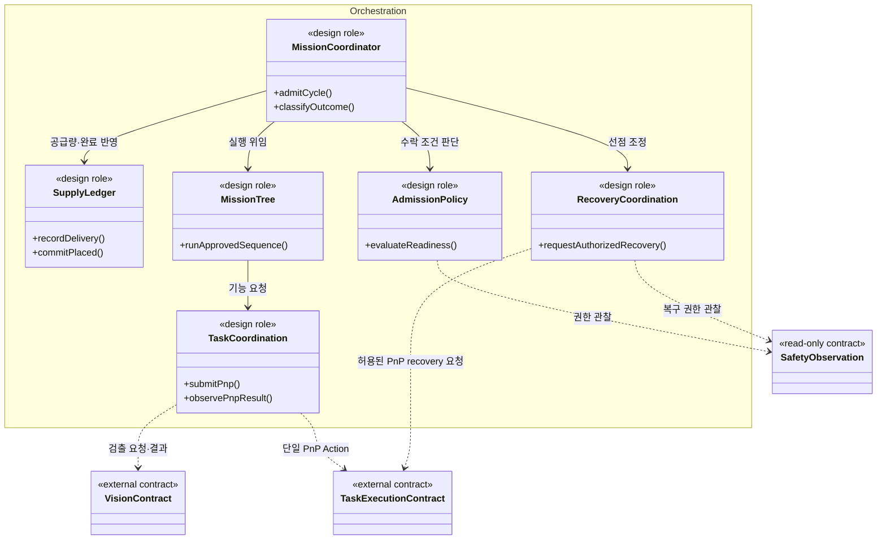
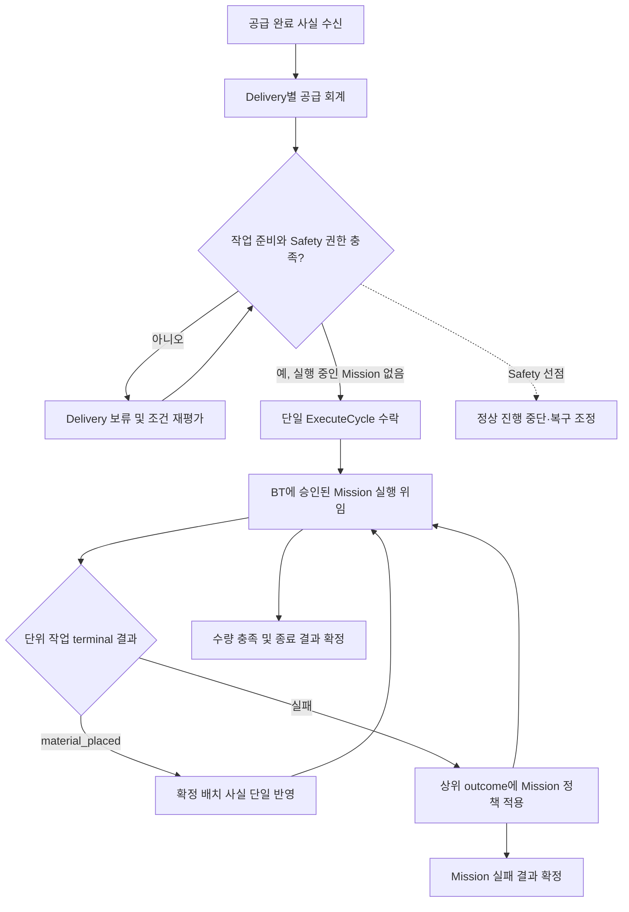
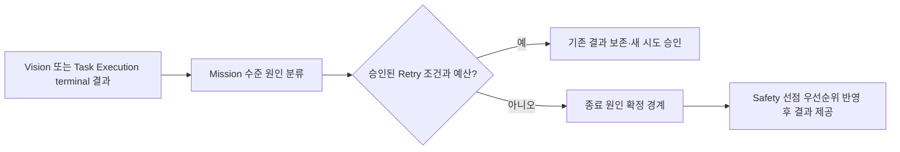

# [SF-Twin] ARM Cell Orchestration Component Design

- **컴포넌트 ID:** `ARM Cell / Mission Orchestration`
- **소유자:** `ARM Cell Orchestration`

## 목적과 책임

Orchestration은 수락된 Cycle을 내부 Mission 역할에 배분하고 요청자의 Mission 결과를 확정한다. 이 CDS는 Mission 책임들의 내부 협력 및 상태 소유 구조를 정의한다.

## 정적 구조와 경계

아래는 실제 클래스와 일대일 대응하지 않는 **설계 책임 역할**이다. 화살표는 정적 의존 또는 책임 위임이며 시간적 실행 순서가 아니다.

MissionCoordinator는 AdmissionPolicy·SupplyLedger·MissionTree를 조정하고, TaskCoordination은 Vision 및 Task Execution 계약을 내부 Mission 역할에 연결한다. RecoveryCoordination은 Safety 관측을 사용해 선점된 Action의 정리와 승인된 상위 복구 및 Mission 계속 실행을 조정한다. 개별 Action 취소는 해당 제출의 identity와 수명주기에 귀속되며 Cycle 전체의 취소 의도와 구별한다. 상세 lifecycle은 [Mission Cycle FDS](fds-mission-cycle.md)와 [Controlled Recovery FDS](fds-controlled-recovery.md)가 소유한다. 이 구조는 상위 아키텍처 경계를 Orchestration 내부 역할에 연결한다.

## 상위 책임 연동 흐름

이 그림은 Delivery 회계·Admission·Mission 결과 분류·Tree 위임이라는 **컴포넌트 책임 수행 흐름**을 요약한다. 반복·종료·Retry의 상세 조건은 [Mission Cycle FDS](fds-mission-cycle.md)가, Safety 선점에 따른 복구 순서는 [Controlled Recovery FDS](fds-controlled-recovery.md)가 소유한다.

## 주요 역할별 책임 흐름

### Mission 결과와 작업 재시도 판단

후보별 탐색과 PnP 내부 Result 확정은 Task Execution 책임이다. Orchestration은 PnP Action terminal `pnp_outcome`을 신뢰하며 MotionStatus·Holding·진단으로 재해석하거나 재승인하지 않는다.

## 소유권과 상태

| 대상 | Authoritative owner / writer | Consumer / observer | 생명주기·일관성 경계 |
|---|---|---|---|
| Delivery ID별 공급 완료·수량 및 누적 배치 완료량 | Orchestration 공급 회계 | Admission, Mission | Delivery ID 중복 반영 금지, Task Execution의 확정 배치 사실을 한 번만 반영 |
| 활성 ExecuteCycle·quantity snapshot·processed count·종료 원인 | Orchestration Mission | 외부 요청자, BT | 한 시점에 하나의 활성 Mission, 새 Delivery는 차기 Cycle 대기 |
| Target episode의 외부 Retry 예산 | Orchestration Mission 정책 | BT | 같은 대상 에피소드에 유지, Motion 내부 후보 전환과 분리 |
| Vision 검출 결과와 관측 적격성 | Vision | Orchestration | 요청별 terminal 결과 및 새 Acquisition 경계 |
| 단일 PnP Goal·candidate search·Gripper·task result | Task Execution | Orchestration | `pnp_outcome`과 `material_placed`가 Mission 분기·회계 입력; 내부 상세는 진단 전용 |
| 개별 motion 실행·MotionStatus·Backend 정지 근거 | Motion | Task Execution, Safety, Orchestration observer | Motion 움직임 상태를 PnP 완료·수량으로 직접 해석하지 않음 |
| Safety 원인·정지 모드·Motion capability | Safety | Orchestration(읽기 전용) | 직접 StopMotion과 복구 허가를 Orchestration이 대체하지 않음 |

### 교란 복구의 정적 책임

잔여 수량이 3개 이상이고 확정 PICK 후보가 없으며 Vision이 유효한 교란 후보를 반환한 경우 Orchestration은 ExecuteDisturb를 요청한다. 요청은 Task Execution 경계로 제출하며 접촉점·경로·교란 후보 실행 가능성을 재판정하지 않는다. 교란의 재관측·반복·오류 전이는 Mission Cycle FDS가 소유한다.

## 제공·요구 계약과 의존성

| 계약 | 의미 Owner | Orchestration 소비·제공 책임 | 의존성 경계 |
|---|---|---|---|
| ExecuteCycle | [Mission Cycle FDS](fds-mission-cycle.md), [ExecuteCycle ICD](../../interfaces/icd-orchestration-execute-cycle.md) | 순차 Mission 실행·progress·terminal 결과 제공 | 새 Mission으로 기존 실패 작업을 암묵 재실행하지 않음 |
| Delivery 완료 | Gateway, [Material Readiness ICD](../../interfaces/icd-integration-orchestration-material.md) | 공급 사실 소비, Delivery ID별 수량 반영 | 확인된 완료 사실에 임의의 연령 TTL을 부여하지 않음 |
| DetectTarget | Vision, [Vision–Orchestration ICD](../../interfaces/icd-vision-orchestration.md) | 요청별 검출 결과·후보 목록 소비 | 관측 실패를 자재 소진으로 간주하지 않음 |
| ExecutePnp Action | Task Execution, [Orchestration–Task Execution ICD](../../interfaces/icd-orchestration-task-execution.md) | 후보 전체·Recipe snapshot 제출, PnP Feedback/Result 소비 | Mission 재시도와 task 내부 candidate transition을 중복하지 않음 |
| SafetyState | Safety, [Safety–Orchestration ICD](../../interfaces/icd-safety-orchestration.md) | 실행·복구 권한을 읽기 전용 관찰 | 업무 준비 상태는 Safety 권한과 별도로 판단 |

## 불변조건, 오류 경계와 관측 가능성

| 검토 대상 | 판단·처리 책임 | 불변조건 및 오류 경계 | 관측 결과·진단 근거 |
|---|---|---|---|
| Mission 단일 실행 | Orchestration | 활성 ExecuteCycle 중 차기 공급을 현재 수량 snapshot에 합치지 않음 | Mission ID, Delivery ID, 대기·활성 상태 |
| 결과 분류 | Orchestration | 원본 Vision/Motion 실패 원인 보존, Safety 선점 우선순위 적용 | Action terminal Result, MissionExitReason |
| Safety 정지 | Safety가 직접 정지, Orchestration이 2차 조정 | Safety→Motion 직접 정지는 Orchestration에 종속되지 않음 | SafetyState, Motion 정지 근거, 취소 결과 |
| Controlled Recovery | Orchestration 조정, Safety 허가 | 복구 권한이 없으면 RETRACT 요청 금지 | Recovery episode, 허가·작업 결과 |
| 정상 작업 준비 | Orchestration | 관련 없는 AMR/PackML 상태나 timestamp 품질을 일괄 PnP gate로 만들지 않음 | 현재 작업에 필요한 준비 조건과 보류 원인 |

## Verification Requirements

### VR-ORCH-OWN-01 — Mission Authority의 독립성

Orchestration은 Safety 또는 Motion의 판단 권한을 재정의해서는 안 된다(SHALL NOT).

### VR-ORCH-OWN-02 — 명시적인 종료 원인

Mission의 완료·실패 분류는 근본적인 종료 원인을 보존해야 한다(SHALL).

### VR-ORCH-OWN-03 — 승인된 복구 조정만 수행

Orchestration은 Safety가 허가한 조건에서만 Recovery를 요청해야 한다(SHALL).

### VR-ORCH-OWN-04 — 작업 준비 상태는 Safety 권한이 아님

현재 Task가 필요로 하는 AMR/PackML·자재·통신 근거가 없거나 무효하거나 오래되었다면 Orchestration은 해당 Task만 보류해야 하며(SHALL), Safety 원인을 생성하거나 정지 심각도를 선택해서는 안 된다(SHALL NOT). 관련 없는 AMR/PackML 상태와 Timestamp 품질을 모든 PnP에 적용하는 공통 Gate로 삼아서는 안 된다(SHALL NOT). Safety가 활성 Motion을 선점하면 직접 정지와 Recovery 허가를 Safety에 맡겨야 한다(SHALL). 검증 근거는 Task 수락·진행 상태, SafetyState, 직접 StopMotion 관측이다.
