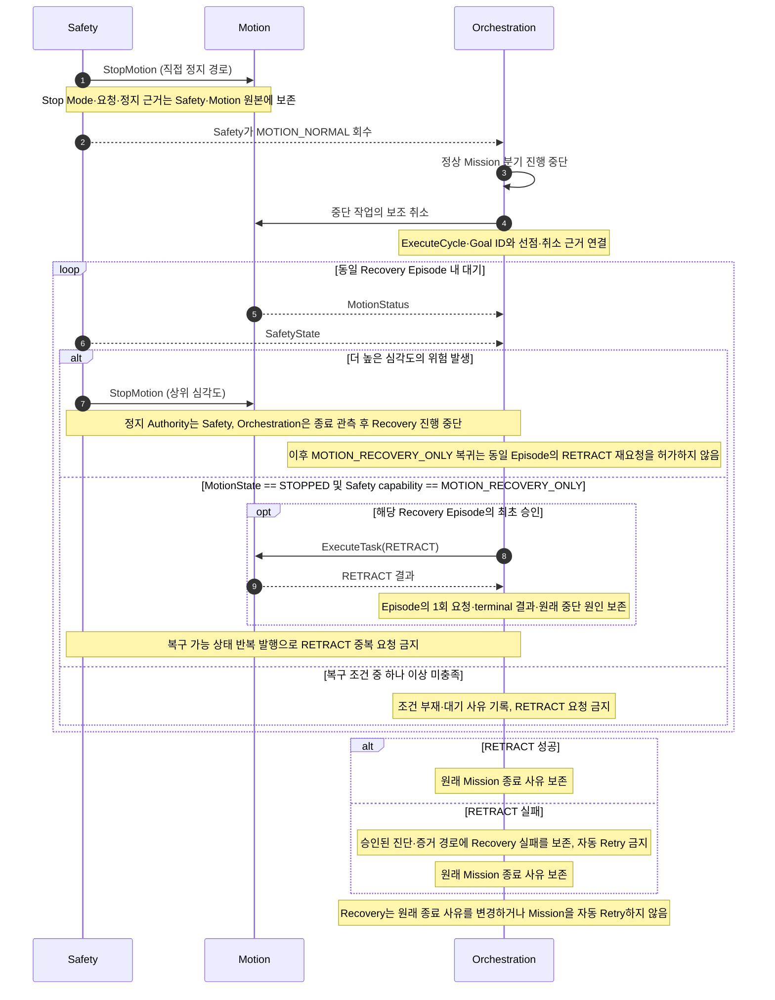
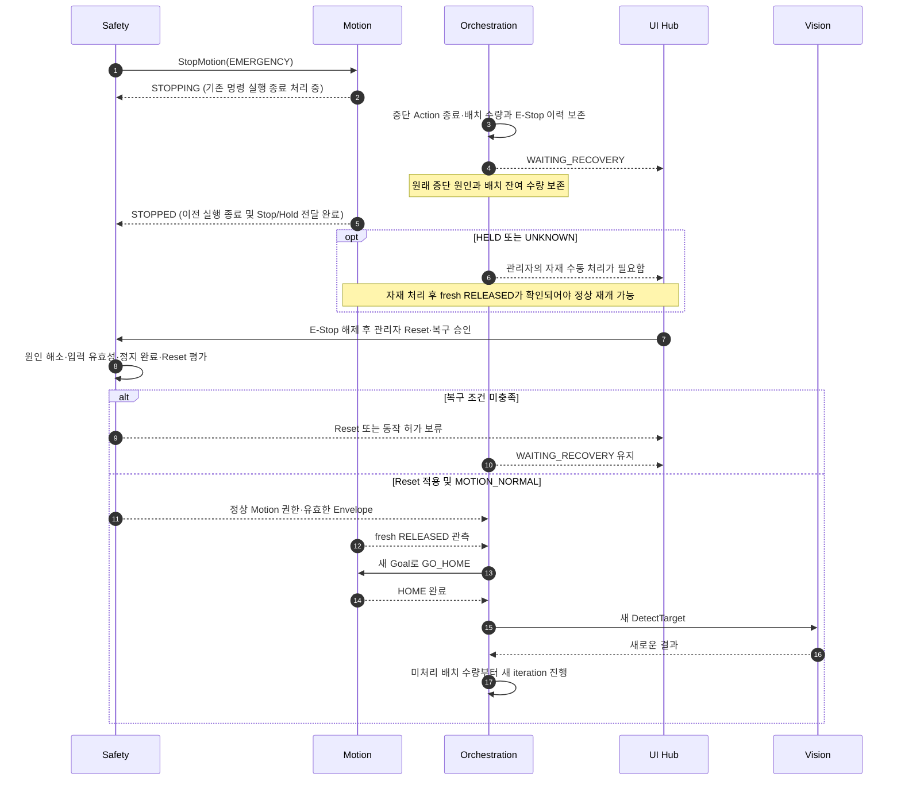

# [SF-Twin] ARM Cell Controlled Recovery Coordination

- **Scope:** `Safety Preemption Coordination`
- **Owner:** `ARM Cell Orchestration`

## 1. 진입 조건

Safety 선점 이후 정상 Mission 진행과 물리적 정지 실행을 구분한다. 직접 StopMotion은 Safety→Motion 경로의 책임이며, Orchestration은 정상 분기 중단·취소, 정지 근거 관찰, Safety가 허가한 복구 작업 및 Batch 계속 실행만 조정한다. 아래 기존 시퀀스와 Recovery episode별 일회성 요청·결과 보존 조건은 그대로 유지한다.

실행 중인 Mission에서 Safety가 정상 Motion 권한을 회수하면 다음과 같이 처리한다.

1. Orchestration은 정상 Mission 분기의 진행을 중단한다.
2. 실행 중인 Motion 작업은 조정을 위해 halt/cancel한다.
3. Motion 정지 근거와 Safety의 복구 권한 판정 결과를 기다린다.

Final Demo 배치에서는 활성 작업과 반복을 종료된 중단 상태로 처리한다. 관리자 및 Safety 복구 조건이 해소될 때까지 배치는 복구 대기 상태로 보존한다. 수락 식별자, 처리 수량, 중단 원인 등의 배치 문맥을 유지하며, 중단된 작업이나 반복을 재개하거나 재실행하지 않는다. 복구가 거부되거나 Orchestration 정책에 따라 배치를 종료하면 기존 Safety 선점 결과를 보존하여 실행을 끝낸다.

Action Goal 수락 또는 terminal 응답이 미확정이어도 Safety 선점은 위 기존 stop/recovery 흐름으로 진행한다. Orchestration은 해당 Submission ID와 관측된 실제 Action Goal UUID, 중단 원인을 Recovery Episode에 연결하고, 기존 Motion 정지 근거·Safety 복구 조건이 충족되기 전에는 이를 안전한 handoff로 취급하지 않는다. 기존 handoff가 성립하면 정상 Mission branch는 종료되고 중단 Goal은 replay되지 않는다. 이후 도착한 수락·Feedback·terminal은 같은 Goal의 기록만 보완하며, 중단된 작업이나 Mission 결과를 다시 열거나 새 작업을 승인하지 않는다. 정지 근거가 아직 없으면 Action 연결 상태와 무관하게 Orchestration은 작업 lifecycle을 미확정으로 유지한다.

Handoff는 중단 Action의 terminal을 무조건 기다리는 조건을 추가하지 않는다. 기존 Motion 정지 근거와 Safety 복구 조건으로 성립한다. Handoff로 분리된 Action의 보조 취소는 그 Action에만 귀속되며 후속 복구 Action에 적용되지 않는다. Cancel 수락, Action terminal 및 Motion Backend 정지 완료는 독립적인 사실이며 서로 추론하지 않는다. 후속 복구 Action이 다시 Safety에 선점되면 Safety 직접 정지와 동일한 Action별 분리 원칙을 적용한다.

Safety→Motion 직접 StopMotion이 일차 정지 경로이며 Orchestration 취소는 보조 조정이다. 정지 시작에 Orchestration 취소가 필요하지 않다. Safety는 최종 선택한 정지 심각도를 `SafetyState.selected_stop_mode`로 제공한다. Orchestration은 해당 Safety 소유 필드만 비교하고 `active_causes`, Mission 상태 또는 자체 정책으로 정지 심각도를 추론해서는 안 된다(SHALL NOT).

### Recovery Episode 생명주기

통제된 Recovery Episode는 중단된 ExecuteCycle 하나에 속한다:

```text
중단된 ExecuteCycle 하나
→ one controlled-recovery episode
→ E-Stop: Reset 후 HELD 자재를 Tray 반환 목표로 이동·릴리즈 확인·HOME 후 새 검출로 배치 계속
→ 기타 승인된 복구: episode당 최대 1회 RETRACT
```

Recovery Episode는 활성 ExecuteCycle이 `MOTION_NORMAL`을 잃고 Orchestration이 해당 중단의 통제된 복구 조정에 진입할 때 시작한다. 같은 중단 Mission에서 Safety capability 변경, `MOTION_RECOVERY_ONLY`의 일시적 상실, 더 높은 심각도의 위험, 승인된 RETRACT 중단·실패, 후속 Safety 상태 발행이 있어도 동일 Episode가 유지된다. 해당 ExecuteCycle의 복구 조정이 끝나고 보존된 종료 결과로 진행하면 Episode가 종료된다.

Safety capability가 반복해서 바뀌어도 RETRACT 허용 횟수를 초기화해서는 안 된다(SHALL NOT). 동일한 중단 ExecuteCycle에서 `MOTION_RECOVERY_ONLY`가 다시 나타나거나 RETRACT 실패·상위 심각도 중단이 발생해도 새 Episode가 생성되지 않는다. Episode마다 RETRACT 요청은 최대 1회이며 자동 복구 Retry는 승인되어 있지 않다. 두 번째 RETRACT는 실제로 새로운 Mission/Recovery Episode이거나 향후 명시적으로 승인된 Retry 정책이 있어야 한다.

## 2. 복구 승인 대기

Mission이 선점되었다는 이유만으로 Recovery를 요청해서는 안 된다(SHALL NOT).

E-Stop 관리 복구와 별개로 RETRACT가 승인된 복구 경로에서만 Orchestration은 다음 두 조건을 기다린다:

1. Motion reports `MOTION_STATE_STOPPED`; and
2. Safety explicitly exposes `MOTION_RECOVERY_ONLY`.

두 조건 중 어느 하나만으로 RETRACT를 허용하지 않는다. 여기서 Motion 정지 상태와 Backend 비활성 관측은 복구를 위한 소프트웨어 제어 정지의 완료 근거이며, 정상 작업의 Goal 수락 조건이 아니다. Stage 2 PICK Retry 변경으로 제거되는 조건도 아니다. Recovery 적격성과 별도의 RETRACT 허용 범위는 Safety만 결정한다.

활성 E-Stop, 미해결 통신 장애 또는 복구 대상이 아닌 다른 Fault는 RETRACT 요청을 유발해서는 안 된다(SHALL NOT).

통신 문제에 의한 중단은 Latch된 위험 Episode와 구별한다. Safety에 필요한 입력이 다시 유효하고 최신 상태가 되고 Motion 비활성이 확인되면, 독립적인 Latch 원인이 없는 경우 Safety는 관리자 Reset 없이 일시적 차단을 해제하고 권한을 복원할 수 있다. 그래도 Orchestration은 중단된 작업·반복을 종료된 것으로 취급하며 이를 재개하거나 재실행하지 않는다. 계속 실행 전 현재 Operational Readiness, Safety capability, 최신 Holding 상태를 다시 확인하고 기존 배치 흐름에서 새 작업 식별자를 사용한다. Latch된 E-Stop/STO, 확인된 Motion 위험 등 Safety Hard Fault는 아래의 명시적 관리자 승인·Reset·계속 실행 계약을 따른다. 현재 시뮬레이션 데모의 AMR Undocking 및 PackML `ABORTED`는 Safety Recovery Episode를 생성하지 않으며, 해당 작업과 관련 있을 때만 Orchestration이 처리한다.

## 3. 복구 요청

E-Stop 관리자 복구를 제외한 승인된 RETRACT 경로에서는:

```text
Safety: MOTION_RECOVERY_ONLY
→ Orchestration requests RETRACT
→ Motion independently rechecks capability
```

앞서 정의한 Episode당 RETRACT 단회 원칙에 따라 복구 가능 상태가 반복 게시되어도 중복 요청하지 않는다(SHALL NOT). 새로운 `RETRACT` 요청에는 새로운 Recovery Episode 또는 명시적으로 승인된 재시도 정책이 필요하다. 현재 계약에는 그러한 자동 재시도가 없다.

진단을 위해 [ARM Cell Observability Records ICD](../../interfaces/icd-observability-records.md)는 중단된 ExecuteCycle 및 Motion Goal ID를 관측된 SafetyState·선택 정지 방식, 직접 StopMotion 결과, Orchestration의 보조 취소, 대기 진입·사유 변경·해제, 승인된 RETRACT Goal·결과, 보존된 Mission 결과와 연결한다. 선택적 판단 증거에는 각 판단 시 읽은 실제 Capability, Motion 정지 상태, Episode별 RETRACT 허용 여부, 취소 상태, 로컬 대기 시간을 사용한다. 기존 Safety·Motion 메시지가 계속 정식 근거이며 이 Trace는 새로운 복구 권한이나 정지 경로를 만들지 않는다.

복구 대기 중 또는 RETRACT 활성 중 복구 권한이 회수되거나 더 높은 심각도의 위험이 발생하더라도 정지 시작과 정지 심각도의 유일한 권한은 Safety에 있다. Safety→Motion 직접 StopMotion이 정식 정지 경로다. Orchestration은 두 번째 정지 정책을 시작해서는 안 된다(SHALL NOT). 복구 Task 종료와 Motion 상태를 관측하고 복구 진행을 중단하며 동일 Episode에서 추가 RETRACT를 요청해서는 안 된다(SHALL NOT). 이후 복구 가능 권한이 돌아와도 재진입이나 재시도가 승인되는 것은 아니다. Safety 정지 명령에 따른 실행·종료 동작은 Motion이 계속 소유하고 중단된 Mission은 자동 재시도하지 않는다.

복구 대기 중 관측한 `selected_stop_mode`가 해당 Episode에서 이전에 관측한 심각도보다 높아지면 중단된 ExecuteCycle의 복구 진행을 영구적으로 닫는다. Capability가 반복 전환돼도 Episode별 허용 여부를 초기화하지 않는다. RETRACT 활성 중 Orchestration은 정지 명령을 발행하거나 대체 정지 정책을 추론하지 않는다. Motion 종료를 관측하고 원래 Mission 결과를 보존한다.

### SEQ-ORCH-RECOVERY-01 — Controlled recovery

**주 소유자:** 이 Controlled Recovery FDS. [Orchestration 동적 설계 진입점](fds-mission-cycle.md)과 공유 ICD는 이 시퀀스를 참조하며 별도의 복구 작업 흐름을 소유하지 않는다.



현재 실현에서는 Safety가 선점한 Mission의 정상 ExecuteCycle 트리 분기가 실패하고 SafetyRecovery 분기로 진입할 수 있다. 통제된 RETRACT에는 기존 Safety capability, Motion 정지, Gripper 상태, Episode별 승인 조건이 계속 적용된다. 트리 halt나 분기 선택은 Motion이 물리적으로 정지했다는 근거가 아니며 복구가 중단된 작업이나 Mission을 재시작하지 않는다.

#### 시퀀스 검증 연결

| 시퀀스 경계 | 관련 기존 VR | 관찰 가능한 검증 기준 |
|---|---|---|
| Safety 직접 정지 및 Orchestration 보조 취소 | `VR-ORCH-REC-03` | Safety→Motion 직접 정지 요청은 Orchestration 취소와 독립적으로 관찰 가능 |
| Recovery 요청 Gate 및 Episode당 RETRACT 한 번 | `VR-ORCH-REC-01`, `VR-ORCH-REC-04` | 현재 Safety Capability·Motion 정지 상태 및 반복 Safety 발행 중 RETRACT 요청 횟수 |
| Recovery 완료 시 중단 원인 보존 | `VR-ORCH-REC-02`, `VR-ORCH-REC-07` | Recovery 이후 및 배치 Terminal 결과까지 중단 사유를 관찰 가능 |
| 상위 심각도 중단 및 Recovery 재진입 Retry 금지 | `VR-ORCH-REC-05` | Safety·Motion 상태 변화 및 이후 Recovery Capability 복구 중에도 RETRACT 요청은 1회 이하 |
| RETRACT 실패·중단 시 결과 보존 | `VR-ORCH-REC-06` | RETRACT 종료 근거, 원래 ExecuteCycle 종료 사유, 후속 정상 작업·RETRACT 요청 없음 |

이 시퀀스는 계약 수준의 표현이다. 구현 내부 상태 변수, mutex, callback 배치 및 private helper 호출은 규범으로 고정하지 않는다.

## 4. 복구 후 Mission 결과

Recovery에 성공했다고 중단된 작업의 결과가 성공으로 바뀌지 않는다. 종료된 비배치 실행의 ExecuteCycle `MissionExitReason`은 유지된다. Final Demo 배치가 `WAITING_RECOVERY`에 머무는 동안에는 배치 실행은 활성 상태로 유지하고 작업·반복 중단을 별도로 기록한다. 최종 MissionExitReason은 배치가 완료되거나 중단될 때 확정한다. 이후 배치 종료 결과가 기존 중단 근거를 삭제하거나 변경해서는 안 된다(SHALL NOT). RETRACT 실패·중단은 별도의 복구 작업 실패이며 새 공개 Mission 결과를 만들거나 자동 Retry해서는 안 된다(SHALL NOT). 더 심각한 위험이 복구를 막거나 중단할 수 있으며 정지 심각도 Authority는 Safety에 남는다. 중단된 작업 자체는 자동 재시도하지 않고 `diagnostic_detail`은 숨겨진 기계 판정 계약이 아니라 비규범적 진단 설명으로 유지한다.

### Final Demo 배치 계속 실행

E-Stop과 구성된 Hard Fault 복구에서는 원인 해소, 명시적 관리자 Clear, 승인·Reset, 현재 capability를 Safety가 소유한다. Orchestration은 명시적인 관리자 Clear와 승인·Reset 완료를 기다린 다음 최신 상태로 준비 조건을 다시 평가해야 한다(SHALL). 원인 해소만으로는 충분하지 않다. 정상 동작을 재개하려면 fresh `RELEASED`가 필요하다. E-Stop으로 중단된 배치에서는 자동 RETRACT나 자동 자재 처리 명령을 내리지 않는다. `HELD` 또는 `UNKNOWN`이면 관리자가 자재를 직접 안전하게 처리한 뒤 복구를 요청하며, Orchestration은 fresh `RELEASED`가 확인되기 전까지 HOME을 비롯한 다음 동작을 시작하지 않는다.
Holding 상태는 MotionStatus에 표시된 Gripper 관측으로 확인한다. Orchestration은 명령, 오래된 Sample 또는 경과 시간으로 `RELEASED`를 추론하지 않는다.

준비 조건이 복원되고 최신 Holding이 `RELEASED`이며 Safety가 정상 Motion을 허가하면 Orchestration은 새 GO_HOME 작업을 요청해야 한다(SHALL). 이후 새로운 Vision 관측을 취득하고 보존된 배치 문맥에서 새 반복을 시작한다. 이는 새로운 작업과 Target 선택 Episode이며 중단된 Action의 재개나 암묵적인 PICK Retry가 아니다. Safety가 `MOTION_RECOVERY_ONLY`만 허가하는 동안 수행해서는 안 된다(SHALL NOT). 이 대기·계속 실행 중에도 배치 실행은 활성 상태로 유지된다. 이후 수량이 정상적으로 달성되면 최종 결과가 `MISSION_EXIT_QUANTITY_REACHED`일 수 있지만 중단 근거는 보존되고 관찰 가능해야 하며, 중단된 작업이 성공으로 바뀌는 것은 아니다.

중단된 작업 결과와 이후 계속 실행의 결과는 독립적이다. GO_HOME 성공 및 이후 배치 계속 실행은 원래 E-Stop 또는 Hard Fault 원인을 배치 Feedback과 수락 증거에 보존해야 하며(SHALL), 중단 기록을 성공으로 지우거나 덮어써서는 안 된다(SHALL NOT).

E-Stop 및 지정된 하드폴트 복구에서 자재 자동 처리는 허용하지 않는다. 관리자 확인·Reset, fresh `RELEASED`, `MOTION_NORMAL` 이후 HOME을 신규 Action으로 요청하고, 새로운 Vision 검출부터 잔여 배치를 이어간다. `HELD` 또는 `UNKNOWN`이면 관리자가 객체를 안전하게 처리하고 새로운 `RELEASED` 관측이 확보되기 전에는 계속 실행을 위한 Motion을 허용하지 않는다. 그때까지 `UNKNOWN`은 Fail-closed로 유지한다.

Holding 상태는 자동 계속 실행의 허용 조건이다:

| 정지·Reset 후 최신 Holding 상태 | 계속 실행 조건 |
|---|---|
| `RELEASED` | 준비 조건과 Safety가 허용하면 GO_HOME 및 새 Vision 관측으로 보존된 배치를 계속 실행 |
| `HELD` | 자동 계속 실행 금지. Final Demo에서는 관리자의 안전한 자재 처리와 새로운 `RELEASED` 확인이 필요 |
| `UNKNOWN` | 자동 Motion·Recovery 금지. 관리자 조치와 안전 상태 확인 전까지 Fail-closed, 계속 실행 전 새로운 `RELEASED` 필요 |

이 배치 계속 실행 규칙은 동일 Recovery Episode에서 두 번째 RETRACT를 승인하지 않는다. 별도로 허용된 복구 Motion도 Safety의 현재 복구 Envelope와 해당 복구 계약 안에서만 실행해야 한다. Safety E-Stop/Reset 및 배치 계속 실행은 보존된 중단 사유를 변경하지 않는다. Action의 최종 결과는 배치 결과를 나타낼 뿐 중단된 작업의 기록을 다시 쓰지 않는다.

## 5. 배치 계속 실행 순서

### SEQ-ORCH-RECOVERY-BATCH-01 — 관리자 승인 후 배치 계속 실행

이 시퀀스는 Reset 계약상 관리자의 명시적 확인이 필요한 Latch된 위험 Episode에 적용한다. 유효하고 최신인 통신 정보 복구 및 Motion 비활성이 확인되어 해소된 통신 전용 중단은 2절의 Reset 불필요 규칙을 따르며 이 시퀀스에 진입하지 않는다.



이 배치 계속 실행 시퀀스는 앞의 선택적 일회성 RETRACT 조정과 별개다. Reset과 준비 조건이 정상 Motion을 허가한 뒤에만 시작하며 중단된 작업을 재개하거나 Retry하지 않는다.

#### 시퀀스 검증 연결

| 시퀀스 경계 | 관련 기존 VR | 관찰 가능한 검증 기준 |
|---|---|---|
| retain interrupted task/iteration provenance through batch continuation | `VR-ORCH-REC-02` | original interruption provenance remains observable through later batch completion/abort |
| continuation uses a new GO_HOME and fresh perception; interrupted task/target is not replayed | `VR-ORCH-REC-07` | task and observation identities after reset, with no resubmission of interrupted task or reuse of its target observation |
| holding gates automatic continuation | `VR-ORCH-REC-08` | fresh holding state and subsequent task request sequence; only `RELEASED` permits automatic continuation |

## 6. 검증 요구사항

### VR-ORCH-REC-01 — 복구 요청의 조기 실행 금지

Motion이 `MOTION_STATE_STOPPED`를 보고하고 Safety가 현재 `MOTION_RECOVERY_ONLY`를 제공하기 전에는 RETRACT를 요청해서는 안 된다(SHALL NOT).

### VR-ORCH-REC-02 — 원래 Mission 결과 보존

복구 성공으로 중단된 작업·반복을 성공으로 표시해서는 안 된다(SHALL NOT). 중단 원인은 배치가 최종 완료되거나 중단될 때까지 관찰 가능해야 한다(SHALL). 이후 배치가 성공하더라도 새 작업 식별자와 새로운 Vision 관측이 필요하다.

### VR-ORCH-REC-03 — Safety 직접 정지의 독립성

Safety가 직접 정지를 시작하는 데 Orchestration의 취소가 필요해서는 안 된다(SHALL NOT).

### VR-ORCH-REC-04 — Episode당 복구 요청 한 번

중단된 ExecuteCycle 하나에 연결된 Controlled Recovery Episode에서, Recovery를 허용하는 Safety 상태가 반복 발행되거나 일시적인 권한 상실 이후 다시 제공되더라도 Orchestration은 해당 Episode에 RETRACT를 최대 한 번만 요청해야 한다(SHALL). 실제로 새로운 Mission/Recovery Episode가 발생하거나 향후 명시적인 Retry 허가가 없다면 두 번째 요청을 발행해서는 안 된다(SHALL NOT). 현재 범위에는 승인된 Recovery Retry 정책이 없다.

### VR-ORCH-REC-05 — Recovery 중단과 재진입 Retry 금지

Controlled Recovery Episode 하나에서 RETRACT 전이나 실행 중 복구 권한이 회수되거나 더 높은 심각도의 Safety 상태가 복구를 중단하면 Orchestration은 Recovery 진행을 중단해야 한다(SHALL). 이후 `MOTION_RECOVERY_ONLY`가 다시 제공되더라도 같은 Episode에 RETRACT를 다시 요청해서는 안 된다(SHALL NOT).

검증 기준은 Safety가 더 높은 `selected_stop_mode`를 발행하고, Safety의 지시에 따라 Motion이 활성 RETRACT를 종료하며, 이후 복구 권한이 다시 제공될 수 있는 동안에도 해당 Episode의 RETRACT 요청 수가 1 이하로 유지되는 것이다. 심각도 전이가 RETRACT 종료·결과보다 먼저 기록되고 Orchestration이 별도의 정지 정책을 발행하지 않았는지도 확인한다.

### VR-ORCH-REC-06 — 복구 실패 시 Mission 결과 보존

허가된 RETRACT가 실패하거나 중단되면 Orchestration은 원래 정규 `MissionExitReason`을 보존하고 자동 RETRACT Retry와 Mission Retry를 수행해서는 안 된다(SHALL NOT). 검증 근거는 원래 ExecuteCycle 종료 사유, RETRACT 요청 횟수, 중단 이후 정상 Mission Task 요청 횟수, RETRACT 결과·종료 증거다. Recovery 실패는 진단·증거에만 남으며 새로운 공개 Mission Exit Result를 만들지 않는다.

### VR-ORCH-REC-07 — 중단된 Task 재개 금지

Safety 중단 및 관리자의 Clear/Acknowledge/Reset 이후에도 Orchestration은 중단된 Task Goal을 다시 제출하거나 기존 Target 관측을 재사용해서는 안 된다(SHALL NOT). 허가된 계속 실행은 배치 문맥과 원래 실패 근거를 보존하면서 새 GO_HOME 및 새로운 Vision 관측을 사용해야 한다(SHALL). 계속 실행 또는 최종 중단이 결정되기 전까지 ExecuteCycle은 `WAITING_RECOVERY`로 유지된다.

### VR-ORCH-REC-08 — Holding에 따른 계속 실행 제한

정지 이후 Holding이 `RELEASED`, `HELD`, `UNKNOWN`인 경우 계속 실행은 다음을 따라야 한다(SHALL). `RELEASED`에서는 정지·Safety 조건과 함께 자동 계속 실행할 수 있다. E-Stop 원인이 해소되고 운영자 Reset으로 Safety가 정상 Motion 권한을 부여한 뒤 Holding이 `HELD`이면 Orchestration은 episode당 한 번 Task Execution에 자재 반환을 요청해야 한다(SHALL). Task Execution은 현재 정지 관절 상태에서 기존 Tray 반환 관절 목표로 이동하고, OPEN 후 새 `RELEASED` 관측을 확인한 다음에만 성공을 반환해야 한다(SHALL). 성공 후 Orchestration은 HOME으로 이동하고 새 Vision 관측 및 새 Task identity로 배치를 계속한다. 이 반환은 중단된 Task의 재실행이나 RETRACT가 아니다. `UNKNOWN` 또는 stale Holding은 새 유효 관측이 확보될 때까지 자동 이동·릴리즈·계속 실행을 막아야 한다(SHALL). Tray 이동·릴리즈 확인 실패나 재차 Safety 선점 시 자동 Retry하지 않고 원래 중단 결과와 실패 근거를 보존한다(SHALL). 검증 근거는 Holding freshness, Safety Reset/권한, 반환·릴리즈·HOME 요청 순서, terminal 결과 및 원래 중단 사유다.

### VR-ORCH-REC-09 — 미확정 Action의 기존 Recovery handoff

Task Execution Goal 수락·terminal이 미확정일 때에도 Orchestration은 기존 Safety stop/recovery 흐름을 수행해야 한다(SHALL). 해당 Submission ID와 관측된 실제 Action Goal UUID 및 중단 원인을 Recovery Episode에 보존하고, 기존 Motion 정지 근거와 Safety 복구 조건이 충족되기 전에는 미해결 Goal의 lifecycle을 handoff 또는 종료로 간주해서는 안 된다(SHALL NOT). 기존 handoff 이후 늦게 도착한 Goal 응답은 중단된 Goal을 replay하거나 새 Mission 작업을 승인해서는 안 된다(SHALL NOT). 검증 근거는 해당 Submission ID와 관측된 Goal ID, Motion 정지 근거, Safety 복구 상태, Recovery Episode 및 이후 Task Goal 요청이다.

### VR-ORCH-REC-CANCEL — Handoff와 후속 복구 Action

기존 Motion 정지 근거와 Safety 복구 조건이 충족된 handoff에 중단 Action terminal을 필수로 요구해서는 안 된다(SHALL NOT). 늦은 수락·Feedback·terminal과 취소는 원래 Action에만 귀속하고 후속 복구 Action의 취소로 적용해서는 안 된다(SHALL NOT). 재차 Safety 선점에도 같은 경계를 유지해야 한다(SHALL). 검증 근거는 각 Goal identity, handoff 근거, 늦은 응답 및 후속 Action의 취소·결과다.
