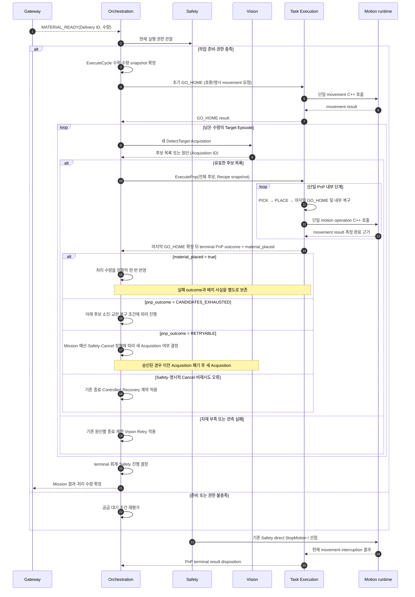
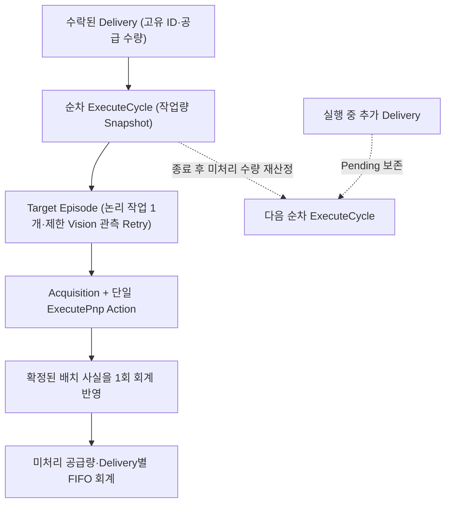

# [SF-Twin] ARM Cell Batch Mission and Iteration Behavior

- **Scope:** 자재 공급 이벤트로 시작하는 Final Demo 배치 Mission
- **Owner:** `ARM Cell Orchestration`

## 1. 목적과 동작 범위

Final Demo 배치 Mission은 자재 공급 완료 이벤트를 수락한 뒤 현재 준비 상태·Safety 권한을 만족하면 단일 ExecuteCycle로 시작된다. 활성 Cycle은 공급된 미처리 자재 수량을 Snapshot으로 확정하고 Vision Acquisition과 Task Execution의 단일 PnP 결과에 따라 완료 수량을 누적한다. 수량 달성, 자재 부족, 구성·관측·작업 실패, 요청자 취소, Safety 선점 중 해당 원인에 따라 Mission 결과를 확정한다. 중단·재시도·복구는 별도 에피소드로 구분하여 기존 실패 근거를 덮어쓰지 않는다.

관리자에게 직접적인 ExecuteCycle 시작 조작을 제공하지 않으며, 실제 Motion 완료·Holding·Safety 정지 여부를 Orchestration이 재판정하지 않는다. 정상 PnP는 내부 마지막 GO_HOME 완료 후 terminal 결과를 반환하며, 남은 수량이 있으면 그 결과와 회계를 확정한 뒤 다음 Target Episode의 새 DetectTarget을 시작한다. Vision을 위한 별도 HOME 위치 Gate나 사전 Lookahead는 두지 않는다. 초기·Retry·Recovery HOME의 기존 계약은 유지하고 정상 PnP 종료 후 Mission HOME은 중복 요청하지 않는다.

## 2. 배치 Mission

### Mission 책임 간 시간적 상호작용



시퀀스는 정상 경로의 참여 책임과 결과 확정 시점을 요약한다. 상세 Retry, 실패와 Recovery 조건은 아래 기존 계약이 소유한다.

### ExecuteCycle Behavior Tree 구조

수락된 ExecuteCycle마다 활성 BehaviorTree.CPP 트리 하나를 소유한다. 실행 구조는 다음과 같다.

```text
Fallback(MissionOrRecovery)
├─ Sequence(ExecuteCycle)
│  ├─ ValidateRecipe
│  ├─ InitialHome (기존 GO_HOME 호환 경계)
│  ├─ RepeatQuantity(quantity snapshot)
│  │  └─ TargetEpisode (material_placed 1회 회계 반영 전까지 유지)
│  │     ├─ BeginTargetEpisode
│  │     ├─ DetectTarget → MissionDisposition
│  │     │  ├─ HIGH 존재 → HIGH 전체를 ExecutePnp에 전달
│  │     │  ├─ HIGH 없음·MEDIUM 존재 → MEDIUM 전체를 ExecutePnp에 전달
│  │     │  ├─ 둘 다 없음·교란 조건 충족 → ExecuteDisturb
│  │     │  └─ 둘 다 없음·교란 불가 → 일시 실패 Retry 또는 기존 오류·부재 결과
│  │     ├─ 단일 PnP 공정·내부 복구 (Task Execution 소유)
│  │     ├─ CommitPlaced (outcome과 무관하게 material_placed 1회 반영)
│  │     └─ MissionRetry (기존 retryable PnP Result)
│  │        ├─ Task Execution의 상위 outcome과 Mission 정책 적용
│  │        ├─ CANDIDATES_EXHAUSTED·미배치·동일 Acquisition 유효 교란 후보·미처리 목표 3개 이상 → ExecuteDisturb
│  │        │  └─ 성공 후 새 DetectTarget → 새 ExecutePnp; 실패·Safety·Cancel은 기존 종료
│  │        ├─ 교란 조건 미충족 또는 기존 RETRYABLE → 기존 HOME·재검출 복구
│  │        ├─ 이전 Acquisition·Candidate List 폐기
│  │        └─ 새 DetectTarget → 새 ExecutePnp (동일 ExecuteCycle)
│  └─ CommitMission
└─ Sequence(SafetyRecoveryRequired, SafetyRecovery)
```

**트리 실행 경계:** Tree는 Delivery 수락, Mission 분기·재시도·수량 회계만 실행한다. 하나의 Acquisition 후보 집합과 Recipe snapshot은 ExecutePnp 하나로 Task Execution에 전달한다. 후보 우선순위·PnP 공정·Gripper·내부 복구·배치 사실 확정은 Task Execution 소유다. 정상 PnP는 PICK·PLACE 성공 뒤 마지막 GO_HOME을 완료하고 나서만 terminal `COMPLETED`를 반환한다. 개별 IK·Planning·Trajectory·측정 완료·Safety Stop은 Motion 소유다. Orchestration은 Task Execution의 terminal result를 소비하며 MotionStatus나 Holding 관측으로 재판정하지 않는다. 초기 GO_HOME, 기존 Retry/Recovery GO_HOME 및 Safety 승인 controlled RETRACT는 migration 단계에서 Task Execution Action adapter를 거친다. 정상 PnP의 마지막 GO_HOME을 Mission이 반복 호출하지 않는다.

| 상황 | Mission의 실행 책임 | 유지해야 할 경계 |
|---|---|---|
| 정상 대상 처리 | 새 Acquisition → 전체 후보를 하나의 ExecutePnp (PICK → PLACE → GO_HOME) → terminal 후 `material_placed=true` 한 번 반영 | 다음 Acquisition은 terminal·회계·진행 결정 뒤 시작; GO_HOME 실패는 PnP 실패 |
| PnP `RETRYABLE` | Mission 예산·Safety·Cancel 정책이 허용하면 GO_HOME 정책 적용 → 새 Acquisition → 새 ExecutePnp | 내부 실패 원인은 분기하지 않으며 Vision retry 계수와 작업 재시도 정책은 별도 유지 |
| PnP `CANDIDATES_EXHAUSTED` | `material_placed=false`, 동일 Acquisition에 유효한 Disturbance Candidate 존재, 미처리 목표 수량 3개 이상이면 기존 `ExecuteDisturb` → 성공 후 새 Vision Acquisition → 새 PnP; 조건 미충족이면 기존 HOME·재검출 복구 | Motion 세부 Result Code로 재판정하지 않음; Safety·Cancel·교란 실패의 기존 종료 의미 유지 |
| PnP `FAILED` | 기존 Mission 실패·Controlled Recovery 계약 적용 | Task Execution terminal 판단을 내부 진단으로 재심사하지 않음 |
| PnP `SAFETY_PREEMPTED` 또는 명시적 Cancel | 기존 Safety 우선순위·Cancel 결과 적용 | 중단된 Task를 replay하지 않음 |
| 제한된 Vision Retry | 기존 Vision 관측 실패만 최대 3회 적격 재관측 | PnP 작업 재시도와 별도 계수 |
| Action/Service 대기 중 취소·선점 | 해당 분기 Halt와 기존 취소 경계 사용; 미확정 Action Goal의 lifecycle 소유 유지 | Halt·취소 요청·응답 지연·연결 상실만으로 거부, 완료, Motion 비활성 또는 Recovery 승인 확정 금지 |
| 다음 Target Acquisition | 이전 PnP의 마지막 GO_HOME 완료 및 terminal 결과·배치 회계 확정 후 새 DetectTarget | 별도 HOME Gate 또는 조기 Lookahead 요청 금지 |
| 추가 Delivery | 공급 회계에 Pending으로 보존 | 현재 Tree·Cycle 작업량 Snapshot 변경 금지 |

### Delivery·Cycle·Target Episode의 관계



| 회계·에피소드 불변조건 | 의미 |
|---|---|
| Cycle 작업량 | 전체 성공 공급 누계에서 `material_placed=true`로 회계 완료한 수량을 뺀 미처리량 |
| FIFO 완료 배분 | `material_placed=true`를 미처리 공급량이 남은 가장 오래된 Delivery에 한 번 반영. 교환 가능한 RawPart의 **논리적 회계**이지 실제 물체 출처 추적이 아님 |
| Episode 경계 | 논리 작업 하나의 첫 DetectTarget에서 시작해 배치 사실의 1회 회계 반영 또는 Batch 종료까지 유지. `RETRYABLE` PnP 후 새 Acquisition에서도 같은 ExecuteCycle과 Vision Retry 계수를 유지 |
| Delivery 중복·추가 공급 | 한 인스턴스에서 고유 ID 한 번만 소비; 중복 거부. 추가 공급은 활성 Cycle을 변경하지 않고 다음 Cycle의 미처리량에 포함 |
| 실패 이후 | `RETRYABLE` PnP 이후 새 관측 재진입은 같은 ExecuteCycle에서 수행하며 고정 작업 실패 상한을 새로 두지 않음. 내부 복구는 동일 ExecutePnp Action에서 수행. Vision 관측 Retry와 시스템·Safety·취소 등 기존 Terminal은 기존 계약 적용 |

### NF-01: 누적 공급 작업의 순차 처리

유효한 `MATERIAL_READY` 완료 이벤트는 수락 시 소비될 때까지 해당 Delivery의 Pending 이벤트로 보존한다. 전송 후 경과 시간만으로 확인된 완료 사실을 무효화하지 않는다. 일반 준비 상태나 Safety capability가 아직 작업을 허용하지 않으면 Orchestration은 Delivery를 보존하고 조건 변경에 따라 자동 재평가한다. 조건을 기다린다는 이유로 이벤트를 버리거나 새 Handoff Trigger를 요구하지 않는다. 작업 조건과 현재 Safety 권한이 충족되면 Orchestration은 Pending Delivery 하나를 수락한다. 별도의 관리자·Hub 수락 조작은 필요하지 않다. 형식이 잘못되거나 서로 일치하지 않는 필드는 수락을 차단한다.
수락 이후 Orchestration은 내부 ExecuteCycle 경계에서 다음 Cycle을 시작한다. 수락된 `material_type`을 설정된 Vision `target_id`와 Recipe snapshot에 대응시키고 Delivery별 수량을 기록한다. Cycle 수량은 전체 성공 공급 수량에서 `material_placed=true`로 처리 완료된 수량을 뺀 값이다. Profile·Recipe·계약 오류는 Motion 요청 전에 `MISSION_EXIT_CONFIGURATION_ERROR`로 종료한다. Delivery 완료나 준비 상태로 현재 Safety 권한을 우회할 수 없다.

### 운영 준비 상태와 Safety 권한

Final Demo의 작업 준비 여부는 Orchestration이 단독으로 판단한다. 현재 유효한 `MATERIAL_READY`, Safety의 `MOTION_NORMAL`, 설정된 작업·장면 전제 조건, 해당 작업에 실제로 필요한 외부 상태만 요구한다. AMR/PackML은 모든 작업에 공통으로 적용되는 수락 전제 조건이 아니다. Timestamp/Freshness 품질을 진단하되, 데이터 누락·모호함은 현재 작업이 해당 데이터에 의존할 때만 Not Ready로 판정한다. 그 외에는 수락을 막지 않는다. `ABORTED`는 현재 CNC 작업 흐름과 관련 있을 때만 처리한다. AMR/PackML 조건으로 Safety 원인, Latch, 정지 또는 Reset을 만들지 않는다.

AMR/PackML 필드와 Timestamp 의미는 [External State and Safety ICD](../../interfaces/icd-external-safety.md)가 소유하고, capability 소비와 외부 상태를 Safety 원인으로 승격하지 않는 경계는 [Safety ↔ Orchestration ICD](../../interfaces/icd-safety-orchestration.md)가 소유한다.

실행 중 실제 Motion Safety 위험과 필요한 Safety-HW/Motion 근거는 Safety가 판단한다. 현재 데모는 AMR–로봇 충돌 위험을 범위에서 제외하므로 Motion 실행 중에도 AMR Undocking이나 PackML `ABORTED`가 Safety 정지·복구를 유발하지 않는다. Orchestration은 현재 작업과 관련된 외부 상태 변경만 처리하며 이를 Safety 원인으로 승격하지 않는다. Safety 직접 정지는 Orchestration 취소와 독립적이다. Safety capability가 작업 준비를 보장하지 않으며, 작업 준비가 Safety capability를 부여하거나 복원하지 않는다.

Vision Calibration은 ExecuteCycle 수락과 새 DetectTarget 진행의 준비 조건이다. Orchestration은 기존 작업·Safety 준비 상태와 함께 현재 `/vision/calibration_status`를 평가한다.

| Calibration 관측 | Mission 처리 |
|---|---|
| Fresh `READY` | 새로운 Calibration 작업을 기다리지 않고 수락·진행 가능 |
| Fresh `NEEDS_CALIBRATION` 또는 `CALIBRATING` | 보고된 상태와 관리자용 원인을 보존하고 수락·진행 보류 |
| Missing/Stale | 기존 1초 Freshness 계약에 따른 Vision 상태 통신 불가로 분류; Calibration 부재로 간주하지 않음 |

보류된 Delivery는 기존 Pending 경로에서 보존하고 조건 회복 시 재평가한다. 별도 Mission이나 ExecuteCycle 내부 대기·Retry 루프를 생성하지 않으며, Orchestration이 자동 Calibration을 시작하거나 완료를 기다리지 않는다. 유지보수 Calibration 전에 생산을 중단하는 책임은 관리자에게 있고 해당 전제 조건은 Vision ICD가 정의한다.

각 DetectTarget 요청은 안정적 자재 관측의 전체 Acquisition을 소유한다. Orchestration은 별도 Vision Lifecycle을 활성화하거나 `SCENE_STABILITY_STABLE`을 기다리고 Generation을 비교하거나 Source Age TTL을 적용하지 않는다. Service Terminal Result는 단일 목록의 적격 후보, 유효한 `OBJECT_NOT_FOUND`, 관측·처리 실패를 구별한다. 성공 시 Handoff가 완료되어 해당 요청에 대한 Vision 책임이 끝난다. STABLE은 관측 결과의 안정성을 나타낼 뿐 자재가 앞으로도 움직이지 않는다는 보장은 아니다. 공급 준비와 시각적 안정성은 별개다. 관측 불가·모호한 증거는 기존 Acquisition Deadline 안에서 대기하거나 실패하며 자재 소진으로 바꾸지 않는다. Tray 다른 위치의 변화만으로 이미 안정적인 적격 후보를 지연하지 않는다. Vision 후보 등급 적격성과 Recipe의 미관측 Yaw fallback 허용 여부는 별도 판단이다. Recipe fallback을 금지·누락·무효로 평가해 기존 PnP 실패 결과가 난 경우 Orchestration은 Yaw만을 이유로 같은 대상의 전용 재취득을 추가하지 않으며 Task Execution의 Recipe 판단을 우회하지 않는다.

Orchestration은 [Orchestration–Task Execution ICD](../../interfaces/icd-orchestration-task-execution.md)의 `pnp_outcome`, `material_placed`, Action terminal status만 Mission 분기에 사용한다. `material_placed=true`는 outcome이 성공·실패·취소·Safety 선점인지와 관계없이 Goal UUID당 정확히 한 번 처리 수량에 반영한다. `RETRYABLE`이면 Mission 예산·Safety·Cancel 정책에 따라 새 Acquisition 재시도를 허가하거나 Mission을 종료한다. 내부 공정·Gripper·복구·Motion 결과·진단 조합은 Task Execution/Motion 추적 정보이며 Mission의 승인·재판정 입력이 아니다. 남은 수량이 있다면 현재 PnP 마지막 GO_HOME까지 포함한 terminal 완료 후 새 DetectTarget을 요청한다. 사전 Lookahead·반복 사이 별도 HOME Gate는 사용하지 않는다. 확정된 작업량에 도달하면 다음 Target을 요청하지 않고 PnP 마지막 GO_HOME의 성공 terminal 및 회계·진행 결정에 따라 Cycle을 완료한다. 미처리 수량이 있을 때 유효한 `DETECT_RESULT_OBJECT_NOT_FOUND`는 정상 완료가 아닌 `MISSION_EXIT_QUANTITY_SHORTFALL`(Soft Error)로 끝난다.

Profile 오류, 지속적인 Vision·Backend 불가, Sensor·TF·Geometry 실패 및 Timeout은 자재 소진이 아니며 기존 Vision·Task Execution 결과 분류를 유지한다. 제한된 Vision Retry는 일시적인 관측 실패 복구에만 사용한다. HIGH/MEDIUM 후보 선택과 교란 완료 뒤 새 Acquisition은 Retry 예산을 소비하지 않는다. Task Execution의 `RETRYABLE` PnP 결과에는 내부 실패 원인과 무관하게 Mission retry admission·Safety·Cancel·작업 재진입 정책을 적용한다. 승인한 재시도는 이전 후보·Acquisition을 폐기하고 새 Vision Acquisition과 새 ExecutePnp Goal을 사용한다. Motion/Task Execution Action protocol의 거부·BUSY는 기존 transport/terminal 오류 정책을 따르며, 정규 terminal result가 있는 경우 Mission은 공유 ICD의 상위 결과만 소비한다.

정상 경로에서는 운영 RGB-D Vision을 사용한다. 검증 전용 Fixed Vision Adapter는 Final Demo의 정상 관측 소스가 아니다.

### 교란과 재검출의 Mission 전이

```mermaid
sequenceDiagram
    participant O as Orchestration
    participant V as Vision
    participant T as Task Execution
    loop Mission이 terminal이 될 때까지
        O->>V: 새 DetectTarget Acquisition
        V-->>O: HIGH·MEDIUM 목록, 미해결 근거, 관측 결과·Acquisition identity
        Note over O,T: PnP 후보 소진 시에도 동일 Acquisition 교란 후보·미배치·수량 조건에 따라 ExecuteDisturb; 불가 시 HOME·재검출
        alt HIGH 목록이 비어 있지 않음
            O->>T: ExecutePnp(HIGH 전체, Acquisition, Recipe)
        else HIGH 비어 있고 MEDIUM 목록이 비어 있지 않음
            O->>T: ExecutePnp(MEDIUM 전체, Acquisition, Recipe)
        else 잔여 수량 3개 이상·유효 교란 후보 있음
            O->>T: ExecuteDisturb(전체 교란 후보, Acquisition)
            T-->>O: Action terminal + outcome
            alt outcome = COMPLETED
                Note over O: 수량 불변; 다음 반복은 새 Acquisition
            else FAILED·CANCELED·SAFETY_PREEMPTED
                Note over O: 기존 Terminal·Cancel·Safety Recovery 의미 적용
                break 교란 Action 비완료 terminal
                    Note over O: 같은 교란 Goal을 반복 제출하지 않음
                end
            end
        else 위 조건 외의 관측 결과
            Note over O: 부재·일시 관측 실패·오류 기존 분류; 일시 실패만 최대 3회 Retry 예산 사용
        end
    end
```

Mission은 같은 Acquisition의 SELECTED HIGH·MEDIUM 전체를 단일 `material_candidates` 목록으로 받아 변경 없이 단일 `ExecutePnp`에 전달한다. Vision 등급이나 개별 Geometry를 Mission이 재판정하지 않으며 Confidence 또는 위치에 따라 재정렬하거나 개별 후보를 선택하지 않는다. PICK 실행 우선순위는 Task Execution이 소유한다. 최초 관측 분기에서는 단일 목록이 비었을 때 기존 잔여 수량 3개 이상, 유효 관측 및 실제 교란 근거 조건을 평가한다. PnP의 `CANDIDATES_EXHAUSTED` 이후에는 위 결과 처리 표의 조건에 따라 같은 Acquisition의 교란 후보를 검토한다. 유효한 최종 관측의 미해결 Geometry는 기존 `DETECT_RESULT_GEOMETRY_ERROR`로 분류하고 근거 있는 교란 후보가 있으면 조건부로 사용한다. `DETECT_RESULT_TEMPORARY_INVALID_TARGET`은 일시적인 관측 Evidence 부족에 한정해 Retry 예산을 적용하며 다른 오류는 기존 분류를 따른다. `OBJECT_NOT_FOUND`는 기존 수량 부족 처리이며 Sensor·TF·Calibration·Freshness·Timeout 실패를 교란으로 우회하지 않는다.

`COMPLETED`는 교란 명령의 측정 완료이며 자재 처리 수량을 차감하지 않는다. 교란 완료 후에는 결과의 반복 횟수나 별도 소진 Gate 없이 새 Acquisition을 요청한다. 이 교란 재검출 반복은 기존 Vision 오류 Retry 예산과 별개다. 기존 Vision 일시적 관측 실패 Retry는 최대 3회를 유지하며 교란 반복으로 소비·초기화하지 않는다. 교란 Action의 `FAILED`, 요청자 `CANCELED` 및 `SAFETY_PREEMPTED`는 각 기존 오류·취소·Safety 처리로 종결하고 교란 후보를 바꾸어 재실행하지 않는다. 기존 PICK/PLACE 결과, `material_placed` 수량 회계 및 Safety 계약은 그대로 적용한다.

### 반복 작업 전이

#### Task Execution Action 제출과 결과 미확정

Orchestration은 Action 제출 전에 ExecuteCycle ID와 Cycle 내 Action 순번으로 구성된 Submission ID를 부여한다. 순번은 같은 Cycle에서 단조 증가하며 거부·실패·취소 후에도 재사용하지 않는다. Motion 및 Task Execution의 모든 Action 제출에 적용한다. 실제 ROS Goal UUID가 관측되면 같은 Submission에 연결하며 미관측이면 추정하지 않는다. 미관측은 서버 Goal의 상태에 대한 증거가 아니다. Orchestration은 `ExecutePnp` 또는 `ExecuteDisturb`의 Submission ID를 활성 lifecycle 기록에 등록한다. 수락 응답을 기다리는 동안에도 제출한 Goal이 실행됐을 가능성을 가진 활성 작업으로 취급한다. 이 규칙은 Action 연결 상태가 아니라 Goal의 정규 거부·terminal 또는 기존 Safety/Recovery handoff가 작업을 정리했는지에 따른다.

```mermaid
sequenceDiagram
  autonumber
  participant O as Orchestration
  participant T as Task Execution Action
  participant M as Motion runtime
  participant S as Safety
  O->>O: Submission ID 부여, 제출 책임 보유
  O->>T: ExecutePnp / ExecuteDisturb 제출
  par Goal 응답 경로
    alt 명시적 거부
      T-->>O: rejected
      O->>O: 이 Goal은 실행되지 않음으로 확정
    else 수락 응답 지연·유실
      Note over O,T: Goal은 잠재적 활성; 동일 Mission 작업 재제출 금지
      opt 늦은 수락
        T-->>O: accepted / Goal handle
        O->>T: 이 Goal에 유효한 Cancel 의도 전달
      end
    else 수락 후 Result/연결 손실
      T-->>O: 연결 또는 결과 응답 상실
      Note over O,M: 완료·비활성 증거 아님; Goal lifecycle 책임 유지
    end
  and Mission Cancel 또는 Safety 선점
    opt Mission Cancel
      O->>T: 현재 Goal에 대한 취소 요청 또는 수락 뒤 취소
    end
    opt Safety 선점
      S->>M: 기존 Safety direct StopMotion
    end
  end
  alt 정규 Action terminal 수신
    T-->>O: terminal result·status
    O->>O: Goal당 한 번 Mission 결과 확정
  else 기존 Stop/Recovery 계약으로 안전한 handoff 확정
    M-->>S: 기존 정지 완료·상태 근거
    S-->>O: 기존 복구 조건·상태
    O->>O: 기존 Recovery에 lifecycle 책임 인계; 중단 작업 replay 금지
  end
  Note over O,T: 이미 확정된 Mission 결과 뒤 늦은 응답은 결과·회계를 변경하지 않음
```

요청자 ExecuteCycle Cancel은 Cycle 전체의 종료 의도이며 기존 Mission 취소 정책을 따른다. 개별 Action Cancel은 특정 Action identity와 그 Submission에 귀속되는 별도의 의도다. 수락이 늦으면 해당 Submission의 취소 의도를 보존하여 같은 Action에 전달한다. 거부·terminal 또는 Safety handoff로 분리된 Submission의 취소는 후속 GO_HOME, RETRACT 또는 다른 Action에 전달하거나 상속해서는 안 된다(SHALL NOT). 새 Action은 현재 Safety capability와 Motion 실행 가능 조건으로 독립적으로 평가한다. Safety handoff 이후 기존 Action의 늦은 수락·Feedback·terminal은 원래 Action의 기록만 보완한다. 요청자 Cycle Cancel을 미래 Action에 대한 지연 개별 Cancel로 구현할 것을 요구하지 않는다.

Action Cancel 응답이나 Goal handle 수신은 취소 완료가 아니다. Orchestration은 제출한 Goal에 대한 명시적 거부, 단일 Action terminal 또는 [Controlled Recovery FDS](fds-controlled-recovery.md)의 기존 정지·복구 handoff 근거가 확인될 때까지 새 Goal이나 같은 작업의 재시도를 시작하지 않는다. Action server 연결 상실은 거부·terminal·backend inactivity가 아니므로 Mission은 결과를 성공으로 만들지 않고, 중복 실행도 하지 않는다. handoff 전 늦은 수락은 원래 UUID에만 적용하며 그 Goal에 유효한 개별 Cancel 의도를 전달한다. handoff 뒤 응답은 원래 Goal의 기록만 보완한다. 늦은 terminal은 이미 확정된 Mission 결과와 회계를 수정하지 않는다. Safety는 어느 상태에서도 기존 direct StopMotion 경로를 사용하며 Orchestration Cancel에 의존하지 않는다.

| 현재 단계 | 이벤트·조건 | 다음 단계·결과 |
|---|---|---|
| 배치 수락 | 현재 작업 준비 상태와 Safety 허가 | 기존 GO_HOME 경계; 성공 시 DetectTarget 요청 |
| 초기 GO_HOME | 고정 관절 명령·완료 판정 실패, Backend 오류, Safety 선점 또는 취소 | 기존 Result·Safety·Cancel 원인을 보존하고 새 Acquisition을 시작하지 않음 |
| DetectTarget 요청 | Deadline 안에 결과 미확정, Vision `BUSY`, 일시적 관측 오류 | 기존 제한 Vision Retry/슬롯 대기; 새 Acquisition은 승인된 경우에만 시작 |
| Acquisition에서 HIGH 또는 MEDIUM 존재 | 전체 `material_candidates`, 같은 Acquisition ID·고유 Candidate ID·Geometry·Occupancy 근거 유효 | SELECTED HIGH·MEDIUM 전체를 변경 없이 Recipe snapshot과 단일 `ExecutePnp` Goal로 전달 |
| Acquisition에서 HIGH/MEDIUM 모두 없음 | 미해결 점유·교란 후보 및 기존 Result 분류 | 유효 교란 후보와 잔여 수량 3개 이상이면 ExecuteDisturb; 그 외 일시 관측 실패만 Vision Retry 예산 적용 |
| PnP 실행 중 | Task Execution이 단일 Goal의 내부 공정·복구 수행 | Orchestration은 terminal 상위 결과를 기다리고 내부 phase·후보·Gripper 상태를 조회하지 않음 |
| PnP 실행 중 | 아직 terminal 결과가 없음 | 다음 Target DetectTarget 요청 금지; 현재 PnP의 마지막 GO_HOME까지 완료 대기 |
| Task Execution Goal 수락 미확정 | 응답 지연·유실 또는 연결 단절 | 제출한 UUID의 owner 유지; 거부로 간주·동일 작업 Goal 재제출 금지 |
| Task Execution Goal 수락 뒤 연결 상실 | Action server/terminal 응답 단절 | 작업 완료·Backend 비활성으로 간주하지 않음; 새 작업 금지, terminal 또는 기존 Safety/Recovery handoff 대기 |
| 제출·실행 중 Mission Cancel | 취소 의도와 Goal lifecycle은 독립 | 같은 UUID에 취소 전달; Cancel 수락을 terminal·정지 근거로 사용하지 않음 |
| Action terminal 이후 늦은 Cancel/응답 | Mission/Action 결과가 이미 확정 | 확정 결과·수량 회계를 불변 유지; 늦은 이벤트가 새 Goal을 열지 않음 |
| PnP terminal `material_placed=true` | Task Execution이 확정한 배치 사실 | outcome과 무관하게 `processed_count`를 Goal UUID당 한 번 증가; 자재를 재취득하지 않음 |
| PnP terminal `RETRYABLE` | Mission retry admission·Safety·Cancel 정책 허용 | 같은 ExecuteCycle에서 필요 시 Mission GO_HOME → 이전 Acquisition 폐기 → 새 DetectTarget → 새 ExecutePnp; Vision retry count는 유지 |
| PnP terminal `FAILED`·`SAFETY_PREEMPTED` 또는 Action Cancel | 외부 outcome·Action terminal status | 내부 Gripper/Motion 상태를 조회하지 않고 기존 Terminal/Controlled Recovery 적용 |
| 수량 완료 | `processed_count == cycle_work_quantity` | PnP 마지막 GO_HOME 성공 terminal 뒤 새 Target 없이 회계·Safety 진행 결정 후 정상 Cycle 완료 |
| 유효한 `OBJECT_NOT_FOUND` | `processed_count < quantity` | Safety 재검증 후 수량 부족 Soft Error; 정상 완료가 아님 |

PnP Result의 Mission 분류는 `pnp_outcome`, `material_placed`, Action terminal status만 기준으로 한다. 세부 result code·disposition·진단은 내부 추적에 남기고 Mission은 해석하지 않는다. Task Execution이 candidate transition·PICK/PLACE·복구를 종결한 뒤 Orchestration이 상위 재진입을 선택한다.

### Gate 소유권과 유효 기간

| Gate·판단 | 분류 | Authority와 판단 근거 | 확인·확정 시점과 유효성 | 실패 대응 |
|---|---|---|---|---|
| `MATERIAL_READY` 수락 | 작업 흐름 조건 | Gateway가 Delivery별 완료 사실 생성, Orchestration이 Delivery 일회 소비·순차 Cycle 수락 소유 | 0이 아닌 Delivery ID, 설정된 Material Type, 양수 수량, `valid=true`, `material_ready=true` 검증. 성공 공급·PLACE 완료 누적 관리 후 양의 차이를 Cycle로 Snapshot. 확정된 공급에는 Source/Receipt Age 만료를 적용하지 않고 소비된 ID를 해당 인스턴스 동안 유지 | 작업·Safety 미충족 또는 활성 Cycle은 대기, 형식 오류·불일치·이미 소비된 이벤트는 거부. 두 번째 활성 ExecuteCycle 금지 |
| Vision Calibration 준비 | 작업 흐름 조건 | 선택 Calibration File 로드·상태는 Vision, 운영 수락·진행 판단은 Orchestration | 수락 시·새 DetectTarget 전 현재 `/vision/calibration_status` 확인. `READY` 즉시 진행, 다른 명시적 상태는 원인 노출, 누락·Stale은 ICD의 기존 1초 Freshness 계약 | Pending Delivery·진행 보류. Mission 안에서 Calibration 완료 대기나 자동 시작 금지 |
| Safety 권한 | Safety Interlock | Safety가 Safety-HW·Motion 입력을 해석해 SafetyState·Capability·Envelope·선택 심각도 발행. Orchestration·Motion은 읽기 전용 소비 | Safety는 입력 갱신·실행 중 평가. 각 Consumer는 수신 Snapshot의 Freshness 확인, 기한을 넘긴 권한 재사용 금지 | Orchestration 진행 보류, MotionPort operation 거부 또는 Safety 직접 StopMotion. Stale Transport Snapshot으로 Consumer가 Safety 원인·심각도·Latch 생성 금지 |
| Vision Target Acquisition | 실행 전제 조건 | Depth Freshness, 호환 CameraInfo·Calibration, Depth Scene Stability, Tray Geometry, 단일 관측 Profile 적격성·후보 열거는 Vision. Mission 준비·Retry 수락은 Orchestration, Material Candidate 순위·전환은 Task Execution, pose·IK 탐색은 Motion | DetectTarget 요청·Deadline 하나, 전체 목록의 Acquisition Identity·Candidate ID 고유성·후보별 Pose·Geometry·Occupancy를 검증하고 변경 없이 ExecutePnp Goal 하나에 전달; 대표 Pose를 선택하거나 성공을 재판정하지 않음 | Vision은 요청 Deadline 내에서만 관측 반복. 승인된 일시 실패 Retry는 새 Acquisition, 유효한 `OBJECT_NOT_FOUND`는 수량 부족 |
| PnP Goal의 물리 movement 실행 | 실행 전제 조건 | MotionPort movement의 Goal·Geometry 검증, Planning·Trajectory 적격성, 현재 Safety·Envelope 적용 및 물리 실행 결과는 Motion | Goal 수락 및 Trajectory 제출 직전 독립 재검증, 실행 중에도 Safety 적용 | 무효·권한 없는 Task 거부, 실제 위험은 Safety 직접 정지, Motion 원래 실패 Result 보존. Orchestration은 물리적 검사 중복 금지 |
| PnP 내부 공정·Gripper 상태 | Task Execution 공정 판단 | Task Execution FDS와 Task Execution–Motion ICD | Mission은 Task Execution terminal outcome만 소비하며 내부 Holding·Gripper를 조회하지 않음 | 내부 대기·복구는 Task Execution; 진단 누락·관측 지연은 Mission의 별도 차단 Gate가 아님 |
| 수량·작업 순서·Retry 수락·Terminal 실패 | 작업 흐름 조건 | Delivery별 공급 회계, `material_placed` 배치 회계, Cycle 수량 Snapshot, Vision 관측 Retry 및 상위 PnP 재시도는 Orchestration 소유 | `material_placed=true`를 PnP outcome과 무관하게 한 번 반영. `RETRYABLE`은 Mission admission·예산 정책에 따라 처리 | 실패 근거·미처리 회계 보존. PnP 내부 세부 원인과 Motion 결과로 재승인하지 않음 |
| 통신·관측 진단 | 진단 | 생산자별 원본 사실 소유, Hub·Orchestration은 2차 위험·물리 판정 없이 진단 제공 | 관측·수신 시점, 진단 유효기간은 원본과 표시 정책에 따름 | 진단 보고·해제. 독자적으로 성능 저하·정지·`MATERIAL_READY` 만료·무관 작업 차단 금지 |

Mission Gate의 결정 Authority는 위 표와 기존 컴포넌트 ICD를 따른다. 특히 Vision은 후보의 관측·적격성을, Task Execution은 후보 우선순위·PnP 공정·material disposition을, Motion은 단일 movement 예약·계획·측정 완료를, Safety는 직접 StopMotion과 Recovery Capability를 소유한다. Orchestration은 각각의 정규 결과를 소비하며 중복 판단하지 않는다.

### 진단 근거 및 원인 추적

[Observability Records ICD](../../interfaces/icd-observability-records.md)는 기록 항목·기존 식별자·상관관계와 증거 누락의 공유 의미를 정의한다. Mission은 수락한 `delivery_id`를 ExecuteCycle Goal UUID, 각 Vision 응답의 `acquisition_id`, 각 ExecutePnp Goal UUID 및 Target Episode와 연결한다. Task Execution/Motion의 기존 Diagnostic은 원본 Goal을 통해 참조하며 Gripper·PhysX 관측을 복제하지 않는다. Vision 응답이 없으면 Server-side Acquisition ID를 Timestamp로 추정하지 않고 Cycle-local 시도·제출 근거와 Join 불가를 보존한다.

| 경계 | 기본 근거 | 필요한 경우의 선택적 상세 |
|---|---|---|
| 단계 진입·종료, 대기·Retry, Mission 종료 | 기존 Action Feedback·Status 및 전이·Terminal 로그 | 당시 작업 Readiness·Safety, 대기 사유·Monotonic Deadline·경과, Retry 분류·횟수·예산, 수락/거부·Terminal 매핑 |
| ExecuteCycle 거부, Vision `BUSY`, Task Execution PnP Result, Action Protocol 거부 | 원래 Result 및 제출 근거 | Protocol·Domain 원인 구별; 완료하지 않은 작업을 성공 회계에 반영하지 않음 |
| BT 내부 Node 전이·`IDLE` Reset | 일반 로그가 아닌 선택된 Orchestration 구조화 진단 | 일반 로그는 Mission 단계·Action Result·Retry/Recovery 결정 중심 |

진단은 기존 Readiness를 재계산하거나 새 Safety 원인을 추론하지 않으며, Polling 관측을 반복 복제하거나 정규 Action·Service·State 의미를 바꾸지 않는다.

### 자재 수락·Mission 진행의 핵심 경계

Pending Delivery의 보존·수락·단회 소비와 미처리 작업량 Snapshot은 위 **Delivery·Cycle·Target Episode의 관계** 및 NF-01을 따른다. 메시지 경과 시간 TTL이나 별도 공급 완료 재판정을 만들지 않는다.

Calibration `READY` 확인 및 Mission-owned 초기 GO_HOME 성공 이후 Orchestration은 DetectTarget을 요청한다. Vision이 반환한 SELECTED HIGH·MEDIUM 전체 단일 `material_candidates` 목록을 변경 없이 하나의 ExecutePnp Goal로 전달한다. Cuboid의 등급·Geometry 적격성을 Mission이 다시 판정하지 않는다. 단일 목록이 비면 기존 미해결·부재·일시 관측 실패 분류를 적용하고, 유효한 교란 근거와 기존 수량 조건을 충족할 때 ExecuteDisturb를 선택한다. `OBJECT_NOT_FOUND`는 잔여 수량이 있을 때 부족으로 분류하며 다른 Vision 실패는 원래 실패 분류를 유지한다. Motion은 개별 movement의 Geometry·Planning·Trajectory를, Task Execution은 PnP와 Gripper의 실제 상태·최종 결과를 소유한다. Orchestration은 PnP terminal outcome과 확정 배치 사실만 소비한다.

다음 Target DetectTarget은 현재 PnP의 마지막 GO_HOME을 포함한 terminal 완료와 배치 회계·Mission/Safety 진행 승인을 받은 다음 시작한다. `PREFETCH_NEXT`는 사용하지 않으며 이를 대신하는 HOME 상태 Gate를 도입하지 않는다. 초기·Retry·Recovery HOME의 기존 계약은 유지하고 정상 PnP 종료 후 Mission HOME은 중복 요청하지 않는다.

Safety 선점은 일반 Retry가 아니라 별도의 Recovery로 진행한다. 재시도 불가·예산 소진은 원래 오류 분류를 보존하고 현재 ExecuteCycle을 종료한다. 이후 고유한 Delivery는 잔여 수량을 포함한 다음 **정상 Cycle**을 시작할 수 있지만 실패한 Cycle을 재실행하지 않는다. 개발용 Retry Detection은 Mission Terminal 이후 Vision만 확인하며 Mission 재개·Handoff Trigger 자동 재발행을 유발하지 않는다.

### Vision BUSY 요청 슬롯 대기

| 관측·조건 | Mission 대응 |
|---|---|
| Vision Service가 원자적으로 `BUSY` 거부 | 50ms 주기 재요청 대신 기존 Transient-local `/vision/diagnostics`를 관측. BUSY 시 최신 Diagnostic Generation을 Marker로 보존 |
| `DETECTING` 또는 오래된 `IDLE` | BUSY Marker 이후의 **새로운** `IDLE` Generation만 슬롯 해제 근거로 인정. BUSY 이전 Transient-local·순서 역전 `IDLE`은 무시 |
| 새로운 유효 `IDLE` | Diagnostic 발행이 슬롯 해제보다 빠른 기존 순서를 고려해 50ms 안정 구간을 둔 뒤 정확히 한 번 Service 요청. 최종 수락 Authority는 Vision Service이므로 경쟁 시 BUSY 재발 가능 |
| BUSY 이후 30초 대기 초과·최신 Diagnostic 수신 30초 초과·새 `IDLE` 없음 | 기존 Vision 오류로 Fail-closed. BUSY 자체는 Vision 관측 Retry 예산을 소비하지 않음 |
| 요청자 취소·Safety 선점 | 대기 중단, 새 Action·Polling Service·별도 상태 관리자 생성 금지 |

### Mission Recipe와 Acquisition 입력

Orchestration은 `target_id`별 Mission Recipe snapshot과 확정된 Vision Algorithm을 선택한다. 선택된 Algorithm은 정상 DetectTarget과 허용된 재관측에 동일하게 전달한다. 지원값과 기본값은 Vision 계약이 정하고, 누락·무효 설정은 구성 오류다. Orchestration은 Task Execution에 Recipe와 성공한 DetectTarget의 전체 후보·evidence를 변경 없이 전달하며, 후보 해석·PICK fallback·파지 전략이나 PnP 결과를 계산하지 않는다.

Vision은 관측 Object Pose·Geometry·Occupancy와 후보 적격성을 소유한다. Vision의 열거 순서는 Task Execution의 내부 우선순위를 대신하지 않는다. Task Execution은 후보 우선순위·전환, Recipe 기반 PnP 의미와 후보 선택을 소유한다. Motion은 선택된 단일 movement 입력의 object-to-TCP 변환, IK·충돌·경로·trajectory 실현을 소유한다. 세부 Recipe 해석과 Geometry 연결은 [Task Execution PnP FDS](../task-execution/fds-pnp-execution.md), PICK 후보 우선순위는 [PICK Candidate Algorithm](../../algorithms/motion-pick-candidate-search.md), PLACE pose 탐색은 [PLACE Pose Search Algorithm](../../algorithms/motion-place-pose-search.md)이 각각 소유한다.

Orchestration은 Vision–Orchestration ICD의 Availability/Payload 쌍을 검증하고 Vision 반환 후보 목록, Acquisition identity, Geometry·Occupancy 근거를 하나의 ExecutePnp Goal로 전달한다. 후보를 선택·재정렬·평가하거나 충돌 제약을 조정하지 않는다. 필수 Recipe snapshot 또는 payload 자체가 없거나 계약상 무효면 불완전한 Goal을 제출하지 않고 기존 configuration/vision 오류로 종료한다. PnP 내부의 실제 실행 적격성과 세부 결과는 Task Execution/Motion에서 판정한다.

## 3. 수량 달성과 부족

`material_placed=true`만 Mission 처리 수량을 증가시킨다. Task Execution이 confirmed release와 필요한 scene update 이후 확정한 이 사실은 어떤 terminal outcome·Cancel·Safety 선점과 무관하게 Goal UUID당 정확히 한 번 반영한다. 그 사실이 true인 배치는 다음 Acquisition의 재작업 대상으로 되돌리지 않는다. Mission은 내부 자재 상태를 읽거나 terminal outcome을 재심사하지 않는다.

처리 수량이 수락된 `quantity`에 도달하면 새 Target Acquisition이나 별도 Mission FinalHome을 요청하지 않는다. 마지막 PnP가 GO_HOME 성공 뒤에만 `COMPLETED`를 반환하므로, Orchestration은 terminal 결과와 회계·Safety 진행 결정을 마친 뒤 `MISSION_EXIT_QUANTITY_REACHED`를 반환한다. GO_HOME 실패는 PnP 실패로 보존되어 정상 완료가 되지 않는다. Vision이 수량 달성 전에 유효한 `OBJECT_NOT_FOUND`를 반환하면 정상 완료가 아닌 수량 부족으로 분류한다. Vision 불가, Stale/Invalid, Timeout, Geometry/TF 실패는 수량 부족으로 매핑하지 않으며 기존 Vision 분류를 유지한다.

| 상위 결과 | Mission 처리 |
|---|---|
| `pnp_outcome=COMPLETED` | `material_placed=true`를 한 번 반영하고 남은 Mission 작업 진행 |
| `pnp_outcome=RETRYABLE` 및 `material_placed=false` | 기존 Mission retry admission·예산·Safety·Cancel 정책에 따라 새 Acquisition 재시도 또는 종료 |
| `pnp_outcome=FAILED` | 기존 Mission 실패 및 Controlled Recovery 정책 적용 |
| `pnp_outcome=SAFETY_PREEMPTED` | 기존 Safety 선점·Recovery 정책 적용; 중단 Task replay 금지 |
| 명시적 Action Cancel | 기존 ExecuteCycle 요청자 취소 여부와 Safety 우선순위에 따라 Mission 결과 확정 |
| 각 결과와 `material_placed=true` | 실패·선점·취소 결과와 별개로 배치 사실을 Goal UUID당 한 번 회계 반영 |
| 수량 달성 전 유효한 `OBJECT_NOT_FOUND` | Safety 재검증 후 `MISSION_EXIT_QUANTITY_SHORTFALL` / Soft Error |
| 재시도 불가 또는 Retry 소진 Vision 실패 | 기존 `MISSION_EXIT_VISION_ERROR`와 원래 결과 근거 유지 |
| 실제 시스템/Backend 오류 또는 복구 불가 실행 실패 | 기존 `MISSION_EXIT_MOTION_ERROR`와 원래 결과 근거 유지 |
| Mission Recipe 누락·무효 | `MISSION_EXIT_CONFIGURATION_ERROR` |

Terminal 결과 분기는 [Orchestration–Task Execution ICD](../../interfaces/icd-orchestration-task-execution.md)가 공유하는 상위 의미만 사용한다. MotionStatus, Holding, 내부 `result_code`, `object_disposition`, PICK 단계, 후보 ID 또는 diagnostic detail로 재승인하지 않는다. 요청자 취소와 Safety 선점의 기존 우선순위 및 terminal mapping은 유지한다.

## 4. 제한된 Vision 관측 Retry

적격 Vision 관측 Retry는 초기 Acquisition 외에 기존 최대 3회의 Retry를 유지하며, 목적은 일시적인 관측 실패 복구로 한정한다. `DETECT_RESULT_TEMPORARY_INVALID_TARGET` 및 기존 계약상 적격한 Timeout·Freshness 실패에 적용한다. 단일 Vision 요청 Deadline 안의 내부 관측 반복은 이 계수를 소비하지 않는다. HIGH/MEDIUM 목록 전달, 유효 교란 후보 처리, 교란 완료 후 새 Acquisition은 예산을 소비하지 않는다. `OBJECT_NOT_FOUND`, 지속적인 Sensor·TF·Backend 오류, Profile·설정 오류, 형식·계약 위반 및 해소되지 않은 Stale·Invalid 입력은 기존 분류를 유지한다. 방향 미관측만을 위한 별도 재취득 분기는 두지 않는다. 방향 fallback의 허용 여부와 금지 시 기존 PnP 실패 결과는 Task Execution이 Recipe snapshot 계약에 따라 판단한다. Vision Retry는 기존 Mission 조건에 따라 새 Acquisition을 사용하며 `retry_count`는 새 Target Episode에서만 초기화한다.

PnP `RETRYABLE` 재진입은 Vision 관측 Retry와 다른 상위 작업 정책이며 Vision retry count를 소비·초기화하지 않는다. 재시도를 승인한 경우 이전 후보 목록·Acquisition을 버리고 새 Acquisition과 ExecutePnp Goal을 생성한다. 내부 후보 전환과 PnP 복구는 Task Execution이 같은 Goal 안에서 소유한다. Orchestration은 실패 Action·궤적·Acquisition을 재전송하지 않는다.

다음 Target의 Acquisition은 이전 PnP의 마지막 GO_HOME을 포함한 terminal 완료 뒤에만 새로 요청한다. 사전 Lookahead 결과의 저장·재사용·폐기 경로는 사용하지 않는다.

## 5. Mission 실패와 Stop 세션 취소

배치 하나에는 수락된 Delivery ID에 대응하는 ExecuteCycle 실행 하나가 있다. 적격 Vision 관측 실패는 Retry 절의 제한을 따른다. Task Execution이 `RETRYABLE`을 반환하면 기존 Mission 정책에 따라 같은 Cycle에서 새 Acquisition과 새 PnP Goal로 작업을 재시도할 수 있으며, PnP 내부 복구·재시도 횟수는 Mission이 지휘하지 않는다. 기존 Terminal 오류, 취소 또는 Safety 종료는 해당 실행을 종료한다. 실패로 Delivery를 다시 활성화하거나 재수락하지 않는다. 이후 다른 Delivery ID를 갖는 명시적인 Publish Trigger는 정상 공급 이벤트다. 공급 성공 및 현재 조건 허가 시 실패 Cycle의 잔여 수량을 포함한 전체 미처리 작업량으로 다음 순차 Cycle을 시작할 수 있다. 이것은 실패한 ExecuteCycle의 Retry나 Replay가 아니다. 개발용 Retry Detection은 별도로 허용된 경우 Mission 종료 후 Vision만 관찰하며 Mission을 재개하지 않는다. Vision Acquisition 내부의 제한된 관측 루프는 요청 하나이며 Orchestration의 시도가 아니다.

Safety 중단 및 Controlled Recovery는 Safety Recovery 계약을 따른다. Recovery는 중단된 Motion Task를 Replay하거나 일반 Retry하지 않는다.

### 실험 프로세스 교체 시 Mission 경계

새 실험의 ROS Bringup 교체·Timeline Stop/Play 순서는 [Simulation Session FDS](../simulation/fds-sim-session.md)가 소유한다. Orchestration은 **새 프로세스에서 이전 프로세스의 Delivery 소비·수량·Retry·Mission 상태를 자동 승계하지 않으며**, 종료된 Goal을 재실행하지 않는다. Pause→Play는 같은 프로세스·세션에 속하고, 기존 프로세스를 유지한 Stop→Play의 늦은 이벤트·잔여량 격리는 보장하지 않는다. Timeline Stop 자체를 Safety StopMotion·Reset 또는 Recovery 승인으로 취급하지 않는다.

## 6. 검증 요구사항

### VR-ORCH-MISSION-DISTURB — 교란 분기·무제한 재관측

잔여 수량 3개 이상, HIGH/MEDIUM 후보 모두 없음, 동일 Acquisition의 유효 관측 및 실제 교란 근거가 있을 때만 ExecuteDisturb로 진입해야 한다(SHALL). 동일 높이 복합 외곽선의 미해결 영역은 기존 `OTHER_UNRESOLVED` 근거로 포함할 수 있으며, HIGH/MEDIUM로 PICK에 전달된 객체를 중복 교란해서는 안 된다(SHALL NOT). 유효 수평 후보가 없다는 이유만으로 관측 근거 없는 교란 후보를 만들거나 실행해서는 안 된다(SHALL NOT). 교란 `COMPLETED` 뒤에는 처리 수량을 바꾸지 않고 새 Acquisition을 요청하며, 조건이 계속 성립해도 반복 횟수만으로 종료해서는 안 된다(SHALL NOT). SELECTED HIGH·MEDIUM 전체를 단일 목록으로 기존 ExecutePnp로 전달해야 한다(SHALL). 교란 반복은 기존 Vision 오류 Retry 최대 3회를 소비하거나 초기화하지 않아야 한다(SHALL NOT).


과거 M10의 `VR-ORCH-MISSION-01`, `VR-ORCH-MISSION-07`, `VR-ORCH-MISSION-09`는 M09/M10 기록에서 기존 자재 소진 기반 의미와 증거를 유지한다. 현재 Final Demo에서는 아래의 수량 기반 VR이 이를 대체하며 과거 기록이나 증거를 수정·승격하지 않는다.

### VR-ORCH-MISSION-11 — 수량 기반 정상 완료

목표 수량 N인 배치에서 Orchestration은 ExecutePnp terminal 결과의 `material_placed=true`를 Goal당 한 번 반영해야 한다(SHALL). 정상 완료 PnP의 terminal은 Task Execution이 PLACE 뒤 마지막 GO_HOME까지 성공한 경우에만 `COMPLETED`다. 마지막 PnP가 이미 HOME 복귀했으므로 Orchestration은 Mission FinalHome을 중복 요청하지 않고, 수량 회계·Mission/Safety 진행 결정 뒤 정상 종료해야 한다(SHALL). `processed_count == N` 이후에는 자재가 남아 있어도 다른 Target을 요청해서는 안 된다(SHALL NOT). GO_HOME 실패는 성공으로 바꾸지 않고 PnP/Mission 실패로 보존한다.

### VR-ORCH-MISSION-02 — 실패 근거 보존

실패나 Safety 중단으로 시도·작업이 종료되면 해당 결과는 독립적으로 관찰 가능해야 한다(SHALL). Recovery 성공이 중단된 Task·Iteration을 성공으로 표시해서는 안 된다(SHALL NOT). 이후 배치는 새 작업 식별자와 새로운 Vision 관측에 의해서만 완료될 수 있으며 원래 중단 근거를 보존해야 한다.

### VR-ORCH-MISSION-04 — Mission Recipe snapshot 전달

Orchestration은 target별 Mission Recipe snapshot과 선택된 Vision Algorithm을 정상 Acquisition·허용된 재관측에 일관되게 제공해야 한다(SHALL). Vision Algorithm 선택이 누락·무효면 기존 Configuration/Vision 분류로 처리한다. 유효한 Recipe snapshot과 Vision Acquisition의 전체 후보·증거를 변경 없이 단일 ExecutePnp Goal로 전달해야 한다(SHALL). 후보별 pose/yaw 해석, Grasp/PLACE 제약 적용, PnP 실행 적격성 판단은 Task Execution/Motion FDS가 소유하며 Orchestration이 복제해서는 안 된다(SHALL NOT).

### VR-ORCH-MISSION-05 — Terminal 결과의 Safety 우선순위

요청자 취소, Vision·Motion 결과, 수량 달성·부족, 구성 오류 등 비Safety Terminal 결과와 경쟁하는 상황에서 종료 판단 시점에 Safety가 정상 Motion을 선점하면, Orchestration은 해당 비Safety 결과 대신 `MISSION_EXIT_SAFETY_PREEMPTED`를 반환해야 한다(SHALL).

### VR-ORCH-MISSION-06 — 구성 오류 경계

요청 Target에 필요한 Mission Recipe가 누락·무효라면 Orchestration은 `MISSION_EXIT_CONFIGURATION_ERROR`를 반환해야 하며(SHALL), 불완전한 PICK·ExecutePnp Goal을 제출해서는 안 된다(SHALL NOT).

### VR-ORCH-MISSION-12 — 수량 부족 종료 순서

`processed_count < quantity`인 상황에서 유효한 Vision `OBJECT_NOT_FOUND`를 받으면 Orchestration은 Safety를 재검증한 후 이를 정상 완료나 Safety 상태 생성으로 처리하지 않고 `MISSION_EXIT_QUANTITY_SHORTFALL`을 보고해야 한다(SHALL). Safety 선점의 우선순위는 유지한다.

### VR-ORCH-MISSION-08 — Motion 취소의 원인 구분

Task Execution Action이 취소 terminal status를 반환하면 Orchestration이 ExecuteCycle 요청자 취소를 실제 관측한 경우에만 `MISSION_EXIT_CANCELED`로 보고하고(SHALL), 그렇지 않으면 `MISSION_EXIT_MOTION_ERROR`를 반환해야 한다(SHALL).

### VR-ORCH-MISSION-13 — Cycle 수량과 전체 미처리 공급량

전체 미처리 작업량 N을 가진 ExecuteCycle이 수락되면 Orchestration은 첫 Acquisition 전에 Mission-level 초기 GO_HOME을 수행해야 한다(SHALL). 승인된 작업 Retry 및 Recovery에서 기존 GO_HOME 정책을 유지한다. 정상 PnP 반복 사이 별도 HOME 요청은 두지 않는다. 마지막 배치의 PnP terminal은 PnP 내부 마지막 GO_HOME 성공을 포함해야 하며, GO_HOME 실패는 Motion 실패로 보존되어 정상 Cycle 완료가 될 수 없다. Mission은 terminal·회계·Safety 진행 결정 뒤 종료하고 Mission FinalHome을 중복 호출하지 않는다. 실행 중 추가 공급은 다음 순차 Cycle에 Pending으로 보존한다(SHALL). `material_placed=true`는 Goal UUID당 한 번만 공급 누계에 반영하고, 다음 Cycle 수량은 전체 성공 공급량에서 반영한 배치 수를 빼서 계산해야 한다(SHALL). 내부 PnP 단계·복구 결과를 Mission이 검사하지 않는다(SHALL NOT). 검증 근거는 Delivery ID, 공급 수량, Cycle identity·수량, `processed_count`, ExecutePnp terminal outcome/배치 사실 및 Cycle terminal result다.

### VR-ORCH-MISSION-14 — 전체 Vision 후보의 단일 인계

Target Episode에서 Orchestration은 성공한 DetectTarget 결과의 HIGH·MEDIUM 단일 목록, Acquisition ID, Geometry·Occupancy evidence를 변경 없이 보존해야 한다(SHALL). 동일 Acquisition의 SELECTED HIGH·MEDIUM 정상 PICK 적격 후보 전체를 단일 `material_candidates` 목록 그대로 하나의 ExecutePnp Goal에 전달해야 한다(SHALL). PICK 실행 우선순위는 Task Execution이 소유하며 Confidence를 비교 기준으로 사용하지 않는다. Vision은 관측·Profile 적격성·열거 안정성·Scene Stability·단일 deadline·관측 내부 retry를 소유한다. Orchestration은 별도 Stability Signal, Generation 일치 또는 Source Age TTL을 요구하거나 등급·Geometry를 재계산해서는 안 된다(SHALL NOT). Mission은 후보를 재정렬·평가·분할하거나 개별 후보 실행을 요청해서는 안 된다(SHALL NOT). 새 자재 및 승인한 PnP 재시도에는 새 Acquisition을 사용한다. 다음 Target Acquisition은 이전 PnP terminal·배치 회계·현재 Mission/Safety 권한 뒤에만 시작한다. `OBJECT_NOT_FOUND`는 안정된 부재에만 해당하며 관측 부족·무효는 기존 오류/Timeout으로 남긴다.

### VR-ORCH-MISSION-22 — PnP terminal outcome 소비

Orchestration은 하나의 Acquisition 전체 후보와 Recipe snapshot을 단일 ExecutePnp Goal에 제출하고 해당 Goal의 terminal `pnp_outcome`, `material_placed`, Action terminal status만 Mission 분기 입력으로 사용해야 한다(SHALL). `material_placed=true`는 다른 terminal outcome·Cancel·Safety 결과와 독립적으로 Goal UUID당 한 번 수량 반영해야 한다(SHALL). Mission은 내부 result code, 자재 disposition 세부값, candidate provenance, Feedback, MotionStatus, Holding 또는 diagnostic detail을 재검사·재승인 근거로 사용해서는 안 된다(SHALL NOT). 검증 근거는 Goal·Acquisition identity, terminal 상위 결과, `processed_count` 및 Mission 결과다.

### VR-ORCH-MISSION-23 — 상위 재관측·재시도 정책

Task Execution이 `RETRYABLE`을 반환하면 Orchestration은 기존 Mission Retry admission, Safety·Cancel 우선순위 및 현재 ExecuteCycle 정책으로 새 Acquisition 재시도 또는 종료를 결정해야 한다(SHALL). 재시도를 승인한 경우 이전 후보·Acquisition을 재사용하지 않고 새 Acquisition과 ExecutePnp Goal을 사용해야 하며 Vision 관측 Retry 예산은 소비하거나 초기화하지 않는다(SHALL). `FAILED`, `SAFETY_PREEMPTED`, 명시적 Cancel은 기존 Mission·Controlled Recovery 정책을 따라야 한다. Mission은 내부 공정·Gripper·반환·Retreat 원인을 열거하지 않고 동일 상위 결과 의미를 처리해야 한다. Mission 수준 초기 GO_HOME과 기존 Retry/Recovery GO_HOME은 명시적 movement 요청으로 유지한다. 정상 PnP의 마지막 GO_HOME은 Task Execution이 완료·보고하므로 Mission FinalHome은 실행하지 않는다. PnP HOME/Tray 내부 복구와 Mission Retry/Recovery 정책은 구별한다. 검증 근거는 outcome, Mission retry admission, 새 Acquisition/Goal identity, 필요한 외부 GO_HOME 요청, 수량 및 Mission terminal result다.

### VR-ORCH-MISSION-03 — Vision 관측 Retry 한도 유지

일시적인 관측 실패에 대한 Vision 관측 Retry는 초기 Acquisition에 최대 3회의 기존 Retry를 더한 제한을 유지해야 한다(SHALL). `retry_count`는 이 제한적 관측 실패 복구에만 증가하고 새 Target Episode에서만 초기화해야 한다(SHALL). HIGH/MEDIUM 목록 전달과 교란 `COMPLETED` 후 새 Acquisition은 이 한도를 소비하지 않는다(SHALL NOT). Task Execution의 `RETRYABLE` 결과 뒤 새 Acquisition도 이 한도를 소비하거나 초기화해서는 안 된다(SHALL NOT). 승인된 PnP 상위 재시도는 이전 후보 목록을 폐기하고 새 Acquisition 및 새 ExecutePnp Goal을 사용해야 한다(SHALL). 방향 미관측만을 위한 Mission 재취득 분기를 두지 않는다. Recipe의 yaw fallback 허용 여부와 금지 시 기존 PnP 실패 결과는 Task Execution이 소유하며 Mission이 이를 재판정하거나 우회해서는 안 된다(SHALL NOT). PnP 내부 후보 전환·복구 절차는 Task Execution FDS가 소유한다. 실패한 Action·Acquisition을 재전송해서는 안 된다(SHALL NOT).

### VR-ORCH-MISSION-10 — 안전 경계와 작업 복구 구분

Safety 선점·명시적 취소·구성/계약 오류·실제 Backend Fault·필수 로봇 실행 상태 상실·승인된 복구 불가 실패는 기존 Action 및 Controlled Recovery 계약을 따라야 한다(SHALL). Task Execution 내부 관측 지연은 해당 PnP lifecycle 안에서 처리하며 Mission의 별도 상태 조회나 새 차단 Gate를 만들지 않는다. `RETRYABLE` 작업 결과는 Vision 관측 Retry 소진 사유가 아니며 작업 재시도 횟수만으로 현재 ExecuteCycle을 종료해서는 안 된다(SHALL NOT). 재시도 여부는 Mission policy가 승인한다. Safety Recovery는 중단된 Task를 Replay하지 않으며 종료 시 동일 Delivery ID를 재발행하거나 새 ExecuteCycle을 만들어서는 안 된다(SHALL NOT).

### VR-ORCH-MISSION-20 — Retry 가능한 Vision 및 관측 전용 시도

Source 유효성 회복 이후 Terminal `DETECT_RESULT_TEMPORARY_INVALID_TARGET` 또는 기존 계약상 적격한 `DETECT_RESULT_TIMEOUT`·Freshness 실패가 있으면 Orchestration은 현재 Retry Admission과 Episode 예산이 허가할 때만 새 DetectTarget Acquisition을 요청할 수 있다(MAY). 이 예산은 일시적인 관측 실패 복구 전용이며 목록 전달·유효 교란 후보 처리·교란 완료 뒤 재관측에는 적용하지 않는다. 유효 최종 관측에서 발생한 `DETECT_RESULT_GEOMETRY_ERROR`, 지속적인 Sensor·TF·Backend·구성·형식 오류 및 복구되지 않은 Stale/Invalid 실패는 원본 근거를 가진 기존 Terminal 실패로 남아야 한다(SHALL). 방향 미관측만을 위한 재취득 분기는 두지 않는다. Recipe fallback 금지·누락·무효에 따른 기존 PnP 실패는 Task Execution 결과를 따른다. 잔여 수량이 있는 `OBJECT_NOT_FOUND`는 수량 부족이며(SHALL), Mission을 완료하거나 Retry를 소비해서는 안 된다(SHALL NOT). 허용된 관측 전용 Retry는 새 Acquisition을 사용해야 한다(SHALL). Motion `IDLE`·활성 Flag로 관측 전용 Retry의 수락 여부를 결정해서는 안 된다(SHALL NOT). 검증 근거는 시도 수, Acquisition ID, 변경되지 않은 Batch 처리량, ExecutePnp Action ID·Result 및 보존된 Terminal 실패 분류다.

### VR-ORCH-MISSION-15 — 준비 상태와 Safety Interlock 분리

AMR/PackML 또는 자재 근거가 Unknown·Invalid·Stale이거나 Timestamp가 비현실적인 경우에도 Orchestration은 현재 작업이 해당 근거를 필요로 할 때만 Not Ready를 적용해야 하며(SHALL), 모든 PnP에 공통 Gate를 강제해서는 안 된다(SHALL NOT). 활성 실행에서는 작업 맥락의 진행 정책을 적용한다. AMR/PackML 상태·통신만으로 Safety Interlock이나 StopMotion을 유발해서는 안 된다(SHALL NOT). 실제 Safety 위험과 필수 Safety-HW/Motion 근거는 Safety가 소유한다. 검증 근거는 작업 맥락, 준비·진행 상태, SafetyState 및 StopMotion이다.

### VR-ORCH-MISSION-18 — 새 실험에서 Mission 상태 비승계

새 ROS Bringup 프로세스의 Orchestration은 이전 프로세스의 Readiness·Delivery 소비·잔여 작업량·Retry 회계를 자동 승계해서는 안 된다(SHALL NOT). 이전 ExecuteCycle·Action을 재제출하지 않고 정상 준비 상태와 최신 Safety 관측을 확인한 뒤 새 요청을 받아야 한다(SHALL). Pause→Play는 기존 프로세스의 실행 문맥을 유지한다. Timeline Stop·Bringup 교체·Safety 재시작의 절차와 Safety Latch 소유권은 [Simulation Session FDS](../simulation/fds-sim-session.md) 및 Safety 설계가 소유하며 Mission은 이를 재규정하지 않는다.

### VR-ORCH-MISSION-24 — Vision BUSY 이후 IDLE 재진입

DetectTarget이 `DETECT_RESULT_BUSY`를 반환하면 Mission은 해당 응답 시점의 Diagnostic Generation을 기준으로 그보다 새로운 `VisionDiagnostic.IDLE`을 관측한 뒤 다음 요청을 정확히 한 번 제출해야 한다(SHALL). BUSY 이전 IDLE 또는 현재 `DETECTING`은 슬롯 해제 근거가 아니다. Diagnostic 누락·Stale, BUSY 이후 유효 IDLE 미관측 또는 기존 유한 대기 한계 초과는 Vision 실패로 보존하며 BUSY 자체는 Vision Retry 예산을 소비하지 않는다. Mission Cancel과 Safety Preemption은 대기를 중단한다. 검증 근거는 BUSY·Diagnostic Generation/상태·요청 횟수·Acquisition ID와 최종 Mission 결과다.

### VR-ORCH-MISSION-25 — Calibration 상태에 따른 Admission

Orchestration은 Admission 및 새 DetectTarget 진행 시 현재 `/vision/calibration_status`를 확인해야 한다(SHALL). Fresh `READY`는 새로운 Calibration 대기 없이 진행을 허용한다. `NEEDS_CALIBRATION`·`CALIBRATING`은 상태와 원인을 보존해 Admission/진행을 보류하고 Pending Delivery를 유지한다. Missing/Stale은 기존 1초 Freshness 계약에 따른 Vision-status Communication Unavailable이며 Calibration 부재의 증거가 아니다. Mission 안에서 Calibration을 자동 요청하거나 완료를 기다리지 않으며 이 검사는 DetectTarget Timeout·Retry 예산을 소비하지 않는다. 검증 근거는 Calibration Status·Receipt Freshness·Pending Delivery·ExecuteCycle Admission 및 DetectTarget 요청 여부다.

### VR-ORCH-MISSION-26 — Task Execution Action의 미확정 lifecycle

`ExecutePnp` 또는 `ExecuteDisturb`를 제출한 뒤 수락 응답 미확정·Action server 연결 상실 중에는 Orchestration이 같은 작업을 재제출하거나 완료 처리해서는 안 된다(SHALL NOT). 해당 Action에 대한 Cancel 의도는 같은 Submission에 유지해 늦은 수락 뒤 전달해야 하며(SHALL), Safety direct Stop은 Orchestration Cancel과 독립적으로 기존 경로를 사용해야 한다(SHALL). Goal 명시적 거부, 단일 Action terminal 또는 기존 Controlled Recovery handoff만 활성 lifecycle 책임을 정리할 수 있다(SHALL). terminal 이후 늦은 응답은 Mission 결과·회계를 변경해서는 안 된다(SHALL NOT). 검증 근거는 Submission ID, 관측된 Goal UUID, 제출·수락·거부·Cancel·Safety·terminal 순서, 재제출 횟수, Motion stop evidence 및 Mission terminal 결과다.

### VR-ORCH-MISSION-CANCEL-IDENTITY — 개별 취소와 후속 제출

수락 지연 중 개별 Action 취소는 같은 제출에 전달되어야 하며(SHALL), terminal 또는 Safety handoff로 분리된 Action의 취소가 후속 GO_HOME·RETRACT 또는 다른 Action에 적용되어서는 안 된다(SHALL NOT). 요청자 Cycle Cancel은 기존 Mission 정책에 따라 처리한다. 검증 근거는 Cycle과 각 Goal identity, 제출·취소·handoff·늦은 응답 및 후속 Goal 결과다.

## 참조

- [Orchestration CDS](cds.md)
- [ExecuteCycle ICD](../../interfaces/icd-orchestration-execute-cycle.md)
- [Vision–Orchestration ICD](../../interfaces/icd-vision-orchestration.md)
- [Orchestration–Task Execution ICD](../../interfaces/icd-orchestration-task-execution.md)
- [Safety–Orchestration ICD](../../interfaces/icd-safety-orchestration.md)
- [Observability Records ICD](../../interfaces/icd-observability-records.md)
- [Simulation Environment Semantics](../simulation-environment-semantics.md)
- [Controlled Recovery FDS](fds-controlled-recovery.md)
