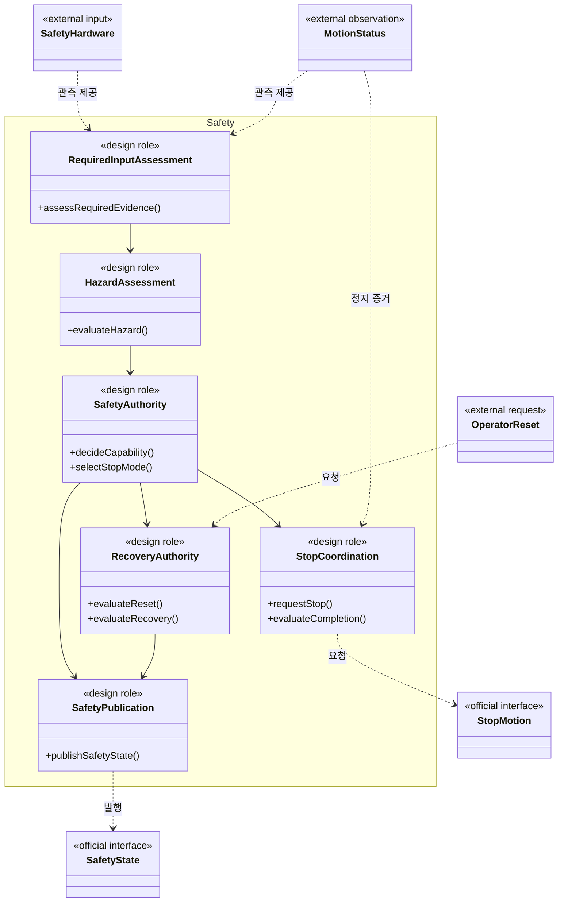
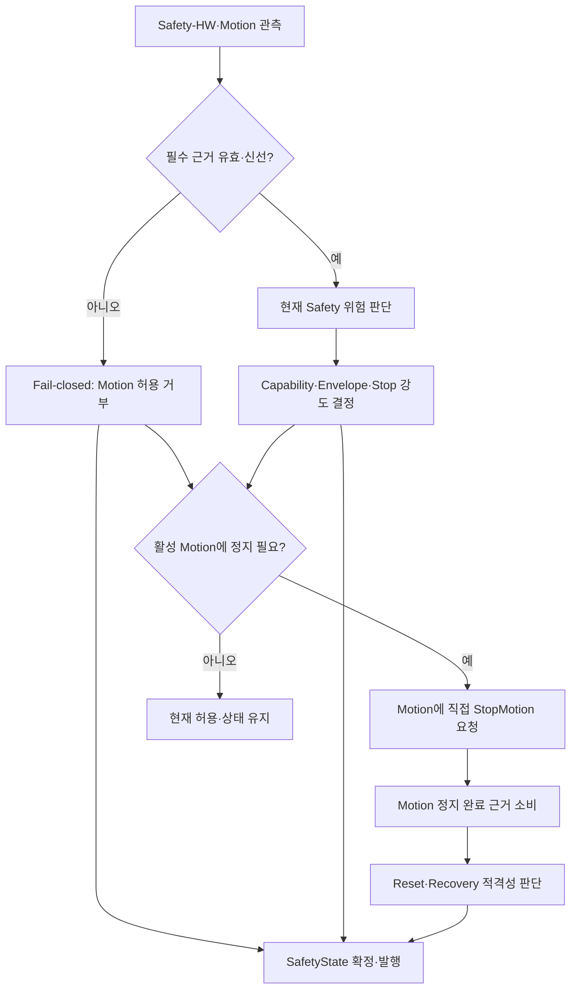

# [SF-Twin] ARM Cell Safety 컴포넌트 설계 (CDS)

- **Component ID:** `ARM-CELL-SAFETY`
- **Owner:** `ARM Cell Safety`

## 목적과 책임

Safety Supervisor는 Safety-HW 신호와 Motion의 실제 위험 및 필수 관측 근거를 평가하고, **Motion capability·정지 원인과 강도·복구·Reset에 관한 소프트웨어 단일 권한**을 소유한다. SafetyState의 단일 발행자는 Safety이며, Motion·Orchestration은 이를 읽기 전용으로 소비한다.

- **책임:** 필수 입력의 의미 유효성과 로컬 수신 freshness 평가, fail-closed 시작, Motion 위험·E-Stop/STO 반영, capability와 permitted envelope 결정, stop severity 선정 및 직접 StopMotion 요청, 정지 승격, latch·복구·Reset 적격성 판단, SafetyState 발행.
- **비책임:** 안전 등급의 물리 E-Stop/STO 대체, Motion 계획·복구 경로 생성, 미션·작업 순서 결정, AMR docking·PackML·자재 공급의 작업 준비 판정. Communication Health의 source timestamp 이상을 별도 물리 위험으로 판정하지 않는다.

## 정적 구조와 경계

아래는 논리적 설계 역할이며 실제 클래스 분해나 호출 순서를 강제하지 않는다.

Safety-HW와 Motion 입력에 대한 필수 freshness는 의미적으로 유효한 payload와 로컬 monotonic receipt age로 판단한다. source timestamp 개연성·age는 Communication Health 진단이며, 유효하고 수신이 신선한 필수 입력의 Safety 권한을 단독으로 변경하지 않는다.

## 상위 책임 연동 흐름

Stop 요청 수락과 완료는 다르다. 정지 완료·승격·Reset의 시간적 순서 및 상세 조건은 [Stop and Recovery FDS](fds-stop-recovery.md)에서 정의한다.

## 소유권과 상태

| 상태·자원 | Authoritative owner / writer | Consumer / observer | Lifecycle·일관성 경계 |
|---|---|---|---|
| `SafetyState`, `motion_capability`, `selected_stop_mode`, permitted envelope | Safety | Motion, Orchestration | 단일 `/safety/state` 발행; 소비자의 freshness 점검은 Safety 판단 재구성이 아님 |
| Safety 위험 원인, active/latched causes | Safety | Motion, Orchestration | 확인된 위험과 통신 품질 증상을 혼합하거나 외부에서 latch를 결정하지 않음 |
| Safety-HW·Motion 필수 관측 | 각각의 제공 책임 | Safety | Safety는 의미 유효성·로컬 수신 freshness 평가; source stamp 진단은 독립 |
| Motion의 실제 정지 완료 관측 | Motion | Safety | StopMotion 요청 수락과 inactivity 확인을 구분 |
| 작업 준비·미션 진행 | Orchestration | Safety는 소유하지 않음 | AMR·PackML 상태는 현 데모에서 Safety 원인이 아님 |

Capability는 `MOTION_NONE`, `MOTION_RECOVERY_ONLY`, `MOTION_NORMAL`을 구별한다. 프로세스가 SAFE/idle이어도 `MOTION_NONE`일 수 있다. AMR·PackML은 현 Isaac Sim 데모에서 Safety 필수 입력이 아니며, 공유 구역 출입 interlock과 AMR–로봇 충돌 위험은 범위 밖이다. 실제 장비에는 별도의 물리 위험 평가와 승인된 안전 설계가 필요하다.

## 제공·요구 계약과 의존성

| Port·계약 | 의미 Owner | Consumer | 의존성 상실 영향 |
|---|---|---|---|
| `/safety/state` 및 capability | Safety; 공유 의미는 Safety–Motion/Orchestration ICD | Motion, Orchestration | 소비자는 stale 허용을 현재 허용으로 추론하지 않고 독립 hazard·severity·latch를 산출하지 않음 |
| Safety-HW 입력 | 독립 하드웨어/Controller의 Safety 신호 | Safety | 실제 Safety 판단에 필요한 근거가 없으면 fail-closed |
| `MotionStatus` | Motion | Safety | 필수 관측 상실은 현 동작에 따른 capability 제한과 직접 Stop 대상 |
| `StopMotion` | Safety 요청 authority, Motion 집행 | Motion | 요청 수락만으로 정지 완료 인정 금지 |
| 운영자 Reset | 요청자는 Operator, 적용 authority는 Safety | Safety | 요청 자체는 capability를 부여하지 않음 |

## 불변조건, 오류 경계와 관측 가능성

| 검토 대상 | 불변조건 | 관측 가능한 근거 |
|---|---|---|
| 단일 권한 | Motion/Orchestration은 Safety 위험·정지 강도·envelope·latch를 재판정하지 않음 | Canonical SafetyState |
| 시작 및 입력 상실 | 필수 Safety-HW·Motion 정보가 유효·신선하기 전에는 정상 Motion을 허용하지 않음 | 입력 판단, capability, 필요 시 StopMotion |
| 통신 품질 | Source timestamp 이상만으로 Safety 원인·정지·감속·latch를 생성하지 않음 | 별도 진단과 불변 SafetyState |
| 정지 완료 | Software stop 수락과 실제 backend inactivity를 분리 | MotionStatus 및 정지 처리 결과 |
| 물리 기능 | ROS 2 감독은 독립 safety-rated E-Stop/STO를 대체하지 않음 | 소프트웨어 감독과 하드웨어 권한 분리 |

## Verification Requirements

| ID | 소유 계약·불변조건 | Verification Requirement |
|---|---|---|
| `VR-SAFE-OWN-01` | Capability 권한 | Motion capability의 유일한 canonical source는 Safety다. |
| `VR-SAFE-OWN-02` | Fail-closed | Safety 감독에 필요한 Safety-HW 및 Motion 정보가 유효·신선하기 전에는 Motion을 거부한다. AMR/PackML은 현 데모의 Safety 필수 입력이 아니며 작업 문맥의 준비성은 Orchestration이 평가한다. |
| `VR-SAFE-OWN-03` | Hardware 경계 | Software Safety가 safety-rated hardware 기능을 대체한다고 주장하지 않는다. |
| `VR-SAFE-OWN-04` | 소비자 권한 | Orchestration·Motion은 `/safety/state`를 읽기 전용으로 소비한다. 로컬 수신 age 판단은 허용의 현재성만 확인하며 Safety 원인·위험 분류·severity·envelope·latch를 만들지 않는다. |

## 참조

- [Safety Supervision FDS](fds-supervision.md)
- [Safety–Motion ICD](../../interfaces/icd-safety-motion.md)
- [Safety–Orchestration ICD](../../interfaces/icd-safety-orchestration.md)
- [Safety Operator ICD](../../interfaces/icd-safety-operator.md)
