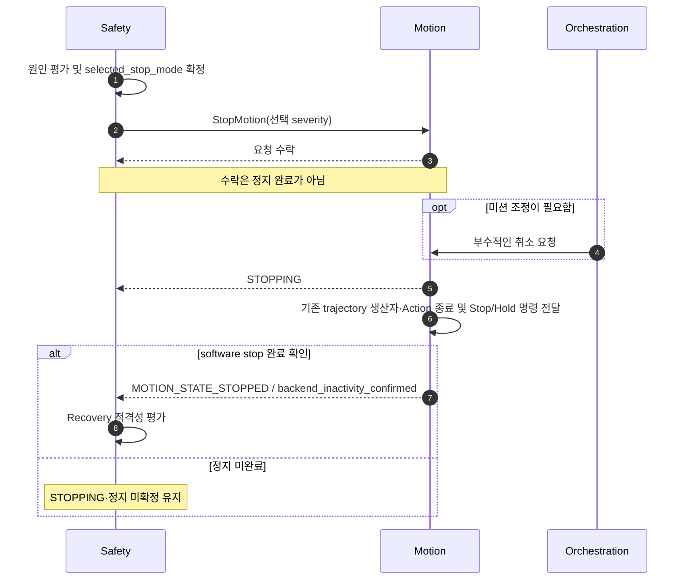
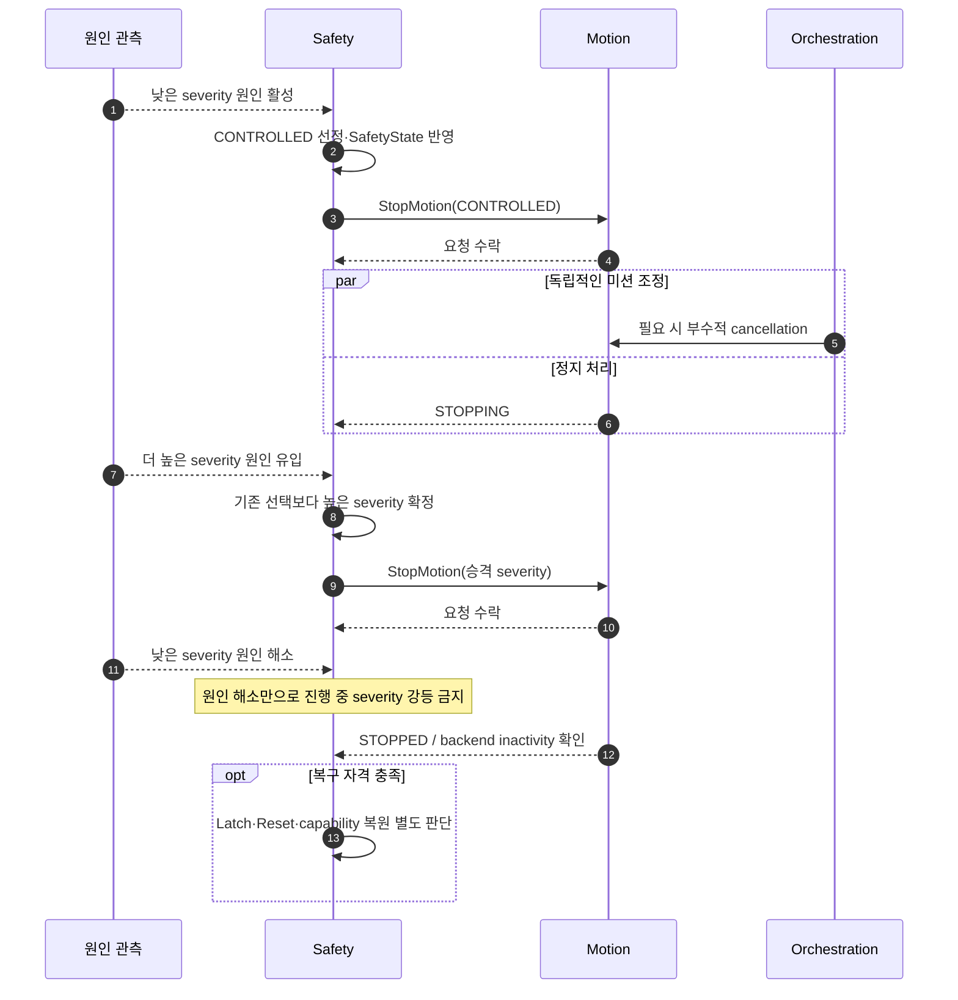
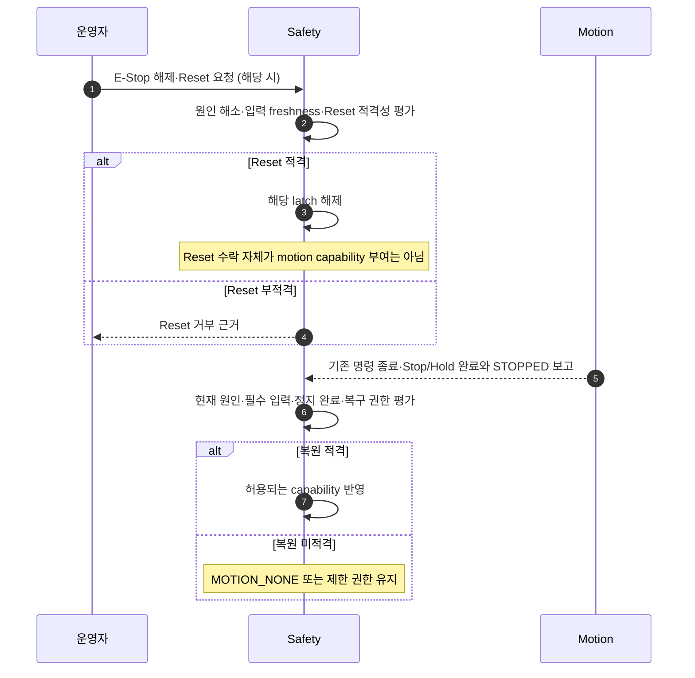

# [SF-Twin] ARM Cell Safety 정지 및 복구 기능 설계 (FDS)

- **Function ID:** `SAFETY-STOP-RECOVERY`
- **Owner:** `ARM Cell Safety`

## 목적과 동작 범위

- **목적:** Safety가 현재 원인에 따른 Stop severity를 단일 결정하고 Motion에 직접 정지를 요청하며, **수락·정지 완료·latch 해제·capability 복원**을 구분한다.
- **시작 경계:** Safety 정지 사유 발생, 정지 중 추가 원인 유입, 정지 완료 근거 수신, 운영자 Reset 요청 또는 원인 해소.
- **종료 경계:** 정지 중·정지 완료·복구 필요·권한 복원 중 현재 의미를 canonical `SafetyState`로 반영한다.
- **비책임:** 실제 trajectory 정지 실행 및 복구 경로 생성(Motion 소유), 미션 재개와 취소 조정(Orchestration 소유), safety-rated 물리 정지 대체.

## 참여 책임과 계약

| 참여 책임 | 기능상 역할 | 정식 계약·Owner |
|---|---|---|
| Safety authority | 원인·문맥 평가, severity 선택·승격, latch·Reset·복구 권한 결정, SafetyState 발행 | [Safety CDS](cds.md) |
| Motion | `StopMotion` 수행, 기존 명령 실행 종료, Stop/Hold 전달 완료와 software stop 상태 보고 | [Safety–Motion ICD](../../interfaces/icd-safety-motion.md) |
| Operator | E-Stop 해제 및 명시적 Reset 요청 | [Safety Operator ICD](../../interfaces/icd-safety-operator.md) |
| Orchestration | 부수적 mission cancellation·중단 후 재개 조정 | [Controlled Recovery FDS](../orchestration/fds-controlled-recovery.md) |

## 핵심 시나리오

### 직접 정지와 완료 확인

`backend_inactivity_confirmed=true` 및 `MOTION_STATE_STOPPED`는 기존 trajectory 명령 생산자와 Action이 종료되고 Stop/Hold 명령 전달이 성공했을 때 Motion이 보고하는 **소프트웨어 제어 정지 완료** 근거다. StopMotion service acceptance나 상태 발행만으로 기존 명령 생산자의 종료를 대신할 수 없다. 이는 safety-rated 물리 정지의 독립 증명이 아니다. Joint position stability·measured velocity·500ms stationary window는 진단 및 fresh-start planning 근거이며 **Safety Reset 또는 capability 복원 gate가 아니다**. Safety는 canonical MotionStatus를 소비하며 joint sample을 별도로 재판정하지 않는다.

### 정지 중 severity 승격 (`SEQ-SAFE-STOP-01`)

`StopMode`의 규범 순서는 `STOP_MODE_CONTROLLED < STOP_MODE_IMMEDIATE < STOP_MODE_EMERGENCY`다. Safety가 `SafetyState.selected_stop_mode`의 유일한 writer이며, 소비자는 `active_causes`나 mission state에서 severity를 재산출하지 않는다. 상위 원인이 하위 정지를 승격하고 하위 요청/원인 해소가 진행 중 상위 정지를 강등시키지 않는다. 물리 E-Stop/STO는 항상 `EMERGENCY`로, 외부/control-room 및 predictive-maintenance stop 근거는 더 높은 실제 위험이 없으면 `CONTROLLED`로 평가한다. Vision은 위험 근거만 제공하고 severity·StopMotion 권한은 Safety가 소유한다.

### Reset과 capability 복원

Reset 수락·Latch 해제와 capability 복원은 별도 판단이다. 문서에서 말하는 **기존 실행 종료 및 Stop/Hold 전달 완료 확인**은 Reset·복구 판단에 적용되는 software control-stop 근거이며, `MOTION_STATE_STOPPED`를 통한 capability 복원 완료 관측과 혼동하지 않는다. 구체 Reset 거부·수락 조건은 아래 표와 관련 ICD를 따른다. 새로운 joint-stationarity gate를 추가하지 않는다.

## 상태와 전이

정지 처리 중 `STOPPING`은 계속 유지될 수 있으며 서비스 수락만으로 `STOPPED`가 되지 않는다. 명시적 Reset이 필요한 latch가 남으면 `RECOVERY_REQUIRED`로 분리하고, 단순 입력 품질 증상은 영구 latch를 만들지 않는다. 정지 완료 후 원인이 해소되어도 독립 latch와 복구 적격성이 충족되지 않으면 권한을 자동 복원하지 않는다. 감독 전체 FSM은 [Supervision FDS](fds-supervision.md)에 표현한다.

## 정지 선택 정책

| 원인·문맥 | 적용 StopMode | 복구·판정 경계 |
|---|---|---|
| 활성 E-Stop | `STOP_MODE_EMERGENCY` | 활성 중 복구 motion 불가 |
| 활성 STO | `STOP_MODE_EMERGENCY` | 활성 중 복구 motion 불가 |
| 실행 중 Motion collision | `STOP_MODE_IMMEDIATE` | 자동 복구 금지 |
| 활성 실행 중 필수 Safety-HW/Motion 증거 상실 | `STOP_MODE_IMMEDIATE` | Fail-closed, inactivity 확인; 일시적 입력 품질만으로 영구 latch 생성 금지 |
| 활성 Motion 안전 판단을 막는 Safety-HW/Motion invalid/unknown | `STOP_MODE_IMMEDIATE` | 신선한 증거 복원·inactivity 확인; 별도 확인 위험 latch는 보존 |
| PackML `ABORTED` | Safety stop 없음 | 관련 작업의 Orchestration 판단만 적용 |
| AMR undocking/driving/state (현 데모) | Safety stop 없음 | 작업 문맥의 Orchestration 판단만 적용 |
| 조작 중 Gripper failure | `STOP_MODE_CONTROLLED` | 높은 severity의 활성 원인이 우선 |

`STOP_MODE_CONTROLLED`는 설정된 ramp-down/controlled-deceleration 의미를 사용한다. 구체 감속 한계·시간·backend ramp 생성은 이 FDS에서 새로 정의하지 않으며 Motion/backend authority에 따른다. Motion이 비활성 상태일 때 readiness-only 외부 조건 이상은 작업 admission에만 영향을 주고 불필요한 StopMotion을 만들지 않는다. 반면 활성 위험 또는 startup/Safety 필수 근거 상실에 대한 Safety capability 제한은 유지하며, 명시적 동기화가 필요한 승인된 정책은 예외가 될 수 있다.

## 시간·동시성·복구 조건

| 조건·경합 | 판단·우선순위 및 종료 조건 | Owner |
|---|---|---|
| 낮은 severity 처리 중 높은 원인 유입 | 즉시 높은 severity로 승격, 낮은 원인 해소만으로 강등하지 않음 | Safety |
| StopMotion 요청 수락 대 완료 | 이전 명령 생산자·Action 종료 및 Stop/Hold 전달 완료 근거까지 미완료 | Motion 보고, Safety 소비 |
| 활성 실행과 inactive 상태 | 활성 실행은 해당 정책에 따라 직접 StopMotion, inactive readiness-only 이상은 불필요한 정지 요청 없음 | Safety / Orchestration |
| 원인·입력 회복 | transient 입력 증상의 nonlatched block 해제 가능; 이미 발행한 정지는 완료 확인 필요 | Safety |
| Reset | E-Stop/STO 해제, 필요한 원인 해소·freshness·control-execution inactivity와 reset 적격성 확인; 물리 관절 안정성만으로 Reset 거부 금지 | Safety |
| Capability 복원 | software stop 완료·해소된 위험·유효한 필수 입력·적용 recovery/normal authorization 조건 필요 | Safety |
| Nonrecovery fault | Recovery 전용 또는 정상 motion capability를 부적절하게 부여하지 않음 | Safety |

확인된 stop-level 위험은 별도 계약이 없는 한 latch된다. E-Stop/STO, 확인된 Motion hazard, recovery-managed Gripper failure 및 승인된 latch 원인은 명시적 운영자 Reset이 필요하다. 일시적 Communication Health 진단 또는 AMR/PackML 상태는 그 자체로 latch·Reset 필요성을 만들지 않는다. `active_causes`와 `latched_causes`는 [Safety–Orchestration ICD](../../interfaces/icd-safety-orchestration.md)의 known-cause bitset이며, timestamp/transport 증상을 이유로 지속 latch에 복제하지 않는다. `PREMATURE_UNDOCK`, `PACKML_ABORT` 상수는 호환성을 위해 남지만 현 데모의 Safety 원인으로 사용하지 않는다.

최종 데모의 Reset은 [Safety Operator ICD](../../interfaces/icd-safety-operator.md)에 따른 명시적 운영자 확인·요청을 필요로 하며 Safety만 canonical capability를 변경할 수 있다. Motion은 새로운 작업을 수락할 때 현재 시작 상태와 Safety 권한을 다시 검증한다. 정지된 미션의 재개는 이 FDS의 책임이 아니다.

## 결과·오류·관측

| 조건 | 감지 책임 | 처리·전파 책임 | 상태·결과 의미 | 관측 근거 |
|---|---|---|---|---|
| 직접 정지 명령 수락 | Motion | Safety | 완료 아님, 정지 처리 계속 | StopMotion 응답과 별도 MotionStatus |
| Software stop 완료 | Motion | Safety | backend inactivity 및 STOPPED 확인 | 이전 실행 종료·Stop/Hold 전달 결과 |
| 높은 severity의 동시 원인 | Safety | Safety | selected_stop_mode 승격·비강등 | 원인 변화·SafetyState·Stop 요청 |
| 부적격 Reset | Safety | Safety | latch 유지 또는 명시적 거부 | 원인·freshness·정지 조건과 요청 결과 |
| 적격 Reset 이후 미완료 정지 | Safety | Safety | latch 해제와 무관하게 capability 미복원 | Reset 결과·MotionStatus·SafetyState |
| AMR/PackML 이상 | 외부 상태 소비 | Orchestration | Safety stop·latch·reset 없음 | 작업 문맥·Safety cause 불변 |

진단 기록 실패는 canonical Stop/Reset 결과를 변경하지 않는다. Stop source, severity 선택, 직접 Safety→Motion 요청, 부수적 Orchestration cancellation과 inactivity 완료는 서로 독립적으로 관찰 가능해야 한다. `SEQ-SAFE-INPUT-01`의 AMR timestamp 시나리오는 [Supervision FDS](fds-supervision.md)가 단일 소유한다.

## Verification Requirements

| ID | 동작·전이·불변조건 | Verification Requirement |
|---|---|---|
| `VR-SAFE-REC-01` | 정지 완료 | StopMotion 응답만으로 완료를 추론하지 않음 |
| `VR-SAFE-REC-02` | 정지 후 복구 | 기존 명령 실행 종료·Stop/Hold 전달 완료 전에는 Motion capability 부여 금지. 적격 관리자 Reset은 latch만 해제하며 `MOTION_STATE_STOPPED` 전까지 `MOTION_NONE` 유지 |
| `VR-SAFE-REC-03` | 복구 불가 원인 | Non-recovery 조건에서는 recovery capability를 부여하지 않음 |
| `VR-SAFE-REC-04` | Reset 선행조건 | 필수 원인 해소·freshness·제어 실행 inactivity 및 Reset 조건이 충족되지 않으면 거부 |
| `VR-SAFE-REC-05` | Severity 승격 | 낮은 severity 처리 중 높은 원인 유입 시 승격, 낮은 요청·외부 원인 해소만으로 상위 severity 강등 금지. `selected_stop_mode`가 관찰 가능해야 함 |
| `VR-SAFE-REC-06` | 문맥별 Stop dispatch | inactive의 readiness-only 외부 이상은 Orchestration admission만 제한하고 불필요한 Safety Stop 없음. active 실행의 승인된 위험·필수 정보 상실은 Safety 소유 StopMotion 요청 |
| `VR-SAFE-REC-07` | 현 데모의 외부 상태 배제 | AMR/PackML 상태·통신만으로 Safety stop·latch·reset 금지. 독립 위험/필수 근거 상실에 따른 정지는 Motion inactivity 완료 증거 필요 |

## 참조

- [Safety CDS](cds.md)
- [Supervision FDS](fds-supervision.md)
- [Safety–Motion ICD](../../interfaces/icd-safety-motion.md)
- [Safety–Orchestration ICD](../../interfaces/icd-safety-orchestration.md)
- [Safety Operator ICD](../../interfaces/icd-safety-operator.md)
- [Orchestration Controlled Recovery FDS](../orchestration/fds-controlled-recovery.md)
