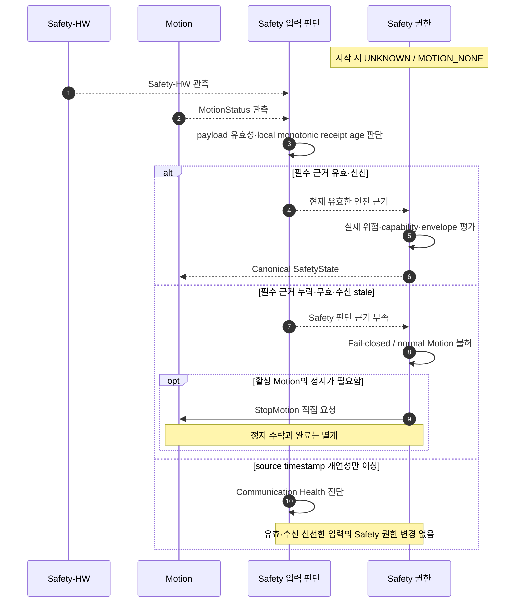
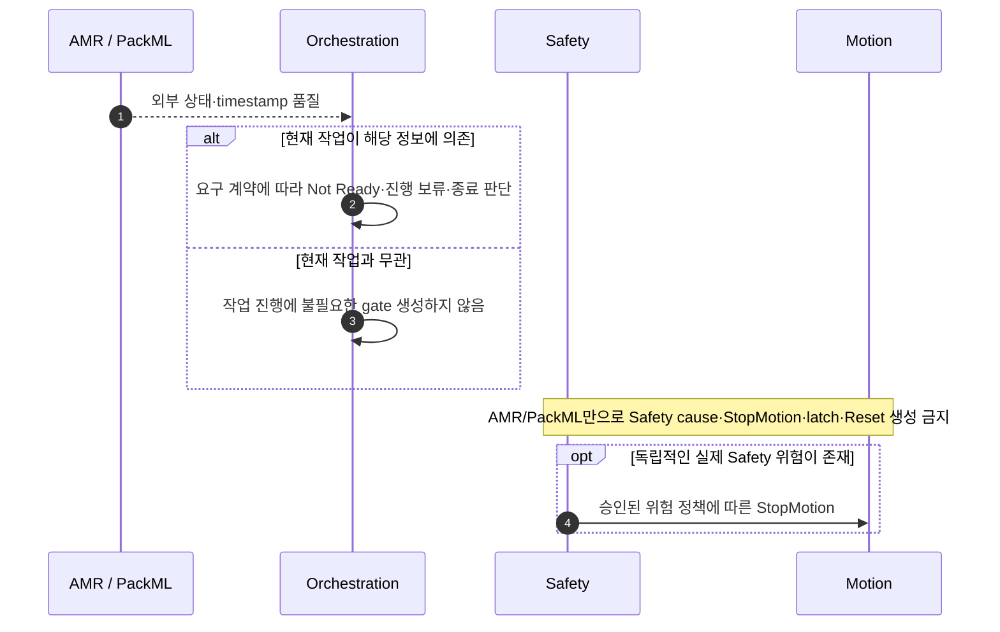
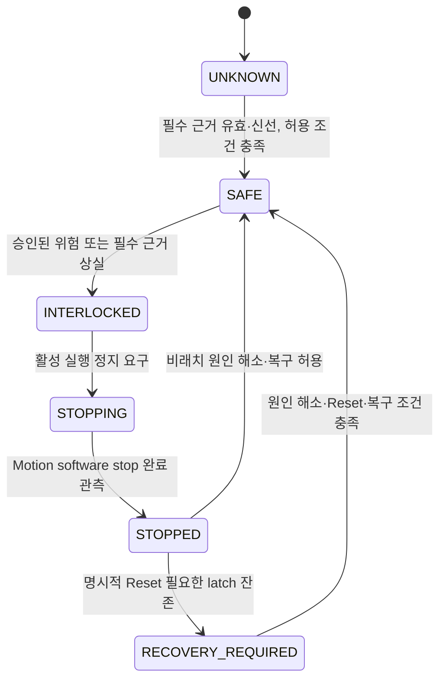

# [SF-Twin] ARM Cell Safety 감독 기능 설계 (FDS)

- **Function ID:** `SAFETY-SUPERVISION`
- **Owner:** `ARM Cell Safety`

## 목적과 동작 범위

- **목적:** Safety-HW와 Motion의 실제 안전 근거를 문맥에 따라 평가하고 Safety capability·interlock·정지 필요 여부를 결정한다.
- **시작 경계:** 최초 기동, 필수 관측의 갱신·상실·복원, 실제 위험·상태 변화.
- **종료 경계:** 현재 Safety 판단을 `SafetyState`로 반영하고 필요한 경우 직접 StopMotion을 요청한다. 완료와 복구는 [Stop and Recovery FDS](fds-stop-recovery.md)가 소유한다.
- **비책임:** AMR·PackML의 작업 준비 판정, Communication Health의 source-stamp 진단을 물리 위험으로 격상, safety-rated 물리 기능 대체.

## 참여 책임과 계약

| 참여 책임 | 이 기능에서의 역할 | 정식 계약·Owner |
|---|---|---|
| 필수 입력 판단 | Safety-HW·Motion payload의 의미 유효성 및 로컬 수신 freshness 평가 | [Safety CDS](cds.md) |
| 위험·권한 판단 | 위험과 필수 근거 부족을 분리 평가하고 capability/envelope·stop을 결정 | Safety CDS |
| Safety-HW | E-Stop/STO 등 외부 안전 신호 제공, 독립 하드웨어 집행 | [External Safety ICD](../../interfaces/icd-external-safety.md) |
| Motion | 실제 MotionStatus 제공, Safety 정지 요청 집행 | [Safety–Motion ICD](../../interfaces/icd-safety-motion.md) |
| Orchestration | 필요한 작업에 한해 AMR·PackML readiness·progress 판단 | [Safety–Orchestration ICD](../../interfaces/icd-safety-orchestration.md) |

## 핵심 시나리오

### 기동과 필수 입력 평가

기동 중 이전의 일시적 정상 관측만으로 새로운 fresh safe state를 확립하지 않는다. Safety-HW와 MotionStatus의 source timestamp가 미래이거나 `source_timestamp_max_age_ms`를 초과해도 **payload가 의미적으로 유효하고 로컬 receipt age가 필수 bound 안이라면** capability·envelope·원인·latch·StopMotion 결정에는 영향을 주지 않는다. Timestamp의 개연성은 별도 Communication Health 진단으로 남긴다. 향후 측정 시각 자체가 Safety 필수인 하드웨어에 적용하려면 별도의 계약 검토가 필요하다.

### 작업 문맥과 외부 상태

AMR docking/undocking/driving, PackML 상태(특히 `ABORTED`)와 그 통신 품질은 현재 Isaac Sim 데모의 Safety 원인이 아니다. PackML은 외부 CNC/process 상태이지 ARM mission state가 아니다. Orchestration은 해당 작업이 실제로 필요로 하는 외부 상태에만 readiness/progression을 적용한다. 현재 데모는 AMR–로봇 충돌 및 shared-zone access interlock을 다루지 않는다. 실제 장비는 별도 물리 위험 평가와 승인이 필요하다.

기존 `SEQ-SAFE-INPUT-01`의 문맥별 보장: admission 전 Motion inactive 시 AMR source stamp 이상은 관련 작업에만 Not Ready를 적용하고, active Motion에서는 현재 작업의 의존성에 따른 진행/종료만 처리한다. 단독 Safety stop·latch·reset은 발생하지 않는다. 이상이 해소되면 해당 작업 준비만 다시 평가하며 중단된 미션을 암묵적으로 재개하지 않는다.

## 상태와 전이

이 그림은 대표 전이를 표현한다. E-Stop/STO는 관련 상태에서 비상 정지를 강제할 수 있고, 확정된 inactivity만으로 명시적 latch가 해제되지 않는다. 현재 공유 상태값의 정확한 wire 의미는 ICD를 따른다. `SAFE`와 `MOTION_NORMAL`은 동일하지 않으며, Safety permission은 작업 admission이 아니다. 진단 회복 또는 작업 readiness는 별도의 Safety recovery episode를 생성하지 않는다.

## 시간·동시성·재시도

| 조건·경합 | 판단·처리 의미 | 책임 |
|---|---|---|
| 필수 입력 미수신, 수신 시간 이상, stale, 의미적 invalid, unknown/불일치 | 현재 Safety 판단에 필요한 증거 상실은 fail-closed, active Motion이면 기존 정지 정책 적용 | Safety |
| Safety-HW·MotionStatus source stamp 미래/과거 이상만 존재 | payload valid 및 receipt fresh라면 단독으로 capability, envelope, StopMotion, 원인·latch 변경 금지 | Communication Health 진단 / Safety 판단 구분 |
| Timestamp 이상 진단의 지속과 회복 | 이상 구간 진입 시 WARN 1회, 반복 억제, 개연성 회복 시 회복 기록. 진단은 새 공개 상태/서비스가 아님 | 관측·진단 owner |
| 외부 상태가 현재 작업의 필수 근거 상실 | 해당 작업에만 Not Ready·진행 판단; Safety hazard로 승격하지 않음 | Orchestration |
| 실제 위험 해소 또는 필요한 입력 회복 | 통신 품질만으로 발생한 비래치 block은 제거 가능하나, 이미 정지가 요청됐다면 완료 확인 필요. 확인된 별도 위험 latch는 유지 | Safety / Motion |

Safety-HW와 `/motion/state`의 수신 freshness는 의미 유효성과 분리해서 평가한다. source timestamp 이상은 `message_valid`, `source_timestamp_plausible`, `received`, `receipt_age`를 구분해 관측하며 missing·receipt timeout·payload invalid·receipt-clock inconsistency를 하나로 합치지 않는다. `source_timestamp_max_age_ms`는 timestamp 진단 설정이다. 현재 필수 freshness bound 등 규범 시간값은 해당 계약·ICD를 따른다. Timestamp quality 또는 delivery delay만으로 임의의 중간 freshness band나 속도·가속도 derating을 추가하지 않는다. Envelope 제한은 승인된 실제 위험 및 관련 Safety/configuration authority에 한한다.

## 결과·오류·관측

| 조건 | 감지 책임 | 처리·전파 책임 | 정규 상태·결과 | 필요한 관측 근거 |
|---|---|---|---|---|
| 필수 신선한 입력과 위험 없음 | 입력·위험 판단 | Safety | 적용 capability 및 envelope | 입력 유효성·receipt age와 SafetyState |
| 필수 입력 상실/무효 | Safety 입력 판단 | Safety, Motion 정지 집행 | normal Motion 불허, 필요 시 직접 정지 | 원인·실행 여부·Stop 요청·완료 분리 |
| source timestamp만 이상 | 통신 품질 관측 | 진단 owner | Safety 판단 불변 | source stamp·receipt age·진단의 독립 verdict |
| E-Stop/STO·확인된 Motion 위험 | Safety 위험 판단 | Safety | 적용 stop·interlock·latch | 위험 원인, selected stop mode, MotionStatus |
| AMR/PackML 외부 상태 이상 | 외부 상태 소비 | Orchestration | 작업 의존성이 있는 경우에만 readiness/progression 변화 | 현재 작업 문맥과 Safety 원인의 불변성 |

Warning은 독립 진단 분류이며 Not Ready 또는 Safety interlock과 병존할 수 있지만 이를 대체하지 않는다. 진단 기록의 실패가 Safety 실행 결과 의미를 덮어쓰지 않는다. 관측의 구체 저장/표현은 Observability Diagnostics FDS가 소유한다.

## Verification Requirements

| ID | 동작·전이·불변조건 | Verification Requirement |
|---|---|---|
| `VR-SAFE-SUP-01` | 기동 | 필요한 fresh 입력 관측 전까지 fail-closed 유지 |
| `VR-SAFE-SUP-02` | 문맥별 판단 | 무관한 조건 하나가 false라는 이유만으로 정상 프로세스를 interlock으로 오분류하지 않음 |
| `VR-SAFE-SUP-03` | 필수 통신 상실 | active-motion Safety 필수 정보 상실은 normal Motion 거부와 정지; readiness-only 상실은 Orchestration admission을 차단하되 Safety 원인·latch를 생성하지 않음 |
| `VR-SAFE-SUP-04` | E-Stop 동기화 | 독립 하드웨어 권한을 유지하며 E-Stop/STO를 software state에 반영 |
| `VR-SAFE-SUP-05` | PackML 분리 | `ABORTED`를 포함한 PackML만으로 Safety cause·StopMotion·latch·reset 생성 금지. 작업 관련성에 따라 Orchestration 판단 |
| `VR-SAFE-SUP-06` | 외부 상태 소비 경계 | AMR/PackML 상태·통신 품질만으로 Safety cause·stop·latch·reset 생성 금지. 작업 문맥과 admission/progression 결과 및 독립 위험 부재 시 SafetyState 불변이 oracle |
| `VR-SAFE-SUP-07` | 활성 envelope 제한 | 활성 실행 중 강화된 envelope는 backend가 안전하게 적용·확증할 때만 계속 실행; 그렇지 않으면 Safety StopMotion 후 inactivity 확인. 다음 작업은 현재 envelope로 계획 |
| `VR-SAFE-SUP-08` | 통신 품질 비감속 | `/motion/state` payload가 유효하고 로컬 receipt age가 500ms 이내이면 source timestamp 경고만으로 normal capability·envelope 변경 또는 StopMotion 불가. 필수 payload invalid/상실/수신 stale 시 fail-closed·active 정지. fresh 복원 시 비래치 block 해제 가능하나 정지 완료 필요 |
| `VR-SAFE-SUP-09` | Timestamp는 위험이 아님 | AMR/PackML source timestamp 이상만으로 Safety cause·StopMotion·latch·reset 금지. 실제 필수 Safety-HW/Motion 근거 상실은 별도 fail-closed 및 정지 완료 규칙 적용 |
| `VR-SAFE-SUP-10` | 필수 입력의 timestamp | Safety-HW/MotionStatus의 source timestamp가 미래 또는 `source_timestamp_max_age_ms` 초과여도 payload valid 및 receipt fresh라면 capability·envelope·cause·latch·StopMotion 불변. 이상 구간당 WARN 1회·반복 억제·회복 기록. missing/stale/invalid·Motion fault·E-Stop/STO의 기존 fail-closed 유지 |

## 참조

- [Safety CDS](cds.md)
- [Stop and Recovery FDS](fds-stop-recovery.md)
- [Safety–Motion ICD](../../interfaces/icd-safety-motion.md)
- [Safety–Orchestration ICD](../../interfaces/icd-safety-orchestration.md)
- [External Safety ICD](../../interfaces/icd-external-safety.md)
- Observability Diagnostics FDS
