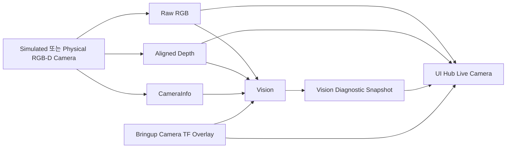

# [SF-Twin] ARM Cell 운영자 Camera 및 Overlay 컴포넌트 설계 (CDS)

- **범위:** Camera Source·Operator Video·Overlay 경계
- **Owner:** Isaac Simulation(Camera Source·Geometry), ARM Cell Bringup(ROS TF Overlay), UI Hub(Operator 표시)

## 1. 목적 및 구성

Camera 통합 구조는 원본 RGB-D 인지 입력과 운영자 화면 표시를 분리하며, Simulation Camera와 실제 Camera가 같은 Source Identity와 원본 관측 의미를 보존하도록 한다. Vision은 이를 소비하지만 Camera Publisher나 TF Overlay를 소유하지 않는다.



Camera Publisher는 **하나의 논리 RGB-D Sensor**의 원본 Frame Identity를 제공한다. 실제 Cell에서는 배포 환경에 맞는 운영자 영상 전송 수단을 추가할 수 있으나 Sensor Origin과 Vision 입력 의미를 바꾸지 않는다. UI Hub는 Simulator 전용 이미지 API에 의존해서는 안 된다.

## 2. 정적 책임·Owner

| 구성 | 책임 | 비책임·공유 계약 |
|---|---|---|
| Isaac Simulation Camera | 논리 Sensor 및 RGB·정렬 Depth·CameraInfo의 단일 Render Source | 인코딩·단위·QoS·Frame 의미는 [RGB-D ICD](../../interfaces/icd-sim-rgbd.md) |
| Camera Geometry Derivation | D455 내부 Color Camera Geometry 식별, 합성 Transform의 Rigid/Near-rigid 검증, 논리 Pose 도출, USD Camera→ROS Optical Basis 명시 변환 | 무효·비강체 Transform의 묵시적 수용 금지 |
| ARM Cell Bringup | `world → camera_link`, `camera_link → camera_color_optical_frame`의 Camera TF Overlay 발행 | Vision의 경쟁 TF Publisher 금지 |
| Vision | 원본 관측·Detector 결과·진단 Annotation Source 의미 보존 | [Vision CDS](../vision/cds.md), [Diagnostic Snapshot FDS](../vision/fds-diagnostic-snapshot.md) |
| UI Hub | 선택적 영상 Source·표시용 Buffer·Depth Heatmap·Live Annotation Pairing·Snapshot Viewer Lifetime | [Viewer FDS](../ui-hub/fds-camera-vision-viewer.md) |

## 3. 논리 센서 정체성과 좌표계

Simulation은 다음 단일 논리 Sensor Identity를 제공한다.

```text
/World/SF_Twin_Cell/Vision/Camera_Sensor
```

상위 ROS 계약은 D455 내부 USD Prim Identity에 의존해서는 안 된다. D455 내부 Color Camera는 Geometry 도출의 원본으로 사용할 수 있지만 공유 Sensor Identity는 위 논리 경계를 따른다.

RGB·Aligned Depth·Native CameraInfo는 Simulation Profile에서 하나의 논리 Sensor/Render Product 취득 원천에서 생성되어야 한다. 독립된 Stream 해석 간 Drift를 방지한다.

## 4. Camera Geometry 및 TF 경계

Isaac Camera 도구는 내부 Color Camera Geometry를 확인하고 Composed Transform이 Rigid 또는 Near-rigid인지 검증한 후 논리 Camera Pose를 도출한다. USD Camera→ROS Optical Frame 변환은 명시적이고 결정적이어야 한다. 무효 또는 비강체 합성 Transform은 묵시적으로 수용하지 않고 도출에 실패해야 한다. 검증된 Camera Snapshot은 ROS Overlay 구성에 사용한다.

Bringup은 지원 ROS Profile에서 Camera Overlay TF Edge의 단일 발행 Owner다. Vision은 이를 소비하며 대체 발행하지 않는다. 개발 환경에서 Simulator 상태를 조사해 Geometry를 도출하고 검증된 Snapshot을 이용해 Overlay를 구성한다. Runtime Vision은 Snapshot 불일치를 보상하려 Geometry·Timestamp·Unit을 몰래 변경해서는 안 된다.

## 5. Operator Video 및 Annotation 경계

원본 RGB와 Aligned Depth는 Vision의 RGB-D/CameraInfo 처리와 별개로 UI Hub에 제공할 수 있다. 운영자 영상 선택·기본값·Depth 표현·Overlay의 150ms 기본/200ms 최대 호환성·Viewer의 마지막 Snapshot 유지 시간은 [UI Hub Viewer FDS](../ui-hub/fds-camera-vision-viewer.md)가 소유한다. Video 표시용 Buffer·변환은 인지 입력을 변경하지 않는다.

Vision은 실제 검출 결과에 존재하는 원본 Image Timestamp·Camera Frame ID·검출 상태·Target Identity·Support/Reference·Segment·Centroid·Target Pixel·Validity/Freshness/Result·Yaw 가용성 등을 관측 근거로 제공한다. Box·Polygon·Mask는 실제 Detector가 제공할 때만 사용한다. Hub는 이 근거를 읽기 전용으로 소비하며 인지 결과를 추론하거나 새 Snapshot을 생성하지 않는다. 비호환·Stale Live Annotation은 숨기거나 Unavailable로 표시한다. Operator Presentation은 Perception·Control·Safety·Pose·Mission Success 판단에 영향을 주지 않는다.

Source Frame·Encoding·QoS·Temporal Association의 공유 의미는 [RGB-D ICD](../../interfaces/icd-sim-rgbd.md)가 소유한다. 정확한 Snapshot 생성 및 Source Identity는 [Vision Diagnostic Snapshot FDS](../vision/fds-diagnostic-snapshot.md)와 [Vision–Orchestration ICD](../../interfaces/icd-vision-orchestration.md)를 따른다.

## 6. 비책임

이 CDS는 RGB-D Consumer 동기화 정책·Vision Frame Buffer·Segmentation/Geometry Detection·DetectTarget 동작이나 RGB-D ICD가 소유한 정규 QoS·Encoding·Unit 의미를 정의하지 않는다.

## 7. Verification Requirements

### VR-SIM-CAM-01 — 안정적인 논리 Sensor Identity
상위 ROS 계약은 D455 내부 Prim이 아닌 논리 Camera 추상화에 결합해야 한다.

### VR-SIM-CAM-02 — Near-rigid 검증
Camera Pose 도출은 비강체/무효 Composed Transform을 거부해야 한다.

### VR-SIM-CAM-03 — 명시적 Optical 변환
USD Camera에서 ROS Optical Frame으로의 변환은 명시적이고 결정적이어야 한다.

### VR-SIM-CAM-04 — 단일 TF Authority
지원 Profile의 Camera Overlay TF Edge에는 ROS 측 단일 발행 Owner만 있어야 한다.

### VR-SIM-CAM-05 — 숨은 Runtime 보정 금지
Runtime Consumer는 Overlay 불일치를 감추기 위해 Sensor Timestamp·Unit·Geometry를 임의로 변경해서는 안 된다.
