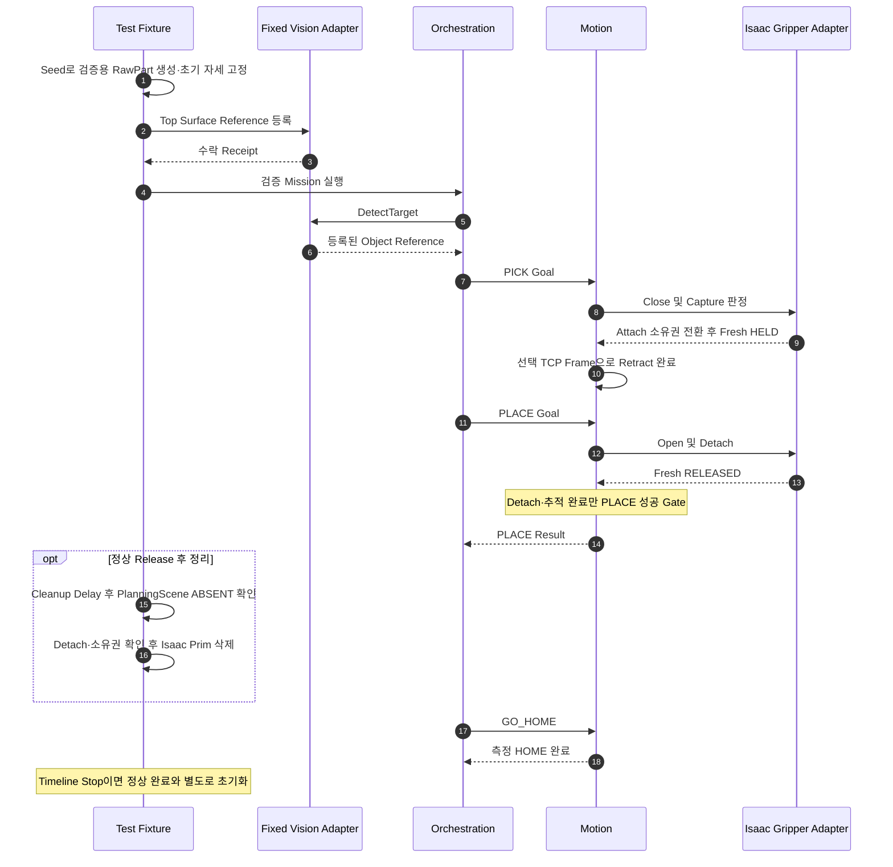
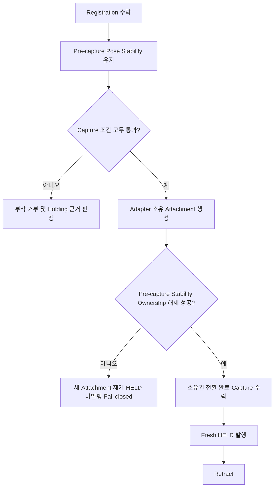

# [SF-Twin] ARM Cell Deterministic PnP Fixture 기능 설계 (FDS)

- **범위:** Isaac 검증 전용 PICK→PLACE→GO_HOME 단일 시나리오
- **Owner:** ARM Cell Simulation Validation Fixture 및 Isaac Gripper Adapter
- **관련 계약:** [Fixed Vision Adapter FDS](../vision/fds-fixed-target-adapter.md), [Task Execution PnP FDS](../task-execution/fds-pnp-execution.md), [Motion Execution FDS](../motion/fds-motion-execution.md), [Simulation Session FDS](fds-sim-session.md)

## 기능·시점 책임

이 FDS는 Production Vision 대신 Fixture가 등록한 Object Reference로 한 번의 PICK→PLACE→GO_HOME을 검증한다. 측정 좌표 인계·Motion 소유 TCP 변환·Backend-neutral Gripper·Simulator Attach/Detach 및 HOME 복귀를 평가한다. **Production Vision 정확도나 실제 물리 배치 안정성의 증거가 아니다.**

- **범위:** `ARM Cell / Isaac 결정적 PnP 검증`
- **소유자:** `ARM Cell Bringup Validation Fixture` (Bringup Runtime 및 Isaac Simulation Extension)

## 1. 목적

이 검증 Fixture의 실행별 책임과 입력·결과 경계는 다음과 같다. Object Reference의 좌표 전달, Motion 소유 Object→TCP 변환, Backend에 독립적인 Gripper 동작, Simulation Attach/Detach, HOME 복귀를 확인한다. Production Vision 정확도나 실제 배치 안정성을 증명하지 않는다.

## 2. 실행 주체

### 2.1 지속 Isaac Gripper Adapter

지속 실행되는 Isaac Gripper Adapter는 Backend-neutral `GripperPort`를 실현한다. Simulator에 종속된 Actuator 명령, Capture Volume 판정, Grasp 확정, Fixed Joint 생성·제거, Holding State 보고를 소유한다. Motion Task Sequence, Target ID 해석, Mission Policy, Vision Pose 생성은 소유하지 않는다.

### 2.2 실행별 Test Fixture

PnP Fixture는 시나리오 실행 하나를 소유하며, Material Shelf/AMR 상단의 승인된 Spawn Volume에서 Seed 기반 무작위 Pose의 **Gravity-disabled Cube 하나**를 생성한다. `base_link`에서 보이는 상판 중심을 계산하고 이미 실행 중인 Fixed Vision Adapter에 등록한다. 등록 수락부터 Capture 수락까지 선언된 허용치 내 Object Pose를 유지하고, 지원하는 Orchestration Mission 경로를 호출·관측한다. Seed·Spawn Pose·등록 Reference·선택 가능한 Prim·Attach/Detach·PLACE·HOME 관측과 결과를 기록한다. Motion의 성공 PLACE와 Detach 확인 후 **3초**가 지나 Prim 삭제를 예약한다. Scene에 과거의 상시 RawPart를 두지 않으며 검증 자재는 Fixture가 생성·제거한다.

등록 수락 후 PICK Capture를 수락하기 전까지 Gravity나 우발적인 비파지 접촉이 등록 Pose를 허용치 밖으로 이동시켜서는 안 된다. 이 안정화의 Simulator 구현 방식은 Validation Runtime/Profile이 소유하고 FDS가 강제하지 않는다. Capture 조건이 만족되면 Adapter는 자신의 Attachment를 **먼저 생성**하고 Pre-capture Fixture Stability 소유권을 해제해야 한다. 해제가 성공해 소유권 전환이 완료된 이후에만 Capture를 수락하고 Fresh `HELD`를 발행한다. 해제 실패 시 새 Attachment를 제거하고 `HELD`를 발행하지 않으며 `UNKNOWN` 또는 Grasp Failure로 Fail-closed 처리한다.

### 2.3 Fixture 등록 계약

Fixture는 명시적 Acknowledgement가 있는 검증 Profile 로컬 등록 Service/Channel을 사용한다. 논리 Request에는 설정된 `target_id`, Run별 `run_id`, 유한 Position의 `geometry_msgs/PoseStamped` Object Reference, `orientation_symmetry_order`(미관측 0, 제공 1; 0이면 Quaternion은 사용할 수 없음), Registration TTL을 포함한다. Adapter는 수락 시 Receipt Sequence와 Adapter 수신 시각을, 거부 시 진단 사유를 보고한다. 거부된 요청이 기존 수락 Record를 덮어써서는 안 된다. 검증 기반 Channel이지 Product 공유 Interface가 아니며 Isaac Prim Path를 Vision에 전달·노출하지 않는다.

| 상황 | 등록 계약 |
|---|---|
| `target_id` 불일치·미등록 | 검증 Profile의 단일 설정 Target과 다르면 거부 |
| 동시 Run | 하나의 활성 Run Registration만 허용 |
| 동일 `run_id` 재등록 | 유효하면 미소비 Record를 원자적으로 교체 |
| 다른 `run_id` | 이전 Record 소비 또는 만료 후에만 수락해 지연 요청이 다음 Run의 Pose를 얻지 못하게 함 |
| 기형 Frame·비유한 Position·미지원 Orientation Order·무효 TTL | 기존 Record를 바꾸지 않고 거부 |
| Orientation Order 1 | 유한하고 0이 아닌 Object Orientation 필요 |
| Orientation Order 0 | Pose Quaternion 무시 |
| TTL | 기본 **30초**, 최대 **60초**; Adapter Steady/Monotonic Clock으로 만료 |
| Pose Stamp | Fixture Provenance로만 보존, RGB-D 관측 시각이라고 주장하지 않음. TTL Freshness는 Adapter Receipt Time 기준 |
| Adapter Unavailable | Registration Failure 반환 후 Fixture는 Orchestration을 호출하지 않고 Run 중단 |

## 3. 재현성과 Spawn 경계

각 Run은 Seed를 입력받거나 생성하여 Run Manifest에 기록한다. 동일 Fixture/Profile 버전에서 같은 Seed를 재생하면 동일 Spawn Pose를 얻어야 한다.

| 데이터·변환 | 좌표계 및 판정 |
|---|---|
| `fixture.spawn_bounds_m`, `fixture.excluded_volumes_m` | `world` 기준 |
| Spawn Sample | 추가 Base→World 변환 없이 Simulator에 World Pose로 전달 |
| Registration Reference | 실제 Simulator World Pose를 **한 번만** `base_link`로 변환하여 보이는 상판 중심 등록 |
| Excluded Volume | 선언된 Geometry Frame에서 실제 Pose로 비교 |
| Release 후 배치 | `world`의 분리된 Fixture Center와 기존 `object_to_grasp_tcp`를 통해 PLACE TCP Pose에서 계산한 예상 Release Center의 유클리드 거리를 `place.position_tolerance_m`과 비교 |
| 관측 실패 | 누락되거나 비유한 Pose는 Unavailable이며 PLACE Motion 성공을 뒤집지 않음 |

Release 위치 관측은 Fixture 전체 Footprint나 Orientation을 검사하지 않는다. 등록 인계는 여전히 `base_link` Pose 계약이며 Manifest는 `spawn_pose_world`, `registered_top_surface_pose_base_link` 등 명시적 Pose 이름과 Frame ID를 보존해야 한다.

PlanningScene Fixture의 Geometry Reference는 다르다. `BOX` Primitive Pose는 **기하학적 중심**이다. 검증 ROS 경계는 등록된 상판 중심에서 Fixture Dimension/Orientation을 이용해 로컬 수직축 음의 방향으로 높이 절반을 이동하여 Center를 계산한다. Fixed Vision·Orchestration으로 전달하는 등록된 상판 Pose는 변경하지 않는다. 이 변환은 검증 CollisionObject에만 적용한다.

정규 0.08m 축 정렬 Fixture에서 Top z=0.0635m이면 PlanningScene Box Center z=0.0235m다. Top Reference를 Box Center Pose로 직접 전달해서는 안 된다. MoveIt ROS Message에서 변환된 Center는 `CollisionObject.pose`에 넣고 Box Primitive의 상대 Pose는 Identity로 유지한다.

Spawn Sampler는 Reachable PICK Region 내부에 완전히 들어가는 선언된 Position/Yaw Bounds를 사용한다. 제외 Geometry와 교차하거나 Fixture Clearance를 위반하는 Sample은 거부한다. 이번 검증 Cube에는 Gravity를 비활성화한다. 이는 Validation Profile의 특성으로 기록하되 Pre-capture 동안 Object가 자유롭게 떠 있는 Dynamic Body여도 된다는 뜻이나 실제 Support/Settling의 근거가 아니다. 별도의 Fixture Stability Ownership이 필요하다.

기존 Step 4N2 진단에서는 Fresh `RELEASED`인데도 물리 Gripper가 닫혀 있을 수 있었다(`left_knuckle`이 Closed Limit 근처). 이는 Mimic Joint Mapping 실패가 아니라 Parent Joint와 파생 Mimic State가 일치하는 상황이다. 따라서 Validation 시작 전에 **물리 OPEN Readiness를 별도로 확인**해야 한다.

Fixture를 생성하기 전에 검증 전용 Bootstrap은 `open()`을 명령하고 새로운 Physical Joint State Sample을 기다리며, 정규 Parent Joint가 Open 영역에 있고 실제 측정 열림이 일치하는지 확인해야 한다. 또한 Fresh `RELEASED`, `attached=false`, Adapter 소유 Grasp Joint 부재를 함께 요구한다. `RELEASED`는 Attachment/Holding 부재만 의미하며 손가락이 실제로 열렸다는 증거가 아니다. 조건 하나라도 실패하면 Fixture 생성·Registration·Mission 시작을 막는다. Unknown/Stale Physical Sample은 Fail-closed다.

OPEN Readiness Wall Clock 예산은 Validation 전용 `open_readiness_timeout_s`(정규 **2초**)이며 `HELD`/`RELEASED` Freshness의 `holding_freshness_ms`와 독립적이다. 새로운 Physics Generation을 기다리거나 활성 OPEN Motion이 정착하는 과정은 일시적이다. `UNKNOWN`, Stale `RELEASED`, Attachment, Feedback 누락, 비유한 Parent Position, 정착됐지만 닫힌 Parent Position은 Terminal Fail-closed이며 Timeout까지 반복 재시도하지 않는다.

## 4. Backend 독립 GripperPort

Motion이 사용하는 논리 의미는 다음과 같다.

| Port | 의미 |
|---|---|
| `close()` | 선택 Grasp Pose에서 장치별 닫기 동작 요청. 목표 열림 폭을 명령하는 것이 아님 |
| `open()` | Release 요청 |
| `holding()` | 단조 Freshness Metadata와 `HELD`/`RELEASED`/`UNKNOWN`의 Fresh 관측 반환. `RELEASED`는 비부착·비보유 의미이지 Finger OPEN의 증거가 아님 |
| `active()`, `stop()` | 실행 중단·안전 종료 지원 |

Motion은 Simulator Attachment를 직접 생성·해제하거나 Isaac Prim Path를 받지 않는다. PICK은 Fresh `HELD` 후에만 Retract를 계속할 수 있고 PLACE는 `open()` 이후 Fresh `RELEASED`일 때만 Retreat을 계속할 수 있다. `UNKNOWN`은 양쪽 전이를 차단한다. 실제 Gripper 구현은 동일 Port 의미를 보존하면서 Simulator 종속 Snap 절차를 교체할 수 있다.

## 5. Isaac Snap 판정

Fixture와 Adapter는 Backend에 독립적인 Fresh Holding 관측(`HELD`/`RELEASED`/`UNKNOWN`)을 제공해야 한다. Validation Profile의 **500ms** Freshness보다 오래된 Holding 관측은 `UNKNOWN`이다. 이는 Vision Registration TTL 30초와 독립적이다.

**Capture는 Close 명령이 활성이고 다음 조건을 모두 만족할 때만 허용된다.**

| 조건 | 근거 및 판정 |
|---|---|
| 적격 객체 | 활성 Fixture가 등록한 Object이며 TCP 주변 실제 Scene Geometry로 판정 |
| Capture Volume | 적격 Object Center가 TCP-local Capture Volume 안에 존재 |
| Position | 실제 TCP와 Motion이 선택한 TCP Grasp Pose의 오차가 설정 허용치 안 |
| Orientation·Closing Axis | 실제 TCP와 선택 Pose의 Orientation 오차 및 Object의 폭에 맞는 서로 마주보는 Contact Face Pair에 대한 Closing Axis 정렬이 설정 허용치 안 |
| 접촉 폭 | `abs(measured_opening_mm - expected_contact_width_mm) <= contact_width_tolerance_mm` |

Fixture는 적격 Object마다 Motion이 선택한 Grasp Candidate의 **양수 `expected_contact_width_mm`**를 받아야 한다. 이는 명령할 Gripper Opening Target이 아닌 Object의 예상 Contact Geometry다. Validation Profile에는 명시적 양수 `contact_width_tolerance_mm`가 필요하다. 두 값은 mm 단위로 Manifest에 기록한다. 허용치 경계의 동등값은 수락하고 초과는 거부한다.

Adapter는 TCP 주위의 실제 Scene Geometry를 평가해야 한다. `target_id`·설정 Prim Path·Vision Result Identity로 멀리 있는 Prim을 검색해서는 안 된다. Production·Validation의 공통 계약은 [Task Execution PnP FDS](../task-execution/fds-pnp-execution.md)가 소유한다. Motion은 선택 TCP Grasp Pose·명시적 Reference Frame·Orientation Class·Geometry에서 산출한 예상 접촉 폭을 제공한다. Adapter는 공통 Frame에서 실제 TCP와 선택 Pose를 비교하며 Object Local Z·공칭 높이·World Up으로 Capture Reference를 재구성하지 않는다.

RawPart에서는 Object의 유한하고 비퇴화·직교인 Box Frame을 검증한다. Box Axis 중 선택 예상 접촉 폭과 기존 Width Tolerance 내에서 일치하는 Geometric Span을 식별하고, 실제 TCP Closing Axis가 이에 정렬되는지 검사한다. Axis 부호 반전은 동등하며 Side Face도 포함한다. 관측된 Orientation Symmetry는 본래 의미를 유지할 뿐 선택 Pose·Contact Geometry 검사를 생략하게 하지 않는다. 폭 불일치는 Contact-width Tolerance, 무효 Box Geometry는 Invalid RawPart Orientation, Closing Axis 불일치는 Motion FDS의 Orientation Tolerance로 거부한다.

World Vertical이나 Top-down Approach는 Production·Validation 어디에서도 Capture의 필수 조건이 아니다. 검증 Recipe는 Top-down을 선택할 수 있지만 Capture는 **실제 Motion이 선택한 Pose**를 확인하며 Top Normal Approach를 별도 조건으로 추가하지 않는다. Profile별 Orientation Tolerance는 Production Demo **40°**, Validation **10°**로 유지한다. 임의 Orientation Error를 허용한다는 뜻이 아니다.

Production Capture 제한은 [`operational_profile.yaml`](../../../../../ros2_ws/src/arm_cell/arm_cell_bringup/config/operational_profile.yaml)의 `gripper_capture`, Validation 제한은 [`pnp_validation_profile.yaml`](../../../../../ros2_ws/src/arm_cell/arm_cell_bringup/config/pnp_validation_profile.yaml)의 `capture`를 따른다. 둘 다 선택 TCP Pose·Closing Axis 계약을 적용하면서 개별 허용치와 Contact Width/Tolerance를 유지한다.

기존 정사각형 Validation Fixture의 예상 Contact Width **70mm**는 Motion이 관측 Rectangle Span 및 선택 Closing Axis에서 계산한다. 일반 Rectangle PICK에서도 Closing Axis와 평행한 관측 변이 예상 접촉 폭이며 Axis 부호 반전은 값을 바꾸지 않는다. Isaac Capture는 이 Geometry 기반 예상값과 실제 Gripper Opening을 설정된 접촉 폭 허용치로 비교하고, Close 명령 폭을 사용하지 않는다.

Capture는 계속해서 TCP-local Volume 내부 Object Center, Motion 선택 Pose 대비 실제 TCP Position Error, 접촉 폭 오차, 적격 Object **정확히 하나**를 요구한다. Production Demo Position Tolerance **60mm**, Validation **15mm**, Width Tolerance **2mm**, Production Capture Volume **120×120×120mm**를 유지한다. Symmetry는 Position·Volume·Width·Uniqueness 어느 조건도 우회하지 않는다.

Adapter는 Goal과 연결된 불변 Capture Diagnostic Record를 `.local_artifacts/capture_diagnostic_records/<goal_uuid>.json`에 보존한다. 각 판정의 실제 값·설정 제한·Pass/Fail, 선택 Object의 Grasp-frame Reference 및 Attachment/HELD 전이를 기록해 거부된 Capture를 재구성할 수 있어야 한다. 내부 Prim Identity는 Isaac 소유의 비공개 Record 안에만 남긴다.

Registration 이후 Capture 수락 전에는 우발 접촉에도 등록 Fixture Pose가 선언된 Validation Tolerance 안에 있어야 한다. 소유권 전환의 순서는 다음과 같다.

후보가 0개일 때 Adapter가 Fresh하고 확정적인 비보유 관측을 가지고 있는 경우에만 `RELEASED`이고 아니면 `UNKNOWN`이다. 후보가 여러 개면 모호하므로 Attachment 없이 `UNKNOWN`으로 Fail-closed한다. Adapter Attachment·Fresh `HELD`는 위 소유권 전환이 완료된 이후에만 유효하다.

Position/Orientation Tolerance, `contact_width_tolerance_mm`, Capture Volume 크기, Holding Freshness 500ms는 Validation Profile 설정이다. 이 값들은 모두 명시적인 양수로 증거에 기록되어야 하며 누락·무효 시 Adapter가 Ready가 되어서는 안 된다.

## 6. PLACE 및 Cleanup

PLACE Motion 성공은 승인된 Release TCP Motion 및 Detach를 의미한다. Detached Fixture의 위치와 Settling은 **Release 이후 관측**이지 PLACE 수락 Gate가 아니다.

1. Motion이 기존 Tracking 및 Approach 수락 조건을 충족하며 PLACE/Release TCP Target에 도달한다.
2. Motion은 `open()`을 호출하고 Isaac Adapter는 Fixed Joint를 제거한다.
3. Fresh `RELEASED`와 PlanningScene Detach 확인으로 PLACE Motion 성공을 확정한다.
4. 성공 직후 Gravity를 활성화한다. Fixture의 낙하·안정화는 후속 Simulator 관측이다.
5. Joint/Prim 관측 누락·Stale·Disconnected·Ambiguous·Unexpected는 `UNKNOWN`으로 처리하여 Retreat/Success를 차단한다.
6. 정상 Release 후 설정된 Cleanup Delay가 지나면 MoveIt은 **Fixture 소유 객체만** PlanningScene에서 제거하고 `ABSENT`를 검증한다. Isaac은 해당 객체를 Capture 후보에서 제외한다.
7. Detach 확인 및 소유권·객체 상태가 명확하면 Isaac은 **정상 Release 후 Cleanup 경로에서** Fixture Prim을 물리적으로 삭제한다. 이는 GO_HOME 성공이나 Mission `FINISHED`를 추가적인 삭제 조건으로 요구하지 않는다. 삭제는 멱등적이어야 한다.

Detach 이후 Fixture Center의 거리와 예상 Release Center의 차이는 `world` 좌표계에서 `place.position_tolerance_m`과 비교해 별도 기록한다. 이 거리는 `orchestration.mission_place_pose_xyz`/Quaternion과 기존 `motion.object_to_grasp_tcp_*`의 역변환으로 예상 Center를 도출한다. PLACE 성공·Cleanup을 차단하지 않으며 Production 배치 품질 보증도 아니다. 정상 Cleanup에서 Attach 상태이거나 소유권이 모호하거나 `UNKNOWN`인 Prim은 삭제하지 않는다. Run Abort가 발생하면 대기 중인 정상 Cleanup을 안전하게 취소하고, 불확실한 객체를 임의 삭제하지 않는다. Release 이후 접촉·반동·안정적 지지는 Simulation의 후속 관측이지 PLACE 성공 Gate가 아니다.

### Timeline Stop의 독립 초기화

Timeline Stop은 **정상 Release와 독립된 Simulation Reset 경계**다. Fixture와 Isaac Simulation의 Reset Owner는 남아 있는 검증용 자재, 임시 Registration, Capture 후보 및 Simulation Attachment 관계를 초기화하고 Isaac 소유 Prim을 삭제한다. 이 경로에는 정상 Cleanup Delay·Fresh `RELEASED`·GO_HOME 성공·Mission `FINISHED`를 요구하지 않는다. 부착 상태가 남아 있으면 Simulation 소유 Attach 관계를 먼저 제거한 다음 자재를 삭제하며, 이는 물리 Gripper Release나 Safety Reset 명령이 아니다. 기존 정상 Cleanup과 Stop Reset은 중복 호출되어도 객체를 이중 삭제하거나 이전 Session 상태를 되살리지 않는다. 자세한 Session 전환 책임은 [Simulation Session FDS](fds-sim-session.md)를 따른다.

## 7. GO_HOME 완료

PLACE 성공 후 기존 Mission 흐름은 GO_HOME을 실행해야 한다. 성공에는 Validation Profile의 Home 관절 허용치 안에 들어온 **측정 Robot State**와 Fresh `RELEASED`가 필요하다. Mission Result만으로 성공을 확정하지 않는다.

## 8. Calibration 경계

WU-14가 설정할 수 있는 것은 Simulator Validation Profile의 Object Reference→Grasp TCP Transform, Approach/Retract 값, Home Tolerance, Capture Volume 및 Snap Tolerance뿐이다. 모든 값은 명시적으로 Run Manifest에 추적되어야 하며 0/Default Fallback은 수락하지 않는다. 이 Fixture의 증거를 Production Camera·Robot·Tool·AMR·Physical Gripper Calibration으로 승격해서는 안 된다.

검증 전용 **70mm Recipe**의 정규 `sf_grasp_tcp` Reference는 공칭 Grasp 구성에서 손가락 안쪽 Contact Surface의 중점으로부터 도출한다. Cube 상판 중심은 여전히 Object Reference다. 정규 Robotiq Model에서 Mimic `q=0.176470588`은 실제 Collision Surface 중점 기준 Gripper Base 대비 검증용 TCP Origin `[0, -0.0003749994, 0.1357482403] m`를 만든다. 이는 Geometry Provenance이지 Production Calibration이 아니다. 자세를 보정한 Contact Band Scan으로 이 Fixture의 Object Top→Grasp TCP Recipe Point **-0.0025m**를 선택했다. 이 결과는 Production Tool Frame Authority를 변경하지 않는다.

보정된 검증 Tool Convention에서 물리 Robotiq Body→Contact 방향은 TCP Local `+Z`다. Top-down Validation Orientation은 TCP `X`축 기준 **180° 회전**이므로 TCP `+Z`는 World `-Z`, TCP `+X`는 양측 Closing Axis에 대응한다. 따라서 `insertion_axis_tcp=[0, 0, +1]`, Approach Retreat은 World `+Z`, Fixture Grasp Yaw는 Fixture Yaw modulo `pi`다. 이는 검증 Scenario의 Tool Geometry와 설정이지 일반 Capture 적격 조건이 아니다. 다른 유효한 Motion 선택 Grasp도 5절의 선택 Pose/Closing Axis 계약으로 평가한다.

MoveIt Dry-run에서는 보정된 Orientation에서 검증 Fixture의 Fingertip-only Contact Band가 `[-0.024, +0.019] m`로 측정되었다. 선택 Recipe Point는 Object Top 대비 **-0.0025m**이며 각 경계까지 **21.5mm** 여유가 있다. 이는 Validation Geometry와 PlanningScene 관측이지 일반 Robotiq 사양이나 Live Acceptance 증거가 아니다.

Validation Grasp Planning 동안에만 PlanningScene이 현재 검증 Fixture Object와 왼쪽·오른쪽 **Fingertip Link만** 접촉하도록 일시적으로 허용할 수 있다. Inner/Outer Knuckle·Gripper Base·Arm Link·Pedestal·Self Collision은 금지 상태로 남는다. 해당 정책은 Grasp Planning 종료 후 원상복구하며 Production Launch에서 사용할 수 없다.

Simulator Profile 값을 제공·검증하지 못하면 WU-14 Acceptance를 차단한다. Motion에 Vision Error를 흡수하도록 허용하거나 Isaac Adapter가 Tolerance를 동적으로 확장할 수 있는 근거가 아니다.

## 9. 비목표

이 단계는 RGB-D Target 검출 및 보이는 상판 Centroid의 정확도, ArUco Marker 검출, AMR Support Depth 추정, Production Depth Vision Profile, Gravity 하의 실제 물리 배치 안정성, Safety Stop/Recovery, 하드웨어 및 Production Calibration을 검증하지 않는다.

## 10. 검증 요구사항

### VR-INT-PNP-01 — Seed 기반 Fixture Lifecycle

Seed가 Spawn Pose를 결정하고 Manifest가 Seed를 기록해야 한다. 정상 Release 후 설정된 Cleanup Delay가 지나면 Fixture 소유 Prim만 PlanningScene에서 제거하고 `ABSENT`를 확인한다. Detach·소유권이 확인된 경우 Isaac Prim의 최종 물리 삭제는 Release 후 Cleanup 경로에서 수행하며 GO_HOME 성공이나 Mission `FINISHED`를 기다리는 조건은 없다. 정상 Cleanup은 Attach·모호·`UNKNOWN` 객체를 임의 삭제하지 않고 Run Abort 시 안전하게 취소한다. Timeline Stop은 별도 Reset 경로로, 남은 Simulation Attachment를 먼저 정리하고 Fixture Prim을 삭제한다. 이 경로는 `RELEASED`·GO_HOME·Mission 완료를 요구하지 않는다. 양 경로의 제거는 멱등적이어야 한다.

### VR-INT-PNP-02 — Capture-local Attachment

Close·Capture Volume·Pose·Orientation·선언된 mm 단위 접촉 폭 비교를 충족하는 적격 Object 정확히 하나만 Attach할 수 있다. 먼 Object·부적격·모호·허용 폭 초과 Object는 Attach할 수 없다. Attach는 Fresh `HELD`, 확인된 Detach는 Fresh `RELEASED`, 이상은 `UNKNOWN`을 발행한다.

Production·Validation의 Capture는 선언된 Frame에서 실제 TCP Pose를 Motion이 선택한 TCP Grasp Pose와 비교하고, Object Geometry로 판정한 폭 호환 Contact Face Pair에 Closing Axis가 정렬되는지 5절에 따라 확인해야 한다. Position·Orientation·Width·Volume의 기존 엄격 조건을 유지하며 Symmetry로 우회하지 않는다. 선택된 Side Face·Tilted Grasp가 유효할 경우 단지 Top-down이 아니라는 이유로 거부해서는 안 된다.

### VR-INT-PNP-09 — 회전된 정사각형 Capture와 완료된 Retract

충분히 관측된 회전 RawPart에 대해 Motion이 실행 가능한 Representative와 Closing Axis를 선택했다면 Isaac Capture는 실제 TCP Pose와 해당 선택 Pose·폭 호환 Object Axis를 비교해야 한다. 5절의 엄격한 Position·Orientation·Width·Volume 조건을 유지하여 Attachment를 생성하고 Fresh `HELD`를 반환한다. Motion은 선택한 TCP Frame 기준으로 Retract를 실행하며 **측정된 Retract 완료 이후** PICK 성공을 보고해야 한다. 잘못된 Symmetry Class·허용치 초과 Pose·잘못된 Contact Width·모호 Candidate는 Attach나 Retract를 승인하지 않는다.

### VR-INT-PNP-03 — Backend 격리

Motion은 `GripperPort` 의미만 관측하며 Isaac Prim Path·Fixed Joint Identifier·Capture Volume 구현을 알지 못한다.

### VR-INT-PNP-04 — PICK 순서

Fresh `HELD` 관측 이전에는 Retract와 PICK 성공을 수행할 수 없다. Fresh `UNKNOWN`은 양쪽을 차단한다.

### VR-INT-PNP-05 — PLACE 순서

PLACE Motion 성공에는 승인된 Release TCP/Motion Tracking과 Approach 수락, Fresh `RELEASED`, 실제 Detach 확인이 필요하다. `UNKNOWN`은 Retreat·성공을 차단한다. 결과 확정 직후 Gravity를 활성화한다. 정상 Release 후 Cleanup에는 확인된 Detach와 모호하지 않은 Fixture 소유권이 필요하다. PlanningScene 제거는 설정된 Cleanup Delay와 `ABSENT` 확인을 따르며 Isaac Prim 삭제는 GO_HOME·Mission `FINISHED`를 요구하지 않는다. Run Abort·Attach·`UNKNOWN`·소유권 모호 시 정상 삭제를 강행하지 않는다. 별도의 Timeline Stop은 남은 Simulation Attach를 정리한 뒤 자재를 삭제하는 Reset이며 정상 Release 조건에 종속되지 않는다. Detached Fixture Center와 예상 Release Center 사이 `place.position_tolerance_m` 거리 관측은 PLACE 성공·Cleanup Gate가 아니다. 예상 Center는 `orchestration.mission_place_pose_xyz`/Quaternion과 기존 `motion.object_to_grasp_tcp_*`의 역변환으로 계산한다. 이는 WU-14 Validation 동작이며 Production 배치 품질 검증이 아니다.

### VR-INT-PNP-06 — HOME 관측

GO_HOME이 PLACE 이후에 실행되고 측정된 Joint가 선언된 Home Tolerance 안에 있으며 보유 Object가 없을 때만 Scenario를 성공으로 판정한다.

### VR-INT-PNP-07 — 검증 범위 명시

증거에는 Gravity-disabled, 고정 Pose Vision 및 Simulator Profile Calibration의 제한을 밝히며 Perception·물리 배치·Safety·Hardware 관련 보증을 주장하지 않는다.

### VR-INT-PNP-08 — Capture 이전 안정화와 소유권 전환

등록 수락 이후 Capture 수락 전까지 우발적인 비파지 접촉에도 등록 Object Pose는 선언된 허용 범위 안에 있어야 하고 Capture 판정에도 유효해야 한다. Adapter가 Attachment를 생성하고 Pre-capture Stability Ownership을 성공적으로 해제한 **후**에만 Capture 수락을 보고한다. 해제 실패는 새 Attachment를 제거하고 `HELD` 없이 Fail-closed한다. 수락 이후에는 Adapter Attachment와 Fresh `HELD`/`RELEASED`가 객체를 통제한다.

### Motion Capture Reference 좌표계 계약

Capture Reference는 Motion이 선택한 TCP Pose와 명시적 `frame_id`를 함께 전달한다. Position은 Meter, Quaternion 순서는 `xyzw`다. Isaac은 Robot Root 아래 Named Frame을 해석하고 해당 Frame의 Stage World Transform을 사용해 Expected Pose를 변환한 뒤 실제 TCP Stage World Pose와 비교한다. Frame 누락·무효 Transform·변환 실패는 Capture를 거부한다. Frame 누락을 Stage World로 간주하거나 다른 Frame으로 대체해서는 안 된다. Production·Validation 모두 기존 Position/Orientation Tolerance 및 RawPart Shape/Contact Width 검사를 유지하며 초기 Fixture Pose와 Test Approach Direction이 Motion 선택 Capture Reference를 대체하지 않는다.
