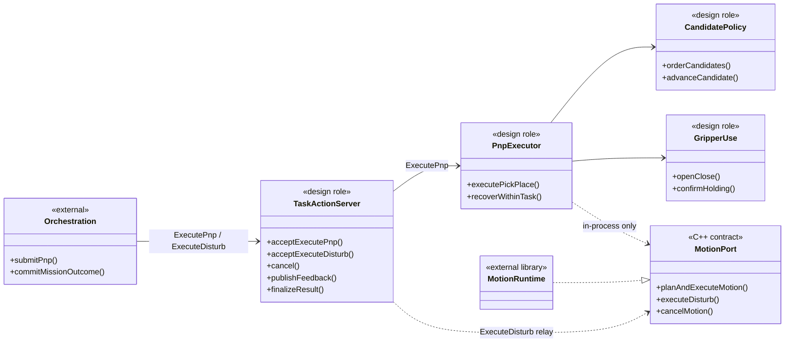

# [SF-Twin] ARM Cell Task Execution 컴포넌트 설계

- **Component ID:** `ARM Cell / Task Execution`
- **Owner:** `ARM Cell Task Execution`

## 목적과 책임

Task Execution은 PnP 요청 또는 별도 교란 요청을 내부 실행 역할에 연결해 작업 결과를 확정한다.
이 CDS는 PnP를 수행하는 내부 구조와 자원 조립을 정의한다.

PnP 내부 단계와 PICK/PLACE별 실행 전략 선택은 [PnP Execution FDS](fds-pnp-execution.md)가 소유한다. PICK과 PLACE는 독립적으로 `PLANNED` 또는 `WAYPOINT`를 선택하며 기본 전략은 둘 다 `PLANNED`다. 전략 선택·작업 sequence·작업 복구는 Task Execution BT에 남고, 개별 movement의 실행·완료·Safety 경계는 [Motion Execution FDS](../motion/fds-motion-execution.md)가 소유한다. 교란 후보 순서, 대표점과 Motion profile 기반 목표 생성 및 계획 실패 시 후보·방향 전환은 Task Execution BT가 소유한다. 각 구간의 물리 계획·Scene·실행과 측정 완료는 [Motion 교란 실행 FDS](../motion/fds-disturb-execution.md)가 소유한다. Task Execution은 ICD에 정의된 ExecuteDisturb 요청과 terminal lifecycle을 유지한다.
외부 Action과 in-process Motion 계약은 각각
[Orchestration–Task Execution ICD](../../interfaces/icd-orchestration-task-execution.md),
[Task Execution–Motion ICD](../../interfaces/icd-task-execution-motion.md)가 소유한다.

## 정적 구조와 의존성

Task Execution Action 경계는 ExecutePnp와 ExecuteDisturb를 수락한다. 기존 `/motion/execute_task`
compatibility Action은 legacy standalone movement와 E-Stop 이후 명시적 `RETURN_HELD`
operation도 제공한다. 이 operation은 Task Execution이 MotionPort와 GripperPort를 사용해
자재 반환과 릴리즈 확인을 완료한다. ExecutePnp는
`PnpExecutor`에 연결하고 ExecuteDisturb는 전체 후보와 identity를 기존 `MotionPort`에
전달해 결과를 terminal 응답으로 중계한다. 외부 Action과 in-process port의 공유 의미는
각 ICD를 따른다.

## 빌드·실행 구성

| 구성 요소 | 목표 구성 |
|---|---|
| Motion library | `arm_cell_motion`가 Task Execution/외부 PnP Action 의존 없이 `MotionPort` 구현, MotionCore movement lifecycle, MoveIt·Isaac backend 및 Safety/status runtime을 export |
| Task Execution library | 신규 `arm_cell_task_execution`가 BehaviorTree 기반 PnP·candidate·recovery sources와 Action server를 소유하고 Motion library를 단방향 링크 |
| 실행 파일·composition root | `task_execution_node`가 한 `rclcpp::Node`/context에서 ExecutePnp server와 Motion library runtime을 조립하고 동일 MotionPort·GripperPort instance를 주입; 내부 움직임은 C++로 호출 |
| Runtime resources | 조립된 하나의 Motion runtime이 MoveIt client, IsaacRosMotionTransport, Backend, GripperPort, joint/Holding observation 및 Motion state를 생성·소유 |
| Bringup | `arm_cell_operational.launch.py`는 별도 `motion_node` Action server 대신 `task_execution_node` 한 프로세스 실행; `orchestration_node`, Vision, Safety는 기존 역할·ROS 경계를 유지 |
| Build dependency | Bringup은 `arm_cell_task_execution` 및 Orchestration package를 의존; `arm_cell_task_execution/package.xml`은 `arm_cell_motion`를 의존하고 역방향 depend는 없음 |

Motion runtime은 기존 `/motion/state`, Safety StopMotion 서비스·Safety subscription 및
operator Gripper contract를 제공한다. `task_execution_node`는 이 runtime을 한 번만
조립하며 기존 `motion_node`를 병행 실행하지 않는다. Motion runtime 내부의 movement,
Safety 정지와 상태 관측 역할은 [Motion CDS](../motion/cds.md)에 둔다.

## 소유권과 상태

| 자원·상태 | 단일 owner | Task Execution의 사용 |
|---|---|---|
| ExecutePnp·ExecuteDisturb Goal identity 및 Action terminal | Task Execution | 명시적 거부·단일 terminal까지 각 외부 Goal lifecycle; 공유 수락·연결 손실 의미는 Orchestration–Task Execution ICD |
| ExecuteDisturb Motion relay 및 Cancel | Task Execution | 같은 Action UUID로 기존 MotionPort에 전달; Motion 결과·정지 근거는 Motion 소유 |
| PICK/PLACE 진행, candidate attempt, internal recovery | Task Execution | 동일 PnP 안에서만 유지 |
| PnP 배치 사실과 terminal outcome | Task Execution | `material_placed` 단조 확정 및 상위 `pnp_outcome` 매핑 |
| Motion 실행 lifecycle·MotionStatus·measured joint state·Planning Scene | Motion runtime | MotionPort result/state 관측 |
| Isaac Motion Transport 및 robot/gripper backend | 단일 runtime composition root가 생성, Motion runtime이 소유 | 동일 backend를 주입받아 소비 |
| GripperPort interface·장치 adapter | interface/API는 Motion library export, concrete Isaac adapter 및 instance는 Motion runtime | Task Execution이 command·Holding observation 의미를 실행 |
| Recipe snapshot·Mission 수량·Retry budget | Orchestration | PnP request input으로 읽기 전용 수신 |
| Safety authority·Stop mode | Safety | preemption signal/result만 소비 |

`TaskExecution` 상태와 Motion 상태를 양쪽에서 별도 생성해서는 안 된다. Task Execution은
공정 state/disposition을, Motion은 현재 움직임·로봇 상태를 각각 단일 소유한다.

## 정적 불변조건

- Task Execution package는 Motion library만 의존하고 Motion은 Task Execution을 의존하지 않는다.
- BT Action Node는 재사용 가능한 단계 계약을 제공하고, PICK·PLACE·교란은 이를 작업별 SubTree로 조합한다. SubTree가 후보·복구 분기를 소유하며 공통 Action Node는 후보 정책을 소유하지 않는다.
- 공통 Motion BT Action Node는 목표 입력, `planMotion`/`executePlannedMotion` 단계, 실행 시작 전 계획 실패 결과, 측정 완료 결과, Cancel/Safety terminal 결과를 공통 포트로 전달한다. 각 작업 SubTree는 필요한 단계 수와 입력을 정하고 실행 시작 후 후보 전환을 금지한다.
- Task Execution은 Vision candidate 전체와 Recipe snapshot을 변경 없이 받으며 그 한 요청 안에서 후보 정책을 실행한다.
- Task Execution BT는 Material Candidate 전환과 작업 Recovery를 소유하며 Motion 내부 Planning BT의 Pose·Seed 재시도나 구현 형태에 의존하지 않는다.
- Task Execution BT는 PICK과 PLACE 전략을 독립적으로 선택하고 각 작업 실행 중 전략을 고정한다. 작업별 sequence와 Recovery는 Task Execution 책임이며 Motion Planning BT로 이동하지 않는다.
- Motion은 Task Execution이 제출한 개별 movement의 실행·완료·Safety 결과를 소유하며 PnP 전략이나 전체 작업 sequence를 결정하지 않는다.
- Motion은 받은 단일 motion command의 움직임 결과만 반환한다. PnP 공정 결과·processed count·새 Acquisition을 결정하지 않는다.
- Motion runtime, Backend, Isaac transport, GripperPort 및 execution state는 한 process에서 단 한 번 생성한다.
- Confirmed release와 scene update 이후 `material_placed`는 terminal outcome·후속 retreat 오류와 무관하게 유지된다.

## Verification Requirements

### VR-TE-OWN-01 — 계층 의존 방향

Task Execution은 Motion C++ port를 사용할 수 있으나 Motion package/build가 Task Execution을 참조해서는 안 된다. 해당 계약 경로에는 ROS endpoint가 없어야 한다.

### VR-TE-OWN-02 — 단일 런타임 인스턴스

Bringup은 Task Execution Action server와 Motion runtime을 동일 ROS process에 조립하고 별도 `motion_node` 실행을 병행하지 않아야 한다. 정적 의존 방향은 Task Execution → Motion이어야 한다.
