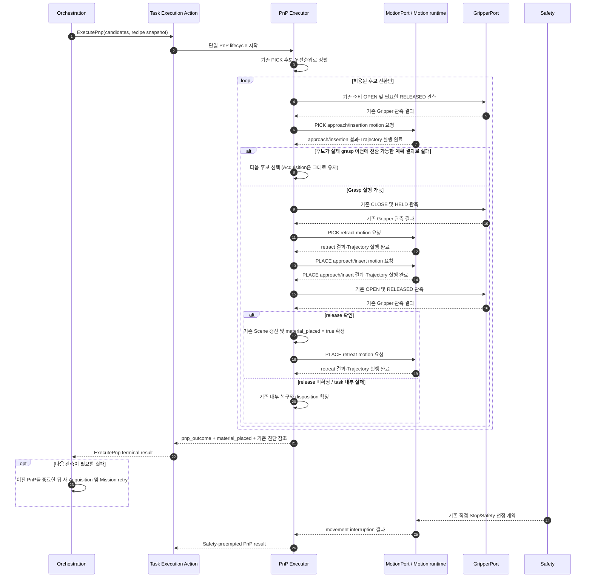
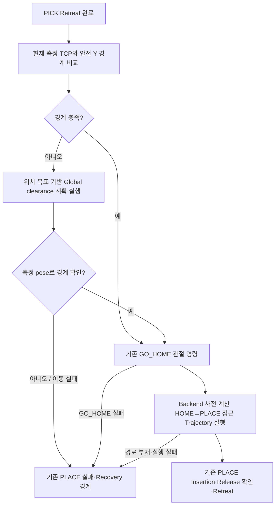

# [SF-Twin] ARM Cell 단일 PnP 작업 실행

- **Function ID:** `ARM-TE-PNP`
- **Owner:** `ARM Cell Task Execution`

## 목적과 동작 범위

- **목적:** 하나의 Acquisition 후보 집합과 Recipe snapshot으로 한 자재 PnP를 수행하고, 내부 PICK/PLACE·Gripper·복구 결과를 하나의 terminal result로 확정한다.
- **시작 경계:** Orchestration이 제출한 유효 `ExecutePnp` Goal을 Task Execution이 수락한 시점.
- **종료 경계:** 성공, task 내부 terminal failure, 명시적 Cancel 또는 기존 Safety preemption 결과 확정.
- **비책임:** 새 Vision Acquisition, Delivery/Mission 수량, 다음 Mission retry, IK·Planning·Trajectory 알고리즘.

## 참여 책임과 계약

| 참여 책임 | 역할 | 정식 계약·Owner |
|---|---|---|
| Orchestration | 단일 PnP 요청·Mission 재시도·수량 회계 | ExecutePnp Action ICD 및 Mission FDS |
| Task Execution Action lifecycle | Goal 수락·Cancel·Feedback·terminal result | Orchestration–Task Execution ICD |
| PnP Executor | PICK→PLACE·후보 선택·공정 내부 복구 | 본 FDS / Task Execution CDS |
| MotionPort | 단일 motion request 수행·움직임 결과 제공 | Task Execution–Motion ICD |
| Motion runtime | IK·계획·collision·trajectory·robot state·기존 Safety Stop | Motion FDS 및 Safety–Motion ICD |
| Vision | 사전 Acquisition 후보·관측 공유 의미 | Vision–Orchestration ICD |

## 핵심 시나리오



이 Action은 단일 공정 경계다. PICK과 PLACE는 독립적인 외부 요청이 아니며 Task Execution이
하나의 candidate list·Recipe snapshot·execution identity로 추적한다.

## PICK / PLACE 독립 전략

운영 profile은 PICK과 PLACE의 전략을 독립적으로 선택한다. 각 작업은 시작 시 전략을 고정하며
실행 도중 다른 전략으로 전환하지 않는다.

```yaml
motion:
  pick_strategy: PLANNED
  place_strategy: PLANNED
```

기본값은 두 작업 모두 `PLANNED`다. 현재 랜덤 낙하 공급 시연도 `PICK=PLANNED`를 사용한다.
기존 ExecutePnp의 Acquisition identity 및 candidate 입력 계약은 유지한다.

| 전략 | 책임 흐름 |
|---|---|
| PICK `PLANNED` | 기존 Vision 후보 기반 Grasp Pose 탐색, IK·충돌 검증·경로 계획 및 실행을 보존한다. |
| PICK `WAYPOINT` | profile에 정의된 공급 환경을 기준으로 결정론적 PICK 이동을 수행한다. Vision의 불규칙 공급 위치 탐색을 사용하지 않는다. 파지 확인과 Retreat 완료까지의 작업 경계는 `PLANNED`와 같다. |
| PLACE `PLANNED` | 기존 자재 목표 Pose, PICK Grasp Relation, 위치·방향 허용 오차 및 경로 계획을 사용하고 접근·삽입·Release 확인·Retreat와 단계별 Recovery를 보존한다. |
| PLACE `WAYPOINT` | PICK Retreat 완료 후 안전 Y 경계를 확인하고 필요하면 위치 목표 기반 clearance 이동을 수행한다. 필수 GO_HOME 뒤 고정 HOME→PLACE 접근 Trajectory를 재사용하고, 지정 배치 영역에서 정상 Release 확인을 우선한다. |

두 PICK 전략은 기존 PICK 삽입 거리 계산과 독립 설정된 Retreat 거리를 공통으로 사용한다. Retreat
거리는 삽입 거리와 다를 수 있으며 별도 연장 거리를 중복 적용하지 않는다. Retreat 완료 뒤에만
PLACE로 전환하고, PICK 완료 자체에는 GO_HOME을 요구하지 않는다.

PLACE WAYPOINT의 안전 경계는 `base_link`에서 측정한 TCP의 절대 Y 위치로 판단한다. 현재 pose가
경계를 이미 충족하면 clearance 이동을 생략한다. 안전 영역 진입은 전체 경로의 무충돌을
뜻하지 않는다.

PLACE `PLANNED`는 기존 자재 목표 Pose와 PICK에서 확정한 `object_to_grasp_tcp` Grasp Relation을
사용해 최종 목표를 정하고 기존 위치·방향 허용 오차와 경로 계획을 적용한다. `WAYPOINT`는 적용된
운영 profile 및 HOME 상태에 대응하는 Backend 사전 계산 HOME→PLACE 접근 Trajectory를 재사용한다.
PICK별 Grasp Relation을 이유로 이 경로를 매번 재계산하거나 최종 TCP 목표를 다시 결정하지 않는다.
현재 시연은 정밀한 자재 위치·방향 일치를 요구하지 않으며 지정 배치 영역 안에서 기존 정상 Release
확인을 우선한다. 사전 계산 경로와 배치 영역의 관계는 운영 환경에서 검증한다. 기존 Release 확인과
Object Disposition 계약은 유지한다. 경로의 계산·검증과 실행 책임은 Motion FDS를 따른다.



PLACE clearance 이동 실패 또는 clearance 후 경계 미충족 시 GO_HOME과 접근 경로를 진행하지 않는다.
GO_HOME 실패, 사전 계산 경로 부재·실패는 기존 PLACE 실패·Recovery 경계로 전달하며 임의 관절 이동이나
다른 전략으로 전환하지 않는다. Insertion·Release·Retreat의 기존 단계별 Recovery, Cancel/Safety
우선순위 및 Object Disposition을 유지한다. 이동 실패만으로 관측된 `HELD`
상태를 `RELEASED`나 `UNKNOWN`으로 바꾸지 않는다. PnP 전체 성공 뒤 terminal 전에 수행하는 기존
마지막 GO_HOME은 그대로 유지한다. 이는 PICK 완료 조건이 아니며 PLACE WAYPOINT의 필수 GO_HOME과
별개의 기존 PnP 종료 단계다.

전략 분기와 작업 순서·복구는 Task Execution BT가 소유한다. Orchestration은 Mission 순서·재시도·
Safety Recovery를 유지하고 Motion은 개별 movement의 기존 실행·완료 및 Safety lifecycle을 소유한다.

## PICK / PLACE 및 내부 복구 책임

| 상황 | Task Execution 판단·행동 | Motion 위임 | 외부 결과 경계 |
|---|---|---|---|
| 후보 우선순위 | `base_link`에서 Tray +Y 방향인 Y 좌표 내림차순, 동률이면 관측 상판 Z 내림차순, 다시 동률이면 Candidate ID 오름차순; Vision enumeration은 priority가 아님 | 선택 후보의 단일 motion 요청 | 시도·선택 candidate를 기존 결과 필드로 보고 |
| 후보 계획 실패 | 기존 전환 eligibility, 시도 budget 및 실패 단계 유지; trajectory 실행 실패나 grasp insertion 뒤에는 후보를 바꾸지 않음 | Motion이 계획/실행 사실 반환 | 허용된 후보 소진은 기존 candidate exhausted result |
| PICK 동작 | 접근, grasp insertion, Gripper close/holding observation, retract, 기존 OPEN 복구 | 모든 팔 이동과 작업별 실행 완료 | grasp/disposition 상태는 task executor가 확정 |
| PLACE 정상 | 접근·삽입, 기존 release 명령/holding observation, release 확인 후 `PLACED`, retreat | 개별 PLACE/retreat 경로와 실행 결과 | retreat 실패도 `object_disposition=PLACED`; 결과 코드는 retreat failure 원인을 보존 |
| PLACE 접근/삽입 실패 | 현행 held-object 반환·release 복구만 수행 | HOME/Tray/retreat 움직임을 각각 요청 | 확인된 `RETURNED`, `HELD` 또는 `UNKNOWN`을 결과화 |
| Gripper command와 Holding | 기존 GripperPort·Motion Backend의 공유 계약을 유지 | 같은 GripperPort instance를 통해 기존 동작 수행 | 지연 시 필요한 관측 대기, 실제 UNKNOWN 구분, 실제 파지 실패 시 기존 OPEN 복구, 중복 OPEN/Holding 검증 제거, 새 timeout/completion gate 없음 |

위 표는 기존 공정 의미를 유지하면서 각 책임 Owner를 명시한다. PICK/PLACE 실패 분류,
후보 priority·전환, Planning budget·collision policy, geometry 변환, PLACE 회계와 복구 동작은
기존 계약을 따른다. 실제 movement의 IK·Planning Scene·trajectory 완료 계약은
[Motion Execution FDS](../motion/fds-motion-execution.md)가 소유한다.

PICK/PLACE의 다음 phase는 Motion이 반환한 Trajectory 실행 완료를 소비한다. Task Execution은
관절 안정화·최종 목표 정확도·Arrival 또는 Next Command Readiness를 중복 Gate로 확인하지 않는다.
Trajectory 완료는 Gripper `HELD/RELEASED`, Isaac 객체 부착·분리 및 PICK/PLACE 공정 성공을 대신하지 않는다.
이 조건과 단계별 실패 분류·Holding·반환·Recovery는 기존대로 유지한다. 이미 `HELD`와 객체 부착이
확인됐다면 Retract의 잔여 진동·정확도 편차·안정화 미충족으로 파지 성공 사실을 PICK 실패로
재분류하지 않는다. 실제 후속 movement 오류·중단은 해당 단계의 원인으로 보존하며 공정 전체 성공을
자동 확정하지 않는다. 마지막 GO_HOME의 기존 목표 도달 판정도 유지한다.

## Recipe 해석·후보 실행과 Gripper 경계

Orchestration은 대상별 Recipe snapshot과 전체 Vision 후보를 바꾸지 않고 전달한다. Task Execution은
후보 우선순위·candidate transition과 PnP 의미를 소유한다. 후보는 기존 `target_pose`의 `base_link` Y 내림차순으로 평가한다. 설치 좌표계/TF에서 Tray +Y는 로봇 쪽을 향하므로 Y가 큰 후보가 Tray 안쪽에 있고 먼저 선택된다. 이는 로봇까지의 3차원 거리가 아니라 Tray Y 순서다. Y가 같으면 관측 상판 높이 `target_pose.position.z` 내림차순, Y와 Z가 같으면 Candidate ID 오름차순으로 결정한다. 객체 두께나 눕힌 면은 순위 계산에서 별도로 보정하지 않으며, 적층 층수·높이 동등 그룹은 계산하지 않는다. Vision 열거 순서를
우선순위로 쓰지 않으며, 기존 탐색 예산과 전환 적격 조건을 유지한다. 실제 trajectory 실행 실패는
후보 전환 성공으로 바꾸지 않는다.

정상적인 후보별 탐색 실패에서는 Task Execution이 다음 적격 Material Candidate를 검토한다. 후보 전환은 후보별 탐색 예산만 초기화하며 PICK 공통 예산은 유지한다. 예산의 수치·호출 적용 규칙은 [PICK Candidate Algorithm](../../algorithms/motion-pick-candidate-search.md)이 소유한다.

Task Execution은 Recipe의 contact width, yaw fallback 허용 여부, grasp frame·방향·approach 요구,
PLACE target/orientation/tolerance 및 object-frame 공정 제약을 해석해 단일 movement 요청을 만든다.
Vision은 관측 pose·geometry와 방향 class를 제공하고 이를 재계산하지 않는다. Task Execution은 선택 Candidate와 같은 Acquisition의 전체 Candidate Geometry를 Motion에 전달한다. Motion은
기존 object-to-TCP 변환, IK, collision, trajectory 및 작업별 실행 완료 판정을 수행한다. PICK 후보 탐색과
PLACE pose search의 구체 알고리즘·기존 budget·순서는 각각 [PICK Candidate Algorithm](../../algorithms/motion-pick-candidate-search.md),
[PLACE Pose Search Algorithm](../../algorithms/motion-place-pose-search.md), [Motion Execution FDS](../motion/fds-motion-execution.md)가
소유한다. Orchestration은 이 계약을 재정의하지 않는다.

Vision symmetry order `1`, `2`, `4`의 관측 방향 class는 후보 evidence와 함께 그대로 유지한다. Order `0`에서 Vision quaternion을 관측 방향으로 사용하지 않는다. Recipe가 unobserved yaw fallback을 허용할 때만 명시된 fallback을 task-local 후보 해석으로 사용하고, 금지·누락·무효면 해당 후보를 실행에 제출하지 않고 기존 PnP 실패 분류로 결과화한다. 부분 Rectangle의 추정 치수와 object 자체 두께는 provenance와 값을 보존하며 적층 높이로 대체하지 않는다. Task Execution은 선택 Candidate와 동일 Acquisition의 전체 Candidate Geometry를 Motion에 넘기고 후보 ID·순위·전환 이력을 보존한다. 후보별 규칙·기존 결과 매핑은 Task Execution 소유이며 Orchestration은 이를 mission retry predicate로 다시 구현하지 않는다.

Gripper command·Holding 관측·복구는 기존 계약을 유지한다. 통신 지연/STALE은 동일 단계에서
기다리고 필요한 상태가 도착하면 기존 흐름을 계속한다. 정상 통신에서 관측된 실제 `UNKNOWN`은
지연과 구별해 기존 task-local 복구로 처리한다. 실제 파지 실패는 기존 OPEN 복구를 사용한다.
이미 완료한 OPEN을 중복 실행하거나 동일 Holding 사실을 중복 검증하지 않으며, 신규 Gripper timeout,
명령 완료 확인 또는 추가 승인 Gate를 만들지 않는다. 세부 Motion 실행·Holding 관측 계약은
[Motion Execution FDS](../motion/fds-motion-execution.md)와 [Motion Backend ICD](../../interfaces/icd-motion-backend.md)를 따른다.

### 내부 PICK/PLACE 복구 의미

Task Execution은 기존 내부 복구를 하나의 PnP lifecycle 안에서만 수행한다. 아래 결정은 Task Execution이
MotionPort 결과와 GripperPort 관측을 바탕으로 내리며, Orchestration에 원인별 절차를 노출하지 않는다.

| 내부 상황 | Task Execution 절차 | Motion 경계 | 최종 배치 사실 |
|---|---|---|---|
| Grasp 전 허용된 후보 계획 실패 | 기존 후보·단계별 탐색 예산과 전환 적격성을 유지한다. 실제 trajectory 실행, 삽입 이후 실패, Backend·Scene·Safety·Cancel·Gripper 오류를 후보 전환으로 감추지 않는다. | 후보별 IK·Planning·충돌·trajectory 결과를 소비한다. | 배치하지 않은 상태 |
| PLACE `PLANNED` 전체 Approach planning 실패 | PICK Retreat 위치에서 기존 반환 절차를 수행한다. HOME/Tray 경유 전 불필요한 궤적을 제출하지 않고, 기존 OPEN 및 fresh `RELEASED` 확인 후 `RETURNED` 또는 기존 실패 결과를 확정한다. | 각 요청 이동과 작업별 실행 완료를 위임한다. | `material_placed=false` |
| PLACE `WAYPOINT` clearance 이동 실패 | PLACE 목표를 제출하지 않고 기존 PLACE 실패·Recovery 경계로 전달한다. | 개별 movement 결과를 제공한다. | 실제 Holding/disposition 관측을 유지 |
| PLACE 삽입 실패, 자재가 확인된 `HELD` | 기존 유한 pose/path 탐색을 먼저 수행하고 소진 시 기존 HOME→Tray→OPEN→새 Holding 관측 순서로 반환한다. 확인된 `RELEASED`만 `RETURNED`로 확정하며 새 `UNKNOWN`에는 OPEN을 반복하지 않는다. | 현재 측정 상태 기준 이동과 경로 실현을 위임한다. | `material_placed=false` |
| PLACE Retreat 실패, release와 scene update 완료 | 기존 측정 상태 기반 후퇴 복구를 수행할 수 있다. 복구 소진 시 실패 원인을 남기되 `PLACED` 사실을 반환하며 자재 반환·OPEN·재배치를 시작하지 않는다. | 후퇴/복구 movement 결과를 소비한다. | `material_placed=true`를 유지 |

Task Execution의 단일 외부 결과 매핑은 내부 복구가 끝난 뒤 수행한다. Action Cancel과 Safety 선점의 기존
우선순위는 이 표보다 우선하며, 그 전에 확정된 `material_placed`는 되돌리지 않는다. 세부 실패 원인·단계·
Disposition은 기존 Result와 진단에 보존할 수 있지만 Orchestration retry predicate가 아니다.

## 취소·Safety 선점

Task Execution은 Action Cancel을 받아 현재 task lifecycle을 취소하고 MotionPort의
활성 움직임에 같은 execution identity의 취소를 전달한다. Cancel은 새로운 복구 명령을
자동 승인하지 않는다. Task Execution은 이미 관찰한 물질 disposition을 보존해 terminal
result를 확정한다.

Safety 권한·원인·severity 및 직접 Stop 요청은 기존 Safety→Motion 경계를 유지한다.
Task Execution은 StopMotion을 발행하지 않으며 Safety permission을 재판정하지 않는다.
Motion은 기존 Backend stop/hold/cancel 실행과 물리적 inactivity 근거를 유지하고,
선점 결과를 MotionPort로 Task Execution에 돌려준다. Task Execution은 실행 완료와
선점이 경합할 때 기존 Safety 우선순위 및 `PLACED` 같은 이미 확정된 disposition을
보존한다. 기존 Safety 허가 이후 Orchestration이 요청하는 standalone controlled
RETRACT는 migration compatibility Action adapter를 통해 요청할 수 있다. 이것은 PnP
Action의 내부 복구나 Safety direct-stop 경로를 대체하지 않는다.

## 내부 복구와 상위 재시도 경계

Task Execution은 후보 전환과 PICK/PLACE 단계별 HOME·Tray·Retreat 복구를 현재 PnP Goal 안에서
완료하거나 terminal 결과로 확정한다. PICK·PLACE 성공 뒤 정상 마지막 GO_HOME은 PnP lifecycle에
포함되며 그 완료 전에 `COMPLETED` terminal을 반환하지 않는다. 내부 HOME/Tray 복구는 공정 복구
경로이며 Orchestration의 초기·Retry·Recovery GO_HOME과 구별된다. Task Execution은 Vision Acquisition,
Mission retry counter, Delivery 수량 또는 Mission 종료를 소유하지 않는다.

Task Execution은 내부 실패와 복구를 마친 뒤 다음 상위 결과를 매핑한다.

| PnP outcome | Task Execution 의미 | Orchestration의 소비 |
|---|---|---|
| `COMPLETED` | PnP 공정 완료 | `material_placed`를 회계 반영하고 Mission 순서 진행 |
| `CANDIDATES_EXHAUSTED` | 삽입 전 후보 탐색 소진 및 배치되지 않은 상태가 확정됨; `material_placed=false` | [Mission Cycle FDS](../orchestration/fds-mission-cycle.md)의 복구 정책 적용 |
| `RETRYABLE` | 내부 복구 후 새 관측이 필요한 기존 재시도 가능 작업 결과 | Mission이 예산·Safety·Cancel 정책에 따라 새 Acquisition 재시도를 승인하거나 종료 |
| `FAILED` | 재관측 재시도로 복구할 수 없는 task/backend/계약 실패. 배치 뒤 Retreat 실패는 `material_placed=true`를 유지 | 기존 Mission 실패·Controlled Recovery 정책 적용 |
| `SAFETY_PREEMPTED` | 기존 Safety 우선순위로 움직임이 선점됨. 선점 전에 배치 사실이 확정됐으면 `material_placed=true` 유지 | 기존 Safety recovery 정책 적용; 중단 Task replay 금지 |

Backend·Safety·Cancel 및 실행 이후 실패를 `CANDIDATES_EXHAUSTED`로 재분류하지 않는다.

이 매핑은 기존 재시도 가능한 작업 결과의 외부 분류만 Task Execution으로 옮긴다. 실제 Gripper
실패·UNKNOWN·반환·후보 소진 등의 세부 원인은 Task Execution 진단에 남고 Orchestration이
판정하지 않는다. 기존 정책에서 retryable인 Gripper 실패가 세부 Holding 값만으로 Mission 종료로
승격되어서는 안 된다. `BACKEND_UNAVAILABLE`, 실행 오류, 명시적 Cancel, Safety 선점 등 기존
재시도 제외 동작은 보존한다. Orchestration의 Vision Retry 횟수와 작업 재시도 정책은
[Mission Cycle FDS](../orchestration/fds-mission-cycle.md)가 단독 소유한다.

`material_placed`는 confirmed release와 scene update 후 monotonic하게 확정한다. PLACE Retreat가
실패하거나 그 뒤 Cancel/Safety 선점이 발생해도 true를 되돌리지 않는다. Task Execution은 terminal
Result에 이 사실을 정확히 한 번 포함한다. Mission은 내부 상태 조회 없이 이를 Goal identity당
한 번 반영한다.

## 결과·오류·관측

| terminal 상태 | 감지 책임 | 최종 결과 책임 | 결과 의미 |
|---|---|---|---|
| PnP 완료 | Task Execution 및 MotionPort | Task Execution | `COMPLETED`와 `material_placed=true` |
| 내부 복구 후 새 관측 필요 | Task Execution | Task Execution | `RETRYABLE`; Mission 새 Acquisition 여부는 Orchestration이 결정 |
| Backend/계획 실행 장애 | Motion | Task Execution이 전체 PnP result로 전달 | 기존 backend/planning code 보존, candidate 전환으로 숨기지 않음 |
| Cancel | Task Execution Action / Motion active operation | Task Execution | `CANCELED` 및 관찰된 disposition |
| Safety preemption | Safety 직접 정지, Motion 감지·집행 | Task Execution | `SAFETY_PREEMPTED`, Safety authority 및 motion stop evidence 보존 |
| release 뒤 retreat 실패 | Motion | Task Execution | 실패 내부 원인과 `material_placed=true` 동시 보존; 상위 outcome은 Task Execution 확정 |

## 외부 Action 계약 결정

Goal은 Acquisition identity, 전체 후보·evidence와 immutable Recipe snapshot을 포함한다. Feedback은
진행·진단 관측이며 Task Execution 내부 phase를 Mission 정책에 노출하지 않는다. 기존 진행 힌트
필드는 호환을 위해 남길 수 있지만 Orchestration은 실행에 사용하지 않는다. 정상 경로는
PICK → PLACE → GO_HOME 순서로 끝나며, terminal `COMPLETED`는 마지막 GO_HOME 성공 뒤에만 반환한다.
마지막 GO_HOME 실패는 실패 terminal로 보고하고 이미 확정된 `material_placed=true`와 `PLACED`
disposition을 보존한다. Terminal 결과는 ICD가 정의한 `pnp_outcome`과 단조 `material_placed`를
상위 계약으로 사용한다. 기존 `MotionTaskResultCode`,
`object_disposition`, candidate provenance와 진단은 migration 호환·내부 원인 추적을 위해 보존할 수
있지만 Orchestration은 이를 분기 입력으로 사용하지 않는다.

개별 PICK/PLACE public Action은 정상 Mission 경로에서 단일 PnP Action으로 전환한다. PnP 내부
HOME/Tray 복구는 Task Execution이 MotionPort로 수행한다. Mission-level 초기 GO_HOME, 승인된
Retry/Recovery GO_HOME 및 Safety 승인 standalone RETRACT는 호환 adapter의 명시적인 movement 요청이며
내부 PnP 복구와 구별한다. 정상 PnP 마지막 GO_HOME은 ExecutePnp 내부에서 수행하므로 Mission-level
종료 GO_HOME은 중복 요청하지 않는다. Motion은 public PnP/공정 Action server를 제공하지 않는다.

E-Stop Reset으로 정상 Safety 권한이 복원된 뒤에도 MotionStatus의 fresh Holding이 `HELD`이면
Orchestration은 `RETURN_HELD` standalone task를 한 번 요청하며, Task Execution은 재사용 가능한
`ReturnHeldToTray` BT Action Node를 실행한다. Node는 진입 시 fresh `HELD`를 확인하고, 현재 정지
관절 상태에서 설정된 Tray 반환 관절 목표로 직접 이동·OPEN·3초 interruptible wait·새
`RELEASED` 관측 확인을 한 반환 동작으로 수행한다. 대기 중 취소나 Safety 선점이 발생하면 확인
단계로 진행하지 않는다. 초기 Holding이 fresh `HELD`가 아니면 이동하지 않으며, 이동·OPEN·대기·확인
실패나 Safety 선점 시 자동 재시도하지 않는다. PLACE 삽입 실패 복구도 HOME 이동 뒤 같은 Node를
조합하며, 반환 성공 시 원래 PLACE 실패 결과를 보존한다. 확인된 E-Stop 반환은 GO_HOME 결과와
독립적으로 `RETURNED`로 보존한다. Orchestration은 이 task 뒤 fresh `RELEASED`와 정지·비활성 상태를
확인하고 GO_HOME 후 batch를 잇는다.

## Verification Requirements

### VR-TE-PNP-01 — 단일 Action과 공정 내부성

하나의 PnP Goal은 내부 PICK, PLACE, 성공 PLACE 뒤 마지막 GO_HOME을 수행하되 Orchestration에서 독립 PICK/PLACE Action을 호출하지 않는다. 각 terminal execution은 하나의 PnP result만 반환한다. `COMPLETED`는 마지막 GO_HOME 성공 뒤에만 반환하고, GO_HOME 실패는 `FAILED` 또는 `SAFETY_PREEMPTED` terminal로 보고한다. 이때 이미 확정된 `material_placed=true`와 `PLACED` disposition을 보존한다.

### VR-TE-PNP-03 — Motion 실패와 후보 전환 구분

기존 허용 후보 전환 조건은 유지하고 실제 trajectory execution·Backend failure는 후보 전환 성공으로 변환하지 않는다.

### VR-TE-PNP-04 — 배치 사실 보존

Confirmed release와 scene update 후 Task Execution은 `material_placed=true`를 확정하고 후속 Retreat 실패·Cancel·Safety 선점에서도 되돌리지 않아야 한다(SHALL). Mission의 회계 반영 횟수는 ICD 및 Mission FDS가 소유한다.

### VR-TE-PNP-05 — 기존 Cancel·Safety 경계

Action Cancel은 활성 MotionPort 실행에 전파되어야 한다. Safety direct stop은 Motion backend로 유지되고 Task Execution은 Safety authority나 stop mode를 발행·재판정하지 않는다.

### VR-TE-PNP-06 — Gripper command 및 Holding 계약 보존

기존 PnP 동작은 Gripper command, Holding observation 및 복구 의미를 보존해야 한다(SHALL). 통신 지연 대기, 실제 UNKNOWN 복구, 실제 파지 실패의 기존 OPEN 복구, 중복 OPEN/Holding 검증 제거와 새 Timeout/completion gate 금지는 이 FDS 및 [Motion Backend ICD](../../interfaces/icd-motion-backend.md)의 정식 계약을 따른다.

### VR-TE-PNP-07 — 내부 복구 후 상위 결과 매핑

Task Execution은 위 내부 PICK/PLACE 복구를 같은 PnP Goal 안에서 완료한 다음 상위 `pnp_outcome`을 한 번 확정해야 한다(SHALL). 후보 전환, Gripper/holding 복구, 자재 반환, HOME/Tray 경유와 retreat 복구를 Orchestration이 지시하거나 세부 결과를 재검증하지 않아야 한다(SHALL NOT). 재관측이 필요한 기존 재시도 가능 작업 결과는 `RETRYABLE`로 매핑하고, Motion/Backend 실행 실패를 후보 전환으로 숨기지 않아야 한다(SHALL). 검증 근거는 PnP Goal identity, MotionPort 요청·결과, Gripper 관측·명령, 내부 recovery trace, 단일 terminal outcome 및 `material_placed`다.

### VR-TE-PNP-08 — Trajectory 결과 소비와 파지 사실 보존

PICK/PLACE Trajectory 완료 이후 Task Execution은 별도 안정화·정확도·Readiness 승인을 기다리지
않아야 한다(SHALL NOT). 확인된 `HELD`·부착 사실을 Retract 안정화 미충족으로 파지 실패로
재분류해서는 안 된다(SHALL NOT). 실제 후속 실행 오류, 기존 Holding·반환·Recovery,
Gripper/부착·분리 및 마지막 GO_HOME 조건은 보존해야 한다(SHALL).

### VR-TE-PNP-09 — 독립 전략과 PICK 경계

운영 profile은 PICK/PLACE 전략을 독립 선택하고, 명시되지 않은 기본값은 각각 `PLANNED`로
해석해야 한다(SHALL). 한 작업 중 전략을 바꾸지 않는다(SHALL NOT). 두 PICK 전략 모두 기존
삽입 거리 계산과 독립 설정된 공통 Retreat 거리를 사용해 Retreat 완료까지 수행하고, PICK만의
완료 조건으로 GO_HOME을 실행하지 않는다(SHALL NOT). Retreat 완료 전에는 PLACE로 전환하지 않는다.

### VR-TE-PNP-10 — PLACE WAYPOINT 경계와 목표 관계

PLACE `WAYPOINT`는 PICK Retreat 뒤 현재 TCP의 안전 Y 경계를 확인하고 필요하면 경계 바깥을 향한
위치 목표 기반 clearance 이동과 기존 GO_HOME 관절 명령을 순서대로 수행해야 한다(SHALL). HOME 도달 뒤에는 적용된 운영
profile·HOME 상태에 대응하는 Backend 사전 계산 접근 경로를 재사용해야 한다(SHALL). PICK별 Grasp
Relation 때문에 경로나 최종 TCP 목표를 다시 계산하지 않으며, 현재 시연에서는 지정 배치 영역에서의
기존 정상 Release 확인을 우선하고 경로와 배치 영역의 관계를 운영 환경에서 검증한다.
접근 경로 완료 뒤 기존 PLACE Insertion·Release 확인·Retreat를 수행한다. 이미 안전 경계를 충족하면
clearance 이동을 생략하지만 GO_HOME은 생략하지 않는다. PICK 완료 자체는 GO_HOME을 요구하지 않는다.

### VR-TE-PNP-11 — WAYPOINT 실패와 기존 disposition

clearance 실패·경계 미충족, GO_HOME 실패, 사전 계산 결과 부재·실패 시 후속 PLACE 단계를 실행하지
않고 기존 PLACE 실패·Recovery 경계로 전파한다. 임의 관절 이동이나 전략 fallback, 새 무제한 재시도,
임의 대기 또는 Safety 판정 계층을 만들지 않는다. 계획·이동 실패만으로 관측된 자재 `HELD` 상태를
`RELEASED`나 `UNKNOWN`으로 바꾸지 않으며 기존 Cancel/Safety 우선순위와 배치 확정 사실을 보존한다.

## 참조

- [Task Execution CDS](cds.md)
- [Mission Cycle FDS](../orchestration/fds-mission-cycle.md)
- [Motion Execution FDS](../motion/fds-motion-execution.md) — Planning·Trajectory 실행 동적 계약
- [Motion Stop and Recovery FDS](../motion/fds-stop-recovery.md)
- [Orchestration–Task Execution ICD](../../interfaces/icd-orchestration-task-execution.md)
- [Task Execution–Motion ICD](../../interfaces/icd-task-execution-motion.md)
- [Vision–Orchestration ICD](../../interfaces/icd-vision-orchestration.md)
- [Safety–Motion ICD](../../interfaces/icd-safety-motion.md)
