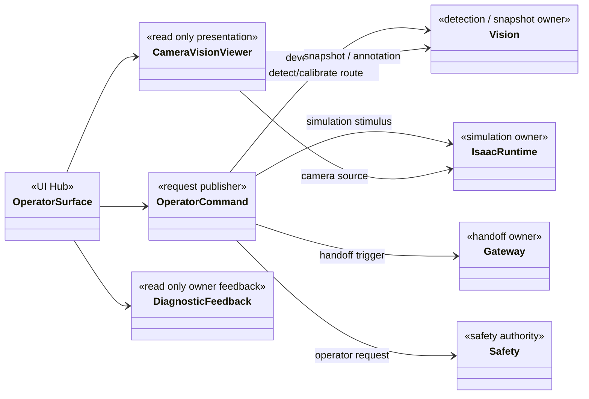

# [SF-Twin] ARM Cell Operator UI Hub 컴포넌트 설계 (CDS)

- **범위:** ARM Cell / Operator UI Hub
- **Owner:** ARM Cell Operator UI Hub

## 1. 목적

UI Hub는 Final Demo에서 운영자의 **입력 및 관측 화면**을 제공한다. 현재 실현 형태는 Isaac Sim/Kit Extension이지만 논리적 UI 책임은 특정 화면 Toolkit에 종속되지 않는다. Hub는 요청을 발행하고 정식 Owner가 보고한 결과를 표현한다. Hub 자체에서 Material Delivery·Readiness·Mission Admission·Safety·Vision·Motion의 결과를 확정하지 않는다.

## 2. 정적 구성

다이어그램은 역할과 의존성을 나타내며 구현 클래스·메서드나 Hub 내부의 별도 프로세스 분할을 지시하지 않는다.

## 3. Authority와 소비 경계

| 역할 | Hub의 책임 | 공식 결과 Owner |
|---|---|---|
| External Handoff Trigger | 타입·수량을 입력받아 공용 Trigger 발행, 로컬 발행 결과 표시 | Gateway 수락·공급 완료, Orchestration Mission Admission |
| Live Camera / Vision Viewer | 원본 영상 및 Snapshot·선택 Target Annotation 읽기 전용 표시 | Camera Publisher·Vision·공유 ICD |
| Simulation Control | Timeline 및 Demonstration Stimulus 요청·표시 | Isaac Simulation Runtime·Supply Adapter |
| Retry Detection / Calibration | 개발 전용/명시적 보정 요청, 응답 표시 | Vision·Orchestration 관련 기능 FDS |
| Fault·Safety 조작 | 승인된 Fault Stimulus 및 Safety Operator 요청 전달 | Fault Injection·Safety Owner |
| Lifecycle Feedback | 요청과 관련된 필요한 Owner 관측만 표시 | 각 상태·결과 Producer |

Hub의 로컬 **발행 성공**은 Gateway의 Trigger **수락**이나 Material Readiness **확정**이 아니다. Safety Reset 요청, Calibration 요청, Vision Retry 요청도 실제 상태 전이를 승인하지 않는다.

## 4. 비책임과 설계 참조

Hub는 임의의 RGB-D Pairing, Detector 실행, Snapshot 생성·그리기, Mission·VDA 상태 재분류, Safety Latch 직접 변경, Motion Goal 생성이나 자동 Retry 정책을 소유하지 않는다. 통합 운영 상태 Dashboard를 필수 기능으로 추가하지 않는다.

관측의 수신·표시 시점 및 사용자의 상호작용은 [Camera·Vision Viewer FDS](fds-camera-vision-viewer.md) 및 [운영 명령 FDS](fds.md)가 소유한다. Snapshot Metadata·Source Identity 등 여러 소비자가 공유하는 의미는 [Vision–Orchestration ICD](../../interfaces/icd-vision-orchestration.md), Trigger 필드·수락 의미는 [External Handoff ICD](../../interfaces/icd-external-handoff-trigger.md), Safety 요청 의미는 [Safety Operator ICD](../../interfaces/icd-safety-operator.md)가 소유한다.

## 5. Verification Requirements

정적 Owner 경계의 검증은 기존 `VR-INT-UI-01~03`을 [운영 명령 FDS](fds.md)에서, 영상·Viewer 관측은 `VR-INT-UI-04~05`를 [Camera·Vision Viewer FDS](fds-camera-vision-viewer.md)에서 유지한다. 이 CDS는 중복 VR을 생성하지 않는다.
