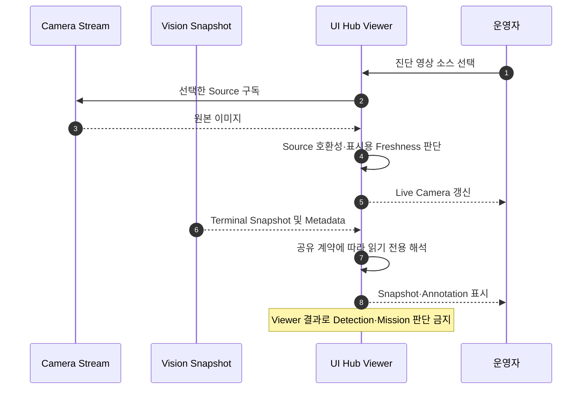

# [SF-Twin] ARM Cell Camera·Vision Viewer 기능 설계 (FDS)

- **범위:** Operator Live Camera, Vision Snapshot, 선택 Target Annotation
- **Owner:** Operator UI Hub
- **정적 책임:** [UI Hub CDS](cds.md)
- **공유 계약:** [Vision–Orchestration ICD](../../interfaces/icd-vision-orchestration.md), [RGB-D ICD](../../interfaces/icd-sim-rgbd.md)

## 목적과 경계

Hub는 영상과 Vision이 생성한 진단 결과를 읽기 전용으로 표시한다. Live Camera 프레임 선택·표시, Snapshot 수신 후 화면 갱신, 호환되지 않는 Annotation 숨김 등 **표시 시점**은 이 FDS가 소유한다. Snapshot Source Identity·Metadata/Diagnostic Record의 공유 의미는 ICD가, Snapshot 생성·렌더링·발행 시점은 [Vision Diagnostic Snapshot FDS](../vision/fds-diagnostic-snapshot.md)가 소유한다. Hub는 Detector를 재실행하거나 RGB-D를 재연관해 Snapshot을 구성하지 않는다.

## 1. 운영자 Camera 영상과 Vision Annotation

선택적 Live Camera는 초기 상태에서 진단 영상을 끈다. 운영자는 ExecuteCycle 중에도 Raw RGB(`/camera/color/image_raw`), Raw Depth(`/camera/aligned_depth_to_color/image_raw`), Tray Depth(`/vision/tray_aligned_depth/image_raw`)를 명시적으로 선택할 수 있다. Hub는 선택한 Source만 구독·변환하며 Off를 선택하면 이미지 구독과 Buffer Frame을 해제한다. 이 표시 경로는 Vision RGB-D 처리와 독립적이다. Vision Detector Snapshot이 있다면 Vision Detector View가 주된 관측 화면이고 Live Source를 사용하지 않는다. Hub는 Isaac 내부 Image Source를 직접 읽지 않으며 실제 산업용 Camera에도 동일한 Topic 경계를 적용한다.

Aligned Depth는 기존 Metric `32FC1` 이미지 계약을 사용한다. Hub는 선택된 Depth를 고정 0.6–1.6m 범위와 일정한 청록→노랑 Colormap의 RGBA Heatmap으로 표시한다. 이 범위는 대표 작업 거리 0.80·1.10·1.40m를 구별하기 위한 것이다. 범위 밖 유효값은 가장 가까운 끝 색상으로 Saturate하고 비유한·0 이하 Pixel은 별도 무효색으로 표현한다. 이는 화면 표시만을 위한 변환이며 Sensor 값이나 Vision 입력을 변경해서는 안 된다. Live Depth는 최신 Frame을 독립 소비하며 RGB-D Pair를 기다리지 않는다. Depth 누락·Stale·미지원은 해당 Live Source만 Unavailable로 표시하고 RGB View·Vision 진단·Detection 결과를 막지 않는다.

Hub는 Vision이 제공한 Diagnostic Metadata만으로 Annotation을 표시한다. Detection/Idle 상태, `target_id`, Source Stamp·Camera `frame_id`, Support/Reference 영역, Validity/Freshness/Result의 Authority는 Vision에 있다. Detector 및 정규 결과에 실제 존재하는 정보만 표시한다. Hub가 RGB를 분석하거나 Detection을 추론하거나 Annotation을 생성해서는 안 된다. Bounding Box·Polygon·Mask는 Detector가 해당 표현을 제공할 때만 표시할 수 있다.

Vision Snapshot Metadata는 표시 RGB의 원래 `header.stamp`와 `frame_id`를 보존 또는 참조하며 처리 Depth Header를 독립적으로 유지한다. 두 Timestamp 차이는 Snapshot RGB 선택 Gate가 아니다. Live RGB Frame도 자신의 Capture Header를 보존하며 Vision Source와 다른 Frame일 수 있다. 일반 Live Annotation을 위해 Hub는 Vision Source와 `frame_id`가 같고 설정된 표시용 시간 허용 범위(기본 150ms, 최대 200ms) 안에서 가장 가까운 Buffer RGB Frame을 선택한다. 서로 다른 Camera Frame ID 사이의 Timestamp 근접성만으로는 충분하지 않다. 이 Live Overlay 규칙은 Vision이 생성한 Snapshot Image에 적용하지 않는다.

Annotation은 운영자용 Vision Metadata 시각화일 뿐 Perception·Control·Safety·Pose Calculation·Mission Success의 입력이 아니다. 원본 Vision 결과와 RGB-D 관측만 정규 인지·제어 근거다. 고정 Camera와 사실상 정지한 Workpiece에 한해 가까운 동일 Camera Frame이 표시 목적으로 적합하다. 호환 Frame이 없거나 시간 경계를 넘으면 Metadata를 숨긴다. 오래되거나 비호환 Metadata는 숨기거나 Stale/Unavailable로 명시한다. 표시 허용 범위 밖 Marker를 Current로 표시해서는 안 된다. 매칭 Algorithm·Library는 구현 상세다.

Acquisition 관측의 Live Overlay는 Raw RGB가 선택된 경우에만 가능하다. Depth·Tray Depth가 선택되면 Hub는 Overlay Pairing을 위한 Raw RGB 구독을 유지하지 않으므로 Live Overlay는 Unavailable이다. Vision Detector View는 Live Source와 독립적으로 Terminal Annotation Snapshot을 계속 표시한다. 이러한 UI 선택은 Vision RGB-D를 동기화하거나 Gate를 추가하거나 Annotation Geometry를 바꾸지 않는다.

Camera 표시는 Freshness를 우선하고 오래된 Frame을 Drop할 수 있다. 선택 Source는 유한 Buffer의 최신 Frame Best-Effort 구독을 사용한다. 진단 Video Off에서는 Raw RGB·Raw Depth·Tray Depth 이미지 구독이 없다. 내부 Owner-State 구독은 기존 QoS를 유지하되 종합 운영 상태 Dashboard를 만들지 않는다.

Vision Detector View는 읽기 전용 `/vision/detector_snapshot` 전체 Event를 구독한다. 이미 Rendered된 Vision PNG를 표시하고 Metadata JSON으로 Label·상세값을 읽는다. Hub는 원본 RGB-D Header를 Pairing하거나 Pixel을 분석해 Annotation을 역구성하거나 `VisionDiagnostic`·`VisionCalibration`·Camera Topic·`/vision/tray_aligned_depth/image_raw`를 합성해 Snapshot을 만들지 않는다. 해당 Feed는 기존 Viewer/Live Camera 화면에서 별도로 표시할 수 있다.

Viewer는 명시적 설치 검사에 성공하고 새 파일이 생성된 뒤에만 `CALIBRATION_COMPLETE`를 표시한다. 이는 Production 운영 파일이 선택되었다는 뜻이 아니다. 시작 시 Profile 지정 파일을 Load해도 Calibration Snapshot은 생성되지 않는다. DetectTarget Progress Snapshot은 발행되지 않으며 Viewer는 Terminal Annotation Snapshot 및 명시적 Calibration 근거만 수신한다. Terminal 성공 시 선택 Profile Result·전체 반환 후보의 RawPart·Target Pose·`orientation_symmetry_order`를, 실패 시 Vision이 포함한 대표 관측과 실제 Failure Stage/Result를 표시한다. 단일 관측 후보·Match 근거와 다중 관측 Stability Summary를 구분하여 하나의 이미지에서 Stability가 계산된 것처럼 표시하지 않는다. Metadata에 존재하는 필드만 표시하고 다른 Detector에 RawPart 전용 진단을 강제하지 않는다.

Snapshot의 Source RGB-D 정체성은 제공된 Metadata를 따른다. Vision이 원본 관측 또는 Render Image를 Unavailable로 표시하면 Viewer도 그대로 표시하며 현재 Live Camera Frame으로 대체하지 않는다. Metadata-only Event에는 Terminal Result/Stage를 표시할 수 있다. Snapshot Render 실패는 Viewer에만 영향을 주고 Vision·Mission 결과는 바꾸지 않는다.

Viewer는 DetectTarget 종료와 ExecuteCycle Terminal 이후에도 마지막 수신 Snapshot을 보존하고 새 Snapshot이 오면 교체한다. ExecuteCycle 완료만으로 지우지 않는다. Topic의 Reliable Transient-local 최신값 전달로 늦게 시작한 Viewer도 최근 Vision Snapshot을 표시할 수 있다. Hub Process/Session ID는 표시용이며 Snapshot의 식별·파일명·생성·저장·발행에는 사용하지 않는다.

Snapshot 저장·이름·할당·발행은 [Diagnostic Snapshot FDS](../vision/fds-diagnostic-snapshot.md)에 따라 Vision이 소유한다. Hub는 Vision Local Artifact 경로를 읽거나 쓰지 않고 발행된 Snapshot만 소비하며 번호형 Directory 구조에 의존하지 않는다. Snapshot·Acquisition ID는 상관관계 경계를 유지한다. Viewer의 Decode/Render 오류는 기존 Hub Observability 경계에서 처리하며 Perception·Control·Safety·Pose·Retry·Orchestration·Mission 결과에 영향을 주지 않는다. Snapshot Artifact/Message는 진단 근거이지 운영 Log의 단일 진실 원천이 아니다.

## 2. 선택 Target Feedback Annotation

선택 Target View는 활성 Iteration에서 실제 소비한 Object Reference를 나타내는 기존 ExecuteCycle Feedback `target_valid`, `target_observation_stamp`, `selected_target_pose`/`has_selected_target_pose`를 사용할 수 있다. Camera Source는 [RGB-D ICD](../../interfaces/icd-sim-rgbd.md)를 따른다. Hub는 Source Stamp 및 설정된 Freshness 경계로 표시용 Stale을 표기할 수 있으나 만료 관측을 Current로 승격하지 않는다. UI 클릭·Overlay·Simulator Identity·과거 Stale Pose로 선택 Target을 정하거나 교체해서는 안 된다.

Image-space Target Marker는 활성 Iteration의 유효하고 Fresh한 Reference(`target_valid`, `has_selected_target_pose`)가 있을 때만 그릴 수 있다. 해당 Observation Stamp의 Camera TF로 변환하고, 표시 RGB의 Frame·Resolution과 호환성이 검증된 CameraInfo Intrinsics/Calibration으로 Projection해야 한다. TF만으로 이미지 Projection은 정의되지 않는다. Validity·Freshness·호환 Calibration·필요 TF가 없으면 Marker를 숨기거나 Stale/Unavailable로 표시하고 과거 Marker를 Current로 남겨서는 안 된다. 이 경계는 진단 시각화이며 Bounding Box·Segmentation Mask를 요구하거나 Vision·Motion·Safety에 역발행하지 않는다. Observer Authority/Local Feedback은 `VR-INT-UI-01~02`, 선택 Target Freshness는 `VR-INT-UI-04`를 따른다.

## 3. 검증 요구사항

### VR-INT-UI-04 — 현재 선택 Target 시각화

활성 Iteration에서 실제 사용한 유효하고 Fresh한 선택 Target Reference만 Current Overlay로 표시할 수 있다. 해당 관측의 필요 TF·CameraInfo·호환 Calibration이 유효해야 한다. Stale·Unavailable·Invalid Target 데이터는 이전 Marker를 Current로 남겨서는 안 되며 Hub는 숨기거나 Stale/Unavailable로 명시할 수 있다. Annotation은 유한 Tolerance 안에서 현재 표시 Camera Frame의 Source Timestamp·Frame Identity와도 호환되어야 하고 Timestamp의 완전 일치는 요구하지 않는다. 비호환 Camera/Metadata Pair는 Marker를 숨기거나 Stale/Unavailable로 표시한다.

Target 선택 Authority는 Hub에 없다. 검증 Oracle은 활성 Iteration의 선택 Target Feedback·Observation Stamp, Source Freshness/Validity, TF·CameraInfo/Calibration Validity와 현재 Overlay의 표시·숨김·Stale 표시 여부다. 특정 Widget·Layout·Rendering 방법은 요구하지 않는다.

### VR-INT-UI-05 — Vision Detector Snapshot Viewer

Hub는 `/vision/detector_snapshot`의 완전한 Vision Snapshot Image·Metadata를 읽기 전용으로 표시해야 한다. Calibration 완료와 적격 Acquisition Revision이 View를 갱신하고 Terminal 성공/실패는 DetectTarget·ExecuteCycle 종료 이후에도 다음 Snapshot까지 보존한다. Viewer는 프레임별 Detector 판단과 다중 관측 Stability Summary를 구별하고 추론값을 표시해서는 안 된다. Camera Buffer로 Snapshot을 조립하거나 Raw Image를 분석해 Perception을 수행하거나 Vision 로컬 파일에 접근하거나 Detector를 재실행해서는 안 된다. Hub가 실행 중이지 않아도 Vision Snapshot 저장·발행이 가능해야 하며 Viewer 실패는 Snapshot Owner의 정규 결과나 Mission 판단을 변경하지 않는다.
