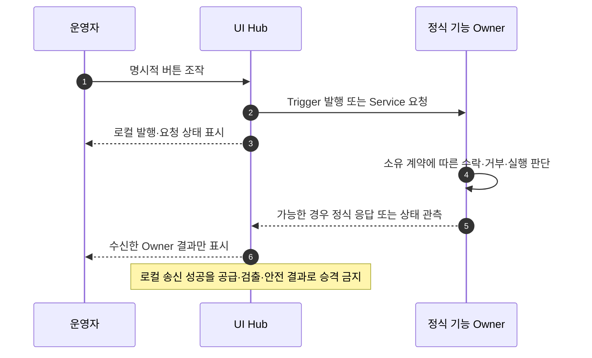

# [SF-Twin] ARM Cell Operator UI Hub Behavior

- **범위 / 컴포넌트:** ARM Cell Simulation UI Hub
- **관심사:** 운영자 제어 및 목적별 시각화 화면
- **소유자:** ARM Cell Simulation UI Hub
- **관련 CDS / HLD:** [Gateway CDS](../gateway/cds.md), [Simulation Camera and Overlay CDS](../simulation/cds-camera-overlay.md)

## 1. 목적과 권한

정적 컴포넌트 역할·비책임과 Authority 경계는 [UI Hub CDS](cds.md)를 따른다. 이 FDS는 운영 요청·자극의 발생 시점과 피드백을 소유하며 공유 요청/응답 필드의 의미는 관련 ICD가 정의한다.

Operator UI Hub는 Final Demo의 단일 운영자 화면이다. Camera·Vision 시각화, 운영자 조작, Fault Injection에 집중한다. 요청은 각 기능 Owner의 경계를 통해 전달하며 종합적인 실시간 시스템 상태 Dashboard를 제공하지 않는다. Hub가 Timeline Stop과 자체 요청 결과를 관측한다고 해서 Safety·Motion·Orchestration·Vision·VDA·Gateway의 정규 상태를 소유하는 것은 아니다. 외부 Terminal과 동일한 Handoff Trigger를 발행할 수 있지만 Delivery 요청·관리 Authority를 갖지는 않는다. 별도의 Qt HMI는 이번 데모 범위에 없다.

`Operator UI Hub`는 Architecture 상의 Component 역할이다. 현재 Final Demo에서는 Isaac Sim/Kit Extension으로 실현하지만 이 FDS의 논리 계약은 Isaac Sim이나 Kit에 종속되지 않는다. 향후 실제 Cell용 Desktop/Web UI에서도 동일 계약을 구현할 수 있다.

## 2. 집중된 UI 피드백

Hub는 AMR·공급/Readiness·Mission/Batch·Safety·Motion·활성 Fault·Recovery·PackML의 상태를 집계하는 **System Observations** 패널이나 일반적인 실시간 종합 운영 상태를 제공해서는 안 된다. 현재 UI는 Camera/Vision 시각화, 운영 조작, 그 조작에서 발생한 로컬 요청 결과에 집중한다. 정규 상태는 해당 Producer가 소유하고 ROS Interface와 Diagnostic Record로 제공한다.

Trigger 발행 결과는 Hub가 자극을 발행했는지만 뜻한다. Gateway 수락·공급 완료·Readiness·Mission Admission이라고 표시해서는 안 된다. Fault나 Reset 요청의 로컬 결과도 정규 시스템 상태 변화가 완료된 것으로 표시해서는 안 된다.

### 반응형 화면 구성

창 크기를 변경하거나 좁게 Docking해도 Camera Viewer와 주요 조작 기능에 접근할 수 있어야 한다. 넓은 창에서는 영상과 Source/Status 패널을 나란히, 좁은 창에서는 위아래로 표시한다. 영상은 원본 Frame 종횡비를 보존하고 기본 표시 크기 범위에서 가용 너비에 맞춘다. Resize는 레이아웃과 표시 크기만 바꾸며 Camera 재구독·Source Frame 변환·Video/Annotation Identity 변경을 유발해서는 안 된다.

가용 높이가 부족하면 Hub 내용은 세로로 Scroll할 수 있어야 한다. Source 선택·External Handoff Trigger·Operator Acknowledge/Reset·Scenario 조작에 계속 접근할 수 있어야 한다. 긴 상태 문구는 패널 너비에 맞춰 줄바꿈하고, Camera Topic 경로와 보조 표시 사항은 조작 영역 확보를 위해 접을 수 있다.

Source에서 유래한 시각화는 Stale 또는 Unavailable 상태를 그대로 드러내야 한다. 누락된 Feed·Animation·UI 로컬 요청 결과에서 정규 상태를 추론하지 않는다. Gateway Readiness나 Owner가 발행한 Transfer Completion을 운영자 상태로 표시하지 않는다. 새 Bringup Session은 이전 Delivery Accounting 없이 시작하며 과거 결과는 Log·Snapshot 등 각 Owner Interface와 Diagnostic Record에만 남는다.

### 2.1 Camera·Vision Viewer 기능 경계

Live Camera·Vision Snapshot·선택 Target Annotation의 수신, 호환성 판단, 표시 동작은 [Camera·Vision Viewer FDS](fds-camera-vision-viewer.md)가 소유한다. Snapshot 생성·발행 시점은 [Vision Diagnostic Snapshot FDS](../vision/fds-diagnostic-snapshot.md), Source Identity와 Metadata의 공유 의미는 [Vision–Orchestration ICD](../../interfaces/icd-vision-orchestration.md)가 소유한다. 본 FDS는 운영 명령·자극·결과 표시를 소유한다.

## 운영 요청·결과 표시의 공통 시퀀스

각 요청의 결과는 해당 Owner 계약을 따른다. 앞선 공통 시퀀스의 Hub 응답으로 Mission·Safety·Vision·Supply 결과를 추론하지 않는다.

## 3. Simulation 조작과 테스트 자극

Play·Pause·Stop은 Isaac Sim의 표준 Timeline UI가 소유한다. Hub는 별도 Simulation 조작 버튼이나 Timeline 상태 표시를 두지 않으며, 요청 가능 여부와 Cleanup에만 Timeline Lifecycle Event를 내부적으로 사용한다. Development Mode에서는 Publish Trigger·Retry Detection을 표시할 수 있고, 승인된 Fault Scenario를 실행하거나 [Safety Operator ICD](../../interfaces/icd-safety-operator.md)를 통해 Operator Acknowledgement/Reset을 요청할 수 있다.

Trigger에는 입력원에서 지정한 `delivery_id`, 양수 `quantity`, 설정된 `material_type`(현재 `RawPart`), 선택적 Random Seed를 담는다. Demo 자극에서 Hub가 생성하는 Fresh ID는 해당 Event의 상관관계 식별자일 뿐, 작업 배정·자재 예약/요청·VDA 호출·Delivery 관리를 뜻하지 않는다. Raw Trigger는 Gateway만 수락해 VDA 및 Isaac Material Supply Adapter로 전달한다. Hub는 Trigger 발행 여부만 보고한다. Adapter의 공급 결과, Vision Scene Stability, VDA Phase, `MATERIAL_READY`, Orchestration Admission은 Hub에서 표시하지 않는다.

### 3.1 Isaac Timeline Stop과 Simulation Reset

Play·Pause·Stop은 Isaac Sim 표준 Timeline UI가 소유한다. Pause는 동일 실험을 보존한 채 Simulation Time 진행을 멈추고, 이후 Play는 이를 재개한다. Timeline Stop은 해당 실험을 종료하고 기존 Isaac Lifecycle Callback을 실행한다. Stop은 Simulation Reset이지 Safety Stop이 아니다. Safety StopMotion 호출, E-Stop/Latch 생성, 실제 장비 Recovery 요청을 수행하지 않는다. Hub에는 Play/Pause/Stop 버튼이 없으며 Timeline Play를 차단할 수도 없다.

Stop Callback은 Isaac Kit을 종료하지 않고 Simulation 소유 상태를 초기화한다. 새 실험을 시작할 때 운영자는 Timeline Stop 전에 ROS Bringup을 수동 중지하고, Reset 이후 `1_before_play.py` 설정 → Timeline Play → `2_after_play.py` Session 초기화 → 새 Bringup 시작·Session 연결 → Endpoint와 Fresh Readiness 확인 순서로 진행한다. 이 프로세스 경계에서 Gateway·Orchestration의 프로세스 로컬 Accounting이 비워진다.

- Isaac은 Robot Articulation의 초기 Joint Position·Velocity와 설정된 초기 Physics State를 복원한다.
- Simulation Gripper는 Attach Joint/Held 관계를 제거하고 초기 Actuator 상태로 돌아간다. 물리적인 Release Sequence를 실행하거나 Reset 승인 조건으로 `RELEASED`/`HELD`를 요구하지 않는다.
- Material Supply Adapter는 Isaac 소유 생성 자재 전체를 제거하고 대기 Spawn·Delivery별 관측을 비우며 로컬 활성 Delivery를 해제한다. 검증 Owner는 소유 Fixture와 Run별 임시 Registration/Event를 제거한다.
- Simulation Fault Injector는 자신이 주입한 Stimulus를 제거한다. 이는 Safety Latch를 초기화하거나 실제 Safety 입력을 바꾸지 않는다.
- Orchestration은 기존 Action Cancel 경로로 이전 ExecuteCycle을 취소하고, 이전 Session에서 Ready였으나 미소비된 Delivery를 종료 처리한다. Motion은 하위 Action Cancel을 받으며 Safety StopMotion은 실행하지 않는다. 진행 중 Vision 요청은 기존 유한 Lifecycle에 따라 완료되거나 취소된 Mission에 의해 결과가 무효화된다. 이후 Mission이 그 결과를 사용하지 않으며 새 요청에는 새 Acquisition ID를 부여한다.
- Gateway는 미완료 Simulation Handoff를 종료하고 해당 Delivery 점유를 해제한다. Isaac Stop Callback은 실제 공급 Adapter나 하드웨어를 지휘하지 않는다.

Configuration·Recipe·유효 Calibration·이전 Snapshot·Log·진단 이력은 보존한다. 이전 실행 전용 상태, Gripper Attachment, Simulation Physics·Material·Fixture, 대기 공급 및 주입 Stimulus는 초기화한다. 새 실험에는 항상 새 Publish Trigger와 Delivery ID가 필요하다.

Reset은 각 Owner의 로컬 동작이며 멱등적이다. Hub가 Cleanup 진단을 집계해 보여주지 않으므로 실패한 항목은 Owner 진단에서 확인한 뒤 새 Bringup·실험을 시작한다. Hub는 영구적인 `Cleaning` 상태나 운영자 승인을 도입하지 않는다. 불완전한 Reset은 다음 Stop/Play 경계의 동일 Timeline Callback에서 다시 시도한다. Timeline Stop은 E-Stop이 아니며 Safety StopMotion·Safety Reset을 호출하지 않는다. Bringup 교체 시 Safety Latch/Cause Memory 전송 계약은 없다. 새 Safety 프로세스는 Fresh Input에 기존 정책을 적용하며 정상 Readiness Gate가 Motion Admission을 통제한다.

ROS Owner를 사용할 수 있는 동안 Hub Extension이 종료되면 활성 E-Stop Stimulus Clear, Safety Signal Loss 기간 취소, 아직 대기 중인 Vision Mislocalization Disarm을 요청한다. 이는 Stimulus Cleanup 요청일 뿐 응답이 Safety·Motion·Vision 결과를 확정하지 않는다. Owner가 이미 없으면 Hub는 Cleanup 요청 실패를 보고하고 기존 Owner/Process Lifecycle이 로컬 Stimulus 폐기를 책임진다. Hub는 Cleanup 명목으로 Safety Acknowledgement/Reset을 요청하지 않는다.

### 3.2 Publish Trigger와 신규 자재 공급

Hub는 데모·개발 편의 화면이다. Publish Trigger 조작과 공개 Trigger 계약은 Bringup이 선택한 두 Provider 환경에서 동일하며 Gateway도 모든 Provider에 같은 입력 계약을 적용한다. 각 명시적 클릭은 Source가 새로 부여한 `delivery_id`를 포함한 기존 External Handoff Trigger를 발행한다. Material Type과 양수 Quantity는 운영자 입력이다. Hub는 선택적 Seed를 생략하고 Random Drop Sampling을 기존 공급 경로에 맡긴다. Gateway만 Trigger 수락·거부를 결정한다. Hub는 로컬 발행 결과만 보고하고 Gateway Receipt, 공급 결과, `MATERIAL_READY`, Mission 결과를 표시하지 않는다. 로컬 발행 성공을 이들 Owner의 결과로 암시해서는 안 된다.

Timeline이 Running이고 Stop 소유 Simulation Reset이 끝났을 때 Publish Trigger를 사용할 수 있다. 각 클릭은 새 Delivery ID로 해당 Quantity의 추가 공급을 요청한다. 이전 Receipt를 기다리는 중이어도 서로 다른 주문을 막지 않으며 중복 Delivery ID는 Gateway가 거부한다. 새로 수락된 Delivery는 활성 공급이나 PnP를 취소·대체하지 않는다. 활성 Mission이 있으면 Orchestration은 새 주문을 보존해 다음 순차 ExecuteCycle에서 처리한다. Terminal Mission 실패가 기존 자재나 성공 PLACE Accounting을 지우지 않으며, 이후 고유 Trigger는 미처리량 전체를 대상으로 새 Cycle을 허용하는 정상 공급 Event다.

### 3.3 Cuboid Demonstration

Hub는 대표 Cuboid 관측을 위한 Simulation 전용 RawPart Preset을 유한 개 제공한다. 단층 패턴 여섯 가지(Single, Side by Side, Angled Adjacent, L Shape, U Shape · 3 Parts, U Shape · 5 Parts), 서로 다른 면이 위를 향한 단층 접촉, 선정된 2·3층 적층 조합, 기울어진 상부 자재가 포함된다. Preset은 설정된 RawPart Material Dimension·Mass를 사용한다. Face 선택은 자재 Local X/Y/Z축을 선택한 수평 면과 World Up축에 대응시키고 Yaw는 World Z축 기준으로 별도 합성한다. 층간 접촉 높이는 선택한 Up축에 따른 치수로 계산한다.

Load는 Timeline Playing 중이고 Material Supply Adapter에 생성된 자재나 대기 공급 작업이 없으며 현재 Play Session에서 Demonstration을 아직 Load하지 않았을 때만 허용한다. Pause/Resume은 Session Latch를 초기화하지 않는다. Timeline Stop은 Material Supply Reset을 통해 Demonstration Root를 제거하고 다음 Play Session을 위해 Latch를 초기화한다. 생성은 기존 Material Supply의 RawPart Shape·Mass·Collision·Rigid Body 경로를 사용하고 Gravity를 활성화한다. 부분 생성 실패 시 Demonstration 소유 Root를 제거한다.

Demonstration은 Vision 관측을 위한 로컬 Stimulus다. External Handoff Trigger를 발행하거나 Delivery Completion·Readiness·Orchestration Admission 사실을 만들지 않고 Production Mission을 시작하지 않는다. 기존 Retry Detection과 Snapshot Viewer가 이를 관측할 수 있다. Pose Recorder는 선택 여부와 무관하게 Live Test 진단에 사용할 수 있다.

### 3.4 Retry Detection — 개발 전용 Vision 요청

Retry Detection은 개발 전용이며 Detection만 수행하는 조작이다. 현재 설정된 `target_id`와 상대 Timeout 30초를 사용해 기존 `/vision/detect_target` 서비스를 정확히 한 번 호출한다. 수락된 호출은 새로운 Acquisition을 시작하고 그 단일 Deadline 내에서 기존 Detector Profile·ROI·안정 관측 적격성·내부 관측 반복을 사용한다. Hub는 Vision Reset·Profile 수정·Frame 재처리·기존 Pose/Result 재사용을 하지 않는다.

Client 응답 Watchdog은 Server Acquisition Deadline과 별개다. Hub는 요청 전달·수락을 위한 최대 30초, 기존 Vision Acquisition 허용 30초, 응답 전달 여유 100ms를 합친 유한 경계를 사용한다. 이 경계는 Dispatch 시점부터 시작하고 진단과 독립적이다. `VisionDiagnostic.DETECTING`은 Server 전역 상태이므로 Hub 요청의 수락 여부를 증명하거나 Deadline을 옮길 수 없다. 다른 Client의 활동도 Watchdog에 영향을 주지 않는다. Vision 요청 자체의 Timeout은 변경하지 않는다. Watchdog 평가 시 이미 완료된 응답은 Vision의 정상 30초 경계에서 나온 Terminal Result를 포함해 정규 응답으로 소비한다. 로컬 만료 후 도착한 응답은 해당 요청의 Terminal 표시나 이후 클릭의 결과를 덮어쓰지 못한다. Request UUID는 Hub Callback의 소유권을 보호하며 서비스 응답과 Terminal Snapshot의 상관관계는 기존 Acquisition ID로만 판단한다.

해당 조작은 로컬 개발 Session에서 Isaac Kit Extension 설정 `/exts/arm_cell.simulation_ui_hub/developer_tools/enable_retry_detection`이 명시적으로 활성화된 경우에만 표시한다. 기본값은 `false`다. 일반 배포 Hub에서는 활성화되지 않으며 공유 Operational Profile 필드도 아니다. 또한 Running Timeline이 정상이고 활성 ExecuteCycle 없이 종료 상태이며 미소비 `MATERIAL_READY`가 없고 Vision 상태가 `IDLE`이어야 한다. Dispatch 시 Mission·Vision 관측이 최신이어야 하고 누락·Stale 상태는 버튼을 비활성화하고 차단 이유를 표시한다. 단일 서비스 호출 직전에 이 조건을 다시 확인한다.

Vision은 Acquisition 슬롯 하나만 소유하며 동시 요청을 Queue에 넣지 않는다. 경쟁 요청은 새 Acquisition 없이 `DETECT_RESULT_BUSY`로 거부하고 활성 요청을 취소·대체·변경하지 못한다. 활성 Mission 동안 Retry Detection은 비활성이고 테스트 요청을 보내지 않는다. Dispatch 시 Vision이 점유 중이면 BUSY로 거부하며 새 테스트 근거 또는 Mission 진행 변경은 없다. BUSY는 요청 수락 결과이지 Vision Failure나 Mission Result가 아니다. 이 흐름은 기존 Mission/Vision 관측과 Vision의 원자적 슬롯을 사용하며 새로운 Service·Action·Manager·Queue·중복 상태 저장소를 도입하지 않는다.

요청 진행 중에는 버튼을 비활성화하여 연속 클릭의 중첩을 막는다. Terminal 응답 후 새 명시적 클릭 하나당 새 요청 하나와 Acquisition ID 하나가 생긴다. 수락된 요청에는 Service Result·`acquisition_id`·Terminal Diagnostics·Snapshot ID·기존 응답과 `/vision/detector_snapshot` Stream의 Image/Metadata를 표시한다. Result와 Snapshot의 Acquisition ID는 일치해야 한다. Vision의 기존 로컬 저장·발행 정책은 바뀌지 않으며 Hub는 Snapshot을 읽기만 한다. BUSY 거부는 Acquisition/Snapshot이 없다는 상태로 표시한다.

Retry Detection은 Orchestration·Motion을 호출하지 않고 PICK·PLACE·GO_HOME·Gripper·Material Handoff를 실행하지 않는다. Isaac Scene·Material Identity/Pose도 바꾸지 않는다. Mission의 Vision Timeout·PICK IK Failure는 기존 분류로 Mission을 종료한다. 이후 운영자가 현재 Camera/ROI를 점검하려 Retry Detection을 실행해도 실패한 Mission을 재개·재시작하지 않는다. 다음 PnP에는 새로운 Publish Trigger가 필요하다.

### 3.5 Vision Calibration 요청·결과

향후 Hub Maintenance 조작은 `/orchestration/calibrate_vision`을 한 번 호출한다. Mission 중이면 Orchestration이 즉시 거부하고, 그렇지 않으면 Vision에 전달한다. Vision은 Acquisition이나 다른 Calibration이 활성일 때 거부한다. 거부는 활성 작업을 변경하지 않는다. Hub는 반환된 성공·실패를 표시하고 성공 시 생성된 파일 경로를 표시한다. 성공은 새 Calibration 파일을 생성했다는 뜻일 뿐이다. 운영자가 `operational_profile.yaml`에서 그 경로를 선택하고 Vision을 재시작해야 활성화된다. 이 조작은 개발 전용 Retry Detection과 별개이며 이 설계 PR에서 구현하지 않는다.

### 3.6 운영자에게 보이는 Lifecycle 상태

| 화면 | 상태와 근거 |
|---|---|
| External Handoff Trigger | `Published` 또는 로컬 발행 실패. Hub Publisher의 결과만 의미 |
| Cuboid Demonstration | Adapter가 보고한 로컬 Preset 결과. 정규 Delivery/Readiness 상태 아님 |
| Retry Detection | 이유와 함께 `Available`/`Unavailable`, 이후 `Requesting`/`Succeeded`/`Failed`. 요청 가능 여부 및 Acquisition/Snapshot ID가 일치하는 Vision 응답 |
| Vision Calibration | `READY`/`NEEDS_CALIBRATION`/`CALIBRATING`의 현재 Vision 상태, 단일 요청·응답과 성공 시 파일 경로 |

Delivery ID는 주문별 공급 식별자다. ExecuteCycle은 Admission Delivery ID로 적격해진 미처리 Quantity의 합계를 처리할 수 있다. ExecuteCycle Action Goal UUID는 Mission 식별자이고 Vision `acquisition_id`는 수락된 각 DetectTarget 요청, `snapshot_id`는 불변 근거, Motion Action Goal UUID는 물리 실행을 각각 식별한다. Hub는 Material/Mission/Motion Lifecycle을 표시하거나 병렬 Lifecycle Record·Runtime Accounting Relay를 만들지 않는다. Calibration Status는 전용 Maintenance/Readiness 화면에서만 표시하며 중복 Mission Lifecycle Store가 아니다.

### 3.7 반복 테스트 검증 시나리오

| 시나리오 | Owner의 실행 순서와 이벤트 | 완료 판정·실패 동작 |
|---|---|---|
| 1. Publish Trigger 및 PnP 성공 | Timeline Play → 새 Delivery ID → Gateway 수락·공급 → Orchestration 승인 → Mission DetectTarget → Motion PICK/PLACE | Receipt·Readiness·Mission/Acquisition/Motion ID의 상관관계와 성공 Terminal Result |
| 2. 일시적 Vision 실패 후 Retry Detection | 재시도 가능한 DetectTarget Timeout/Temporary Invalid가 Attempt를 소비하고 새 Acquisition을 얻음. 재시도 불가 Terminal 또는 Budget 소진 후 운영자가 Retry Detection 요청 가능 | 내부 Attempt는 동일 ExecuteCycle의 새 Acquisition ID 사용. 이후 개발 요청은 별도 Acquisition/Snapshot 하나를 생성하며 Mission을 재개하지 않음 |
| 3. PICK IK 실패 후 Retry Detection | Retry-safe IK/Planning 실패로 Motion Action 종료 → Fresh RELEASED·Safety·HOME·Cancel/Recovery·잔여 Budget 확인 → GO_HOME → 새 DetectTarget → 새 PICK. Terminal Mission 실패 이후에는 운영자 Retry Detection 가능 | Retry Motion은 새 Action UUID와 Fresh Pose를 사용. 이후 개발 요청은 Vision만 실행하고 원래 실패 근거를 보존 |
| 4. 연속 Retry Detection 클릭 | 첫 요청 동안 버튼 비활성, 종료 후 다음 클릭으로 요청 하나 발행 | 순차 수락 클릭은 서로 다른 Acquisition ID. 중첩 요청은 Acquisition 생성 전 BUSY, Queue 없음 |
| 5. Retry Detection 실패 | Vision이 Timeout/Invalid/Failure 및 Terminal Snapshot 반환 | Result·Diagnostic·Snapshot은 Vision 정책에 따라 표시·저장. Scene/Material 불변 |
| 6. Mission 중 Retry Detection | 현재 ExecuteCycle 상태로 Dispatch 전에 비활성. Vision 경합 시 원자 슬롯에서 BUSY 거부 | 활성 Mission 중 Test 요청 없음. BUSY에는 Acquisition/Snapshot 없고 기존 요청·Mission 진행 불변 |
| 7. Terminal Mission 후 Publish Trigger | 기존 Mission Terminal → 새 Delivery ID → Gateway 수락·자재 추가 → 후속 순차 Cycle | 이전 잔여 Material 보존, 신규 Workload에 포함. 공급 실패는 긍정적 Readiness 없음 |
| 8. Timeline Stop 중 Handoff | Bringup 수동 중단 → Timeline Stop으로 미완료 Simulation Handoff 취소 → Isaac Material/Adapter Reset → Before Playing → Play → After Playing → Bringup 수동 시작·Session 연결·Endpoint 확인 | 신규 프로세스 Delivery Accounting은 비어 있음. Timeline Play Authority는 Isaac |
| 9. 실험 종료 시 PnP | Bringup 수동 중단으로 ExecuteCycle/Child Goal 종료 → Timeline Stop으로 Robot·Simulated Gripper Attachment·Material·Fixture Reset → Before Playing → Play → After Playing → Bringup 수동 시작·Session 연결·Endpoint 확인 | 신규 프로세스에 이전 Readiness·잔여 작업 Accounting 없음. Simulated HELD/UNKNOWN은 Release 승인 없이 초기화, Safety 불변 |
| 10. Reset 실패 또는 Safety 제한 | Owner Reset이 실패를 보고하거나 기존 Safety 상태가 Motion을 허용하지 않음 | Owner Diagnostic으로 Reset 실패·Safety 원인 식별. Hub는 집계 상태나 Reset 결과를 표시하지 않고 Safety Reset도 없음 |
| 11. Retry Budget 소진 | 재시도 가능한 Vision/PICK 결과가 현재 Target Episode의 Attempt Slot 4개를 소비하거나 재시도 불가 Result 발생 | 원래 실패 분류·진단으로 ExecuteCycle 종료. 자동 Trigger/ExecuteCycle/Delivery 재승인 없음 |
| 12. 정상 Quantity Batch | 각 자재는 DetectTarget→PICK/HELD→PLACE/RELEASED. 적격 실패는 해당 자재 Episode 안에서만 재시도. 마지막 GO_HOME 한 번 | 다음 자재에서 Retry Budget 새로 시작. 성공 Quantity·정상 Result 불변, Mission 전체 재시작 없음 |
| 13. 누적 Delivery | Trigger A 공급 3개, 한 번 PLACE/RELEASED 후 Mission 종료. Trigger B 공급 2개 | A 공급·성공 PLACE 보존, B 자재 추가, 다음 Cycle 미처리 총량 4개. 기존 PLACE 중복 집계 금지 |
| 14. PnP 도중 Trigger | A ExecuteCycle 활성 중 Trigger B 수락 | Adapter는 즉시 B 추가 Physics Drop 시작. 활성 Goal·Snapshot Quantity 불변. B는 다음 순차 ExecuteCycle에서 처리 |
| 15. 실패 후 신규 공급 | 자재가 남은 상태에서 현재 Mission Terminal, 새 Trigger 수락 | 잔여 공급·확정 PLACE 보존. 다음 Cycle은 기존 잔여+새 성공 공급 처리. 자동 Retry가 아닌 새 Event |
| 16. ROS Bringup 재시작 | 이전 Bringup 수동 종료 → Kit 열린 채 Timeline Stop → Before Playing → Play → After Playing → 새 Bringup 시작·Session 연결·ROS Endpoint 확인 | 새 Delivery 전에 Fresh Simulation Readiness 검증. Stage Material Reset, Process-local Delivery/Mission/Retry/Readiness/Action/Vision Accounting 비움. 과거 잔여량 제외·새 ID 사용 |
| 17. Isaac Python/Extension Reload | Runtime Python 또는 Hub Extension 수정 후 역할 Entrypoint 재실행 또는 Extension 비활성/활성, Kit은 유지 | 수정 Module 로드, 이전 Callback/Node/Runtime Object 제거, 활성 Instance 하나만 남김. Stage/Material은 명시적 재구성 없으면 보존 |
| 18. Stage/ActionGraph 재구성 | Stage 또는 Graph 수정. 필요 시에만 Timeline Stop, 관련 Object Cleanup 및 기존 Setup 역할 재실행 | Kit 유지, 중복 Node/Callback 없이 Stage/Graph 복구. Stop을 사용한 경우에만 Play에서 새 실험 시작 |
| 19. PICK 중 Emergency Stop | PICK 도중 E-Stop Inject → Safety 직접 정지와 Motion STOPPED 확인 → E-Stop 입력 Clear → 기존 명시적 Safety Acknowledgement/Reset | Fresh RELEASED·Safety Permission·Readiness 충족 시 보존 Batch를 새 GO_HOME·DetectTarget·PICK으로 계속. HELD/UNKNOWN이면 추가 Motion 없이 운영자 안전 처리 및 Fresh RELEASED 대기 |
| 20. PICK 중 Safety Signal Loss | Safety-HW 입력을 선택적으로 5초 차단 → 필요 입력 Freshness 상실·Safety StopMotion(IMMEDIATE)·Motion Stop 확인 → 즉시 Fresh Safety-HW 복귀 및 Latch/Reset 없는 Recovery 확인 | AMR·PackML은 발행 지속. Fresh RELEASED·Safety/Readiness 복구 시 새 GO_HOME·Acquisition으로 Batch 계속. HELD/UNKNOWN은 Motion 없이 대기. 5초는 Stop 완료 Deadline이 아님 |
| 21. Vision Mislocalization | Vision 단발 Arm → Arm 후 수락된 다음 Acquisition의 성공 RawPart Detection에서 Support Normal 방향 100mm Offset 반환, 원본/변경 Pose 진단 기록 → 정상 Motion PICK Capture 시도 | Planning/Execution·실제 Gripper Capture·Fresh RELEASED·기존 Retry-safe 분류를 Live Test에서 별도 검증. 설계만으로 결과 보증하지 않음. 기존 Retry Admission만 GO_HOME→새 Detection→새 PICK 결정. 미충족이면 원래 실패로 종료. 성공 전 Detection 실패/취소에는 Arm 유지 |

각 수신 Owner는 자신의 Authority에 따라 요청을 검증·적용한다. Hub는 버튼 조작이나 낙관적인 로컬 표시만으로 공급 완료·Readiness·Batch Admission을 확정하거나 Safety Capability·Latch·Severity를 변경하거나 Vision Target·Mission 진행·Recovery 성공을 결정할 수 없다. Reset/Acknowledgement는 Safety에 대한 요청이며 기존 결과와 상태에 따라 효력이 발생한다.

Acceptance 검증에서 Invalid·Stale·Unavailable Target 시나리오는 [RGB-D ICD](../../interfaces/icd-sim-rgbd.md)의 Source-side Stimulus 경계로, Holding Uncertainty는 [Motion Backend ICD](../../interfaces/icd-motion-backend.md)의 Backend Observation 경계로 라우팅한다. Hub는 시나리오 활성화를 요청하고 Owner가 발행한 결과를 관측할 뿐 Sensor Message·`MotionStatus`·Safety·Mission 상태를 직접 바꾸지 않는다. Production Vision과 정상 Motion Backend를 검증하며 검증 전용 Fixed Vision Adapter를 Production 인지 근거로 삼지 않는다.

운영자 화면은 Timeline 상태를 별도로 표시하지 않고 Isaac 표준 Timeline을 사용한다. 주요 Hub 영역의 첫 번째는 **External Handoff Trigger**다. 운영자 Fault Scenario는 정확히 세 가지다.

| 시나리오 | 운영자 조작 | 정식 Owner 경계 |
|---|---|---|
| Emergency Stop | `Inject` / `Clear` | 기존 External State Mock E-Stop 입력. 입력 Clear는 Safety Latch 해제가 아님 |
| Safety Signal Loss | `Inject 5s` | Safety-HW Mock이 `/safety/hardware_state`만 Wall Clock 5초간 중단한 뒤 Fresh 발행 재개. AMR·PackML 발행은 유지 |
| Vision Mislocalization | `Inject Next Detection Error` | Vision이 다음 한 번의 성공 DetectTarget 결과에 대한 자체 Pose 교란 Arm |

기존 Vision·Gripper·AMR·PackML·Material Handoff·외부 통신 시나리오는 기존 개발/테스트 경로에서만 이용할 수 있으며 운영자 영역에는 나열하지 않는다. Safety Reset은 기존의 별도 운영자 요청으로 유지한다.

운영자 영역은 보유 중인 RawPart를 안전하게 수동 처리하기 위한 별도 **Gripper Open**도 제공한다. 이는 네 번째 Fault Scenario도 정상 PnP/ExecuteCycle 명령도 아니다. Hub는 이 버튼으로 Safety Reset Service를 호출하거나 `MotionStatus`/Holding State를 직접 기록하거나 GripperPort를 직접 조작하지 않는다. Motion Owner가 승인하는 요청을 제출하며 제출/거부와 이후 Holding 관측을 분리해 보고한다.

Gripper Open은 기존 Motion/Safety 승인이 정상 Task 실행을 허용하고 필수 Safety 관측이 유효·Fresh하며 Motion에 활성 Task가 없고 비활성임이 확인된 경우에만 허용한다. `MOTION_NONE`·`MOTION_RECOVERY_ONLY`·`UNKNOWN`/Stale Safety, 활성·정지 중 Motion Task, 불확실한 Backend 상태에서는 거부하거나 비활성화한다. 운영자는 먼저 RawPart를 받치거나 물리적으로 구속하여 낙하를 방지하고 Release 영역이 안전한지 확인해야 한다. E-Stop/Safety Stop의 권한은 유지되며 정상 Motion Capability가 거부된 동안 Gripper Open은 사용할 수 없다. Safety Reset은 이 조작과 결합되거나 암묵적으로 수행되지 않는다.

Open 명령의 수락/성공 응답은 요청 수락 또는 명령 발행 사실만 뜻하며 물체 Release 성공을 증명하지 않는다. Orchestration이 보존된 Batch를 계속하기 위해서는 Motion의 정규 Holding 관측이 Fresh `RELEASED`로 바뀌어야 한다. `HELD`·누락/Stale 근거·`UNKNOWN`은 자동 진행을 계속 차단하고 UNKNOWN은 기존 Fail-closed 처리를 유지한다. 이 조작은 정상 PnP Batch를 재승인·재시작하거나 Admission을 우회할 수 없다.

현재 Hub↔Motion 계약에는 독립적인 Operator Gripper Open 요청이 없다. Motion은 Backend Port 내부에 논리적 Open/Holding 관측이 있지만 공개 Task Interface는 PICK·PLACE·GO_HOME·RETRACT만 지원한다. 따라서 실제 활성화하려면 기존 Motion Interface에 최소한의 Owner 승인 요청·결과 경로가 추가되어야 한다. 그 전까지는 실행 가능 기능이 아닌 설계 요구사항이다. Safety Stop 예외나 Recovery Motion은 여기서 정의하지 않는다.

Hub는 각 요청을 해당 Owner 경계로 보내고 요청 제출·Owner 수락·거부·Transport Failure를 구별해서 보고한다. 요청 응답이나 로컬 Timer만으로 입력의 상실/복구, Motion 정지, Safety Safe, Retry 시작 또는 Recovery 완료를 주장하지 않는다. 이런 결과는 기존 Safety·Motion·Vision·Orchestration 관측과 진단으로만 확인한다.

Fault 요청의 성공은 Hub가 기록한 Stimulus 의도가 적용됐다는 응답일 뿐 실제 효과를 확정하지 않는다. 요청 실패는 해당 의도 기록을 변경하지 않는다. 효과는 Hub 외부의 정규 Owner 상태를 확인해야 한다. Stimulus Clear와 Operator Acknowledgement/Reset은 별개다. E-Stop 입력을 Clear해도 Safety Latch는 Reset되지 않는다. Safety Signal Loss는 Owner의 5초 Deadline이 끝나면 종료하고 Fresh Safety-HW 발행을 재개하지만 Hub는 이로부터 Safety/Motion 상태를 추론하지 않는다. Safety Recovery는 현재 Safety 및 다른 정규 관측만으로 결정한다.

## 4. 검증 요구사항

### VR-INT-UI-01 — 관측자의 권한

Hub 조작이나 로컬 표시 상태를 변경해도 Safety·Motion·Orchestration·Vision·VDA·Material의 정규 상태를 덮어써서는 안 된다. Oracle은 요청 전후 Owner 발행 상태의 비교다.

### VR-INT-UI-02 — 집중된 피드백 화면

Hub는 집계 System Observations 패널이나 일반적인 정규 운영 상태의 실시간 종합 요약을 제공하지 않는다. Trigger·Fault·Reset 조작은 로컬 발행/요청 결과만 표시하고 정규 Owner 결과를 암시하지 않는다. Camera/Vision의 Freshness는 `VR-INT-UI-04` 및 Snapshot 검증 요구사항을 별도로 따른다. Hub에는 Vision Detector Snapshot·선택적 Live Camera·Fault Injection·Safety 경유 Acknowledgement/Reset·활성화된 경우 개발 전용 Retry Detection을 유지하고 External Handoff Trigger를 첫 주요 영역으로 배치한다.

### VR-INT-UI-03 — Trigger·요청 의미

Trigger 조작은 로컬 발행 결과만 표시하고 Gateway 수락·VDA Phase·Readiness·Supply Completion·Orchestration Admission을 표시하거나 주장하지 않는다. UI 조작과 로컬 결과만으로 실행 상태 전이가 완료된 것처럼 표시해서는 안 된다. Random Drop은 선택적 Seed를 생략한다(`has_random_seed = false`).

### Viewer 검증 계약의 Owner

선택 Target 표시와 Snapshot Viewer의 기존 `VR-INT-UI-04`, `VR-INT-UI-05`는 [Camera·Vision Viewer FDS](fds-camera-vision-viewer.md)에 ID와 의미를 보존한다.

### VR-INT-UI-06 — Timeline Stop Simulation Reset

새 실험에서 운영자는 ROS Bringup을 수동 중지하고 Timeline Stop 후 `1_before_play.py` → Timeline Play → `2_after_play.py`의 Session 초기화를 마친 다음 Bringup을 수동 시작해 동일 Session에 연결하고 Endpoint 및 Fresh Readiness를 확인해야 한다. Timeline Stop은 Fresh Gripper `RELEASED`, Safety Recovery 또는 Isaac Kit 재시작을 요구하지 않고 Isaac 소유 Robot Articulation·Simulation Gripper Attachment/Actuator·생성 Material·검증 Fixture·대기 Supply·Simulation Fault Stimulus를 초기화해야 한다. Hub의 Stop 처리는 Isaac 프로세스 내부 Owner Port를 통해 Isaac 소유 Fault Stimulus를 제거하며 Bringup 종료 후 ROS Mock Endpoint에 Cleanup을 요청해서는 안 된다. Safety StopMotion·Safety Reset·실장비 명령도 수행해서는 안 된다. Reset 실패는 새 실험 전에 보고·해결해야 한다. Oracle은 복구된 초기 Simulation 상태·Owner Reset 진단·Fresh Endpoint/Readiness·비어 있는 프로세스 로컬 Accounting이다. Bringup 교체는 Safety Latch/Cause Memory를 전달하지 않으며 새 Safety는 Fresh 입력에 기존 정책을 적용한다. 동일 프로세스 Stop→Play Admission 격리는 요구하지 않는다.

### VR-INT-UI-07 — Publish Trigger와 Retry Detection의 분리

Publish Trigger는 새로운 Delivery ID를 사용하고 로컬 발행 결과만 보고해야 한다. Gateway 수락·공급 완료·Readiness·Mission Admission/Outcome은 Owner Interface와 Record를 따른다. Retry Detection은 30초 Caller Timeout으로 새 `/vision/detect_target` 요청 하나를 보내고 수락 시 새 Acquisition을 만들어야 한다. Delivery·ExecuteCycle 생성, Scene/Material 변경, Motion/Gripper 호출을 해서는 안 된다. 동시 Acquisition은 활성 요청을 취소·변경하지 않고 BUSY로 거부하며 활성 Mission은 중단되지 않는다. Oracle은 Gateway Receipt/Readiness·Mission ID·Vision Acquisition/Snapshot ID·Vision Result 및 Retry Detection 이후 변하지 않은 Scene/Material/Motion/Gripper 상태다.

### VR-INT-UI-08 — Final Demo Fault 화면과 Lifecycle

Fault Injection 영역에는 Emergency Stop(`Inject`/`Clear`), Safety Signal Loss(`Inject 5s`), Vision Mislocalization(`Inject Next Detection Error`)만 노출해야 한다. 다른 Fault 경계는 기존 개발/테스트 경로에서 이용할 수 있지만 이 영역에 표시해서는 안 된다. Safety Reset은 별도 조작으로 유지한다. Hub 상태는 로컬 제출/Owner 응답과 정규 관측 효과를 구별해야 하며, 대응하는 정규 관측 없이 `Signal Restored`·`Motion STOPPED`·`Safety SAFE`·`Retrying`·Recovery 완료를 주장해서는 안 된다. Timeline Stop·Extension 종료는 상기 Cleanup을 따르며 Cleanup은 Safety Latch를 지우거나 Safety Reset을 요청하지 않는다. Oracle은 실제 표시된 Control Set, Owner 요청 결과, 정규 Owner 관측, Lifecycle Cleanup 후 Stimulus 상태다.

### VR-INT-UI-09 — Operator Gripper Open

Hub는 Gripper Open을 세 Fault Scenario 및 Safety Reset과 구별해 표시해야 한다. 기존 Safety Permission이 유효·Fresh하고 정상 실행을 허용하며 Motion 비활성이 확인되고 운영자가 자재 Support/구속과 Release 영역 안전을 확인했을 때만 Motion Owner에 요청해야 한다. `MOTION_NONE`·`MOTION_RECOVERY_ONLY`·Stale/Unknown Safety/Motion 관측·활성/정지 중 Task에서는 요청하지 않는다. 명령 수락을 Release로 보고해서는 안 되며 Fresh Motion Holding `RELEASED` 관측만 보존 Batch의 재개를 허용한다. `HELD`/`UNKNOWN` 또는 Fresh 근거 누락은 계속 차단한다. 정상 PnP Batch를 시작하거나 우회해서는 안 된다. Oracle은 Motion Request/Result·Safety Capability·확인된 Motion 비활성·Fresh Holding·불변 Orchestration Admission이다. 독립 Owner 승인 Open 요청을 기존 Motion Interface가 지원하기 전까지 미구현 요구사항이며 Hub는 별도의 Gripper 제어 경로를 만들지 않는다.

### VR-INT-UI-10 — Cuboid Demonstration

Hub는 RawPart Material Dimension으로 구성된 유한한 단층·2층·3층 Cuboid Preset을 제공해야 한다. Demonstration은 Timeline Play 동안 Play-to-Stop Session당 최대 한 번, Material Supply에 생성 자재나 대기 작업이 없을 때에만 Load해야 한다. Pause/Resume은 허용 횟수를 초기화하지 않는다. Timeline Stop은 Material Supply Reset으로 Demonstration 소유 RawPart를 제거하고 허용 횟수를 초기화해야 한다. 생성은 Gravity가 활성화된 기존 RawPart Rigid Body/Collision 경로를 사용하며 Handoff를 발행하거나 Completion·Readiness·Admission 사실을 만들지 않는다. Oracle은 Adapter Result, 생성 Prim Transform/Physics Attribute, 불변 Handoff/Admission 상태, Stop 후 비어 있는 Demonstration Root다. PhysX Stability는 Isaac Sim 관측으로 확인해야 하며 Preset Geometry 검사만으로 확정되지 않는다.

## 5. References

- [Gateway CDS](../gateway/cds.md)
- [Operator camera and overlay CDS](../simulation/cds-camera-overlay.md)
- [Material Handoff FDS](../gateway/fds-material-handoff.md)
- [External Handoff Trigger ICD](../../interfaces/icd-external-handoff-trigger.md)
- [Material Readiness ICD](../../interfaces/icd-integration-orchestration-material.md)
- [Safety Operator ICD](../../interfaces/icd-safety-operator.md)
- [External Mock Fault Injection FDS](../vda/fds-fault-injection.md)
- [Orchestration Batch Mission FDS](../orchestration/fds-mission-cycle.md)
- [Orchestration Controlled Recovery FDS](../orchestration/fds-controlled-recovery.md)
- [Vision DetectTarget FDS](../vision/fds-detect-target.md)
- [ExecuteCycle ICD](../../interfaces/icd-orchestration-execute-cycle.md)
- [Safety Supervision FDS](../safety/fds-supervision.md)
- [Vision ↔ Orchestration ICD](../../interfaces/icd-vision-orchestration.md)
- [Simulated RGB-D ICD](../../interfaces/icd-sim-rgbd.md)
- [Motion Backend ICD](../../interfaces/icd-motion-backend.md)
