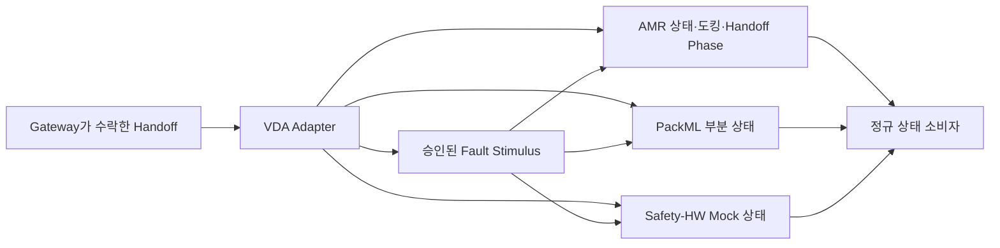

# [SF-Twin] ARM Cell 외부 시스템 Mock·VDA Adapter 컴포넌트 설계 (CDS)

- **범위:** ARM Cell / AMR·PackML·Safety-HW Mock 경계
- **Owner:** ARM Cell VDA Adapter (`arm_cell_vda_adapter`)

## 1. 목적과 구성

VDA Adapter는 시스템 통합에 필요한 외부 AMR·PackML/PLC·Safety-HW 상태를 시뮬레이션·시험 환경에서 대체한다. 현재 구현은 **VDA 5050 전체가 아닌 Mock Subset**이다.

이 구조는 논리적 Owner와 상태 발행 관계만 나타낸다. Fault 자극에 따른 실제 정규 상태 전이와 Safety 판단은 각각의 기능 Owner가 담당한다.

## 2. 정적 책임

| 영역 | VDA Adapter의 책임 | 소유하지 않는 의미 |
|---|---|---|
| AMR | Docking 및 지원 상태 Subset의 Mock 발행 | 실제 AMR Navigation·Order 수행 |
| PackML | 지원 PackML 상태 Subset의 Mock 발행 | 실제 PLC/생산 설비 제어 |
| Safety-HW | Mock `SafetyHardwareState` 발행 | 안전 인증·Safety Latch/Reset 판단 |
| 상태 전달 | 주기적 State·Heartbeat 및 관련 상태 전환의 즉시 발행 | Consumer의 Safety·Mission 판단 |
| Fault Injection | 승인된 외부 Mock 자극·복구 동작 | Safety Stop·Recovery 결과 확정 |
| Handoff 표현 | **Gateway가 수락한** Trigger에서만 `delivery_id`를 보존하여 유한한 VDA Handoff Phase 표시 | Raw 외부 Trigger 수락, Material Supply·Transfer Completion·Readiness |

## 3. 비책임과 교체 경계

현재 컴포넌트는 VDA 5050의 전체 Order·InstantActions·Connection·MQTT 호환성이나 안전 인증된 하드웨어 동작을 주장하지 않는다. 실제 PLC/Safety Controller를 소유하지 않으며 IT/MES 작업 배정, Delivery Allocation, Material Scheduling도 수행하지 않는다.

실제 배포에서는 내부 Mock을 실제 VDA·PLC·Safety Adapter로 교체할 수 있다. 이때 상위 ARM Cell의 정규 공유 Interface 의미는 유지해야 한다. Handoff 수락·공급·Readiness의 동작 순서는 [Material Delivery FDS](fds-material-delivery.md), Fault 자극 및 복구 시점은 [Fault Injection FDS](fds-fault-injection.md), 공유 외부 Safety 상태의 의미는 [External State–Safety ICD](../../interfaces/icd-external-safety.md)를 따른다.

## 4. 검증 요구사항

### VR-VDA-OWN-01 — Mock 범위 명시
현재 Adapter는 Simulation/Integration용 Mock Subset임을 명확히 밝혀야 한다.

### VR-VDA-OWN-02 — 상위 의미의 안정성
Mock을 실제 Adapter로 교체해도 상위 Safety Logic이 Simulator 전용 표현을 소비하도록 변경해서는 안 된다.
