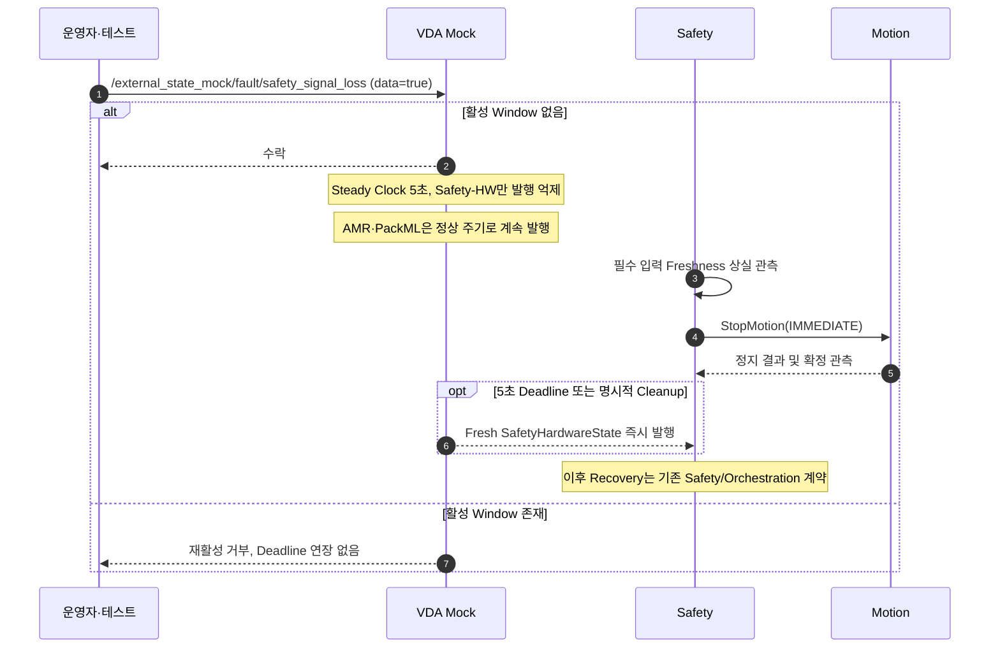

# [SF-Twin] ARM Cell External Mock Fault Injection 기능 설계 (FDS)

- **범위:** ARM Cell VDA Mock Fault Injection
- **Owner:** ARM Cell VDA Adapter

Scene 수준의 우회 금지 불변조건은 [Simulation Environment Semantics](../simulation-environment-semantics.md)가 소유한다. 이 FDS는 **외부 Mock Stimulus의 발생·해제 시점 및 해당 Owner 경계에 나타나는 결과**만 소유한다.

## 1. Fault Stimulus 구성

| 시나리오 | 자극과 해제 | 제한 |
|---|---|---|
| Emergency Stop | Mock AMR/Safety-HW 상태를 비상 상태로 전환하고 즉시 발행 | 자극 Clear는 Safety Latch/Reset 우회가 아님 |
| Safety Signal Loss | Safety-HW 발행만 5초간 선택적으로 중단하고 즉시 복원 | AMR/PackML 발행 유지, Safety Stop 완료 Deadline과 독립 |
| Premature Undock | 즉시 `AMR_DOCKING_UNDOCKED`와 `driving=true` 발행 | Clear만으로 자동 Redock하지 않음 |
| PackML Abort | `PACKML_STATE_ABORTED` 발행 | Mock Reset 동작에 따라 Fresh State 복원 |
| Communication Loss | Safety Watchdog 검증에 필요한 주기적 Publisher Group 중단 | 복원 즉시 Fresh 발행 |
| Transient Communication Degradation | Safety Freshness 경계 안에서 제한된 Delay/Jitter 부여 | Delay만으로 Capability 축소·StopMotion 불가 |

PackML Subset 값의 공유 의미는 [External State–Safety ICD](../../interfaces/icd-external-safety.md)가 소유한다.

## 2. 선택적 Safety Signal Loss의 시퀀스

`/external_state_mock/fault/safety_signal_loss`는 Owner-local `std_srvs/srv/SetBool` 요청이다. `data=true`는 Steady Clock 기준 5초 억제 Window를 시작하고 활성 Window가 없을 때만 수락한다. 중복 활성화는 거부하며 Deadline을 연장하지 않는다. `data=false`는 Lifecycle Cleanup을 위해 활성 Window를 취소한다. 수락 응답은 자극 적용 요청의 결과이지 Safety가 입력 Stale을 관측했거나 Motion을 정지시켰다는 증거가 아니다.

억제 중 AMR·PackML Publisher는 정상 상태와 설정된 주기로 계속 발행한다. 만료 또는 명시적 Cleanup 시 Mock은 Safety-HW 억제를 해제하고 유효하고 Fresh한 `SafetyHardwareState`를 즉시 발행한 뒤 정상 주기 발행을 재개한다. 이 시나리오는 전체 Publisher Group에 영향을 주는 Communication Loss와 다르다. **5초는 Stimulus Window만 제한하며 Safety Freshness 감지·Motion Stop 완료의 독립적인 Timing/Completion 계약을 변경하지 않는다.**

예상되는 Safety 반응은 기존 필수 입력 Freshness Watchdog과 직접 `StopMotion(IMMEDIATE)` 경로를 사용한다. Freshness만 일시적으로 손실된 경우 영구 Latch 또는 Operator Reset 요구를 생성하지 않는다. Fresh 입력 복귀와 Motion Stop 완료 확인 이후의 자동 계속 진행은 기존 Safety·Orchestration Recovery 계약에 따른다.

## 3. 기타 Fault의 동작

### 3.1 E-Stop
E-Stop을 활성화하면 Mock AMR/Safety-HW 상태에 비상 상태를 반영하고 변경된 상태를 즉시 발행한다. Mock Fault를 Clear해도 Safety Latch·Reset 정책은 우회되지 않는다.

### 3.2 Premature Undock
활성화하면 AMR 상태로 `AMR_DOCKING_UNDOCKED` 및 `driving=true`를 즉시 발행한다. Fault Clear는 자동 Redocking을 뜻하지 않는다.

### 3.3 PackML Abort
활성화하면 지원 PackML Subset 값 `PACKML_STATE_ABORTED`를 발행한다. Clear는 승인된 Mock Reset 동작을 따르며 Fresh State를 발행한다.

### 3.4 Communication Loss
활성화하면 Safety Watchdog 검증에 필요한 필수 주기 Publisher Group을 실제로 억제한다. 비활성화하면 Publisher Group을 재개하고 무관한 긴 Delay 없이 Fresh State를 즉시 발행한다.

### 3.5 Transient Communication Degradation
Final Demo 검증 경계는 Safety의 필수 Freshness Limit 안에서 Required Input을 유효하게 유지하는 유한 Delay/Jitter Stimulus를 지원해야 한다. 이는 Communication Health만 표현하며 Safety Capability·현재 Velocity/Acceleration Envelope·StopMotion 동작을 변경하지 않는다. 필수 Safety-HW 또는 Motion 입력이 무효이거나 Freshness Limit을 넘는 Communication Loss의 경우 Safety는 정상 Capability를 거부하고 기존 Fail-closed Stop 정책을 적용한다. 자극 Clear는 지연 없는 Fresh 발행을 복원한다.

Delay Duration은 해당 테스트 자극의 Profile 설정이며 중간 단계의 Degraded-Freshness Band나 Delay 양에 비례하는 Motion Derating을 구성하지 않는다.

## 4. 검증 요구사항

### VR-VDA-FAULT-01 — 실제 통신 억제
Communication Loss 자극은 관련 Heartbeat Publisher를 실제로 억제해야 한다.

### VR-VDA-FAULT-02 — Fresh 복원
통신 복원 후 무관한 장시간 Delay를 기다리지 않고 Fresh State를 제공해야 한다.

### VR-VDA-FAULT-03 — E-Stop Clear와 Safety Reset의 분리
Mock E-Stop Clear가 독립적인 Safety Latch/Reset 정책을 직접 해제해서는 안 된다.

### VR-VDA-FAULT-04 — Undock Clear와 Redock의 분리
Premature Undock으로 `UNDOCKED`가 발행된 후 자극을 Clear하더라도 `DOCKED`를 임의로 만들어서는 안 된다. Undock Event가 없을 때의 정상 초기 상태는 `DOCKED`로 유지한다.

### VR-VDA-FAULT-05 — 지연 Warning과 필수 입력 손실의 구분
유한 Transient Delay Stimulus는 필수 입력을 Safety Freshness Limit 안의 유효 상태로 유지하고 지연만으로 허용 Motion Envelope를 줄이거나 StopMotion을 발행해서는 안 된다. 필수 Safety-HW/Motion 경로의 Communication Loss는 그 Freshness 경계를 넘어서 Safety의 Fail-closed Capability/Stop 동작을 유지해야 한다. Oracle은 Source Sample Age·Validity, Safety Envelope/Capability 및 StopMotion 결과다.

### VR-VDA-FAULT-06 — 선택적 Safety-HW 손실 및 Fresh 복원
Safety Signal Loss 활성 요청을 수락하면 `/safety/hardware_state`만 Steady Clock 5초간 발행 억제하고 AMR·PackML은 계속 발행해야 한다. 기존 Safety Watchdog은 필수 입력 Freshness 손실을 관측하고 Motion 활성 중 Safety는 직접 `StopMotion(IMMEDIATE)`를 보내야 한다. Stimulus Window를 Stop 완료 Deadline으로 해석해서는 안 된다. 만료 또는 명시적 Cleanup에서는 즉시 유효하고 Fresh한 Safety-HW 상태를 발행해야 한다. 일시적 Freshness 손실만으로 영구 Latch나 Operator Reset을 요구해서는 안 된다. Oracle은 Safety-HW Source/Receipt Freshness, 동시 AMR/PackML Sample, Safety State/Capability/Cause, StopMotion Request/Result, Motion의 확정 정지 상태 및 Fresh Safety-HW 복원이다.
