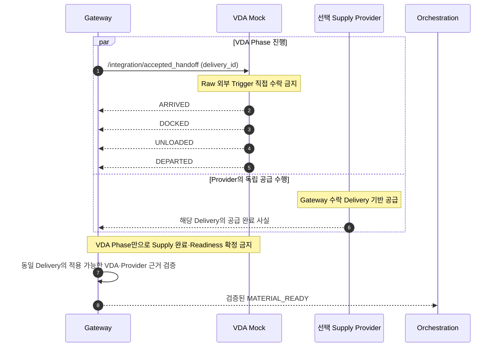
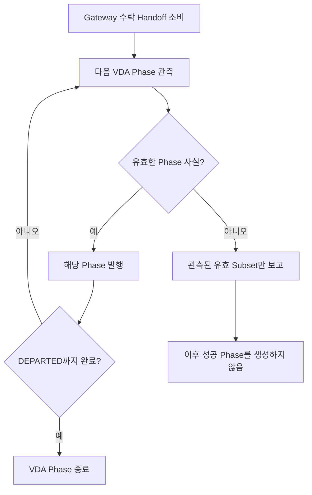

# [SF-Twin] ARM Cell AMR 자재 Delivery Mock 기능 설계 (FDS)

- **범위:** ARM Cell VDA Mock의 AMR Delivery 상태 표현
- **Owner:** ARM Cell VDA Adapter (`arm_cell_vda_adapter`)

## 1. 목적과 동작 경계

Final Demo의 AMR Mock은 **사전에 정의된 짧은 이동·상태 표현**을 제공한다. 이는 VDA 5050 Navigation·경로 계획·Order Execution·Route Recovery 구현이 아니다. Delivery 수락과 자재 공급/완료 판정은 이 컴포넌트의 책임이 아니다.

## 2. 정상 Handoff 시퀀스

VDA Mock은 `/integration/accepted_handoff`만 소비해야 하며 `/external/handoff_trigger`를 구독하거나 수락해서는 안 된다. **Gateway 수락이 Delivery의 단일 Authority**다. VDA는 수락된 `delivery_id`를 그대로 보존하고 `ARRIVED → DOCKED → UNLOADED → DEPARTED` 순서의 Phase 사실만 발행한다.

Gateway가 Provider로 전달하는 `quantity`·`material_type`·선택적 Seed는 VDA Phase의 의미를 바꾸지 않는다. VDA의 `DEPARTED`는 Orchestration Batch를 종료하거나 변경하지 않는다.

`UNLOADED`·`DEPARTED`는 자재 생성, 공급 완료, Vision 관측/안정화 또는 `MATERIAL_READY`의 증거가 아니다. Isaac Demo Adapter는 Quantity 기반 Random Physics Drop을 수행하지만 그 결과는 **Simulation 생성·동작 성공**에 한정되며 실제 Production 공급 완료를 결정하지 않는다. Production Supply Provider는 환경에 맞는 Completion 판단을 소유한다. VDA Phase 진행과 Provider Completion의 도착 순서는 서로 독립적이다. Gateway는 Delivery와 연관된 Provider Completion과 적용 가능한 VDA Context를 모두 검증한 후에만 Readiness를 발행한다. VDA는 Readiness를 발행하거나 Work를 승인하지 않는다.

## 3. 실패 및 중복 처리

Arrival·Docking·Unload·Departure 중 어느 사실이 실패하거나 무효라면 관측된 유효 Subset만 보고하고 후속 성공 사실을 만들어서는 안 된다. VDA 실패는 공급이 완료되었다는 뜻이 아니다. Supply의 독립 증거는 Provider Completion이 결정한다. VDA 사실 또는 Provider Completion이 누락·실패하면 긍정적 Readiness가 성립하지 않는다. 이미 수락된 동일 Delivery Identity는 새 Episode를 시작할 수 없다.

## 4. 검증 요구사항

### VR-VDA-MAT-01 — 수락 Event와 Identity
Gateway가 전달한 수락 Event만 VDA Episode를 시작해야 한다. 모든 Phase는 같은 Delivery Identity를 보존하며 짧아진 Phase 순서를 유지해야 한다.

### VR-VDA-MAT-02 — 실패 시 종료와 Admission 비소유
앞 Phase가 실패했다면 이후 성공 Phase를 발행해서는 안 된다. VDA는 Provider Completion·`MATERIAL_READY`·Batch Admission을 발행하지 않으며 각각의 Owner는 선택된 Supply Provider·Gateway·Orchestration이다.

### VR-VDA-MAT-03 — Navigation 구현 주장 금지
Mock은 사전 정의된 짧은 이동 표현이며 VDA 5050 Navigation·Route Execution을 구현했다고 주장해서는 안 된다.

## 5. 관련 계약

- [VDA CDS](cds.md)
- [External Handoff Trigger ICD](../../interfaces/icd-external-handoff-trigger.md)
- [Gateway Material Handoff FDS](../gateway/fds-material-handoff.md)
- [Fault Injection FDS](fds-fault-injection.md)
