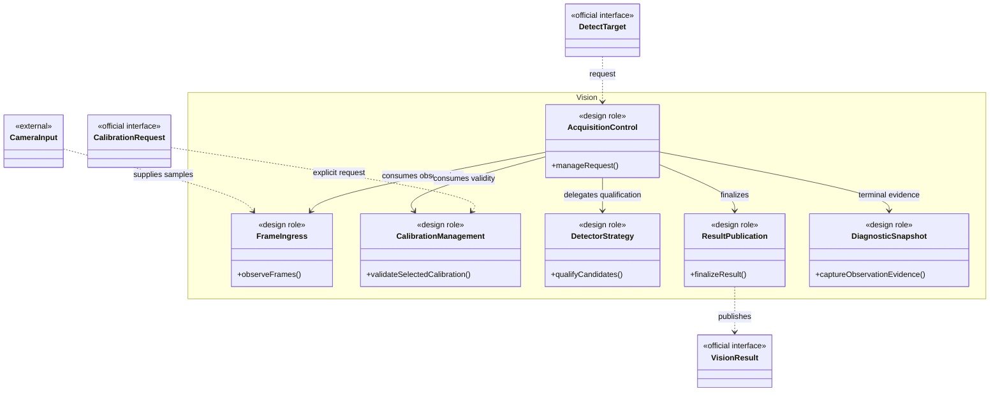
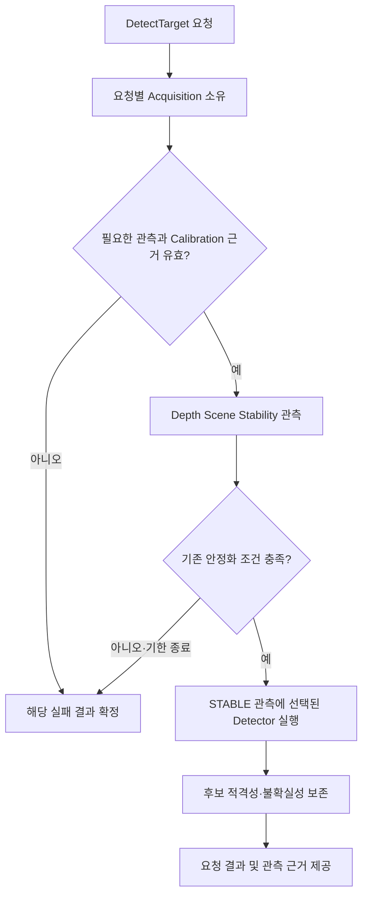

# [SF-Twin] ARM Cell Vision 컴포넌트 설계 (CDS)

- **범위:** `ARM Cell / Material Detection (기존 RGB-D Vision 구현)`
- **소유자:** `ARM Cell Material Detection`

## 1. 목적

ARM Cell의 `arm_cell_vision`은 Material Detection 책임을 실현한다. Depth 관측과 호환되는 CameraInfo 및 유효한 설치 Calibration을 사용해 Detector Profile이 정의한 Observation Pose와 품질 근거를 생성한다. 카메라 스트림은 계속 수신할 수 있지만 검출은 `DetectTarget` 요청에 한정해 처리한다.

## 2. 책임

Material Detection은 다음을 소유한다.

- 원본 RGB·Depth·CameraInfo 수신
- RGB·Depth 구독과 유계 시간 연결
- Deprojection에 사용하는 검증된 CameraInfo 내부 Calibration 상태
- 초기 설치 Calibration과 명시적으로 요청한 유지보수 Calibration의 측정·검증·새 Camera-to-Tray 변환 파일 생성
- 요청별·일시적 Ingress Buffer와 신선도 관리
- 오래된 프레임 거부·제거
- 공유 Depth Scene Stability Gate, Depth 관측, 재시도, Timeout, 취소 처리, 보존 결과 폐기를 포함한 요청별 DetectTarget 전체 생명주기
- Acquisition 대기·처리와 센서 입력 처리의 구조적 분리 및 양쪽의 독립적인 진행
- `DetectTarget.target_id`에 따른 Material Detection 소유 Detector Profile 선택
- Profile 기반 RawPart 후보 전체의 추출과 기하학적 적격성 검증
- 반환 후보의 관측 Pose·Geometry와 Profile별 qualification 근거
- 마지막 단일 관측에서 Detector를 한 번 실행하기 전에 유효한 Depth 관측 5회의 Scene Stability 평가
- Source 관측에 연결된 선택 Target 및 진단용 인지 의미
- 3D 역투영
- 지지면·표면 추정
- 객체 높이 추정
- Yaw 추정 및 모호성 처리
- 회전 불변 Profile 측정 및 DetectTarget 결과에서 자세 대칭성의 관측 가능 여부 명시
- 물리적 타당성 검증
- Camera Optical Frame에서 `base_link`로 결과 변환
- DetectTarget 결과 분류

## 3. 비책임

Material Detection은 다음을 소유하지 않는다.

- 운영자 영상 압축 또는 원격 UI 전송
- Hub의 Annotation 그리기·렌더링
- 로봇·Tool 고유 TCP Offset
- Motion 실행 권한
- 충돌 없는 궤적의 보증
- 카메라 Publisher 소유권
- 카메라 TF Publisher 소유권
- 시뮬레이션 세션 생명주기 권한
- 센서 메시지의 Timestamp·단위 재작성

## 정적 구조와 경계

이 구조는 **기존 Vision 책임을 설명하기 위한 설계 역할**이며 실제 클래스 수나 내부 함수 호출 순서를 지정하지 않는다. Camera 입력과 Calibration 설정, Detector Strategy, 결과 공유의 책임은 구분하되, 요청 실행·상태 전이는 각 FDS에서 정의한다.

## 상위 책임 연동 흐름

이 그림은 Acquisition이 입력 유효성·안정성·후보 적격성 판단을 연결해 결과를 확정하는 **상위 책임 수행 흐름**이다. 시간·동시성·종료 조건을 별도로 정의하지 않는다. 정확한 관측·실행 시퀀스는 [DetectTarget FDS](fds-detect-target.md), [Frame Ingress FDS](fds-frame-ingress.md), [RawPart FDS](fds-rawpart-depth-perception.md)를 따른다.

## 소유권과 상태

| 대상 | Authority / writer | Consumer / observer | 경계 |
|---|---|---|---|
| 카메라 샘플·CameraInfo | 선택된 Sensor Adapter | Frame Ingress, Calibration | 메시지 시각·단위 재작성 금지 |
| 요청별 Acquisition·retained result | Vision | Orchestration·Task Execution | 결과 반환 뒤 후보 실행은 Task Execution이 소유하며 연속 재검출로 재판정하지 않음 |
| 선택 Calibration 경로 | Deployment Profile | Vision | 생성된 파일은 자동 선택·적용하지 않음 |
| 측정 Calibration 산출물 | Vision Calibration | 운영자·Vision | 선택 파일과 새 출력 파일은 별도 lifecycle |
| Detector Strategy·후보 품질·관측 Geometry | Vision의 선택 Strategy | Task Execution·Motion은 전달된 검출 결과 소비 | 관측 불확실성 보존; Vision 열거 순위는 실행 우선순위나 grasp feasibility가 아님 |
| Mission admission·Material Candidate 우선순위·전환 | Orchestration은 Mission admission, Task Execution은 후보 우선순위·전환 | Vision은 후보 목록을 변경 없이 제공 | Safety·Motion 판단을 Vision이 대신하지 않음 |

## 제공·요구 계약 및 관측 경계

| 계약 | 책임 | 의존성·실패 경계 |
|---|---|---|
| DetectTarget 결과 | 요청 한정 인지, 후보 목록·관측 근거 제공 | 유효 샘플과 안정화/검출 실패를 성공으로 위장하지 않음 |
| Camera·Depth·CameraInfo | 관측 입력 소비 | 신선도·호환성 검증 시점은 Frame Ingress FDS, 공유 Header·Frame·Source 의미는 ICD를 따름 |
| Calibration Status·요청 | 명시적 설치 보정과 선택 파일 호환성 | 파일 생성과 운영 적용을 구별 |
| Diagnostic Snapshot·진단 | 결과에 연결되는 관측 증거 생성 | 진단 출력 실패가 정규 검출 결과를 변경하지 않음 |

## 3.1 요청 기반 인지 및 진단의 정적 경계

Vision은 카메라 입력 수신·요청별 Acquisition 처리·검출 Strategy·결과 및 진단 생성의 역할을 구분해 소유한다. 카메라 Topic 수신은 지속될 수 있지만 Detector 실행은 요청이 소유한다. 해당 역할의 요청 처리·5회 Depth 안정화는 [DetectTarget FDS](fds-detect-target.md), 프레임 수신은 [Frame Ingress FDS](fds-frame-ingress.md), terminal Snapshot 생성·저장·발행 시점은 [Diagnostic Snapshot FDS](fds-diagnostic-snapshot.md)가 각각 소유한다.

검출 Strategy별 후보 적격성은 [RawPart FDS](fds-rawpart-depth-perception.md), 계산 절차는 각 Algorithm, Acquisition 식별자·후보·Result의 경계 의미는 [Vision–Orchestration ICD](../../interfaces/icd-vision-orchestration.md)가 소유한다. UI 표시는 Vision의 책임이 아니다. Task Execution은 전달된 Material Candidate의 실행 우선순위·전환을, Motion은 선택된 후보의 Grasp Pose와 개별 movement를 평가한다.

## 4. 출력 의미

Stable Material Acquisition은 적격 관측으로 한 번의 결과를 확정하지만, 이후 자재의 정지 상태나 Motion 허용을 보증하지 않는다. 결과 보존은 한 요청의 deadline 안에서만 유효하며 인계·terminal 결과·취소 시 끝난다. 인계 후 PnP 실행·후보 전환은 Task Execution, 개별 movement 결과는 Motion, Mission 진행·새 관측 요청은 Orchestration이 소유한다. 향후 Safety 관측이 필요하더라도 이 계약의 범위 밖이다.

Detection은 선택한 Target Profile을 평가하기 위한 Vision 내부의 pixel·Depth·feature 근거이며 서비스가 공개하는 Pose 자체가 아니다. 성공 응답의 `target_pose`는 해당 Profile이 선정한 기하학적 기준점의 `base_link` Observation Pose다. 별도 Profile 계약이 명시하지 않는 한 Object Pose나 로봇 TCP 명령 Pose가 아니다.

Sensor 관측 가능성과 시뮬레이터 ground truth 독립성은 [Simulation Environment Semantics](../simulation-environment-semantics.md)가 소유한다. 이 CDS는 공통 Observation Pose 경계와 Profile 책임을 정의한다. 각 Detector Profile은 자신이 보고할 기하학적 기준점을 정의해야 하며, 보이는 상판은 모든 Vision에 공통인 기준점이 아니다. Profile은 선언된 센서 입력 조건을 만족하는 시뮬레이션 및 실제 RGB-D 관측에서 사용할 수 있어야 한다.

## 5. 배포 설정이 소유하는 Detector Profile

배포 설정은 논리적 `target_id`와 Vision Detector Profile의 대응 관계 및 Profile별 매개변수를 소유한다. 지원되는 운영 Profile에서는 배포가 소유한 `vision` 설정 아래 정의하며, 공용 ROS 메시지·서비스 스키마가 아니다.

매핑은 `target_id`를 키로 사용한다. Material Definition은 물리 형상과 공칭 치수를, Vision Profile은 선택한 Material을 참조하며 Algorithm 실행 설정·작업 영역/support 제약·관측 품질을, Recipe는 Detector 선택·Grasp·Approach·PLACE 정책을 소유한다. 이 책임 분리는 별도의 Material Registry 도입이나 Recipe로의 치수 소유권 이전을 뜻하지 않는다. Isaac Material Supply도 동일한 정의에서 `material_type`을 해석한다.

Vision은 Orchestration이 Mission Recipe에 따라 요청한 Detector Strategy를 실행한다. Recipe가 선택을, Vision Profile이 실행 설정을 소유한다. 허용 값·기본값·검증은 [RawPart FDS](fds-rawpart-depth-perception.md)와 [Mission Cycle FDS](../orchestration/fds-mission-cycle.md)를 따른다. 하나의 Acquisition 동안 Strategy는 고정되지만 요청 간에는 Vision 재시작 없이 Algorithm을 바꿀 수 있다. 검증 전용 대체는 아래 5.1절의 제한을 따른다. 새로운 Registry Service나 동적 Plugin Loader는 도입하지 않는다.

### 내부 Detector Strategy 경계

Strategy는 공통 관측 처리와 구체 Detector 사이에 놓인 최소한의 Vision 책임 경계다. 데이터와 소유권을 규정하며 C++ 타입·상속·Factory·특정 디자인 패턴을 강제하지 않는다.

| 경계 | 계약 |
|---|---|
| 입력 | 유효하고 신선한 Depth, 호환 CameraInfo, 선택적 표시 RGB, 원본 Frame/Time, 로드된 support Transform·Geometry와 TF 문맥, Material Definition, 작업 영역·품질 설정을 포함한 Vision Profile, 요청 Algorithm. Recipe의 Grasp/Approach/PLACE 정책이나 simulator truth는 입력하지 않음 |
| 공통 준비 | Acquisition/Ingress, Calibration 호환성, freshness, deprojection/support 좌표와 공통 품질 검사는 공유. Algorithm 고유 Fit은 공통 필수 조건이 아니며 기존 데이터를 재사용할 수 있음 |
| 후보 출력 | 관측된 상판 기준 Pose, 측정된 수직 변, symmetry, 근거 있는 자체 두께, 단일 관측 geometry feature와 안정된 열거를 갖춘 0개 이상의 적격 후보. Source identity를 포함하고 유효한 부재와 무효·모호한 근거를 구별 |
| 점유맵 출력 | 없음. Vision 결과는 검출 후보의 관측 Pose·Geometry이며 Planning Occupancy를 포함하지 않음 |
| 진단 근거 | 실제 Fit/model의 수락·거부, 두께 provenance, 후보 적격성·열거. 미계산 Algorithm 통계는 선택적이며 공통 소비자 필수 사항이 아님 |
| 공통 적격성 | Depth Scene Stability는 유효한 연속 Depth 관측으로 Detector를 Gate하며 정확히 STABLE이 된 관측에서 Detector를 한 번 실행. Strategy는 해당 관측에 기존 geometry 적격성 규칙 적용 |
| 인계 및 수명 | 공통 Acquisition은 ID·직렬화·응답 구성 전까지 최종 관측 보존·deadline 소유. Vision은 내부 평가된 SELECTED HIGH·MEDIUM 전체를 단일 `material_candidates` 목록으로 한 번 반환하고, 적격 후보 부재 시 기존 미해결·부재 결과 계약을 적용하고 Task Execution이 PnP Action 안에서 우선순위·소비·전환을 소유하며 Motion은 선택 후보의 Grasp Pose·계획·movement를 소유. Strategy 상태가 반환 목록의 수명을 연장하거나 순서를 바꾸지 않음 |

Orchestration은 Recipe의 Algorithm 이름을 전달하고 Task Execution은 Material Candidate 우선순위를, Motion은 Grasp Pose 후보 생성·계획 가능성을 소유한다. 소비자는 공통 Candidate payload 의미를 검증하고 Vision은 선택된 Profile의 Producer 의무를 지킨다. 후보 평가·등급 및 HIGH·MEDIUM 단일 목록 반환 동작은 RawPart FDS, L자 가설 생성·정규화·기하 근거 평가는 통합 [Algorithm 설계](../../algorithms/cuboid-top-face-grasp-selection.md)가 소유한다. 완전·부분 관측은 하나의 Algorithm 책임이며 별도 복원 fallback/module contract를 만들지 않는다. 별도 Strategy Registry나 공개 인터페이스는 도입하지 않는다.

## 5.1 검증 전용 Fixed Adapter

결정적 PnP 검증 Profile은 Production Detector 대신 별도 Fixed Vision Adapter를 사용할 수 있다. 이 경우에도 공개 `/vision/detect_target` ROS 형식과 이후 Object Reference 의미는 Vision–Orchestration ICD의 검증 전용 provenance overlay에 따라 보존해야 한다. Adapter는 독립 실행 파일이며 등록된 Fixture Object Reference만 수락한다.

Production 운영 Profile은 Mode Flag·Plugin Option·Parameter를 통해 이를 선택해서는 안 된다. 이 Adapter는 Production Perception, RGB-D Timestamp Provenance, Detector Profile 동작 또는 가시 표면 중심점 정확성의 검증 근거가 아니다. 상세 동작은 [Fixed Target Adapter FDS](fds-fixed-target-adapter.md)를 따른다.

## 6. 설치 Calibration의 책임과 정적 경계

설치 Calibration의 측정·검증·산출물 생성·사용은 Vision이 소유하지만, 명시적 작업의 수락·실행 순서·상태·파일 전환 동작은 [Installation Calibration FDS](fds-installation-calibration.md)에서 정의한다. Deployment Profile은 선택할 Calibration 파일 경로와 설치 구성을, Calibration 산출물은 측정된 Transform과 카메라 호환성 정보를 소유한다. Orchestration은 운영 중 미션과 Calibration 요청의 조정 책임을 갖는다.

## 7. 관측 시간과 RawPart 증거의 책임 경계

Vision은 Acquisition 동안 Sensor 관측의 신선도와 단일 요청의 Deadline을 책임진다. 상세 수신·시각·Epoch 해석은 [Frame Ingress FDS](fds-frame-ingress.md), 요청 완료와 Result 사용 범위는 [DetectTarget FDS](fds-detect-target.md) 및 공유 ICD를 따른다. 시뮬레이션 Epoch 자체의 Authority는 Vision에 있지 않다.

RawPart의 Observation Pose·자체 두께·점유 증거 생성은 Vision이 소유하며 Geometry 산출·불확실성 및 Candidate 판정은 [RawPart FDS](fds-rawpart-depth-perception.md)와 해당 Algorithm에 따른다. Motion의 Collision Policy는 Vision이 선택하지 않고, 같은 관측의 증거를 전달한다.

## 8. 검증 요구사항

### VR-VIS-STACK-01 — Profile 동작 검증
[RawPart FDS](fds-rawpart-depth-perception.md)가 소유하며 `VR-VIS-STACK-01` 식별자를 유지한다.

### VR-VIS-STACK-02 — Profile 두께 검증
[RawPart FDS](fds-rawpart-depth-perception.md)가 소유하며 `VR-VIS-STACK-02` 식별자를 유지한다.

### VR-VIS-STACK-03 — 적층을 고려한 Target 적격성
위에 놓인 RawPart에 가려진 아래 RawPart는 PICK Target으로 인계해서는 안 된다(SHALL NOT). 독립적으로 노출된 상판 후보는 계속 적격하다.

### VR-VIS-STACK-04 — 부분 관측의 무결성
Detector는 합쳐지거나 분리된 것으로 보이는 불확실한 객체 인스턴스를 거부해야 하며(SHALL), 가려지거나 무효인 Depth 영역을 확정된 형상이나 빈 공간으로 주장해서는 안 된다(SHALL NOT).

### VR-VIS-STACK-05 — 적층 작업 영역 Coverage
Deployment가 소유하는 RawPart 검출 ROI는 설정된 최대 적층 높이를 수용해야 하며(SHALL), 기존 관측 유효성 검사를 유지한다.

### VR-VIS-STACK-06 — Profile 동작 검증
[RawPart FDS](fds-rawpart-depth-perception.md)가 소유하며 `VR-VIS-STACK-06` 식별자를 유지한다.

### VR-VIS-STACK-07 — 관측 기준점 보존
적층 후보는 기존 RawPart의 보이는 상판 기준점, 객체 자체 두께 범위, 자세 대칭성 의미를 유지해야 한다(SHALL). Tray 바닥 기준 높이나 근거 없는 가려진 Box 중심으로 객체 높이를 대체해서는 안 된다(SHALL NOT).

### VR-VIS-OWN-01 — Detector Profile 관측 Pose
성공 출력은 선택한 Detector Profile이 정의한 기하학적 기준점을 사용해야 하며(SHALL) 로봇·Tool TCP 보정을 포함해서는 안 된다(SHALL NOT).

### VR-VIS-OWN-02 — Calibration 유효성
Vision은 `vision.calibration_file`이 선택한 파일이 존재하고 유효하며 현재 Camera·CameraInfo·센서 설정과 호환될 때만 해당 파일을 사용해야 한다(SHALL).

### VR-VIS-OWN-09 — Calibration 생명주기
Vision은 Production에서 `vision.calibration_file`이 선택한 파일을 로드해야 하며(SHALL), 프로세스·시뮬레이터·Mission 재시작 시 또는 Production 중 주기적으로 자동 보정해서는 안 된다(SHALL NOT). 초기 Calibration과 재보정에는 명시적인 운영자 요청이 필요하다(SHALL). 생성된 파일은 운영자가 운영 Profile에서 선택하고 Vision을 재시작한 이후에만 활성화된다.

### VR-VIS-OWN-03 — Motion 권한 없음
Vision은 로봇 동작 권한을 부여해서는 안 된다(SHALL NOT).

### VR-VIS-OWN-04 — 센서 데이터 재작성 금지
Vision은 상위 입력의 불일치를 감추기 위해 원본 픽셀, Depth 값, Timestamp, Frame, CameraInfo를 재작성해서는 안 된다(SHALL NOT).

### VR-VIS-OWN-05 — Profile 선택 소유권
Vision은 요청 `target_id`와 연결된 Detector Profile을 선택해야 한다(SHALL). Target ID와 Profile의 매핑 및 Profile 값은 Deployment 설정이 소유해야 한다(SHALL).

### VR-VIS-OWN-06 — 환경 의미 참조
Production 센서 관측 가능성과 시뮬레이터 Ground Truth 독립성에 대한 횡단 요구사항은 [ARM Cell Simulation Environment Semantics](../simulation-environment-semantics.md)의 `VR-ARM-SIM-ENV-02` 및 `VR-ARM-SIM-ENV-10`이 소유·검증한다.

### VR-VIS-OWN-07 — Profile 정의 기준점
성공한 Target 위치는 TCP·Tool Pose가 아니라 선택된 Detector Profile이 선언한 관측 기준점을 나타내야 한다(SHALL).

### VR-VIS-OWN-08 — 검증 Adapter 격리
검증 전용 Fixed Vision Adapter는 Production 운영 Profile에서 선택할 수 없는 별도 실행 파일과 Profile로 유지해야 한다(SHALL).

### VR-VIS-OWN-10 — Profile 선택 검증
구체적인 요청 선택 판정 기준은 [RawPart FDS](fds-rawpart-depth-perception.md)가 소유하며 `VR-VIS-OWN-10`을 유지한다.
