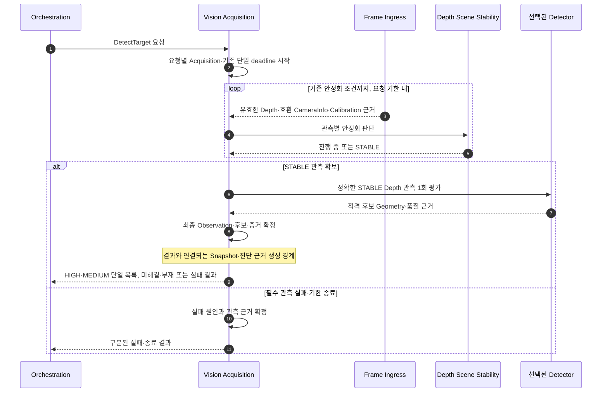
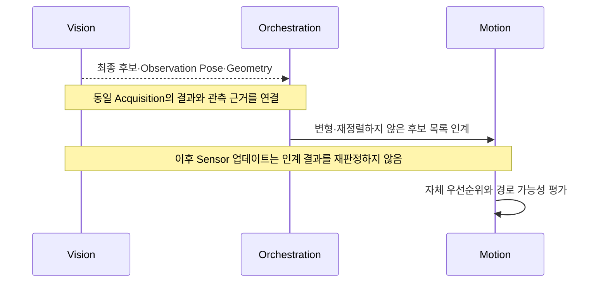

# [SF-Twin] ARM Cell Vision DetectTarget 기능 설계 (FDS)

- **Scope:** `ARM Cell Material Detection / DetectTarget Processing`
- **Owner:** `ARM Cell Material Detection`

## 목적과 동작 범위

DetectTarget은 명시적인 요청마다 유한한 Acquisition을 수행하고 유효한 관측의 Depth Scene Stability 및 선택된 Detector Strategy를 거쳐 결과와 연결된 증거를 확정한다. 상시 카메라 수신은 상시 검출을 뜻하지 않는다. 반환한 후보의 순위 재결정·실행 판단은 Motion, 미션 진행은 Orchestration이 소유한다.

- **시작:** DetectTarget 요청의 수락.
- **종료:** 성공·요청 범위의 실패/기한 종료·거부 및 해당 결과 근거 확정. 이미 인계한 Pose는 새 프레임으로 자동 재검증하지 않는다.
- **별도 경계:** 설치 Calibration은 독립 기능이며 DetectTarget의 자동 선행 단계가 아니다.

## 참여 책임과 계약

| 참여 책임 | 기능상 역할 | 정식 Owner |
|---|---|---|
| Orchestration | DetectTarget 요청·미션 조정과 결과 소비 | Orchestration FDS 및 [Vision–Orchestration ICD](../../interfaces/icd-vision-orchestration.md) |
| Vision Acquisition | 요청의 수락, 기한, 입력 근거와 결과 확정 | [Vision CDS](cds.md), 이 FDS |
| Frame Ingress | Depth·CameraInfo·필요 시 RGB 입력의 호환성 | [Frame Ingress FDS](fds-frame-ingress.md) |
| Depth Scene Stability | 기존 5회 관측 안정화 판단 | [Depth Scene Stability Algorithm](../../algorithms/depth-scene-stability.md) |
| Detector Strategy | 고정된 STABLE 관측에 대한 후보 적격성 평가 | [RawPart FDS](fds-rawpart-depth-perception.md) 및 해당 Algorithm |
| Motion | 인계된 후보 목록의 실행 우선순위·계획 | Motion FDS |
| Operator / Calibration | 명시적 보정 요청, 산출 파일 선택·재시작 | 이 FDS와 설치 Deployment Profile |

## 핵심 시나리오

### 요청별 Acquisition 및 결과 확정

위 도식은 기존 계약의 의미상 선후관계를 나타낸다. RGB는 선택적 표시 근거이고 Depth 안정화에 RGB pair를 필수로 요구하지 않는다. 명시적 fiducial Calibration은 별도 동기화 RGB-D 근거를 사용한다. 한 번 평가한 STABLE 관측에서 후보 적격성을 결정하며, Vision은 Motion의 파지 순위를 부여하지 않는다.

### 결과 인계와 증거 수명

## 결과·오류·관측의 읽기 기준

| 상황 | 정규 결과·판정 책임 | 진단으로 남길 근거 |
|---|---|---|
| 유효한 안정 관측과 후보 | Vision이 요청 결과 확정 | 입력 정체성, 안정화 판정, 후보 품질·관측 Pose·Geometry |
| Sensor/Calibration/Geometry 실패 | 각각의 관측·검출 책임이 원인 보고, Vision이 terminal 결과 확정 | 실패 단계, 입력 유효성, 기한·원인 |
| Snapshot 출력 실패 | Snapshot 진단 owner | 정규 DetectTarget 성공·실패 결과를 덮어쓰지 않음 |
| 인계 이후 후보 탐색 실패 | Motion | Vision이 후보를 재정렬하거나 재검출하는 결과로 해석하지 않음 |

## 1. 요청 처리 및 관측 흐름

위 **요청별 Acquisition 및 결과 확정** 시퀀스가 공통 처리 흐름을 정의한다. 그 시퀀스 밖의 원자적 BUSY 거부, Profile 선택, 요청별 Deadline 및 후보 인계의 고유 조건은 아래 본문에서 규정한다.

이 단계는 Profile에 공통인 DetectTarget 동작과 결과 의미를 정한다. Support 추정, Depth 변환, 후보 생성, Target 분리, Geometry fitting의 Profile 내부 알고리즘 및 순서는 규정하지 않는다. 세부 단계와 순서는 [RawPart Depth Perception FDS](fds-rawpart-depth-perception.md) 등 각 하위 Profile FDS가 소유하며, 공통 서비스 결과·freshness·frame·Observation Pose 계약을 변경하지 않고 구체화한다.

Algorithm 선택은 Recipe가 소유한다. Orchestration은 `vision.algorithm`을 DetectTarget의 `algorithm`으로 전달하고, Vision은 내부 관측 재시도를 포함한 해당 Acquisition 전체에서 선택값 그대로 검증·실행한다. Production RawPart의 지원 알고리즘은 `cuboid_top_face` 하나다. Recipe가 없는 호출의 실효 기본값도 Cuboid이어야 한다. 과거 서비스 필드의 Legacy 기본값은 구현 정합화 대상이다.

호출자는 [Vision–Orchestration ICD](../../interfaces/icd-vision-orchestration.md)가 정의한 상대 `builtin_interfaces/Duration` timeout을 제공한다. Vision은 요청을 수신한 시점에 steady monotonic deadline을 시작한다. 이는 절대 ROS Time이나 wall-clock deadline이 아니다.

운영 검출은 요청 기반이다. 카메라 스트림의 연속 발행은 관측 가능성을 제공할 뿐, Profile 처리는 활성 Acquisition 요청 동안에만 실행한다. 요청마다 서비스 수신부터 신선한 Depth 관측, Scene Stability, Profile 검증, terminal 응답까지 **하나의 steady monotonic deadline**을 사용한다. 안정화나 DetectTarget 대기 예산을 별도로 누적하지 않는다. 서비스 `timeout`은 전체 Acquisition 예산이며, Vision은 예산 내에서 불충분하거나 일시적으로 무효인 관측을 내부 재시도한다.

Detector를 실행하려면 유효한 Depth 관측이 연속 5회 필요하다. TF preflight가 불가능하면 Detector 결과를 기록하지 않고 같은 deadline 내 대기한다. 이후 새 관측을 사용하려면 그 관측 자체의 Depth 평가가 STABLE이어야 한다. 선택 Detector는 STABLE이 된 정확한 Depth 관측에서 한 번 실행하며, 근처 시각의 호환 RGB는 선택적인 표시 자료일 뿐이다. Detector는 모든 가설을 내부 평가하고 SELECTED HIGH·MEDIUM 후보 전체를 단일 `material_candidates` 목록으로 같은 Acquisition에 반환한다. 단일 목록이 비어 있고 유효한 최종 관측에서 개별 Geometry를 확정하지 못한 경우 기존 `DETECT_RESULT_GEOMETRY_ERROR` 및 근거가 있는 `disturbance_candidates` 의미를 적용한다. `DETECT_RESULT_TEMPORARY_INVALID_TARGET`은 일시적인 관측 Evidence 부족에 한정한다. LOW·REJECTED는 일반 PICK 후보로 반환하지 않는다. `OBJECT_NOT_FOUND`는 유효한 Absence 조건이 부재를 확정한 경우에만 반환하며 불충분하거나 모호한 관측은 부재가 아니다.

모든 후보 Geometry는 동일한 최종 Depth 관측에서 나온다. Vision은 단일 대표 후보를 선택하거나 Pose·ID·Geometry·Confidence를 Acquisition 공통 결과에 투영하지 않는다. Acquisition 진단과 전체 가설·Selection·Boundary·Plane Map·Replay·Disturbance 근거는 특정 후보와 독립적으로 보존한다. 성공적으로 인계한 뒤 Vision은 목록을 보존하지 않는다. Orchestration은 전체 목록을 변경 없이 한 PICK Goal로 전달하고 Task Execution은 후보 우선순위·전환을 소유한다. Strategy별 후보 참여 및 필수 출력은 [RawPart FDS](fds-rawpart-depth-perception.md), ROS 필드와 후보 Geometry 의미는 ICD를 따른다. 물체 하나를 처리한 후 다음 물체는 새로운 관측에서 검출한다. 요청은 `/vision/scene_stability_active`를 사용하지 않는다. `scene_generation`은 호환·진단 식별자로 채울 수 있으나 호출자의 추가 수락 Gate가 아니다.

Orchestration은 PICK 슬롯별로 동시에 하나 이하의 DetectTarget 요청을 보낸다. Vision은 전역적으로도 서비스를 직렬화해 하나의 Acquisition만 처리 상태를 소유할 수 있게 한다. 경쟁 요청은 즉시 `DETECT_RESULT_BUSY`와 빈 `acquisition_id`를 반환하며 새로운 Acquisition·Snapshot·Detector 처리는 없다. 수락된 요청을 Queue에 넣거나 취소·교체하지 않는다. 이 Owner 측 원자적 수락은 개발 클라이언트가 자체 가용성 관측을 경합시키더라도 Mission Acquisition을 보호한다. Orchestration은 BUSY를 임시 슬롯 경합으로 취급해 Mission을 종료하거나 Motion을 제출하지 않은 채 Vision `IDLE`을 기다린 뒤 정상 요청을 보낸다. Hub는 재전송하지 않고 BUSY를 표시하며 운영자는 IDLE 이후 다시 누를 수 있다.

현재 PLACE 작업이 Gripper Phase에 진입했다는 Motion feedback이 오면 Orchestration은 다음 물체의 DetectTarget 요청을 하나 시작할 수 있다. 이 PLACE Lookahead는 별도 다음 물체 Acquisition이다. PLACE 실패·취소·Safety 선점 시 Lookahead 결과는 폐기한다. 처리 수량은 Orchestration이 소유하며 Vision에 수량 기반 Gate는 없다. 후보 ID는 한 Acquisition 안에서만 유일하며 지속 객체를 식별하지 않는다. Vision은 적용 Profile의 관측 상판 높이 tolerance를 후보마다 함께 반환한다. Cuboid는 `cuboid.height_tolerance_m`을 사용하고 Acquisition 내에서는 변경하지 않는다. Orchestration은 목록을 하나의 PICK Goal로 전달하며 Motion은 이 값을 관측 높이가 동등한 후보 그룹 판단에만 사용한다. Lookahead 결과는 PLACE가 fresh `RELEASED`로 성공하기 전까지 별도로 유지한다.

## 1.1 관측과 연결된 진단의 생성 시점

DetectTarget의 진단은 수락된 Acquisition과 연결된다. Vision은 신선한 Depth·호환 CameraInfo·선택 Calibration으로 Depth Scene Stability를 평가하고, STABLE로 확정된 **바로 그 Depth 관측**에서 선택 Detector를 한 번 실행한다. TF preflight가 일시적으로 불가능하면 동일 Deadline 안에서 대기하며, 이후 사용한 관측도 자체적으로 STABLE이어야 한다. Detector가 실제 실행된 경우 유효한 부재·Geometry 실패를 포함하여 해당 결과를 한 번 확정한다. 무효 입력·유효 Depth Pixel 부재·시간 비교에 사용할 Pixel 부재는 기존 Stability 판단에 따라 연속 관측을 초기화하거나 보류한다. Tray Visibility·Coverage Ratio는 Detector 진입 Gate가 아니다.

진단 출력은 각 판단이 실제로 끝난 시점에 존재하는 근거에 한정한다. Detector 결과를 확정한 **이후** Snapshot용 호환 RGB를 선택할 수 있고, 선택으로 인해 Detector를 재실행하거나 결과를 바꾸지 않는다. 입력·관측·결과와 RGB가 나타내는 원본의 의미, 각 Header/Stamp·Frame·상태·유효성의 보장 및 소비자의 호환성·stale 해석은 [Vision–Orchestration ICD](../../interfaces/icd-vision-orchestration.md)가 소유한다. 선택적 RGB를 Depth Detection의 추가 Gate로 만들지 않는다.

Acquisition은 `IDLE`에서 `DETECTING`으로 진행하고 terminal 응답과 연결된 진단을 확정한 뒤 `IDLE`로 돌아간다. 성공 진단을 지속적 Target Lock 상태로 전환하지 않는다. Terminal Timeout에는 이미 관측한 가장 구체적인 처리 단계를 보고하고, 상세 진단은 해당 시점까지 확보한 입력 근거만 사용한다. 진단 발행 실패는 canonical DetectTarget 결과에 영향을 주지 않는다. `/vision/diagnostics`의 공개 필드·`VisionDiagnostic`의 해석 및 Hub의 표시용 Source Matching 계약은 ICD를 참조한다.

## 1.2 Diagnostic Snapshot과의 기능 경계

DetectTarget은 terminal 결과와 해당 요청에서 이미 확정된 관측 근거를 [Diagnostic Snapshot FDS](fds-diagnostic-snapshot.md)에 제공한다. Snapshot의 렌더링·저장·발행은 별도 부수 효과이며 DetectTarget 결과, Deadline 및 Mission 진행을 변경하지 않는다. Shared Snapshot Payload·Source Identity·진단의 의미와 소비자 해석은 [Vision–Orchestration ICD](../../interfaces/icd-vision-orchestration.md)를 따른다.

### Vision 오위치 진단 시나리오

시뮬레이션·테스트 전용 `/vision/test_scenario/mislocalize_next` 요청은 Vision 내부에서 단발성 위치 교란을 Arm한다. Vision은 먼저 정상 RawPart Detection·전체 후보 열거·Scene Stability·TF 변환·후보별 성공 Pose 검증을 모두 완료한다. 성공 결과를 반환하기 직전에 **반환 목록의 모든 후보 Pose 위치만 동일하게** 보정된 Tray/Support Plane의 양의 법선 방향으로 100mm 평행 이동한다. 방향은 반환 Frame인 `base_link`로 표현하며 기존 [RawPart Support Frame 계약](fds-rawpart-depth-perception.md)에 따라 Support Frame 및 Calibration/TF 변환에서 구한다. 선택된 Workpiece 상판 방향을 따르는 Pose Local `+Z`와 같다고 가정하지 않는다. 실제 반환 위치가 물리적으로 위로 이동하도록 변환된 Frame에서 Offset을 적용한다.

`PoseStamped` Header, Source Timestamp, Frame, Orientation, `target_id`, Acquisition/Calibration 식별자, 측정 Geometry, Result Code 및 다른 모든 Response Field는 정상 Detection 결과 그대로다. 원본 관측·후보 집합·Isaac Scene도 변경하지 않는다. 이 통제된 테스트 자극만 정상 반환 Pose가 관측된 Profile Reference를 나타낸다는 원칙의 예외이며 일반 오위치 Algorithm·신규 Adapter·별도 Detector 경로를 도입하지 않는다.

현재 데모 장면에는 Support Surface 위에 공중에 떠 있는 다른 RawPart가 없다. 단발 Offset은 성공 목록의 모든 후보 Pose 위치에 동일하게 적용하며 다른 Material Candidate를 선택하거나 대체하지 않는다.

대기 중인 요청은 Arm 요청을 수락한 **이후** Admit된 Acquisition에만 적용한다. Arm 수락 시 이미 활성인 Acquisition에는 적용하지 않는다. 완전히 유효성 검증된 성공 Detection Pose의 반환 직전에만 원자적으로 소비한다. `BUSY`·실패·무효·Timeout·내부 취소 Acquisition은 소비하지 않으므로 다음 적격 Acquisition에 적용될 수 있다. 소비 후 이후 Acquisition은 정상 처리한다. Disarm(`data=false`)은 아직 대기 중인 요청만 지운다. 성공 결과의 Vision 진단은 Acquisition ID와 후보 ID별 원래 Pose, 교란 후 반환 Pose, 적용 Offset, 단발 요청 소비 여부를 연결해 보고한다. 반환된 Vision Snapshot/Result는 동일한 원본 관측과 실제 반환 Pose를 계속 식별한다.

위쪽 100mm 이동은 실제 PICK Miss를 유도하기 위해 선택한 데모 값이다. 현재 Capture Geometry를 근거로 정했지만 설계만으로 Approach/Insertion Planning 성공, Gripper Capture 실패, Fresh `RELEASED` 관측, Orchestration의 Retry-safe 실패 분류가 보장되지는 않는다. 정상 Motion·Gripper 경로를 사용하는 Live Test에서 각각 검증한다. Retry를 강제하려고 Result나 Holding State를 조작하지 않는다. Retry는 기존 Mission Cycle Retry Admission을 충족할 때에만 진행하며 `GO_HOME → 새 DetectTarget Acquisition → 새 PICK`을 수행한다. 그렇지 않으면 기존 Terminal Failure 정책을 적용한다.

### 설치 Calibration과의 기능 경계

DetectTarget은 운영자가 선택해 Vision 시작 시 로드된 Calibration의 호환성을 소비한다. 명시적 보정 요청·산출 파일 생성·운영 파일 전환은 [Installation Calibration FDS](fds-installation-calibration.md)가 소유하며 DetectTarget을 실행할 때 자동 Calibration을 수행하지 않는다.

## 2. Target Profile 선택

`DetectTarget.target_id`는 배포 설정에 등록된 Vision 소유 Detector Profile을 선택해야 한다. 서비스 경계는 요청 식별자를 Profile 해석 및 처리까지 전달해야 한다. 알 수 없거나 미설정된 ID는 일반 Foreground Segmentation으로 Fallback하지 않고 `DETECT_RESULT_INVALID_RESULT`를 반환해야 한다. 유효하게 설정된 Profile에서 일치 Target이 없으면 `DETECT_RESULT_OBJECT_NOT_FOUND`를 반환한다.

배포 설정은 Target ID와 Profile의 매핑 및 Profile별 Parameter를 소유한다. 지원되는 운영 Profile에서 이는 논리 Target ID를 Key로 하는 `vision.detector_profiles` 매핑이며 각 항목의 논리 구조는 다음과 같다.

| 항목 | 필요 여부 | 내용 |
|---|---|---|
| `selection_constraints` | 필수 | 요청 Target을 Sensor 관측에서 분리하는 배포/Profile별 제약. Workspace ROI·연결 Depth Component·관측 Appearance 또는 동등한 Perception 소유 근거 가능 |
| `geometry_constraints` | 필수 | Profile별 Size·Extent 및 Target Geometry 유효 범위 |
| `yaw_observability_constraints` | 선택 | 선택 Geometry로 유효한 Object Yaw를 관측할 수 있는지 판단하는 Profile별 조건 |

매핑과 값은 Deployment Configuration이다. 중첩 제약 Parameter는 선택 Vision Profile이 정의하며 이 동작 계약이나 공개 ICD는 특정 Algorithm·숫자 임계값을 고정하지 않는다.

RawPart Profile은 인지 소유 제약으로 경쟁 Foreground Geometry에서 요청 관측을 분리해야 한다. 분리가 가능한 환경 전제와 Simulator Ground Truth 독립성은 [ARM Cell Simulation Environment Semantics](../simulation-environment-semantics.md)가 소유한다. 이 FDS는 Sensor 관측에 대한 Target Profile 처리 동작을 소유한다.

## 3. 자재 소진 의미

`OBJECT_NOT_FOUND`는 정상적인 자재 소진 근거이며 Sensor·Calibration·TF·Geometry 품질 실패와 구별해야 한다.

최종 STABLE Depth 관측에서 Detector의 유효한 RawPart 작업 영역 Coverage 및 Support Geometry가 **부재를 확정했을 때만** `OBJECT_NOT_FOUND`를 반환한다. 관측된 후보가 Geometry 조건을 만족할 가능성이 있을 때는 이러한 부재 확정 조건을 Detector 실행 Gate로 사용하지 않는다.

불충분하거나 무효인 Scene Stability 입력은 같은 Deadline 내에서 재시도한다. Detector를 한 번 호출한 뒤에는 추가 Detection Run 없이 후보, 유효한 부재 또는 Geometry 실패를 반환한다. 관측 불가·모호한 Detector 결과는 실패이며 부재로 보고하지 않는다.

## 4. Geometry

Vision은 RANSAC/PCA 또는 승인된 동등 Algorithm으로 다음을 도출할 수 있다.

- Support/Surface 관계
- Object Height
- 선택 Profile이 선언한 기하학적 기준점
- Grasp-reference Yaw
- 품질 지표

Verification Requirement에서 요구하지 않는 한 내부 Algorithm의 정확한 구현 형태는 Canonical 계약이 아니다.

`target_pose`는 선택된 Profile의 Observation Pose 기준을 `base_link`로 변환해 보고해야 하며 Robot/Tool/TCP 보정을 포함하지 않는다. Profile은 가시 표면·객체 중심 또는 다른 Sensor 기반 Geometry Feature를 기준으로 정의할 수 있다. RawPart의 가시 상판 Centroid는 하위 Profile FDS의 계약이지 전체 Profile에 일반화되지 않는다. Observation Pose에서 Object Pose 및 Grasp TCP Geometry로의 변환은 Motion이 소유한다.

RawPart의 `estimated_height_m`는 선택 객체 자체의 수직 두께로, 측정값 또는 지원되는 Face Hypothesis에서 해석한 값이다. Tray에서 상판까지의 Stack Elevation이 아니다. 반환된 `target_pose.position.x`, `.y`, `.z`를 변경·대체해서는 안 된다. Motion은 변경되지 않은 상판 Observation Pose로 Object Pose를 도출할 때에만 해당 Extent를 사용한다.

## 5. Orientation Symmetry

Object Geometry가 안정적인 방향을 뒷받침하지 않으면 Vision은 임의의 불안정한 Orientation을 유효하다고 보고해서는 안 된다. 응답의 `orientation_symmetry_order`는 고유 Yaw(`1`), 관측된 RawPart Rectangle 대칭(서로 다른 변은 `2`, 같은 변은 `4`), 관측 불가능한 방향(`0`)을 구별한다.

Order `0`에서는 `target_pose.orientation`을 사용할 수 없고, `1`은 고유 Object Orientation, `2`는 180도 Modulo의 비정사각 Rectangle 장축 대표 방향, `4`는 90도 Modulo의 정사각 Edge Angle 대표 방향이다. 이 Order는 인계 전체에서 권위 있는 값이다.

Recipe의 미관측 Yaw fallback 허용 여부는 Recipe snapshot을 적용하는 Task Execution이 소유한다. Vision은 관측 가능한 방향 class와 Geometry 등급을 판정하며 Recipe 금지 조건을 완화하지 않는다. Task Execution은 Order `0`에서 Recipe가 fallback을 허용할 때에만 fallback 방향을 사용하고, 금지·누락·무효이면 후보를 실행에 제출하지 않고 기존 PnP 실패 분류를 적용한다. Orchestration은 이 판정을 재구현하거나 방향 미관측만을 위한 별도 Acquisition Retry 분기를 추가하지 않는다. Vision은 발행 전 무효한 선택적 Geometry를 걸러낼 책임을 유지한다.

## 6. TF

성공 Pose 출력을 위해서는 Camera Optical Frame에서 `base_link`로의 유효한 Transform이 필요하다. Vision은 TF를 소비하며 경쟁하는 Camera/Robot TF를 발행하지 않는다.

### 미확정 교란 후보의 Acquisition 반환

안정 Depth 및 Detector 평가가 유효하면 SELECTED HIGH·MEDIUM 후보 전체를 단일 목록으로 같은 Acquisition에 반환한다. 단일 목록이 비고 미확정 관측 영역이 남은 경우, 실제 관측 근거가 있는 `OTHER_UNRESOLVED` 영역을 교란 후보로 함께 반환할 수 있다. LOW·REJECTED 가설과 해당 관측 점유 근거는 Vision 진단·Snapshot에 보존한다. 이는 관측으로 확정된 자재 부재(`OBJECT_NOT_FOUND`)가 아니다. 유효한 최종 관측의 Geometry 미해결과 일시적 관측 Evidence 부족은 기존 Geometry Failure와 Temporary Invalid Result로 각각 구분하며 Sensor·TF·Calibration·Freshness·Timeout 오류도 원래 분류를 유지한다. 교란 후보가 없다는 이유로 관측 근거 없는 후보를 만들지 않는다. `OBJECT_NOT_FOUND`는 기존 valid-absence 판정이 성립한 경우에만 사용한다. 추가 안정화 Gate나 별도 Acquisition을 생성하지 않는다.

## 7. Verification Requirements

### VR-VIS-DETECT-DISTURB — 미확정 관측과 유효 부재 구분

유효한 최종 관측의 미확정 복합 Geometry는 실제 관측 영역 근거와 Acquisition identity를 보존한 기존 `OTHER_UNRESOLVED` 교란 후보를 반환할 수 있어야 한다(SHALL). 후보 중심·높이는 관측 Grid 셀로 산출하고 가상 경계·Recipe 기반 임의 Pose·미관측 영역 외삽을 사용해서는 안 된다(SHALL NOT). HIGH/MEDIUM로 PICK에 인계한 객체는 중복 교란 후보로 만들지 않는다(SHALL NOT). `OBJECT_NOT_FOUND` 및 Sensor·TF·Freshness·Timeout 오류를 교란 가능 상태로 변경해서는 안 된다(SHALL NOT).

### VR-VIS-DETECT-01 — 정상 소진 구별

정상 소진은 `OBJECT_NOT_FOUND`만으로 표현해야 한다.

### VR-VIS-DETECT-02 — Geometry 실패 분류

필수 객체 위치의 Geometry가 불충분하거나 무효이면 Detection 성공으로 반환해서는 안 된다. 위치가 유효하지만 Yaw를 관측할 수 없으면 `orientation_symmetry_order=0`과 사용할 수 없는 Pose Orientation을 포함한 성공 결과를 반환해야 한다. 충분히 관측된 RawPart는 서로 다른 변에 Order 2, 같은 변에 Order 4를 반환하고 측정 대표 방향을 유지하되 고유 Orientation이라고 주장하지 않는다.

### VR-VIS-DETECT-03 — TF 실패 분류

Optical→Base Transform이 없거나 유효하지 않으면 Vision 실패 결과를 반환해야 한다.

### VR-VIS-DETECT-04 — Profile별 관측 기준점

성공 Target Pose는 선택 Detector Profile이 정의한 3D Observation Reference의 `base_link` 좌표여야 한다. Profile에서 명시하지 않는 한 Object Center 또는 Grasp TCP Pose를 의미하지 않는다.

### VR-VIS-DETECT-05 — Yaw 모호성

Object Geometry의 Yaw가 불안정하거나 관측 불가능하면 성공 결과에 임의의 Orientation을 유효한 Yaw처럼 포함해서는 안 된다. Vision은 유효한 관측 위치를 보존하면서 Orientation Order 0을 보고할 수 있다. Orchestration은 필수 명시 정책이 허용할 때에만 별도 Recipe Fallback Direction을 사용할 수 있으며 `target_pose.orientation`은 사용하지 않는다. RawPart Order 2는 측정 장축의 180도 Modulo Class, Order 4는 정사각형 측정 Edge의 90도 Modulo Class다. 어느 쪽도 임의 Orientation Search를 허용하지 않는다. Vision의 Robot/Tool/TCP 보정 권한도 생기지 않는다.

### VR-VIS-DETECT-06 — Target ID에 따른 Profile 선택

서로 다른 설정된 `target_id`의 요청은 각 ID를 Profile Resolution에 전달하고, 처리에서 ID를 무시하거나 전역 Foreground Set을 사용하지 않고 대응 Profile을 사용해야 한다.

### VR-VIS-DETECT-07 — 미등록 Profile 결과

알 수 없거나 설정되지 않은 `target_id`는 `DETECT_RESULT_INVALID_RESULT`를 반환하며 `DETECT_RESULT_OBJECT_NOT_FOUND`로 치환해서는 안 된다.

### VR-VIS-DETECT-08 — 등록된 Profile의 소진

유효하게 설정된 Profile에 일치하는 Target이 없으면 `DETECT_RESULT_OBJECT_NOT_FOUND`를 반환해야 한다.

### VR-VIS-DETECT-09 — 경쟁 Foreground 분리

요청 Target과 무관한 Foreground 객체가 하나 이상 함께 있을 때 선택 Target Pose는 요청 Target만에서 도출해야 하며 무관한 Geometry가 해당 Pose를 이동·재정의해서는 안 된다.

### VR-VIS-DETECT-10 — RawPart Profile 선택

설정된 RawPart Profile은 승인된 Acceptance Observation에서 관측된 RawPart Target을 선택하고 경쟁 Foreground Geometry를 배제하며 RawPart 관측이 없으면 Object Not Found를 보고해야 한다.

### VR-VIS-DETECT-11 — Profile 정의 Observation Pose

알려진 Sensor Observation Fixture에서 선택 Target의 성공 Position은 Fixture에 선언된 Tolerance 내에서 선택 Profile의 Sensor 기반 Geometry Reference에 일치해야 하고 `base_link`로 변환되어야 한다. RawPart Profile의 세부 동작은 하위 FDS로 검증한다.

### VR-VIS-DETECT-12 — Orientation 관측 가능성과 부재

안정적인 선택 Surface Geometry의 고유 Orientation은 `orientation_symmetry_order=1`인 유효한 Object-centric Yaw로 반환한다. 측정 RawPart Rectangle은 다른 변에 Order 2, 같은 변에 Order 4로 대표 방향을 보존한다. 모호하거나 관측 불가능한 Orientation에서는 유효 xyz를 유지하며 Order 0과 사용할 수 없는 `target_pose.orientation`을 보고한다.

### VR-VIS-DETECT-13 — Environment Semantics 참조

Production Vision의 Simulator Ground Truth 독립성은 [ARM Cell Simulation Environment Semantics](../simulation-environment-semantics.md)의 `VR-ARM-SIM-ENV-10`이 소유·검증한다.

### VR-VIS-DETECT-14 — TCP/Tool 보정 금지

Robot/Tool Geometry가 바뀌거나 제거되어도 Vision Object Reference 결과는 변하지 않아야 하며 Vision은 TCP/Tool 보정을 수행하지 않는다.

### VR-VIS-DETECT-15 — Estimated Height의 비권한성

`estimated_height_m`을 변경·생략하거나 값이 달라져도 반환 Target xyz/z는 변하지 않아야 한다. 반환 Position은 Optical에서 `base_link`로 변환한 선택 Detector Profile의 Observation Pose를 유지한다.

### VR-VIS-DETECT-19 — 단발 Vision 오위치

테스트 시나리오를 Arm하면 다음 완전히 검증된 성공 Acquisition의 모든 후보 Pose는 RawPart Support Frame 계약에 따른 보정 Support Plane의 위쪽 법선을 `base_link`로 표현한 방향으로 **Position만 100mm** 이동한 동일 정상 결과를 반환해야 한다. 방향을 Object Local `+Z`에서 가져오면 안 된다. 선택 RawPart의 원본 관측·Scene·Frame·Stamp·Orientation·Target/Acquisition 식별자·Calibration·측정 Geometry는 그대로다. 실패·Timeout·Invalid·BUSY·Canceled Acquisition은 Arm 상태를 유지하고 성공 하나만 정확히 한 번 소비하며 이후 Acquisition은 정상이다. Vision 진단은 후보 ID별 원래 좌표와 반환 좌표 및 소비 Acquisition을 구별해야 한다. Motion·Gripper 결과는 정상 실행·관측 경로에서만 발생해야 한다. Live Verification은 Planning/Execution, Capture, Fresh `RELEASED`, 기존 Retry Admission을 평가하며 이 FDS는 해당 결과의 성공을 보증하지 않는다. Oracle은 연결된 DetectTarget 응답·원본 식별자·Vision 진단 및 이후 Motion PICK Action Result·Fresh Gripper Disposition·Orchestration Retry 결정이다.

### VR-VIS-DETECT-20 — Depth Scene Stability Detector Gate

Depth Scene Stability는 RGB Pixel·Candidate Output·Simulator Ground Truth 없이 Depth 값만으로 판정한다. 샘플은 RGB Pairing과 독립적인, 호환 CameraInfo·Calibration을 가진 신선한 Depth 관측이다. Detection 전에 연속 유효 샘플 5개가 필요하며 Detector는 정확히 STABLE로 평가된 Depth 관측을 받아야 한다. TF Preflight로 호출할 수 없으면 동일 Acquisition Deadline 내 대기할 수 있고 이후 관측을 쓰려면 그 관측도 STABLE이어야 한다. Stable 판정만으로 유효한 부재·후보 인계를 생성할 수 없다. 무효 Time·비호환 CameraInfo/Calibration·유효 Depth Pixel 부재·두 시간 비교 중 하나라도 Comparable Pixel 부재·설정 Tolerance를 초과한 Changed-Pixel Ratio는 STABLE을 만들 수 없다. Tray Visibility·Coverage Ratio는 Detector 진입 조건이 아니다. Scene Stability는 원래 Camera Depth(m 단위)를 Filter·Projection·Segmentation·Candidate Data 없이 비교하며 Detector Geometry 적격성·후보 결과·유효 부재 Coverage 규칙을 변경하지 않는다.
