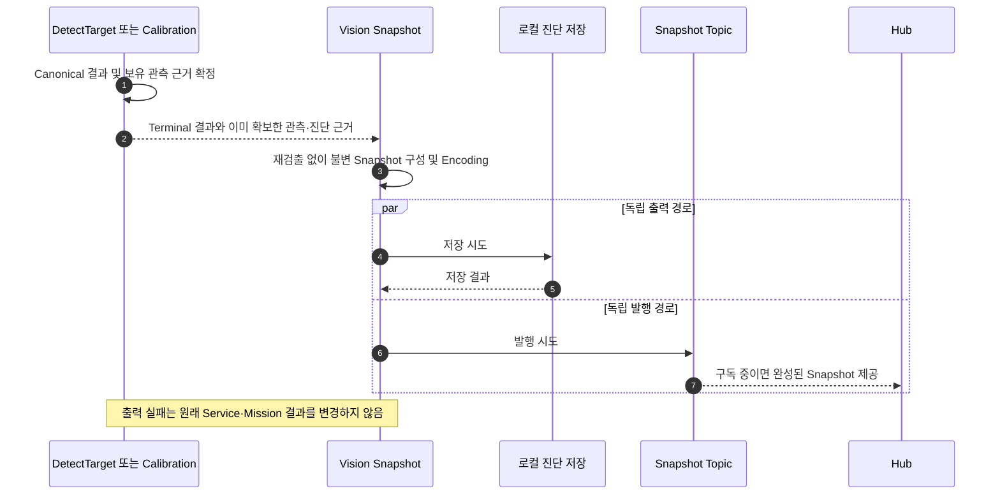

# [SF-Twin] ARM Cell Vision Diagnostic Snapshot 기능 설계 (FDS)

- **범위:** `ARM Cell Vision / Diagnostic Snapshot`
- **소유자:** `ARM Cell Vision`
- **관련 문서:** [Vision CDS](cds.md) · [DetectTarget FDS](fds-detect-target.md) · [Installation Calibration FDS](fds-installation-calibration.md) · [Vision–Orchestration ICD](../../interfaces/icd-vision-orchestration.md)

## 기능 경계

이 FDS는 DetectTarget과 명시적 Installation Calibration 결과를 **진단용 Snapshot으로 확정·렌더링·저장·발행하는 시점과 실패 처리**를 소유한다. DetectTarget의 결과 판단이나 Calibration의 운영 파일 적용을 수행하지 않는다. Source Header·Snapshot ID·Metadata·Diagnostic Record 등 여러 소비자가 해석하는 공유 의미는 ICD가 소유하며, Detector 계산 절차는 해당 Algorithm이 소유한다.



## 관측의 확정 시점과 공유 계약

| 기능 | Snapshot 생성 조건 | 미생성/실패 조건 | 의미 Owner |
|---|---|---|---|
| DetectTarget | 수락된 Acquisition의 terminal 성공·실패 | 진행 중 Frame마다 생성하지 않음 | Snapshot·Diagnostic Field 의미는 ICD |
| Installation Calibration | 명시적 Calibration 성공으로 파일 생성 완료 | 시작 시 파일 로드·READY 발행·실패 요청 | Calibration 상태 의미는 ICD |
| 상세 진단 | 선택된 상세 진단과 이미 확보한 Detector 근거 | 추가 Detector 실행·재샘플링 금지 | 계산 근거는 Algorithm, 공유 진단 의미는 ICD |

## Snapshot 수명과 진단 근거

Snapshot 생성·저장·발행의 시간적 순서는 위 시퀀스가 소유한다. Snapshot은 최종 Depth 관측 하나와 호환되는 선택적 RGB, 그 관측에 연결된 Vision 판단을 불변의 revisioned 형태로 표시한다. 진단 근거이지 Log 대체물이나 Safety·Motion·Orchestration·PICK admission·Mission 성공 판단 입력이 아니다.

기존 `VisionDiagnostic`은 대표 후보 투영 없이 Acquisition 요청 처리·관측 진단을, `VisionCalibration`은 Support Calibration을, `SceneStability`는 요청 내 다중 관측 안정화 상태를 계속 보고한다. Vision 내부 입력이자 읽기 전용 Hub 진단이지만 완전히 Rendered된 Snapshot을 운반하지는 않는다. `DetectionSnapshot`은 Hub 로컬 View Container로만 사용한다. Hub는 Raw RGB-D Pairing·Snapshot Annotation 구성·Detector 재실행을 하지 않는다. 최소한의 완전한 Snapshot 전송은 [Vision ICD](../../interfaces/icd-vision-orchestration.md)가 정의한다.

Vision은 해당 프레임 Detector 결과에 사용한 **동일한 `DetectionInput`**에서 Snapshot을 생성한다. 이미지·원본 Depth 식별자·선택적 RGB 식별자·ROI/Support Annotation은 같은 관측을 가리킨다. 후보 수·상태는 이미지 Annotation 설명에 필요할 때만 표시한다. 여러 프레임에 걸친 Calibration 또는 Stability 결론을 대표 이미지 하나에서 계산한 것처럼 표시하지 않는다. 선택 Detector Profile의 고유 진단은 Snapshot Metadata가 아니라 해당 Profile 소유다. 공통 Snapshot은 RawPart 전용 단계·Geometry·거부 이유를 요구하지 않는다. 증거를 채우려 또 다른 Strategy나 Detection을 실행해서는 안 된다. Profile 미확정 실패에는 선택 근거를 unavailable로 남기고 Calibration Snapshot에서 Detector 선택을 꾸며내지 않는다. JSON versioning은 ICD가 소유한다.

Snapshot의 lifecycle 이벤트는 다음과 같다.

- **Calibration 결과:** terminal `CALIBRATION_COMPLETE` Snapshot은 명시적 요청의 검증 성공과 산출 파일 생성을 기록할 수 있다. 파일을 운영에서 선택하거나 로드했다는 뜻이 아니다. 작업 진행/결과는 Service 응답으로만 공개한다. 시작 시 파일 로드와 READY 발행은 Calibration Snapshot을 만들지 않는다.
- **DetectTarget terminal:** 성공은 선택 Profile의 결과, 해당 Profile이 제공한 RawPart 선택, canonical Target Pose, Orientation Symmetry Order를 포함한다. 연결된 Diagnostic Record에는 다중 관측 Acquisition Stability 요약을 기록한다. 실패는 실제 처리한 마지막 대표 관측, canonical terminal 결과, 관측된 가장 구체적인 처리 단계를 포함한다. Candidate/Match/Reject 및 부재 확인 근거는 선택 Profile이 계산한 경우 연결된 Vision Diagnostic Record가 소유한다. 사용 가능한 Depth 관측이 없으면 이미지에 원본 관측 부재를 명시한다.

Snapshot 이미지는 해당 Acquisition에서 Runtime이 실제로 계산·평가한 정보의 시각 증거다. Snapshot 전용 후보 생성, 추가 Contour·Line 추출, Geometry 검증, 후보 재분류·재정렬, 가설 정규화·중복 제거, 임의 표시 개수 제한, 미관측 Geometry 생성, 서로 다른 Frame 간 근거 결합을 해서는 안 된다(SHALL NOT). 이미지에는 패널 식별자와 최소 Candidate/Hypothesis ID, 해석에 필요한 축·범례만 둔다. 좌표·Yaw·치수의 후보별 나열, Confidence·Geometry 거부 이유, 처리 통계, Stability Threshold·Reset 사유의 장문 설명, 교란 Category·좌표 목록은 이미지에 쓰지 않고 기존 Metadata/Diagnostic Record에 둔다.

### Snapshot 이미지 구성과 책임

| 파일 | 구성·표현 책임 | Availability 및 관측 제한 |
|---|---|---|
| `snapshot.png` | 선택적 호환 RGB의 최종 HIGH·MEDIUM 반환 윤곽·ID와 기존 DisturbanceCandidate 대표점 | RGB가 없거나 투영할 수 없으면 가상 Annotation 없이 RGB 없음/표시 unavailable을 기록한다. Calibration Snapshot의 기존 Readiness 표현을 유지한다. |
| `geometry_observation.png` | 가로 3패널: ① 관측 Height Grid와 실제 미관측 영역, ② 단색 배경의 원본 Boundary Extraction (관측 Contour·Fitted Edge·관측 모서리), ③ 실제 Plane 관측 Cell·ID·상태의 Plane Map | Stage 1은 `cuboid_replay_evidence.height_grid_m`을 사용한다. Stage 2는 `cuboid_boundaries`에 보존된 Plane 해석 전의 관측 Contour·Fitted Edge·모서리만 표시한다. 후속 Plane 분할, Rectangle, Hypothesis, Anchor 및 Selection을 표시하지 않는다. 미실행·미관측·렌더 불가를 구분해 Unavailable로 남긴다. |
| `geometry_interpretation.png` | 가로 2패널: ④ Stage 3 Plane Map 위의 Runtime Rectangle Partition·전체 Hypothesis 평가 상태, ⑤ 동일한 Plane Map 위의 최종 HIGH·MEDIUM 반환 윤곽 | Stage 3은 `PlaneRegion`에서 보존한 관측 Cell만 사용한다. Stage 4는 `rectangle_regions`·`inferred_partition_edges` 및 보존된 Hypothesis·Candidate 근거만 합성해 표시한다. 관측 근거는 실선, 추론 경계는 점선이다. 같은 Acquisition의 실제 기록만 표시하며 서로 다른 Frame의 근거를 보충하지 않는다. |
| `scene_stability_panorama.png` | 최근 최대 5개 Depth Observation의 변화·안정화 경과 및 실제 최종 상태 | 존재하는 관측만 표시한다. 보존되지 않은 Observation을 만들거나 관측 범위를 늘리지 않는다. |
| 기존 `metadata.json` | Source·판단·Stability·이미지 참조 및 출력 상태의 상세 수치·설명 | 기존 Schema와 Optional/Unavailable 표현을 사용하며 별도 Metadata 저장 체계를 만들지 않는다. |

`snapshot.png`의 RGB 후보 Annotation은 최종 Runtime 결과만 간결하게 나타낸다. 최종 정상 반환 HIGH는 녹색, MEDIUM은 파란색 윤곽과 ID로 표시한다. LOW·UNRESOLVED는 기존 Hypothesis와 진단 정보에 유지하며 별도의 RGB 정상 검출 객체로 표시하지 않는다. REJECTED와 미선택 대안도 RGB 대표 이미지에서 최종 객체로 표시하지 않는다. 실측·관측 경계는 실선, 평면 분할·Recipe 기반 추론/미관측 복원 경계는 점선으로 구분한다. Candidate ID는 필요한 경우 작은 식별 마커로만 표시한다. Support·Target 영역은 기존 근거가 있는 경우에 한해 시각 구분을 유지한다. Calibration Readiness Diagram의 기존 색상·의미는 바꾸지 않는다.

RGB의 최종 Result Code·HIGH/MEDIUM 개수·핵심 범례는 상단에 배치하며 원본 크기·방향을 유지한다. Geometry는 지도 바깥 별도 Header에 Stage 이름과 한 줄 핵심 정보를 둔다. Heightmap의 높이 색·미관측 표현, Boundary의 관측 실선·추론 점선·Anchor, Plane의 상태별 개수, Hypothesis의 전체 수·실제 SELECTED/ALTERNATIVE/UNRESOLVED/REJECTED 개수와 별도의 Confidence 색 의미를 표시한다. 하단 설명 문단·별도 범례 영역은 두지 않는다. 작은 지도나 겹친 ID는 기존 충돌 방지·표시 생략을 적용하고 원본 진단 ID는 보존한다.

기존 Plane/Hypothesis 분석에서 남는 관측 잔여 마스크는 내부 판정·진단에만 유지한다. 표시만을 위한 잔여 외곽선 추출·RGB 투영·진단 필드·Overlay는 생성하지 않는다. 이 잔여 표현은 LOW/UNRESOLVED Hypothesis, 원본 Boundary 및 DisturbanceCandidate와 구별하며 이들의 근거·대표점은 보존한다.

DisturbanceCandidate는 LOW·UNRESOLVED 가설 등 기존 관측 근거에서 Runtime이 결정한 독립적인 교란 후보이며 단순 관측 잔여 영역과 다르다. RGB Snapshot은 기존 대표점을 원·십자 마커로만 표시하며, 관측 잔여 영역 Overlay나 새로운 관측 외곽선·교란 대상 형상을 생성하지 않는다. 교란 대표점은 별도 Geometry 패널에 반복 표시하지 않는다. Category·좌표·높이·판정 근거는 기존 Metadata/Diagnostic Record에 둔다. Snapshot은 대표점이나 목표 위치를 새로 계산하지 않으며 교란 이동 방향·경로·충돌 안전성을 보장하거나 암시하지 않는다.

정상 Depth Detection에서 RGB는 선택적이다. Detector 결과 확정 뒤 Frame Ingress가 선택한 표시용 호환 RGB의 원본 Source Identity를 Depth와 별도로 보존하고 두 관측 Timestamp 차이는 Metadata에 기록한다. RGB 부재·공간 투영 불가 시 가상 Annotation을 만들지 않으며 정규 Depth Detection 결과를 바꾸지 않는다. Calibration Snapshot의 기존 RGB-D 측정 의미는 유지한다.

다섯 패널의 지도는 같은 Tray 좌표 범위·방향·축척과 전체 유효 관측 범위를 사용해 장면을 임의 Crop하지 않는다. 기존 Tray-to-RGB 방향 정렬 계약을 적용하되 픽셀 단위 RGB 정합을 의미하지 않는다. Plane Map은 등급과 무관한 구분용 색상을 사용하며 실제 평면 소속·관계를 바꾸지 않는다. 평면맵의 영역 식별 색상은 어두운 배경과 구별되는 밝은 고정 팔레트를 사용한다. 관측 근거 부족 영역도 식별 가능한 대비를 유지하며, 신뢰도·선택 상태는 기존 상태 표기와 함께 해석한다. 영역 색상 자체를 검출 성공·실패 의미로 사용하지 않는다. Stage 2는 Plane 해석 전 `cuboid_boundaries`의 원본 Contour·Fitted Edge·관측 모서리와 그 원본 식별만 표시한다. Rectangle Partition, 분할선, Hypothesis, Anchor, Selection은 Stage 2에 표시하지 않는다. Stage 3에는 PlaneRegion의 관측 Cell과 Runtime 상태만 표시한다. Stage 4와 Stage 5는 Stage 3 Plane Map을 그대로 배경으로 사용한다. Stage 4는 Runtime이 보존한 Rectangle Partition·전체 Hypothesis 평가·Selection 상태를, Stage 5는 최종 반환 후보 윤곽을 합성한다. 이 두 패널은 Snapshot의 추가 계산 단계가 아니라 Runtime이 기록한 평가 상태와 반환 상태를 각각 보여준다. 관측 근거는 실선, 추론 경계는 점선으로 표시한다. Stage 2와 Stage 3은 각각 자신의 실제 Runtime 결과만 표시하며 Snapshot에서 재추출·분할·보정·추론하지 않는다.

`geometry_interpretation.png`의 ④ Runtime Hypotheses 패널은 `cuboid_height_patches.rectangle_regions`·`inferred_partition_edges`와 `cuboid_hypotheses`를 사용하여 Runtime이 실제 평가한 기하 검증 통과·정규화 관계·미해결 모호성·REJECTED 가설과 기록된 최종 disposition을 모두 보여준다. 중첩 가설은 허용하며 Snapshot에서 가설을 생략·제한·중복 제거하지 않는다. Runtime이 정규화한 동등 가설은 실제 대표 Hypothesis ID와 원본 Hypothesis ID의 관계를 사용해 추적한다. 관측 외곽선은 실선, 평면 분할·Recipe 기반 추론/미관측 복원 경계는 점선으로 표현한다. LOW는 관측 부족·실제 가림의 객체 신뢰도로 표시하고, ALTERNATIVE·UNRESOLVED는 선택 상태·Hypothesis ID로 구분하여 LOW와 같은 의미로 표시하지 않는다. REJECTED는 얇은 붉은 점선으로 구분한다. ⑤ Final Selection 패널은 `ordered_candidates`의 최종 HIGH/녹색·MEDIUM/파란색 반환 후보만 표시한다. 후보별 `rawpart_candidate_diagnostics.fitted_outline_support`와 연결된 Hypothesis의 Pose 방향을 사용하며 전체 대안·거부 가설을 중첩하지 않는다. 반환 윤곽은 후보별로 보유한 진단 근거만 표시하고 근거가 부족한 후보의 윤곽만 생략한다. Header는 일부 윤곽만 표시 가능한 경우와 전체 윤곽 근거가 없는 경우를 구분한다. 기존 Manifest는 전체 반환 윤곽 근거가 갖춰졌을 때만 성공으로 표시하고 일부라도 부족하면 근거 미가용 상태를 유지한다. 이는 Runtime 후보의 무효나 검출 실패를 뜻하지 않으며 원본 Hypothesis·Selection 상태·집계·ID와 검출 결과를 변경하지 않는다. ③ Plane Map은 `cuboid_height_patches.observed_cells_xy`와 기록된 `plane_status`만 사용하며, Heightmap 색상 없이 관측 Plane 식별 색·ID·실제 상태를 보여주고 ④·⑤의 동일한 배경으로 사용한다. 모든 패널은 같은 Acquisition의 기존 근거와 Tray 좌표 범위·방향·축척을 사용하며 Snapshot에서 후보 판정·평가를 수행하지 않는다. 표시를 위한 Geometry 변경이나 실제 정보 Crop은 금지한다. ID·등급·정규화 관계·거부 근거·평가 결과는 기존 Metadata/Diagnostic Record와 연결한다.

Vision Snapshot은 검출 결과와 원본 관측 해석을 표시하며 Planning Occupancy를 생성하거나 복제하지 않는다. Motion planning map의 시각 증거는 [Motion Execution FDS](../motion/fds-motion-execution.md)가 소유한다.

`scene_stability_panorama.png`는 히스토그램 열거보다 연속 관측의 안정화 경과와 최종 Runtime 판정을 중심으로 한다. 최근 최대 5개 Depth Observation의 순서, Baseline 대비 절대 Depth Difference, Previous Observation 대비 절대 Depth Difference, 관측별 Changed Pixel Ratio, 연속 유효 관측 진행 상태와 실제 `STABLE`/`UNSTABLE`/`UNOBSERVABLE` 등 Runtime 상태를 간결한 시계열·상태 시각으로 표시한다. Changed Pixel Ratio 추이를 주요 시각 정보로 두고 Baseline/Previous 비교를 구분한다. 기존 절대 Depth Difference Histogram은 보조 자료로 유지한다. Threshold·Reset 사유·상세 통계·Timestamp는 Metadata/Diagnostic Record에 둔다. 실제 확보된 관측 기록만 표시하고, 안정화 실패 시 없는 이전 관측이나 성공 상태를 꾸며내지 않는다. Runtime Stability 판정·Threshold와 기존 관측 보존 범위는 변경하지 않는다.

Snapshot Metadata와 연결된 기존 Diagnostic Record는 `snapshot_id`, `acquisition_id`, `vision_run_id`, Source Depth/RGB Header·Stamp·Frame·표시 호환 상태, 선택 Detector, 보존된 Plane Map·Boundary·Contour·Line·Anchor 및 대안 분할 근거, Hypothesis ID·원본 Anchor·Recipe 치수 가설·정규화 대표 관계, HIGH/MEDIUM/LOW 또는 미평가와 별도의 선택·대안·미해결·거부 상태 및 Runtime 판정 근거, 관측/복원 경계, 반환 후보·LOW/UNRESOLVED 가설과 원본 관측 외곽선, Disturbance 영역·대표점·목표 위치의 실제 Availability, Stability 비교·Histogram·Reset·최종 상태, 이미지별 생성·저장 성공 및 파일 참조를 기존 진단 구조 안에서 추적한다. 이미 Diagnostic Record에 있는 상세를 Metadata에 중복 복제하지 않는다. Runtime이 보존하지 않는 항목은 새 계산을 요구하지 않고 Optional/Unavailable로 표현하며, 미실행·미관측·렌더 실패·저장 실패는 구별한다. Image ID와 Metadata ID는 같은 Acquisition에 속해야 한다. 기존 Snapshot Schema의 이미지 참조·Availability 구조를 재사용하며 필드 의미나 공유 Interface를 확장하지 않는다.

Vision 상세 진단에서는 terminal DetectTarget Snapshot에 검출·Geometry 이미지와 `metadata.json`을 기록한다.

후보 Envelope는 반환된 Target Pose·Rectangle 치수·가능한 Estimated Height를 사용하여 보고된 값을 시각화하며 자재를 독립적으로 재구성하지 않는다.

Sidecar는 상세 진단 활성 시 기존 Snapshot Worker가 생성·저장한다. Metadata에는 PNG 저장에 성공한 후에만 상대 경로를 기록한다. Render 실패와 Save 실패는 서로 다른 Status다. 이 Sidecar는 canonical Snapshot 이미지·ROS Snapshot Payload·Vision–Orchestration 데이터 계약을 대체하거나 변경하지 않는다.

Terminal `cuboid_top_face` Snapshot은 기존 저장 선택 조건에서 Runtime 근거가 있을 때 `geometry_observation.png`와 `geometry_interpretation.png`를 생성한다. 첫 이미지는 ① Heightmap, ② 원본 Boundary Extraction, ③ Plane Map을, 두 번째 이미지는 ④ Runtime Hypotheses와 ⑤ Final Selection을 표시한다. LOW·미선택 대안·REJECTED와 중복 정규화 관계도 기록된 평가 근거 범위에서 구별한다. 기존 ICD Stage Manifest의 `height_patches` 참조는 `geometry_observation.png`를, `geometry_candidates`와 `final_candidates` 참조는 각각 ④ 전체 가설 평가 상태와 ⑤ 최종 반환 상태에 대응하며 동일 `geometry_interpretation.png`를 가리킨다. 각 참조의 기존 Status·Availability·Candidate ID 표현을 유지하고 같은 PNG를 중복 저장하지 않는다. Identity·disposition·reason은 연결된 기존 Diagnostic Record 의미를 따른다. 기존 Stage 식별자는 호환용으로 유지한다. `height_patch_extraction`은 Heightmap과 Plane Map 관측 근거, `contour_line_extraction`은 Boundary Extraction, `rectangle_hypothesis_generation`은 Rectangle Partition과 Cuboid 복원, `geometry_validation_resolution`은 정규화·Hypothesis Selection, `candidate_eligibility_enumeration`은 Confidence와 반환을 참조한다. 식별자 나열 순서가 새 Algorithm의 계산 순서를 정하지 않으며 세부 6단계 근거는 연결된 Diagnostic Record에서 구별한다. 새 필수 공유 필드나 Schema Version 변경은 요구하지 않는다.

Tray 좌표로 렌더링하는 깊이 미리보기와 Cuboid Stage Sidecar는 유효한 `tray_from_camera` 및 호환 `CameraInfo`가 있을 때 Tray 평면의 +X·+Y 기준축이 RGB 영상에 투영되는 방향에 맞춰 2D 방향을 정렬한다. `tray_from_camera`는 Camera 좌표를 Tray 좌표로 보내므로 방향 계산에는 그 역변환을 사용한다. Camera Optical Frame의 +X는 영상 오른쪽, +Y는 영상 아래쪽이며 Tray XY 이미지는 +X 오른쪽, +Y 위쪽이다. 두 투영축을 함께 사용해 회전과 필요한 좌우 또는 상하 반전을 결정한다. 프레임·보정·카메라 정보가 유효하지 않으면 기존 Tray XY 표시 방향을 유지한다.

이 정렬은 물체 배치를 RGB와 같은 시각적 방향으로 이해하도록 하는 2D 회전·반전 표시 변환이다. 원근 보정이나 RGB 영상에 대한 픽셀 단위 정합을 뜻하지 않는다. 원본 RGB 입력과 `snapshot.png`의 RGB 패널은 회전·반전하지 않으며 기존 Snapshot Annotation 동작을 유지한다. Height Grid, Patch Cell, 후보 Geometry 및 Detector의 Tray XY 좌표·결과는 변경하지 않는다. 두 Geometry 이미지의 모든 패널에 관측 Cell·윤곽·후보 외곽선·라벨의 같은 변환을 적용하며, 회전 후 캔버스를 확장해 유효 영역을 보존한다. Geometry Observation의 HeightPatch 표현에는 텍스트 설명을 포함하지 않는다.

모든 이미지는 terminal 관측에서 보존된 Height Grid와 선택 Detector 증거로 Render한다. Snapshot이 Contour Extraction·Line Fitting·또 다른 Detection Pass를 실행해서는 안 된다. Detector의 Patch Cell·Contour·Fitted Edge는 상세 시각화 요청이 있을 때만 보존한다. 중간 근거가 없으면 해당 패널과 기존 Manifest 참조를 Unavailable로 표시하고 다른 Frame에서 재구성하지 않는다. 전체 평가 Hypothesis를 그릴 근거가 완전하지 않으면 일부 가설만 담아 성공처럼 표시하지 않고 해당 패널을 Unavailable로 둔다. 렌더 상태와 파일 저장 상태는 구분한다. Sidecar는 `snapshot.png`, 후보 선택·순위, Stability, 요청 시간을 변경하지 않는다. Geometry 이미지는 표시 RGB 없이도 제공할 수 있다.

`snapshot_id`와 revision은 발행한 값마다 구분된다. `vision_run_id`는 Vision 프로세스 실행마다 고유하며 `calibration_id`, `acquisition_id`는 각 lifecycle Instance를 구별한다. 이러한 식별자는 Orchestration Gate가 아니고 기존 `scene_generation`도 변경하지 않는다. Snapshot의 화면 표시 수명은 Acquisition·Calibration 수명과 독립적이다. 요청 종료 뒤에도 Hub는 새 Snapshot을 받거나 Viewer Session이 끝날 때까지 마지막 Snapshot을 표시한다. ExecuteCycle 완료가 이를 지우지 않는다.

### Snapshot 출력과 정규 동작의 분리

Terminal Annotation의 출력 순서는 다음과 같다.

```text
Vision 판단
→ 불변 terminal Snapshot 값(Rendered PNG + Metadata JSON)
→ ROS에 Snapshot 값 발행
→ Hub가 수신한 값 표시
```

Vision은 명시적 Calibration 요청이 산출 파일을 생성했을 때에만 Calibration 완료 Snapshot을 저장한다. DetectTarget의 성공·실패 terminal Snapshot은 UI Annotation용으로 생성·저장·발행하지만 진행 중 Snapshot은 만들지 않는다. 프로세스 시작 시 선택 Calibration 파일을 로드하는 것만으로는 Snapshot이 생기지 않는다. 실패한 Calibration 요청은 서비스 결과로 보고하고 Calibration Output Snapshot을 만들지 않는다.

Vision은 Snapshot의 생성·저장·발행을 소유한다. Vision과 Motion의 Snapshot 이미지는 공통 `snapshots/` 영역에 저장한다. Acquisition Snapshot Metadata JSON은 해당 Acquisition 이미지와 같은 디렉터리에 저장하며 Calibration Metadata JSON과 진단 JSON은 `diagnostic_records/` 영역에 저장한다. 이미지와 Metadata는 같은 세션 및 Acquisition 또는 Calibration 식별자로 연관 지을 수 있어야 한다. 세션에 연결되지 않은 실행도 다른 실행의 기록을 덮어쓰거나 혼동하지 않도록 실행 식별을 보존한다.

Stage 이미지의 상대 참조는 선택적 `snapshot_directory`가 가리키는 이미지 디렉터리를 기준으로 해석한다. 이 필드와 기존 Metadata의 Source·식별자·Optional/Unavailable 의미는 [Vision–Orchestration ICD](../../interfaces/icd-vision-orchestration.md)를 따른다. Metadata는 기존 Snapshot·Run·Acquisition·Calibration 식별자, Source, Terminal Result와 처리 단계 및 제한된 시간·Ingress Summary를 보존한다. 상세 Sample·Pair 기록은 기존 Capture 설정을 따른다. Metadata 저장 위치의 변경은 Stage 이미지나 정식 Diagnostic Record의 데이터 의미를 변경하지 않는다. 저장·발행은 Hub의 실행 여부에 의존하지 않으며 원본 RGB-D Replay 데이터는 기본 저장하지 않는다. Runtime Calibration의 원천은 Snapshot이 아닌 `vision.calibration_file`이 선택한 YAML이다.

PNG Encoding·로컬 저장·ROS 발행은 Sensor 처리와 DetectTarget deadline/result 경로 바깥의 Vision 소유 **Snapshot 전용 부수 효과 경로**에서 수행한다. ROS I/O 동안 공용 처리 상태를 점유하거나 차단하지 않으며 일반 Task Queue·Storage Service·Database·별도 Logging State Machine을 도입하지 않는다. Calibration Output은 저장 시도와 발행에 하나의 불변 인코딩 이미지/Metadata 값을 사용한다. DetectTarget Terminal Annotation도 한 번 Encoding하여 저장·발행한다. 저장 실패 시에도 동일 Snapshot의 발행은 시도한다. PNG Encoding 실패 시 Image를 명시적으로 unavailable로 둔 Metadata 발행이 가능하다. Snapshot 출력 실패는 Calibration, Canonical DetectTarget Result, Safety·Motion·Orchestration·Mission 결과를 변경하지 않는다.

Vision 출력 경계는 기존 Severity·원인 의미에 따라 복구 가능한 Snapshot 출력 실패를 실패 Operation당 한 번만 기록한다(예: 진단 Artifact 저장·발행 실패의 `WARN`). 반복 입력 프레임마다 로그·발행하지 않고 Canonical Detection 오류를 바꾸거나 새 Error Catalog를 추가하지 않는다. Snapshot 파일과 ROS 메시지는 진단 근거이며 운영 로그의 단일 진실 원천이 아니다.

### Snapshot 및 Diagnostic Record의 확정과 전달

수락된 DetectTarget 시도마다 Vision은 의미 있는 판단 단계와 terminal 분류·결과를 연결한 Acquisition 단위 Diagnostic Record를 확정한다. 상세 Capture를 선택한 경우 실제 Detector가 실행한 단계의 입력·출력·거부 이유를 그 판단 시점에 보존한다. 미실행 단계나 근거가 없는 값은 다른 관측에서 추론하지 않는다. 단일 관측 판단은 Acquisition의 다중 관측 Stability 집계와 시점을 구별한다.

상세 진단 및 Replay Capture는 이미 계산·보존한 근거를 사용하며 추가 샘플링이나 Detector 재실행을 유발하지 않는다. 실패 시에도 해당 시도에서 이미 확보한 제한된 근거만 보존한다. Capture·직렬화·저장은 Acquisition, Detection, Service Result와 분리된 부수 효과다. 상세 기록을 활성화해도 Canonical 결과·Deadline·후보 순위는 변경되지 않는다.

Terminal Snapshot은 해당 Acquisition에서 결과를 확정한 뒤 구성한다. Snapshot용 표시 이미지와 Diagnostic Record는 같은 판단의 근거를 가리키되, 이미지 하나가 다중 관측 판단을 직접 산출한 것처럼 표현하지 않는다. Snapshot Metadata가 담는 Source Identity·표시/좌표 해석, `diagnostic_record_json`의 판단 근거와 Replay Data 의미, Optional/Unavailable 값, 기존 Schema와의 호환성 및 Hub 소비 규칙은 [Vision–Orchestration ICD의 Snapshot Event Contract](../../interfaces/icd-vision-orchestration.md)에서 정의한다. Profile별 계산·인정/거부 근거는 해당 Detector Algorithm이 소유한다.

운영 중 경량 Record를 남기는 시점과 실패 시 증거 보존의 목적은 **추후 프레임을 다시 취득하거나 검출을 재실행하지 않고 해당 시도의 실패를 해석할 수 있도록 하는 것**이다. 숫자 Replay Input과 시각화 Artifact의 차이, Acquisition ID·Frame·Stamp의 의미는 해당 공유 계약을 따른다. 저장·발행 실패는 Diagnostic 상태로 보고하되 정규 Detection 및 Mission 결과를 바꾸지 않는다.

### VR-VIS-DETECT-16 — 원본 관측과 연결된 Detector 근거

모든 Detector Snapshot은 프레임별 판단에 처리한 정확한 Depth 관측을 식별하고 선택적 RGB 사용 여부, 미사용 시 제외 이유, 사용 시 선택한 RGB 원본 Timestamp와 Frame을 따로 기록해야 한다. RGB 선택은 Detector 결과 확정 후에 수행하며 결과를 재실행하거나 변경해서는 안 된다. RGB·Depth Timestamp와 로컬 수신 시각은 관측 Metadata이지 수락 Gate가 아니다. RGB가 없거나 공간적으로 호환되지 않으면 RGB 없는 Snapshot을 만들고 Depth Detection을 거부하지 않아야 한다. 다중 관측 Calibration 및 Stability 요약은 프레임별 판단과 분리해 표기해야 한다. 누락된 원본 식별자·Detector 출력은 명시적으로 없는 상태를 유지하고 무관한 Camera Frame이나 추론 Geometry로 대체해서는 안 된다.

### VR-VIS-DETECT-17 — Terminal 근거와 Lifecycle 분리

Calibration 파일 생성에 성공하면 Vision은 Calibration Snapshot의 생성·저장·발행을 시도해야 한다. DetectTarget의 Terminal 성공·실패 시 Vision은 `acquisition_id`별 디렉터리에 대표 Annotation Snapshot 하나를 생성·저장·발행해야 한다. 성공에는 Canonical Target Pose와 선택 Profile 결과, 실패에는 Terminal Domain Result와 실제 관측된 가장 구체적인 단계를 포함해야 한다. Snapshot Encoding·저장·발행 실패가 Vision 서비스 결과나 Safety·Motion·Orchestration·Mission 결과를 지연·변경해서는 안 된다.

### VR-VIS-DETECT-18 — Viewer와 독립적인 Snapshot 실행

Hub 프로세스나 Snapshot Subscriber가 없어도 Vision은 Calibration 성공 Snapshot과 각 DetectTarget Terminal Snapshot을 생성·저장 시도한 후 발행도 시도해야 한다. 로컬 저장 실패는 발행을 억제하거나 Canonical Operation Result를 변경하지 않는다.


## 검증 계약 및 참조

Snapshot의 생성·출력 시점 및 실패 독립성은 위에서 유지한 `VR-VIS-DETECT-16~18`의 요구사항을 따른다. 다른 소비자의 공유 필드·데이터 보장 검증은 [ICD의 `VR-ICD-VIS-ORCH-18~20`](../../interfaces/icd-vision-orchestration.md)를 단일 Owner로 참조한다. 이 FDS는 추가 Gate·Timeout을 도입하지 않는다.
