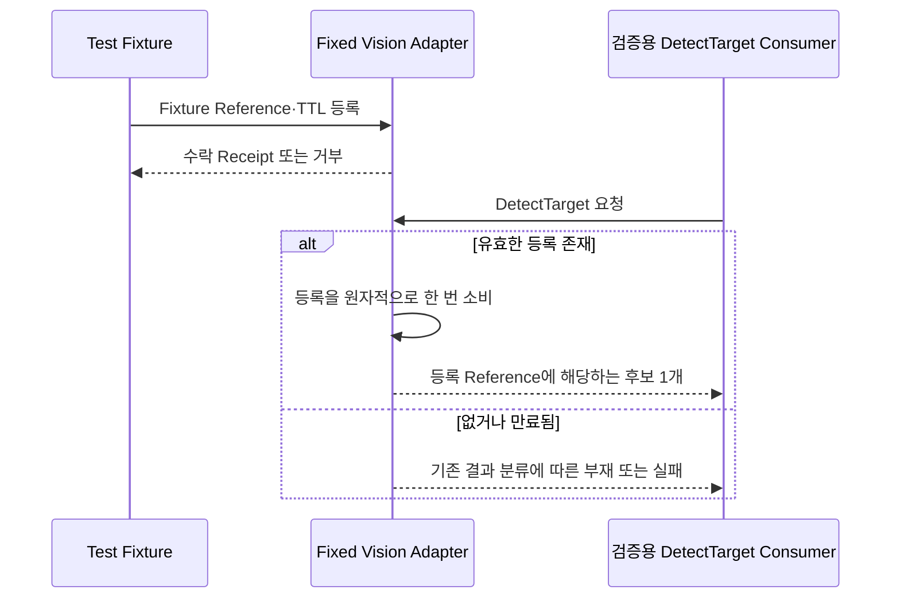

# [SF-Twin] ARM Cell Fixed Vision 검증 Adapter 동작

- **범위:** `Vision / Deterministic PnP Validation Adapter`
- **소유자:** `ARM Cell Vision`

## 기능 경계와 검증 전용 관측 시점

이 Adapter는 실제 카메라 관측이 아닌 등록된 Fixture Reference를 검증 전용 `DetectTarget` 결과로 제공한다. 등록 수락·갱신·만료 및 한 번의 소비 시점은 이 FDS가 소유한다. 반환하는 `acquisition_id`, `candidate_id`, Reference Frame, Orientation Order, Occupancy Flag 및 Validation Provenance의 **공유 의미**는 [Vision–Orchestration ICD](../../interfaces/icd-vision-orchestration.md)의 검증 Overlay 계약을 따른다. 이 기능은 Production Depth Scene Stability·Calibration이나 [Diagnostic Snapshot FDS](fds-diagnostic-snapshot.md)의 운영 관측을 대체하지 않는다.

## 1. 목적

Fixed Vision 검증 Adapter는 결정적인 Orchestration·Motion 검증을 Production 인지 정확도와 분리한다. Vision–Orchestration의 후보 인계를 구현해 Fixture에 등록된 객체 Reference를 검증 전용 Profile의 단일 후보 Acquisition으로 반환한다. Vision↔Orchestration ICD의 검증 출처 Overlay에 따라 ROS 결과·좌표계·후속 객체 Reference 의미를 유지하지만, Production의 전체 RGB-D 관측 의미를 충족한다고 주장하지 않는다.

이 Adapter는 시험 대역(Test Double)이다. RGB-D 처리, Segmentation, 지지면 추정, ArUco 위치 추정 또는 `VR-VIS-DETECT-11`은 검증하지 않는다.

## 2. 프로세스와 Profile 분리

Adapter는 Production DetectTarget 노드와 별도 실행 파일로 빌드해야 하며(SHALL), 전용 PnP 검증 Launch/Profile로만 시작해야 한다(SHALL).

Production 운영 Profile은 Detector를 이 Adapter로 교체하는 Parameter, Mode Flag, Plugin 선택, Launch Argument를 제공해서는 안 된다(SHALL NOT). 검증 Profile을 지원되는 Production Profile로 수락해서도 안 된다(SHALL NOT).

두 실행 파일은 후보 식별자 및 Occupancy 존재 여부 Flag를 포함한 현재 동일한 공개 `DetectTarget` 서비스 구조를 구현한다. 검증 실행 파일은 `DetectTarget.material_candidates` 배열에 `PickCandidate` 하나를 반환한다. 같은 프로세스 그래프에서 동일한 서비스 이름으로 동시에 실행해서는 안 된다(SHALL NOT).

## 3. Fixture 등록

실행 중인 Adapter는 프로세스를 재시작하지 않고도 검증 전용 Profile의 로컬 등록 Service 또는 명시적 확인 응답이 있는 동등한 채널을 통해 Fixture Pose를 반복 등록할 수 있어야 한다(SHALL). 논리적 요청에는 다음이 포함된다.

- 설정된 `target_id`
- Run 범위의 `run_id`
- 위치가 유한한 `base_link` 좌표계의 `geometry_msgs/PoseStamped` 객체 Reference
- `orientation_symmetry_order`(이 Adapter에서는 `0` 또는 `1`; Order 1은 유한하고 영이 아닌 객체 자세가 필요하며, Order 0에서는 Quaternion을 사용할 수 없음)
- 요청된 등록 TTL

Adapter는 수신 Sequence, Adapter 수신 시각, 수락·거부 진단을 반환해야 한다(SHALL). 거부된 요청은 수락된 기록을 덮어써서는 안 된다(SHALL NOT). 이 Service는 공개 제품 인터페이스가 아니며 Isaac Prim Path를 전달하거나 노출해서는 안 된다(SHALL NOT).

설정된 `target_id`는 Vision이 소유한 검증 Profile 하나에 대한 식별자 연결이다. 알 수 없거나 일치하지 않는 ID는 거부하며 일반 전경 Pose로 대체하지 않는다. 활성 Run 등록은 한 번에 하나만 허용한다. 동일 `run_id`의 유효한 재등록은 아직 소비하지 않은 기록을 원자적으로 교체한다. 다른 `run_id`는 이전 기록이 소비되거나 만료된 이후에만 수락한다.

등록 검증은 잘못된 Frame, 유한하지 않은 위치, 잘못된 Order, Order 1에서만 적용되는 유한하지 않거나 Norm이 0인 자세, 잘못된 요청 형식, `(0, 60s]` 범위를 벗어난 TTL을 거부해야 한다(SHALL). 기본 TTL은 **30초**다. TTL 만료는 Adapter의 Steady/Monotonic Clock과 수신 시각으로 판단한다. 입력 Pose Stamp는 Fixture 출처로만 보존하며 RGB-D 관측 Stamp로 설명해서는 안 된다(SHALL NOT). Adapter를 사용할 수 없다면 등록에 실패하며 Fixture는 실행을 중단해야 한다(SHALL).

최초 Cube 시나리오에서 등록된 Reference는 보이는 상판의 중심이다. x/y는 중앙, z는 상판 높이를 사용한다. Fixture 자세는 객체 기준이며 Yaw가 제공되면 Order 1이다. Yaw가 제공되지 않으면 Order 0이며 `target_pose.orientation`은 사용할 수 없다. Adapter가 Recipe Fallback을 만들어내거나 적용하지 않는다.

## 4. DetectTarget 동작

검증 Profile에 설정된 `target_id`의 동작은 다음과 같다.

1. 사용 가능한 등록이 없으면 `DETECT_RESULT_OBJECT_NOT_FOUND` 반환
2. 유효한 등록이 있으면 생성된 `acquisition_id`, Acquisition 로컬 `candidate_id`, 등록된 객체 Reference, 존재가 명시된 빈 비대상 Occupancy 집합과 함께 `DETECT_RESULT_SUCCESS` 반환
3. 성공한 등록은 원자적으로 소비하며, 새 Fixture Pose 등록 전까지 다음 요청은 `OBJECT_NOT_FOUND` 반환

알 수 없는 `target_id`는 `DETECT_RESULT_INVALID_RESULT`를 반환한다. Adapter는 일반 Pose로 대체하거나 소비된 등록을 재사용해서는 안 된다(SHALL NOT).

1회 소비 규칙은 결정적인 PICK→PLACE→GO_HOME Mission 반복 1회 후 정상적인 후보 소진을 지원한다. 자동 재시도 정책은 아니다. 이 검증 Adapter는 격리된 Fixture Scene으로 제한되며 빈 Occupancy는 Fixture의 시험 가정이지 실제 관측·추론된 충돌 증거가 아니다. 적층 장면의 충돌 처리를 검증하는 데 사용해서는 안 된다(SHALL NOT). Motion이 궤적 제출 전에 등록된 후보를 모두 소진하면 해당 응답 목록에 추가 후보는 없다.

## 5. 실패 및 신선도 규칙

등록 형식이 잘못됐거나 수락된 등록 TTL(기본 30초, 최대 60초)이 만료됐거나 좌표계가 틀리면 Adapter는 Fail-closed로 처리해야 한다(SHALL). 잘못된 요청·Profile과 설정된 Target의 부재를 구분해야 한다(SHALL).

검증 Overlay의 Freshness 권한은 등록 수신 확인에 있다. 입력 Pose Stamp는 출처 증거로만 남는다. Motion 작업이 실패·취소되어도 소비된 Vision 결과를 복구하지 않는다. 시나리오 재실행에는 명시적인 새 Fixture 등록이 필요하다. Adapter를 사용할 수 없거나 수신 확인이 없으면 등록 실패이며 Fixture는 Orchestration을 호출해서는 안 된다(SHALL NOT).

검증 Adapter는 Holding 상태를 생성하지 않는다. 이 상태는 GripperPort/Isaac Adapter 경계가 소유한다.

## 6. 검증 요구사항

### VR-VIS-FIXED-01 — Production 격리
Production Launch/Profile은 Fixed Vision Adapter를 선택하거나 시작할 수 없어야 한다.

### VR-VIS-FIXED-02 — 검증 Overlay 보존
유효한 등록은 공개 ROS 구조, 결과·좌표계·객체 Reference 의미 및 Fixture 등록 Stamp를 유지하고 TCP/Tool 보정 없이 `/vision/detect_target`을 통해 반환된다. 이를 수락된 RGB-D 관측으로 보고해서는 안 된다(SHALL NOT).

### VR-VIS-FIXED-03 — 등록 계약
수락된 등록은 수신 확인을 반환하고 설정된 `target_id`와 `run_id`를 연결하며 Fixture 출처를 보존한다. 잘못된 식별자·입력 형식·TTL, 사용 불가 Adapter, 수신 확인 누락이 성공을 만들어서는 안 된다.

### VR-VIS-FIXED-04 — 실행 중 재등록
동일 Run의 유효한 등록은 Adapter 재시작 없이 미소비 기록을 교체한다. 새로운 Run은 이전 기록이 소비되거나 만료된 이후에만 수락한다.

### VR-VIS-FIXED-05 — 1회 소비
성공 결과는 정확히 하나의 등록을 소비하며, 재등록 전 다음 요청은 `OBJECT_NOT_FOUND`를 반환한다.

### VR-VIS-FIXED-06 — Fail-closed 입력
좌표계 불일치, 유한하지 않은 값, Norm이 0인 자세, 오래된 값, 알 수 없는 Target 입력은 성공 결과를 생성할 수 없다.
