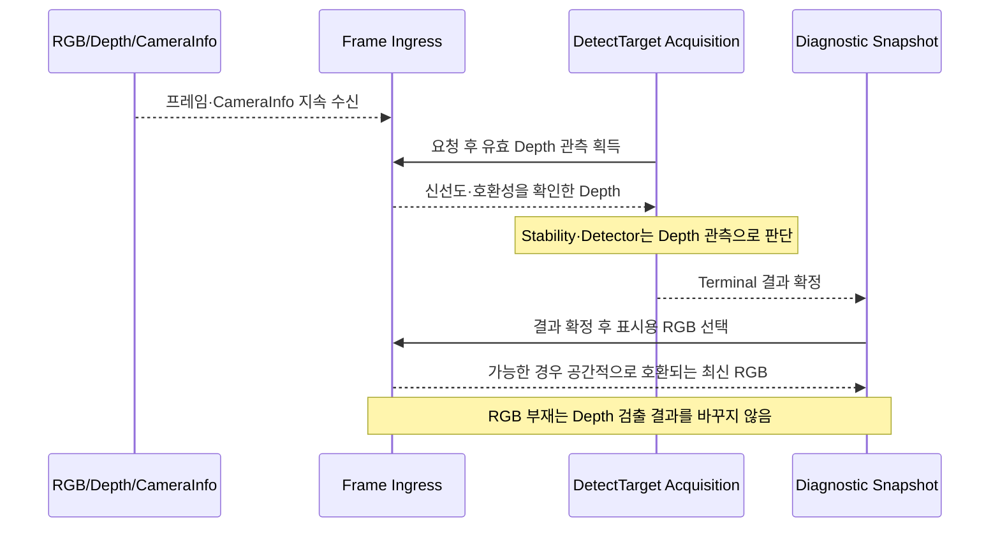

# [SF-Twin] ARM Cell Vision 프레임 입력 동작

- **범위:** `ARM Cell Material Detection / Snapshot RGB, Calibration RGB-D 연결, 신선도, Deadline`
- **소유자:** `ARM Cell Material Detection`

## 기능 소유권과 관측 시점

Frame Ingress는 RGB·Depth·CameraInfo 수신과 호환성 확인, 관측 Freshness, 요청 중 입력 진행, Calibration RGB-D Pairing 및 Snapshot용 선택 RGB의 **취득 시점**을 소유한다. Source Header/Stamp·Frame의 공유 해석과 Snapshot Metadata 필드 의미는 [Vision–Orchestration ICD](../../interfaces/icd-vision-orchestration.md)가 소유한다. `DetectTarget`의 결과 확정·Deadline은 [DetectTarget FDS](fds-detect-target.md), Snapshot 인코딩·저장·발행은 [Diagnostic Snapshot FDS](fds-diagnostic-snapshot.md), 설치 Calibration 작업은 [Installation Calibration FDS](fds-installation-calibration.md)가 각각 소유한다.



## 1. 목적

RGB와 Depth의 독립 수신, Snapshot 표시용 RGB 선택, Calibration RGB-D 연결, CameraInfo 검증, Depth 신선도 선택 및 DetectTarget 대기 시간의 경계를 정의한다. CameraInfo 내부 파라미터는 선택한 Camera-to-Tray 설치 Calibration 파일과 구분된다. 이 FDS는 센서 입력 연결과 CameraInfo 호환성만 소유한다. 설치 Calibration의 영속성과 유효성은 Vision CDS가 소유한다.

## 2. RGB ↔ Depth 동기화

실제 센서가 동일한 타임스탬프를 생성할 필요는 없다.

명시적인 Fiducial Calibration에서는 기존 동기화된 RGB-D 연결을 유지하며 다음 조건을 충족하는 Pair만 수락한다.

```text
abs(t_rgb - t_depth) <= configured_sync_tolerance
```

ROS `message_filters`의 ApproximateTime 방식 동기화기 또는 의미가 동등한 유계 연결 방식으로 구현할 수 있다(MAY).

정확한 알고리즘·라이브러리는 구현 세부사항이며, 규범적 계약은 시간 범위를 제한한 연결 의미다.

현재 Isaac Profile에서는 타임스탬프가 자연스럽게 같을 수 있으나 일반 계약에서 동일성을 요구하지 않는다.

ARM Cell Vision Calibration Profile의 지원 기본값은 다음과 같다.

```text
sync_slop_ms = 10.0 ms
```

이는 Profile 설정이지 일반 RGB-D 센서 계약이 아니다. Parameter는 계속 설정 가능해야 한다. `0 ms`는 명시적인 진단·시험 설정으로만 허용하며 지원 기본값은 아니다.

## 3. CameraInfo 연결

CameraInfo는 센서가 제공하는 내부 Calibration 모델이며 Deprojection을 위해 검증하고 캐시할 수 있다. 영속적인 Camera-to-Tray 외부 Calibration 기록이 아니다.

Vision은 캐시된 Calibration을 사용하기 전에 다음 중 적용되는 요소를 포함해 현재 이미지 형상과의 호환성을 검증해야 한다(SHALL).

- Calibration Frame 식별자
- 이미지 가로·세로 크기
- 내부 파라미터 행렬
- 사용 중인 모델이 요구하는 왜곡·투영 의미

CameraInfo가 호환되지 않거나 무효가 되면 Vision은 호환되는 CameraInfo가 제공될 때까지 영향을 받는 처리를 거부해야 한다(SHALL). 이 거부로 설치 Calibration을 시작하지는 않는다. 선택 파일의 호환성과 Ready 상태는 Vision CDS 및 해당 인터페이스가 계속 소유한다.

## 4. 요청 시작과 오래된 데이터 제거

RGB·Depth·CameraInfo 구독은 활성 상태를 유지한다. `/vision/detect_target` Acquisition이 활성화되지 않으면 Profile 검출을 지속 실행하지 않는다. 요청 시작 시 Depth는 요청 Watermark보다 새로운 양의 Source Stamp와 요청 시작 이후의 로컬 수신 시각을 가져야 한다. 캐시된 CameraInfo는 호환성 검증 후에만 사용한다. 최근 Depth 샘플은 기존의 유계 캐시 경과시간 정책에 따라 고려할 수 있으나, 5프레임 Scene Stability Gate에는 해당 요청에서 유효하게 관측된 Depth가 필요하다.

각 Depth 관측은 Source Stamp, 수신 시각, 호환되는 CameraInfo, Calibration 식별자 및 Acquisition 식별자를 유지한다. Scene Stability와 Detector는 Depth만 소비한다. Detector는 STABLE로 평가된 정확히 그 Depth 관측에 한 번 실행된다. RGB는 검출을 차단하거나 재실행하게 하지 않는다.

RGB 수신은 최신 이미지 하나만 보유한다. Detector 완료 및 결과 확정 후 Vision은 Terminal Snapshot용 최신 RGB를 선택하고 작업을 큐에 넣기 전에 Snapshot 입력에 고정한다. 이후 수신되는 RGB는 대기 중인 Snapshot을 변경할 수 없다. 선택 시 RGB·Depth 타임스탬프 차이와 로컬 수신 순서·간격은 무시한다. 이미지 Encoding·Buffer가 유효하고 RGB의 크기·Frame이 정렬된 Depth 및 CameraInfo와 공간적으로 호환될 때만 RGB를 사용한다. RGB가 없거나 호환되지 않으면 명시적인 표시 상태와 함께 Depth 전용 Snapshot을 생성한다. Calibration은 별도의 동기화 RGB-D 입력과 `sync_slop_ms` 계약을 유지한다.

DetectTarget Acquisition이 활성 상태인 동안 적합한 결과를 기다리더라도 Depth 수신과 관측 처리는 계속 진행될 수 있어야 한다(SHALL). Acquisition 생명주기가 센서 관측 진행을 차단해서는 안 된다(SHALL NOT). RGB 수신은 표시와 명시적 Calibration을 위해 독립적으로 계속되며 DetectTarget은 Depth 관측에 RGB를 연결하지 않는다. 이 동작 계약은 ROS 실행 모델이나 특정 구현 방식을 강제하지 않는다.

요청별 [Tray Depth Scene Stability 알고리즘](../../algorithms/depth-scene-stability.md)은 RGB Pairing과 독립적으로 호환되는 CameraInfo·Calibration을 갖춘 최신 Depth 관측을 평가한다. Gate와 Detector는 정확히 같은 Depth, CameraInfo, Source Stamp, 수신 시각, Calibration 및 Acquisition 식별자를 공유한다. 호환되는 표시용 프레임이 있을 때만 RGB 식별자를 별도로 기록한다.

Scene Stability는 원본 카메라 Depth에서 필터링하지 않은 미터 단위 픽셀을 비교한다. 현재 프레임 대 기준 프레임 비교와 현재 프레임 대 직전 프레임 비교에는 각각 양쪽 Depth가 유효한 픽셀 집합과 별도 비교 가능 픽셀 분모를 사용한다. 안정화에는 Tray 투영, 이미지 처리, Coverage 또는 Tray 전체 가시성 Gate를 적용하지 않는다. 비교 가능한 Depth 픽셀이 없으면 관측 불가로 판단하며 5회 연속 관측을 중단한다. 이 시간적 Gate는 선택된 Detector의 형상·후보 적격성·유효한 부재 판정 Coverage 규칙을 대체하거나 변경하지 않는다.

Vision은 요청별 관측 신선도를 사용하며 무관한 카메라 시작 또는 장면 Settling 지연을 추가해서는 안 된다(SHALL NOT). `/clock`이 일시 정지돼도 Monotonic Acquisition Deadline은 멈추지 않는다.

## 5. 신선도와 요청 Deadline

시간에 관한 두 판단은 의도적으로 분리한다.

### 5.1 센서 신선도

센서·샘플 신선도는 센서·시뮬레이션 타임스탬프 의미를 사용하며 필요할 때 로컬 수신 정보를 함께 평가한다.

### 5.2 요청 Deadline

DetectTarget 요청 Timeout은 Depth 관측, 장면 안정화, Profile 처리, 응답 인계에 공통으로 적용하는 유일한 Deadline이다. Vision은 서비스 수신 시 하나의 Monotonic Steady Clock Deadline을 시작한다. 별도 Stability 대기 예산을 추가하거나 다른 프레임이 도착할 때 예산을 초기화하지 않는다. Adapter 로컬 기본값이 전달된 Timeout보다 먼저 활성 요청을 만료시켜서는 안 된다(MUST NOT). Deadline이 만료되면 가장 구체적인 미해결 Acquisition 사유와 함께 `DETECT_RESULT_TIMEOUT`을 반환해야 한다(SHALL). 중단할 수 없는 처리는 Deadline 이후 완료될 수 있지만 그 결과를 성공 또는 다른 Terminal 인지 결과로 보고해서는 안 된다(SHALL NOT).

`/clock`이 일시 정지돼도 유계 API 요청이 무기한 대기하도록 해서는 안 된다(SHALL NOT).

[ARM Cell Observability Records ICD](../../interfaces/icd-observability-records.md)는 Ingress 결정에 사용된 Source Stamp, 로컬 수신 시각, ROS Clock 관측, 정확한 Freshness/Deadline 입력의 선택적 수집을 정의한다. 가능한 경우 기록은 Acquisition 및 Snapshot 식별자를 재사용하며 기존 Ingress 상태나 DetectTarget 결과를 변경하지 않는다.

Timeout 시 기존 `diagnostic_detail`은 가장 구체적으로 관측된 Acquisition 단계·거부 사유를 식별하거나 처리가 시작됐지만 Deadline을 초과했다고 명시해야 한다(SHALL). 가능한 경우 최근 RGB·Depth·CameraInfo 수신 경과시간 및 마지막 Ingress 상태를 포함한다. 누락된 스트림 증거는 명시적으로 사용할 수 없다고 표시한다.

## 6. 역행·무효 센서 시간

Vision은 순서가 역전됐거나 시간이 역행하거나 오래됐거나 다른 이유로 무효인 프레임 후보를 거부해야 한다(SHALL).

시뮬레이션 세션 Epoch의 권한은 ARM Cell Simulation Runtime 계약이 유지한다. Isaac Simulation은 Timeline Reset을 소유하고 `arm_cell_sim_adapter`는 정규 측정 관절 상태 게시를 소유한다.

후속 Architecture 결정으로 소유권이 명시적으로 변경되지 않는 한 Vision은 독립적인 영구 재시작·생명주기 권한을 생성해서는 안 된다(SHALL NOT).

## 7. 실패 결과

Ingress는 다음 원인으로 실패할 수 있다.

- Deadline 전에 유효한 Depth 관측이 없음
- 오래되거나 순서가 역전된 데이터
- 형식이 잘못된 메시지
- 무효 Calibration
- 호환되지 않는 Frame·해상도·Calibration
- 유계 Queue·연결 실패

정확한 공개 결과 매핑은 `fds-detect-target.md`와 Vision↔Orchestration ICD가 소유한다.

## 8. 검증 요구사항

### VR-VIS-INGRESS-01 — 선택적 최신 Snapshot RGB
Detector 완료 후 Snapshot은 선택 시점에 공간적으로 호환되는 최신 RGB 이미지를 타임스탬프·수신 시간 Gate 없이 사용해야 한다(SHALL). 선택한 이미지는 해당 Snapshot에서 고정돼야 한다(SHALL). 명시적 Calibration은 별도의 `sync_slop_ms` 연결을 유지해야 한다(SHALL). RGB 부재·비호환성으로 Depth 검출을 거부해서는 안 된다(SHALL NOT).

### VR-VIS-INGRESS-02 — 정확한 타임스탬프 일치 불필요
일반 Vision 동작은 실제 센서 RGB와 Depth의 정수 나노초 단위 완전 일치를 요구해서는 안 된다(SHALL NOT).

### VR-VIS-INGRESS-03 — Acquisition 중 관측 진행
DetectTarget Acquisition 활성 중 요청이 적합한 결과를 기다려도 Depth 수신과 관측 처리는 계속 가능해야 한다(SHALL). Acquisition 생명주기는 센서 관측 진행을 차단해서는 안 된다(SHALL NOT).

### VR-VIS-INGRESS-04 — Calibration 캐시 유효성
캐시된 CameraInfo는 활성 이미지 형상과 호환될 때만 사용해야 한다(SHALL).

### VR-VIS-INGRESS-05 — Steady Clock 요청 Deadline
시뮬레이션 시간이 일시 정지되어도 DetectTarget 대기 Timeout은 유계여야 한다(SHALL).

### VR-VIS-INGRESS-06 — 센서 시간 기반 신선도
프레임 신선도는 Wall Time만이 아닌 센서·시뮬레이션 시간 의미에 근거해야 한다(SHALL).

### VR-VIS-INGRESS-07 — Epoch 소유권 분리
Vision은 무효 시간 샘플을 거부해야 하며(SHALL), Simulation Runtime의 세션 생명주기 권한을 가져서는 안 된다.

### VR-VIS-INGRESS-08 — Depth 전용 진단 관측
진단용 장면 평가기가 활성화되면 호환되는 최신 Depth 샘플을 RGB/Depth Pairing과 독립적으로 평가해야 한다(SHALL). CameraInfo 누락, Calibration 비호환, 무효 Source Time, 오래된 수신, 유효한 Depth 픽셀 부재, 시간 비교 중 어느 한쪽의 비교 가능 픽셀 부재는 계속 관측 불가로 처리하고 안정 상태로 판단해서는 안 된다(SHALL NOT). Tray 가시성과 Coverage는 Depth Scene Stability의 Gate가 아니다.
