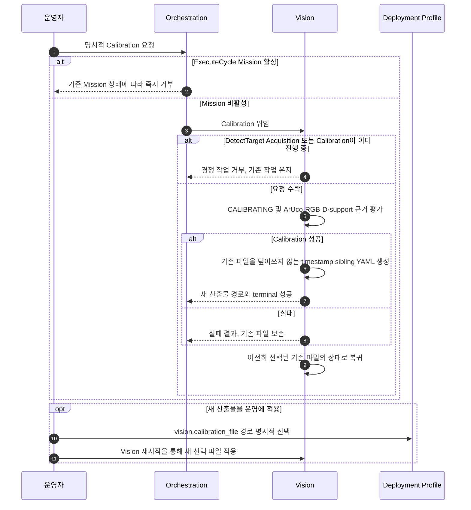

# [SF-Twin] ARM Cell Vision 설치 Calibration 기능 설계 (FDS)

- **기능 ID:** `VISION-INSTALLATION-CALIBRATION`
- **소유자:** `ARM Cell Vision`

## 목적과 동작 범위

운영자의 명시적 설치·정비 Calibration 요청을 수락·거부·실행하고 측정 결과를 새로운 파일로 제공한다. 검출 요청의 자동 준비 단계가 아니며 현재 적용 중인 Calibration과 새 산출물의 lifecycle을 분리한다.

- **시작:** Orchestration을 통한 운영자 요청
- **종료:** 거부 또는 단일 terminal 성공·실패, 운영자의 별도 선택·재시작 적용
- **비책임:** 자동 재보정, 선택 파일 자동 갱신, DetectTarget Acquisition의 정상 실행

## 참여 책임과 계약

| 참여 책임 | 기능상 역할 | Owner |
|---|---|---|
| 운영자 | 유지보수 요청·새 파일 경로 선택 | Calibration 운영 절차 및 명시적 요청 경계 |
| Orchestration | 활성 Mission 중 요청 거부·Vision 전달 | Orchestration FDS |
| Vision | 공유 작업 점유·Calibration 수행·산출물 생성·상태 제공 | [Vision CDS](cds.md) |
| Deployment Profile | 설치 설정·선택 파일 경로 | 운영 설정 |

## 핵심 시나리오

### 명시적 요청과 운영 파일 전환



### 설치 Calibration 및 운영 파일 전환

ARM Cell의 카메라·Tray·ArUco marker는 고정 설비이고 정상 운영 중 배치가 변하지 않는다고 가정한다. Vision은 설비 이동을 감시하거나 재보정 필요성을 추론하지 않으며, 시작·ROS/Isaac/Mission 재시작·Timeline Stop/Play·주기적 실행에 따른 **자동 Calibration을 수행하지 않는다**. 최초 설치와 정비 후 재보정은 운영자가 명시적으로 요청한다.

`operational_profile.yaml`은 설치 입력과 `vision.calibration_file` 아래 선택된 **단 하나의 Calibration 파일 경로**를 소유한다.

```yaml
vision:
  calibration_file: config/calibration/arm_cell_camera.yaml
```

기존 bringup 경로 해석 규칙을 따른다. 선택 파일이 아직 없더라도 경로는 필요하며, Vision은 시작할 때 그 경로의 파일을 읽는다. 측정된 Transform이 읽기 가능하고 구조적으로 유효하며 camera identity·frame·CameraInfo·해상도·sensor 구성과 호환되면 `READY`다. 누락·파손·무효·비호환이면 사유와 함께 `NEEDS_CALIBRATION`이며 다른 파일로 fallback하거나 자동 보정하지 않는다. Process나 simulator 수명 자체는 파일 유효성을 바꾸지 않는다.

선택 YAML에는 측정된 `tray_T_camera`, 기준 및 optical frame, CameraInfo topic, 호환성을 검사하는 image dimensions·distortion model·intrinsic/rectification 값만 저장한다. ArUco 치수·pose, Tray ROI, Detector profile, RawPart 설정은 Deployment Profile의 책임이므로 중복 저장하지 않는다. Calibration YAML은 일반 설정 스키마가 아닌 측정 산출물이며 Snapshot은 재현 근거일 뿐 Calibration 저장소가 아니다.

`/vision/calibration_status`는 `READY`, `NEEDS_CALIBRATION`, `CALIBRATING`을 보고한다. `CALIBRATING`은 동기식 명시 요청의 처리 중에만 발행하며 종료 후에는 **여전히 선택되어 있는 파일**의 상태로 돌아간다. `READY`는 선택 파일의 로딩과 센서 구성 호환성을 의미하고 현재 Depth freshness까지 보증하지 않는다. 필요한 센서 입력의 missing/stale은 요청 수준의 sensor error이며 파일 자체를 무효화하지 않는다. 실제 CameraInfo와 선택 파일의 충돌은 설정 비호환이므로 Detection을 차단한다. 물리 설비 이동은 이 비교로 검출할 수 없으며, 실제 설치와 다른 파일을 선택할 위험은 운영자에게 있다.

운영자는 정비 준비 후 Orchestration을 통해 Calibration을 명시적으로 요청한다. Orchestration은 `ExecuteCycle` Mission이 활성 상태라면 기존 Mission 상태로 즉시 거부하고, 그렇지 않으면 Vision으로 전달한다. Vision은 DetectTarget Acquisition이나 다른 Calibration이 공용 작업을 점유 중이면 경쟁 요청을 원자적으로 거부하며 기존 작업에 영향을 주지 않는다. 수락 시 설정된 ArUco와 필요한 RGB-D·support-plane 근거를 수집하고 단일 terminal 결과를 돌려준다.

**성공은 새 YAML 파일 생성**을 의미한다. 선택 파일의 존재 여부와 무관하게 구성된 경로에서 유도한 timestamp 형제 파일을 만들며 기존 파일을 덮어쓰지 않고 응답으로 새 경로를 알려준다. 실패하면 성공 산출물을 만들지 않고 기존 파일도 변경하지 않는다. 새 파일을 만들더라도 active Transform과 `calibration_file`은 변경되지 않는다. 운영자가 `operational_profile.yaml`에서 새 파일을 선택하고 Vision을 재시작해야 적용된다. 별도 승인 단계·active-record flag·registry·자동 파일 선택은 없다.

반복 관측·depth residual·pose 일관성 검증은 실제 근거가 설치 수락 주장에 기여할 때만 사용하며 무조건적인 임계값으로 강제하지 않는다. 평상시 DetectTarget은 로드된 Transform과 설정된 Tray support geometry를 사용한다. ArUco 검출·설치 depth 교차 검증·Calibration 관측 횟수는 운영 Detection의 Gate가 아니다. Runtime Depth freshness, CameraInfo/Calibration 호환성, Depth Scene Stability, 단일 관측 RawPart geometry·visibility는 요청별 조건으로 유지한다. 선택적 RGB 연관은 Detection Gate가 아니다. Cached CameraInfo는 관련 frame·해상도·intrinsic identity가 변했으면 거부한다.


## Diagnostic Snapshot과의 경계

성공적인 파일 생성과 terminal 결과 확정 **이후** [Diagnostic Snapshot FDS](fds-diagnostic-snapshot.md)가 Calibration 완료 Snapshot을 생성·저장·발행할 수 있다. Calibration 요청의 실패, 운영 파일 로드 및 `READY` 전환은 Snapshot 생성을 요구하지 않는다. Snapshot 출력 실패는 보정 결과·산출 파일·운영 선택 상태를 변경하지 않는다. 공유 `CALIBRATION_COMPLETE` Event와 Metadata·결과 필드의 의미는 [Vision–Orchestration ICD](../../interfaces/icd-vision-orchestration.md)에 둔다.

## 결과·오류·관측

| 조건 | 처리 결과 | 증거 |
|---|---|---|
| Mission 또는 Acquisition/Calibration 활성 | 기존 작업을 변경하지 않고 요청 거부 | 요청·활성 작업·거부 사유 |
| 측정·산출 실패 | 기존 파일·선택 Transform 유지 | 실패 단계와 측정 근거 |
| 새 Calibration 성공 | 별도 timestamp sibling YAML과 경로 반환, 자동 적용 없음 | 산출 경로·유효성·선택 상태 |
| 별도 운영자 선택·재시작 | 선택 파일 호환성 재평가 후 READY 또는 NEEDS_CALIBRATION | 선택 파일·CameraInfo 호환성 |

## Verification Requirements

기존 Calibration 관련 `VR-VIS-OWN-02`, `VR-VIS-OWN-09`의 정적 경계 및 [DetectTarget FDS](fds-detect-target.md)의 Calibration 소비 계약을 보존한다. 추가 Gate나 승인 절차는 도입하지 않는다.

## 참조

- [Vision CDS](cds.md)
- [DetectTarget FDS](fds-detect-target.md)
- [Vision–Orchestration ICD](../../interfaces/icd-vision-orchestration.md)
