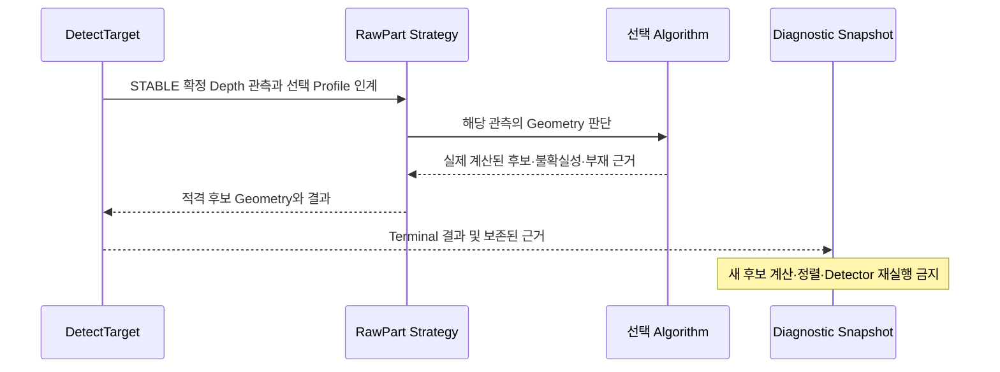

# [SF-Twin] ARM Cell Production RawPart Depth Perception

- **Scope:** `ARM Cell Material Detection / Production RawPart profile`
- **Owner:** `ARM Cell Material Detection`
- **Parent behavior:** [Vision DetectTarget FDS](fds-detect-target.md)

## RawPart 기능의 책임과 관측 계약

이 FDS는 선택된 RawPart Strategy의 관측 처리·후보 적격성·유효 부재와 Geometry 실패 판정·결과 확정 **동작**을 소유한다. 요청의 수락·단일 Deadline과 Depth Scene Stability에서 Detector로 인계되는 **시점**은 [DetectTarget FDS](fds-detect-target.md)를 따른다. 후보 목록·Observation Pose·Orientation Symmetry·Frame/Time의 **공유 의미**는 [Vision–Orchestration ICD](../../interfaces/icd-vision-orchestration.md)가 소유한다. Heightmap·Boundary·Plane Map·Geometry Fitting의 구체 계산은 각 [Algorithm 설계](../../algorithms/cuboid-top-face-grasp-selection.md)를 따른다. Snapshot은 [Diagnostic Snapshot FDS](fds-diagnostic-snapshot.md)가 기존 계산 근거로 생성하고 Detector를 재실행하지 않는다. PICK 충돌 점유맵은 반환 후보 Geometry를 소비하는 Motion이 구성하며 해당 책임은 [Motion Execution FDS](../motion/fds-motion-execution.md)가 소유한다.



## 1. 목적과 책임

이 FDS는 Final Demo의 설정된 RawPart Profile에 대한 정식 Production Depth/Geometry Pipeline을 정의한다. 상위 DetectTarget FDS는 요청 동작, 결과 의미, Freshness, 성공한 Object Reference 계약을 소유한다. 이 문서는 공유 RawPart Processing과 Detector Strategy 경계를 소유하며 구체적인 Geometry 계산 절차는 Algorithm 문서가 소유한다. 새로운 Service를 추가하지 않는다.

Caller의 논리 `target_id`는 사전 설정된 Vision 소유 Profile을 선택한다. Profile은 Material Definition의 공칭 물리 형상과 치수를 참조하지만 Algorithm 실행 설정, Observation Quality 조건, Workspace/Support 제약, 선택적 Diagnostic 비교 규칙을 소유한다. `operational_profile.yaml`의 공유 Material Definition이 Material ID·형상·공칭 치수를 소유하고 Vision Profile은 물리적 크기를 정의하거나 제공하지 않는다. 공칭 치수 사용 방식은 2.4절의 Algorithm별 계약을 따른다. Configuration Threshold·Calibration Value·Marker ID/Pose·ROI 치수·Fiducial Geometry는 배포 설정으로 남는다.

Production Pipeline은 Vision이 선택 파일에서 로드한 Calibration과 호환 CameraInfo·Depth를 관측한다. 정상 검출에서 RGB는 선택 사항이며 동기화된 RGB는 명시적 Fiducial Calibration에서만 필요하다. 검출 후 공간적으로 호환되는 최신 RGB를 Snapshot Annotation에 사용할 수 있다. Simulator Prim Identity·정확한 World Coordinate·Simulator Metadata·API를 Production Perception Input으로 사용해서는 안 된다. RGB Appearance·Learned Detector는 선택 사항으로 이 정식 Profile의 필수 조건이 아니다. Environment 선행 조건은 [Simulation Environment Semantics](../simulation-environment-semantics.md)가 소유한다.

Collision Planning에서는 [Motion CDS의 정적 RawPart Domain](../motion/cds.md#정적-구조와-경계)이 취급 대상 자재 외에 별도 미식별 객체가 없다고 가정한다. 이 가정은 Vision의 관측·Qualification을 바꾸지 않는다. Vision은 관측된 후보의 Geometry와 미해결 Hypothesis를 각자의 반환·진단 경계에 보존한다. Vision은 Planning Occupancy를 생성하거나 Collision Constraint를 선택하지 않으며, Motion은 미해결 영역을 PICK 점유맵에 포함하지 않는다. Vision은 Planning 실패 뒤 Geometry/Stability Validation을 완화하거나 실시간 장애물 회피를 보장하지 않는다.

### 1.1 Recipe Algorithm 선택과 운영 설정

Recipe `vision.algorithm`은 알고리즘 선택의 SSOT이며 Vision Operational Profile은 선택된 알고리즘의 실행 설정을 소유한다. 지원 알고리즘 목록과 기본 선택은 구성 및 해당 Algorithm 계약을 따르며 이 FDS는 특정 구현 하나로 선택을 한정하지 않는다. 명시적인 Empty·Non-string·Unsupported 값은 구성 오류이며, 지원되지 않는 알고리즘으로 자동 Fallback하지 않는다. Legacy Rectangle은 PoC 비교 대상으로 남되 향후 정식 알고리즘 추가가 이 공유 동작 계약을 변경하도록 강제하지 않는다.

```json
"vision": {"algorithm": "cuboid_top_face"}
```

Orchestration은 정상 DetectTarget·Retry·새 자재 Acquisition·PLACE Lookahead에 Mission Recipe의 선택을 그대로 전달한다. Vision은 요청별 선택을 확인하고 해당 Acquisition 전반에 단일 Strategy를 적용한다. Snapshot은 실제 선택한 Algorithm을 기록한다. Material Definition은 형상·공칭 치수를, Vision Profile은 Grid·Height Tolerance·Contour Fitting·Workspace·Observation·Calibration 설정을 소유한다. 추가 Registry·Plugin·Service 또는 Motion 정책을 도입하지 않는다. Recipe/Service 기본값 및 Fixed Validation과의 구현 정합성은 실현 단계에서 확인해야 한다.

### 1.2 Strategy 지원 및 Producer 책임

`cuboid_top_face`는 Touching/Stacked 배치를 포함한 수평 직육면체 가설을 최종 Depth 관측에서 생성·평가한다. 완전·부분 상판은 같은 L자 기반 후보 생성과 정규화 절차를 사용한다. Vision은 모든 가설을 내부 평가하고 관측 해석의 선택 상태와 객체 Confidence를 분리한다. 선택된 적격 HIGH와 MEDIUM을 단일 목록의 안정된 열거 순서로 모두 반환한다. 미선택 대안은 LOW로 간주하지 않고 선택 상태·사유를 진단에 보존한다. LOW·REJECTED와 미해결 근거는 진단·Snapshot에 보존하되 일반 PICK 후보로 반환하지 않는다. Vision은 후보별 Planning Occupancy를 생성하지 않는다. Geometry Qualification과 단일 반환 목록 의미는 [Vision–Orchestration ICD](../../interfaces/icd-vision-orchestration.md)를 따른다. 형상 해석·등급 계산은 [직교 외곽선 기반 직육면체 복원 Algorithm](../../algorithms/cuboid-top-face-grasp-selection.md)이 소유한다. Legacy Rectangle의 계산·Greedy Selection은 PoC 기록의 과거 비교 대상으로만 남으며 현행 Strategy의 실행·검증 기준이 아니다.

Success를 발행하기 전에 Vision은 선택 Strategy의 필수 후보 Geometry와 결과를 검증해야 한다(MUST). Cuboid Candidate Geometry 누락·무효는 기존 Result 의미상 Geometry Failure다. Planning Occupancy는 Vision 필수 출력이나 성공 조건이 아니다. Support-resting Object의 자체 두께 제약은 2.5절에 정의한다.

Stacking Extension에서는 Material 치수를 변경하지 않은 채 Configured Workspace의 수직 범위가 허용된 적층 Envelope을 포함해야 한다. 기울거나 불안정하거나 수평 상판이 아닌 Geometry는 이 확장 범위 밖이다. 상부 객체에 덮인 것으로 관측된 하부 후보는 LOW로 진단에 보존하고 일반 PICK 목록으로 전달하지 않는다. 파지 가능성은 Vision 등급과 별개로 Motion이 판단한다. 미해결 Evidence는 Confirmed Absence를 확정하지 않는다. 선택한 Face 및 자체 두께 Hypothesis가 모호하지 않다면 가려진 Support Interface를 직접 관측할 필요는 없다.

## 2. 처리 파이프라인

```text
DetectTarget(target_id, algorithm)
→ 설정된 RawPart Profile 결정
→ Fresh Depth 및 호환 CameraInfo 취득. 표시용 호환 RGB만 선택적으로 보존
→ vision.calibration_file의 Transform 및 설정된 Tray Support Geometry 적용
→ 연속 5회 유효 관측으로 Depth Scene Stability 완료
→ STABLE을 확정한 정확한 Depth Observation으로 Detector 1회 실행
→ Depth를 Tray Frame으로 역투영하고 Support 기준 상대 좌표 표현
→ 설정된 Workspace 및 Support-relative Geometry Band로 제한
→ 요청에서 선택된 Detector Strategy만 평가
→ 단일 관측 Geometry 적격성 평가 및 Strategy 출력 순서 유지
→ 해당 Result에 한해 전체 적격 Candidate Geometry·Observation Evidence 보존
→ 자체 두께·Pose/Symmetry·Sanity·Freshness·TF 검증
→ HIGH·MEDIUM 단일 목록의 전체 Qualified Material Candidate Geometry 반환
```

각 활성 DetectTarget Acquisition에서 Vision은 공유 Tray Scene Stability Gate로 연속 5개 유효 Depth Sample을 평가한 다음 Profile을 한 번 실행한다. 이 Gate는 RawPart를 Segmentation·Detection·Classification하지 않는다. Candidate Geometry 및 Valid Absence는 선택 Detector가 최종 Depth Observation 하나로 결정한다. 후보 적격성은 Temporal Tracking이 아닌 단일 Observation Geometry 판단이다. Acquisition이 없을 때 Camera Ingress는 활성화돼도 RawPart Profile Processing은 실행되지 않는다.

유효 Absence에는 최종 Detector Observation의 완전한 Projected Workspace Coverage와 충분한 Valid Depth가 필요하다. 이 조건은 Detector 실행 자체를 막거나 이미 관측된 유효 Candidate를 거부하는 조건이 아니다. Unobservable·Ambiguous·Insufficient Geometry는 Absence가 아니다. Scene Stability는 원본 Camera Depth Frame을 비교하며 Detector Heightmap이나 Support-relative Projection에 의존하지 않는다.

Scene Stability를 완료한 다섯 번째 Observation을 Detector Input으로 직접 사용한다. 추가 Frame을 취득하거나 Detection을 반복하지 않는다. 성공 인계는 Sensor Processing Slot을 해제하고 동일 DetectTarget Response에서 그 Observation의 정렬된 Candidate List와 Geometry를 반환한다. Vision은 Handoff 뒤 Candidate List를 보존하지 않는다. Orchestration은 List를 변경 없이 전달하고 Motion은 유한한 PICK Search 안에서 소비한다. Failed·Absent·Timed-out·Internally Cancelled Result는 Terminal Outcome에서 폐기한다.

단일 Request의 Monotonic Deadline은 Input Wait·Qualification·Detection·Handoff를 모두 포함한다. Caller가 ROS Service Request를 포기해도 기존 Service Shape에는 Server Cancellation 신호가 없으므로 Server의 Result는 같은 Deadline으로 제한되고 Terminal Completion에서 폐기된다. 이 제약이 별도 Lifecycle Owner를 추가하지 않는다. Qualified Candidate Geometry와 공통 Wire 의미는 ICD를 따른다.

Material Workspace는 선택 Calibration File에서 로드한 Camera-to-Tray Transform과 Tray/Support Plane 위 설정된 Deployment Workspace에 고정한다. 현행 Environment Design에서 Tray는 Support Surface이고 Scene Stability는 개별 후보 Geometry와 독립적으로 설정 작업 영역 전체를 평가한다. 정확한 Profile Geometry 및 Threshold는 Deployment Configuration이다.

Calibrated Tray/Support Frame은 이 Profile의 Support-plane Coordinate 계약이다. XY Plane은 Support Surface와 평행하고 +Z는 Surface에서 멀어지는 법선 방향이다. `base_link`에서 방향이 필요하면 선택 Calibration/TF Transform으로 이 Support Frame Direction을 변환하며 Object Orientation에서 추측하지 않는다.

Vision은 공유 Depth Scene Stability Gate의 State Change를 `/vision/scene_stability`로 발행한다. `scene_stability.stable_observation_count`는 Camera Cadence가 아닌 연속 Observation Count(기본 5)를 설정한다. `diagnostics.depth_scene_stability.depth_difference_tolerance_m`와 `diagnostics.depth_scene_stability.changed_pixel_ratio_tolerance`는 원본 Frame의 Pixel Difference와 허용 Changed-pixel Ratio를 설정한다. Reason은 Observation 대기·Depth 변화·Stable·Invalid/Out-of-order/Stale Input·유효 Depth 부족·비교 가능한 Depth Pixel 부재를 구분한다. Tray/Heightmap/Region Coverage는 Detector Owner가 판단하며 Stability Count의 Gate가 아니다. Calibration/Configuration 비호환은 별도 Fail-closed Readiness Outcome이다. Diagnostic은 Target·Acquisition Identity·실제 적격/필요 Observation Count를 보존한다.

이 Scene Stability Evaluator는 현재 Camera Depth Observation만 사용한다. Isaac Prim 좌표·Identity·물리적 Linear/Angular Velocity·Sleeping·기타 Simulator Physics State를 읽지 않는다. Stable Scene이 Target Absence나 Grasp Success를 보장하지 않는다. 새 Request는 독립 Acquisition Identity를 가지고 Scene Change Reset도 그 Acquisition 내부에서 발생한다.

Candidate Identity는 Profile 내부에 한정된다. Retained Result는 Request Deadline에 연결돼 DetectTarget Response로 반환되고 별도 Pose TTL이나 Caller Generation Gate는 없다. Candidate 평가는 Acquisition의 최종 Observation에 고정돼 이후 Sensor Observation으로 재정렬·교체되지 않는다. Vision은 내부 평가에서 HIGH로 분류된 후보 전체을 하나의 Response로 반환하고 Orchestration은 변경 없이 전달하며 Motion은 PICK Search에서 소비한다. 외부 Material Movement는 Motion의 일반 PICK Outcome과 Orchestration의 유한 Retry Policy로 처리한다.

유효한 Configured Profile·Fresh Sensor Set·Valid Support Reference가 필요한 Stage는 Fail-closed다. 이를 Target Absence로 해석해서는 안 된다(SHALL NOT). Processing Result는 Parent의 Result Code 계약을 따른다. 설정 Target이 유효한 관측에서 부재한 경우에만 `DETECT_RESULT_OBJECT_NOT_FOUND`를 반환한다.

### 2.1 입력 집합과 Freshness

Vision은 현재 Image Geometry 및 Optical Frame과 호환성이 검증된 Depth·CameraInfo를 수락한다. 시간적으로 호환되는 RGB는 정상 Detection에서 선택적이며 명시적 Fiducial Calibration에서는 필수다. CameraInfo는 Vision CDS의 Calibration 규칙에 따라 Cache할 수 있고 Image와 동일 Timestamp가 필수는 아니다. Depth Observation은 Geometry Processing 전에 Ingress Ordering·Freshness를 통과해야 한다. Detector Input은 Depth만 사용한다. Detector 완료 이후 Frame Ingress 계약이 Snapshot용 최신 RGB를 선택하며 Detection Gate로 사용하지 않는다. 수락 Observation Timestamp는 성공 `PoseStamped`에 전달한다.

Service Steady-clock Deadline은 유효한 Set 대기를 제한한다. Timeout·Missing/Stale Image·Incompatible Calibration·Invalid Depth·Incomplete Ingress는 상황에 따라 `TIMEOUT`, `SENSOR_ERROR`, Parent의 Temporary Invalid Observation 결과인 Failure이며 Depletion이 아니다.

### 2.2 로드된 Calibration과 Runtime Support Geometry

Vision CDS가 고정 설비 가정·Calibration 파일 생성·선택·호환성·READY를 소유한다. 이 FDS는 RawPart Runtime Processing 경계만 소유한다. Runtime Deprojection은 `vision.calibration_file`에서 로드한 Transform과 Operational Profile의 Tray/Support Geometry를 사용한다. ArUco를 검출하거나 설치 Depth 검사를 반복하지 않는다.

설치 Observation Count와 Evidence 검사는 명시적 Calibration에 속한다. Runtime Depth Scene Stability는 `vision.scene_stability.stable_observation_count`의 공유 연속 Observation Count를 사용한다. Simulator에서 유도한 Transform Scale이나 Startup Observation Count가 Vision CDS에 따라 선택된 Measured Calibration을 대체하지 않는다.

정상 Production Frame에 Marker가 없어도 실패가 아니다. 현재 Depth Validity/Freshness·Compatible CameraInfo/Calibration·Depth Scene Stability·Single Observation RawPart Geometry/Visibility는 Runtime 요구사항이다. Invalid Sensor Input 또는 검증할 수 없는 Candidate는 Observation/Geometry Failure이며 `OBJECT_NOT_FOUND`가 아니다.

### 2.3 Support-relative Depth Geometry

유효 Depth Pixel `(u,v)`와 Depth `z`에 대해 Vision은 검증된 Camera Intrinsic으로 Deprojection한다. 예를 들면 `p_camera = z * K^-1 [u, v, 1]^T`다. 로드된 Camera-to-Tray Transform을 적용하여 `p_support`를 얻는다. 따라서 Simulator/World Coordinate 또는 Prim을 참조하지 않고 Support-relative Height와 Planar Position을 계산한다. Invalid·Out-of-range·Non-finite Sample은 설정된 Sensor Validity Limit에 따라 폐기한다. Configured Workspace Region은 관측과 분석에 사용할 입력 영역을 정하며 복원 객체 전체가 그 영역 안에 포함될 것을 요구하지 않는다. Support-relative Height/Geometry Envelope은 관측 기하 평가에 사용한다.

### 2.4 Algorithm 평가와 공유 Observation Quality

요청에서 선택한 Strategy가 Candidate Generation·Geometry Qualification·confidence 분류·Deterministic Enumeration을 소유한다. Vision은 Grasp Accessibility로 Candidate를 Ranking하지 않는다. Motion이 Feasibility와 Priority를 평가하고 Orchestration은 Mission Progression과 Retry를 소유한다. Acquisition에서 선택된 Detector Strategy는 고정된다. `cuboid_top_face`는 완전·부분 관측에 공통인 L자 기반 가설 생성으로 모든 가설을 평가하며 “일반 후보 없음” fallback 조건을 두지 않는다. HIGH와 MEDIUM 전체를 단일 PICK 후보 목록으로 반환하고 LOW·REJECTED 및 미해결 근거는 진단에 보존한다. 다른 Strategy 실행이나 병렬 비교는 없다. 공통 검사에는 Valid Depth·Compatible CameraInfo/Calibration·Support Geometry·Source Depth Validity·Freshness·TF·Physical Sanity가 포함된다. Workspace ROI는 관측을 제한하며 복원 객체 중심·꼭짓점·Footprint 포함을 거부 조건으로 사용하지 않는다. ROI 밖 실제 미관측 상판은 MEDIUM 판단 근거이며 경계 접촉만으로 강등하지 않는다. Valid Absence에는 전체 Absence Coverage가 필요하지만 이 조건은 이미 관측된 Candidate 승인을 제한하지 않는다. Optional RGB Compatibility는 Annotation·Calibration에만 적용한다. 공통 계약은 특정 fit formula나 edge support estimator를 강제하지 않는다.

- [`cuboid_top_face`](../../algorithms/cuboid-top-face-grasp-selection.md)는 완전·부분 관측 공통의 Recipe 치수 기반 L자 Hypothesis 생성, Equivalent Hypothesis 정규화, Candidate-local 관측 근거 판정, confidence 분류, HIGH/MEDIUM 단일 목록의 전체 반환, 두 등급 모두 비었을 때의 기존 미해결·부재 결과 분류를 규정한다. Planning Occupancy·Grasp Clearance·Priority는 계산하지 않는다. 면적 조합·무제한 전체 Layout/Complete Partition 탐색을 후보 생성·선택에 사용해서는 안 된다(SHALL NOT). Recipe와 독립적인 Rectangle Partition과 독립 객체 보존 및 실제 경쟁 해석에 한정한 관측 적합도 비교는 Algorithm을 따른다. Material Dimension은 Cuboid Hypothesis 생성·평가에만 사용하며 Plane Map의 평면 구성·분할에 사용하지 않는다. 관측 면적은 후보별 평가 근거이며 보편적 관측률 Gate가 아니다.

Cuboid 경로는 요청 Profile 격리와 Failure/Depletion 구분을 유지한다. Insufficient·Clipped·Ambiguous·Unresolved Evidence는 Absence를 입증하지 못한다. Cuboid의 직접 모순 Rejection은 해당 가설에 한정하고 경쟁 가설은 선택 상태로 구분하며 독립적으로 관측된 Top에 전파하지 않는다. 같은 높이의 복합 Contour·연결 평면은 객체 수나 경계를 단독으로 정하지 않는다. Heightmap에서 경계를 먼저 추출하고 Plane Map·Rectangle Partition, Cuboid Reconstruction, Hypothesis Selection, Confidence Classification 순서로 해석한다. Plane Map은 객체 확정이 아닌 관측 평면·관계·대안 분할이다. 완전 Partition은 승인 조건이 아니며 같은 연결 영역의 독립 적격 객체를 반환할 수 있다. 선택되지 않은 대안이라는 이유만으로 LOW로 분류하지 않는다. 관측 범위와 Recipe 기반 복원 Footprint를 구분한다. `workspace_roi_m`의 경계 clipping과 이미지 경계 clipping은 형상 모순이 아니며, 객체 중심·꼭짓점·Footprint 포함 여부만으로 제거하거나 confidence를 낮추지 않는다. ROI 밖 미관측 영역에 다른 가림 객체가 있다고 가정하지 않는다. 실제 이미지 경계에서 잃은 관측 증거는 가설의 지지와 해석 확실성 평가에 반영할 수 있다. 이 처리는 유효 Absence/Depletion에 필요한 전체 Workspace Coverage를 변경하지 않는다. Tilted Surface는 연결된 동일 Top에서 기존 Sensor/Profile Tolerance를 넘는 일관된 Height Change가 관측될 때만 수평 후보에서 제외한다. Height Step·Overlap·Occlusion·작은 Noise는 Tilted Object가 아닌 별도 Surface 또는 Evidence 부족으로 판단한다. 관측 평면의 법선·기울기는 내부 근거로 보존하지만 기울어진 객체의 완전한 6D Pose·물리적 면 정체성으로 확정하거나 PICK Pose로 반환하지 않는다. 복합 외곽선의 분할·대안과 원래 경계는 복원에 전달하며 유일한 완전 분할을 후보 승인 전제조건으로 삼지 않는다. 미해결 복합 외곽선에서 교란 후보를 생성할 때는 실제 관측된 영역의 유효 Grid 셀 중심·높이를 사용하고 Recipe 기반 임의 Pose·가상 경계·미관측 영역 외삽을 만들지 않으며, PICK에 인계한 HIGH/MEDIUM 객체를 중복 대상으로 삼지 않는다.

Candidate 자체 Geometry·Quality 근거가 있으면 Workspace의 다른 부분이 Image 밖이어도 내부 평가할 수 있다. 반면 Stable Absence를 확정하려면 완전한 Projected Workspace Visibility와 설정된 Valid Depth Coverage가 필요하다. Algorithm Rejection이 Unresolved Scene을 Depletion으로 바꿀 수 없다.

### Confidence 평가와 외부 반환

Algorithm은 모든 후보를 같은 최종 Observation에서 식별·정규화·평가한다. Confidence는 확률이나 파지 성공 예측이 아니라 수평 형상 근거와 정규화 후 형상·자세 해석의 확실성 등급이다. 등급 의미와 실제 판정 근거는 [직교 외곽선 기반 Cuboid Algorithm](../../algorithms/cuboid-top-face-grasp-selection.md)이 소유한다. HIGH는 상판 전체 관측과 개별 형상·Pose 확정을 요구한다. ROI/Grid 경계 자체는 거부·감점 사유가 아니지만 실제 상판 일부가 미관측이면 유일 복원 후보도 MEDIUM이다. 경계 접촉만 있는 완전 관측 상판과 기존 전처리로 흡수되는 국소 노이즈·Depth Hole에는 HIGH를 허용한다. 그 밖의 부분 관측은 L자·높이·Recipe 치수 근거로 개별 형상·자세가 확정되면 MEDIUM이다. 상부 가림 자체로 LOW로 강등하거나 확정 후보를 제외하지 않는다. 가림 관계는 관측 높이와 3D 공간 관계로 판단하고 단순 XY Footprint 중첩만으로 확정하지 않는다. 관측 부족으로 개별 형상·자세를 확정할 수 없으면 LOW이며, 대안의 존재나 선택 순위만으로 LOW를 부여하지 않는다.

Vision은 선택 상태가 SELECTED인 적격 HIGH와 MEDIUM 후보를 단일 `material_candidates` 목록으로 모두 반환한다. ALTERNATIVE·UNRESOLVED·REJECTED는 일반 PICK 목록에 넣지 않는다. LOW 후보와 REJECTED 가설은 내부 진단·Snapshot에 남기며 일반 PICK 목록에 반환하지 않는다. 단일 목록이 비어 있지 않으면 기존 Success 결과를 사용한다. 유효한 최종 관측에서도 개별 Geometry를 확정하지 못하면 기존 `DETECT_RESULT_GEOMETRY_ERROR`를 사용하고, 근거가 있는 미해결 영역은 별도 `disturbance_candidates`로 보존할 수 있다. `DETECT_RESULT_TEMPORARY_INVALID_TARGET`은 일시적인 관측 Evidence 부족에 한정한다. `DETECT_RESULT_OBJECT_NOT_FOUND`는 유효한 부재 Coverage와 Support Geometry가 부재를 확정한 경우에만 반환한다. 미해결 가설을 부재로 바꾸지 않는다. 기존 Candidate Pose·Geometry 계약을 사용하고 confidence 숫자나 Ranking Score를 추가하지 않는다. Action 후보 정렬과 작업 순서는 Motion/Task Execution이 소유한다. IK·로봇 접근 가능성·경로 계획은 Vision 적격성 Gate가 아니며 실제 파지 가능성은 기존 Task Execution/Motion이 판단한다.

상부 가림 평가는 관측된 높이와 공간 관계를 사용한다. XY footprint 중첩만으로 가림을 확정하지 않는다. 부분 관측이지만 L자·높이·Recipe 근거로 개별 형상·자세가 확정되고 다른 객체 아래에 깔리지 않은 Candidate는 MEDIUM이다. 실제 상부 객체에 덮인 하부 Candidate는 LOW로 유지한다. 정규화·관측 적합도 비교 후에도 개별 객체를 확정할 수 없는 관측 부족은 LOW 근거다. 미선택 대안은 별도 선택 상태로 남기며 대안의 존재 자체로 정상 후보를 강등하지 않는다. 동일 객체의 복수 L자·대칭·동등 Pose 가설은 먼저 정규화하며 중복 proposal 수만으로 등급을 낮추지 않는다. 관측된 형상·높이와 직접 모순되는 가설만 REJECTED다. 미관측 ROI 밖 영역은 상부 가림이나 모순을 입증하지 않는다. 다른 후보와 LOW·미해결 객체의 신뢰 가능한 관측 높이·체적 근거는 Vision Diagnostic Record에 보존한다. 낮은 등급 가설을 HIGH/MEDIUM 반환 Candidate Geometry로 승격하지 않는다.

후보별 등급과 판정 근거는 해당 Acquisition의 Vision Diagnostic Record와 연결된 Snapshot Metadata에 보존한다. 선택 상태·대안 ID·선택/거부 사유는 Confidence 및 그 근거와 별도로 보존한다. REJECTED는 Confidence가 아닌 명백한 모순의 판정 상태다. Stage Sidecar는 이 동일 평가를 재사용한다. Snapshot은 새 검출을 수행하지 않는다. 등급은 진단 정보이며 성공한 파지, 안전한 접근 또는 충돌 부재를 보증하지 않는다.

Snapshot·Diagnostic은 실제 선택 Evaluation을 재사용하고 계산한 Hypothesis·Count·Acceptance/Rejection Evidence·Absence Decision만 담는다. 표시를 위해 Candidate를 추가 생성하거나 Matching을 재실행해서는 안 된다(SHALL NOT). `Pick-eligible`은 Geometry와 Observation Quality가 검증됐다는 뜻이지 Motion Reachability·Clearance·Grasp Feasibility 검증이 아니다.

### 2.5 RawPart Observation Pose 기준

선택 Candidate 안에서 Vision은 Support-relative Height·Surface Normal·Configured Workpiece Profile의 일관성으로 관측된 상판을 식별한다. Robust Plane Fit은 Depth Noise와 Boundary Outlier를 거부할 수 있다. 완전·부분 관측 모두 선택 Algorithm이 요구하는 실제 관측 L자 Edge 지지와 기존 Profile의 Observation Quality를 평가 근거로 사용한다. 전체 상판 Coverage는 모든 후보에 적용하는 필수조건이 아니다. 모서리 위치를 안정적으로 평가할 수 없는 Insufficient·Geometrically Inconsistent Evidence는 Geometry/Temporary Observation Failure이지 Success/Depletion이 아니다. 상부 가림은 후보 존재 근거를 없애지 않으며 확실성 등급에 반영한다.

RawPart Profile의 Observation Pose는 `base_link`에서 정의한 Visible Rectangle Top Surface Reference다. 관측된 Top Surface Centroid와 측정 Top Height를 사용하고 Local Z는 관측된 Outward Top Normal을 따른다. 실측 경계가 있는 경우 Local X/Y와 실측 변을 관측 형상에서 얻으며, Recipe 치수로 복원한 경계는 추정 provenance를 유지한다. L자 기반 복원에서는 관측된 직각 외부 모서리와 Recipe 면·변 가설로 전체 Top Footprint 중심을 추정할 수 있다. Z/Top Elevation은 같은 관측의 수평 Plane Map 영역에서 얻으며 추정된 변 길이는 기존 Candidate side-length 필드와 `has_observed_rectangle=false`로 전달한다. 추정 중심이 ROI 밖이라는 이유로 Candidate를 거부하지 않는다. 관측 경계 밖의 복원 영역은 UNKNOWN이다. Vision은 Robot/Tool/TCP Offset을 적용하지 않는다. Motion은 이 Surface Reference를 Grasp Geometry Anchor로 사용하고 고정 Nominal Half-height를 빼서 Object Center를 추론하지 않는다.

`top elevation`은 Calibrated Support Plane 위 관측 Top의 Height다. `own thickness`는 지원되는 Upright Geometry에서 자체 Bottom부터 Top까지 Outward Normal 방향으로 측정하거나 추론한 Object의 수직 범위다. 기존 `estimated_height_m`는 유한한 양수의 Own Thickness를 전달하며 `target_pose`는 관측 Top Reference와 관측된 Top Elevation을 유지한다. 일반 관측과 L자 복원은 같은 Face/Own-height Hypothesis 평가를 사용한다. Thickness에 영향을 주는 실질적 모호성이 남으면 이를 confidence 진단에 기록하고 가설을 HIGH/MEDIUM으로 승격하지 않는다. 살아남은 복원 가설의 Own Thickness는 추정 provenance를 유지한다. 관측 Top Elevation과 자체 두께를 구분하며 새 Height Field는 추가하지 않는다.

Orchestration은 이를 `estimated_object_height_m`로 변경 없이 전달한다. Motion은 Top Normal을 따라 Own Thickness의 절반만큼 안쪽으로 Object Pose를 도출한다. 예를 들어 Support 위 Top 0.16m, Own Thickness 0.08m이면 Center는 0.08m가 아닌 0.12m에 있다. Stack Elevation을 Own Thickness로 대체하거나 Observed Top Reference를 이동시켜서는 안 된다(SHALL NOT).

Cuboid Strategy는 적층 Height와 개별 자재의 자체 두께를 구분해야 하며, 기존 Geometry/Temporary-invalid 결과 Class를 유지한다. 현행 지원 범위에서 추가 Result Code를 도입하지 않는다.

### 2.6 선택적인 Object-centric Yaw

Yaw는 선택 Algorithm의 관련 절차에 따라 충분한 Evidence가 있는 Candidate Geometry에서 도출한다. 공통 FDS는 출력 Symmetry·Qualification 불변조건만 정의하며 PCA·Enclosing Rectangle Direction·공유 Yaw Estimator를 강제하지 않는다.

Fitted Direction은 TCP Pose가 아닌 Rectangle Long Axis를 나타낸다. 측정 또는 L자 복원으로 추정한 두 Side가 다르면 Rectangle의 회전 대칭은 180°이므로 `orientation_symmetry_order=2`와 Modulo 180° Long-axis Direction을 발행한다. Side가 같으면 Order 4와 Modulo 90° Edge Direction을 발행한다. Edge Evidence가 부족하거나 불안정하면 Order 0으로 발행하고 Pose Orientation은 사용할 수 없게 한다. Order 1은 실제 고유 Object Orientation을 관측할 수 있는 Profile용이며 RawPart Rectangle 표현에는 사용하지 않는다. 일반 Cuboid의 관측 Class는 Recipe Policy로 변경할 수 없다. Motion은 양수 Side Length(실측 또는 L자 복원 Recipe 추정)로 서로 다른 Jaw-axis Grasp 선택지 두 개를 생성하며 Order 4를 일반적인 Rectangle Candidate Count로 취급하지 않는다.

Candidate Geometry는 공유 Scene Stability Gate 이후 최종 Depth Observation 하나에서 평가한다. Vision은 Candidate Pose·Dimension·Yaw·Area·Support Normal·Fit Quality를 시간적으로 추적하거나 Qualification하지 않는다.

## 3. 검증·변환·결과 분류

Success 이전에 Vision은 Position의 유한성을 검증하고 Orientation은 관측 가능한 Order일 때만 유한성을 검증한다. Geometry 조건은 관측된 Edge와 상판 증거의 충분성, 복원 가설의 내부 일관성 및 관측 정보와의 직접 모순으로 평가한다. 실측 Rectangle과 Recipe 추정 Rectangle은 `has_observed_rectangle` provenance로 구분한다. 추정된 변 길이와 Own Thickness는 양수이고 서로 일관된 경우 기존 Candidate 필드에 전달한다. Workspace ROI의 분석 경계 안에 Candidate의 중심·꼭짓점·전체 Footprint가 있어야 한다는 조건을 두지 않는다. Observation Freshness와 기존 센서·물리 유효성은 그대로 유지한다. 전체 Footprint가 ROI·Tray 또는 이미지 경계 안에 포함될 필요는 없다. 필수 Position Geometry가 관측·Recipe 근거로 유효하지 않으면 Success가 될 수 없다. Orientation이 관측 불가능하다고 유효한 Position이 무효가 되는 것은 아니다. 이 경우 `orientation_symmetry_order=0`이며 Pose Orientation을 사용할 수 없게 한다. 안정적으로 관측된 Non-square Rectangle은 Order 2, 측정 Side가 같은 Rectangle은 Order 4를 사용하며 두 경우 모두 관측 Edge Representative를 보존한다.

Vision은 관측 시각에 유효한 TF를 사용해 수락된 Optical-frame Object Reference를 `base_link`로 변환한다. TF가 Missing/Invalid이면 Depletion이 아닌 `DETECT_RESULT_TF_ERROR`를 반환한다. Success는 수락 Observation Stamp 및 Parent 계약의 Object Reference 의미를 포함한다.

| 조건 | 결과 |
|---|---|
| Unknown/Unconfigured `target_id` 또는 Profile | `DETECT_RESULT_INVALID_RESULT` |
| 유효 Profile·Support·Observation에서 일치 Target 없음 | `DETECT_RESULT_OBJECT_NOT_FOUND` |
| 필수 Depth/CameraInfo·Calibration·Freshness 실패 | Parent Sensor/Timeout/Temporary Invalid Failure. Depletion 아님 |
| 선택 Calibration File Unavailable/Incompatible | `DETECT_RESULT_SENSOR_ERROR`, Acquisition/Target Result 없음. Depletion 아님 |
| 유효한 최종 관측에서 개별 Candidate Geometry를 확정하지 못함 | 기존 `DETECT_RESULT_GEOMETRY_ERROR`. 미해결 점유·교란 근거는 같은 Acquisition에 보존 가능; Depletion 아님 |
| 일시적인 Target Observation Evidence 부족 | 기존 `DETECT_RESULT_TEMPORARY_INVALID_TARGET`. 유효한 자재 부재나 정상적인 미해결 복합 형상과 구별 |
| 선택 Target의 필수 Position Geometry Invalid | `DETECT_RESULT_GEOMETRY_ERROR` |
| Optical → `base_link` Transform Invalid/Unavailable | `DETECT_RESULT_TF_ERROR` |
| Valid Position·Stable Unique Yaw | `SUCCESS`, `orientation_symmetry_order=1` |
| Valid Position·Stable Non-square Rectangle | `SUCCESS`, `orientation_symmetry_order=2` |
| Valid Position·Stable Square Edge Angle Class | `SUCCESS`, `orientation_symmetry_order=4` |
| Valid Position·Yaw Unobservable/Unstable | `SUCCESS`, `orientation_symmetry_order=0` |

Failure와 Depletion 분류는 상위 [DetectTarget FDS](fds-detect-target.md), [Vision–Orchestration ICD](../../interfaces/icd-vision-orchestration.md), 실행 가능한 [DetectTarget Result Code IDL](../../../../../ros2_ws/src/interfaces/arm_cell_interfaces/msg/DetectTargetResultCode.msg)을 따른다. 일시적인 Observation Validity 거부는 기존 `DETECT_RESULT_TEMPORARY_INVALID_TARGET=7`, 유효한 관측에서 해결되지 않은 필수 Geometry는 기존 `DETECT_RESULT_GEOMETRY_ERROR`를 사용한다. 이 RawPart FDS는 현행 Result Code를 소비하며 코드를 추가·변경하지 않는다.

## 4. 책임과 교체 가능 경계

| 관심사 | Owner / 교체 가능 경계 |
|---|---|
| Request·Result Contract·Depletion·Freshness | 상위 DetectTarget FDS 및 ICD |
| Support/Work Surface 불변조건 | Simulation Environment Semantics |
| 설치 Calibration 및 생성 파일 Lifecycle | Vision CDS |
| Runtime Support Transform·Depth Geometry·RawPart Candidate 격리·Top Surface Reference·Optional Yaw | 공유 동작은 이 FDS, 구체 Geometry 계산은 Cuboid Algorithm |
| Material ID·Shape·Nominal Dimension | Isaac Material Supply와 공유하는 `operational_profile.yaml` Material Definition |
| Detector Strategy·Threshold·Fiducial ID/Pose/Geometry·ROI·Quality Limit | Deployment Configuration의 Vision Detector Profile |
| Optical → `base_link` Transform | Vision이 TF를 소비하고 TF 계약 Owner가 발행 |
| Object Reference → Executable Grasp TCP 및 Tool/Gripper Offset | Motion |
| Batch Retry/Depletion Progression | Orchestration |

## 5. 검증 요구사항

검증은 Sensor Observation·Fixture·선언된 Configuration을 입력과 Oracle로 사용한다. 정량 Tolerance는 해당 Configuration/Fixture Authority가 정의하며 이 FDS가 새 값을 정하지 않는다. 아래 Profile별 요구사항은 공통 DetectTarget 요구사항을 보완한다. Simulator Ground Truth 독립성은 `VR-VIS-DETECT-13`·`VR-ARM-SIM-ENV-10`, Profile 선택·미등록 결과는 `VR-VIS-DETECT-06~07`, Depletion 구분은 `VR-VIS-DETECT-01`·`VR-VIS-DETECT-08`·`VR-ICD-VIS-ORCH-02`, Object Reference/TCP 분리는 `VR-VIS-DETECT-04`·`VR-VIS-DETECT-14`·`VR-VIS-OWN-01`의 기존 Owner가 소유한다.

### VR-VIS-RAWPART-01 — Support Reference 성공

호환 CameraInfo와 `vision.calibration_file`에서 선택한 파일이 있고 Fresh·Valid Depth Observation을 받았다면 Vision은 로드된 Camera-to-Tray Transform 및 설정 Tray Geometry로 선언된 Tolerance 안의 Support-relative Geometry를 확정해야 한다(SHALL).

### VR-VIS-RAWPART-02 — Support Reference 실패

선택 Calibration File이 없거나 Invalid하거나 활성 Sensor/Configuration과 호환되지 않으면 Vision은 Target Result를 보류하고 Readiness Cause를 보고해야 하며(SHALL), 자동 Calibration이나 `OBJECT_NOT_FOUND`를 반환해서는 안 된다(SHALL NOT).

### VR-VIS-RAWPART-03 — Depth-only Target 격리

설정된 RawPart Profile과 유효하게 로드된 Support Reference에서 Candidate 격리 및 Profile Matching은 RGB Appearance 또는 Learned Detector 없이 Depth와 알려진 Geometry만으로 성공해야 한다(SHALL).

### VR-VIS-RAWPART-04 — 경쟁 Foreground 거부

요청 RawPart 및 하나 이상의 무관한 Foreground Object가 있을 때 Vision은 요청 Profile Match만 선택해야 한다. 경쟁 Foreground가 선택 Geometry/Reference Pose를 이동·병합·재정의해서는 안 된다. Algorithm별 Generation·Stable Enumeration은 선택 Algorithm 문서를 따르고 Cuboid 직교 외곽선 복원·Candidate Isolation의 Oracle은 그 문서가 소유한다.

### VR-VIS-RAWPART-05 — Known Workpiece Geometry 검증

선택 Algorithm의 Shape/Geometry Gate 또는 Support/Workspace Constraint에 맞지 않는 Candidate는 거부해야 하며(SHALL), 선택 RawPart Geometry를 오염시켜서는 안 된다(SHALL NOT). Unknown/Unconfigured Profile 결과는 `VR-VIS-DETECT-07`이 소유한다.

### VR-VIS-RAWPART-06 — Observation Reference 정확도

선언된 Sensor Observation Fixture의 선택 Target에 대해 성공 Position은 Optical → `base_link` 변환 후 Fixture가 선언한 Tolerance 안에서 선택한 Visible Top Surface Geometry의 Centroid와 일치해야 한다(SHALL).

### VR-VIS-RAWPART-07 — Orientation 관측 가능·불가능 경우

안정적이고 충분히 제약된 Asymmetric Geometry는 유효한 고유 Object Orientation을 제공해야 한다. Square Symmetry만 있는 경우 충분한 Edge Evidence가 있다면 고유 Yaw를 주장하지 않고 측정된 Order-4 Edge Angle Class를 제공해야 한다. Occluded·Insufficient·Ambiguous Edge Evidence는 가능한 Valid XYZ를 보존하고 Order 0과 사용할 수 없는 Pose Orientation을 보고하며 임의 Orientation을 유효하다고 노출해서는 안 된다.

### VR-VIS-RAWPART-08 — Scene Gate 및 Geometry Candidate 적격성

공유 Depth Scene Stability Gate는 선택 Detector 실행 전에 연속 5회 Fresh·Valid Depth Observation을 요구해야 한다. STABLE을 만든 정확한 Depth Observation을 Detector Input으로 사용해야 한다. Detector는 단일 관측 Geometry Eligibility와 confidence 평가를 수행하고 Cuboid의 HIGH·MEDIUM 후보를 단일 전체 목록으로 반환해야 한다. 단일 목록이 비고 유효한 최종 관측에서 개별 Geometry를 확정하지 못하면 기존 `DETECT_RESULT_GEOMETRY_ERROR`로 분류하고 미해결 관측과 근거 있는 교란 후보를 진단에 보존해야 하며 `OBJECT_NOT_FOUND`로 취급해서는 안 된다. 일시적인 관측 Evidence 부족은 기존 `DETECT_RESULT_TEMPORARY_INVALID_TARGET`로 구분한다. Candidate에 Temporal Tracking/Qualification을 요구해서는 안 된다. Valid Absence에는 해당 Detector Observation의 완전한 Projected Workspace Visibility와 충분한 Valid Depth Coverage가 필요하다. Invalid/Ambiguous Evidence는 `OBJECT_NOT_FOUND`가 되어서는 안 된다.

### VR-VIS-RAWPART-09 — 최종 Observation Result Identity

Scene Stability와 Candidate Geometry는 동일 Depth Observation Identity를 사용하고 Optional RGB Source Identity는 독립적으로 기록해야 한다. Detector Strategy는 STABLE 후 한 번만 실행하고 그 Acquisition의 정확한 Success·Valid Absence·구체 Geometry Failure를 보존해야 한다. Detector Failure 때문에 5회 Observation을 다시 시작하거나 Detection을 반복해서는 안 된다. Invalid Depth Freshness·CameraInfo·Calibration·유효 Depth Pixel 부재·원본 Frame 비교 중 어느 하나의 Comparable Pixel 부재는 STABLE을 Reset/보류하고 기존 Sensor/Configuration Failure 의미를 유지해야 한다. 모든 후보 Geometry는 최종 Observation 하나에서 계산해야 한다. Cuboid 응답에는 HIGH·MEDIUM 후보 전체를 단일 목록의 기존 열거 순서에 보존한다. Vision은 Handoff 후 Grasp Ranking이나 Candidate Motion Monitoring을 하지 않는다.

### VR-VIS-RAWPART-13 — 명시적 Installation Calibration

최초 Installation Calibration과 Maintenance Recalibration은 명시적인 Operator Request 이후에만 시작해야 한다. 선언된 Installation Input/Evidence Check를 사용해야 하며 새 Output File을 생성한 경우에만 Success를 보고해야 한다. 운영자가 Operational Profile에서 파일을 선택하고 Vision을 재시작할 때까지 선택 파일과 활성 Transform은 변경되지 않아야 한다. Process/Simulator/Mission Restart 및 정상 DetectTarget Activity는 Calibration을 시작해서는 안 된다.

### VR-VIS-RAWPART-14 — Calibration Observation과 Material Stability 분리

Installation Calibration은 Runtime Depth Scene Stability와 독립적이다. 공유 연속 Depth Observation Gate는 Detection 실행 시점만 제어하며 개별 Candidate를 Qualification/Tracking하지 않는다.

### VR-VIS-RAWPART-10 — Legacy Geometry Verification (PoC)

기존 Rotation/Fit/Residual Oracle은 Legacy Rectangle Detection의 과거 PoC 근거에 속한다. `VR-VIS-RAWPART-10` ID는 호환 추적을 위해 유지하지만 이 FDS의 현행 Production Strategy Acceptance Gate가 아니다. 공유 Observation Quality는 이 FDS가 소유한다.

### VR-VIS-RAWPART-11 — Candidate Qualification 및 Stable Enumeration

반환 Candidate는 선택한 정식 Algorithm의 Single-observation Geometry Eligibility를 통과해야 한다. Cuboid는 동일 관측에서 유효 후보 전부를 평가하고 HIGH와 MEDIUM 후보 전체를 단일 목록의 Grasp Priority 의미 없는 Deterministic Enumeration으로 반환해야 한다. LOW·REJECTED와 미해결 근거는 진단에 남긴다. 단일 목록이 비었을 때 기존 미해결/부재 결과 계약을 따른다. Eligible Candidate에 Unique Complete Partition을 요구해서는 안 된다. 직접 모순의 Rejection은 해당 가설에 한정한다. 경쟁 그룹에는 Algorithm의 선택 원칙을 적용하고 상충을 이유로 적격 가설 양쪽을 자동 거부하거나 독립적으로 관측된 Top에 전파해서는 안 된다. Geometry Matching은 Rectangle의 동등한 180° 및 Square의 90° 표현을 정규화한다. ID는 Acquisition-local이고 DetectTarget 응답 뒤 Order/Geometry를 다시 계산하지 않는다.

### VR-VIS-RAWPART-12 — Orientation Class 및 Snapshot Evidence

Non-square Rectangle은 Symmetry Order 2의 Long Edge Representative를, 같은 Side의 Square는 Order 4의 동일 Fit을 보고해야 한다. Unobservable Direction은 사용할 수 없는 Pose Orientation과 Order 0을 보고해야 한다. Candidate ID는 영속 Object Identity가 아닌 Observation-local Diagnostic Label이다. Candidate별 Detector Snapshot Metadata와 Vision Diagnostic Record는 Measured Side·Optional Nominal Residual·Orientation Class·실제 Acceptance Evidence·Match/Rejection Reason·Enumeration Position·Evaluation Provenance와 confidence 등급·가림/모호성 판정 근거를 보존해야 한다. 계산하지 않은 Angular Uncertainty나 사용하지 않은 Fit Statistic을 발행하지 않는다. Rendered Snapshot과 Stage Sidecar는 최종 반환 등급·후보 집합을 해당 평가 근거와 함께 식별할 수 있어야 한다. 낮은 등급·Rejected 가설은 Diagnostic Record에 남기고 Snapshot에서도 기존 진단 Metadata/Stage evidence로 보존한다. Snapshot 생성·저장·발행·표시는 Vision 소유의 기존 읽기 전용 Hub 경로를 따른다.

### VR-VIS-RAWPART-15 — Strategy 교체 및 Candidate Geometry

Cuboid는 Complete Partition을 개별 Candidate Gate로 취급하거나 Grasp Access를 평가하거나 Legacy Hull/`minAreaRect` Gate를 추가하지 않고 동일 L자 기반 후보 생성·정규화·평가 절차를 충족해야 한다. Success는 반환된 HIGH/MEDIUM 후보 전체의 유효한 Geometry와 계산 근거를 제공한다. HIGH/MEDIUM 단일 목록이 비고 유효한 최종 관측에서 Geometry가 미해결이면 기존 Geometry Failure와 근거 있는 교란 후보 계약을 적용한다. 일시적인 관측 Evidence 부족은 기존 Temporary Invalid 결과로 구분하며, 부재 Coverage와 Support Geometry가 실제 부재를 확정할 때만 `OBJECT_NOT_FOUND`로 분류한다. 완전 상판과 부분 상판은 별도 일반·복원 경로로 나뉘지 않고 같은 절차에서 평가해야 한다. Scene Stability·Handoff·Diagnostic은 동일 최종 Depth Observation을 사용한다. Legacy의 기존 Single Candidate·Greedy Occupancy는 PoC 근거로만 남으며 정식 Strategy 검증 요구사항은 아니다.

### VR-VIS-RAWPART-16 — Stacked Own Thickness

Top Elevation과 Own Thickness가 다른 Fixture에서는 관측 Top XYZ를 보존하고 Support-to-top Stack Elevation이 아닌 선택 Hypothesis의 Own Thickness를 반환해야 한다. 두께에 영향을 주는 실질적 모호성은 confidence 등급과 진단에 반영해야 한다. L자 복원에서 Recipe로 추정한 두께는 추정 provenance를 보존해야 하며 관측 Top Elevation을 바꾸어서는 안 된다. 과거 Legacy Support-resting Fixture의 Height 기록은 PoC 호환 근거이며 Hidden-support Fixture의 유효 Own Thickness/Stacked Clearance 입증으로 사용하지 않는다.

### VR-VIS-RAWPART-17 — Horizontal Top과 Candidate-local Ambiguity

Cuboid는 동일 Connected Top Region 내부에서 기존 Sensor/Profile Tolerance를 넘는 연속적이고 일관된 Height Change가 관측될 때에만 Candidate를 Inclined로 거부해야 한다. Small Noise·Discontinuous Step·Overlapping Top·Occlusion을 하나의 Inclined Surface로 분류해서는 안 된다. Insufficient Height Evidence는 Observation Insufficient/Ambiguous로 유지해야 한다. 관측 평면의 법선·기울기를 보존할 수 있으나 Inclined Object의 완전한 6D Pose나 물리적 면 정체성·PICK Pose를 확정해서는 안 된다. Inclined·Identity Ambiguous·기타 Ineligible Candidate를 거부해도 독립적으로 Eligible한 Horizontal Candidate를 거부해서는 안 된다. 상부 가림 자체로 확정된 후보를 LOW로 낮추거나 PICK 목록에서 제외하지 않는다. XY 중첩만으로 가림을 확정하지 않는다.

### VR-VIS-OWN-10 — Recipe Strategy 선택

Recipe의 유효한 알고리즘 선택은 Mission 전체에 유지되고 정상·Retry·새 자재·PLACE Lookahead 요청에서 동일하게 전달되어야 한다. 선택 생략 시에는 정해진 기본 선택을 적용하며, Empty·Non-string·Unsupported Recipe 값은 Mission 구성 오류다. Vision은 미지원 Service Selection을 Acquisition 수락 전에 거부하고 요청별 단일 Strategy를 실행해야 한다. 다른 Strategy로의 자동 Fallback·Strategy 혼합은 금지한다. Oracle은 Recipe Selection, 실제 Detector Strategy, 반환 Result와 Snapshot Diagnostic의 일치다.

### VR-VIS-STACK-01 — Observation Route와 단일 Object 보존

Cuboid Strategy는 Algorithm 소유 Scene Interpretation을 적용하고 Unresolved Layer Evidence를 Unknown으로 보존하며, 자체 Layer Order·Identity·Physical Freedom이 해결되지 않은 Candidate만 거부해야 한다. 독립적인 Eligible Candidate는 사용 가능한 상태로 유지해야 한다. Unresolved Layer에서 Absence를 추론해서는 안 된다. Legacy Routing/Fitting/Greedy/Stability를 Cuboid의 추가 Gate로 실행하지 않는다.

### VR-VIS-STACK-06 — Singleton Regression

Cuboid는 동일 Acquisition에서 객체를 하나씩 인출하기 위한 적격 Candidate Sequence를 Single Object Scene에서도 유지해야 한다. Stack-related Ambiguity를 Verified Object Absence로 보고해서는 안 된다. 과거 Legacy의 Isolated Object Validity·Selection·Stability·Observation Geometry는 PoC 회귀 근거로 구분한다.

### VR-VIS-STACK-02 — Shape-informed Object Thickness

Stacked Candidate는 검증된 Face Identity와 알려진 Material Geometry로 직접 Support Interface를 보지 않고도 Own Thickness를 추론할 수 있다(MAY). Result는 기존 Observation Reference 및 Physical Height 의미를 보존하고 Diagnostic에서 Inferred Evidence를 구분해야 한다.

### VR-VIS-RAWPART-18 — 후보 Geometry와 Planning 책임 분리

Vision은 성공한 각 Candidate의 유효한 관측 Pose·자체 두께·Rectangle Geometry 및 Source provenance를 같은 Acquisition에서 제공해야 한다. HIGH·MEDIUM 외 가설의 Confidence·선택 상태·미해결 근거는 기존 진단 경계에 남기고 Candidate Geometry로 승격해서는 안 된다. Vision의 성공 출력에는 Planning Occupancy가 필요하지 않다.

### VR-VIS-RAWPART-19 — L자 가설과 관측 경계

Cuboid Detector는 완전 관측과 부분 관측 모두에서 Heightmap에서 선행 추출한 Boundary·Contour·직선 및 Plane Map 근거의 직교 L자 모서리에 Recipe 치수를 적용해 후보를 생성·평가해야 한다(SHALL). 기존 일반 후보 유무를 복원 절차 호출 조건으로 사용해서는 안 된다(SHALL NOT). 복원된 전체 Footprint와 관측 Cell Mask를 구분하고, ROI/Grid 밖으로 이어지는 추정 Geometry를 격자 경계에서 잘린 작은 자재로 바꾸어서는 안 된다(SHALL NOT). ROI 경계 접촉·교차·돌출이나 복원 중심 포함 여부만으로 후보를 거부해서는 안 된다(SHALL NOT). 실제 상판 일부의 미관측은 MEDIUM으로 분류하며 경계 접촉만으로 완전 관측 상판을 강등해서는 안 된다(SHALL NOT). 이미지 경계에서 실제 잃은 관측 지지는 판단에 반영할 수 있으나 경계 접촉만으로 거부해서는 안 된다. 미관측 영역은 UNKNOWN으로 유지해야 한다(SHALL). Recipe 기반 변 길이는 추정 provenance를 보존하고 실측 Rectangle로 표시해서는 안 된다(SHALL NOT). Clipping·모호성·후보 부재만으로 `OBJECT_NOT_FOUND`를 반환해서는 안 된다(SHALL NOT).

### VR-VIS-RAWPART-20 — Confidence와 진단 근거

Vision은 수평 객체 해석의 HIGH/MEDIUM/LOW Confidence와 SELECTED/ALTERNATIVE/UNRESOLVED/REJECTED 선택·판정 상태를 분리해야 한다(SHALL). REJECTED는 관측 기하와 직접 모순되는 가설의 상태이며 Confidence 등급이 아니다. 대안 미선택만으로 LOW로 강등하거나 IoU·선택 순위만으로 HIGH로 승격해서는 안 된다(SHALL NOT). HIGH는 상판 전체 관측과 개별 형상·자세 확정을 요구하고, 부분 관측에서 근거로 개별 형상·자세가 확정된 경우 MEDIUM이어야 한다(SHALL). ROI/Grid 경계 자체로 거부하거나 완전 관측 상판을 강등해서는 안 되며(SHALL NOT), 실제 상판 일부의 미관측은 MEDIUM으로 분류하고, 상부 가림 자체로 LOW 또는 후보 제외를 결정해서는 안 된다(SHALL NOT). 상부 관측 근거는 Vision Diagnostic Record와 Snapshot에 보존해야 한다(SHALL). 상부 가림 판정은 관측 높이와 3D 공간 관계를 사용하고 단순 XY 중첩으로 확정해서는 안 된다(SHALL NOT). 등급 판정은 동일 객체의 중복 L자·대칭·동등 Pose 정규화 이후 수행해야 하며 proposal 개수만으로 모호성이나 감점을 만들지 않아야 한다(SHALL NOT). 후보 등급과 판정 근거는 Vision Diagnostic Record와 Snapshot에 남기되 Motion Action Payload에 새 confidence field를 요구해서는 안 된다(SHALL NOT). IK·로봇 접근·경로 계획을 Vision Gate로 추가하지 않는다. HIGH/MEDIUM은 파지 성공·충돌 없는 접근의 보증이 아니다.

### VR-VIS-RAWPART-21 — 단일 목록의 후보 전체 반환

Vision은 한 Acquisition의 모든 가설을 내부 평가하고 SELECTED인 적격 HIGH와 MEDIUM 전체를 단일 `material_candidates` Stable Enumeration 목록으로 반환해야 한다(SHALL). 미선택 대안·미해결·거부 상태는 Confidence와 분리하여 진단에 남기고 반환하지 않는다. LOW·REJECTED와 미해결 관측은 일반 PICK 목록에서 제외하고 진단·Snapshot에 보존해야 한다(SHALL). 단일 목록이 비었을 때 유효한 최종 관측의 Geometry 미해결은 기존 Geometry Failure, 일시적인 관측 Evidence 부족은 Temporary Invalid 결과로 구분하며, 유효 부재가 기존 Coverage·Support 조건으로 확인된 경우에만 `OBJECT_NOT_FOUND`를 반환한다(SHALL). 단일 목록 안에서 단일 후보 선택이나 PICK 작업 우선순위를 부여해서는 안 된다(SHALL NOT). Motion Action Payload에는 confidence field를 추가하지 않는다(SHALL NOT). Orchestration은 전체 후보를 변경 없이 전달하고 PICK 실행 우선순위는 Task Execution이 소유한다. Confidence는 PICK 우선순위 근거가 아니다.
