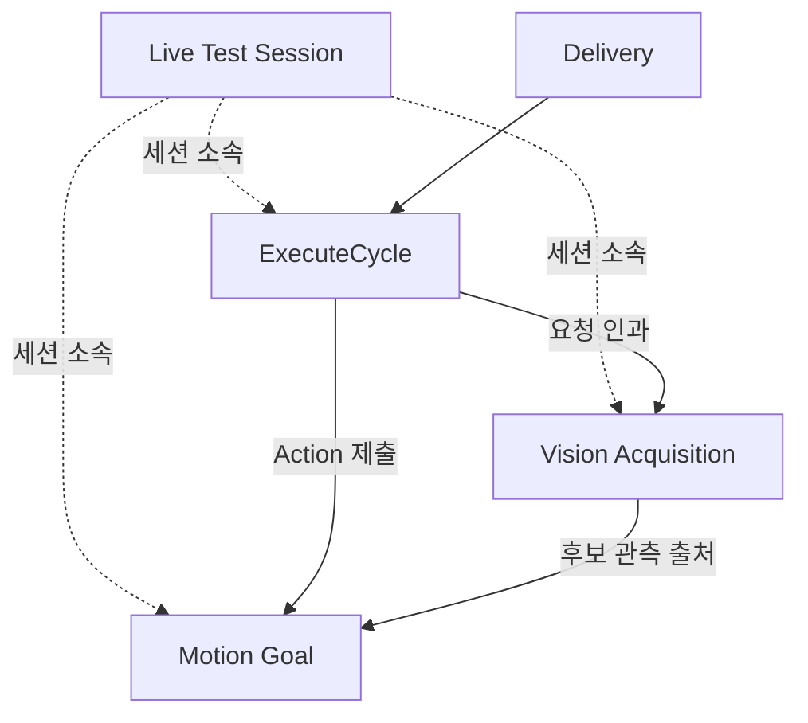

# [SF-Twin] ARM Cell 관측·진단 기록 공유 의미 계약

- **계약 ID:** ARM-CELL-OBSERVABILITY-CORRELATION
- **의미 소유자:** ARM Cell Shared Interface
- **소비자:** Simulation, Vision, Motion, Safety, Orchestration, Live Test Analysis

## 목적과 공유 계약 경계

여러 컴포넌트가 기록한 Observation → Decision → Outcome을 기존 식별자와 실제 인과 참조로 연결하기 위한 공유 의미를 정의한다. 이 ICD는 새로운 Runtime 상태·Safety Gate·Retry 입력, 전역 Trace ID, Writer, Service 또는 기록 생성 시점을 정의하지 않는다. 각 컴포넌트 FDS는 자신이 사용하는 관측·판단·결과와 그 증거의 생성 시점을 소유한다.

## 참여자와 인터페이스

| 참여 책임 | 공유 의미 | 결과 Authority |
|---|---|---|
| 관측 생산자 | 실제 읽은 관측값과 출처·유효성 | 해당 원본 데이터 Owner |
| 판단 컴포넌트 | 실제 판단 시점에 사용한 입력·Rule·분류 | 해당 판단 Owner |
| Action·Service·Mission 수행자 | 정규 terminal 결과와 원인 | 해당 결과 Owner |
| Isaac Session Owner | 세션 ID와 확인된 참여 프로세스 | Simulation Session FDS |
| 분석 Consumer | 기록 연결 및 증거 범위 판정 | 정규 결과를 변경하지 않음 |

## 공유 식별자와 상관관계

| 기존 식별자 | 범위 및 연결 경계 |
|---|---|
| delivery_id, Hub request_id | 해당 공급·요청 계약과 연관된 업무 이벤트 |
| ExecuteCycle Goal ID | Mission 단위와 하위 Vision·Motion 요청 연결 |
| vision_run_id + acquisition_id | Vision Process Run과 요청별 Acquisition. Process-local Request Counter는 Run 없이 독립 식별자가 아님 |
| Orchestration Submission ID | ExecuteCycle과 해당 Cycle 내 Action 제출·취소·handoff·관측 결과 연결. 실제 Goal UUID 관측 시 같은 제출에 연결 |
| Motion Goal UUID / execution_id | Motion Action 및 후보·계획·실행·그리퍼 기록 연결 |
| MotionProfileTrace run_id | 해당 Trace에 국한. 기존 Goal 연결 근거가 있을 때만 Join |
| Live Test session_id | Play~Stop 세션 소속. Mission 결과·Safety Authority가 아님 |
| 로컬 Sequence / Clock Epoch | 로컬 Producer의 관측 순서에만 사용 |

RawPart Pose Recorder의 Producer-local session_id는 Live Test Session ID와 구별한다. 명시적인 live_test_session_id 또는 Session Descriptor의 유효한 참조를 통해서만 소속을 확정한다. 식별자 누락·응답 미수신 등으로 Join 근거가 없으면 unassociated/unavailable로 표시한다. 동일 Timestamp, 파일 경로 또는 이름만으로 인과 연결을 추론하지 않는다. 새로운 전역 capture_id·Trace ID·상관관계 Service를 도입하지 않는다.

## 시간의 의미와 비교 한계

| 관측 시계·값 | 공유 해석 |
|---|---|
| Isaac Publish-side Simulation Time | 실제 관측한 경우에만 발행측 근거. ROS 수신값에서 역산하지 않음 |
| ROS /clock 메시지 | 수신한 Clock 값. 노드별 수신 시각은 독립적 |
| 노드 ROS Time | 실제 판단 시점에 읽은 Clock. 마지막 /clock Subscriber 값과 일치한다고 단정하지 않음 |
| Message Source Stamp | 사용한 메시지의 발행측 시각. 로컬 수신 시각이 아님 |
| Local Steady Time | 같은 프로세스 인스턴스·부팅·Epoch의 시간 구간 측정. 프로세스 간 원시값 직접 비교 금지 |
| Receipt Age | 동일 로컬 Steady 기준의 판단 시각에서 수신 시각을 뺀 값. 결측·역전은 Invalid |
| Observed RTF | 같은 Epoch 내 delta(/clock) / delta(local steady receipt). 시뮬레이터 물리 성능 또는 전송 지연의 직접 측정 아님 |

음수 Clock Jump는 관측 Epoch를 구분하며 정지·무수신·지연·전진 Jump·재진행은 구별한다. Callback 공백만으로 Isaac Pause나 DDS 지연 원인을 단정할 수 없다. Clock Authority와 ROS/TF 의미는 [시뮬레이션 시간 ICD](icd-sim-state-time-tf.md)가 소유한다.

## 핵심 진단 근거의 공유 조망

아래 표는 **기존 컴포넌트별 기록에서 추적할 중요한 항목**을 한눈에 보여준다. 기록 생성·확정 시점과 실패 처리 순서는 각 FDS의 기존 시나리오가 소유하며, 여기의 항목은 새 기록 생성 명령·필수 API·일률적인 상세 수집 요구가 아니다. 각 Owner가 이미 보존한 원본 Result·Artifact를 재사용하고, 얻지 못한 근거는 유실·미관측으로 구분한다.

| 기능·기록 Owner | 핵심 기록·근거(무엇) | 원본 결과와의 관계 | 상관관계·근거 참조 | 소유 FDS |
|---|---|---|---|---|
| Vision — Frame Ingress / DetectTarget | 실제 Depth 입력·시각·Receipt Age, CameraInfo/Calibration·TF 적격성, Scene Stability, Algorithm/Profile, 후보별 Geometry·거부 사유, 적격 후보·Snapshot 및 Timeout 단계 | 정규 DetectTarget Service Result와 구별. 유효한 OBJECT_NOT_FOUND는 관측 실패·기록 누락과 구별 | vision_run_id, acquisition_id, Source Depth / Snapshot 참조 | [Frame Ingress](../components/vision/fds-frame-ingress.md), [DetectTarget](../components/vision/fds-detect-target.md) |
| Task Execution / Motion | Task Execution: PnP Goal·후보 순위/전환·Gripper·복구·`pnp_outcome`·`material_placed`. Motion: 선택된 movement·Scene/Occupancy·IK/Planning·trajectory·Joint feedback·accuracy·Backend/stop 결과 | PnP outcome과 배치 사실은 Task Execution authority, movement result·MotionStatus·stop evidence는 Motion authority | ExecutePnp Goal UUID, movement identity, Vision acquisition_id·candidate, selected candidate·trace | [Task Execution PnP](../components/task-execution/fds-pnp-execution.md), [Motion Execution](../components/motion/fds-motion-execution.md), [Stop/Recovery](../components/motion/fds-stop-recovery.md) |
| Safety — Supervision | 실제 입력·Payload 유효성·Receipt Freshness·Source Stamp 품질, 선택 Capability/Stop Mode, StopMotion 요청·결과, Reset 평가·결과, 관측 공백과 복구 | SafetyState 및 직접 StopMotion 결과가 Authority. 단순 Timestamp 경고를 Safety 원인으로 승격하지 않음 | Safety 상태·관측 시점, 관련 Motion Goal / ExecuteCycle 참조가 확인될 때만 연결 | [Safety Supervision](../components/safety/fds-supervision.md) |
| Orchestration — Mission | Delivery 수락·보류와 Quantity, Vision Acquisition·BUSY·Timeout, Task Execution의 상위 PnP outcome·배치 사실, Mission Retry 예산·승인/거부, Mission ExitReason | Mission 수락·회계·결과 Owner. 내부 Motion/Gripper 진단으로 PnP 결과를 재분류하지 않음 | delivery_id, ExecuteCycle Goal ID, target episode, acquisition_id·ExecutePnp Goal UUID | [Mission Cycle](../components/orchestration/fds-mission-cycle.md) |
| Orchestration — Recovery | Safety 선점·선택 Stop Mode, 보조 Cancel, 정지 및 복구 허가 대기, 허용 RETRACT·결과, 원래 중단 사유와 배치 계속 실행 | 원래 Mission 중단 근거 보존. Recovery 기록은 새 Stop 권한·결과 Authority 아님 | ExecuteCycle / Motion Goal, Safety 관측, Recovery Episode | [Controlled Recovery](../components/orchestration/fds-controlled-recovery.md) |
| Isaac / Simulation Session | Play~Stop Session, 참가 Process·상태·Source Revision·Dirty State, Artifact 경로·참여 누락·종료 Coverage, Gripper/PhysX 관측의 출처 | Session Descriptor는 증거의 소속과 출처. 실행 결과·물리적 정답의 대체가 아님 | Live Test session_id, Producer-local 기록 ID 및 명시적 Artifact 참조 | [Simulation Session](../components/simulation/fds-sim-session.md) |
| Live Test Analysis | 각 Owner의 실제 관측·판단·최종 결과, Ground Truth 대응, 결측 근거, 시간 비교 가능 범위, 성능·실패 분석 | 확인됨/범위 축소/증거 불충분은 사후 분석 등급이며 Runtime Result Code 아님 | Session·Delivery·Acquisition·Goal 및 Ground Truth의 검증된 참조 | [Live Test Analysis](../components/fds-live-test-analysis.md) |

위 기록에는 **일반 운영 로그**와 **선택적 상세 진단**이 혼재할 수 있다. 항목별 실제 활성화 조건·요약/상세 분리·보존 한도는 Owner FDS 및 운영 정책에 따른다. 표의 항목이 언제나 동일한 파일·포맷으로 생성된다는 뜻은 아니다.

### Motion 실행 완료와 정확도 진단의 구분

기존 Motion Task Accuracy Record 및 관련 실행 진단은 최종 목표 대비 관절별·최대 위치 오차,
TCP 위치·방향 오차, 측정 관절 위치·속도와 유용한 피드백 변화량 관측을 유지한다. 계획 Trajectory
소요시간, 실제 최종 명령 발행·수락 시각, 실행 완료·중단 사유는 서로 구별되는 근거다.
발행 시도와 성공 수락은 다르며 Backend가 별도 장치 ACK를 제공하지 않으면 그 보장 범위를
넘겨 해석하지 않는다. 시계 기준·측정 시각·결측을 보존하고 미관측 오차를 0이나 정확도 충족으로
해석하지 않는다. 기록 생성 시점과 best-effort 처리 책임은 [Motion Execution FDS](../components/motion/fds-motion-execution.md)가 소유한다.

PICK/PLACE Trajectory 완료는 정확도·안정화 보증이 아니다. 관측된 큰 오차·잔여 움직임 또는 진단
계산·쓰기 실패를 완료 Gate나 결과 재분류 근거로 사용하지 않는다. 기존 기록을 재사용하며
추가 파일·기록 체계를 요구하지 않는다.

## 기록의 공통 의미와 무결성

- Operational Log, Execution Record, Diagnostic Record, Visual Artifact, Replay Evidence, Performance Trace는 목적에 따라 구별하되 공통 Schema·파일 포맷이나 Writer 클래스를 요구하지 않는다.
- Decision 근거는 판단에 실제 사용한 값·출처·기준을 해당 시점에 보존한다. 나중에 가변 상태나 Clock을 다시 읽어 과거 판단을 재구성하지 않는다.
- Outcome은 기존 Action Result·Service Response·SafetyState·Mission Result를 참조하며 대체하지 않는다. 기록·쓰기 실패가 실행 결과·Retry·Safety를 바꾸지 않는다.
- observed, retained, unavailable, not_captured, dropped, write_failed, not_applicable 등 실제 증거 범위를 가능한 한 구별한다. 기록이 없다는 사실은 사건이 없었다는 증명이 아니다.
- log_level과 선택적 diagnostics 상세 수집은 서로 독립적이다. 구체적인 설정·저장 방식은 기존 Logging/Observability 운영 Owner와 생산자가 정의한다.
- 동일한 원본 Artifact는 복사 대신 참조하고, Progress가 Terminal Summary를 덮어쓰거나 일부 파일이 완전한 결과처럼 제시되지 않도록 한다.
- 사후 분석은 확인됨, 범위 축소, 증거 불충분을 구분한다. 분석 분류는 새 Runtime 상태나 Result Code가 아니다.

## 상호운용 조건 및 비보장

세션 소속과 업무 인과 ID는 독립적이다. Session Descriptor는 참여와 증거 경로를 연결하는 기록이지 Runtime 상태 저장소나 Mission Manifest가 아니다. Join 실패와 기록 유실은 정상 제어를 차단하지 않는다. 컴포넌트별 기록의 생성 조건, 세부 Payload, 저장·한계, 후보 계산, 오류 분류는 각 Owner에 남는다.

## Verification Requirements

| ID | 검증 기대 결과 |
|---|---|
| VR-OBS-CORRELATION-01 | 실제 전파된 기존 ID·명시적 참조가 없으면 서로 다른 컴포넌트의 기록을 인과 Join하지 않는다 |
| VR-OBS-CORRELATION-02 | 미관측·유실·저장 실패와 Clock 비교 불가가 증거 범위에 남고 원래 실행·Safety 결과는 변경되지 않는다 |
| VR-OBS-CORRELATION-03 | Clock Jump·프로세스별 Steady 시간 기준을 구별하며 Timestamp만으로 전체 사건 순서를 확정하지 않는다 |

### 기존 컴포넌트 검증 계약의 소유권

`VR-OBS-MOTION-PICK-01`은 Motion Task FDS, `VR-OBS-SESSION-REVISION-01`은 Simulation Session FDS가 소유한다. 이 ICD는 해당 기록의 **공유 참조 및 해석**만 담당하고, 기능별 생성 시점·유한 기록 예산·세션 종료 절차를 다시 규정하지 않는다.

## 참조

- [Simulation Session FDS](../components/simulation/fds-sim-session.md)
- [Live Test Analysis FDS](../components/fds-live-test-analysis.md)
- [Motion Execution FDS](../components/motion/fds-motion-execution.md) 및 [Task Execution PnP FDS](../components/task-execution/fds-pnp-execution.md)
- [Vision DetectTarget FDS](../components/vision/fds-detect-target.md)
- [Safety Supervision FDS](../components/safety/fds-supervision.md)
- [Orchestration Mission FDS](../components/orchestration/fds-mission-cycle.md)
