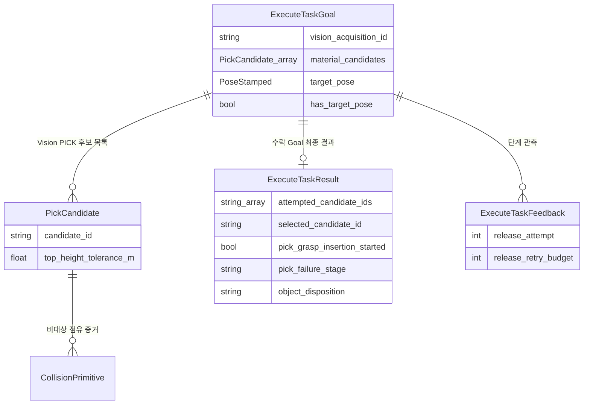

# [SF-Twin] ARM Cell Orchestration ↔ Motion 기존 공유 의미 및 호환 계약

- **Contract ID:** `ICD-ORCH-MOT`
- **Semantic Owner:** `ARM Cell Shared Interface`
- **Consumers:** Task Execution compatibility adapter, legacy ExecuteTask callers, Orchestration(명시적 standalone movement와 진단 관측)

## 1. 목적과 공유 계약 경계

이 ICD는 현행 `/motion/execute_task`와 호환 adapter에서 사용하는 요청·관측·결과 의미 및 기존 Geometry·candidate 공유 의미를 보존한다. 정상 자재 처리의 목표 실행 경계는 [Orchestration–Task Execution ICD](icd-orchestration-task-execution.md)의 단일 `ExecutePnp`다. 그 Action은 여기 정의된 유효 candidate·Recipe field의 공유 의미를 재사용하지만 Motion ROS Action을 호출하지 않는다.

**비책임:** Material Candidate 우선순위·PnP 내부 전환·Gripper·복구는 [Task Execution PnP FDS](../components/task-execution/fds-pnp-execution.md), IK·Planning Scene·충돌·Grasp/PLACE 경로와 movement 완료는 [Motion Execution FDS](../components/motion/fds-motion-execution.md), 정적 권한은 Motion CDS, Mission Retry·Lookahead·상위 시퀀스는 [Mission Cycle FDS](../components/orchestration/fds-mission-cycle.md)가 소유한다. 이 ICD는 해당 절차나 최적화 목적을 다시 정의하지 않는다.

## 2. 참여자와 인터페이스

| 공유 경계 | Producer·Authority | Consumer | 계약 의미 |
|---|---|---|---|
| `/motion/execute_task` Goal | legacy caller 또는 Orchestration의 명시적 standalone movement 요청 | Task Execution compatibility adapter | 기존 logical Task wire contract; PnP Mission은 사용하지 않음 |
| ExecutePnp Goal·Feedback·Terminal Result | Orchestration 요청 / Task Execution 수락·결과 확정 | Task Execution | 단일 PnP lifecycle; 상세는 신규 Orchestration–Task Execution ICD |
| `/motion/state` | Motion | Safety·UI 및 선택적 Orchestration diagnostic observer | Mission 실행·PnP 결과 재승인 Gate가 아니며 공유 의미는 [Safety–Motion ICD](icd-safety-motion.md) 참조 |
| Legacy PICK 후보·Occupancy | 직접 Caller 입력 / Orchestration의 호환 전달 | Task Execution compatibility adapter | 직접 목표·점유 입력만 이 legacy 경계에서 해석하며 Vision-derived PnP는 별도 Action 계약을 사용 |
| `MotionObservationError` 비Terminal 이벤트 | Motion | Orchestration | JointState 수신 공백 오류의 별도 정형 보고 |

아래의 `ExecuteTask` field·phase·Result 표와 legacy VR은 기존 `/motion/execute_task` compatibility
adapter와 구 Caller의 wire contract에만 적용한다. 정상 Mission의 단일 `ExecutePnp` Action,
PICK/PLACE 내부 의미 및 외부 결과는 [Orchestration–Task Execution ICD](icd-orchestration-task-execution.md)가
소유한다. 새 PnP 흐름은 아래 legacy `object_disposition`/Motion result 조합을 Mission 분기로
사용하지 않는다. 새 PnP의
`object_disposition` authority는 Task Execution이다. 기존 Action 호환 중에는 adapter가
같은 결과 의미를 유지해 전달한다.

ROS Action Goal UUID는 유일한 실행 식별자다. 활성 실행의 `MotionStatus.active_execution_id`는 이 값을 가리킨다. 새로운 Caller-assigned Task ID를 요구하지 않는다.

### 논리적 데이터 모델

이 모델은 필드 의미와 포함 관계를 보여주는 논리 모델이다. `ExecuteTaskResult`는 수락된 Goal의 최종 결과이며, Feedback은 0회 이상 발생할 수 있다. 상세 타입과 표현 방식은 논리 계약의 의미를 유지하도록 결정하며, 이 그림에 생략된 필드의 존재를 부정하지 않는다.

### JointState 수신 공백 오류의 논리적 교환 데이터

이 계약은 Motion에서 Orchestration으로 전달하는 **독립적인 비Terminal 관측 오류 이벤트** `MotionObservationError`를 정의한다. Action Result·MotionStatus·Action Feedback에 오류 문자열을 끼워 넣어 파싱하지 않는다. 물리적 Joint Stalled 오류와도 구분한다.

| 필드 | 의미 |
|---|---|
| `observation_kind` | `JOINT_STATE_RECEIPT_GAP`: 유효한 JointState Callback 수신 공백 |
| `severity` | `ERROR`: 동일 공백이 5초 지속된 관측 오류 |
| `has_execution_id` / `execution_id` | 해당 시점 활성 Motion Goal UUID의 존재 여부 및 값. Goal이 없다면 연결 추정 금지 |
| `gap_duration_ms` | Motion의 로컬 단조 시계로 계산한 수신 공백 길이 |
| `observed_at` | 이벤트 보고 시각. 수신된 JointState의 Source Stamp와 구별 |

같은 공백에 대한 5초 오류는 **한 번만** 보고하고, 수신이 회복된 뒤 새 공백이 시작되면 별개의 오류로 본다. Orchestration은 Goal과 연관 지을 수 있는 경우 해당 실행의 비Terminal 진단으로 기록한다. 이벤트 수신만으로 Action을 종료·재시도·Hold·Stop하거나 새 승인 Gate를 만들지 않는다. 이벤트 전달이 누락되더라도 Action Feedback·Result의 기존 계약을 변경하지 않는다. 교환 형식은 구현 전에 위 논리 필드와 의미를 만족하도록 정식 인터페이스로 확정한다.

## 3. 공유 의미 계약

### 주요 공유 데이터 필드

| 필드·그룹 | 승인된 의미 | 존재 조건·제약 |
|---|---|---|
| `task_type` | PICK·PLACE·GO_HOME·RETRACT·RETURN_HELD 종류 | Action Goal에만 존재하며 Result에 중복하지 않음. `RETURN_HELD`는 E-Stop Reset 이후 Orchestration이 명시적으로 요청하는 자재 반환 operation |
| `material_candidates` / `vision_acquisition_id` | 단일 Acquisition에서 Mission이 전달하는 Vision 후보 집합과 증거 상관 ID | 정상 Mission PICK에서는 SELECTED HIGH·MEDIUM 전체를 후보별 고유한 비공백 ID와 함께 그대로 운반; 직접 PICK에서는 후보 목록 비움. 후보 등급이나 confidence 필드는 추가하지 않음 |
| `target_pose` / `has_target_pose` | 직접 PICK의 관측 Pose 또는 PLACE의 Desired Object Pose | Vision 후보 목록과 직접 단일 입력은 혼용 금지 |
| `estimated_object_height_m` / `has_estimated_object_height` | Object own thickness와 presence | Rectangle PICK에서는 유한 양수; 부분 복원에서는 추정 자체 두께 |
| `has_observed_rectangle`, `rectangle_long_side_m`, `rectangle_short_side_m` | `has_observed_rectangle`는 Rectangle 실측 여부 provenance이고 side 필드는 유효 Rectangle Geometry 치수 | 실측 또는 추정 Geometry를 제공할 때 양수·형상 일관성; false여도 양수 side는 추정값으로 유효 |
| `orientation_symmetry_order`, `has_unobserved_yaw_fallback`, `unobserved_yaw_fallback_rad` | 관측 대칭 동치류와 별도 Recipe 방향 정책 | 0/1/2/4만 인정; order 0 fallback은 관측 근거로 취급 금지 |
| `grasp_width_min_mm`, `grasp_width_max_mm` | Recipe의 허용 접촉 폭 구간 | 유한 양수·최솟값 ≤ 최댓값 |
| `pick_approach_translation_direction`, `pick_approach_distance_m` | PICK 접근축 모드·Grasp와 Approach 분리 거리 | RawPart는 TCP insertion axis, 양의 거리 |
| `pick_grasp_position_tolerance_m`, `pick_grasp_orientation_tolerance_rad` | Recipe의 Grasp 목표 허용오차 | 후보 상판 높이 동치 허용오차와 구별 |
| `has_non_target_occupancy`, `non_target_occupancy` | 직접/non-Vision PICK 호환용 점유 Availability·Primitive. Vision-derived PnP는 후보 Geometry를 Task Execution–Motion ICD로 전달하고 Motion이 맵을 구성 | 직접 입력에서만 flag와 목록을 한 쌍으로 해석 |
| `place_position_tolerance_m`, `place_orientation_tolerance_rad`, `place_orientation_constraint` | PLACE 공정 위치·방향 제약 | FIXED/BOUNDED/FREE, FREE에서 방향 허용오차 무시 |
| `place_approach_direction_object`, `place_approach_distance_m`, `place_retract_distance_m` | Desired Object Frame의 단위 접근 방향과 공정 거리 | 단위 방향·유한 양수 거리 |
| `has_place_tool_orientation_preference`, `place_tool_orientation_preference` | Base Frame에서 가능한 TCP 자세의 순위 힌트 | FREE일 때 적용하지 않음 |
| `result_code`, `diagnostic_detail` | `result_code`는 Action의 실제 실행 결과·실패 원인, `diagnostic_detail`은 사람이 읽는 비규범 근거 | Result는 Action 수락 Goal에만 존재; 통신 지연을 작업 실패 원인으로 변환 금지 |
| `object_disposition` | 새 PnP Action에서는 Task Execution이 확정하는 자재 처리 결과; 기존 ExecuteTask 호환 응답은 이 의미를 보존 | `ExecuteTask.Result`/PnP Result의 공유 필드; legacy Goal에서는 `task_type`과 해석; `diagnostic_detail`에서 추론 금지 |
| `attempted_candidate_ids`, `selected_candidate_id`, `pick_failure_stage`, `pick_grasp_insertion_started` | 탐색 시도·결과 원인 후보·최종 단계·삽입 제출 여부 | Action terminal 대상 후보 기준 |
| `release_attempt`, `release_retry_budget`, `release_last_failure` | 기존 PLACE Release 진행·진단 Feedback | 0은 비해당, Attempt는 1 기반; 관측 지연은 새 시도나 재명령 근거가 아니며 반복 판단은 Motion FDS 소유 |

`object_disposition`은 Gripper의 현재 상태 자체가 아니라 해당 PnP lifecycle에서 확정한 자재 처리 결과다. Task Execution은 기존 `result_code`와 별도로 다음 값 하나를 PnP Result에 보고한다. 구 endpoint adapter는 legacy response에서도 같은 의미를 보존한다.

| 값 | 의미 |
|---|---|
| `UNCHANGED` | Action이 자재 처리 상태를 바꾸지 않음. PICK 후보 탐색만 소진한 경우와 자재를 처리하지 않는 GO_HOME·RETRACT에 사용하며, 비처리 Action에서 추가 Gripper 상태 Gate를 만들지 않음 |
| `HELD` | 성공 PICK에서 Motion이 파지 상태 `HELD`인 새 관측을 확인함 |
| `RETURNED` | Motion이 해당 Action의 기존 반환 계약을 완료하고 `RELEASED` 상태의 새 관측을 확인함. `RETURN_HELD`는 설정된 Tray 관절 목표에서 이 결과를 확정하며 이동·릴리즈 순서는 Task Execution FDS가 소유함 |
| `PLACED` | 정상 PLACE 목표에서 자재 해제와 `RELEASED` 상태의 새 관측을 확인함. OPEN 명령 성공만으로 확정하지 않으며, 확정 뒤 Retreat 실패해도 의미가 유지됨 |
| `UNKNOWN` | Action 종료 시 자재 처리 결과를 확정할 근거가 없는 경우. Holding 상태 `UNKNOWN`과 별개이며, 관측 전달 지연·Stale만으로는 이 값이나 Action 종료를 만들지 않음 |

`result_code`는 기존 성공·실패 원인을 표현하고 `object_disposition`은 Action 종료 시 자재 처리 의미를 표현한다. `task_type`은 기존 Action Goal에만 두며 Result에 중복하지 않는다. 기존 `pick_failure_stage`는 PICK의 단계별 실패 의미를 계속 표현하며 `object_disposition`과 중복 해석하지 않는다. `diagnostic_detail`은 기계 판정에 사용하지 않는다.

Gripper의 Holding 상태와 관측 전달 상태는 별개다. Holding 값은 `HELD`, `RELEASED`, `UNKNOWN`이고 전달은 최신 관측 수신 또는 지연·Stale로 구분한다. Stale은 Holding 값이 아니며 Motion은 마지막 정상 관측의 값·시퀀스·시각을 보존한다. 필요한 관측이 지연되면 Motion Action 내부에서 기다리고, 새 관측 후 같은 작업 단계를 계속한다. 통신 지연은 `result_code`, `object_disposition=UNKNOWN`, `TASK_RESULT_GRASP_FAILURE` 또는 새 Terminal 결과로 매핑되지 않는다.

Holding `UNKNOWN`은 `object_disposition=UNKNOWN`을 자동 의미하지 않는다. `object_disposition`은 Action 종료 시 Motion이 확정한 자재 처리 결과를 표현한다. 새 `RELEASED`로 반환 완료가 확인된 경우만 `RETURNED`를 사용하고, 처리 결과가 미확정이면 `UNKNOWN`을 보존한다. Gripper 작업 실패의 `result_code`는 기존 실패 원인을 보존하며 실제 Transport/Backend 오류도 기존 정규 Result 의미를 따른다. Action 내부 OPEN·재명령·복구 단계와 그 결과 확정 절차는 Motion FDS가 소유한다.

Legacy ExecuteTask caller는 해당 Goal의 `task_type`과 Terminal `result_code`·`object_disposition`을 기존 방식으로 소비할 수 있다. 정상 Mission의 새 ExecutePnp consumer는 legacy field 조합, Holding·MotionStatus 재조회 또는 diagnostic detail로 결과를 재분류하지 않으며 [Orchestration–Task Execution ICD](icd-orchestration-task-execution.md)의 상위 결과만 사용한다. 이 compatibility ICD는 신규 PnP outcome을 대신 정의하지 않는다.

| 경계 또는 값 | 보장하는 의미 | 금지된 해석 |
|---|---|---|
| Action Goal acceptance | 프로토콜 수준에서 Goal 처리·Result 전달을 위한 수락 | Motion 실행 예약·Safety 허가·Backend 시작·성공을 의미하지 않음 |
| Action protocol rejection | Goal이 Action 수준에서 거절됨; `ExecuteTask.Result` 없음 | `TASK_RESULT_BUSY` 또는 도메인 실행 실패로 추정 금지 |
| `TASK_RESULT_BUSY` | Motion이 기존 예약·실행·미확정 Backend 정리로 새 Goal을 예약할 수 없어 반환하는 정규 Result | 선행 실행을 교체하거나 계획·Gripper 작업을 시작했다는 뜻 아님 |
| Result / MotionStatus | Result는 특정 Goal의 terminal outcome; Status는 현재 발행 시점의 상태 관측 | 지연된 Status로 확정 Result를 재분류하거나, 통상 작업 순서에서 Status를 추가 승인 Gate로 사용 금지 |
| Cancel 수락 | Caller 요청 처리 수락 | 실행 완료·Backend 비활성·실제 Stop으로 추정 금지 |
| `TASK_RESULT_SAFETY_PREEMPTED` | Safety 직접 선점으로 인한 정규 종료 | Caller Cancel이나 일반 Backend 실패와 합치기 금지 |
| `diagnostic_detail` | 사람을 위한 부가 진단 | 머신이 파싱할 규범 프로토콜 아님 |
| `vision_acquisition_id` | Vision에서 전달된 증거와 실행의 상관 식별자 | Motion Goal 수락·실행 가능성 결정 근거 아님 |
| `material_candidates` | 동일 Acquisition에서 Mission이 선택해 전달한 HIGH 전체 또는 MEDIUM 전체 후보 집합, 입력 열거 순서 유지 | 단일 목록 안에 등급을 혼합하지 않으며 confidence 필드는 포함하지 않음; 목록 순서가 Motion 실행 우선순위라는 뜻 아님 |
| `attempted_candidate_ids` | 실제 정밀 탐색이 시작된 후보만 시도 순서대로 | 검증 단계에서 건너뛴 후보·모든 Vision 입력 후보와 동일시 금지 |
| `selected_candidate_id` | **최종 Action 결과의 원인이 된 후보**; 성공이면 성공 후보, 실패면 terminal 원인 후보; 후보 정밀 탐색이 시작되지 않았으면 비어 있음 | 최초 Approach 실행 후보 또는 마지막 단순 입력 후보로 추정 금지 |
| `pick_failure_stage` | 최종 실패의 Action-local 단계; 성공 시 `NONE`, 근거 불충분 시 `UNKNOWN` | 중간 실패 목록 또는 정규 오류 원인 코드 대체 아님 |
| `object_disposition` | §2의 공유 자재 처리 결과 | 단순 Gripper 현재 상태가 아니며 §2의 조건 없이 `PLACED`를 추론할 수 없음 |
| `pick_grasp_insertion_started` | 해당 결과 후보의 Grasp 삽입 궤적이 Backend에 제출되었는지 확인된 사실 | Feedback phase·Status·진단으로 추정 금지 |
`result_code`와 `object_disposition`은 기존 ExecuteTask compatibility Action의 wire 의미다. 새 ExecutePnp 경로에서는 Task Execution이 내부 진단·legacy adapter mapping에만 이를 보존하며 Orchestration은 상위 `pnp_outcome`과 `material_placed`만 사용한다. 기존 구 Caller에만 `task_type`별 legacy 의미가 적용된다. `PLACED`는 Result 성공 여부와 무관하게 한 번만 처리 수량에 반영하며, `RETURNED`·`UNCHANGED`는 처리 수량을 늘리지 않는다. 상세 Task별 절차와 복구는 [Task Execution PnP FDS](../components/task-execution/fds-pnp-execution.md) 및 [Motion Execution FDS](../components/motion/fds-motion-execution.md), 반복·재진입·회계는 [Mission Cycle FDS](../components/orchestration/fds-mission-cycle.md)가 소유한다. Feedback·MotionStatus·Holding 재조회·`diagnostic_detail`은 Terminal 결과를 재판정하는 근거가 아니다.

**서로 다른 입력 형식:** Vision-derived PICK은 동일 Acquisition의 고유하고 비어 있지 않은 Candidate ID를 가진 Vision 반환 `material_candidates`로 전달한다. 직접/non-Vision 호환 PICK은 후보 목록이 비어 있고 기존 단일 `target_pose`와 개별 Geometry 필드를 쓴다. 두 형식은 혼합하지 않는다. 후보 단위의 로컬 무효값은 해당 후보를 건너뛸 수 있으나, 목록 전체의 Acquisition/ID 일관성 위반과 동일시하지 않는다. 검출 증거의 재검증·후보 평가 단계는 각 소유 FDS가 담당한다.

**좌표·형상·방향 해석:**
- PICK `target_pose`는 Observation Pose이며 Object Center나 직접 명령할 TCP Grasp Pose가 아니다. Rectangle top-face의 실제 두께(`estimated_object_height_m`)는 상단 높이나 Tray 지지면부터의 높이가 아니며 Orchestration은 원값과 presence를 보존한다.
- 직사각형 변 길이·Contact Width 범위는 관측/추정 Geometry와 Recipe 정책을 구분한다. `has_observed_rectangle=false`인 L자 기반 RawPart 복원은 양수 Side Length를 Recipe 추정 치수로 전달할 수 있으며 Motion은 flag와 독립적으로 이를 Geometry 입력으로 소비한다. Orientation symmetry `0/1/2/4`는 차례로 관측 불가 / 고유 / 180° 등가 / 90° 등가 의미다. Order 0에서는 target Pose의 Quaternion을 사용하지 않으며, 유효한 복원 Candidate의 Recipe 추정 방향은 기존 symmetry 대표값과 `target_pose`로 전달한다. 추정 Yaw를 관측값으로 기록하지 않는다.
- `PICK_APPROACH_TCP_INSERTION_AXIS`는 RawPart의 Recipe 전달 모드다. 기존 직접 Caller의 planning-frame vertical 모드는 호환성 목적으로 유지한다.
- PLACE `target_pose`는 `base_link`의 Desired **Object** Pose이며 최종 TCP Pose가 아니다. `fixed`는 명목 방향, `bounded`는 Recipe의 방향 오차 내, `free`는 Object 방향 공정 제한 없음이다. `free`에서 호환성 `orientation_tolerance_rad` 필드는 실행 제한으로 사용하지 않으며 선택적 TCP orientation preference도 적용하지 않는다. Preference는 `base_link` 방향 순위 힌트일 뿐 목표 Object Pose를 바꾸지 않는다.
- PLACE Approach/Retreat 방향은 Desired Object Pose Frame에서 해석한다. 그 외 접근 거리·정확도·Grasp Width와 Orientation 제약은 전달된 Recipe 공정 요구사항이며 Motion이 Solver 선택·실행 가능성 판정을 소유한다.

**직접 PICK Occupancy 해석:** `has_non_target_occupancy`와 `non_target_occupancy`는 직접/non-Vision PICK 호환 입력에만 적용한다. `false/empty`는 증거 미계산·사용 불가를 뜻하고 이웃 장애물 없음의 선언이 아니다. `true/empty`는 사용 가능한 비대상 Primitive가 없는 계산된 집합이다. `false/nonempty`는 계약 위반이다. Primitive Geometry·Frame·Timestamp 규칙은 이 ICD의 직접 입력 계약을 따른다. 모든 경우 기존 정적 Scene·Safety 검증은 유지한다.

## 4. 상호운용 조건

| 관심사 | 공유 계약 |
|---|---|
| Goal 경합 | Orchestration은 동일 논리 Task의 병렬 Goal 복제를 보내지 않는다. Motion은 Admission 예약의 단일 Authority다. Accepted Goal이라도 `BUSY`, `INVALID_GOAL`, `PERMISSION_DENIED`, `BACKEND_UNAVAILABLE` 등을 Result로 반환할 수 있다. |
| 불확실한 송신 | Acceptance 지연·통신 소실은 제출 결과 미확정이지 BUSY가 아니다. 무조건적인 중복 Goal 재전송은 허용하지 않는다. |
| Result·Status 순서 | Terminal Result와 MotionStatus에는 상대적 도착 순서 보장이 없다. Orchestration은 통상 다음 Task의 순서를 해당 Action Terminal Result로 결정하고 Status로 Motion Admission을 재구현하지 않는다. |
| Action Feedback | 활성 Accepted Goal에서 단계 변경 시 즉시, 그 외 **500ms 간격**으로 현재 phase를 보낸다. 반복 phase 허용. Orchestration은 해당 Goal UUID만 **monotonic clock** 기준 관측하며 **1.5초 무응답**을 관측 이상으로 기록한다. 무응답 자체는 Cancel·재전송 근거가 아니다. PLACE Approach Planning 반환 흐름은 Motion Terminal Result가 보장하며 Feedback은 진행·진단 관측으로만 사용한다. |
| Gripper 관측 대기 | Motion은 기존 Action의 `GRIPPER` 진행 phase를 통해 관측 대기 중임을 보고할 수 있다. Orchestration은 이를 진행 관측으로만 소비하며 Action을 Cancel·재제출하지 않는다. 새 Gripper 상태 필드나 조회 Gate를 만들지 않는다. |
| PLACE Release Feedback | 기존 `release_attempt`(1-based; 비해당=0), `release_retry_budget`, `release_last_failure`는 진단용 Release 진행 관측이다. 지연·Stale 관측으로 OPEN 재명령이나 추가 시도를 승인하지 않으며, 실제 Release 실패의 처리는 Motion FDS가 소유한다. |
| PICK Result 근거 | 후보 전환은 하나의 Action 내부에서 완료되며 Orchestration은 후보별 Goal을 보내거나 계획 로그로 Result를 재분류하지 않는다. 실패에 대한 Mission Retry 가능 여부는 [Mission FDS](../components/orchestration/fds-mission-cycle.md) 소유다. |
| 500ms Joint Feedback WARN / 5초 오류 | Motion의 **JointState Callback 수신 공백**에 대한 500ms WARN은 위 500ms Action Feedback과 별개다. 동일 관측 공백 **5초 시점에는 Orchestration 비Terminal 오류 보고**가 필요하다. 별도 Hold/Resume·재계획·Terminal 확정으로 해석하지 않는다. 교환 필드와 비Terminal 의미는 2절의 `MotionObservationError`를 따른다. |
| Cancel·선점 | Caller Cancel의 수락과 Terminal Action은 다른 사건이다. Safety 직접 Stop은 독립적이고 우선하며, 복구·실제 Stop의 보장은 [Safety–Motion ICD](icd-safety-motion.md) 및 [Stop FDS](../components/motion/fds-stop-recovery.md)를 따른다. |
| Compatibility | 동일 Action 정의를 사용하는 양측 Binary가 호환되어야 한다. 단순히 공개 메시지의 수신 또는 단계 Feedback은 새 실행 승인·물리 실행 확인이 아니다. |

## 5. 검증 요구사항 (Verification Requirements)

### VR-ICD-ORCH-MOT-01 — 논리적 작업 계약
Orchestration은 Backend 장치별 로봇 명령이 아닌 논리적 작업 의미로 Motion에 요청해야 한다.

### VR-ICD-ORCH-MOT-02 — 논리적 그리퍼 명령
상위 계층은 논리적 `close()`/`open()`을 요청해야 한다. 장치별 구동 및 명령 완료 판정은 Gripper Adapter가 소유한다. 닫기 명령의 성공만으로 파지 성공을 확정해서는 안 된다.

### VR-ICD-ORCH-MOT-03 — Legacy ExecuteTask 결과 호환

기존 `/motion/execute_task` compatibility adapter는 구 Caller를 위해 `result_code`와 §2의 `object_disposition` 의미를 보존해야 한다(SHALL). 이 legacy wire contract는 새 ExecutePnp Mission 결과를 정의하지 않으며, 정상 Mission의 상위 분기·회계에는 Orchestration–Task Execution ICD가 단독 적용된다.

### VR-ICD-ORCH-MOT-04 — Legacy 방향 필드 호환 의미

Legacy ExecuteTask payload는 symmetry order `0/1/2/4`와 방향 evidence의 기존 직렬화 의미를 보존해야 한다(SHALL). Order 0은 target quaternion을 관측 방향으로 취급하지 않는다. 신규 ExecutePnp에서 Recipe fallback 허용·적용과 후보별 사용 여부는 Task Execution FDS가 소유하며 Orchestration은 Recipe snapshot과 Vision candidate를 변경 없이 전달한다.

### VR-ICD-ORCH-MOT-06 — Action 수락과 Terminal Result 구분
Action 프로토콜에서 거절된 Goal에는 `ExecuteTask.Result`가 없으며, 이를 `TASK_RESULT_BUSY`나 도메인 실패로 추정해서는 안 된다. 수락된 Goal은 정규 Terminal `result_code`를 반환하며 `TASK_RESULT_BUSY`는 기존 공유 Result 값이다. Goal UUID는 Result·Feedback과 실행을 연관한다. Orchestration의 BUSY·실패 처리 및 재진입 절차는 [Mission Cycle FDS](../components/orchestration/fds-mission-cycle.md)가 소유한다.

### VR-ICD-ORCH-MOT-07 — 취소와 Safety 선점
Cancel 수락만으로 Backend 비활성이나 Action 최종 완료가 증명되지 않는다. Safety의 직접 `StopMotion`은 요청자 Cancel과 독립적이며, Safety 선점에 따른 Action 결과는 일반 취소·작업 실패와 구분되어야 한다.

### VR-ICD-ORCH-MOT-08 — Action Feedback 관측
수락된 활성 Motion Goal은 단계가 바뀌면 즉시, 그 외에는 500ms 간격으로 관측 단계를 Feedback으로 보고해야 한다. Orchestration은 해당 Action Goal UUID의 Feedback만 단조 시계 기준으로 관측하고, 1.5초 이상 수신 공백을 감지·기록하며 회복도 기록해야 한다. 과거 Goal 또는 이미 종료된 Goal의 Feedback은 현재 Goal 관측에 사용하지 않는다. Feedback 수신 공백만으로 Cancel 또는 재제출을 수행해서는 안 된다. Motion의 Gripper Holding 관측 지연은 기존 `GRIPPER` phase 안의 Action 내부 대기이며, 새 Terminal Result·Result 매핑·Orchestration 승인 Gate가 아니다. 검증 근거는 Goal UUID, Feedback 수신 시각, 공백·회복 판단, MotionStatus 대조와 최종 Action Result다.

### VR-ICD-ORCH-MOT-09 — Geometry·직접 점유 입력의 인계 의미
Orchestration은 Observation Pose, 객체 자체 두께와 presence를 변경 없이 전달해야 한다(SHALL). 적층 높이는 객체 자체 두께를 대신하지 않는다. 직접/non-Vision PICK Occupancy 입력의 availability Flag와 목록은 한 쌍으로 해석한다. `false/empty`는 계산된 빈 공간이 아니고, `true/empty`는 관측된 비대상 Primitive가 없는 계산 결과이며 `false/nonempty`는 무효 조합이다. Vision-derived PICK 후보 Occupancy는 Orchestration 입력이 아니며 후보 Pose·Geometry는 [Vision–Orchestration ICD](icd-vision-orchestration.md)에 따른다. 점유 증거를 Motion Planning 구간에 적용하는 규칙은 Motion FDS가 소유한다.

### VR-ICD-ORCH-MOT-10 — 후보 증거와 결과 식별
Vision PICK에서 Orchestration은 동일 Acquisition의 SELECTED HIGH·MEDIUM 후보 목록과 증거를 변경 없이 한 PnP Goal에 전달해야 한다(SHALL). Action Payload는 confidence 등급을 추가하지 않는다. Task Execution의 Terminal Result는 실제 시도 순서 `attempted_candidate_ids`, 최종 결과 원인 후보 `selected_candidate_id`, 해당되는 경우 최종 실패 단계 `pick_failure_stage`를 구분해야 한다(SHALL). 입력 목록 순서는 실행 우선순위를 뜻하지 않는다. 후보 평가·전환은 Task Execution PnP FDS가, MotionPort 입력과 개별 movement 계약은 각 정식 ICD/FDS가 소유한다.

### VR-ICD-ORCH-MOT-11 — Vision Occupancy 필드의 비소비
Vision-derived PnP의 Planning은 `has_non_target_occupancy`와 `non_target_occupancy`를 사용하지 않아야 한다(SHALL NOT). 해당 경로는 전체 Candidate Geometry와 선택 ID를 [Task Execution–Motion ICD](icd-task-execution-motion.md)에 따라 전달한다. 이는 직접/non-Vision PICK의 기존 Occupancy field 의미를 바꾸지 않는다.

### VR-ICD-ORCH-MOT-12 — JointState 수신 공백 오류 보고

유효한 JointState Callback이 500ms 이상 도착하지 않으면 Motion은 관측 경고를 남기고, 같은 공백이 5초에 도달하면 `MotionObservationError`를 한 번 보고해야 한다. Orchestration은 이벤트의 종류·지속 시간·Execution ID 존재 여부를 보존하고 비Terminal 진단으로 소비해야 한다. 해당 공백만으로 Action의 성공·실패·취소 또는 안전 정지를 확정하지 않는다. 500ms Action Feedback 주기와 1.5초 Feedback 수신 이상은 별도 계약이다.

### VR-ICD-ORCH-MOT-14 — 추정 Rectangle Geometry 소비
Orchestration은 `has_observed_rectangle=false`인 부분 형상 RawPart Candidate의 유효 Side Length·Pose 방향·추정 자체 두께를 기존 필드에서 보존해 전달해야 한다. Motion은 presence/provenance flag만으로 이 값을 거부하지 않고 유한성·양수·형상 일관성을 검증해 grasp geometry와 Object Pose에 사용해야 한다. 메시지 필드는 추가하지 않는다.

## 6. 계약 의존성과 소비 관계
- **Motion CDS/FDS:** [정적 책임](../components/motion/cds.md), [Motion movement](../components/motion/fds-motion-execution.md), [Task Execution PnP](../components/task-execution/fds-pnp-execution.md), [Stop 처리](../components/motion/fds-stop-recovery.md)
- **Orchestration FDS:** [Mission 재시도·Lookahead·워크플로](../components/orchestration/fds-mission-cycle.md)
- **공유 계약:** [Safety–Motion](icd-safety-motion.md), [Vision–Orchestration](icd-vision-orchestration.md), [Motion Backend](icd-motion-backend.md)

각 소비자는 자신이 사용하는 공유 의미의 단일 설계 Owner를 참조한다. 구현 경로나 파일 탐색은 이 문서에서 규정하지 않는다.
