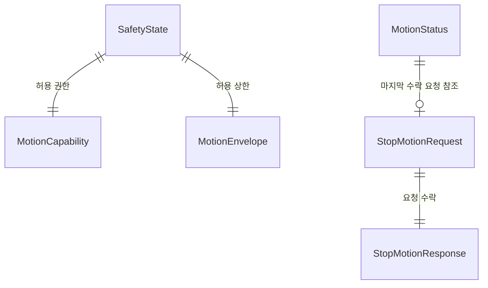

# [SF-Twin] ARM Cell Safety–Motion 공유 인터페이스 계약

- **계약 Owner:** ARM Cell Shared Interface
- **참여자:** Safety Supervisor, Motion Core
- **추가 소비자:** Orchestration 및 UI Hub의 상태 관측

## 1. 목적과 공유 계약 경계

Safety가 소유하는 실행 Capability·허용 운동 Envelope·정지 명령과 Motion이 발행하는 상태·보유 증거의 **공유 데이터와 의미**를 정의한다. 정지 처리 순서와 Motion의 작업 중단·복구 동작은 [Motion Stop FDS](../components/motion/fds-stop-recovery.md), Safety 원인·Latch·Reset의 판단은 Safety 설계가 소유한다. 이 ICD는 새 중단 Gate나 Hardware Safety 인증을 도입하지 않는다.

## 2. 참여자와 인터페이스

| 논리적 인터페이스 | Producer / 의미 Authority | Consumer |
|---|---|---|
| `/safety/state`의 `SafetyState` | Safety | Motion, Orchestration |
| `MotionCapability` / Permitted Envelope | Safety | Motion |
| `/safety/stop_motion`의 `StopMotion` | Safety 요청 / Motion 수락·수행 | Motion, Safety |
| `/motion/state`의 `MotionStatus` | Motion | Safety, Orchestration, UI Hub |

### 공유 데이터 모델

## 3. 공유 의미 계약

### Safety Capability 및 허용 Envelope

| 값·필드 | 보장 의미 | 금지된 해석·제약 |
|---|---|---|
| `MOTION_NONE` | 모든 Trajectory 작업 금지 | 새 정상 작업이나 RETRACT 허가로 해석 금지 |
| `MOTION_RECOVERY_ONLY` | 승인된 제한 복구 `RETRACT`만 허용 | 일반 PICK/PLACE/GO_HOME 허가 아님 |
| `MOTION_NORMAL` | Safety 관점에서 정상 작업 실행 가능 | Mission 준비·AMR 도킹·PackML·자재 가용성까지 보증하지 않음 |
| `motion_envelope_valid` | 현재 Safety가 제공한 운동 상한의 유효성 | 누락·오래된 허용값을 재사용할 근거 아님 |
| `max_velocity_scale`, `max_acceleration_scale` | 현재 보정된 Motion Profile에 대한 속도·가속도 상한 배율 | 각 값은 유한하고 `(0, 1]`; `1.0`은 해당 차원의 추가 제한 없음 |
| `selected_stop_mode` | Safety가 현재 선택한 정지 강도 | Motion이나 Orchestration이 원인으로부터 재계산할 수 없음 |
| `diagnostic_detail` | 사람을 위한 보조 설명 | Capability·Envelope를 대체하는 결정 필드 아님 |

Safety만 Capability, 허용 Envelope, 정지 심각도와 원인을 판정한다. Motion은 Goal 수락과 Backend Trajectory 실행 직전에 유효한 현재 Capability를 확인하며, 허가를 재사용 가능한 Lease로 취급하지 않는다. 새 Trajectory는 현재 Velocity·Acceleration 상한 내에서 계획·실행한다.

실행 중 Envelope가 더 엄격해지면 Backend가 새 상한을 **안전하게 적용하고 적용 근거를 제공할 때만** 계속 실행할 수 있다. 그렇지 않으면 Safety가 승인한 직접 `StopMotion` 경로로 정지하고, 비활성 확인 후 현재 Envelope를 적용해 새 작업을 계획한다. Capability 하향 자체만으로 Motion이 Stop 원인이나 정지 정책을 만들어 수행하지 않는다. 유효하지 않거나 사용 불가능한 Envelope로 새 궤적을 실행할 수 없다.

### StopMotion

| 필드 | 공유 의미 |
|---|---|
| `request_id` | Safety가 부여한 정지 요청 UUID |
| `stop_mode` | Safety가 요구한 정지 방식 |
| `causes` | Safety가 판정한 알려진 활성 원인 Bitset |
| 응답 `accepted` | Motion이 요청 처리를 접수했는지 여부 |
| 응답 `diagnostic_detail` | 비규범적 설명 |

`STOP_MODE_CONTROLLED`는 설정된 감속 정지, `STOP_MODE_IMMEDIATE`는 실행 Trajectory 취소 및 현재 위치 Hold, `STOP_MODE_EMERGENCY`는 독립된 E-Stop/STO와 연계한 소프트웨어 명령 차단·취소를 뜻한다. 심각도는 CONTROLLED < IMMEDIATE < EMERGENCY 순이며 높은 수준을 낮은 요청으로 강등하지 않는다. `accepted=true`는 정지 완료·Backend 비활성·물리 안전 정지 증거가 아니다.

### MotionStatus

| 필드 | 보장하는 의미 |
|---|---|
| `header` | 활성 ROS Clock의 상태 발행 시각; 원천 시각의 타당성은 Safety 통신 진단 |
| `execution_state` | `UNKNOWN`, `IDLE`, `EXECUTING`, `STOPPING`, `STOPPED`, `EMERGENCY_STOPPED`, `FAULTED` |
| `active_execution_id` / `has_active_execution` | 활성 ExecuteTask Goal UUID 및 존재 여부 |
| `active_task_type` | 활성 작업 종류 또는 `TASK_TYPE_UNSPECIFIED` |
| `execution_active` | 이전 Backend 제어 실행이 아직 관절 명령을 생산할 수 있음 |
| `backend_inactivity_confirmed` | 이전 명령 생산자와 Action이 종료됐고 Stop/Hold 전달이 성공했음 |
| `last_stop_request_id` / `has_last_stop_request` | 마지막으로 수락한 직접 정지 요청의 식별자 및 존재 여부 |
| `holding_state` | `HOLDING_UNKNOWN`, `HOLDING_HELD`, `HOLDING_RELEASED` |
| `applied_velocity_scale` / `applied_acceleration_scale` | Backend가 확인한 현재 적용 상한 배율 |
| `applied_envelope_valid` | 적용 상한 근거가 신선하고 유효함 |
| `diagnostic_detail` | 비규범적 진단 텍스트 |

`MOTION_STATE_STOPPING`은 이전 명령 생산자의 종료 또는 Stop/Hold 전달 완료가 아직 확인되지 않은 상태다. `MOTION_STATE_STOPPED`는 이전 실행·Action 종료, Stop/Hold 전달 성공, `execution_active=false`, `has_active_execution=false`, `backend_inactivity_confirmed=true`를 모두 요구한다. **관절 위치·속도의 안정 구간은 STOPPED 진입 Gate가 아니며**, 해당 상태는 Hardware Safety 인증을 뜻하지 않는다. `EMERGENCY_STOPPED`도 독립 안전 하드웨어 기능을 대체하지 않는다.

정상 PICK/PLACE Trajectory 완료 뒤 `IDLE`은 실행 소유권이 해제됐음을 뜻하며,
`backend_inactivity_confirmed=false`일 수 있다. 이 경우 다음 정상 movement의 수락에
Stop 완료를 요구하지 않는다. `IDLE`이나 정상 실행 완료를 `STOPPED` 또는 Stop/Hold 전달
성공의 증거로 해석하지 않으며, 진행 중인 Stop의 완료 조건은 그대로 유지한다.

보유 상태 관측이 결측·오래됐으면 `HOLDING_UNKNOWN`을 발행한다. 과거 `HELD`/ `RELEASED`는 현재 관측으로 재사용할 수 없다. 적용 Envelope가 더 엄격해지는 실행에서는 최신 Backend 근거로 두 적용 배율이 현재 Safety 제한 이내임을 확인해야 지속 실행이 가능하다.

## 4. 상호운용 조건

| 상황 | 계약 |
|---|---|
| 신선한 필수 Safety 입력 | Demo에서는 유효한 Payload의 **로컬 수신 경과 시간**으로 필수 입력의 유효성을 평가한다 |
| Source Timestamp 미래·과거 | `source_timestamp_max_age_ms`를 벗어나더라도 Payload가 유효하고 로컬 수신 Freshness를 만족하면 Timestamp 자체만으로 Capability·Envelope 변경, StopMotion, Cause/Latch를 만들지 않는다 |
| Timestamp 품질 이상 | 해당 이상 시작에 WARN 한 번, 지속 중 중복 WARN 억제, 정상화 시 회복 기록; Timestamp 진단 임계값과 필수 입력 수신 Freshness를 혼동하지 않는다 |
| 필수 입력 누락·수신 지연·무효 | 기존 Safety Fail-closed 동작 유지; 명시적 Motion Fault, E-Stop, STO도 그대로 적용 |
| Envelope 입력 불가 | Motion은 새 Trajectory를 실행하지 않으며 Motion 자체가 Safety 원인·강도를 판정하지 않는다 |
| Reset과 복구 | Operator Reset이 적격한 Latch를 해제하더라도 `STOPPING` 동안 Capability를 부여하지 않는다. Safety는 소프트웨어 정지 완료 후에만 운동 권한을 허용하고 Motion은 현재 권한으로 새 요청을 평가한다 |
| 직접 정지 | Safety→Motion의 직접 Stop이 우선 경로이며 Orchestration Cancel은 필요 조건이 아니다 |

현 Demo의 `/motion/state`와 `/safety/hardware_state`는 Source Timestamp 품질이 나쁘더라도 Payload가 유효하고 **500ms 이내 로컬 수신**된 상태라면 그 이유만으로 정상 Capability나 Envelope를 낮추지 않는다. 단, 실제 안전 하드웨어에서 측정 시각 자체가 안전 필수 근거라면 별도의 승인된 계약이 필요하다.

## 5. 검증 요구사항

### VR-ICD-SAFE-MOT-01 — Safety 권한
정규 Motion Capability는 Safety만 결정해야 한다.

### VR-ICD-SAFE-MOT-02 — Motion의 권한 집행
Goal 수락 또는 Backend 실행 직전에 현재 유효한 권한이 부족하면 Goal을 거절하거나 실행을 시작하지 않아야 한다. 이전 권한을 Lease로 재사용해서는 안 된다.

### VR-ICD-SAFE-MOT-02A — 실행 중 정지 권한
이미 실행 중인 Trajectory는 Capability 하향만으로 Motion이 새 정지 정책을 만들어 중단하지 않는다. 실행 중인 경로의 정지 시작은 Safety의 `StopMotion`을 따른다.

### VR-ICD-SAFE-MOT-03 — 요청 수락의 의미
`StopMotion.accepted`는 정지 완료를 뜻하지 않는다.

### VR-ICD-SAFE-MOT-04 — 정지 완료의 의미
이전 Trajectory 명령 생산자·Action 종료 및 Stop/Hold 전달이 확인돼야 소프트웨어 정지 완료다. 물리적 완전 정지는 추가 Capability Gate가 아니다. Operator Reset은 조건에 따라 접수할 수 있지만 Motion이 `STOPPING`인 동안에는 `MOTION_NONE`을 유지한다.

### VR-ICD-SAFE-MOT-05 — 직접 정지
Safety는 Orchestration Cancel에 의존하지 않고 Motion에 직접 정지 요청을 전달할 수 있어야 한다.

### VR-ICD-SAFE-MOT-06 — 복구 권한
`RETRACT` 실행은 유효한 복구 Capability를 요구한다.

### VR-ICD-SAFE-MOT-07 — 하드웨어 경계
소프트웨어 Emergency Stop 의미가 독립 안전 등급 하드웨어 기능을 대체해서는 안 된다.

### VR-ICD-SAFE-MOT-08 — 운동 Envelope 집행
Motion은 현재 유효한 속도·가속도 상한을 준수한다. 실행 중 강화된 상한을 Backend가 안전하게 적용·증명하지 못하면 Safety의 StopMotion으로 중단하고 비활성 확인 후 새 제한으로 재계획해야 한다. 검증 근거는 적용 한계 또는 정지 상태, Backend 비활성 및 다음 Task의 상한이다.

### VR-ICD-SAFE-MOT-09 — 보유 상태 관측
MotionStatus는 현재 `HELD`·`RELEASED`·`UNKNOWN`을 제공한다. 결측·오래된 값은 UNKNOWN이며 소비자는 이전 값을 현재 상태로 해석하지 않는다. 관측 Freshness는 Motion이 책임진다.

### VR-ICD-SAFE-MOT-10 — 통신 상태와 Envelope
MotionStatus가 유효하고 로컬 수신 경과 500ms 이내인 상태에서 Source Timestamp 이상만으로 Safety는 정상 Capability·Envelope를 변경하거나 StopMotion을 보내지 않는다. Payload 결측·무효·수신 지연, 명시적 Motion Fault 및 Safety Hardware E-Stop/STO에는 기존 Fail-closed 계약을 적용한다.

### VR-ICD-SAFE-MOT-11 — Safety 입력 Timestamp 품질
필수 입력의 Source Timestamp 품질과 수신 Freshness·Payload 유효성은 분리하여 관측한다. Timestamp 이상 자체만으로 원인·Latch·StopMotion·Capability 또는 Envelope 제한을 새로 만들지 않는다. 필수 입력 결측·무효·수신 지연은 기존 Fail-closed 의미를 유지한다.

## 6. 계약 의존성과 소비 관계

- [Motion Stop FDS](../components/motion/fds-stop-recovery.md): 정지 처리·복구 실행 순서
- [Motion CDS](../components/motion/cds.md): Capability 집행·실행 상태 제공 책임
- [Motion–Backend ICD](icd-motion-backend.md): 명령 생산 종료·Stop/Hold 전달·Holding 신선도
- [Orchestration–Motion ICD](icd-orchestration-motion.md): Action Result와 Status의 순서·공통 해석
