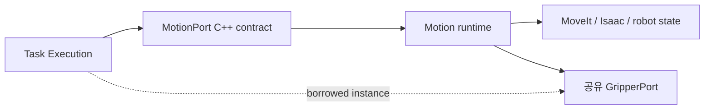

# [SF-Twin] Task Execution–Motion in-process 공유 계약

- **Contract ID:** `ARM-CELL-TASK-EXECUTION-MOTION`
- **Semantic Owner:** Motion은 움직임 결과·정지 상태·Backend 관측, Task Execution은 PnP 절차·자재 처리 의미를 소유한다.
- **Consumers:** Task Execution, Motion

## 1. 계약 경계

Task Execution은 PnP 내 개별 로봇 움직임과 독립 교란 작업을 Motion에 위임한다. 이 경계는 같은 ROS
process에서 호출하는 C++ library port다. 새 ROS Topic·Service·Action, serialized
command queue 또는 Task Execution package를 참조하는 Motion code는 허용하지 않는다.

## 2. MotionPort 논리 요청

| 논리 요청 | 입력 | Motion 결과 |
|---|---|---|
| `planMotion` | 기존 movement 요청 및 선택적 시작 관절 상태; Vision-derived PICK movement에는 동일 Acquisition의 전체 `material_candidates`와 선택된 `selected_candidate_id`; 같은 execution/movement identity로 연속 계획 가능 | 작업 소유권을 유지하는 계획 ID, 실행 가능한 시간 매개변수화 Trajectory, 실제 계획 시작 상태 및 Trajectory 종료 상태; Backend 실행 없음 |
| `executePlannedMotion` | `planMotion`이 반환한 계획 ID·identity·Trajectory | 기존 `MotionTaskResultCode`, 실패 classification, 작업별 실행 완료 및 MotionStatus evidence; 재계획 없음 |
| `planAndExecuteMotion` | PnP execution identity, segment kind, Vision-derived PICK이면 동일 Acquisition의 전체 `material_candidates`와 Task Execution이 선택한 `selected_candidate_id`; 또는 Recipe destination pose; 해당 segment의 Recipe constraints | 기존 `MotionTaskResultCode`, 실행/계획 실패 classification, 작업별 실행 완료·측정 state·MotionStatus evidence |
| `disturbanceParameters` | 입력 없음 | Motion 운영 Profile의 밀기 거리·접근 여유·속도 비율 |
| `cancelMotion` | 같은 PnP identity 또는 그 하위 motion identity | 취소 요청 수락 여부와 실제 Backend inactivity/terminal movement evidence |
| `observeMotionState` | 해당 runtime의 observer access | 현재 MotionStatus 및 canonical measured joint state 관측 |
| `measuredTcpPose` | 해당 runtime의 observer access | 현재 측정 TCP Pose와 Frame. 관측 불가 시 명시적 실패 |
| `executeDisturb` | 동일 Acquisition identity·scene generation 및 전체 원본 disturbance candidate 집합 | Motion FDS의 후보 선택·전체 동작 계획·접근·밀기·후퇴 결과 |

`MotionPort`는 단일 움직임용 `planMotion`·`executePlannedMotion`과 호환 조합인 `planAndExecuteMotion`, 그리고 기존 `executeDisturb` entry point를 제공하는 in-process C++ 계약이다. 별도 `MotionDisturbPort`나 두 번째 adapter는 두지 않는다. Task Execution BT는 PnP candidate와 교란 candidate를 선택하고 작업 순서·계획 실패 전환·Gripper·복구를 결정한다. 교란 BT는 대표점과 Motion profile 값으로 짧은 목표들을 만들고, 각 구간을 기존 `planMotion`·`executePlannedMotion`으로 계획·실행한다. Motion은 PnP의 object pose/geometry에 기존 object-to-TCP 변환을 유지하며, 교란은 전달된 target pose를 사용해 IK·collision·trajectory를 계획한다.
`measuredTcpPose`는 Task Execution의 PLACE WAYPOINT clearance 시작 Pose 및 완료 후 Y 경계 확인에 사용한다. `target_is_tcp_pose`가 지정된 PLACE clearance movement는 요청 Pose 자체가 `base_link` TCP 목표이며 object-to-TCP 변환을 다시 적용하지 않는다. PLACE WAYPOINT 접근은 적용된 고정 profile의 사전 준비 경로를 기존 `planMotion` reservation과 `executePlannedMotion` lifecycle로 제출하며, 경로 부재나 profile 불일치는 명시적 movement 실패로 처리하고 임의 이동 또는 다른 전략으로 대체하지 않는다.
`planMotion`은 MotionCore가 같은 execution/movement identity의 작업 예약을 보유한 채 요청별 Scene, 기준 측정 상태, 현재 Safety permission 및 선택적 연속 계획 시작 상태를 사용한다. 반환된 계획은 그 예약에 묶인다. 같은 identity의 연속 계획은 앞 Trajectory의 종료 관절 상태를 다음 요청의 시작 관절 상태로 전달할 수 있다. 다른 operation은 계획이 실행되거나 같은 identity가 Cancel/Safety로 종료될 때까지 거부된다. `executePlannedMotion`은 보관된 계획 metadata와 호출자가 전달한 동일 계획 ID의 Trajectory를 기존 실행 Backend에 전달하고 MoveIt 계획을 다시 호출하지 않는다. 전달된 Trajectory는 보관된 계획과 일치해야 한다. 각 계획의 실행 완료는 [Motion Execution FDS](../components/motion/fds-motion-execution.md)의 작업별 계약으로 확인하며 작업 예약은 남은 계획이 모두 끝날 때까지 유지한다. 기존 `planAndExecuteMotion`은 이 계획·실행 기능을 같은 operation 안에서 순서대로 호출한다.
한 identity로 여러 계획을 보관하면 생성 순서대로만 실행할 수 있다. 앞 구간이 해당 작업의 실행 완료 계약을 충족해야 뒤 구간 실행을 시작한다. 순서 위반은 `BUSY`로 반환하며 계획을 폐기하지 않는다.
`segment_kind`는 기존 단계별 collision/접촉 정책에 필요한 movement 범주만 표현하며
PICK/PLACE 순서, candidate 전환, Gripper command, object disposition, HOME/Tray recovery
policy, Vision request, quantity 또는 Mission retry를 입력·결과 의미로 포함하지 않는다.
PLACE WAYPOINT의 Tray 이탈 movement는 `PLACE_CLEARANCE` segment로 구별하며,
`PLACE_DESCENT`의 배치 진입 정책과 혼합하지 않는다. Clearance 완료 여부는 계획 결과가 아니라
실행 후 측정 TCP Y 경계 확인으로 판정한다.

`executeDisturb` Action은 전체 후보를 한 번에 받으며 기존 Task Execution BT SubTree와 동일 MotionPort runtime으로 처리한다. BT는 공통 `HEIGHT_FIRST` 후보 순서와 계획 실패 시 방향·후보 전환을 적용한다. 결과는 `COMPLETED`, `FAILED`(계획 소진 또는 실제 실행 실패), `CANCELED`, `SAFETY_PREEMPTED`로 구별하며, 각 결과의 완료 oracle·원인·정지 근거는 [Motion 교란 실행 FDS](../components/motion/fds-disturb-execution.md)가 소유한다. 새 ROS endpoint를 만들지 않는다.

기존 세 논리 요청은 PnP 공정의 movement 계약으로 그대로 유지한다. 구현상 MotionPort에 남는
Motion 전용 planner candidate 상태·planning failure evidence·요청별 Planning Scene 구성은
Motion이 소유하고 Task Execution은 그 결과를 받아 공정 결정을 한다. Vision-derived PICK에서
Task Execution은 한 후보 실행 시도에 동일 Acquisition의 전체 `material_candidates`와 선택한
`selected_candidate_id`를 전달한다. Candidate Geometry와 Acquisition provenance는 변경 없이
유지한다. Occupancy 구성은 [PICK Candidate Algorithm](../algorithms/motion-pick-candidate-search.md),
Planning 적용과 시도별 Snapshot 수명은 [Motion Execution FDS](../components/motion/fds-motion-execution.md)가
소유한다. Material Candidate 선택 trace는 Task Execution이 만든 사실을 진단 기록에 전달할 뿐
Motion이 후보 순위나 전환을 확정하지 않는다. Grasp relation API는 Motion의 Scene 관계를
준비·확정·해제하며 fresh Holding 판단은 호출 전에 Task Execution이 끝낸다.

단계적 이행 중 기존 `/motion/execute_task` Action Goal·Feedback·Result와 Endpoint는
Task Execution의 legacy 호환 Action Server가 유지한다. 이 호환 경계는 단독 GO_HOME 및
Safety 승인을 받은 standalone RETRACT를 명시적인 movement type으로 Motion에 전달한다.
Action Goal 전체는 MotionPort movement 입력이 아니며 PICK/PLACE 공정은 계속 단일
movement 요청으로 분해된다. Task Execution 내부 PLACE 복구의 configured joint target은
PLACE movement 권한을 사용한다.

## 3. 결과 의미

Motion은 성공을 목표 궤적 제출만으로 보고하지 않는다. 계획 유효성·충돌 및 작업별 실행 완료·실패는
[Motion Execution FDS](../components/motion/fds-motion-execution.md)를 따른다.

| 결과·관측 | 소비자가 의존할 의미 | 보장하지 않는 의미 |
|---|---|---|
| PICK/PLACE Trajectory 완료 | 계획 시간 경과 및 계획 명령 시퀀스 정상 발행·최종 수락, 실행 무효화 사유 없는 개별 이동 완료 | 실제 목표 위치 일치, 관절 안정화·물리 정지, Gripper/부착·분리, 공정 전체 성공 |
| 명령 수락 | Backend 계약의 전달 경계에서 명령 처리 요청을 수락 | 실제 관절 정확도 또는 별도로 제공되지 않은 장치 ACK |
| 측정 state·정확도 진단 | 실제 관측 및 관측 범위. 다음 Planning은 기존 최신 측정 상태를 사용 | 이전 Trajectory 완료에 대한 추가 Accuracy/Readiness 승인 |

실제 실행 실패는 planning candidate failure로 바꾸지 않는다. 기존 Safety permission·Stop,
GO_HOME 목표 도달 및 Cancel terminal arbitration 계약은 유지한다. Task Execution은 Motion
result code를 PnP terminal result로 매핑하되 `MotionStatus`나 정지 근거를 완료에서 추정하지 않는다.

Motion operation result는 Task Execution의 resource disposition을 확정하지 않는다.
`HELD`, `RELEASED`, `RETURNED`, `PLACED`는 Gripper 관측과 PnP 공정 이력을 결합해 Task
Execution이 확정한다. MotionStatus의 Holding projection은 현재 외부 observation이며
Task Execution의 material ledger가 아니다.

## 4. GripperPort·Isaac Transport ownership

| 계약·실체 | Owner | 사용 및 lifecycle |
|---|---|---|
| `GripperPort` C++ interface | Motion library가 선언·export; Task Execution이 소비 | 단일 interface instance를 composition root가 주입 |
| `IsaacGripperPort` concrete adapter | Motion runtime | 같은 `IsaacRosMotionTransport`를 사용 |
| `IsaacRosMotionTransport` | Motion runtime | MoveIt/trajectory/robot state와 기존 Gripper transport 연결의 단일 instance |
| Gripper command sequence·Holding expectation | Task Execution | 기존 PnP 단계에서 shared port 호출 |
| Holding observation·device mapping | Motion transport/adapter | 단일 observation stream; 양 계층이 별도 subscription/adapter를 만들지 않음 |

기존 Gripper command·Holding observation 동작은 변경하지 않는다. 통신 지연 대기, UNKNOWN
분류, 실제 파지 실패의 OPEN 복구, 중복 OPEN/Holding 검증 제거 및 Timeout/completion 조건은
기존 상세 FDS가 소유하며 이 ICD는 동작 절차를 복제하지 않는다.

## 5. 취소와 Safety stop

Action Cancel은 Task Execution이 동일 identity의 active MotionPort 동작에 전파한다.
Motion은 기존 Backend `cancel/hold/stop`과 `backend_inactivity_confirmed` 근거의 owner다.

계획이 반환된 뒤에는 계획 ID가 붙은 reservation이 계속 active Motion operation이다.
계획 사이 또는 실행 대기 중의 다른 operation은 그 reservation을 탈취할 수 없다. 동일
execution/movement identity의 Cancel은 보류된 모든 plan을 무효화하고 operation을 끝낸다.
Safety direct Stop도 같은 reservation을 선점하며, 계획 결과가 이미 반환됐다는 이유로
Safety 원인이나 기존 stop evidence를 생략하지 않는다.

실행 중인 계획은 실행 경로가 backend terminal 결과를 받은 뒤 한 번만 종결한다. Cancel과
Safety는 같은 계획을 별도로 종결하지 않으며, 보류 계획 정리·operation 해제·terminal 진단도
중복 수행하지 않는다. `MotionTaskResultCode`와 `MotionStatus`는 기존 STOPPING 및 Backend
inactivity evidence 계약을 따른다.

Cancel 요청 수락과 Motion operation terminal은 별개의 사실이다. Motion이 동일 identity의
취소를 받아도 실제 실행 중단과 기존 stop evidence를 확정하기 전에는 그 수락만으로 Action을
`CANCELED` terminal로 만들지 않는다. Motion이 먼저 `COMPLETED` 또는 `EXECUTION_FAILURE`를
확정했다면 뒤늦은 Cancel은 그 결과를 재분류하지 않는다. Cancel과 실행 결과가 동시에 경합할
때는 Motion이 확정한 실제 operation 결과가 기준이며, Motion이 실제 중단을 확정한 경우에만
`CANCELED`를 반환한다. Task Execution은 이 결과를 바꾸지 않고 한 Action Goal의 terminal을
한 번만 확정한다.

Motion operation 시작 전에 도착한 Cancel은 실행을 시작하지 않게 할 수 있으며 이 경우 Action은
`CANCELED`로 종료할 수 있다. Motion 실행이 시작되지 않았으므로 이 결과에는 Backend 중단 근거가
없을 수 있다. `backend_inactivity_confirmed`는 실제 Motion/Safety 관측이 제공할 때만 참이다;
취소 수락, operation 미시작 또는 Action 종료로 이를 추론하지 않는다. Cancel 수락 후 중단이
지연되는 동안 Task Execution은 Motion의 terminal 결과와 정지 근거를 기다린다.

Safety는 기존 SafetyState 및 Safety→Motion direct Stop 경계로 permission, 원인, stop
mode와 선점을 결정한다. StopMotion service/기존 Safety 연동 및 Backend stop 전파는 Motion
runtime에 남는다. Task Execution은 Safety API를 호출해 stop mode를 고르지 않는다. 명시적
Cancel의 Action 결과와 Safety 선점 결과는 구별하고 Safety 원인 및 기존 software stop 완료
근거를 terminal 결과에 보존한다. 정지 요청 수락만으로 `backend_inactivity_confirmed`를
추론하지 않는다.
Cancel과 Safety direct Stop이 겹치면 Safety의 원인·정지 근거와 `SAFETY_PREEMPTED`가 우선한다.
이미 Motion이 확정한 terminal 결과는 뒤늦게 도착한 Cancel 또는 Safety 통지로 소급 변경되지
않으며, 새 Safety 정지는 이미 끝난 operation과 별도의 기존 Safety lifecycle에 속한다.
정상 PICK_RETRACT와 PLACE_RETRACT는 각각 PICK·PLACE movement permission으로 검사하며,
Recovery-only permission은 기존 Safety 승인 경계의 standalone controlled RETRACT에만
적용한다. 이 구분은 기존 capability 검증을 정확한 movement type에 적용하며 Safety gate를
추가하지 않는다.
`Task Execution → Motion` dependency는 정적 package dependency를 뜻하며 Safety가 Motion을
직접 제어하는 현행 구조를 바꾸지 않는다.

## 6. Package·process 불변조건

| 항목 | 계약 |
|---|---|
| build dependency | `arm_cell_task_execution`은 `arm_cell_motion`에 의존; 역방향 금지 |
| binary/runtime | 하나의 Task Execution runtime process에서 Motion runtime을 직접 구성하거나 ROS component로 조립 |
| state | active Motion execution, MotionStatus, backend, GripperPort/transport는 한 instance |
| ROS transport | Task Execution↔Motion 사이 신규 ROS endpoint 없음 |
| External Action | 현행 migration 호환은 Task Execution이 `/motion/execute_task`를 제공; 목표 경계는 Orchestration↔Task Execution의 `ExecutePnp` |

Task Execution Action server와 Motion runtime은 하나의 process에 조립한다. Orchestration·Vision·Safety는
각자의 컴포넌트 경계를 유지하고, 같은 Motion runtime을 두 번째 서버로 중복 실행하지 않는다.

## 7. Verification Requirements

### VR-ICD-TE-MOT-DISTURB — 기존 MotionPort의 교란 operation

동일 Acquisition의 전체 후보가 기존 `ExecuteDisturb` Action 요청으로 전달되어야 하며(SHALL). 기존 Task Execution BT가 공통 `HEIGHT_FIRST` 순서, 대표점 기반 목표 생성 및 계획 실패 전환을 수행하고(SHALL), 각 구간은 기존 in-process `MotionPort.planMotion`·`executePlannedMotion`으로 처리해야 한다(SHALL). 별도 Port·Adapter·ROS endpoint를 추가하거나 Motion package에서 Task Execution을 참조해서는 안 된다(SHALL NOT). 실행 시작 이후 후보·방향을 바꾸어서는 안 된다(SHALL NOT).

### VR-ICD-TE-MOT-CANCEL — Cancel·실행 terminal arbitration

Motion 결과가 확정된 `COMPLETED` 또는 `EXECUTION_FAILURE`이면 후속 Cancel 요청으로 결과를 `CANCELED`로 바꾸어서는 안 된다(SHALL NOT). Cancel 수락과 실제 중단 완료는 구별되어야 하며, `backend_inactivity_confirmed=true`에는 기존 Motion/Safety 정지 근거가 있어야 한다(SHALL). 실행 전 Cancel은 Backend 정지 근거 없이 종료될 수 있어야 하며 그 경우 비활성 근거를 만들어서는 안 된다(SHALL NOT). Cancel과 Safety direct Stop이 겹치면 Safety 원인 및 정지 근거를 보존하고 한 Action Goal에 terminal 결과 하나만 확정해야 한다(SHALL).

### VR-ICD-TE-MOT-01 — C++ 단방향 port

Task Execution에서 MotionPort 호출이 새 ROS graph endpoint 없이 동작하고 Motion package가 Task Execution package/API를 의존하지 않아야 한다.

### VR-ICD-TE-MOT-02 — 움직임 결과의 범위

Motion operation terminal result는 개별 움직임을 설명하고 PnP phase ordering·candidate retry·material disposition을 정의하지 않아야 한다.

### VR-ICD-TE-MOT-03 — 단일 runtime resource

하나의 in-process MotionPort가 해당 Motion runtime과 동일 GripperPort interface/adapter instance를 참조해야 하며 별도 Action·ROS endpoint를 생성하지 않아야 한다.

### VR-ICD-TE-MOT-06 — Vision-derived PICK geometry input

각 Vision-derived PICK Candidate attempt에서 Task Execution은 해당 Acquisition의 전체 원본 `material_candidates`와 그 시도에서 선택한 단일 Candidate ID를 Motion에 제공해야 한다. Candidate Geometry·Acquisition provenance는 변경 없이 유지되어야 한다. Motion은 선택된 Candidate 외 다른 관측 객체를 추론해 입력을 보충하지 않아야 한다(SHALL NOT). Occupancy 구성은 [PICK Candidate Algorithm](../algorithms/motion-pick-candidate-search.md), Planning 적용과 시도별 Snapshot 수명은 [Motion Execution FDS](../components/motion/fds-motion-execution.md)가 소유한다.

### VR-ICD-TE-MOT-04 — Safety direct stop

Safety preemption은 현행 Safety→Motion 경로로 Backend에 도달하고 Task Execution은 권한·mode를 재판정하지 않아야 한다.

### VR-ICD-TE-MOT-05 — PLACE WAYPOINT profile trajectory

PLACE WAYPOINT는 적용된 운영 profile의 고정 HOME→PLACE 접근 경로를 기존 `planMotion` reservation과 `executePlannedMotion` 실행·Cancel·Safety lifecycle로 사용해야 하며, PnP 실행 중 이 경로를 다시 계획해서는 안 된다(SHALL NOT). 경로 준비 실패는 명시적 movement 실패여야 하며 다른 전략이나 임의 관절 이동으로 대체해서는 안 된다(SHALL NOT). `target_is_tcp_pose`가 지정된 clearance 목표에는 object-to-TCP 변환을 다시 적용해서는 안 된다(SHALL NOT).

## 참조

- [Motion CDS](../components/motion/cds.md)
- [Motion Execution FDS](../components/motion/fds-motion-execution.md)
- [Task Execution CDS](../components/task-execution/cds.md)
- [Task Execution FDS](../components/task-execution/fds-pnp-execution.md)
- [Safety–Motion ICD](icd-safety-motion.md)
- [Motion Backend ICD](icd-motion-backend.md)
