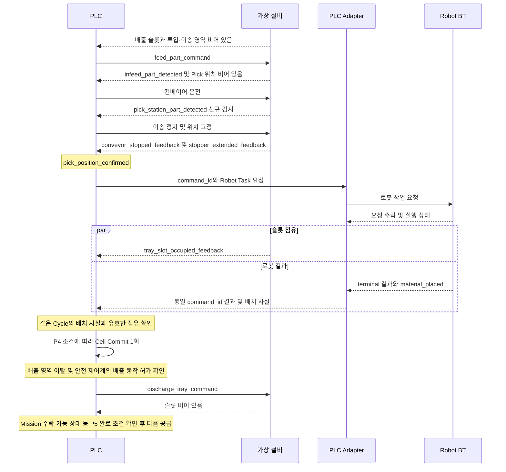

# Conveyor Pick & Place Cell — Cell Control Design (초안)

- **대상 Cell:** `conveyor-pnp-poc`
- **Owner:** Cell 통합 제어 책임자 (선정 필요)
- **상태:** 설계 초안

> PLC와 로봇 BT 사이의 제어 권한·명령·상태 교환을 정의한다. 공정 Step/Gate/Commit 의미는 Cell Process Design을 참조하고, 재사용 가능한 공유 필드 의미 및 내부 실행 시퀀스는 정식 System ICD/FDS가 소유한다.

## 제어 책임과 설비 경계

| 역할·제어 주체 | 판단·명령 권한 | 외부에 제공하는 상태 | 비책임 경계 |
|---|---|---|---|
| **SoftPLC** | 컨베이어·스토퍼 명령, 공급·Pick 허가, Cell 단계 조정, Cell Commit | 준비/이송/위치 확정, 로봇 요청, Cell 완료·보류 | 로봇의 Motion 경로·BT 내부 Retry를 직접 결정하지 않음 |
| **로봇 Orchestration / Task Execution BT** | 수락한 Robot Task 실행, Pick·Place 전략과 내부 복구 | 요청 수락, 작업 중, terminal 결과, 자재 처리 결과 | PLC의 컨베이어 모터·센서 명령을 직접 결정하지 않음 |
| **PLC Adapter** | Modbus TCP와 Robot Task 경계의 변환, 요청 ID 상관, 재연결 동기화 | 링크 상태, 마지막 수락·완료 사실 | Cell Commit을 독자적으로 재판정하지 않음 |
| **Isaac 설비 모델** | 공급·벨트·스토퍼·배출 명령에 따른 가상 장치 구동 | 벨트 실제 정지, 스토퍼 위치, 자재 감지, 트레이 슬롯 점유 | PLC 상태·BT 결과를 직접 확정하지 않음 |
| **Robot Backend** | 명목 티칭/계획 경로 실현과 Logical Attach | 로봇 관절·그리퍼 관측 | Cell 공정 완료 확정 아님 |
| **안전 제어계** | 실제 안전 정지·허가의 독립 권한 | 정지·해제/허가 상태 | 일반 PLC/BT가 우회할 수 없음 |

공급기·벨트·스토퍼·배출기는 PLC가 발행한 각 장치의 명령을 수행한다. 로봇과 흡착기는 로봇 제어 계층이 발행한 이동·Tool 명령을 수행한다. 실물과 시뮬레이션에 같은 경계를 적용한다. 장치가 구동에 사용하는 조건은 명령의 유효성, 해당 장치의 가용 상태와 동작 허가다. 자재 예약, 다른 설비의 점유, PLC 단계와 Commit을 조회해 명령의 공정 적합성을 다시 판단하는 책임은 장치에 없다. 설비 간 인터록은 아래 단계표의 제어 주체가, 장치 자체의 보호는 해당 장치가 담당한다.

센서는 관측 시점의 투입·Pick 감지, 벨트 정지, 스토퍼 위치, 트레이 점유를 보고한다. 예를 들어 빈 벨트에 유효한 운전 명령을 주면 벨트는 돌고 자재 감지는 꺼져 있다. PLC가 배출을 명령해도 자재가 슬롯에 남아 있으면 점유는 계속 참이다. PLC는 이 피드백으로 다음 단계를 결정한다.

런처에서 선택한 PLC 프로젝트가 로컬 시험 대상을 정한다. CODESYS는 그 프로젝트의 장치와 CODESYS Gateway 연결 설정으로 대상 Runtime에 로그인한다. Cell의 Delivery Gateway는 외부 자재 인계를 처리한다. Conveyor의 운전 중 요청과 응답은 PLC Adapter를 통해 교환한다.

**기존 시스템과의 연결 시 주의:** 현재 공개 ARM Cell의 Gateway는 Delivery/Handoff와 VDA 문맥을, Orchestration은 Mission·PnP 결과와 수량을 별도로 소유한다. 이번 PoC는 이 의미를 임의 변경하거나 가상의 VDA/AMR 상태를 꾸며내지 않는다. PLC의 위치 확정·작업 요청을 기존 계약과 접속할 방법을 구현 전에 검토한다. 기존 범용 기능이 충분하지 않다면 공통 인터페이스 확장을 별도 시스템 설계로 다룬다. Cell Commit과 기존 로봇 PnP 완료 회계는 서로 다른 개념이며 중복 카운팅하지 않는다.

상위 설비나 HMI에서 PackML을 사용할 경우 PLC가 Cell 전체의 운전 상태를 표현한다. 예를 들어 연속 생산은 `Execute` 안에서 P1~P5를 반복하며, 개별 Cell Commit은 운전 상태 전이를 일으키지 않는다. [기존 `/packml/state`](../../interfaces/icd-external-safety.md)는 외부 CNC/공정 상태를 나타낸다. 로봇 실행·인수 판정과 Safety 허가는 각각의 기존 계약을 따른다.

## 단계별 명령·상태와 시퀀스

| 공정 단계 | 명령 주체 → 수행 주체 | 명령 효과 | 상태 출처 → 소비 주체 | 적용 계약 |
|---|---|---|---|---|
| P1 | PLC → Feeder | 빈 배출 슬롯 확인 후 `feed_part_command` | `infeed_part_detected` → PLC | Cell Process P1 |
| P2 | PLC → Conveyor/Stopper | `conveyor_run_command`로 운전·정지, `stopper_extend_command`로 고정 | `pick_station_part_detected`, `conveyor_stopped_feedback`, `stopper_extended_feedback` → PLC | Cell Process P2의 PLC 판정 `pick_position_confirmed` |
| P3 | PLC → Adapter → Robot Task | `pick_position_confirmed` 및 Mission 수락이 가능하면 해당 `command_id`의 PnP 요청 | 수락·실행·terminal 결과 및 `material_placed` → PLC | Cell Process P3 및 [PnP 결과 계약](../../interfaces/icd-orchestration-task-execution.md) |
| P4 | PLC | 해당 Cycle의 인수 기록을 한 번 확정 | 같은 요청의 `material_placed=true` 및 유효한 `tray_slot_occupied_feedback=TRUE` → PLC | Cell Process P4 |
| P5 | PLC → 배출 설비 | Commit 후 로봇의 배출 영역 이탈과 설비 동작 허가를 확인해 `discharge_tray_command` 발행 | 배출 후 슬롯 비움과 Mission 수락 가능 상태 → PLC | Cell Process P5 |

## 공정 인터록과 안전 인터록

| 구분 | 조건 출처 → 적용 주체 | 영향받는 명령·동작 | 해제/복귀 |
|---|---|---|---|
| 공정 · P1 | 활성 자재·영역 및 트레이 슬롯 점유 → PLC | 슬롯 점유·상태 불명 시 새 공급 보류 | P1 시작 조건 재평가 |
| 공정 · P2 | Robot Pick 구역 사용 중 → PLC | 컨베이어 이동·스토퍼 해제 보류 | Robot 영역 작업 종료 후 재평가 |
| 공정 · P3 | `pick_position_confirmed`, Mission 수락 가능 상태 → PLC | 조건 미확정 시 Robot Task 요청 보류 | P3 시작 조건 재평가 |
| 공정 · P4 | 요청 ID별 배치 사실과 유효한 슬롯 점유 → PLC | 인수 근거 미확정 시 Commit 보류 | 두 근거가 갖춰지면 로봇의 실패 결과를 보존하고 인수 기록 |
| 공정 · P5 | 로봇의 배출 영역 이탈 및 배출 설비 동작 허가 → PLC | 영역 점유·상태 불명 또는 동작 미허가 시 배출 명령 보류 | 영역 이탈·동작 허가 확인 후 배출. 다음 Cycle은 P5 완료 조건 적용 |
| 안전 | 실제 안전 제어계 상태 → 권한 있는 제어기 | 허용되지 않는 기구 동작 정지/금지 | 안전 권한자의 허가 후 공정 상태 재확인 |

PLC 상태 대기와 오류는 공정상 영향받는 단계에 국한한다. Safety 정지 해제만으로 업무 Cycle이 자동 완료·재개된다고 추정하지 않는다.

## 통신 단절·중복 명령·상태 재동기화

| 상황 | 필요한 정보 | 처리/다음 명령 조건 |
|---|---|---|
| 요청이 전달됐으나 ACK 없음 | `command_id`, 마지막 요청/로봇 실행 상태 | 먼저 실행 여부 조회. 미확정 상태에서 새 ID로 중복 요청 금지 |
| 같은 ID 재수신 | ID의 범위, 기존 실행 또는 terminal 기록 | Adapter/Robot는 같은 작업을 재실행하지 않고 기존 결과를 반환하도록 계약 |
| 로봇 완료 후 응답 소실 | 같은 ID의 terminal 결과·배치 사실, 실제 슬롯 점유와 Commit 여부 | Cell Process P4에 따라 미확정 Cycle만 한 번 확정 |
| PLC/Adapter 재시작 | 마지막 ID와 결과, Commit 기록, 실제 자재·로봇·슬롯 상태 | 미확정 작업 재실행 금지. 이미 Commit했으면 P5에서 실제 배출 여부와 현재 동작 조건 확인. 상관을 복원할 수 없으면 보류 |
| 실제 설비 상태 불일치 | 관측의 유효성 및 해당 Cycle과의 연관성 | Cell Process의 재확인 경로 사용, 독립적 재검출이 불가능하면 작업자 확인 |

PLC가 재배포로 원점이고 로봇 쪽에는 이전 요청이 남은 경우, Adapter는 해당 영수증의 자재와 예약을 생산 이력에 대조한다. 같은 스트림에서 마지막 자재의 예약 해제, PLC 인수, 실제 배출이 확인되면 이전 요청을 종료된 것으로 식별할 수 있다. 동일 스트림에서 자동운전을 재개하면 PLC는 다음 자재의 작업을 요청할 때 직전 요청에 이은 번호를 부여한다. 기존 실행을 이어갈 근거가 없거나 더 진행된 자재가 있으면 새 작업을 보류한다. 새 실험의 원점 복원은 [Simulation Session](../../components/simulation/fds-sim-session.md), 첫 요청 번호와 이전 영수증 처리는 [PLC 단일 작업 ICD](../../interfaces/icd-plc-task.md)를 따른다.

실행 코드의 영속화 수단·레지스터 표현은 구현 계약에서 결정하되, 재시작·통신 단절 시험이 주장하는 범위에 맞게 해당 단계에 필요한 결과와 관측 증거를 보존하거나 재조회할 수 있어야 한다.

## PLC·Equipment Adapter 구성 참조

| 대상 | 논리 계약과 구현 구성 연결 | 설정 원본 |
|---|---|---|
| SoftPLC ↔ 설비 I/O | P1·P2 공급/이송/스토퍼 명령과 설비 피드백, P4·P5 슬롯 점유 및 배출 명령 | [PLC 레지스터 원본](../../../../infra/plc/conveyor_pnp_cell/Conveyor.fbsdev/Application.iecapp^/PLC_PRG.prg.st) · [설비 I/O 변환](../../../../infra/isaac_sim/scripts/conveyor_pnp_cell/equipment_io.py) |
| SoftPLC ↔ Robot Task | 요청 ID, 수락·실행·terminal 결과, `material_placed`, Mission 수락 가능 표본 | PLC Adapter Mapping Configuration |
| Isaac 설비 | Asset/Joint, 센서 Prim과 I/O Binding | Cell / Equipment Configuration |
| Robot Task | 정적 Pick/Place 목표, 상면 흡착 전략, Task Profile | Robot/Tool/Cell Profiles + Calibration |

Modbus 레지스터 번호, PLC 타이머, 실제 티칭 좌표와 속도는 이 설계서가 아닌 해당 구성의 정식 원본에서 관리한다.

## Robot Task 연결과 후속 Cell 통합

1. PLC 요청은 [PLC 단일 작업 ICD](../../interfaces/icd-plc-task.md)를 통해 [Configured-source Mission](../../interfaces/icd-configured-supply.md)에 연결한다. Task는 Mission이 예약한 도착 자재에 고정 Pick/Place 티칭을 적용한다. 기존 Vision PnP에는 실제 Acquisition 후보가 필요하다.
2. 공급자는 실제 Pick 도착과 PLC 위치 확정을 대조하고 해당 자재 ID를 PLC에 응답한다. PLC는 연결을 확인한 뒤 P3 요청을 발행한다. 공급 예약과 Robot Task는 같은 설비 슬롯과 그때 도착한 개체를 함께 참조한다.
3. Task 실패는 기존 Mission을 종료한다. 배치 사실은 같은 Mission의 terminal 결과로 전달하며 PLC가 P4에서 별도 인수를 판단한다. PoC의 Modbus TCP 장치 주소와 I/O 매핑은 Adapter 구성에서 관리한다.
4. 고장 주입은 실제 I/O 관측 경계에서 수행한다. `Fault Injector`가 PLC 내부 상태나 Cell Commit을 직접 수정하는 것은 금지한다.

## 공급 설정과 Isaac 설비 연결

운영자는 [UI Hub의 공통 운전·공급 조작](../../components/ui-hub/fds.md#32-공통-운전공급-조작)을 사용한다. 설비는 수락한 품종과 수량을 기존 미투입 재고에 추가하고, 현재 생성 중인 자재의 품종·ID를 보존한다. 자동운전 중 재고가 소진되면 PLC는 대기하고, 재고가 보충되면 기존 P1 조건을 다시 평가한다. 설비는 PLC 공급 명령과 자재 ID로 생성 동작을 한 번 수행하고 실제 생성 확인 후 수량을 차감한다. 투입 도착은 별도 센서가 확인한다. 생성 결과가 불명확하면 해당 ID를 보류하고 자재와 생성 이력을 대조한다. Tape·CNC의 공급 요청은 각 Cell의 기존 공급자가 처리한다.

후속 Isaac Cell의 `material_supply_factory`는 [ConveyorFeeder](../../../../infra/isaac_sim/scripts/conveyor_pnp_cell/supply.py)를 기존 UI 포트에 등록하고 종료 시 해제한다. 설비 측 [ConveyorIO](../../../../infra/isaac_sim/scripts/conveyor_pnp_cell/equipment_io.py)는 같은 Modbus 서버의 설비 블록을 교환한다. 설비가 유효한 공급 명령을 읽으면 `feed(cycle, spawn_one)`에 기존 자재 생성 함수를 연결한다. 복원 시 마지막 생성 ID와 미확정 생성 건을 실제 자재에 대조한다.

Pick 센서가 관측한 자재와 PLC가 위치를 확정한 자재가 일치하면 공급자가 그 개체를 고정 Pick 슬롯에서 공개한다. 로봇 요청 단계에서는 PLC가 위치 확정 신호를 내린다. 공급자는 이미 배정된 동일 개체가 정지된 벨트의 Pick 위치에 있고 스토퍼 전진·트레이 비움이 관측되는 동안 해당 요청의 예약을 수락한다. 같은 개체를 다시 관측해도 품종과 개체 ID를 유지한다. 목적지 Release를 확인한 뒤에는 해당 개체를 퇴역시키며 다음 도착 자재가 같은 슬롯을 사용한다. [Configured Supply ICD](../../interfaces/icd-configured-supply.md)

### 데이터 모델 및 변환 계약

자재·슬롯·논리 배정·예약·작업·검사·생산 이력의 Entity·Cardinality·영속성·복원은 [Cell Data Model Design](cell-data.md)이 소유한다. PLC·Equipment·Robot·History의 식별자 및 오류 의미 매핑은 [Integration Mapping Design](integration-mapping.md)이 소유한다.

Cell Control은 기존 공정 명령·상태·인터록 및 인수 확정 권한을 유지한다. Data/Mapping 문서는 새 PLC Gate 또는 Safety 상태를 정의하지 않는다.
