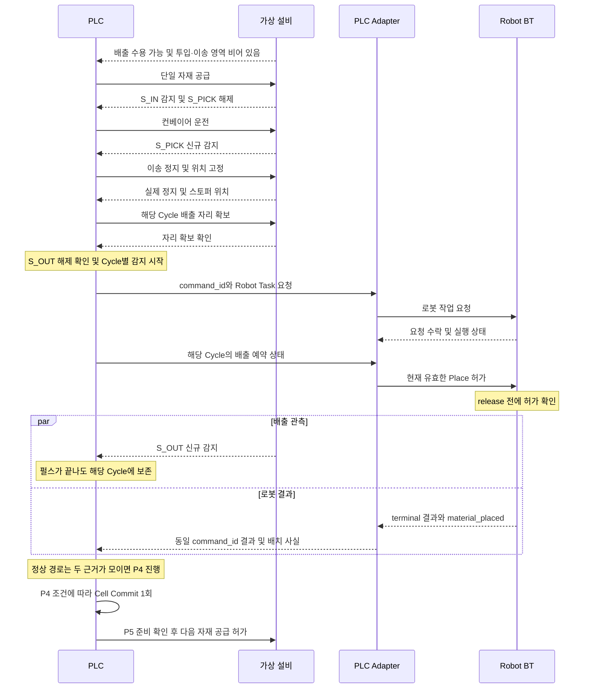

# Conveyor Pick & Place Cell — Cell Control Design (초안)

- **대상 Cell:** `conveyor-pnp-poc`
- **Owner:** Cell 통합 제어 책임자 (선정 필요)
- **상태:** 설계 초안

> PLC와 로봇 BT 사이의 제어 권한·명령·상태 교환을 정의한다. 공정 Step/Gate/Commit 의미는 Cell Process Design을 참조하고, 재사용 가능한 공유 필드 의미 및 내부 실행 시퀀스는 정식 System ICD/FDS가 소유한다.

## 제어 책임과 설비 경계

| 역할·제어 주체 | 판단·명령 권한 | 외부에 제공하는 상태 | 비책임 경계 |
|---|---|---|---|
| **SoftPLC** | 컨베이어·스토퍼 명령, 공급·Pick 허가, Cell 단계 조정, Cell Commit | 준비/이송/위치 확정, 로봇 요청, Cell 완료·보류 | 로봇의 Motion 경로·BT 내부 Retry를 직접 결정하지 않음 |
| **로봇 Orchestration / Task Execution BT** | 수락한 Robot Task 실행, Pick·Place 전략과 내부 복구 | 요청 수락, 작업 중, terminal 결과, 자재 처리 결과 | PLC의 컨베이어 모터·센서 명령을 직접 결정하지 않음 |
| **PLC Adapter** | Modbus TCP와 Robot Task 경계의 변환, 요청 ID 상관, 재연결 동기화 | 링크 상태, 마지막 수락·완료 사실 | Cell Commit을 독자적으로 재판정하지 않음 |
| **Isaac 설비 모델** | PLC 명령에 따른 가상 기구 운동, 배출 자리 확보 및 센서 생성 | 벨트 실제 정지, 스토퍼 위치, 자재 감지, 배출 수용·예약 상태 | PLC 상태·BT 결과를 직접 확정하지 않음 |
| **Robot Backend** | 명목 티칭/계획 경로 실현과 Logical Attach | 로봇 관절·그리퍼 관측 | Cell 공정 완료 확정 아님 |
| **안전 제어계** | 실제 안전 정지·허가의 독립 권한 | 정지·해제/허가 상태 | 일반 PLC/BT가 우회할 수 없음 |

**기존 시스템과의 연결 시 주의:** 현재 공개 ARM Cell의 Gateway는 Delivery/Handoff와 VDA 문맥을, Orchestration은 Mission·PnP 결과와 수량을 별도로 소유한다. 이번 PoC는 이 의미를 임의 변경하거나 가상의 VDA/AMR 상태를 꾸며내지 않는다. PLC의 위치 확정·작업 요청을 기존 계약과 접속할 방법을 구현 전에 검토한다. 기존 범용 기능이 충분하지 않다면 공통 인터페이스 확장을 별도 시스템 설계로 다룬다. Cell Commit과 기존 로봇 PnP 완료 회계는 서로 다른 개념이며 중복 카운팅하지 않는다.

## 단계별 명령·상태와 시퀀스

| 공정 단계 | 명령 주체 → 수행 주체 | 명령 효과 | 상태 출처 → 소비 주체 | 적용 계약 |
|---|---|---|---|---|
| P1 | PLC → Feeder/Conveyor | 단일 자재 투입 허가 | `S_IN` → PLC | Cell Process P1; 장치 I/O 매핑 |
| P2 | PLC → Conveyor/Stopper | 이송 시작·정지·스토퍼 구동 | 이송 전·중 `S_PICK`, Drive Stopped, Stopper Position → PLC | Cell Process P2 |
| P3 | PLC → 배출 설비, PLC → Adapter → Robot Task | 한 자리 확보 후 특정 `command_id`의 PnP 요청. 로봇은 현재 예약에 대한 Place 허가를 release 전에 확인 | 예약 확인·유효 상태 → PLC → 로봇, Accepted/Busy/Terminal 및 배치 사실 → PLC | Cell Process P3 및 [PnP 결과 계약](../../interfaces/icd-orchestration-task-execution.md) |
| P4 | PLC가 관측·결과 소비 | 같은 Cycle의 배출 인수 확정 | terminal 결과·배치 사실 및 P3부터 보존한 `S_OUT` 감지 → PLC | Cell Process P4 및 배치 후 실패 복구 |
| P5 | PLC → Feeder | 다음 자재 공급 허가 | Ready/빈 공간 관측 → PLC | Cell Process P5 |

## 공정 인터록과 안전 인터록

| 구분 | 조건 출처 → 적용 주체 | 영향받는 명령·동작 | 해제/복귀 |
|---|---|---|---|
| 공정 · P1 | 활성 자재·영역 점유·배출 수용 가능 → PLC | 중복 공급 및 배출 Busy 중 새 공급 보류 | P1 시작 조건 재평가 |
| 공정 · P2 | Robot Pick 구역 사용 중 → PLC | 컨베이어 이동·스토퍼 해제 보류 | Robot 영역 작업 종료 후 재평가 |
| 공정 · P3 | P2 확정 상태, Robot Ready, 해당 Cycle의 배출 예약 → PLC | 하나라도 미확정이면 Robot Task 요청 보류 | P3 시작 조건 재평가 |
| 공정 · Place | 배출 설비의 예약 유효 상태 → PLC → 로봇 실행 주체 | 해당 자리의 허가 유실·불명 시 release 보류 | PLC가 같은 자리의 수용을 재확인하고 로봇이 보유 상태와 실행 가능 여부를 확인한 뒤 같은 작업을 계속 |
| 공정 · P4 | 로봇 terminal 결과·배치 사실, Cycle별 출력 감지, 실패 시 복구 상태 → PLC | 증거 누락 또는 복구 미확정 시 Cell Commit 보류 | Cell Process P4 및 복구 조건 확인 |
| 안전 | 실제 안전 제어계 상태 → 권한 있는 제어기 | 허용되지 않는 기구 동작 정지/금지 | 안전 권한자의 허가 후 공정 상태 재확인 |

PLC 상태 대기와 오류는 공정상 영향받는 단계에 국한한다. Safety 정지 해제만으로 업무 Cycle이 자동 완료·재개된다고 추정하지 않는다.

## 통신 단절·중복 명령·상태 재동기화

| 상황 | 필요한 정보 | 처리/다음 명령 조건 |
|---|---|---|
| 요청이 전달됐으나 ACK 없음 | `command_id`, 마지막 요청/로봇 실행 상태 | 먼저 실행 여부 조회. 미확정 상태에서 새 ID로 중복 요청 금지 |
| 같은 ID 재수신 | ID의 범위, 기존 실행 또는 terminal 기록 | Adapter/Robot는 같은 작업을 재실행하지 않고 기존 결과를 반환하도록 계약 |
| 로봇 완료 후 응답 소실 | 같은 ID의 terminal 결과·배치 사실, 보존된 Cycle별 출력 감지와 Commit 여부 | Cell Process P4에 따라 미확정 Cycle만 한 번 확정 |
| PLC/Adapter 재시작 | 마지막 ID·결과·배치 사실, Cycle별 출력 감지·Commit 기록, 설비 예약·로봇 상태 | 해당 단계의 근거를 복원할 수 없으면 보류. 현재 센서 레벨을 과거 감지로 사용하지 않음 |
| 실제 설비 상태 불일치 | 관측의 유효성 및 해당 Cycle과의 연관성 | Cell Process의 재확인 경로 사용, 독립적 재검출이 불가능하면 작업자 확인 |

실행 코드의 영속화 수단·레지스터 표현은 구현 계약에서 결정하되, 재시작·통신 단절 시험이 주장하는 범위에 맞게 해당 단계에 필요한 결과와 관측 증거를 보존하거나 재조회할 수 있어야 한다.

## PLC·Equipment Adapter 구성 참조

| 대상 | 논리 계약과 구현 구성 연결 | 설정 원본 |
|---|---|---|
| SoftPLC ↔ 설비 I/O | Run/Stop 명령과 독립된 실제 벨트 정지 피드백·유효성, 스토퍼 명령·위치, `S_IN`·`S_PICK`·`S_OUT`, 배출 자리 수용·예약 요청 및 확인 | PLC I/O Mapping Configuration |
| SoftPLC ↔ Robot Task | Request ID, Request/Accepted/Busy, 해당 자리의 Place 허가, terminal 결과·배치 사실, 복구 상태·Robot Ready | PLC Adapter Mapping Configuration |
| Isaac 설비 | Asset/Joint, 센서 Prim과 I/O Binding | Cell / Equipment Configuration |
| Robot Task | 정적 Pick/Place 목표, Logical Attach, Task Profile | Robot/Tool/Cell Profiles + Calibration |

Modbus 레지스터 번호, PLC 타이머, 실제 티칭 좌표와 속도는 이 설계서가 아닌 해당 구성의 정식 원본에서 관리한다.

## 구현 선행 확인 사항

1. 기존 ARM Cell Gateway/Orchestration의 외부 수락 계약이 `conveyor-pnp-poc`의 위치 확정 이벤트를 수용하는지 확인한다. 기존 VDA Delivery Phase를 가짜로 발행하는 방식은 피한다.
2. 기존 PnP의 정적 Pick Pose 입력과 release 전 Place 허가·보류를 연결할 경계를 확인한다. 필요한 확장은 해당 System ICD/FDS에서 결정한다.
3. Modbus TCP는 PoC의 프로토콜 선택이다. 다른 PLC 제조사로 변경할 때 공정 계약을 바꾸지 않는 것을 목표로 한다.
4. 고장 주입은 실제 I/O 관측 경계에서 수행한다. `Fault Injector`가 PLC 내부 상태나 Cell Commit을 직접 수정하는 것은 금지한다.
