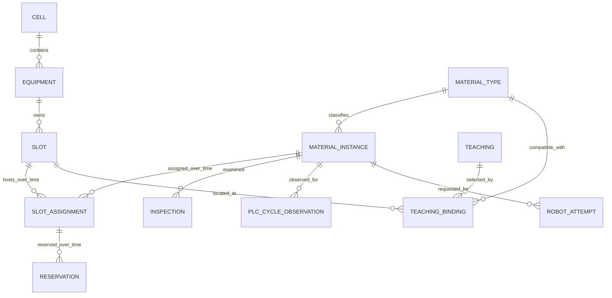

# Conveyor PnP Cell — Cell Data Model Design

- **대상:** `conveyor-pnp-poc`
- **Owner:** Cell Supply(자재·예약), PLC(공정 Commit), Robot Task(실행 결과), 검사 설비(품질 근거)
- **범위:** Cell의 물리 위치, 논리 배정, 자재·예약·실행·검사 이력 및 재시작 정합성

## 데이터 의미와 관계

- `SLOT`은 `conveyor_pnp_cell/CV-01/pick` 및 `conveyor_pnp_cell/TR-01/receive`처럼 자재가 바뀌어도 유지되는 물리 주소다.
- `MATERIAL_INSTANCE`는 한 번 물리적으로 생성된 개체로, `stream_id/plc_material_number`가 식별자다. 생성 시 확정한 `material_type_id`는 예약 epoch 변경으로 바뀌지 않는다.
- `SLOT_ASSIGNMENT`는 현재 슬롯의 논리적 작업 대상이다. 실제 센서 `Physical Occupancy`와 구별하며, 로봇이 자재를 들고 이동하는 동안에도 예약 관계를 보존한다.
- `RESERVATION`은 공급 epoch, 예약 ID, 슬롯 및 자재 ID에 귀속된다. 한 슬롯의 예약 이력은 여럿 가능하나, 동시에 활성 예약은 최대 하나다. `TEACHING_BINDING`은 Pick·Place 슬롯과 호환 품종을 고정 티칭에 연결한다.
- `ROBOT_ATTEMPT`는 PLC 요청과 ROS Action 및 진단 근거를 가리키는 논리 관계다. 하나의 자재에 수락 거부·BUSY 등 복수 요청이 있을 수 있어 `material_number=command_id`로 정의하지 않는다.

현재 PoC는 개체를 한 번에 하나만 공급한다. ER의 여러 이력 관계가 곧 여러 설비의 동시 작업 허용을 뜻하지 않는다.

## 데이터 Authority와 동시 변경

| 데이터 | Canonical Authority | 다른 주체가 제공할 수 있는 것 | 변경 일관성 |
|---|---|---|---|
| 실제 물리 개체·위치 관측 | Isaac Equipment Plugin | 센서 관측, 생성 영수증 | 개체 생성 ID 중복 불가 |
| 공급 논리 배정과 예약 | Conveyor Supply | 예약 명령과 관측 | 동일 슬롯 활성 예약 1개, 개체/품종 불변 |
| 로봇 파지·Release·Task terminal | Robot Task/Tool | 실행과 장치 상태 증거 | Release 후 실패도 원래 결과·배치 사실 보존 |
| 공정 수락·Commit·배출 | CODESYS PLC | 서로 독립적인 Task 결과와 트레이 점유 | PLC 요청 ID별 Commit 한 번 |
| 품질 판정과 측정 증거 | 개별 검사 설비 | `inspection_id`·`station_id`·`verdict`·근거 참조 | 기존 검사 결과 덮어쓰기 불가 |
| 영속 생산 조회용 이력 | Conveyor History Ledger | 위 각 정식 Owner의 확인된 사건 | SQLite 트랜잭션으로 기록 변경 일괄 확정; 제어 권한 없음 |

검사 기록은 `PASS`, `FAIL`, `INCONCLUSIVE` 중 실제 관측 결과만 저장한다. 검사가 없다는 사실은 합격이 아니다. PLC Commit은 검사의 합격 여부를 임의로 추론하지 않는다. 여러 설비는 기존 ROS 경계를 통해 관측을 제출하며 Ledger가 쓰기를 직렬화한다. SQLite는 PLC·Robot·PhysX에 걸친 전역 트랜잭션을 제공하지 않는다.

## 영속성·복원·추적

별도의 SQLite `production.sqlite`는 실제 생성 개체, 공급 Snapshot 및 예약 이력, PLC에서 관측한 Cycle 상태·Commit, 검사 근거와 상태 변화 이력을 보존한다. 요약 수량은 **원장에 실제 식별된 자재와 PLC가 Commit을 보고한 Cycle의 결합**으로만 계산한다. PLC Adapter의 별도 SQLite `receipt`가 가진 `command_id ↔ Mission Goal UUID`는 정식 실행 영수증이며 Ledger가 임의로 재발급하지 않는다.

동일 `stream_id`로 Equipment Sidecar만 재시작하면 이전 Snapshot·epoch·예약을 읽되, 새로 관측한 물리 자재 및 PLC 위치 확정이 일치하기 전에는 작업 예약을 공개하지 않는다. 실제 Stage/PLC 재시작으로 스트림 자체가 바뀌면 이전 이력은 조회 가능하지만 새 자재가 이전 예약을 자동 재사용하지 않는다. 복원된 예약에는 같은 epoch·예약·슬롯·개체·품종의 종료 요청을 적용할 수 있다. Task가 목적지 Release를 확인한 자재는 Pick 재관측 없이 퇴역시키며, 배치 없이 반환한 자재는 실물과 PLC 위치 확정을 대조한 뒤 다시 예약할 수 있다. 기록 복원은 기구 재가동이나 기존 Task 자동 재실행 승인이 아니다.

미해결 예약과 불확실 Task 결과는 명시적으로 보존한다. 기존 Cell Control/Process의 Reconciliation 경계를 사용하며, DB 기록만으로 물리 자재의 현존·트레이 인수·PLC Commit을 정식 확정하지 않는다. 영구 보존·백업, 원격 DB 공유, 자동 무인 Recovery는 추가 검증이 필요한 운영 결정이다.

## 검증 조건

| ID | 관찰 조건 | 기대 결과 |
|---|---|---|
| VR-CD-01 | 중복 생성·동일 자재의 품종 변경 | 기존 개체 보존, 충돌 변경 거부 |
| VR-CD-02 | 예약 생성·반환·Release | 개체·예약·Snapshot이 같은 DB 트랜잭션으로 기록 |
| VR-CD-03 | Sidecar 재시작 | 같은 스트림의 예약·이력 조회, 물리 대조 전 실행 수락 금지 |
| VR-CD-04 | 독립 검사 결과 재입력 | 같은 검사 ID 동일값은 멱등, 다른값은 충돌 |
| VR-CD-05 | PLC 배치 후 실패/Commit | 원래 결과를 유지하고 독립 점유·Commit 관측만 생산 실적에 반영 |
